# 第十章 移动底盘规划基础与Nav2框架

> **本章导读**：第四章我们已经能让 G2 四轮独立转向底盘按给定的 $(v_x,v_y,\omega_z)$ 运动，但"给什么速度"仍然要人来决定。本章回答的正是这个问题：机器人如何根据地图、自身位姿和实时障碍，自己算出一条安全路线并把它变成连续的速度指令。我们从位姿与坐标系、占据栅格和代价地图开始，依次讲解全局路径规划、路径与轨迹优化、局部路径规划、轨迹跟踪、安全监控和恢复机制，最后把这些基础模块映射到 ROS 2 Nav2 的标准工程框架中。
>
> 本章最终要跑通两个案例：一是不调用 Nav2、完全由本章 Python 代码实现的教学导航（`code/code_chapter10_1`），G2 从 $(-3.6,-3.3)$ 出发，绕开三块静态障碍和一个周期移动的障碍物，到达 $(3.6,3.2)$ 并对准 $1.57\ \mathrm{rad}$ 朝向；二是用标准 Nav2 节点完成同一任务（`code/code_chapter10_2`）。本章建立的"地图—规划—控制—恢复"闭环，是后续接入 SLAM、AMCL、真实激光雷达和更复杂任务调度的基础。

## 本章概览

### 本章要解决的问题

设想 G2 停在房间西南角，你在 RViz 里点了一下东北角，希望它自己走过去。房间中央有一块 $1.0\times2.4\ \mathrm{m}$ 的大箱子，西北和东南还各有一块障碍，另外有一个蓝色方块在通道中来回移动。机器人需要知道"墙在哪里、自己有多胖"，需要找到一条绕开箱子的大方向路线，需要在蓝色方块挡路时临时绕行而不左右摇摆，需要把路线变成底盘能执行的速度，还需要在被卡住时停下来重新想办法。本章把这些问题逐层拆开，每一层都给出原理、公式、真实代码和可以手算验证的小案例。

### 学习目标

- **解释**占据栅格、地图分辨率、世界坐标与栅格坐标转换，以及为什么要按"机器人半径 + 安全余量"膨胀障碍物；
- **推导并手算** Dijkstra、A*、加权 A* 在小网格上的扩展顺序，说明 Octile 启发函数与"防斜向穿墙"规则的作用；
- **实现/阅读**视线捷径化、Chaikin 平滑、等距重采样和航向生成四步路径优化，并能手算其中的新点坐标；
- **解释**全局规划与局部规划的分工，手算全向底盘前视跟踪器输出的 $(v_x,v_y,\omega_z)$；
- **描述** Nav2 中 `bt_navigator`、`planner_server`、`controller_server`、`smoother_server`、`behavior_server`、`velocity_smoother` 和两层 Costmap 的职责，读懂 `nav2_params.yaml` 的"服务器 → 插件 → 参数"结构；
- **运行**教学导航与 Nav2 导航两套示例，并用 RViz、`ros2 topic`、`ros2 lifecycle`、`tf2_echo` 观察和**排查**常见故障。

### 前置知识

- 第四章：G2 四轮独立转向底盘的运动学、`G2BaseController` 的速度接口 $(v_x,v_y,\omega_z)$（本章直接复用 `code/code_chapter4`）；
- 前几章的 Isaac Sim 场景加载、ROS 2 话题与 TF 基础概念；
- 数学：二维旋转矩阵、向量长度、`atan2`、指数函数；
- 编程：Python `dataclass`、`heapq` 最小堆、`numpy` 数组索引；了解 YAML 与 ROS 2 Launch 的基本写法。

### 知识地图

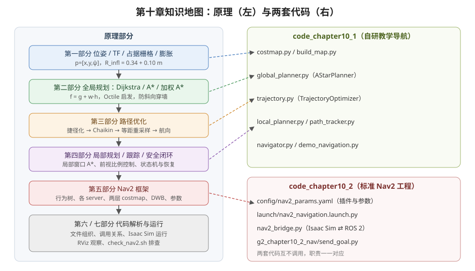

<p align="center"><b>图 10-1</b> 本章知识地图：左侧是按数据流排列的原理部分，右侧是两套代码中实现对应功能的文件</p>

本章的教学代码实际处理顺序不是简单的"全局规划、局部规划、优化、跟踪"，而是：

```text
静态地图与机器人尺寸
        ↓
障碍物膨胀
        ↓
A* 全局路径规划
        ↓
全局路径捷径化、平滑与重采样
        ↓
动态障碍融合与局部路径规划
        ↓
局部绕行路径再次优化
        ↓
全向底盘轨迹跟踪
        ↓
碰撞监控、进度检查和恢复重规划
        ↓
第四章 G2BaseController
        ↓
Isaac Sim 中的四轮转向与驱动关节
```

也就是说，轨迹优化既作用于全局路径，也会作用于局部 A* 生成的绕行路径。这样既符合代码实现，也能完整体现"规划—优化—控制"的层次关系。

### 对应代码

本章包含两套相互衔接、但**互不调用**的代码：

- `code/code_chapter10_1`：不调用 Nav2，从零实现一条便于学习的完整导航链路（A*、路径优化、局部规划、前视跟踪、状态机）；
- `code/code_chapter10_2`：不再重复实现规划算法，而是使用标准 Nav2 节点完成地图管理、全局规划、局部控制、恢复和任务调度，并配置可由行为树调用的路径平滑服务器。

两套代码都复用第四章的 G2 四轮独立转向底盘控制器，机器人模型为 `assets/robot/G2_omnipicker/robot.usda`，仿真环境为 `assets/background/room/room_1/background.usda`。

---

## 第一部分 移动底盘规划基础与完整数据链

### 1.1 移动底盘导航不是一条路径，而是一个闭环系统

**直观理解。** 很多初学者会把移动底盘导航理解为"从起点画一条线到终点"。路径规划确实重要，但仅有一条路径并不能让机器人可靠到达目标——就像开车时手机导航给你画好了路线，你仍然要看路、躲行人、控制油门和方向盘，走错了还要重新规划。

一个完整的移动机器人导航系统至少要持续回答下面几个问题：

1. **机器人在哪里？** 系统需要获得机器人当前位姿，包括位置和朝向。
2. **环境中哪里可以通过？** 系统需要地图、障碍物信息和机器人自身尺寸，不能把机器人当成没有体积的点。
3. **从当前位置到目标的大方向怎么走？** 全局规划器需要在较大范围内找到一条连通、代价较低的路线。
4. **眼前突然出现障碍物时怎么办？** 局部规划器需要结合实时传感器数据，对短距离路径或速度进行调整。
5. **怎样把路径变成底盘速度？** 跟踪控制器要根据机器人当前误差输出 $(v_x,v_y,\omega_z)$，再交给底盘控制器执行。
6. **机器人被卡住或路径失效时怎么办？** 导航器需要停止、重新规划、执行恢复行为，必要时报告失败。

因此，移动底盘导航是一个不断重复的闭环：

```text
读取位姿与传感器
        ↓
更新地图和障碍物
        ↓
计算或更新路径
        ↓
计算速度指令
        ↓
底盘执行运动
        ↓
再次读取新的位姿与传感器
```

本章的两套代码都遵循这一基本闭环。区别在于，`code_chapter10_1` 把关键算法直接写在 Python 模块中，便于观察每一步；`code_chapter10_2` 则把相同职责交给 Nav2 的标准服务器和插件。

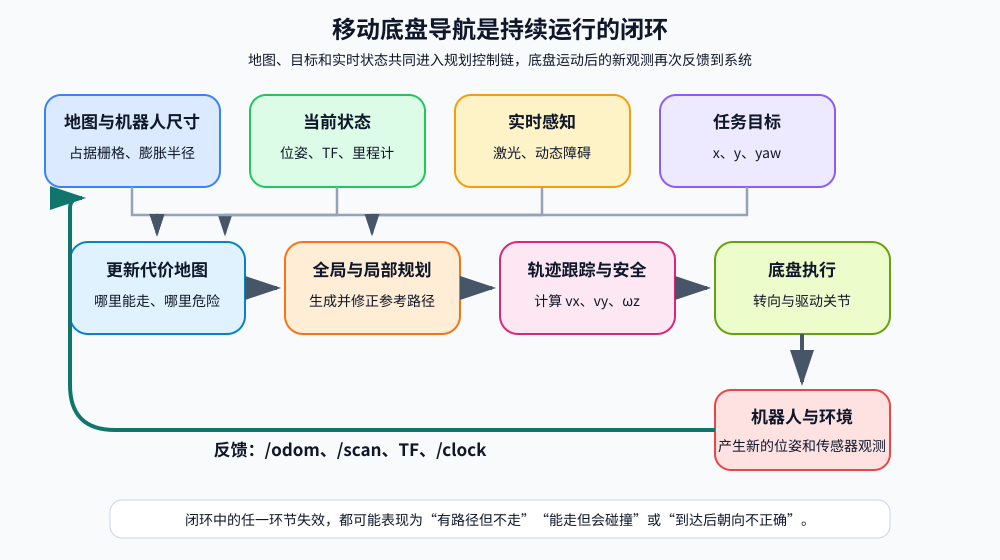

<p align="center"><b>图 10-2</b> 移动底盘导航闭环：地图、位姿、实时感知和任务目标共同进入规划控制链。底盘执行后产生的新里程计、激光和 TF 又反馈给系统，因此导航不是一次性的路径计算，而是持续更新的闭环</p>

**闭环在代码里有多快？** 教学版中 Isaac Sim 物理步长为 $1/120\ \mathrm{s}$（`SimulationConfig.physics_hz = 120`），导航器每 6 个物理步（`120 // 20`，即 $20\ \mathrm{Hz}$）调用一次 `navigator.update()`；局部路径每 $0.40\ \mathrm{s}$ 才重算一次；全局路径只在收到目标或恢复时重算。不同层以不同频率运转，是导航系统的常态：越靠近执行端越快，越靠近"思考"端越慢。

> 💡 **要点**：判断一个导航系统是否"完整"，不是看它有没有路径规划算法，而是看上面 6 个问题是否都有对应模块回答，并且信息能闭环流动。

### 1.2 位姿、目标、路径和轨迹

**原理与公式。** 平面导航中的机器人位姿写成：

$$
\mathbf{p}=[x,\ y,\ \psi]^{T}
$$

其中：

- $x$、 $y$ 是机器人在平面中的位置，单位为米；
- $\psi$ 是航向角 `yaw`，单位为弧度；
- 本章统一采用右手坐标系，逆时针旋转为正方向。

导航目标同样是一个二维位姿：

$$
\mathbf{p}_{g}=[x_g,\ y_g,\ \psi_g]^{T}
$$

这意味着"到达目标"通常包含两层要求：

- 机器人位置接近 $(x_g,y_g)$；
- 机器人最终朝向接近 $\psi_g$。

路径和轨迹容易混淆，可以先用一个直观区分：

- **路径（Path）**主要回答"经过哪些位置"；
- **轨迹（Trajectory）**还关心"以什么方向、速度和时间规律经过这些位置"。

本章教学代码中的 `Pose2D` 路径点包含 $(x,y,yaw)$，路径优化器会为各点补充航向，但没有为每个点预先规定绝对到达时间。因此它更接近一条带航向的几何参考轨迹。真正的速度随时间变化由轨迹跟踪器在线计算。

**对应代码。** 所有算法共用的几何类型都定义在 `code/code_chapter10_1/geometry.py`，它不依赖 Isaac Sim 或 ROS 2，便于单独测试：

```python
# 摘自 code/code_chapter10_1/geometry.py
# 坐标约定：x 向前、y 向左、yaw 逆时针为正。
@dataclass
class Pose2D:
    x: float = 0.0
    y: float = 0.0
    yaw: float = 0.0          # 弧度

@dataclass
class Velocity2D:
    vx: float = 0.0           # base_link 前向速度 m/s
    vy: float = 0.0           # base_link 左向速度 m/s
    wz: float = 0.0           # 绕 z 轴角速度 rad/s

def normalize_angle(angle: float) -> float:
    # 把任意角度折回 [-π, π)，即公式中的 wrap()
    return (angle + math.pi) % (2.0 * math.pi) - math.pi
```

导航链路中各层的输入输出可以概括为：

| 层级 | 主要输入 | 主要输出 | 作用范围 |
|---|---|---|---|
| 地图与代价地图 | 静态障碍、传感器、机器人尺寸 | 可通行区域和碰撞代价 | 全局或局部 |
| 全局规划 | 当前位姿、目标位姿、全局代价地图 | 从起点到终点的全局路径 | 整张地图 |
| 路径优化 | 栅格折线路径、碰撞约束 | 更短、更平滑、间距更均匀的路径 | 整条路径或局部绕行段 |
| 局部规划 | 当前位姿、全局参考线、动态障碍 | 当前附近的一小段安全路径 | 滚动窗口 |
| 轨迹跟踪 | 当前位姿、局部路径、最终目标 | $(v_x,v_y,\omega_z)$ | 当前控制周期 |
| 底盘控制 | 底盘速度指令 | 各转向关节与驱动关节目标 | 机器人关节 |

**案例：角度归一化。** 为什么需要 `normalize_angle`？假设目标朝向 $\psi_d=3.0\ \mathrm{rad}$，当前朝向 $\psi=-3.0\ \mathrm{rad}$。直接相减得 $6.0\ \mathrm{rad}$，控制器会逆时针转将近一整圈；而两者实际只差 $2\pi-6.0\approx0.283\ \mathrm{rad}$。代入代码： $(6.0+\pi)\bmod 2\pi-\pi = 9.1416 - 6.2832 - 3.1416 \approx -0.283\ \mathrm{rad}$，即顺时针转 $0.283\ \mathrm{rad}$ 就够了。

> ⚠️ **注意**：凡是"两个角度相减"的地方都必须归一化，否则机器人在 $\pm\pi$ 附近会突然原地转一大圈。

### 1.3 坐标系与 TF 树

**直观理解。** 导航系统中的位姿、地图、激光和速度不能随意混用，必须明确它们所在的坐标系。就像"往左走两步"必须说清是谁的左边——地图的左边还是机器人的左边。

本章两套示例使用相同的 TF 主链：

```text
map -> odom -> base_link -> base_scan
```

各坐标系含义如下：

| 坐标系 | 含义 | 是否随机器人运动 |
|---|---|---|
| `map` | 全局地图坐标系，目标点和全局路径所在坐标系 | 否 |
| `odom` | 里程计坐标系，用于表达连续的短期运动 | 否 |
| `base_link` | 机器人底盘坐标系 | 是 |
| `base_scan` | 激光雷达坐标系 | 是 |

在真实机器人中，轮式里程计会累积漂移，因此 `map -> odom` 通常由 SLAM 或 AMCL（Adaptive Monte Carlo Localization，自适应蒙特卡洛定位）定位系统动态估计；`odom -> base_link` 由轮式里程计、视觉里程计或状态估计器发布。

本章为了把重点放在规划与控制上，直接使用 Isaac Sim 仿真真值作为里程计，并发布恒等的 `map -> odom`。因此在当前示例中，`map` 和 `odom` 的原点与方向重合。这是一种教学简化，不能直接等同于真实机器人定位方案。

`base_link -> base_scan` 是固定外参，表示雷达相对底盘的安装位置。代码中雷达位于底盘上方约 `0.30 m`。

**世界系到底盘系的速度变换。** 速度指令 $(v_x,v_y,\omega_z)$ 使用机器人自身的 `base_link` 坐标系：

- $v_x>0$：沿机器人前方移动；
- $v_y>0$：沿机器人左侧横移；
- $\omega_z>0$：逆时针旋转。

这与第四章 G2 全向底盘控制接口一致。路径点在 `map` 中，速度却在 `base_link` 中，两者之间靠一个二维旋转连接：

$$
\begin{bmatrix}\Delta x_b\\ \Delta y_b\end{bmatrix}
=\begin{bmatrix}\cos\psi & \sin\psi\\ -\sin\psi & \cos\psi\end{bmatrix}
\begin{bmatrix}\Delta x_w\\ \Delta y_w\end{bmatrix}
$$

其中 $(\Delta x_w,\Delta y_w)$ 是世界系中的位移（米）， $(\Delta x_b,\Delta y_b)$ 是同一位移在机器人自身坐标系中的表达， $\psi$ 是机器人当前航向。

```python
# 摘自 code/code_chapter10_1/geometry.py
def world_to_body(dx: float, dy: float, yaw: float) -> tuple[float, float]:
    cosine = math.cos(yaw)
    sine = math.sin(yaw)
    # 第一行：Δx_b = cosψ·Δx_w + sinψ·Δy_w
    # 第二行：Δy_b = -sinψ·Δx_w + cosψ·Δy_w
    return cosine * dx + sine * dy, -sine * dx + cosine * dy
```

**案例。** 机器人朝向 $\psi=\pi/2$（面朝地图 $+y$），目标点在世界系中相对它 $(\Delta x_w,\Delta y_w)=(0.5,0.3)$。代入： $\Delta x_b=0\cdot0.5+1\cdot0.3=0.3$， $\Delta y_b=-1\cdot0.5+0\cdot0.3=-0.5$。即目标在机器人"前方 0.3 m、右侧 0.5 m"。画图验证：机器人面朝北，东边 $0.5\ \mathrm{m}$ 恰好是它的右手边。

> ⚠️ **注意**：`map -> odom` 恒等是本章的教学假设。迁移到真机时如果忘记接入定位，`map` 中的目标会随里程计漂移一起偏掉，表现为"路径看起来对，但机器人总停在目标旁边"。

### 1.4 占据栅格与地图分辨率

**直观理解。** 占据栅格（Occupancy Grid）就是把地面切成一张"方格纸"，每个格子只记一件事：这里能不能走。

本章使用二维占据栅格表达环境。每个栅格保存一个离散状态：

- `0`：空闲；
- `100`：占用；
- `-1`：未知。

地图分辨率为 `0.05 m`，表示每个栅格边长为 `5 cm`。地图范围为：

```text
x: [-4.75, 4.75]
y: [-4.75, 4.75]
```

因此地图宽、高都约为：

$$
N=\frac{4.75-(-4.75)}{0.05}=190
$$

即一张约 `190 × 190` 的栅格地图。

**原理与公式。** 世界坐标 $(x,y)$ 转为栅格行列时，使用：

$$
\mathrm{column}=\left\lfloor\frac{x-x_0}{r}\right\rfloor
$$

$$
\mathrm{row}=\left\lfloor\frac{y-y_0}{r}\right\rfloor
$$

其中 $(x_0,y_0)$ 是地图原点（左下角，单位米）， $r$ 是分辨率（米/格）。反过来，栅格 $(\mathrm{row},\mathrm{column})$ 的中心世界坐标为：

$$
x=x_0+(\mathrm{column}+0.5)\,r,\qquad y=y_0+(\mathrm{row}+0.5)\,r
$$

**对应代码。**

```python
# 摘自 code/code_chapter10_1/costmap.py
@dataclass
class OccupancyGrid2D:
    """ROS 地图约定的二维栅格：0 空闲，100 占用，-1 未知。"""
    data: np.ndarray        # 形状 (height, width)，data[row, column]
    resolution: float
    origin_x: float
    origin_y: float

    def world_to_grid(self, x: float, y: float) -> tuple[int, int]:
        column = int(math.floor((x - self.origin_x) / self.resolution))
        row = int(math.floor((y - self.origin_y) / self.resolution))
        return row, column              # 注意返回顺序是 (row, column)

    def grid_to_world(self, row: int, column: int) -> tuple[float, float]:
        return (
            self.origin_x + (column + 0.5) * self.resolution,   # 取栅格中心
            self.origin_y + (row + 0.5) * self.resolution,
        )

    def is_occupied_cell(self, row, column, unknown_is_occupied=True) -> bool:
        if not self.contains_cell(row, column):
            return True                  # 地图外一律视为障碍
        value = int(self.data[row, column])
        return value >= 50 or (unknown_is_occupied and value < 0)
```

代码解读：

- `world_to_grid` 先算列（x 方向）再算行（y 方向），但返回 `(row, column)`，与 `numpy` 的 `data[row, column]` 索引顺序一致；
- `is_occupied_cell` 用 `>= 50` 判断占用，并默认把未知（`-1`）也当成障碍，地图边界之外同样视为障碍，这是一种"宁可保守"的设计；
- 地图由 `build_map.py` 生成：先把四周 `wall_thickness = 0.12 m`（向上取整为 3 格）的边框置为 100，再把 `config.py` 中 `STATIC_OBSTACLES` 的三块矩形写入。

```python
# 摘自 code/code_chapter10_1/build_map.py
def build_navigation_map(config: MapConfig | None = None) -> OccupancyGrid2D:
    config = config or MapConfig()
    width = int(math.ceil((config.max_x - config.min_x) / config.resolution))
    height = int(math.ceil((config.max_y - config.min_y) / config.resolution))
    grid = OccupancyGrid2D(np.zeros((height, width), dtype=np.int8),
                           config.resolution, config.min_x, config.min_y)
    thickness = max(1, int(math.ceil(config.wall_thickness / config.resolution)))
    grid.data[:thickness, :] = 100      # 下边墙
    grid.data[-thickness:, :] = 100     # 上边墙
    grid.data[:, :thickness] = 100      # 左边墙
    grid.data[:, -thickness:] = 100     # 右边墙
    for obstacle in STATIC_OBSTACLES:   # center_block / northwest_block / southeast_block
        grid.set_rectangle(obstacle.center_x, obstacle.center_y,
                           obstacle.size_x, obstacle.size_y)
    return grid
```

三块静态障碍定义在 `code/code_chapter10_1/config.py`，栅格地图和 Isaac Sim 场景中的方块使用同一份定义，保证"地图里画的"和"仿真里摆的"完全一致：

| 名称 | 中心 $(x,y)$ / m | 尺寸 $x\times y$ / m |
|---|---|---|
| `center_block` | $(0.0,\ 0.0)$ | $1.0\times2.4$ |
| `northwest_block` | $(-2.2,\ 1.9)$ | $0.9\times1.4$ |
| `southeast_block` | $(2.1,\ -1.8)$ | $1.3\times0.8$ |

**案例：起点和终点落在哪个格子？** 默认起点 $(-3.6,-3.3)$：

$$
\mathrm{column}=\left\lfloor\frac{-3.6+4.75}{0.05}\right\rfloor=\left\lfloor\frac{1.15}{0.05}\right\rfloor
$$

数学上 $1.15/0.05=23$，但 $-3.6+4.75$ 在浮点数中略小于 $1.15$，商约为 $22.9999\ldots$，`floor` 得到 $22$； $\mathrm{row}=\lfloor 1.45/0.05\rfloor=\lfloor 29.0\rfloor=29$。实际运行 `world_to_grid(-3.6, -3.3)` 得到 `(29, 22)`，该格中心为 $(-3.625,-3.275)$。同理目标 $(3.6,3.2)$ 落在 `(159, 166)`。

> ⚠️ **注意**：恰好落在栅格边界上的坐标会受浮点误差影响落到相邻格。这不影响导航（误差小于半格 $2.5\ \mathrm{cm}$），但写单元测试时不要断言边界点一定落在某一格。

> 💡 **要点**：分辨率是"精度—计算量"的权衡。分辨率减半（ $0.025\ \mathrm{m}$），格子数变为 4 倍（ $380\times380$），A* 要搜索的节点也大约变为 4 倍。

### 1.5 障碍物膨胀与配置空间

**直观理解。** 规划时不能只判断机器人中心是否碰到障碍。G2 底盘具有实际宽度，如果把它当成一个没有体积的点，路径可能从距离墙面只有几厘米的位置经过，机器人真实外轮廓仍会碰撞。

常见处理方法是把障碍物向外"吹胖"，再把机器人中心当作规划点——这在规划理论中叫配置空间（Configuration Space，C-space）：机器人缩成一个点，障碍物相应膨胀一个机器人半径。教学代码使用圆形近似：

$$
R_{\mathrm{inflation}}=R_{\mathrm{robot}}+R_{\mathrm{margin}}
$$

当前参数为：

$$
R_{\mathrm{inflation}}=0.34+0.10=0.44\ \mathrm{m}
$$

其中：

- `robot_radius = 0.34 m`：机器人外接圆半径；
- `safety_margin = 0.10 m`：额外安全距离；
- `inflation_radius = 0.44 m`：规划使用的总膨胀半径。

膨胀半径越大，路径离障碍越远，但狭窄通道可能被完全封闭；膨胀半径越小，可通行区域增多，但碰撞风险上升。因此机器人尺寸必须来自真实模型或可靠测量，不能只凭视觉随意设置。

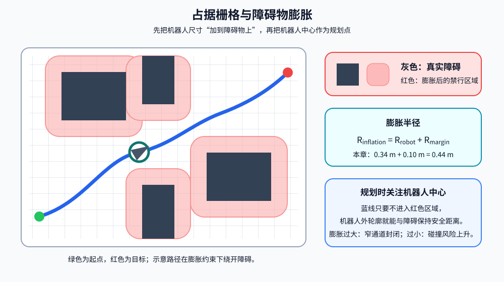

<p align="center"><b>图 10-3</b> 占据栅格与障碍物膨胀：灰色区域表示真实障碍，红色区域表示按机器人半径和安全余量膨胀后的禁行区域。规划器只需约束机器人中心不进入红色区域，就能为真实底盘外轮廓保留安全距离</p>

**对应代码。** 膨胀半径由配置类自动计算，避免手工改错：

```python
# 摘自 code/code_chapter10_1/config.py
@dataclass(frozen=True)
class MapConfig:
    resolution: float = 0.05
    min_x: float = -4.75
    min_y: float = -4.75
    max_x: float = 4.75
    max_y: float = 4.75
    wall_thickness: float = 0.12
    robot_radius: float = 0.34
    safety_margin: float = 0.10
    unknown_is_occupied: bool = True

    @property
    def inflation_radius(self) -> float:
        return self.robot_radius + self.safety_margin
```

膨胀算法本身是"圆形模板平移"：先预计算所有满足 $\sqrt{d_r^2+d_c^2}\cdot r\le R$ 的偏移量 $(d_r,d_c)$，再把每个原始占用格按这些偏移量整体平移并标记为 100：

```python
# 摘自 code/code_chapter10_1/costmap.py
def inflated(self, radius: float) -> "OccupancyGrid2D":
    """按机器人外接圆膨胀障碍物，配置空间中机器人可视为一个点。"""
    if radius <= 0.0:
        return self.copy()
    occupied = self.data >= 50
    result = self.copy()
    cells = int(math.ceil(radius / self.resolution))      # 模板半边长（格）
    offsets = [
        (dr, dc)
        for dr in range(-cells, cells + 1)
        for dc in range(-cells, cells + 1)
        if math.hypot(dr, dc) * self.resolution <= radius  # 圆形模板
    ]
    rows, columns = np.nonzero(occupied)                   # 所有原始障碍格
    for dr, dc in offsets:
        shifted_rows = rows + dr
        shifted_columns = columns + dc
        valid = ((shifted_rows >= 0) & (shifted_rows < self.height)
                 & (shifted_columns >= 0) & (shifted_columns < self.width))
        result.data[shifted_rows[valid], shifted_columns[valid]] = 100
    return result
```

代码解读：

- 循环次数等于模板偏移量个数，而不是障碍格个数；每次平移用 `numpy` 一次性处理全部障碍格，因此即使地图有几千个障碍格也很快；
- 判据用的是"格心距离 $\le R$"，膨胀后的边界是阶梯状的圆，最大误差约半格。

**案例：手算一个最小膨胀。** 为了能在纸上画出来，取分辨率 $r=0.1\ \mathrm{m}$、膨胀半径 $R=0.15\ \mathrm{m}$，地图中只有中心一个障碍格：

1. 模板半边长 `cells = ceil(0.15/0.1) = ceil(1.5) = 2`，候选偏移 $d_r,d_c\in\{-2,\dots,2\}$，共 25 个；
2. 判据 $\sqrt{d_r^2+d_c^2}\times0.1\le0.15$，即 $\sqrt{d_r^2+d_c^2}\le1.5$；
3. $(0,0)$ 距离 0， $(\pm1,0)$、 $(0,\pm1)$ 距离 1， $(\pm1,\pm1)$ 距离 $1.414$，都满足； $(\pm2,0)$ 距离 2，不满足；
4. 最终通过的偏移恰好是 $3\times3=9$ 个，膨胀后中心周围一圈全部变为占用。

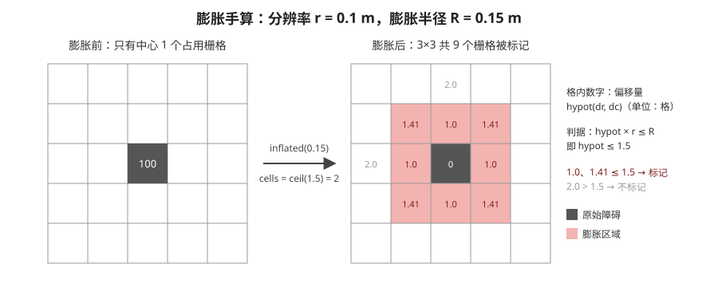

<p align="center"><b>图 10-4</b> 膨胀手算：分辨率 0.1 m、半径 0.15 m 时，单个障碍格膨胀为 3×3 区域；格内数字是偏移量的格心距离</p>

对本章真实参数： $R=0.44\ \mathrm{m}$ 时 `cells = ceil(8.8) = 9`，满足条件的偏移共 241 个； $R=0.34\ \mathrm{m}$ 时 `cells = 7`，偏移共 145 个。可以用下面几行代码自行验证：

```python
import math
for R in (0.44, 0.34):
    cells = math.ceil(R / 0.05)
    n = sum(1 for a in range(-cells, cells + 1) for b in range(-cells, cells + 1)
            if math.hypot(a, b) * 0.05 <= R)
    print(R, cells, n)     # 0.44 9 241 / 0.34 7 145
```

**两张膨胀地图。** 教学代码区分了两张地图：

- **规划地图**按 `0.44 m` 膨胀，用于生成具有安全余量的路径；
- **短时碰撞检查地图**按 `0.34 m` 膨胀，用于判断机器人外轮廓是否即将碰到静态障碍。

```python
# 摘自 code/code_chapter10_1/demo_navigation.py
raw_map = build_navigation_map(map_config)
planning_map = raw_map.inflated(map_config.inflation_radius)   # 0.44 m
# ...
navigator = TeachingNavigator(
    planning_map, planner, optimizer, local_planner, tracker,
    # ...
    safety_costmap=raw_map.inflated(map_config.robot_radius),  # 0.34 m
)
```

这种设计让规划器主动远离墙面，同时避免最后一道急停保护过于敏感：如果急停也按 $0.44\ \mathrm{m}$ 判断，机器人只要被局部绕行推到离墙 $0.40\ \mathrm{m}$ 的位置就会频繁急停，尽管它实际还有 $6\ \mathrm{cm}$ 余量。

**案例：通道还能不能过？** 两块障碍之间有一条宽 $W$ 的通道。膨胀后两侧各吃掉 $0.44\ \mathrm{m}$，剩余可行宽度为 $W-2\times0.44$。只有 $W>0.88\ \mathrm{m}$（再加上约一格的离散误差）时规划器才认为可通行。如果把 `safety_margin` 从 $0.10$ 增大到 $0.20$，门槛变为 $1.08\ \mathrm{m}$，原先 $1.0\ \mathrm{m}$ 宽的通道就会被"堵死"，A* 会选择绕远路或直接报告失败。

> ⚠️ **注意**：遇到"明明有路却规划失败"，第一步应检查膨胀半径与通道宽度的关系，而不是去调 A* 或控制器参数。

> 💡 **要点**：圆形近似对接近正方形的底盘足够好；对长条形底盘，外接圆会过度保守，此时 Nav2 支持用 `footprint` 多边形代替 `robot_radius`（本章未使用）。

---


## 第二部分 全局路径规划：从 Dijkstra 到 A*

### 2.1 全局规划解决什么问题

**直观理解。** 全局规划器面向整张地图工作。它接收机器人当前位姿和最终目标，在静态地图或全局代价地图上寻找一条连通路径。

全局规划负责决定"从障碍物左边走还是右边走""通过哪一条走廊到达目标"等大尺度问题，但通常不负责直接输出车轮控制量，也不会在每个物理仿真步都重新搜索整张地图。

把占据栅格看成一张图（Graph）：每个空闲栅格是一个节点，相邻空闲栅格之间有一条边，边上的权重是移动代价。全局规划就变成了经典的**图上最短路径**问题。

| 概念 | 在栅格地图中的含义 |
|---|---|
| 节点 $n$ | 一个空闲栅格 $(\mathrm{row},\mathrm{column})$ |
| 边 | 当前栅格到四邻域或八邻域中可通行栅格的移动 |
| 边权 | 直线移动 1，对角移动 $\sqrt{2}$（单位：格） |
| 路径代价 | 沿路径所有边权之和，乘以分辨率即为米 |

### 2.2 Dijkstra、A* 与加权 A*：同一个框架的三种取值

**直观理解。** 三种算法都维护一个"待探索的边界"，每次从边界上取出"最有希望"的节点向外扩展。区别只在于"最有希望"怎么定义：

- **Dijkstra**：只看已经走了多远 $g(n)$，像水波一样从起点均匀向四周扩散；
- **A\***：看"已走 + 估计还要走" $g(n)+h(n)$，波前会朝目标方向偏；
- **加权 A\***：把估计值放大， $g(n)+w_h h(n)$（ $w_h>1$），更急切地冲向目标。

**原理与公式。** 本章教学代码使用 A* 算法。A* 可以理解为同时考虑两类代价：

- 已经走过的累计代价 $g(n)$；
- 从当前节点到目标的估计代价 $h(n)$。

节点优先级为：

$$
f(n)=g(n)+w_h h(n)
$$

其中 $w_h$ 是启发函数权重，本章默认 `heuristic_weight = 1.0`。取 $h\equiv0$ 时退化为 Dijkstra。

当 $w_h=1$ 且启发函数不高估真实代价（称为**可采纳**，admissible）时，A* 能在离散图上找到最优路径。增大权重通常会让搜索更偏向目标、扩展节点更少，但可能牺牲最优性：加权 A* 找到的路径代价最多是最优值的 $w_h$ 倍。

| 算法 | 优先级 | 是否最优 | 扩展节点数 | 本章中的位置 |
|---|---|---|---|---|
| Dijkstra | $g(n)$ | 是 | 最多 | NavFn 在 `use_astar: false` 时的默认方式 |
| A* | $g(n)+h(n)$ | 是（ $h$ 可采纳） | 较少 | 教学版 `AStarPlanner`；NavFn `use_astar: true` |
| 加权 A* | $g(n)+w_h h(n)$ | 不保证 | 通常更少 | 教学版把 `heuristic_weight` 改大即可 |

### 2.3 八邻域、Octile 启发函数与防斜向穿墙

**四邻域与八邻域。** 栅格地图上最简单的移动方式是四邻域：上、下、左、右。四邻域每一步代价为 `1`。为了让路径能够斜向移动，本章默认启用八邻域，再加入四个对角方向，对角移动代价为 $\sqrt{2}$。

**Octile 启发函数。** 八邻域适合使用 Octile Distance 作为启发函数：

$$
h(n)=\max(\Delta x,\Delta y)+(\sqrt{2}-1)\min(\Delta x,\Delta y)
$$

其中 $\Delta x$、 $\Delta y$ 是当前栅格与目标栅格在列、行方向上的差的绝对值（单位：格）。它可以看成：先尽量沿对角线同时缩小横纵距离（走 $\min$ 步，每步 $\sqrt2$），剩余部分再沿直线移动（走 $\max-\min$ 步，每步 1），合起来就是 $\sqrt2\min+(\max-\min)$，整理后即上式。在没有障碍时它恰好等于真实最短代价，有障碍时只会更小，因此是可采纳的。

**防斜向穿墙（corner cutting）。** 八邻域存在一个常见错误：机器人可能从两个相邻障碍栅格的角点之间斜穿过去。数学上两个栅格中心之间有一条对角线，真实机器人却没有足够空间通过。

因此教学代码规定：当候选移动同时改变行和列时，对角线两侧的两个正交栅格也必须为空闲。只有三个相关位置都可通行，才允许对角移动。这一步通常称为防止 `corner cutting`。

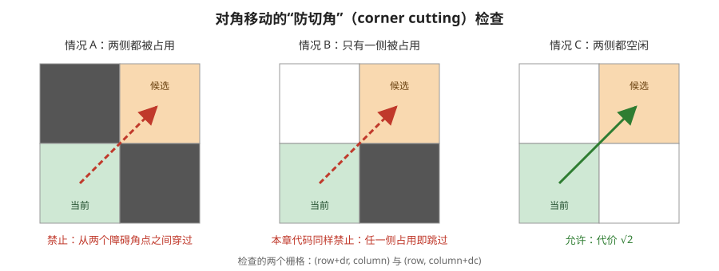

<p align="center"><b>图 10-5</b> 对角移动的防切角检查：只要对角线两侧的任一正交栅格被占用，本章代码就禁止该对角移动</p>

**对应代码。**

```python
# 摘自 code/code_chapter10_1/global_planner.py
def _neighbors(self, cell, bounds):
    row, column = cell
    moves = [(1, 0, 1.0), (-1, 0, 1.0), (0, 1, 1.0), (0, -1, 1.0)]   # 四邻域，代价 1
    if self.allow_diagonal:
        diagonal = math.sqrt(2.0)
        moves += [(1, 1, diagonal), (1, -1, diagonal),
                  (-1, 1, diagonal), (-1, -1, diagonal)]             # 对角，代价 √2
    for dr, dc, cost in moves:
        next_cell = row + dr, column + dc
        if not self._cell_allowed(next_cell, bounds):                # 目标格必须空闲且在窗口内
            continue
        # 对角运动时两侧正交栅格也必须空闲，避免从障碍角点"穿墙"。
        if dr and dc:
            if self.costmap.is_occupied_cell(row + dr, column):
                continue
            if self.costmap.is_occupied_cell(row, column + dc):
                continue
        yield next_cell, cost

@staticmethod
def _heuristic(a, b):
    dx, dy = abs(a[1] - b[1]), abs(a[0] - b[0])     # 列差、行差
    # Octile distance：适合 8 邻域移动。
    return max(dx, dy) + (math.sqrt(2.0) - 1.0) * min(dx, dy)
```

> 💡 **要点**：防切角规则与障碍膨胀是两道独立的防线。膨胀保证"格子本身"离障碍够远；防切角保证"格子之间的连线"不会擦过障碍角点。

### 2.4 A* 主循环：开放列表、关闭集合与父节点回溯

A* 搜索中维护三类关键数据：

| 数据 | 作用 | 代码中的变量 |
|---|---|---|
| 开放列表 | 保存已经发现、但尚未正式扩展的候选节点 | `open_heap`（最小堆） |
| 关闭集合 | 保存已经扩展过的节点，避免重复处理 | `closed` |
| 父节点表 | 记录每个节点从哪里到达，用于终点回溯 | `came_from` |

此外还有 `g_cost` 字典记录每个节点当前已知的最小累计代价。当目标节点从开放列表中取出后，算法沿父节点不断回溯到起点，再把顺序反转，得到起点到终点的栅格路径。

```python
# 摘自 code/code_chapter10_1/global_planner.py（AStarPlanner.plan）
start_cell = self._nearest_free(self.costmap.world_to_grid(start.x, start.y), bounds)
goal_cell = self._nearest_free(self.costmap.world_to_grid(goal.x, goal.y), bounds)
if start_cell is None:
    raise PlanningError("起点附近没有可通行栅格")
if goal_cell is None:
    raise PlanningError("终点附近没有可通行栅格")

open_heap = []
counter = 0
heapq.heappush(open_heap, (0.0, counter, start_cell))   # (f, 插入序号, 节点)
came_from = {}
g_cost = {start_cell: 0.0}
closed = set()
expanded = 0

while open_heap:
    _, _, current = heapq.heappop(open_heap)            # 取 f 最小者
    if current in closed:                               # 堆里的过期副本，跳过
        continue
    if current == goal_cell:                            # 终点出堆才算找到
        cells = self._reconstruct(came_from, current)
        path = [Pose2D(*self.costmap.grid_to_world(row, column)) for row, column in cells]
        path[0] = Pose2D(start.x, start.y, start.yaw)   # 首尾换成精确位姿
        path[-1] = Pose2D(goal.x, goal.y, goal.yaw)
        return PlanResult(path, expanded, g_cost[current] * self.costmap.resolution)

    closed.add(current)
    expanded += 1
    for neighbor, step_cost in self._neighbors(current, bounds):
        if neighbor in closed:
            continue
        tentative = g_cost[current] + step_cost          # 经 current 到 neighbor 的 g
        if tentative >= g_cost.get(neighbor, math.inf):  # 不比已知更好则放弃
            continue
        came_from[neighbor] = current
        g_cost[neighbor] = tentative
        counter += 1
        priority = tentative + self.heuristic_weight * self._heuristic(neighbor, goal_cell)
        heapq.heappush(open_heap, (priority, counter, neighbor))

raise PlanningError("A* 未找到从起点到终点的可行路径")
```

代码解读：

- 堆元素是三元组 `(f, counter, cell)`。`counter` 是单调递增的插入序号，当两个节点 $f$ 相同时先插入的先出堆，保证结果确定且不会去比较 `cell`；
- `heapq` 不支持"降低某个元素的优先级"，所以发现更短的 $g$ 时直接再压入一份新副本，旧副本出堆时被 `if current in closed` 过滤——这叫"惰性删除"；
- 终点**出堆**时才返回，而不是第一次被发现时返回，这是保证最优性的关键；
- `PlanResult.path_cost` 把以"格"为单位的 $g$ 乘以分辨率换算成米，`expanded_nodes` 会被导航器打印为"全局规划完成：扩展 N 个栅格"；
- 回溯函数 `_reconstruct` 沿 `came_from` 从终点一路找父节点，最后 `reverse()`。

**起终点落在障碍里怎么办？** 如果用户给出的起点或终点恰好落在占用栅格中（例如膨胀后机器人本身就"压"在红区里），教学代码会在周围搜索最近的自由栅格，最大搜索半径为 `20` 个栅格。以 `0.05 m` 分辨率计算，对应最大约 `1.0 m` 的搜索范围。如果附近仍没有自由位置，则规划失败并给出明确错误。

```python
# 摘自 code/code_chapter10_1/global_planner.py
def _nearest_free(self, requested, bounds, max_radius_cells: int = 20):
    if self._cell_allowed(requested, bounds):
        return requested
    row, column = requested
    for radius in range(1, max_radius_cells + 1):     # 一圈一圈向外找
        candidates = []
        for dr in range(-radius, radius + 1):         # 正方形环的左右两条边
            candidates.append((row + dr, column - radius))
            candidates.append((row + dr, column + radius))
        for dc in range(-radius + 1, radius):         # 上下两条边
            candidates.append((row - radius, column + dc))
            candidates.append((row + radius, column + dc))
        valid = [cell for cell in candidates if self._cell_allowed(cell, bounds)]
        if valid:                                     # 同一圈里取欧氏距离最近的
            return min(valid, key=lambda cell: (cell[0] - row) ** 2 + (cell[1] - column) ** 2)
    return None
```

### 2.5 手算案例：5×5 小网格上的 A* 与 Dijkstra

为了真正看懂扩展过程，我们在一张 $5\times5$ 的小网格上手算。设分辨率为 $1\ \mathrm{m}$（这样代价直接以格计），坐标写成 $(\mathrm{row},\mathrm{column})$：

- 起点 $S=(1,0)$，终点 $G=(3,4)$；
- 障碍： $(1,2)$、 $(2,2)$、 $(3,2)$，是一道竖墙，只在 $\mathrm{row}=0$ 与 $\mathrm{row}=4$ 两端留有缺口；
- 启用八邻域与防切角， $w_h=1$。

**第 0 步：初始化。** $h(S)$： $\Delta x=|0-4|=4$， $\Delta y=|1-3|=2$， $h=4+0.414\times2=4.828$。开放列表 $\{S: f=0\}$（起点压堆时优先级写的是 $0$，不影响结果）。

**第 1 步：扩展 $S=(1,0)$。** 按代码中 `moves` 的顺序检查邻居：

| 邻居 | 移动 | $g$ | $h$ | $f=g+h$ |
|---|---|---:|---:|---:|
| $(2,0)$ | 上 | 1 | $4+0.414\times1=4.414$ | 5.414 |
| $(0,0)$ | 下 | 1 | $4+0.414\times3=5.243$ | 6.243 |
| $(1,1)$ | 右 | 1 | $3+0.414\times2=3.828$ | **4.828** |
| $(2,1)$ | 右上 | 1.414 | $3+0.414\times1=3.414$ | **4.828** |
| $(0,1)$ | 右下 | 1.414 | $3+0.414\times3=4.243$ | 5.657 |

（行号向上增大，"上"指 row+1。）左侧邻居超出地图被跳过。 $(1,1)$ 和 $(2,1)$ 的 $f$ 相同， $(1,1)$ 先入堆，所以先出堆。

**第 2 步：扩展 $(1,1)$。** 它的邻居要么已在开放列表且新 $g$ 不更小（如 $(2,1)$ 经此 $g=2>1.414$），要么是障碍 $(1,2)$。值得注意的是右下方 $(0,2)$：对角移动 $dr=-1,dc=+1$，需要检查 $(0,1)$ 与 $(1,2)$，而 $(1,2)$ 是障碍，**防切角规则拒绝了这一步**。本步没有新增节点。

**第 3 步：扩展 $(2,1)$， $f=4.828$。** 新发现 $(3,1)$： $g=1.414+1=2.414$， $h=3$， $f=5.414$；以及 $(3,0)$： $g=1.414+1.414=2.828$， $f=6.828$（稍后会被经 $(2,0)$ 的更短路径 $g=2$ 更新）。

**第 4、5 步：** 开放列表中 $(2,0)$ 与 $(3,1)$ 都是 $f=5.414$，按插入顺序先扩展 $(2,0)$（把 $(3,0)$ 的 $g$ 更新为 2），再扩展 $(3,1)$（发现 $(4,1)$， $g=3.414$， $f=6.828$）……

继续下去，完整的扩展顺序如下表（ $g$、 $h$ 为该节点被扩展时的值）：

| 顺序 | 节点 | $g$ | $h$ | $f$ |
|---:|---|---:|---:|---:|
| 1 | $(1,0)$ 起点 | 0 | 4.828 | — |
| 2 | $(1,1)$ | 1.000 | 3.828 | 4.828 |
| 3 | $(2,1)$ | 1.414 | 3.414 | 4.828 |
| 4 | $(2,0)$ | 1.000 | 4.414 | 5.414 |
| 5 | $(3,1)$ | 2.414 | 3.000 | 5.414 |
| 6 | $(0,1)$ | 1.414 | 4.243 | 5.657 |
| 7 | $(3,0)$ | 2.000 | 4.000 | 6.000 |
| 8 | $(0,0)$ | 1.000 | 5.243 | 6.243 |
| 9 | $(0,2)$ | 2.414 | 3.828 | 6.243 |
| 10 | $(4,1)$ | 3.414 | 3.414 | 6.828 |
| 11 | $(0,3)$ | 3.414 | 3.414 | 6.828 |
| 12 | $(4,2)$ | 4.414 | 2.414 | 6.828 |
| 13 | $(1,3)$ | 4.414 | 2.414 | 6.828 |
| 14 | $(1,4)$ | 4.828 | 2.000 | 6.828 |
| 15 | $(4,3)$ | 5.414 | 1.414 | 6.828 |
| 16 | $(2,3)$ | 5.414 | 1.414 | 6.828 |
| 17 | $(2,4)$ | 5.828 | 1.000 | 6.828 |
| — | $(3,4)$ 终点出堆 | 6.828 | 0 | 6.828 |

终点出堆时 $g=6.828=4+2\sqrt2$，回溯 `came_from` 得到路径：

$$
(1,0)\to(2,1)\to(3,1)\to(4,1)\to(4,2)\to(4,3)\to(3,4)
$$

它由 2 步对角（ $(1,0)\to(2,1)$、 $(4,3)\to(3,4)$）和 4 步直线组成，代价 $4+2\sqrt2$。可以检查：从北侧缺口绕墙至少要走这么多，从南侧缺口绕同样是 $6.828$，所以这是最优值。

**同一网格上的 Dijkstra。** 令 $h\equiv0$，节点按 $g$ 从小到大扩展，像水波一样一圈圈推开。终点出堆前共扩展 **21** 个节点（A* 只扩展 **17** 个），找到的路径代价同样是 $6.828$，只是选了另一条等代价路径 $(1,0)\to(2,0)\to(3,0)\to(4,1)\to(4,2)\to(4,3)\to(3,4)$。

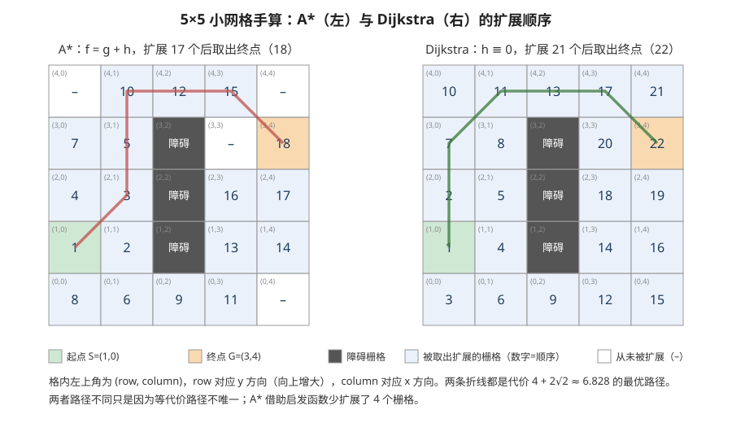

<p align="center"><b>图 10-6</b> 5×5 小网格手算：格内数字是被取出扩展的顺序。Dijkstra（右）比 A*（左）多扩展了 (4,0)、(0,4)、(3,3)、(4,4) 四个格子——它们要么在起点身后的角落，要么是 $g$ 较大、启发函数判断"不必先看"的位置</p>

**再做两个对比实验。** 用同样的网格和真实 `AStarPlanner` 代码运行：

| 配置 | 扩展节点数 | 路径代价 | 说明 |
|---|---:|---:|---|
| 八邻域 A*， $w_h=1$ | 17 | 6.828 | 默认配置 |
| 八邻域 Dijkstra（ $h\equiv0$） | 21 | 6.828 | 同样最优，扩展更多 |
| 四邻域 A*（`allow_diagonal=False`） | 21 | 8.000 | 只能走直角折线，路径更长 |
| 八邻域加权 A*， $w_h=2$ | 11 | 6.828 | 扩展最少；本例碰巧仍最优，一般不保证 |

可以用下面的小程序复现第一行（在 `code/code_chapter10_1` 目录下运行）：

```python
import numpy as np
from costmap import OccupancyGrid2D
from geometry import Pose2D
from global_planner import AStarPlanner

data = np.zeros((5, 5), dtype=np.int8)
for rc in [(1, 2), (2, 2), (3, 2)]:
    data[rc] = 100
grid = OccupancyGrid2D(data, 1.0, 0.0, 0.0)          # 分辨率 1 m，原点 (0,0)
# 栅格 (row=1, column=0) 的中心是 (x=0.5, y=1.5)
result = AStarPlanner(grid).plan(Pose2D(0.5, 1.5), Pose2D(4.5, 3.5))
print(result.expanded_nodes, result.path_cost)        # 17 6.828...
print([(p.x, p.y) for p in result.path])
```

> 💡 **要点**：A* 与 Dijkstra 的最优路径代价相同，差别在于"为了找到它看了多少格"。在 $190\times190$ 的真实地图上这个差距会放大成成千上万个节点。

> ⚠️ **注意**：等代价路径往往不唯一，两次规划结果在折线形状上可能不同，这是正常现象。后面的捷径化和平滑会让它们收敛到相近的形状。

### 2.6 为什么 A* 路径不能直接跟踪

A* 输出的是离散栅格中心序列。即使允许八邻域，它仍可能出现以下问题：

- 路径点数量很多；
- 相邻线段方向频繁变化；
- 拐角不连续；
- 路径点间距由地图分辨率决定；
- 控制器容易在折点附近左右摆动；
- 路径航向没有按照运动方向统一生成。

以本章真实地图为例，起点栅格 $(29,22)$ 到终点栅格 $(159,166)$ 行差 130、列差 144，即使没有任何障碍，八邻域路径也至少有 $\max(130,144)=144$ 步，产生 145 个点，而且只能沿 $0°/45°/90°$ 这几个离散方向前进。因此，规划结束并不代表可以立刻把路径交给底盘。还需要在保持无碰撞的前提下，把"栅格折线"转换为更适合跟踪的参考路径——这就是第三部分的内容。

---


## 第三部分 路径与轨迹优化

### 3.1 优化流水线总览

**直观理解。** A* 给出的是"能走"的路，路径优化要把它变成"好走"的路：去掉多余的折点，把尖角磨圆，让点距均匀，再给每个点标上朝向。整个过程有一条铁律——**任何一步都不能把路径推进障碍区**。

本章的轨迹优化包含四个步骤：

```text
A* 栅格路径
    ↓
视线捷径化
    ↓
Chaikin 平滑
    ↓
等距重采样
    ↓
航向生成
```

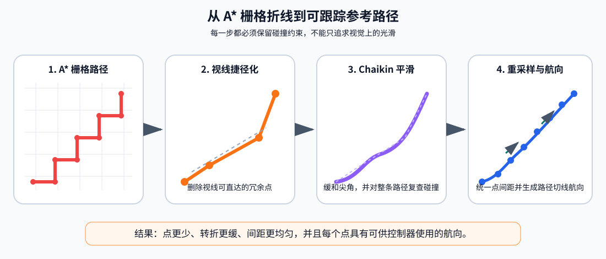

<p align="center"><b>图 10-7</b> 从 A* 栅格折线到可跟踪参考路径：A* 的密集折线先删除可直达的冗余点，再缓和尖角，最后按统一间距采样并补充切线航向。每一步都要重新进行碰撞检查，不能为了平滑而进入障碍区域</p>

**对应代码。** `TrajectoryOptimizer.optimize()` 把优化步骤固定为统一流水线：

```python
# 摘自 code/code_chapter10_1/trajectory.py
class TrajectoryOptimizer:
    def __init__(self, costmap: OccupancyGrid2D, spacing: float = 0.12) -> None:
        if spacing <= 0.0:
            raise ValueError("spacing 必须大于 0")
        self.costmap = costmap          # 传入的是膨胀后的规划地图
        self.spacing = spacing

    def optimize(self, path, shortcut_passes=2):
        """依次进行视线裁剪、保碰撞约束的 Chaikin 平滑和等距重采样。"""
        if len(path) < 2:
            return list(path)
        result = list(path)
        for _ in range(max(1, shortcut_passes)):      # 第一步：捷径化，默认 2 轮
            result = self.shortcut(result)
        smoothed = self.chaikin(result, iterations=2) # 第二步：Chaikin 2 次
        if self.costmap.path_is_free(smoothed):       # 整条平滑路径安全才接受
            result = smoothed
        result = self.resample(result, self.spacing)  # 第三步：0.12 m 重采样
        return self.assign_yaws(result, final_yaw=path[-1].yaw)   # 第四步：航向
```

所有步骤共用同一个碰撞检查工具——线段采样检查：

```python
# 摘自 code/code_chapter10_1/costmap.py
def line_is_free(self, start: Pose2D, end: Pose2D, step: float | None = None) -> bool:
    length = math.hypot(end.x - start.x, end.y - start.y)
    sample_step = step or self.resolution * 0.5            # 默认半格 = 0.025 m
    samples = max(1, int(math.ceil(length / sample_step)))
    for index in range(samples + 1):
        ratio = index / samples
        x = start.x + ratio * (end.x - start.x)
        y = start.y + ratio * (end.y - start.y)
        if self.is_occupied_world(x, y):
            return False
    return True

def path_is_free(self, path: Sequence[Pose2D]) -> bool:
    return all(self.line_is_free(a, b) for a, b in zip(path, path[1:]))
```

直线是否安全不是只检查两个端点，而是沿线段按小于栅格分辨率的间隔采样。只要任一采样点落入占用区域，该捷径就被拒绝。例如一条 $1\ \mathrm{m}$ 长的线段会被采样 $\lceil 1/0.025\rceil+1=41$ 个点。

> ⚠️ **注意**：采样步长取半格是为了不"跳过"一个完整的障碍格。如果把 `step` 设得大于分辨率，细长障碍可能恰好落在两个采样点之间而被漏检。

### 3.2 第一步：视线捷径化

**直观理解。** 站在当前点往路径远处看，只要能"一眼看到"某个点（中间没有障碍），中间那些点就是多余的。

从当前锚点开始，算法尽量寻找路径后方最远、且与锚点之间直线无碰撞的点。如果可以直接连接，就跳过中间多余栅格点。例如，原路径可能沿连续对角栅格包含几十个点，但如果起点到某个远处节点之间整段都处于自由空间，就可以用一条直线代替中间节点。教学代码默认执行 `2` 轮捷径化。

```python
# 摘自 code/code_chapter10_1/trajectory.py
def shortcut(self, path):
    if len(path) <= 2:
        return list(path)
    output = [path[0]]
    anchor = 0
    while anchor < len(path) - 1:
        candidate = len(path) - 1                 # 从最远的点开始试
        while candidate > anchor + 1:
            if self.costmap.line_is_free(path[anchor], path[candidate]):
                break                             # 找到最远可直达点
            candidate -= 1
        output.append(path[candidate])            # 最差也会连到相邻点
        anchor = candidate
    return output
```

**案例。** 继续使用 2.5 节的 $5\times5$ 网格，A* 路径的世界坐标（栅格中心）为：

$$
(0.5,1.5)\to(1.5,2.5)\to(1.5,3.5)\to(1.5,4.5)\to(2.5,4.5)\to(3.5,4.5)\to(4.5,3.5)
$$

1. 锚点 $(0.5,1.5)$：先试终点 $(4.5,3.5)$，连线在 $x=2.5$ 处 $y=2.5$，落在障碍格 $(2,2)$，拒绝；再试 $(3.5,4.5)$、 $(2.5,4.5)$，都会穿过墙，拒绝；试 $(1.5,4.5)$，连线 $x\in[0.5,1.5]$ 只经过第 0、1 列，全部空闲，**接受**；
2. 锚点 $(1.5,4.5)$：试终点 $(4.5,3.5)$，连线 $y$ 从 $4.5$ 降到 $3.5$，经过的格子 $(4,1)\sim(4,4)$、 $(3,4)$ 都空闲（在 $x=2.5$ 时 $y\approx4.17$，处于第 4 行，越过了墙顶 $\mathrm{row}=3$），**接受**；
3. 结果只剩 3 个点： $(0.5,1.5)\to(1.5,4.5)\to(4.5,3.5)$。

路径长度从 $6.828$ 缩短到 $\sqrt{1^2+3^2}+\sqrt{3^2+1^2}=2\sqrt{10}\approx6.325\ \mathrm{m}$——捷径化后的路径甚至比"栅格意义下最优"的路径还短，因为它不再受 8 个离散方向的限制。

> 💡 **要点**：A* 的"最优"只是在八邻域图上最优；捷径化让路径走出栅格方向的限制，是对离散化误差的补偿。

### 3.3 第二步：Chaikin 平滑

**原理与公式。** 捷径化后的路径点很少，但拐角仍是尖的。Chaikin 算法（Chaikin's corner cutting）对相邻两个路径点 $P_i$ 和 $P_{i+1}$，构造两个新点：

$$
Q_i=0.75P_i+0.25P_{i+1}
$$

$$
R_i=0.25P_i+0.75P_{i+1}
$$

即在每条线段的 $1/4$ 和 $3/4$ 处各取一点，用它们替换原来的拐点。重复处理后，尖锐折角会变成更平滑的折线，极限情况下收敛为二次 B 样条曲线。本章默认迭代 `2` 次。

```python
# 摘自 code/code_chapter10_1/trajectory.py
def chaikin(self, path, iterations=2):
    points = list(path)
    for _ in range(max(0, iterations)):
        if len(points) < 3:
            break                                   # 两个点的直线无需平滑
        refined = [points[0]]                       # 保留起点
        for first, second in zip(points, points[1:]):
            q = Pose2D(0.75 * first.x + 0.25 * second.x, 0.75 * first.y + 0.25 * second.y)
            r = Pose2D(0.25 * first.x + 0.75 * second.x, 0.25 * first.y + 0.75 * second.y)
            # 新点必须位于自由空间；否则保留原线段端点。
            if not self.costmap.is_occupied_world(q.x, q.y):
                refined.append(q)
            if not self.costmap.is_occupied_world(r.x, r.y):
                refined.append(r)
        refined.append(points[-1])                  # 保留终点
        points = refined
    return points
```

平滑会改变路径位置（拐角被"切掉"后路径会向内侧收），因此不能只追求曲线好看。教学代码先检查新点是否处于自由空间，生成整条平滑路径后还会在 `optimize()` 中再次用 `path_is_free` 检查所有线段是否无碰撞。只有整条平滑路径安全时才接受，否则继续使用捷径化后的结果。

**案例。** 对直角折线 $A(0,0)\to B(1,0)\to C(1,1)$ 迭代一次：

- 线段 $AB$： $Q_0=0.75(0,0)+0.25(1,0)=(0.25,0)$， $R_0=(0.75,0)$；
- 线段 $BC$： $Q_1=0.75(1,0)+0.25(1,1)=(1,0.25)$， $R_1=(1,0.75)$；
- 首尾保留：结果为 $(0,0),(0.25,0),(0.75,0),(1,0.25),(1,0.75),(1,1)$，共 6 点。

拐点 $B(1,0)$ 消失了，取而代之的是一条从 $(0.75,0)$ 到 $(1,0.25)$ 的 $45°$ 斜边。再迭代一次得到 12 个点，中间段为 $(0.8125,0.0625)$、 $(0.9375,0.1875)$ 等，折角进一步变缓。原来 $90°$ 的方向突变被拆成了若干次较小的转向。

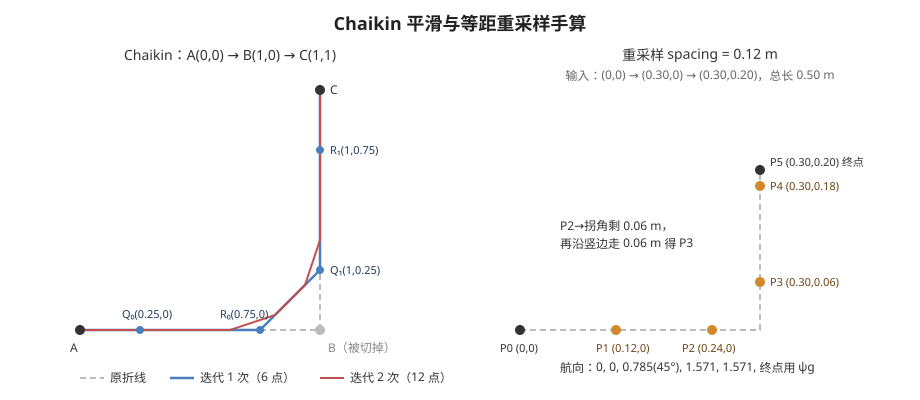

<p align="center"><b>图 10-8</b> Chaikin 平滑（左）：每次迭代在每条线段的 1/4、3/4 处取新点，拐角 B 被切掉；等距重采样（右）：沿折线每 0.12 m 放一个点，跨越拐角时余量会累积到下一段</p>

> ⚠️ **注意**：Chaikin 会把首尾之外的原始点全部替换掉。如果某个原始点是"必须经过"的（例如门洞中心），平滑后路径可能偏离它，这正是需要整条路径碰撞复检的原因。

### 3.4 第三步：等距重采样

**直观理解。** 控制器希望路径点分布相对均匀。如果有些点相距几厘米，有些点相距一米，前视点选择和速度控制都会不稳定。

教学代码按 `path_spacing = 0.12 m` 重新采样，使相邻参考点间距接近 `12 cm`。这样路径密度不再直接受地图 `5 cm` 分辨率限制。

```python
# 摘自 code/code_chapter10_1/trajectory.py
@staticmethod
def resample(path, spacing):
    if len(path) < 2:
        return list(path)
    output = [Pose2D(path[0].x, path[0].y, path[0].yaw)]
    carry = 0.0                       # 上一个采样点之后、已经"走过"但不足 spacing 的距离
    previous = path[0]
    for target in path[1:]:
        segment = distance(previous, target)
        while carry + segment >= spacing and segment > 1e-12:
            ratio = (spacing - carry) / segment          # 在本段中再走 spacing-carry 就到下一个采样点
            previous = Pose2D(previous.x + ratio * (target.x - previous.x),
                              previous.y + ratio * (target.y - previous.y))
            output.append(previous)
            segment = distance(previous, target)
            carry = 0.0
        carry += segment              # 本段剩余不足 spacing 的部分留给下一段
        previous = target
    if distance(output[-1], path[-1]) > 1e-6:
        output.append(Pose2D(path[-1].x, path[-1].y, path[-1].yaw))   # 确保包含终点
    return output
```

**案例。** 折线 $(0,0)\to(0.30,0)\to(0.30,0.20)$，总长 $0.50\ \mathrm{m}$，`spacing = 0.12`：

1. 第一段长 $0.30$：依次放下 $(0.12,0)$、 $(0.24,0)$；剩余 $0.06$ 不足一个间距，`carry = 0.06`；
2. 第二段长 $0.20$：只需再走 $0.12-0.06=0.06$ 就到下一个采样点，得 $(0.30,0.06)$；再走 $0.12$ 得 $(0.30,0.18)$；剩余 $0.02$；
3. 终点 $(0.30,0.20)$ 与最后采样点相距 $0.02>10^{-6}$，补上终点。

结果为 6 个点： $(0,0),(0.12,0),(0.24,0),(0.30,0.06),(0.30,0.18),(0.30,0.20)$。注意 $(0.24,0)\to(0.30,0.06)$ 的直线距离是 $0.085$ 而不是 $0.12$——重采样保证的是**沿路径弧长**等距，而不是直线距离等距；最后一段则可能短于间距。

### 3.5 第四步：航向生成

除最后一个点外，每个路径点的航向由它指向下一个点的切线方向确定：

$$
\psi_i=\mathrm{atan2}(y_{i+1}-y_i,\ x_{i+1}-x_i)
$$

最后一个点使用用户目标中指定的最终朝向 $\psi_g$。于是机器人在途中可以沿路径切线平稳运动，到达目标位置附近后再精确调整最终朝向。

```python
# 摘自 code/code_chapter10_1/trajectory.py
@staticmethod
def assign_yaws(path, final_yaw=None):
    if not path:
        return []
    output = []
    for index, pose in enumerate(path):
        if index < len(path) - 1:
            following = path[index + 1]
            yaw = math.atan2(following.y - pose.y, following.x - pose.x)   # 切线方向
        elif final_yaw is not None:
            yaw = normalize_angle(final_yaw)                               # 终点用目标朝向
        elif output:
            yaw = output[-1].yaw
        else:
            yaw = pose.yaw
        output.append(Pose2D(pose.x, pose.y, yaw))
    return output
```

**案例。** 对 3.4 节的 6 个点、目标朝向 $\psi_g=1.57$：前两点指向 $+x$，航向 $0$； $(0.24,0)\to(0.30,0.06)$ 方向为 $\mathrm{atan2}(0.06,0.06)=0.785\ \mathrm{rad}=45°$；之后两点指向 $+y$，航向 $1.571$；终点航向取 $1.57$。

路径优化不能突破碰撞约束。它的目标不是把路径变成任意光滑曲线，而是在安全区域内减少冗余点、缓和折角、统一点间距并补充航向。

> 💡 **要点**：对全向底盘而言，路径点航向是"期望朝向"，不是"运动方向的约束"——G2 可以侧着走，但让车头大致朝向前进方向能让激光视野更合理，也让行为更符合人的预期。

> ⚠️ **注意**：`PlannerConfig.shortcut_passes` 已在配置类中定义，但 `demo_navigation.py` 当前没有把它显式传给 `TrajectoryOptimizer.optimize()`；实际运行使用该函数默认值 `2`。如果要通过配置修改轮数，需要在调用 `optimize()` 时继续传递该字段。

---


## 第四部分 局部路径规划、轨迹跟踪与安全闭环

### 4.1 全局路径与局部路径的分工

**直观理解。** 全局路径提供从起点到终点的大方向，但它主要依据静态地图。机器人实际运动时可能遇到地图中没有的新障碍，例如移动的人、临时摆放的箱子或正在穿过通道的其他机器人。

如果每次发现动态障碍都在整张地图上重新做全局搜索，计算量会增大，路径也可能频繁发生大幅变化。因此导航系统通常采用全局与局部两层规划：

- 全局规划器在整张地图上生成长期参考路线；
- 局部规划器只关注机器人附近的滚动窗口；
- 局部规划器尽量沿全局路线前进，必要时产生短距离绕行；
- 绕过障碍后再逐渐回到全局参考线。

本章教学局部规划器的处理步骤为：

```text
当前位姿
    ↓
寻找全局路径最近点
    ↓
沿全局路径向前选择局部目标
    ↓
复制静态规划地图并写入动态障碍
    ↓
检查原全局参考段是否安全
    ├─ 安全：直接复用参考段
    └─ 被阻塞：在局部窗口内运行 A*
                    ↓
              优化局部绕行路径
```

当前参数中：

- 局部目标前视距离为 `2.4 m`；
- 局部窗口半径为 `3.0 m`；
- 局部重规划周期为 `0.40 s`；
- 动态障碍物写入局部地图时使用 `0.44 m` 的额外膨胀；
- 已有绕行路径仍然安全时优先复用。

局部目标并不是最终导航目标。它是沿全局路径向前截取的一个短期目标，使局部搜索始终服务于全局方向，而不是在机器人附近任意游走。

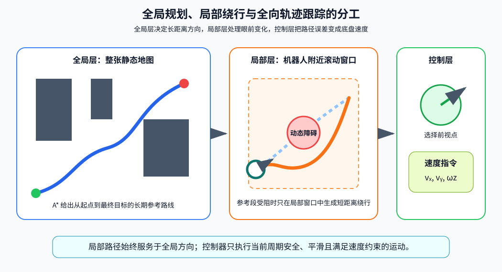

<p align="center"><b>图 10-9</b> 全局规划、局部绕行与轨迹跟踪分工：全局规划器在整张地图上确定长期方向；局部规划器只在机器人附近处理动态障碍；轨迹跟踪器选择前视点并输出全向底盘速度 $(v_x,v_y,\omega_z)$。三层职责不同，但共同服务于同一个最终目标</p>

**对应代码：选局部目标。** 局部规划器先找到机器人在全局路径上的最近位置，再沿路径累计弧长，直到超过 `2.4 m`：

```python
# 摘自 code/code_chapter10_1/local_planner.py
nearest = nearest_path_index(global_path, current, max(0, self._last_global_index - 5))
self._last_global_index = nearest
target_index = self._target_index(global_path, nearest)
target = global_path[target_index]
# ...
def _target_index(self, path, start):
    travelled = 0.0
    for index in range(start + 1, len(path)):
        travelled += distance(path[index - 1], path[index])
        if travelled >= self.lookahead_distance:      # 2.4 m
            return index
    return len(path) - 1                              # 不足 2.4 m 时取终点
```

`nearest_path_index` 从上次的索引往回退 5 个点开始搜索，而不是每次从头搜索：这样既能容忍机器人小幅后退，又能防止路径自交时"最近点"跳回到起点附近。全局路径按 $0.12\ \mathrm{m}$ 采样， $2.4\ \mathrm{m}$ 的前视距离约对应向前 20 个路径点。

### 4.2 动态障碍融合与稳定绕行

**动态障碍模型。** 教学场景包含一个周期移动的圆形障碍物。它在固定的 $x$ 位置上沿 $y$ 方向做正弦运动：

$$
y(t)=y_c+A\sin\left(\frac{2\pi t}{T}\right)
$$

当前参数为：

- 固定位置 `x = 1.20 m`；
- 中心位置 `center_y = 1.05 m`；
- 运动幅值 `travel = 1.15 m`；
- 周期 `period = 8.0 s`；
- 障碍物半径 `radius = 0.34 m`。

**案例。** $t=2\ \mathrm{s}$ 时 $y=1.05+1.15\sin(\pi/2)=2.20\ \mathrm{m}$（最北端）； $t=6\ \mathrm{s}$ 时 $y=1.05+1.15\sin(3\pi/2)=-0.10\ \mathrm{m}$（最南端）。障碍物在 $y\in[-0.10,\,2.20]$ 之间往返，平均速度为 $2\times2.30/8=0.575\ \mathrm{m/s}$，比机器人最大线速度 $0.48\ \mathrm{m/s}$ 还快，所以机器人无法靠"跑赢它"来避障，必须真正绕行或等待。

```python
# 摘自 code/code_chapter10_1/config.py
@dataclass(frozen=True)
class DynamicObstacleConfig:
    x: float = 1.20
    center_y: float = 1.05
    travel: float = 1.15
    period: float = 8.0
    radius: float = 0.34

    def at_time(self, seconds: float) -> CircleObstacle:
        import math
        y = self.center_y + self.travel * math.sin(2.0 * math.pi * seconds / self.period)
        return CircleObstacle(self.x, y, self.radius)
```

**写入局部地图。** 局部地图把动态障碍圆写入静态规划地图的副本，而不会永久修改全局静态地图。这样每个局部规划周期都能根据障碍物的新位置重新构建短时环境。写入时半径为 $0.34+0.44=0.78\ \mathrm{m}$：障碍物本身的半径加上与静态障碍一致的膨胀半径（`dynamic_padding = map_config.inflation_radius`）。

```python
# 摘自 code/code_chapter10_1/local_planner.py
local_map = self.static_costmap.copy()
local_map.add_circles(dynamic_obstacles, padding=self.dynamic_padding)
reference = [Pose2D(current.x, current.y, current.yaw), *global_path[nearest : target_index + 1]]
reference_is_free = local_map.path_is_free(reference)
```

如果障碍物挡住全局参考段，局部规划器会限制 A* 搜索范围，只在以机器人为中心、半径约 `3 m` 的窗口内寻找通向局部目标的绕行路径。搜索成功后，绕行路径同样经过捷径化、平滑、重采样和航向生成：

```python
# 摘自 code/code_chapter10_1/local_planner.py
bounds = (
    current.x - self.window_radius,
    current.y - self.window_radius,
    current.x + self.window_radius,
    current.y + self.window_radius,
)
try:
    raw = AStarPlanner(local_map).plan(current, target, bounds=bounds).path
    optimized = TrajectoryOptimizer(local_map, self.path_spacing).optimize(raw)
    self._remember(optimized, used_detour=True)
    return LocalPlanResult(optimized, True, False, target_index)
except PlanningError:
    self._previous_path = []
    self._previous_used_detour = False
    # 只返回当前位置，blocked=True，导航器据此请求恢复
    return LocalPlanResult([Pose2D(current.x, current.y, current.yaw)], True, True, target_index)
```

这里复用了第二、三部分的 `AStarPlanner` 和 `TrajectoryOptimizer`，只是换了一张地图并加了 `bounds`：窗口为 $6\times6\ \mathrm{m}$，即 $120\times120$ 格，比整张地图的 $190\times190$ 小得多。

**防止左右振荡。** 动态避障中一个常见问题是"左右振荡"：

1. 第一次规划从障碍物左侧绕行；
2. 障碍物稍微移动后，右侧路径代价略低；
3. 下一周期又切到右侧；
4. 再下一周期重新切回左侧；
5. 机器人在两种决策之间摆动，无法稳定通过。

本章采用了简单但直观的路径保持策略：

- 如果上一条绕行路径剩余部分仍然安全，就继续使用；
- 即使全局参考线已经恢复畅通，也连续确认若干周期；
- 默认确认 `3` 个局部规划周期后，才切回全局路径；
- 已走过的旧路径点会被裁掉，只保留机器人前方的剩余部分；
- 当剩余路径长度过短时（代码中 `reuse_min_distance = 0.55 m`），不再继续复用。

这种方法相当于给路径切换加入"滞回"（hysteresis），避免系统对很小的环境变化过度敏感——就像空调不会在 25.0℃ 和 25.1℃ 之间反复启停。

```python
# 摘自 code/code_chapter10_1/local_planner.py
previous = self._remaining_previous_path(current)
if self._previous_used_detour and previous and local_map.path_is_free(previous):
    if reference_is_free:
        self._clear_cycles += 1                         # 参考线畅通，计数
        if self._clear_cycles <= self.detour_hold_cycles:
            self._remember(previous, used_detour=True)
            return LocalPlanResult(previous, True, False, target_index)   # 继续绕行
    else:
        self._clear_cycles = 0                          # 参考线仍被挡，清零计数
        self._remember(previous, used_detour=True)
        return LocalPlanResult(previous, True, False, target_index)

self._clear_cycles = 0
if reference_is_free:
    self._remember(reference, used_detour=False)
    return LocalPlanResult(reference, False, False, target_index)          # 回到全局参考
```

**案例：多久才切回全局路径？** 绕行中某次局部规划发现参考线畅通，`_clear_cycles` 变为 1、2、3 时都继续绕行；第 4 次仍然畅通时 `4 > 3`，才切回全局参考。局部规划周期是 $0.40\ \mathrm{s}$，所以至少要连续 $4\times0.40=1.6\ \mathrm{s}$ 观察到畅通才会切回。

> 💡 **要点**：滞回的代价是反应变慢。`detour_hold_cycles` 越大越稳，但障碍物离开后机器人会多绕一段；设为 0 则恢复到"每次都选当前最优"，振荡风险最大。

### 4.3 全向底盘前视轨迹跟踪

**直观理解。** 局部规划器输出一段安全参考路径，但机器人仍然需要把路径误差转换为速度指令。本章使用"前视点 + 比例反馈"的全向轨迹跟踪方法。它不是只追逐离机器人最近的路径点，而是在路径前方选择一个距离约为 `0.70 m` 的目标点——就像骑自行车时眼睛看前方几米，而不是盯着前轮。

选择前视点有两个作用：

- 避免机器人在密集路径点之间频繁调整；
- 让控制器提前看向弯道前方，运动更平滑。

前视点不能越过障碍物。如果机器人当前位置到某个候选前视点之间的直线被障碍阻挡，控制器会停止继续向前寻找，避免为了追逐远处路径点而"切弯"穿过障碍。

**原理与公式。** 路径点和机器人位姿位于世界坐标系，而第四章底盘控制器接收 `base_link` 坐标系中的速度。因此先计算世界坐标误差：

$$
\Delta x_w=x_t-x
$$

$$
\Delta y_w=y_t-y
$$

再根据当前航向 $\psi$ 转换到底盘坐标系：

$$
\Delta x_b=\cos\psi\,\Delta x_w+\sin\psi\,\Delta y_w
$$

$$
\Delta y_b=-\sin\psi\,\Delta x_w+\cos\psi\,\Delta y_w
$$

全向底盘可以同时前后和横向移动，因此直接采用比例控制：

$$
v_x=k_p\Delta x_b
$$

$$
v_y=k_p\Delta y_b
$$

当前 `position_gain = 1.0`。随后按照二维合速度进行统一缩放：

$$
v=\sqrt{v_x^2+v_y^2}
$$

最大线速度为 `0.48 m/s`。处于局部绕行状态时，再把线速度限制为 `0.34 m/s`，减少绕障过程中的冲击和超调。

机器人接近目标时会逐渐减速。当前减速距离为 `0.90 m`。在目标位置容差外，速度上限随剩余距离减小，但保留一定的最低比例，避免过早变得极慢。写成公式即：

$$
v_{\mathrm{limit}}=v_{\max}\cdot\min\!\left(1,\ \max\!\left(0.18,\ \frac{d_{\mathrm{goal}}}{d_{\mathrm{slow}}}\right)\right)
$$

其中 $d_{\mathrm{goal}}$ 为到最终目标的直线距离， $d_{\mathrm{slow}}=0.90\ \mathrm{m}$。若 $v>v_{\mathrm{limit}}$，则 $v_x,v_y$ 同乘 $v_{\mathrm{limit}}/v$，方向不变。

角速度采用航向误差比例控制：

$$
e_{\psi}=\mathrm{wrap}(\psi_d-\psi)
$$

$$
\omega_z=\mathrm{clip}(k_{\psi}e_{\psi},-\omega_{\max},\omega_{\max})
$$

当前参数为：

- `yaw_gain = 1.5`；
- `max_angular_speed = 0.80 rad/s`。

行进过程中，期望航向取前视路径点的切线航向；进入目标位置容差后，线速度变为零，再对齐最终目标朝向。

目标判定使用：

- 位置容差 `0.12 m`；
- 航向容差 `0.12 rad`，约为 `6.9°`。

只有位置误差和航向误差同时满足要求，状态才会变为 `SUCCEEDED`。

**对应代码。**

```python
# 摘自 code/code_chapter10_1/path_tracker.py（HolonomicPathTracker.compute）
goal_distance = distance(current, goal)
goal_yaw_error = normalize_angle(goal.yaw - current.yaw)
reached = goal_distance <= self.position_tolerance and abs(goal_yaw_error) <= self.yaw_tolerance
if reached:
    return TrackingResult(Velocity2D(), goal, goal_distance, goal_yaw_error, True)

nearest = nearest_path_index(path, current)
target = path[min(nearest + 1, len(path) - 1)]
travelled = 0.0
for index in range(nearest + 1, len(path)):
    travelled += distance(path[index - 1], path[index])
    candidate = path[index]
    # 弯道附近不能让前视点越过障碍，否则控制器会"切弯"。
    if self.costmap is not None and not self.costmap.line_is_free(current, candidate):
        break
    target = candidate
    if travelled >= self.lookahead_distance:          # 0.70 m
        break

dx_body, dy_body = world_to_body(target.x - current.x, target.y - current.y, current.yaw)
vx = self.position_gain * dx_body                     # v_x = k_p Δx_b
vy = self.position_gain * dy_body                     # v_y = k_p Δy_b
speed = math.hypot(vx, vy)
speed_limit = self.max_linear_speed * min(1.0, max(0.18, goal_distance / self.slow_down_distance))
if speed > speed_limit and speed > 1e-12:
    scale = speed_limit / speed                       # 合速度统一缩放，方向不变
    vx *= scale
    vy *= scale

# 行进时跟随轨迹切线；进入目标位置容差后再精确对齐目标朝向。
desired_yaw = goal.yaw if goal_distance <= self.position_tolerance else target.yaw
yaw_error = normalize_angle(desired_yaw - current.yaw)
wz = max(-self.max_angular_speed, min(self.max_angular_speed, self.yaw_gain * yaw_error))
if goal_distance <= self.position_tolerance:
    vx = vy = 0.0                                     # 到位后只转不走
return TrackingResult(Velocity2D(vx, vy, wz), target, goal_distance, yaw_error, False)
```

> ⚠️ **注意**：`HolonomicPathTracker.__init__` 的默认参数（如 `lookahead_distance=0.55`、`position_gain=1.25`）与 `TrackerConfig` 不同。`demo_navigation.py` 通过 `HolonomicPathTracker(**tracker_config.__dict__, costmap=planning_map)` 传入配置，所以实际运行值以 `TrackerConfig` 为准（`0.70`、`1.0` 等）。单独构造跟踪器做实验时要记得显式传参。

**案例一：偏离路径时的指令。** 参考路径是沿 $x$ 轴的直线 $y=0$，每 $0.1\ \mathrm{m}$ 一个点（ $x=0,0.1,\dots,3.0$，航向均为 0），目标为 $(3.0,0,0)$。机器人位于 $(0,0.2)$，航向 $\psi=0$：

1. 最近点是 $(0,0)$；沿路径向前累计，到 $(0.7,0)$ 时累计长度达到 $0.70$，前视点为 $(0.7,0)$；
2. $\psi=0$，所以体坐标误差等于世界误差： $(\Delta x_b,\Delta y_b)=(0.7,-0.2)$；
3. $k_p=1$： $(v_x,v_y)=(0.70,-0.20)$， $v=\sqrt{0.49+0.04}=0.728\ \mathrm{m/s}$；
4. 目标距离 $\sqrt{3^2+0.2^2}\approx3.007>0.90$， $v_{\mathrm{limit}}=0.48$；缩放系数 $0.48/0.728=0.659$；
5. 结果 $(v_x,v_y)=(0.462,-0.132)\ \mathrm{m/s}$；前视点航向为 0， $\omega_z=0$。

机器人一边向前一边向右（ $-y$）回到路径上。用真实代码运行可得 `Velocity2D(vx=0.4615..., vy=-0.1319..., wz=0.0)`，与手算一致。

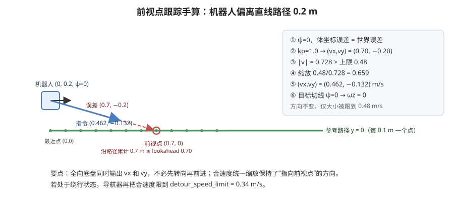

<p align="center"><b>图 10-10</b> 前视点跟踪手算：误差向量指向 0.7 m 外的前视点，合速度被统一缩放到 0.48 m/s，方向保持不变</p>

**案例二：接近目标时减速。** 机器人距目标 $0.30\ \mathrm{m}$： $0.30/0.90=0.333>0.18$， $v_{\mathrm{limit}}=0.48\times0.333=0.16\ \mathrm{m/s}$。距目标 $0.15\ \mathrm{m}$： $0.15/0.90=0.167<0.18$，取下限， $v_{\mathrm{limit}}=0.48\times0.18=0.0864\ \mathrm{m/s}$。所以最后 $0.162\ \mathrm{m}$（ $0.18\times0.90$）以内速度上限保持在约 $8.6\ \mathrm{cm/s}$，不会无限变慢而迟迟到不了。

**案例三：最终转向。** 机器人已到达 $(3.6,3.2)$ 附近（位置误差 $<0.12\ \mathrm{m}$），当前航向 $0.8\ \mathrm{rad}$，目标航向 $1.57\ \mathrm{rad}$： $e_\psi=0.77$， $1.5\times0.77=1.155$，被限幅为 $0.80\ \mathrm{rad/s}$。随着误差减小，当 $e_\psi<0.80/1.5=0.533\ \mathrm{rad}$ 后角速度开始线性减小，直到 $|e_\psi|\le0.12$ 判定到达。

> 💡 **要点**：前视距离是跟踪器最重要的参数。太小——追着眼前的点跑，容易左右摆；太大——"抄近道"切弯。本章用"前视点不得穿过障碍"兜住了切弯的风险。

### 4.4 状态机、碰撞监控与恢复机制

**直观理解。** 规划器和控制器需要由更高一层的导航状态机组织——它像一个调度员，决定"现在该规划、该跟踪、还是该停下来想办法"。本章教学导航器包含六种状态：

| 状态 | 含义 |
|---|---|
| `IDLE` | 等待目标，没有输出运动指令 |
| `PLANNING` | 正在进行全局规划与路径优化 |
| `CONTROLLING` | 正在局部规划并跟踪路径 |
| `RECOVERY` | 当前导航异常，准备清除局部历史并重规划 |
| `SUCCEEDED` | 位置和朝向都已到达目标容差 |
| `FAILED` | 无法规划或超过最大恢复次数 |

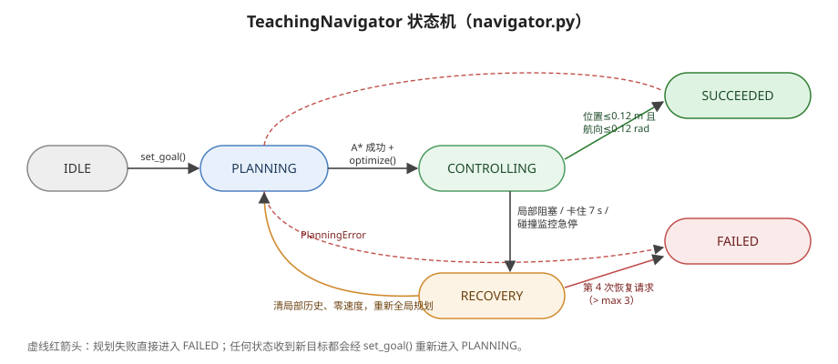

<p align="center"><b>图 10-11</b> TeachingNavigator 状态机：正常流程为 IDLE → PLANNING → CONTROLLING → SUCCEEDED；三类异常触发 RECOVERY 并回到 PLANNING，超过 3 次恢复则进入 FAILED</p>

收到新目标后，导航器会清空旧的全局路径、局部路径和绕行历史，再进入 `PLANNING`。全局规划成功后进入 `CONTROLLING`。

```python
# 摘自 code/code_chapter10_1/navigator.py
class NavigationState(str, Enum):
    IDLE = "IDLE"
    PLANNING = "PLANNING"
    CONTROLLING = "CONTROLLING"
    RECOVERY = "RECOVERY"
    SUCCEEDED = "SUCCEEDED"
    FAILED = "FAILED"

def set_goal(self, goal, current, now=None):
    self.goal = Pose2D(goal.x, goal.y, goal.yaw)
    self.global_path = []
    self.local_path = []
    self.local_planner.reset()
    self.recovery_attempts = 0
    self._last_local_plan_time = -math.inf      # 保证下一次 update 立即做局部规划
    self._using_detour = False
    self.state = NavigationState.PLANNING
    self._message = "收到新目标"
    self.progress_checker.reset(current, time.monotonic() if now is None else now)
```

控制期间，系统按照 `0.40 s` 的周期更新局部路径，但速度跟踪以 `20 Hz` 运行。这样可以避免在每个物理步都做局部 A*，同时保持速度控制足够连续。

除规划器外，系统还设置了两类安全检查。

**短时域碰撞监控。** 碰撞监控器根据当前速度指令向前模拟一小段时间，预测机器人中心是否会进入按机器人半径膨胀后的静态障碍区域。

当前参数为：

- 预测时域 `collision_horizon = 0.12 s`；
- 积分步长 `collision_step = 0.05 s`。

若预测碰撞，速度立即变为零，并请求恢复。这里的最后一道监控主要针对静态地图；动态障碍的主要处理仍由局部地图和局部规划器完成。

预测使用全向底盘的运动学积分（把 `base_link` 速度旋转到世界系）：

$$
\begin{aligned}
x_{k+1}&=x_k+(\cos\psi_k\,v_x-\sin\psi_k\,v_y)\,\Delta t\\
y_{k+1}&=y_k+(\sin\psi_k\,v_x+\cos\psi_k\,v_y)\,\Delta t\\
\psi_{k+1}&=\psi_k+\omega_z\,\Delta t
\end{aligned}
$$

```python
# 摘自 code/code_chapter10_1/navigator.py
class CollisionMonitor:
    """在控制器之外增加最后一道短时域碰撞保护。"""
    def __init__(self, costmap, horizon=0.12, step=0.05):
        self.costmap = costmap          # 传入 safety_costmap（按 0.34 m 膨胀）
        self.horizon = horizon
        self.step = step

    def safe_command(self, pose, command):
        x, y, yaw = pose.x, pose.y, pose.yaw
        elapsed = 0.0
        while elapsed < self.horizon:
            cosine, sine = math.cos(yaw), math.sin(yaw)
            x += (cosine * command.vx - sine * command.vy) * self.step
            y += (sine * command.vx + cosine * command.vy) * self.step
            yaw += command.wz * self.step
            if self.costmap.is_occupied_world(x, y):
                return Velocity2D()     # 预测碰撞：输出零速度
            elapsed += self.step
        return command
```

**案例。** `elapsed` 依次取 $0,0.05,0.10$，都小于 $0.12$，所以循环执行 3 步，实际向前预测 $0.15\ \mathrm{s}$。以最大速度 $0.48\ \mathrm{m/s}$ 计，前视距离约 $0.48\times0.15=0.072\ \mathrm{m}$，略大于一格（ $0.05\ \mathrm{m}$）。这说明碰撞监控只是"最后一道闸"，真正保持距离靠的是 $0.44\ \mathrm{m}$ 的规划膨胀。

**进度检查。** 机器人可能持续收到非零速度，但由于碰撞、控制异常或物理约束而没有实际前进。进度检查器会记录一个锚点：

- 如果机器人移动距离达到 `0.12 m`，更新锚点和时间；
- 如果连续 `7.0 s` 没有达到最小进度，认为机器人可能被卡住。

```python
# 摘自 code/code_chapter10_1/navigator.py
class ProgressChecker:
    def is_stuck(self, pose, now):
        if distance(pose, self.anchor) >= self.minimum_progress:   # 0.12 m
            self.reset(pose, now)                                  # 有进展，更新锚点
            return False
        return now - self.anchor_time >= self.timeout              # 7.0 s 无进展
```

**恢复流程。** 进入恢复状态后，教学代码会：

1. 输出零速度；
2. 清除局部规划器保存的旧绕行路径；
3. 重置局部规划计时；
4. 回到全局规划状态；
5. 从当前位置重新生成全局路径。

允许的恢复次数为 `3`。如果问题持续存在，下一次恢复请求会让导航状态进入 `FAILED`，避免机器人无限循环。

```python
# 摘自 code/code_chapter10_1/navigator.py（update 的控制分支）
if now - self._last_local_plan_time >= self.local_replan_period or not self.local_path:
    local_result = self.local_planner.plan(current, self.global_path, dynamic_obstacles)
    self.local_path = local_result.path
    self._using_detour = local_result.used_detour
    self._last_local_plan_time = now
    if local_result.blocked:
        return self._request_recovery("局部路径被阻塞")
    # ...
tracking = self.tracker.compute(current, self.local_path, self.goal)
if tracking.reached:
    self.state = NavigationState.SUCCEEDED
    # ...
if self.progress_checker.is_stuck(current, now):
    return self._request_recovery("进度检查失败：机器人可能被卡住")

desired_command = tracking.command
if self._using_detour:
    desired_command = self._limit_linear_speed(desired_command, self.tracker.detour_speed_limit)
command = self.collision_monitor.safe_command(current, desired_command)
if command == Velocity2D() and math.hypot(desired_command.vx, desired_command.vy) > 0.05:
    return self._request_recovery("碰撞监控触发急停")
return self._output(command, tracking.target)

def _request_recovery(self, message):
    self.recovery_attempts += 1
    if self.recovery_attempts > self.max_recovery_attempts:       # 第 4 次 → FAILED
        self.state = NavigationState.FAILED
        self._message = f"{message}；超过最大恢复次数"
    else:
        self.state = NavigationState.RECOVERY
        self._message = message
    return self._output(Velocity2D(), None)
```

代码解读：

- 三类异常（局部阻塞、进度不足、碰撞急停）都汇入同一个 `_request_recovery`，计数共享；
- 碰撞急停只在"原本想以超过 $0.05\ \mathrm{m/s}$ 平移"时才算异常，避免原地转向时误触发；
- `recovery_attempts` 只在 `set_goal` 时清零，所以一次导航任务中最多恢复 3 次。

此外，主程序还监控机器人倾斜角。倾斜超过 `0.35 rad`，约 `20°` 时立即停止并抛出异常。这项检查不属于路径规划算法，但属于真实机器人系统中不可缺少的执行安全边界。

> ⚠️ **注意**：教学版的"恢复"只是重新规划，并不会主动后退或原地旋转。如果机器人被卡在角落，重规划可能得到同样的路径而反复失败，这正是 Nav2 引入 `behavior_server`（Spin、BackUp 等）的原因。

---


## 第五部分 Nav2 整体框架、参数与数据流

### 5.1 从教学模块映射到 Nav2 标准组件

**直观理解。** `code_chapter10_1` 的目标是让读者看清每一步做了什么；`code_chapter10_2` 的目标是展示工程中如何使用 Nav2（Navigation 2，ROS 2 的标准导航框架）组织同类功能。可以把 Nav2 理解为把第二至第四部分的每个模块都做成了"可替换插件"，再用一个行为树把它们串起来。

两者的职责对应关系如下：

| 教学版模块 | Nav2 组件 | 主要职责 |
|---|---|---|
| `OccupancyGrid2D` 与地图发布 | `map_server`、Costmap 2D | 发布静态地图并构建全局、局部代价地图 |
| `AStarPlanner` | `planner_server` + NavFn | 生成全局路径 |
| `TrajectoryOptimizer` | `smoother_server` + Simple Smoother | 提供全局路径平滑能力；是否执行取决于行为树是否调用 `SmoothPath` |
| `LocalPlanner` | `controller_server` 中的 DWB | 根据局部代价地图采样并评价短时轨迹 |
| `HolonomicPathTracker` | DWB 控制器 | 选择可行速度并跟踪全局路径 |
| `CollisionMonitor`、`ProgressChecker` | Costmap、DWB、Progress Checker | 碰撞约束和卡住检测 |
| `TeachingNavigator` 状态机 | `bt_navigator` 行为树 | 调度规划、控制、恢复和任务结果 |
| 教学恢复重规划 | `behavior_server` | 旋转、后退、等待等恢复动作 |
| 底盘限速 | `velocity_smoother` + 第四章底盘控制器 | 平滑速度、限制加速度并驱动关节 |

Nav2 不是一个单独进程，而是一组通过 ROS 2 话题、服务、Action 和 TF 协作的服务器。导航目标通过 `NavigateToPose` Action 发送给 `bt_navigator`，行为树再按任务状态调用规划器、控制器和恢复行为。

本章 Nav2 示例的数据流为：

```text
目标位姿 /navigate_to_pose
        ↓
bt_navigator 行为树
        ↓
planner_server 生成 /plan
        ↓
可选：行为树调用 smoother_server 平滑路径
        ↓
controller_server + local_costmap
        ↓
DWB 采样、前向模拟和评分
        ↓
velocity_smoother
        ↓
/cmd_vel
        ↓
nav2_bridge.py
        ↓
第四章 G2BaseController
        ↓
Isaac Sim G2 底盘
        ↓
/odom、/scan、TF、/clock
        └──────────────反馈到 Nav2
```

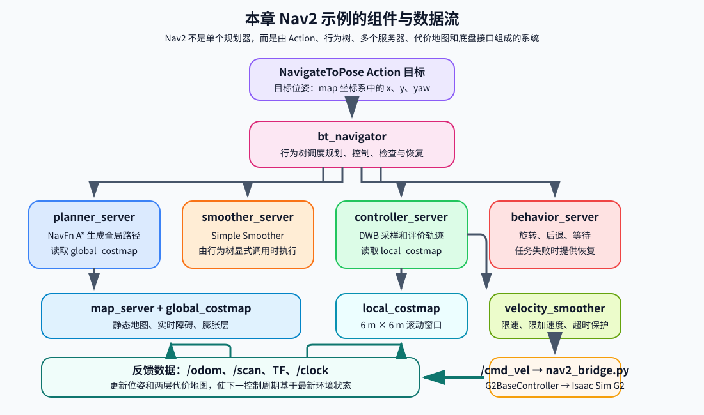

<p align="center"><b>图 10-12</b> Nav2 组件与数据流：NavigateToPose 目标先进入 bt_navigator，行为树再调度规划、平滑、控制和恢复服务器。两层代价地图提供环境约束，速度经 velocity_smoother 和 bridge 传给 G2 底盘，新的 /odom、/scan、TF 与 /clock 持续反馈到 Nav2</p>

> 💡 **要点**：读 Nav2 的任何参数之前，先问"它属于哪个服务器、哪个插件"。本章 `nav2_params.yaml` 的顶层键就是服务器名：`bt_navigator`、`controller_server`、`local_costmap`、`global_costmap`、`map_server`、`planner_server`、`smoother_server`、`behavior_server`、`waypoint_follower`、`velocity_smoother`。

### 5.2 行为树导航器与 Lifecycle 节点

**行为树（Behavior Tree，BT）。** 教学版用 `if/elif` 写成的状态机在功能变多后会迅速膨胀。Nav2 改用行为树：树中的每个节点在被"tick"（周期性调用）时返回 `SUCCESS`、`FAILURE` 或 `RUNNING`，控制节点（如 Sequence、Recovery）根据子节点的返回值决定下一步执行谁。动作节点则各自对应一个服务器的 Action：

| BT 动作节点 | 调用的服务器 | 对应教学版 |
|---|---|---|
| `ComputePathToPose` | `planner_server` | `PLANNING` 状态中的 `planner.plan()` |
| `SmoothPath` | `smoother_server` | `optimizer.optimize()` |
| `FollowPath` | `controller_server` | `CONTROLLING` 状态中的局部规划 + 跟踪 |
| `Spin` / `BackUp` / `Wait` 等 | `behavior_server` | `RECOVERY` 状态（教学版只重规划） |

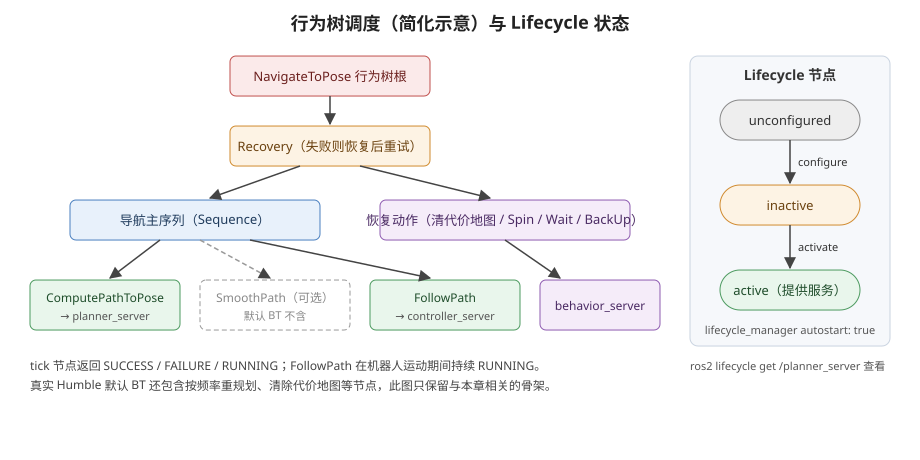

<p align="center"><b>图 10-13</b> 行为树调度的简化骨架（左）与 Lifecycle 节点状态（右）：默认 NavigateToPose 行为树不包含 SmoothPath；各服务器要经 configure、activate 进入 active 才提供服务</p>

本章面向 ROS 2 Humble，参数文件没有指定自定义行为树 XML，因此使用 Humble 默认 NavigateToPose 行为树。`bt_navigator` 自身不实现 A* 或 DWB，它保存任务级坐标和行为树调度参数：

```yaml
# 摘自 code/code_chapter10_2/config/nav2_params.yaml
bt_navigator:
  ros__parameters:
    use_sim_time: true
    global_frame: map
    robot_base_frame: base_link
    odom_topic: /odom
    bt_loop_duration: 10
    default_server_timeout: 20
```

**Lifecycle 节点。** Nav2 大多数服务器是 Lifecycle（生命周期）节点。进程已经出现不代表它已经提供服务，必须依次经过 `unconfigured -> inactive -> active`。本章用 `lifecycle_manager` 设置 `autostart: true` 自动完成 configure 和 activate；排查时用 `ros2 lifecycle get /planner_server` 查看当前状态。

> ⚠️ **注意**：需要特别区分"平滑服务器已经配置并激活"和"每次导航一定执行平滑"：默认流程主要调用 `ComputePathToPose` 与 `FollowPath`，不会仅因为 `smoother_server` 已启动就自动执行 `SmoothPath`。如果课程要求保证每次全局路径都经过 Simple Smoother，应提供包含 `SmoothPath` 节点的自定义 BT XML，并通过 `default_nav_to_pose_bt_xml` 参数显式指定。

### 5.3 地图服务器、两层代价地图与定位简化

**地图服务器。** `map_server` 读取 `chapter10_2_map.yaml`，再加载对应的 PGM 图像。地图参数为：

| 参数 | 当前值 | 含义 |
|---|---:|---|
| `resolution` | `0.05` | 每个像素代表 `5 cm` |
| `origin` | `[-4.75, -4.75, 0.0]` | 地图左下角在 `map` 坐标系中的位置 |
| `mode` | `trinary` | 将像素解释为空闲、占用或未知三类 |
| `occupied_thresh` | `0.65` | 高于阈值判为占用 |
| `free_thresh` | `0.25` | 低于阈值判为空闲 |

这份 YAML/PGM 由 `build_map.py` 调用 `OccupancyGrid2D.save()` 生成：空闲写成像素值 254、占用写成 0、未知写成 205，并做一次上下翻转，因为 PGM 原点在左上而 ROS 地图原点在左下。

**两层代价地图。** Nav2 同时维护全局代价地图和局部代价地图。代价地图（Costmap）与占据栅格的区别是：它不只记"能不能走"，还给每个格子一个 0～254 的代价，越靠近障碍代价越高；它由若干"层（layer）"叠加而成。

**全局代价地图**使用 `map` 坐标系，包含：

- `static_layer`：静态地图障碍；
- `obstacle_layer`：由 `/scan` 标记和清除的实时障碍；
- `inflation_layer`：障碍膨胀代价。

它的更新和发布频率都是 `2 Hz`，主要服务于全局规划。

**局部代价地图**使用 `odom` 坐标系，是一个跟随机器人移动的滚动窗口：

- 宽 `6 m`；
- 高 `6 m`；
- 分辨率 `0.05 m`；
- 更新频率 `10 Hz`；
- 发布频率 `5 Hz`。

它只包含实时障碍层和膨胀层，主要服务于 DWB 局部控制。 $6\ \mathrm{m}$ 的窗口与教学版局部规划器 $3\ \mathrm{m}$ 半径的窗口大小一致。

两张代价地图都使用：

- `robot_radius = 0.34 m`；
- `inflation_radius = 0.44 m`；
- `cost_scaling_factor = 4.0`。

**膨胀代价的衰减。** `inflation_radius` 决定障碍影响范围，`cost_scaling_factor` 决定代价随距离衰减的速度。衰减越快，机器人越可能靠近障碍；衰减越慢，较远位置也会具有较高代价，路径更保守。

教学版的膨胀是"非黑即白"的： $0.44\ \mathrm{m}$ 内全部为 100，之外全部为 0。Nav2 的 `InflationLayer` 则是渐变的。按 Nav2 官方文档给出的计算方式，设 $d$ 为格子到最近障碍的距离， $r_{\mathrm{ins}}$ 为机器人内切半径（本章只给了 `robot_radius`，取 $0.34\ \mathrm{m}$）：

$$
\mathrm{cost}(d)=\begin{cases}
254 & d=0\ \text{（障碍本身，LETHAL）}\\
253 & 0<d\le r_{\mathrm{ins}}\ \text{（INSCRIBED，机器人中心在此必碰）}\\
252\,e^{-k\,(d-r_{\mathrm{ins}})} & r_{\mathrm{ins}}<d\le R_{\mathrm{inflation}}\\
0 & d>R_{\mathrm{inflation}}
\end{cases}
$$

其中 $k$ 即 `cost_scaling_factor`。

**案例。** 取 $k=4.0$： $d=0.39\ \mathrm{m}$ 时 $\mathrm{cost}=252e^{-4\times0.05}\approx206$； $d=0.44\ \mathrm{m}$ 时 $\mathrm{cost}=252e^{-0.4}\approx169$，超过 $0.44\ \mathrm{m}$ 立即掉到 0。若把 $k$ 改成 $10$， $d=0.44$ 处代价降到约 93；改成 $1$ 则约为 228。可以看到本章 $0.44\ \mathrm{m}$ 的膨胀半径较小，整个衰减段只有 $10\ \mathrm{cm}$，代价在边界处仍然很高，相当于一道"陡峭的围墙"。

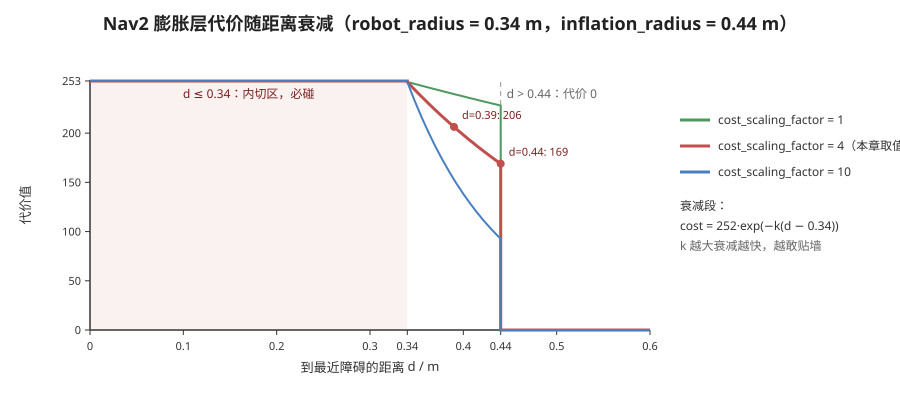

<p align="center"><b>图 10-14</b> Nav2 膨胀层代价随距离衰减：0.34 m 以内为内切区，0.34～0.44 m 按指数衰减，cost_scaling_factor 越大衰减越快</p>

**激光观测源。** 激光观测源配置为 `/scan`，消息类型为 `LaserScan`，同时启用：

- `marking: true`：检测到障碍时写入代价地图；
- `clearing: true`：射线穿过的自由空间用于清除旧障碍。

障碍有效范围到 `7.5 m`，射线清除范围到 `8.0 m`，与 bridge 发布的模拟激光量程一致。

```yaml
# 摘自 code/code_chapter10_2/config/nav2_params.yaml
local_costmap:
  local_costmap:
    ros__parameters:
      use_sim_time: true
      update_frequency: 10.0
      publish_frequency: 5.0
      global_frame: odom
      robot_base_frame: base_link
      rolling_window: true
      width: 6
      height: 6
      resolution: 0.05
      robot_radius: 0.34
      plugins: [obstacle_layer, inflation_layer]
      obstacle_layer:
        plugin: nav2_costmap_2d::ObstacleLayer
        enabled: true
        observation_sources: scan
        scan:
          topic: /scan
          data_type: LaserScan
          clearing: true
          marking: true
          obstacle_min_range: 0.12
          obstacle_max_range: 7.5
          raytrace_min_range: 0.12
          raytrace_max_range: 8.0
          max_obstacle_height: 2.0
      inflation_layer:
        plugin: nav2_costmap_2d::InflationLayer
        inflation_radius: 0.44
        cost_scaling_factor: 4.0
      always_send_full_costmap: true

global_costmap:
  global_costmap:
    ros__parameters:
      # ...
      global_frame: map
      track_unknown_space: false
      plugins: [static_layer, obstacle_layer, inflation_layer]
      static_layer:
        plugin: nav2_costmap_2d::StaticLayer
        map_subscribe_transient_local: true
      # obstacle_layer / inflation_layer 与局部代价地图相同
```

**定位简化。** 当前示例没有启动 AMCL。`nav2_bridge.py` 直接发布恒等 `map -> odom` 和仿真真值 `odom -> base_link`。因此读者不需要先解决定位问题就能学习 Nav2，但将代码迁移到真实机器人时必须替换这一部分。

> 💡 **要点**：动态障碍物在教学版中由仿真直接"告诉"局部规划器；在 Nav2 版中它只能通过 `/scan` 被看见——bridge 把动态障碍写进射线投射地图，再由 `obstacle_layer` 标记。这更接近真实机器人的情况。

### 5.4 全局规划器与路径平滑服务器

**NavFn 规划器。** 全局规划服务器注册名为 `GridBased` 的 NavFn 插件。关键参数为：

| 参数 | 当前值 | 含义 |
|---|---:|---|
| `expected_planner_frequency` | `5.0 Hz` | 期望规划器工作频率 |
| `use_astar` | `true` | 使用 A*，而不是默认 Dijkstra 方式 |
| `tolerance` | `0.15 m` | 目标附近允许寻找可达替代点的容差 |
| `allow_unknown` | `false` | 不允许规划进入未知区域 |

NavFn 的 A* 与教学版思想一致（ $f=g+h$），区别在于它在**代价地图**上搜索：格子代价越高，经过它的 $g$ 增长越多，因此即便不进入 253/254 的禁区，路径也会自然地远离障碍。教学版的二值地图做不到这一点，只能靠更大的膨胀半径换取安全距离。`tolerance` 则对应教学版的 `_nearest_free`：目标恰好不可达时，允许在 $0.15\ \mathrm{m}$ 内找替代终点。

**Simple Smoother。** 参数文件配置并启动了 `nav2_smoother::SimpleSmoother` 平滑服务器：

| 参数 | 当前值 | 含义 |
|---|---:|---|
| `tolerance` | `1.0e-10` | 优化停止容差 |
| `max_its` | `1000` | 最大迭代次数 |
| `do_refinement` | `true` | 对结果继续细化 |

```yaml
# 摘自 code/code_chapter10_2/config/nav2_params.yaml
planner_server:
  ros__parameters:
    use_sim_time: true
    expected_planner_frequency: 5.0
    planner_plugins: [GridBased]
    GridBased:
      plugin: nav2_navfn_planner/NavfnPlanner
      tolerance: 0.15
      use_astar: true
      allow_unknown: false

smoother_server:
  ros__parameters:
    use_sim_time: true
    smoother_plugins: [simple_smoother]
    simple_smoother:
      plugin: nav2_smoother::SimpleSmoother
      tolerance: 1.0e-10
      max_its: 1000
      do_refinement: true
```

与教学版 Chaikin "一次性构造新点"不同，Simple Smoother 是迭代优化：反复微调路径点，在"贴近原路径"和"与相邻点平滑"之间取平衡，直到变化量小于 `tolerance` 或达到 `max_its`。两者目标一致——不越过障碍的前提下减少折角。

> ⚠️ **注意**：再次强调，本仓库配置并启动了 `SimpleSmoother`，但 Launch 没有指定自定义 `default_nav_to_pose_bt_xml`。**当前代码能够启动 smoother server，但默认导航任务不保证实际调用路径平滑 Action**。不要只修改 `simple_smoother` 参数后就假定路径已经被优化。

### 5.5 DWB 局部控制器：速度空间采样与评分

**直观理解。** Nav2 中的局部规划与轨迹跟踪由 DWB（Dynamic Window approach，"B" 表示该实现的第二代版本）控制器统一完成。DWB 的基本思想不是先输出一条固定局部路径，再单独用另一个跟踪器追踪，而是在速度空间中"试驾"：把一批候选速度各自模拟开一小段，看哪条轨迹最好，就执行哪个速度。

**原理与公式。** DWB 在速度空间中采样候选速度：

$$
(v_x,v_y,\omega_z)
$$

然后对每个候选速度进行短时间前向模拟，得到一条候选轨迹，再使用多个评价器进行评分。得分较低且无碰撞的轨迹对应下一周期速度指令：

$$
(v_x,v_y,\omega_z)^{*}=\arg\min_{(v_x,v_y,\omega_z)\in\mathcal{V}}\ \sum_{i} s_i\cdot c_i\big(\tau(v_x,v_y,\omega_z)\big)
$$

其中 $\mathcal{V}$ 是满足速度、加速度约束的采样集合， $\tau(\cdot)$ 是以该速度前向模拟 `sim_time` 得到的轨迹， $c_i$ 是第 $i$ 个评价器（critic）的原始分数， $s_i$ 是它的权重（`*.scale`）。碰撞轨迹被直接剔除。

"动态窗口"指 $\mathcal{V}$ 不是整个速度范围，而是当前速度在一个控制周期内**能达到**的范围。以 `acc_lim_x = 0.8 m/s²`、控制频率 $20\ \mathrm{Hz}$ 为例，一个周期内 $v_x$ 最多变化 $0.8\times0.05=0.04\ \mathrm{m/s}$。

本章为 G2 全向底盘同时开放 $v_x$ 和 $v_y$：

| 参数 | 当前值 |
|---|---:|
| `min_vel_x / max_vel_x` | `-0.55 / 0.55 m/s` |
| `min_vel_y / max_vel_y` | `-0.55 / 0.55 m/s` |
| `max_vel_theta` | `1.0 rad/s` |
| `max_speed_xy` | `0.55 m/s` |
| `vx_samples` | `12` |
| `vy_samples` | `12` |
| `vtheta_samples` | `16` |
| `sim_time` | `1.5 s` |

**案例：采样规模。** 如果不考虑约束过滤，三个维度可形成最多 `12 × 12 × 16 = 2304` 组离散速度组合。DWB 会对候选轨迹进行碰撞检查和代价评价，而不是把这些速度全部发送给机器人。每条轨迹模拟 $1.5\ \mathrm{s}$；以 $0.55\ \mathrm{m/s}$ 计最远约 $0.83\ \mathrm{m}$，按 `linear_granularity: 0.05` 约需 17 个检查点。也就是说每个 $50\ \mathrm{ms}$ 控制周期里，DWB 最多要做数万次代价地图查询——这就是采样数不能无限增大的原因。

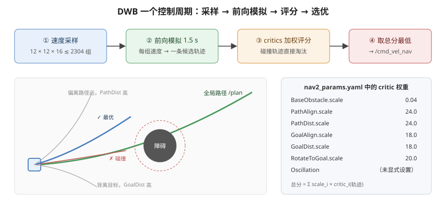

<p align="center"><b>图 10-15</b> DWB 一个控制周期：速度采样、前向模拟、critic 加权评分、取总分最低者；右侧为本章 nav2_params.yaml 中的 critic 权重</p>

当前使用的评价器包括：

| Critic | 作用 | 本章权重 `scale` |
|---|---|---:|
| `BaseObstacle` | 惩罚靠近或碰到障碍的轨迹 | 0.04 |
| `PathAlign` | 让机器人运动方向与全局路径方向一致 | 24.0 |
| `GoalAlign` | 让机器人朝向有利于接近目标 | 18.0 |
| `PathDist` | 惩罚偏离全局路径 | 24.0 |
| `GoalDist` | 惩罚距离目标过远 | 18.0 |
| `RotateToGoal` | 接近目标时完成最终朝向调整 | 20.0 |
| `Oscillation` | 抑制前后、左右或旋转方向反复切换 | 未显式设置 |

这些评价器共同决定"安全、贴近路径、朝向合理、能够接近目标"的综合效果。调参时不能只看某一个权重；某个权重过大可能压制其他目标，导致机器人虽然贴近路径，却无法有效绕障或调整朝向。

```yaml
# 摘自 code/code_chapter10_2/config/nav2_params.yaml（controller_server.FollowPath）
    FollowPath:
      plugin: dwb_core::DWBLocalPlanner
      debug_trajectory_details: false
      min_vel_x: -0.55
      min_vel_y: -0.55
      max_vel_x: 0.55
      max_vel_y: 0.55
      max_vel_theta: 1.0
      min_speed_xy: 0.0
      max_speed_xy: 0.55
      min_speed_theta: 0.0
      acc_lim_x: 0.8
      acc_lim_y: 0.8
      acc_lim_theta: 1.8
      decel_lim_x: -0.8
      decel_lim_y: -0.8
      decel_lim_theta: -1.8
      vx_samples: 12
      vy_samples: 12
      vtheta_samples: 16
      sim_time: 1.5
      linear_granularity: 0.05
      angular_granularity: 0.04
      transform_tolerance: 0.25
      xy_goal_tolerance: 0.12
      trans_stopped_velocity: 0.05
      short_circuit_trajectory_evaluation: true
      stateful: true
      critics: [RotateToGoal, Oscillation, BaseObstacle, GoalAlign, PathAlign, PathDist, GoalDist]
      BaseObstacle.scale: 0.04
      PathAlign.scale: 24.0
      PathAlign.forward_point_distance: 0.25
      GoalAlign.scale: 18.0
      GoalAlign.forward_point_distance: 0.25
      PathDist.scale: 24.0
      GoalDist.scale: 18.0
      RotateToGoal.scale: 20.0
      RotateToGoal.slowing_factor: 5.0
      RotateToGoal.lookahead_time: -1.0
```

由于 G2 是全向底盘，本章把 `min_vel_y` 和 `max_vel_y` 分别设为 `-0.55` 与 `0.55`。如果把两者都设为零，DWB 就不会采样横向速度，机器人会退化为不能横移的底盘模型。

**教学版跟踪器与 DWB 对比。**

| 对比项 | `HolonomicPathTracker` | DWB |
|---|---|---|
| 决策方式 | 解析公式： $v=k_p\cdot$ 误差 | 采样 + 模拟 + 打分 |
| 避障 | 依赖局部规划器先给出无碰撞路径 | 评分中直接考虑代价地图 |
| 每周期计算量 | 极小 | 数千条轨迹 |
| 调参对象 | 前视距离、增益、限速 | 采样数、`sim_time`、critic 权重 |

> ⚠️ **注意**：`BaseObstacle.scale = 0.04` 看起来远小于其他权重，但它乘的是代价地图的代价值（可达 252 左右），而路径类 critic 的原始分数通常是以格为单位的距离，量纲不同。不要仅凭数字大小判断谁"更重要"。

### 5.6 控制频率、容差、恢复行为与速度平滑

控制服务器以 `20 Hz` 运行。进度检查与目标检查参数为：

| 参数 | 当前值 | 含义 |
|---|---:|---|
| `required_movement_radius` | `0.12 m` | 判定有效进度所需移动距离 |
| `movement_time_allowance` | `8.0 s` | 允许无明显进度的最长时间 |
| `xy_goal_tolerance` | `0.12 m` | 目标位置容差 |
| `yaw_goal_tolerance` | `0.12 rad` | 目标航向容差 |
| `stateful` | `true` | 到达位置后保持目标检查状态，继续完成朝向 |

它们与教学版 `ProgressChecker`（ $0.12\ \mathrm{m}$ / $7.0\ \mathrm{s}$）和目标容差（ $0.12\ \mathrm{m}$ / $0.12\ \mathrm{rad}$）几乎一一对应。

DWB 内部速度约束为：

| 参数 | 线速度 $x/y$ | 角速度 |
|---|---:|---:|
| 最大速度 | `0.55 m/s` | `1.0 rad/s` |
| 最大加速度 | `0.8 m/s²` | `1.8 rad/s²` |
| 最大减速度绝对值 | `0.8 m/s²` | `1.8 rad/s²` |

**恢复行为。** `behavior_server` 提供：

- `spin`：原地旋转；
- `backup`：后退；
- `drive_on_heading`：沿指定方向移动；
- `wait`：等待环境变化。

这些行为由 `bt_navigator` 的行为树按任务状态调度。`behavior_server` 使用 `odom` 坐标系和局部代价地图（`local_costmap/costmap_raw`）判断恢复动作是否安全，旋转速度限制在 $0.2\sim1.0\ \mathrm{rad/s}$。

**速度平滑器。** 最后，`velocity_smoother` 以 `20 Hz` 对速度进行平滑，并限制速度、加速度、减速度。其关键参数为：

| 参数 | 当前值 |
|---|---|
| `max_velocity` | `[0.55, 0.55, 1.0]` |
| `min_velocity` | `[-0.55, -0.55, -1.0]` |
| `max_accel` | `[0.8, 0.8, 1.8]` |
| `max_decel` | `[-0.8, -0.8, -1.8]` |
| `feedback` | `OPEN_LOOP` |
| `velocity_timeout` | `0.5 s` |

`velocity_smoother` 也不是规划插件，它读取数组形式的三轴速度、加速度和减速度限制，三个位置依次对应 `vx`、`vy`、`wz`。`OPEN_LOOP` 表示它以上一次输出的速度为基准做限幅，而不是读取里程计实测速度。

**案例：从静止加速到最大速度要多久？** $v_x$ 从 0 到 $0.55\ \mathrm{m/s}$，加速度上限 $0.8\ \mathrm{m/s^2}$，需 $0.55/0.8\approx0.69\ \mathrm{s}$，在 $20\ \mathrm{Hz}$ 下约 14 个周期，每周期增加 $0.04\ \mathrm{m/s}$。

Nav2 的最终速度通过 `/cmd_vel` 发送给 `nav2_bridge.py`。bridge 自身也设置 `0.5 s` 指令超时：如果长时间没有收到新速度，就向第四章底盘控制器发送零速度。ROS 2 Humble 的标准导航 Launch 将控制器原始速度放到 `/cmd_vel_nav`，平滑器处理后输出 `/cmd_vel`，正好与 bridge 的订阅一致。于是参数链为：

```text
FollowPath.max_vel_* / acc_lim_*
        ↓ 决定 DWB 可采样范围
controller_server: /cmd_vel_nav
        ↓
velocity_smoother.max_velocity / max_accel / max_decel
        ↓ 再做输出限幅和平滑
/cmd_vel
        ↓
nav2_bridge.py 的 0.5 s 超时保护
        ↓
G2BaseController
```

这种双层约束体现了工程控制中的重要原则：规划器给出的速度仍然要经过平滑和超时保护，底盘执行端也不应无限保持最后一条旧指令。

> ⚠️ **注意**：DWB 的 `max_vel_*`、`velocity_smoother` 的 `max_velocity` 与第四章 `ControlLimits` 是三层独立的限速。只改其中一层往往看不到效果——实际速度取三者中最严格的那个。

### 5.7 参数文件如何装载插件

参数文件按"节点名 → `ros__parameters` → 插件列表 → 插件实例参数"组织。例如：

```yaml
planner_server:
  ros__parameters:
    planner_plugins: [GridBased]
    GridBased:
      plugin: nav2_navfn_planner/NavfnPlanner
      use_astar: true
```

装载过程可以理解为：

1. `planner_server` 读取 `planner_plugins: [GridBased]`；
2. 它寻找名为 `GridBased` 的参数组；
3. `GridBased.plugin` 指定真正实例化的 C++ 插件类型；
4. `use_astar`、`tolerance`、`allow_unknown` 传给这个插件实例；
5. BT 以规划器 ID `GridBased` 请求路径时，`planner_server` 调用该实例。

`controller_server` 的写法与之对应：

```yaml
controller_server:
  ros__parameters:
    controller_frequency: 20.0
    controller_plugins: [FollowPath]
    progress_checker_plugin: progress_checker
    goal_checker_plugins: [goal_checker]

    FollowPath:
      plugin: dwb_core::DWBLocalPlanner
      min_vel_x: -0.55
      max_vel_x: 0.55
      min_vel_y: -0.55
      max_vel_y: 0.55
      vx_samples: 12
      vy_samples: 12
      vtheta_samples: 16
      sim_time: 1.5
```

这里有三类不同 ID：

- `FollowPath` 是控制器插件实例 ID，行为树把全局路径交给它；
- `progress_checker` 判断机器人是否在规定时间内产生了足够位移；
- `goal_checker` 判断位置和朝向是否进入目标容差。

代价地图参数采用两层节点命名。例如 `local_costmap.local_costmap.ros__parameters` 中，`plugins` 决定加载哪些层，每个同名参数组再指定插件类型和数据源（见 5.3 节的完整 YAML）。

其他服务器采用相同模式：

| 服务器 | 插件 ID | 插件类型 | 本章中的作用 |
|---|---|---|---|
| `planner_server` | `GridBased` | `nav2_navfn_planner/NavfnPlanner` | 在全局代价地图上使用 A* 生成全局路径 |
| `controller_server` | `FollowPath` | `dwb_core::DWBLocalPlanner` | 采样全向速度、前向模拟轨迹并评分，完成局部避障和路径跟踪 |
| `smoother_server` | `simple_smoother` | `nav2_smoother::SimpleSmoother` | 在被行为树调用时平滑全局路径 |
| `behavior_server` | `spin`、`backup`、`drive_on_heading`、`wait` | Nav2 Behaviors | 规划或控制失败后的恢复动作 |
| `local_costmap` | `obstacle_layer`、`inflation_layer` | Costmap Layers | 融合 `/scan`，维护机器人周围 `6 m × 6 m` 滚动窗口 |
| `global_costmap` | `static_layer`、`obstacle_layer`、`inflation_layer` | Costmap Layers | 融合静态地图和激光障碍，供全局规划使用 |

> 💡 **要点**：插件 ID 是"名字"，`plugin` 字段是"类型"。同一类型可以注册多个不同 ID 的实例（例如两个参数不同的 DWB），由行为树按 ID 选择——这是 Nav2 可扩展性的核心。

---


## 第六部分 代码结构与实现解析

前五部分在讲原理时已经穿插了核心算法代码。本部分换一个视角：按"文件 → 调用关系 → 执行顺序"把两套工程串起来，并把两套工程**完全分开**：

| 代码目录 | 谁完成规划与控制 | 目标怎样进入系统 | 最终速度怎样进入底盘 |
|---|---|---|---|
| `code/code_chapter10_1` | 本章自己实现的 A*、轨迹优化、局部规划、跟踪器和状态机 | `demo_navigation.py` 默认目标或 `/goal_pose` | 主循环直接调用第四章 `G2BaseController` |
| `code/code_chapter10_2` | 标准 Nav2 节点和插件 | `/navigate_to_pose` Action 或 RViz 的 Nav2 Goal | Nav2 发布 `/cmd_vel`，`nav2_bridge.py` 转交给 `G2BaseController` |

这两套代码不是上下游关系。`code_chapter10_2` **不会调用** `code_chapter10_1` 中的 `AStarPlanner`、`TrajectoryOptimizer`、`LocalPlanner`、`HolonomicPathTracker` 或 `TeachingNavigator`。前者用于拆开算法观察内部过程，后者用于学习真实 ROS 2/Nav2 工程怎样通过节点、Action、话题、TF 和参数插件完成同类功能。

### 6.1 文件组织

**`code_chapter10_1`：自研教学导航。**

```text
code/code_chapter10_1/
├── __init__.py               # 导出 Pose2D、OccupancyGrid2D、AStarPlanner 等核心类
├── config.py                 # 教学版统一参数（地图、规划、跟踪、安全、仿真、动态障碍）
├── geometry.py               # 二维位姿、速度和坐标变换
├── costmap.py                # 占据栅格、膨胀、碰撞查询、射线投射、PGM/YAML 读写
├── build_map.py              # 构造静态地图（可单独运行生成 maps/ 下的文件）
├── global_planner.py         # 八邻域 A*
├── trajectory.py             # 捷径化、平滑、重采样和航向生成
├── local_planner.py          # 局部目标、动态障碍和局部 A*
├── path_tracker.py           # 全向底盘前视轨迹跟踪
├── navigator.py              # 状态机、碰撞监控、进度检查与恢复
├── simulation.py             # Isaac Sim 场景和动态障碍
├── ros2_interface.py         # 教学路径、状态和传感器可视化
├── demo_navigation.py        # 教学版装配入口与主循环
├── run_teaching_navigation.sh  # 用 Isaac Sim python.sh 启动 demo_navigation.py
├── run_rviz.sh               # 用系统 ROS 2 启动 RViz（chapter10_1_navigation.rviz）
├── config/chapter10_1_navigation.rviz
├── maps/chapter10_1_map.yaml / .pgm
└── tests/                    # 不依赖 Isaac Sim 的算法测试（原文列出，见 7.2 节说明）
```

**`code_chapter10_2`：标准 Nav2 工程。**

```text
code/code_chapter10_2/
├── config.py                 # 场景、地图与仿真配置（Pose2D、障碍物定义等）
├── map_utils.py              # 最小地图工具：只生成静态地图和模拟 LaserScan，不含规划算法
├── build_map.py              # 生成 maps/chapter10_2_map.yaml / .pgm
├── simulation.py             # Isaac Sim 场景加载
├── nav2_bridge.py            # Isaac Sim ⇄ ROS 2 桥接器
├── config/
│   ├── nav2_params.yaml      # 所有 Nav2 服务器与插件参数
│   └── chapter10_2_navigation.rviz
├── launch/
│   └── nav2_navigation.launch.py   # map_server + Nav2 官方 navigation_launch + RViz
├── maps/
│   ├── chapter10_2_map.yaml
│   └── chapter10_2_map.pgm
├── g2_chapter10_2_nav/       # 标准 ament_python ROS 2 包
│   ├── package.xml
│   ├── setup.py              # 注册 console_scripts: send_goal
│   ├── launch/
│   ├── config/
│   ├── maps/
│   └── g2_chapter10_2_nav/
│       └── send_goal.py      # NavigateToPose Action 客户端
├── build_nav2.sh             # 生成地图、同步配置、colcon 构建
├── run_nav2_bridge.sh        # 终端 1：Isaac Sim + bridge
├── run_nav2.sh               # 终端 2：map_server + Nav2 + RViz
├── run_rviz.sh               # 单独启动 RViz
├── send_goal.sh              # 终端 3：发送目标
└── check_nav2.sh             # 检查关键话题、Action 和 TF
```

### 6.2 模块调用关系

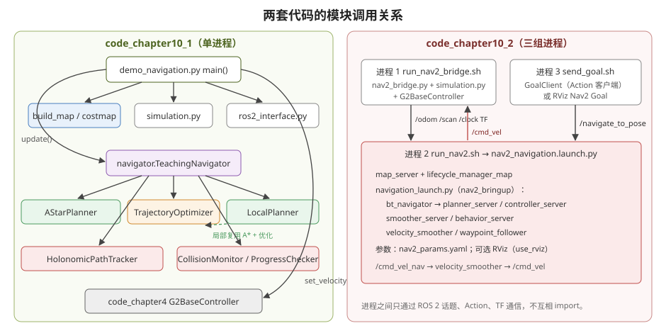

<p align="center"><b>图 10-16</b> 两套代码的模块调用关系：左侧教学版是单进程内的函数调用；右侧 Nav2 版是三组独立进程，只通过 ROS 2 话题、Action 和 TF 通信</p>

教学版推荐按"数据结构 → 地图 → 全局规划 → 路径优化 → 局部规划 → 跟踪 → 状态机 → 主循环"的顺序阅读：

```text
geometry.py
    ↓
costmap.py → global_planner.py → trajectory.py
                                      ↓
                              local_planner.py
                                      ↓
                               path_tracker.py
                                      ↓
                                 navigator.py
                                      ↓
                           demo_navigation.py
```

Nav2 版这里最容易产生的误解是：**Nav2 不是在 `nav2_bridge.py` 中被 `import` 后调用的一个 Python 类。** 实际运行时至少有三组独立进程，它们通过 ROS 2 通信：

| 进程 | 启动入口 | 职责 | 与其他进程的接口 |
|---|---|---|---|
| Isaac Sim 与 bridge | `run_nav2_bridge.sh` | 仿真、里程计、激光、TF、仿真时钟和底盘执行 | 发布 `/clock`、`/odom`、`/scan`、TF；订阅 `/cmd_vel` |
| Nav2 服务器组 | `run_nav2.sh` | 地图、代价地图、全局规划、局部控制、行为树、恢复和速度平滑 | 提供 `/navigate_to_pose` 等 Action；消费地图、TF、里程计和激光；输出速度 |
| 目标客户端 | `send_goal.sh` 或 RViz | 构造目标位姿并等待结果 | 调用 `/navigate_to_pose` Action |

从调用关系看，一次目标请求经过下面的数据链：

```text
send_goal.py 或 RViz
        │  NavigateToPose Action: /navigate_to_pose
        ▼
bt_navigator
        │
        ├── ComputePathToPose ──> planner_server
        │                           ├── global_costmap
        │                           └── NavfnPlanner(A*)
        │
        ├── FollowPath ─────────> controller_server
        │                           ├── local_costmap
        │                           └── DWBLocalPlanner
        │
        └── 失败时调用恢复行为 ─> behavior_server
                                    ├── Spin
                                    ├── BackUp
                                    ├── DriveOnHeading
                                    └── Wait

controller_server 的原始速度
        │ /cmd_vel_nav
        ▼
velocity_smoother
        │ /cmd_vel
        ▼
nav2_bridge.py
        ▼
G2BaseController
        ▼
Isaac Sim 中的四轮独立转向底盘
```

与此同时，环境信息沿反方向进入 Nav2：

```text
静态 PGM/YAML ──> map_server ──> /map ──> global_costmap
Isaac Sim 位姿 ─> /odom + TF ───────────> Nav2
模拟激光 ──────> /scan ────────────────> local/global obstacle_layer
仿真时间 ──────> /clock ───────────────> 所有 use_sim_time 节点
```

因此，"调用 Nav2"实际包含三件事：先提供 Nav2 所需的数据接口，再启动并激活各服务器，最后通过 Action 发送目标。缺少其中任何一项，都不会形成完整导航闭环。

### 6.3 关键流程逐段解读

#### 6.3.1 教学版：参数集中管理

`code_chapter10_1/config.py` 用数据类集中管理参数。规划、跟踪和安全参数分别保存：

```python
# 摘自 code/code_chapter10_1/config.py
@dataclass(frozen=True)
class PlannerConfig:
    allow_diagonal: bool = True
    heuristic_weight: float = 1.0
    shortcut_passes: int = 2
    path_spacing: float = 0.12
    local_lookahead_distance: float = 2.4
    local_window_radius: float = 3.0
    local_replan_period: float = 0.40
    detour_hold_cycles: int = 3

@dataclass(frozen=True)
class TrackerConfig:
    # 稍长的前视距离与较低增益可减少局部路径更新时的左右摆动。
    lookahead_distance: float = 0.70
    position_gain: float = 1.0
    yaw_gain: float = 1.5
    max_linear_speed: float = 0.48
    max_angular_speed: float = 0.80
    detour_speed_limit: float = 0.34
    slow_down_distance: float = 0.90
    position_tolerance: float = 0.12
    yaw_tolerance: float = 0.12

@dataclass(frozen=True)
class SafetyConfig:
    max_tilt_angle: float = 0.35  # rad，约 20°，超过后立即停车
    collision_horizon: float = 0.12
    collision_step: float = 0.05
    progress_timeout: float = 7.0
    minimum_progress: float = 0.12
    max_recovery_attempts: int = 3

@dataclass(frozen=True)
class SimulationConfig:
    headless: bool = False
    physics_hz: int = 120
    rendering_hz: int = 60
    warmup_steps: int = 120
    renderer: str = "RaytracedLighting"
    robot_start: Pose2D = field(default_factory=lambda: Pose2D(-3.6, -3.3, 0.0))
    default_goal: Pose2D = field(default_factory=lambda: Pose2D(3.6, 3.2, 1.57))
    dynamic_obstacle: bool = True
```

需要注意当前代码中的两个参数连接细节：

- `PlannerConfig.shortcut_passes` 已在配置类中定义，但 `demo_navigation.py` 当前没有把它显式传给 `TrajectoryOptimizer.optimize()`；实际运行使用该函数默认值 `2`。如果要通过配置修改轮数，需要在调用 `optimize()` 时继续传递该字段；
- `MapConfig.unknown_is_occupied` 也没有从主程序显式传入查询函数；当前地图查询函数自身默认把未知栅格视为占用，因此默认行为与配置值 `True` 一致。若要允许未知区域，需要同时修改参数传递链，而不是只改配置字段。

#### 6.3.2 教学版：主程序装配

`demo_navigation.py` 是所有模块的装配入口。核心创建顺序为：

```python
# 摘自 code/code_chapter10_1/demo_navigation.py（main）
map_config = MapConfig()
planner_config = PlannerConfig()
tracker_config = TrackerConfig()
safety_config = SafetyConfig()
raw_map = build_navigation_map(map_config)
planning_map = raw_map.inflated(map_config.inflation_radius)

planner = AStarPlanner(
    planning_map,
    allow_diagonal=planner_config.allow_diagonal,
    heuristic_weight=planner_config.heuristic_weight,
)
optimizer = TrajectoryOptimizer(planning_map, planner_config.path_spacing)
local_planner = LocalPlanner(
    planning_map,
    lookahead_distance=planner_config.local_lookahead_distance,
    window_radius=planner_config.local_window_radius,
    path_spacing=planner_config.path_spacing,
    dynamic_padding=map_config.inflation_radius,
    detour_hold_cycles=planner_config.detour_hold_cycles,
)
tracker = HolonomicPathTracker(**tracker_config.__dict__, costmap=planning_map)
navigator = TeachingNavigator(
    planning_map, planner, optimizer, local_planner, tracker,
    collision_horizon=safety_config.collision_horizon,
    collision_step=safety_config.collision_step,
    progress_timeout=safety_config.progress_timeout,
    minimum_progress=safety_config.minimum_progress,
    max_recovery_attempts=safety_config.max_recovery_attempts,
    local_replan_period=planner_config.local_replan_period,
    safety_costmap=raw_map.inflated(map_config.robot_radius),
)
```

随后复用第四章底盘模块。导航使用的底盘加速度限制比第四章单独速度演示更保守：

```python
# 摘自 code/code_chapter10_1/demo_navigation.py（main）
simulation = G2NavigationSimulation(sim_config, enable_ros2=not args.no_rviz)
geometry = RobotGeometry()
kinematics = SwerveKinematics(geometry.wheel_positions, geometry.wheel_radius)
# 导航比单独速度演示更强调稳定性：降低加速度，避免局部路径变化时冲击底盘。
navigation_limits = ControlLimits(
    max_linear_speed=tracker_config.max_linear_speed,
    max_angular_speed=tracker_config.max_angular_speed,
    max_linear_acceleration=0.40,
    max_angular_acceleration=0.90,
)
base = G2BaseController(simulation.robot, kinematics, navigation_limits)
```

#### 6.3.3 教学版：一次控制周期

教学版的一次控制周期是：

1. `simulation.py` 读取机器人当前位姿和动态障碍；
2. `TeachingNavigator.update()` 决定是否重新规划全局或局部路径；
3. `HolonomicPathTracker.compute()` 计算底盘坐标系速度 `(vx, vy, wz)`；
4. `CollisionMonitor.safe_command()` 对短时预测轨迹做最后安全检查；
5. `demo_navigation.py` 将速度直接交给 `G2BaseController`；
6. `ros2_interface.py` 只把地图、路径、状态和速度副本发布到 RViz 观察。

```python
# 摘自 code/code_chapter10_1/demo_navigation.py（主循环，有删减）
control_period_steps = max(1, sim_config.physics_hz // 20)          # 120//20 = 6
visualization_period_steps = max(1, sim_config.physics_hz // 10)    # 120//10 = 12
scan_angles = [(-math.pi + index * 2.0 * math.pi / 359.0) for index in range(360)]
# ...
max_steps = int(args.timeout / sim_config.physics_dt)
for step in range(max_steps):
    pose = simulation.get_pose2d()
    tilt_angle = simulation.get_tilt_angle()
    if tilt_angle > safety_config.max_tilt_angle:                   # 防倾倒
        raise RuntimeError(f"底盘倾斜达到 {math.degrees(tilt_angle):.1f}°，已触发防倾倒停车")
    dynamic = simulation.dynamic_obstacles()

    if ros2:
        ros2.spin_once()
        requested_goal = ros2.take_goal()                           # RViz 2D Goal Pose
        if requested_goal is not None:
            goal = requested_goal
            navigator.set_goal(goal, pose, now=simulation.sim_time)

    if step % control_period_steps == 0:                            # 20 Hz 导航决策
        output = navigator.update(pose, dynamic, now=simulation.sim_time)
        command = output.command
        if output.state != last_state or output.message != last_message:
            print(f"[{output.state.value}] {output.message}", flush=True)
            last_state, last_message = output.state, output.message
    # 非控制周期保持上一条命令，底层仍以物理频率更新限速和车轮关节。
    base.set_velocity(command.vx, command.vy, command.wz)
    base.update(sim_config.physics_dt)                              # 120 Hz 底盘控制
    # ...（20 Hz 发布位姿；10 Hz 发布路径、标记和激光）
    simulation.step()
    if output.state == NavigationState.SUCCEEDED:
        print(f"[完成] 到达目标，最终位姿：({pose.x:.2f}, {pose.y:.2f}, {pose.yaw:.2f})", flush=True)
        break
    if output.state == NavigationState.FAILED:
        raise RuntimeError(output.message)
else:
    raise TimeoutError(f"导航在 {args.timeout:.1f} 秒内未完成")
```

主循环中，导航控制以 `20 Hz` 更新，底层控制器仍按 `120 Hz` 物理频率执行。非控制周期保持上一条速度指令，使关节速度和加速度变化连续。终端里看到的 `[CONTROLLING] ...` 这类日志只在状态或消息变化时打印一次，所以不会刷屏。默认 `--timeout 90`，即 $90/(1/120)=10800$ 个物理步。

#### 6.3.4 教学版：ROS 2 可视化接口

`code_chapter10_1/ros2_interface.py` 只承担教学版的可视化和目标输入，不参与 Nav2。它发布的主要话题如下：

| 话题 | 含义 |
|---|---|
| `/map` | 教学版占据栅格地图 |
| `/plan/global` | 自研 A* 与优化器得到的全局路径 |
| `/plan/local` | 局部规划器当前采用的局部路径 |
| `/plan/executed` | 机器人已经走过的轨迹 |
| `/odom` | Isaac Sim 中的机器人位姿与速度 |
| `/scan` | 教学版模拟激光雷达 |
| `/teaching_cmd_vel` | 自研轨迹跟踪器输出的速度，仅用于观察 |
| `/navigation/markers` | 目标点、前视点和动态障碍物标记 |
| `/navigation/status` | 教学状态机状态与文字说明 |
| `/clock` | 仿真时间 |

它还订阅 `/goal_pose`，所以可以在 RViz 中使用 **2D Goal Pose** 修改教学版目标。需要特别注意：`/teaching_cmd_vel` 不是 Nav2 的 `/cmd_vel`，教学版速度由主程序直接交给第四章 `G2BaseController`，不会经过 Nav2 服务器。

激光数据是"假"的：主程序把动态障碍写进原始地图的副本，再用 `OccupancyGrid2D.ray_cast()` 沿 360 条射线以约 $0.025\ \mathrm{m}$ 步进，遇到占用格即返回距离，量程 $0.12\sim8.0\ \mathrm{m}$。

#### 6.3.5 Nav2 版：Isaac Sim—Nav2 bridge

`nav2_bridge.py` 的职责非常克制：它不做规划，只把仿真世界转换成 Nav2 能理解的 ROS 2 数据，并把 Nav2 速度转换为第四章底盘控制命令。

**1. 创建 ROS 2 接口。** `Nav2IsaacBridge.__init__()` 创建三个发布器、两个 TF 广播器和一个速度订阅器：

```python
# 摘自 code/code_chapter10_2/nav2_bridge.py
self.odom_pub = self.node.create_publisher(Odometry, "/odom", 30)
self.scan_pub = self.node.create_publisher(LaserScan, "/scan", 10)
self.clock_pub = self.node.create_publisher(Clock, "/clock", 20)
self.tf_pub = TransformBroadcaster(self.node)
self.static_tf_pub = StaticTransformBroadcaster(self.node)
self.node.create_subscription(Twist, "/cmd_vel", self._command_callback, 10)
```

它们的消息契约如下：

| 接口 | 消息/变换 | 关键坐标系 | 用途 |
|---|---|---|---|
| `/clock` | `rosgraph_msgs/Clock` | 无 | 让所有 `use_sim_time: true` 节点使用同一个仿真时间 |
| `/odom` | `nav_msgs/Odometry` | `odom -> base_link` | 提供机器人位姿和 `(vx, vy,wz)` |
| `/scan` | `sensor_msgs/LaserScan` | `base_scan` | 给代价地图障碍层标记和清除障碍 |
| TF | `map -> odom -> base_link -> base_scan` | 四层坐标树 | 让地图、机器人和激光数据能够互相转换 |
| `/cmd_vel` | `geometry_msgs/Twist` | `base_link` 语义 | 接收 Nav2 最终平滑后的底盘速度 |

**2. 接收 Nav2 速度并设置超时保护。** 回调只保存最新速度，不直接操作关节：

```python
# 摘自 code/code_chapter10_2/nav2_bridge.py
def _command_callback(self, message) -> None:
    self.command = Velocity2D(message.linear.x, message.linear.y, message.angular.z)
    self.last_command_time = self.sim_time
```

主循环调用 `spin_once()` 执行一次 ROS 2 回调。如果超过 `0.5 s` 没收到新命令，就返回零速度：

```python
# 摘自 code/code_chapter10_2/nav2_bridge.py
def spin_once(self, sim_time: float) -> Velocity2D:
    self.sim_time = sim_time
    self.rclpy.spin_once(self.node, timeout_sec=0.0)
    if sim_time - self.last_command_time > 0.5:
        return Velocity2D()
    return self.command
```

这样做可以避免 Nav2 异常退出或通信中断后，底盘继续执行最后一条非零指令。`last_command_time` 初始化为 $-\infty$，所以启动后在收到第一条 `/cmd_vel` 之前底盘始终静止。

**3. 发布里程计、激光和 TF。** `publish()` 使用同一个仿真时间戳发布 `/clock`、`odom -> base_link`、`/odom` 和 `/scan`。其中激光参数与模拟射线保持一致：360 条射线、最小距离 `0.12 m`、最大距离 `8.0 m`、扫描周期 `0.1 s`。

```python
# 摘自 code/code_chapter10_2/nav2_bridge.py（publish，有删减）
quaternion_z, quaternion_w = math.sin(pose.yaw / 2.0), math.cos(pose.yaw / 2.0)
transform = self.TransformStamped()
transform.header.frame_id = "odom"
transform.child_frame_id = "base_link"
transform.header.stamp = stamp
transform.transform.translation.x = pose.x
transform.transform.translation.y = pose.y
transform.transform.rotation.z = quaternion_z
transform.transform.rotation.w = quaternion_w
self.tf_pub.sendTransform(transform)
# ... /odom 填入相同位姿与当前速度指令，并给出小的非零协方差
scan = self.LaserScan()
scan.header.frame_id = "base_scan"
scan.angle_min = angle_min
scan.angle_max = angle_max
scan.angle_increment = (angle_max - angle_min) / max(1, len(ranges) - 1)
scan.scan_time = 0.1
scan.range_min = 0.12
scan.range_max = 8.0
```

当前 TF 的含义是：

```text
map -> odom            静态恒等变换
odom -> base_link      Isaac Sim 真值位姿
base_link -> base_scan 雷达相对底盘的静态外参，z = 0.30 m
```

这里的 `map -> odom` 恒等变换只是为了把课程重点放在 Nav2 规划与控制上。它等价于假设机器人在地图中的位姿完全已知，**不是** AMCL、SLAM 或真实机器人定位方案。接入真实机器人时，应由定位系统持续估计 `map -> odom`，里程计系统发布 `odom -> base_link`。

**4. 在仿真主循环中完成闭环。** `main()` 创建场景、第四章运动学和底盘控制器，然后循环执行：

```python
# 摘自 code/code_chapter10_2/nav2_bridge.py（main）
publish_steps = max(1, sim_config.physics_hz // 20)    # 20 Hz
scan_steps = max(1, sim_config.physics_hz // 10)       # 10 Hz
# ...
while simulation.is_running():
    if step % publish_steps == 0:
        command = bridge.spin_once(simulation.sim_time)
    base.set_velocity(command.vx, command.vy, command.wz)
    base.update(sim_config.physics_dt)
    pose = simulation.get_pose2d()
    if step % scan_steps == 0:
        sensor_map = raw_map.copy()
        sensor_map.add_circles(simulation.dynamic_obstacles())
        ranges = sensor_map.ray_cast(pose, scan_angles, 0.12, 8.0)
    if step % publish_steps == 0:
        bridge.publish(simulation.sim_time, pose, command, ranges, -math.pi, math.pi)
    simulation.step()
    step += 1
```

实际代码将底盘控制和物理仿真按物理频率执行，将 ROS 2 状态约按 `20 Hz` 发布，并约按 `10 Hz` 更新激光。数据闭环因此是：Nav2 根据上一周期的位姿与激光计算速度，bridge 执行速度，Isaac Sim 产生新位姿和新激光，再反馈给 Nav2。注意 bridge 使用的是第四章默认 `ControlLimits()`，而不是教学版那组更保守的导航加速度限制；Nav2 版的加速度约束主要由 DWB 和 `velocity_smoother` 承担。

#### 6.3.6 Nav2 版：Launch 如何启动 Nav2

`run_nav2.sh` 不是直接执行某个规划器，而是先加载 ROS 2 环境和本章安装空间，再调用 Launch：

```text
run_nav2.sh
  ├── source /opt/ros/humble/setup.bash
  ├── source code/code_chapter10_2/ros2_install/setup.bash
  └── ros2 launch g2_chapter10_2_nav nav2_navigation.launch.py
```

`nav2_navigation.launch.py` 又完成三层启动。

**第一层：单独启动静态地图服务器。**

```python
# 摘自 code/code_chapter10_2/launch/nav2_navigation.launch.py
map_server = Node(
    package="nav2_map_server",
    executable="map_server",
    name="map_server",
    output="screen",
    parameters=[params, {"yaml_filename": map_yaml, "use_sim_time": True}],
)
```

地图文件不在 `nav2_params.yaml` 中写死（那里 `yaml_filename: ""`），而由 Launch 参数 `map` 覆盖 `yaml_filename`。因此可以在命令行替换地图：

```bash
ros2 launch g2_chapter10_2_nav nav2_navigation.launch.py \
  map:=/absolute/path/to/another_map.yaml
```

**第二层：让地图服务器进入 active。** 本章创建 `lifecycle_manager_map`，设置 `autostart: true`，并管理 `map_server`，所以无需手动执行 configure 和 activate：

```python
# 摘自 code/code_chapter10_2/launch/nav2_navigation.launch.py
map_lifecycle = Node(
    package="nav2_lifecycle_manager",
    executable="lifecycle_manager",
    name="lifecycle_manager_map",
    output="screen",
    parameters=[
        {"use_sim_time": True},
        {"autostart": True},
        {"node_names": ["map_server"]},
    ],
)
```

**第三层：包含 Nav2 官方导航 Launch。**

```python
# 摘自 code/code_chapter10_2/launch/nav2_navigation.launch.py
navigation = IncludeLaunchDescription(
    PythonLaunchDescriptionSource(os.path.join(nav2_dir, "launch", "navigation_launch.py")),
    launch_arguments={
        "use_sim_time": "true",
        "autostart": "true",
        "params_file": params,
        "use_composition": "False",
    }.items(),
)
```

这一步启动并激活 `controller_server`、`planner_server`、`smoother_server`、`behavior_server`、`bt_navigator`、`waypoint_follower`、`velocity_smoother` 和导航 Lifecycle Manager。`use_composition: False` 表示这些组件以便于学习和排查的独立进程运行。Launch 还声明了三个参数：`params_file`（默认包内 `config/nav2_params.yaml`）、`map`（默认包内 `maps/chapter10_2_map.yaml`）、`use_rviz`（默认 `true`）。

#### 6.3.7 Nav2 版：NavigateToPose 的具体调用

命令行目标不是向 `/goal_pose` 发布一条普通消息，而是调用 Nav2 的 `/navigate_to_pose` Action。Action 适合长时间任务，因为它同时包含：

- Goal：目标位姿；
- Feedback：剩余距离、恢复次数等中间状态；
- Result：最终成功、失败或取消状态；
- Cancel：任务执行过程中取消目标的能力。

本章从 Shell 到 Python 的调用链如下：

```text
send_goal.sh
  ├── source /opt/ros/humble/setup.bash
  ├── source ros2_install/setup.bash
  └── ros2 run g2_chapter10_2_nav send_goal --x ... --y ... --yaw ...
          ↓ setup.py 中的 console_scripts
     g2_chapter10_2_nav.send_goal:main
          ↓
     GoalClient.send()
          ↓
     ActionClient(..., "navigate_to_pose")
```

`setup.py` 注册入口：

```python
# 摘自 code/code_chapter10_2/g2_chapter10_2_nav/setup.py
entry_points={"console_scripts": ["send_goal = g2_chapter10_2_nav.send_goal:main"]},
```

因此 `ros2 run` 并不是按文件路径运行脚本，而是在已经构建并 `source` 的 ROS 2 安装空间中查找这个入口。

**1. 创建 Action Client。**

```python
# 摘自 code/code_chapter10_2/g2_chapter10_2_nav/g2_chapter10_2_nav/send_goal.py
self.client = ActionClient(self, NavigateToPose, "navigate_to_pose")
```

在根命名空间运行时，相对名称 `navigate_to_pose` 解析为 `/navigate_to_pose`，它由 `bt_navigator` 提供。

**2. 把平面目标转换为 `PoseStamped`。**

```python
# 摘自 send_goal.py（_make_goal）
goal.pose.header.frame_id = "map"
goal.pose.header.stamp = self.get_clock().now().to_msg()
goal.pose.pose.position.x = x
goal.pose.pose.position.y = y
goal.pose.pose.orientation.z = math.sin(yaw / 2.0)
goal.pose.pose.orientation.w = math.cos(yaw / 2.0)
```

`x`、`y` 的单位是米，`yaw` 的单位是弧度，而且目标必须使用 `map` 坐标系。二维航向只需设置四元数的 `z` 和 `w` 分量：绕 $z$ 轴旋转 $\psi$ 的四元数为 $(w,x,y,z)=(\cos\frac{\psi}{2},0,0,\sin\frac{\psi}{2})$。**案例**：默认 $\psi=1.57$ 时 $z=\sin0.785\approx0.7068$， $w=\cos0.785\approx0.7074$，接近 $90°$ 旋转的 $(\tfrac{\sqrt2}{2},\tfrac{\sqrt2}{2})$。

**3. 等待服务器和 Lifecycle 激活。**

```python
# 摘自 send_goal.py（send）
if not self.client.wait_for_server(timeout_sec=startup_timeout):
    self.get_logger().error("Nav2 action 未就绪，请检查 bringup 和 lifecycle 状态")
    return False
```

Action 名称已经出现在 `ros2 action list` 中，仍不一定意味着 `bt_navigator` 已经进入 `active`。本章客户端发送后如果暂时被拒绝，会每隔 `1 s` 重试，直到目标被接受或超过 `startup_timeout`（默认 $30\ \mathrm{s}$）。

**4. 异步发送目标并注册反馈回调。**

```python
# 摘自 send_goal.py（send）
while True:
    future = self.client.send_goal_async(
        self._make_goal(x, y, yaw), feedback_callback=self._feedback
    )
    rclpy.spin_until_future_complete(self, future)
    handle = future.result()
    if handle is not None and handle.accepted:
        break
    if time.monotonic() >= deadline:
        break
    self.get_logger().warn("Nav2 尚未激活，1 秒后重试目标")
    time.sleep(1.0)
```

目标被接受后，`bt_navigator` 开始 tick 行为树。反馈回调每 `0.5 s` 最多打印一次剩余距离和恢复次数，避免终端被高频日志刷满。

**5. 等待最终 Result。**

```python
# 摘自 send_goal.py（send）
result_future = handle.get_result_async()
rclpy.spin_until_future_complete(self, result_future)
result = result_future.result()
# ...
self.get_logger().info(f"导航结束，action 状态码：{result.status}")
return result.status == GoalStatus.STATUS_SUCCEEDED
```

只有 Action 状态为 `STATUS_SUCCEEDED` 才算完成。全局路径已经生成、机器人开始运动或 `/cmd_vel` 出现非零值，都只是中间状态。失败时 `main()` 以 `SystemExit(1)` 退出，便于脚本判断。

把内部过程展开后，一次目标的实际执行顺序如下：

1. `send_goal.py` 向 `/navigate_to_pose` 发送 `map` 坐标系目标；
2. `bt_navigator` 接受目标并启动默认 NavigateToPose 行为树；
3. 行为树请求 `planner_server` 计算路径；
4. `planner_server` 从 TF 获取当前机器人位姿，并读取 `global_costmap`；
5. `GridBased` 对应的 NavFn A* 插件生成全局路径；
6. 行为树把路径交给 `controller_server` 的 `FollowPath`；
7. `controller_server` 每秒执行约 20 个控制周期；
8. DWB 从 `/odom` 获取当前速度，从 TF 获取当前位姿，从 `local_costmap` 获取障碍；
9. DWB 对全向速度样本做前向模拟和 critic 评分，选出当前周期最优速度；
10. 原始速度经 `/cmd_vel_nav` 进入 `velocity_smoother`；
11. 平滑后的 `/cmd_vel` 被 `nav2_bridge.py` 接收；
12. bridge 调用第四章 `G2BaseController`，底盘在 Isaac Sim 中运动；
13. 新 `/odom`、`/scan` 和 TF 返回 Nav2，下一控制周期重新计算；
14. 若规划或控制失败，行为树调用清除代价地图或 `behavior_server` 恢复动作，再重试；
15. 进入 `0.12 m` 位置容差和 `0.12 rad` 朝向容差后，Action 返回成功。

在 RViz 中使用 **Nav2 Goal** 工具时，入口界面不同，但最终同样向 Nav2 的 NavigateToPose 接口提交 `map` 坐标系目标，后续规划、控制与 bridge 执行链不变。

#### 6.3.8 Nav2 版：参数修改怎样真正生效

本章保留了两份配置：顶层 `config/launch/maps` 便于阅读，包内同名目录用于 ROS 2 构建。`build_nav2.sh` 会先生成地图，再把顶层文件复制到 `g2_chapter10_2_nav` 包内，最后执行 `colcon build`：

```text
顶层 config/nav2_params.yaml
          │ build_nav2.sh 复制
          ▼
g2_chapter10_2_nav/config/nav2_params.yaml
          │ colcon --symlink-install
          ▼
ros2_install/share/g2_chapter10_2_nav/config/nav2_params.yaml
          │ run_nav2.sh / ros2 launch
          ▼
各 Nav2 节点参数
```

因此推荐的修改步骤是：

1. 修改 `code/code_chapter10_2/config/nav2_params.yaml`；
2. 重新运行 `bash code/code_chapter10_2/build_nav2.sh`，把顶层配置同步到 ROS 2 包；
3. 结束旧的 Nav2 进程；
4. 重新运行 `run_nav2.sh`；
5. 用 `ros2 param get` 检查运行节点实际收到的参数。

例如：

```bash
ros2 param get /planner_server GridBased.use_astar
ros2 param get /controller_server FollowPath.max_vel_x
ros2 param get /controller_server FollowPath.max_vel_y
ros2 param get /local_costmap/local_costmap robot_radius
ros2 param get /velocity_smoother max_velocity
```

修改参数后只看 YAML 文件还不够，必须确认"配置文件被同步、节点重新启动、运行参数值正确、对应插件确实被行为树调用"。这四步共同成立，参数才真正进入 Nav2 执行链。

> ⚠️ **注意**：直接修改包内 `g2_chapter10_2_nav/config/nav2_params.yaml` 的改动会在下一次运行 `build_nav2.sh` 时被顶层文件覆盖。请始终修改顶层文件。

---


## 第七部分 代码运行

### 7.1 环境部署

> 💡 **路径约定**：下文命令中 `/path/to/project-root` 表示本仓库在你电脑上的根目录，均为占位符，请替换为自己机器上的实际路径。

本章命令面向仓库在 Ubuntu 环境中的路径：

```text
/path/to/project-root
```

运行前应具备：

- Isaac Sim；
- ROS 2 Humble；
- Nav2；
- 本仓库完整代码与模型资产；
- 第四章 `code/code_chapter4` 底盘控制代码。

教学版可以只运行算法单元测试，不需要 Isaac Sim。完整仿真和 Nav2 联调则需要对应运行环境。

**两套 Python 环境不能混用。** ROS 2 Humble 的系统 `rclpy` 通常对应 Python 3.10，而当前 Isaac Sim 使用自己的 Python 3.11 环境。本章脚本已经分离两类进程：

- `run_teaching_navigation.sh`、`run_nav2_bridge.sh` 使用 Isaac Sim 的 `python.sh` 和 Isaac ROS 2 Bridge 库（脚本中默认 `ISAAC_SIM_ROOT=/root/isaacsim`，可通过环境变量覆盖）；
- `run_nav2.sh`、`send_goal.sh`、`run_rviz.sh`、`build_nav2.sh` 使用系统 ROS 2 Humble 环境。

**构建 Nav2 示例。** Nav2 示例首次运行前需要构建 ROS 2 包：

```bash
cd /path/to/project-root
bash code/code_chapter10_2/build_nav2.sh
```

构建脚本会依次完成：

1. 运行 `build_map.py` 生成 PGM/YAML 地图；
2. 把顶层地图同步到 `g2_chapter10_2_nav/maps`；
3. 把 Nav2 参数和 RViz 配置同步到包内 `config`；
4. 把 Launch 文件同步到包内 `launch`；
5. `source /opt/ros/humble/setup.bash`；
6. 使用 `colcon` 构建包；
7. 安装到 `code/code_chapter10_2/ros2_install`。

导航场景展示：

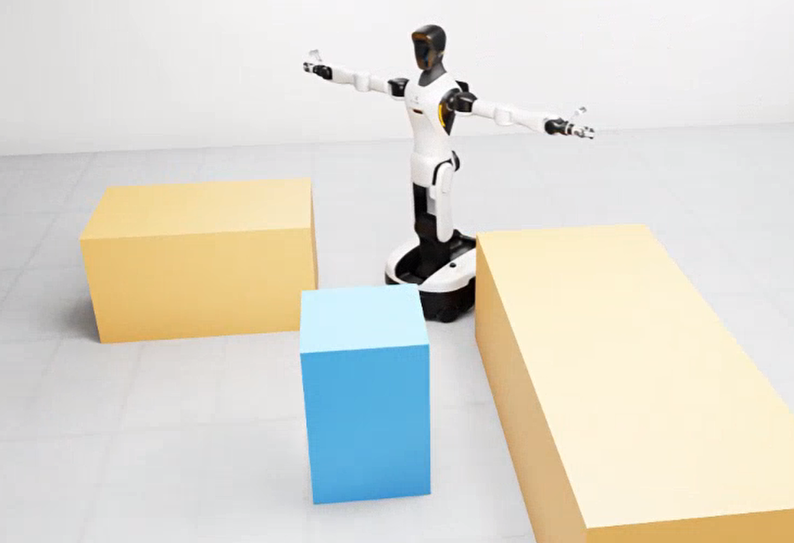

<p align="center"><b>图 10-17</b> 导航场景展示：room_1 场景中的 G2 机器人、三块静态障碍与移动障碍</p>

### 7.2 代码执行

#### 7.2.1 运行不使用 Nav2 的教学导航

打开终端 1，启动 Isaac Sim 与教学导航主程序：

```bash
cd /path/to/project-root
bash code/code_chapter10_1/run_teaching_navigation.sh
```

程序会自动加载：

- `room_1` 场景；
- G2 机器人；
- 三个静态矩形障碍；
- 一个周期移动障碍；
- 默认起点 `(-3.6, -3.3, 0.0)`；
- 默认目标 `(3.6, 3.2, 1.57)`。

常用运行参数如下（分别用于无窗口运行、关闭移动障碍、指定目标、关闭 ROS 2 接口和修改超时）：

```bash
# 无 Isaac Sim 图形窗口运行，但保留 ROS 2 和 RViz 数据
bash code/code_chapter10_1/run_teaching_navigation.sh --headless

# 关闭移动障碍，只观察全局规划和基础跟踪
bash code/code_chapter10_1/run_teaching_navigation.sh \
  --no-dynamic-obstacle

# 指定目标 x、y、yaw
bash code/code_chapter10_1/run_teaching_navigation.sh \
  --goal 3.2 2.8 1.57

# 完全关闭 ROS 2 可视化接口
bash code/code_chapter10_1/run_teaching_navigation.sh --no-rviz

# 修改最大允许仿真时间
bash code/code_chapter10_1/run_teaching_navigation.sh \
  --timeout 120
```

如果需要 RViz，在终端 2 运行下面的命令，它用系统 ROS 2 加载 `chapter10_1_navigation.rviz` 配置：

```bash
cd /path/to/project-root
bash code/code_chapter10_1/run_rviz.sh
```

可以在 RViz 中使用 **2D Goal Pose** 工具发送新目标。新目标会发布到 `/goal_pose`，教学导航器将清除当前路径并从机器人实时位置重新规划。

#### 7.2.2 运行纯算法测试

不启动 Isaac Sim 时，可运行下面的命令，用 `unittest` 自动发现并执行教学版算法测试：

```bash
cd /path/to/project-root
python3 -m unittest discover \
  -s code/code_chapter10_1/tests -v
```

测试覆盖：

- 地图坐标转换；
- 地图保存、加载和膨胀；
- A* 全局规划；
- 防斜向穿墙；
- 路径捷径化与平滑；
- 局部动态绕障；
- 前视轨迹跟踪；
- 碰撞监控与进度检查；
- 完整导航状态机；
- ROS 2 接口中的非运行时数学逻辑。

单元测试通过只说明这些 Python 模块在测试输入下符合预期，不等于 Isaac Sim、ROS 2、Nav2 和真实机器人已经完成端到端验证。

> ⚠️ **注意**：当前仓库快照中 `code/code_chapter10_1/` 下没有 `tests/` 目录。如果执行上面的命令时报告找不到目录，说明测试文件未随本仓库发布；可以参考第二、三部分中的小程序（5×5 网格 A*、Chaikin、重采样、前视跟踪）自行编写测试。

#### 7.2.3 运行 Nav2 示例

构建完成后，推荐使用三个终端。

**终端 1：启动 Isaac Sim 与 Nav2 bridge。** 下面的命令启动仿真、G2 底盘、模拟激光和 ROS 2 桥接器：

```bash
cd /path/to/project-root
bash code/code_chapter10_2/run_nav2_bridge.sh
```

无窗口运行：

```bash
bash code/code_chapter10_2/run_nav2_bridge.sh --headless
```

关闭移动障碍：

```bash
bash code/code_chapter10_2/run_nav2_bridge.sh \
  --no-dynamic-obstacle
```

bridge 正常启动后会提示它正在订阅 `/cmd_vel`，并发布 `/odom`、`/scan`、`/clock` 和 TF。

**终端 2：启动地图服务器、Nav2 和 RViz。** 下面的命令通过 Launch 启动 `map_server`、全部 Nav2 服务器和 RViz：

```bash
cd /path/to/project-root
bash code/code_chapter10_2/run_nav2.sh
```

如果在无图形界面的服务器运行，用 `use_rviz:=false` 关闭 RViz：

```bash
bash code/code_chapter10_2/run_nav2.sh use_rviz:=false
```

随后可在另一个带图形环境的终端单独启动 RViz：

```bash
bash code/code_chapter10_2/run_rviz.sh
```

**终端 3：发送 NavigateToPose 目标。** 下面的命令通过 Action 客户端向 Nav2 发送目标 $(3.6,3.2,1.57)$ 并等待结果：

```bash
cd /path/to/project-root
bash code/code_chapter10_2/send_goal.sh \
  --x 3.6 --y 3.2 --yaw 1.57
```

也可以在 RViz 中使用 **Nav2 Goal** 工具发送目标。具体操作为：

1. 确认 RViz 的 Fixed Frame 为 `map`；
2. 等待 `/map`、机器人模型或坐标轴、`/scan`、global/local costmap 正常显示；
3. 单击工具栏中的 **Nav2 Goal**；
4. 在地图自由区域按下鼠标，拖动箭头指定目标朝向后松开；
5. 观察 `/plan` 出现全局路径、`/local_plan` 出现 DWB 当前局部轨迹，随后机器人开始运动；
6. 到达后查看 Nav2 终端或 Action 客户端的最终状态，而不是只根据路径是否显示判断成功。

目标必须位于地图自由区域，并且机器人到目标之间存在可行通路。如果 Nav2 启动较慢，可以提高客户端等待时间：

```bash
bash code/code_chapter10_2/send_goal.sh   --x 3.6 --y 3.2 --yaw 1.57 --startup-timeout 60
```

#### 7.2.4 运行检查

可以先运行快速检查脚本，它列出关键话题、NavigateToPose Action，并在 5 秒内尝试打印 `map -> base_link` 变换：

```bash
bash code/code_chapter10_2/check_nav2.sh
```

它会检查：

- `/clock`；
- `/cmd_vel`；
- `/map`；
- `/odom`；
- `/scan`；
- `/plan`；
- `/local_plan`；
- `/navigate_to_pose` Action；
- `map -> base_link` TF。

也可以分别执行：

```bash
ros2 topic echo /clock --once
ros2 topic echo /scan --once
ros2 topic echo /odom --once
ros2 topic echo /cmd_vel --once
ros2 action list | grep navigate_to_pose
ros2 lifecycle get /planner_server
ros2 lifecycle get /controller_server
ros2 run tf2_ros tf2_echo map base_link
```

### 7.3 运行结果

#### 7.3.1 教学导航输出

正常启动后，控制台会显示类似的状态变化：

```text
=== 第十章教学版：不使用 Nav2 的完整导航 ===
起点：(-3.60, -3.30)
目标：(3.60, 3.20, 1.57)
算法链：A* → 路径优化 → 局部重规划 → 全向前视跟踪 → 碰撞监控
[CONTROLLING] 局部路径畅通，正在跟踪全局路径
[CONTROLLING] 检测到障碍，正在稳定绕行
[SUCCEEDED] 目标已到达
[完成] 到达目标，最终位姿：(..., ..., ...)
```

实际日志是否出现绕行状态，取决于移动障碍与机器人到达交叉区域的时间关系。

**如何读懂这些输出：**

- 前四行由 `demo_navigation.py` 在进入主循环前打印，"起点"是 Isaac Sim 中实测的初始位置，因此可能与配置值 $(-3.6,-3.3)$ 有毫米级差异；
- `[状态] 消息` 只在状态或消息变化时打印。第一次 `update()` 中 PLANNING 成功后会在同一周期继续进入控制分支，所以通常直接看到 `[CONTROLLING]`，而"全局规划完成：扩展 N 个栅格"会被随后的局部规划消息覆盖；
- 看到"检测到障碍，正在稳定绕行"说明局部参考段被动态障碍挡住，`LocalPlanner` 启用了局部 A*；之后再次出现"局部路径畅通"说明滞回计数已满，切回全局参考；
- 若出现"恢复行为 k/3：重新规划"，说明触发过局部阻塞、进度检查或碰撞急停；出现 `[FAILED]` 时程序会抛出 `RuntimeError` 并附带原因；
- `[完成]` 行给出最终 $(x,y,\psi)$，应满足与目标距离不超过 $0.12\ \mathrm{m}$、航向误差不超过 $0.12\ \mathrm{rad}$。

在 RViz 中重点观察：

| 显示内容 | 话题 | 应观察的现象 |
|---|---|---|
| 静态地图 | `/map` | 墙体和三个静态障碍与场景对应 |
| 全局路径 | `/plan/global` | 从起点绕开静态障碍到达目标 |
| 局部路径 | `/plan/local` | 无动态阻挡时贴近全局路径，阻挡时产生局部绕行 |
| 执行轨迹 | `/plan/executed` | 机器人真实走过的轨迹逐渐增长 |
| 模拟雷达 | `/scan` | 扫描线随机器人和移动障碍变化 |
| 导航标记 | `/navigation/markers` | 目标、前视点和动态障碍位置 |
| 里程计与 TF | `/odom`、TF | `map -> odom -> base_link -> base_scan` 连通 |

动态避障演示：

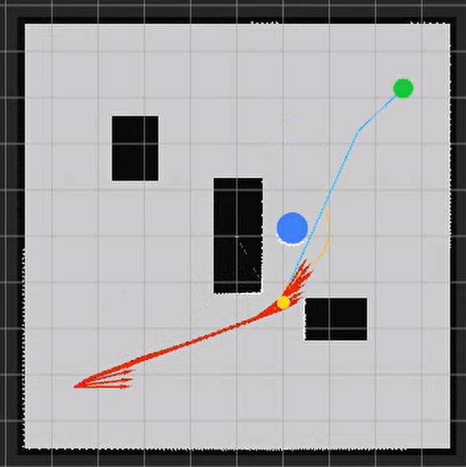

<p align="center"><b>图 10-18</b> 教学导航动态避障演示：局部路径偏离全局路径，绕开移动障碍</p>

导航终点演示：

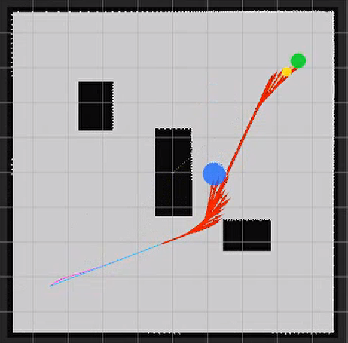

<p align="center"><b>图 10-19</b> 教学导航终点演示：机器人到达目标位置并对准最终朝向</p>

#### 7.3.2 Nav2 导航输出

目标客户端正常工作时会显示：

```text
等待 Nav2 navigate_to_pose action...
目标已接受
剩余距离：... m，恢复次数：...
导航结束，action 状态码：...
```

只有 Action 状态为 `SUCCEEDED` 才表示 Nav2 任务成功结束。看到全局路径、局部轨迹或 `/cmd_vel` 都不能单独证明机器人最终到达目标。

**如何读懂这些输出：**

- "等待 Nav2 navigate_to_pose action..." 之后若长时间无响应，说明 `bt_navigator` 尚未提供 Action；若出现"Nav2 尚未激活，1 秒后重试目标"，说明 Action 已存在但 Lifecycle 尚未 active；
- "剩余距离"每 $0.5\ \mathrm{s}$ 最多打印一次，应总体单调下降；"恢复次数"增加说明行为树调用了恢复分支；
- "action 状态码"是 `action_msgs/GoalStatus` 中的整数，`STATUS_SUCCEEDED` 对应 4，`STATUS_ABORTED` 对应 6，`STATUS_CANCELED` 对应 5（ROS 2 标准定义）；客户端在非成功时以退出码 1 结束。

实验中动态避障效果演示：

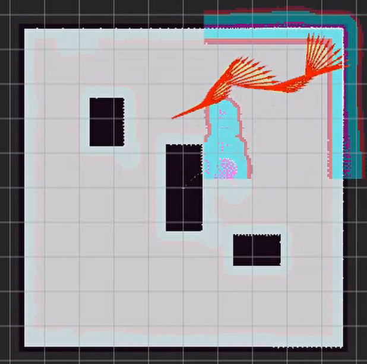

<p align="center"><b>图 10-20</b> Nav2 动态避障演示：RViz 中显示全局路径 /plan、DWB 局部轨迹与两层代价地图</p>

---

## 本章小结

### 知识回顾

| 主题 | 核心要点 | 教学版实现 | Nav2 对应 |
|---|---|---|---|
| 位姿与 TF | $\mathbf p=[x,y,\psi]^T$；`map -> odom -> base_link -> base_scan`；速度在 `base_link` | `geometry.py` | bridge 发布 TF |
| 占据栅格 | $0.05\ \mathrm{m}$ 分辨率， $190\times190$；`floor` 换算行列 | `costmap.py` | `map_server` |
| 膨胀 | $R=0.34+0.10=0.44\ \mathrm{m}$；规划图与安全图分离 | `inflated()` | `inflation_layer`，指数衰减 |
| 全局规划 | $f=g+w_h h$，Octile 启发，防切角，终点出堆才返回 | `AStarPlanner` | NavFn `use_astar: true` |
| 路径优化 | 捷径化 → Chaikin → 0.12 m 重采样 → 切线航向，全程碰撞复检 | `TrajectoryOptimizer` | Simple Smoother（需 BT 调用） |
| 局部规划 | 2.4 m 局部目标、3 m 窗口、0.40 s 周期、3 周期滞回 | `LocalPlanner` | DWB + `local_costmap` |
| 轨迹跟踪 | 0.70 m 前视点、 $k_p=1$、合速度缩放、目标附近减速 | `HolonomicPathTracker` | DWB critics |
| 安全与恢复 | 0.12 s 碰撞预测、7 s 无进展、最多 3 次恢复、20° 倾斜停车 | `TeachingNavigator` | Progress Checker、`behavior_server` |
| 速度链 | 多层限速与 0.5 s 超时 | `ControlLimits` | `velocity_smoother` + bridge |

两套示例的区别可以总结为：

| 对比项 | `code_chapter10_1` | `code_chapter10_2` |
|---|---|---|
| 主要目的 | 学习导航算法内部流程 | 学习标准 Nav2 工程集成 |
| 全局规划 | 自编八邻域 A* | NavFn A* 插件 |
| 路径优化 | 自编捷径化、Chaikin、重采样 | 已配置 Simple Smoother；实际调用由行为树决定 |
| 局部规划 | 局部窗口 A* | DWB 速度空间采样 |
| 路径跟踪 | 全向前视比例控制 | DWB 轨迹评分与控制 |
| 任务调度 | Python 状态机 | Behavior Tree Navigator |
| 恢复机制 | 清除局部历史并重新规划 | Behavior Server + 行为树 |
| 接口 | 教学专用路径与标记话题 | 标准 Nav2 话题、Lifecycle 和 Action |
| 定位 | 仿真真值 | 仿真真值，未启用 AMCL |
| 适用场景 | 理解原理、修改算法 | 接近实际 ROS 2 工程使用方式 |

教学版的价值在于把导航拆成可阅读、可测试的模块，让读者理解每一层的输入、输出和边界。Nav2 版的价值在于展示实际工程如何通过插件、参数文件、Lifecycle、行为树和 ROS 2 Action 组织这些功能。

本章最终建立了两条完整链路。

第一条是算法学习链：

```text
占据栅格
    ↓
障碍膨胀
    ↓
A* 全局路径
    ↓
路径优化
    ↓
局部动态绕行
    ↓
全向轨迹跟踪
    ↓
安全监控与恢复
```

第二条是 Nav2 工程链：

```text
NavigateToPose 目标
    ↓
Behavior Tree Navigator
    ↓
Planner Server
    ↓
可选的 Smoother Server
    ↓
Global/Local Costmap
    ↓
Controller Server + DWB
    ↓
Velocity Smoother
    ↓
/cmd_vel
    ↓
G2BaseController
    ↓
Isaac Sim G2
```

在此基础上，后续可以继续接入 SLAM、AMCL、真实激光雷达、真实底盘里程计和更复杂的恢复行为，逐步从教学仿真导航扩展到真实机器人自主导航系统。

### 课后练习

建议先关闭移动障碍，确保静态导航稳定，再逐步加入局部避障。每次只修改一类参数，并记录路径长度、完成时间、最小障碍距离、最大横向误差和恢复次数。

1. **思考题：可采纳启发函数。** 在 2.5 节的 $5\times5$ 网格上，如果把启发函数换成欧氏距离 $\sqrt{\Delta x^2+\Delta y^2}$，它还可采纳吗？如果换成曼哈顿距离 $\Delta x+\Delta y$ 呢？对八邻域而言，哪一个可能导致 A* 返回非最优路径？请用起点 $(1,0)$ 的 $h$ 值与真实代价 $6.828$ 比较说明。

2. **手算题：Chaikin 与重采样。** 对折线 $(0,0)\to(2,0)\to(2,2)$ 做一次 Chaikin 迭代，写出全部新点；再对结果以 `spacing = 0.5` 重采样，写出前 5 个点及其航向。用 `TrajectoryOptimizer` 的 `chaikin()`、`resample()`、`assign_yaws()` 验证你的答案。

3. **动手题：地图膨胀半径。** 教学版修改：

   ```text
   MapConfig.safety_margin
   ```

   Nav2 版修改：

   ```text
   local_costmap.inflation_layer.inflation_radius
   global_costmap.inflation_layer.inflation_radius
   ```

   观察：路径与墙面的距离；狭窄通道是否仍可通行；局部规划失败次数。请同时用 1.5 节的公式预测 `safety_margin` 增大到多少时某条通道会被堵死。

4. **动手题：四邻域与八邻域 A\*。** 教学版把：

   ```text
   PlannerConfig.allow_diagonal = False
   ```

   比较路径长度、折点数量和扩展节点数（导航器打印的"全局规划完成：扩展 N 个栅格"）。关闭对角移动后，路径通常更接近水平和竖直折线。再把 `heuristic_weight` 改为 `2.0`，比较扩展节点数的变化，并解释与 2.5 节小网格结果是否一致。

5. **动手题：路径点间距、前视距离与局部重规划稳定性。** 依次调整：

   ```text
   PlannerConfig.path_spacing
   TrackerConfig.lookahead_distance
   ```

   一般规律为：点间距太小——路径点密集，计算与可视化数据增加；点间距太大——弯道表达粗糙；前视距离太小——跟踪精细但容易摆动；前视距离太大——运动平滑但可能切弯，窄通道风险增加。随后修改：

   ```text
   PlannerConfig.local_replan_period
   PlannerConfig.detour_hold_cycles
   TrackerConfig.detour_speed_limit
   ```

   观察移动障碍附近是否出现左右换边、急转或路径跳变。把 `detour_hold_cycles` 设为 0 时，按 4.2 节分析预测会发生什么。

6. **动手题：DWB 速度采样与 Critic 权重。** 修改：

   ```text
   vx_samples
   vy_samples
   vtheta_samples
   sim_time
   ```

   采样数量增加通常能提供更多候选运动，但计算量也会增加。`sim_time` 增大可让控制器看得更远，但也可能使机器人在狭窄环境中过于保守。之后调整 critic 权重，建议按以下顺序：

   1. 先确保 `BaseObstacle` 能阻止碰撞；
   2. 再平衡 `PathDist` 和 `GoalDist`；
   3. 调整 `PathAlign` 和 `GoalAlign`；
   4. 最后处理 `RotateToGoal` 与振荡问题。

   不要一次同时修改所有权重，否则难以判断行为变化来自哪个参数。另外尝试把 `min_vel_y`、`max_vel_y` 都设为 0，观察 G2 是否退化为不能横移的底盘。修改后记得按 6.3.8 节重新构建并用 `ros2 param get` 确认。

### 参考资料

- 本章原文：`docs/chapter10/第十章 移动底盘规划基础与Nav2框架.md`（原文未单独列出参考资料条目）；
- 本章代码：`code/code_chapter10_1/`（教学导航）、`code/code_chapter10_2/`（Nav2 工程，参数见 `config/nav2_params.yaml`）；
- 第四章 G2 底盘控制代码：`code/code_chapter4/`（`base_controller.py`、`kinematics.py`、`config.py`）；
- Nav2 官方文档（补充阅读，本章 5.3 节膨胀代价公式、5.2 节行为树结构依据此文档整理）：https://docs.nav2.org/
