# 第十一章 机械臂规划基础与 MoveIt 2 框架

> **本章导读**：第五章已经解决了“给定关节角，末端在哪里”（正运动学）和“给定末端目标，关节应该转到哪里”（逆运动学）的问题。本章继续向前一步：即使起点和终点都能通过逆运动学求出，机械臂也不能简单地从起点直线插值到终点，因为中间过程可能撞到桌面、障碍物、机器人躯干或自身连杆，也可能产生过快、过急、底层控制器无法稳定跟踪的运动。
>
> 因此，机械臂规划真正要解决的是一条完整链路：从当前关节状态和任务目标出发，建立机器人与环境的碰撞模型，在高维关节空间中搜索无碰路径，对路径进行优化和时间参数化，再通过控制器执行轨迹，并利用真实关节反馈判断执行是否成功。本章与第十章（移动底盘规划与 Nav2）形成“底盘—机械臂”的对照，并为第十二章的移动操作综合实践准备好机械臂这一半。
>
> 本章最终要跑通的案例是：G2 机器人右侧七自由度机械臂绕开黄色阻挡物，抓起桌上的红色物体。同一个任务分别用“自编规划器（`code_chapter11_1`）”和“MoveIt 2（`code_chapter11_2`）”各实现一遍。

## 本章概览

### 本章要解决的问题

G2 位于桌前，桌上放置红、绿、蓝三色物体，红色物体前方挡着一块黄色阻挡物。红色物体在 `arm_base_link` 下的位置已知，用第五章的 IK 很容易算出“手放到红色物体上方”时七个关节应该是多少度。可是如果让七个关节从当前角度同时匀速转到目标角度，前臂很可能会扫过黄色阻挡物，夹爪甚至可能从桌面下方穿过去。我们需要回答：怎样判断某个关节姿态会不会撞？怎样在七维关节空间里找到一条绕开所有障碍的路线？找到的折线路线怎样变成平滑、带时间、控制器跟得上的轨迹？工程上又怎样用 MoveIt 2 把这些步骤组织成标准系统？

本章不使用右夹爪相机定位目标，也不实现末端视觉伺服；头部深度相机只负责生成环境障碍点云。

### 学习目标

学完本章你能：

- **解释**工作空间与构型空间（Configuration Space，C 空间）的区别，说明为什么“IK 成功不等于规划成功”，并区分路径、轨迹与控制指令；
- **推导**胶囊—AABB 碰撞检测的 Slab 判定和边插值检查的采样数，并对给定线段手算是否碰撞；
- **解释并手算** RRT、RRT-Connect 的单步扩展，说明 PRM、RRT* 与 RRT-Connect 的适用场景差别；
- **推导**五次 smoothstep 时间参数化中的系数 1.875 与 5.8，并对给定路径段手算持续时间；
- **说明** MoveIt 2 中 `move_group`、URDF/SRDF、Planning Scene、OMPL 规划流水线、请求适配器和控制器接口各自的职责；
- **运行**两套抓取案例与纯算法测试，读懂终端日志中的路径长度、轨迹时长和跟踪误差；

### 前置知识

- 第五章：G2 右臂的正/逆运动学、关节限位、`code_chapter5.kinematics.G2ArmKinematics`；
- 第七、八章：深度图反投影、点云与体素的基本概念（用于理解头部深度障碍地图）；
- 第十章：全局规划与局部规划的思想（本章与底盘规划形成对照）；
- ROS 2 基础：话题、Action、TF、launch；
- 数学：向量范数、线性插值、多项式求导；编程：Python 数据类、NumPy，能读懂基础 C++。

### 知识地图

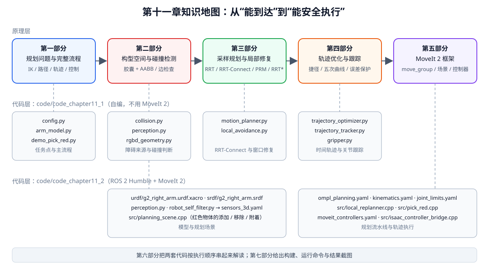

<p align="center"><b>图 11-1</b> 本章知识地图：五个原理部分依次递进，下方是每部分对应的两套代码模块</p>

### 对应代码

| 目录 | 一句话说明 |
|---|---|
| `code/code_chapter11_1/` | 不使用 MoveIt 2，从零实现碰撞检测、RRT-Connect、局部路径修复、轨迹优化和关节轨迹跟踪，用于看清机械臂规划内部每一步 |
| `code/code_chapter11_2/` | 使用 ROS 2 Humble 与 MoveIt 2，把机器人模型、Planning Scene、KDL、OMPL、轨迹执行、RViz 和 Isaac Sim 控制桥组织成标准工程 |
| `code/srdf/g2_right_arm.srdf` | 另一份 G2 右臂 SRDF（增加了虚拟关节和更多禁用碰撞对），用于对照阅读 SRDF 写法 |

两套代码都执行相同任务：右机械臂绕开黄色阻挡物，到达红色物体的预抓取位置，再接近、夹持并抬升目标。两者必须分开阅读和运行：`code_chapter11_1` 是用于拆解算法的自编教学链路，`code_chapter11_2` 是使用 MoveIt 2 的标准工程链路，二者不能混成同一套运行环境。

---

## 第一部分 机械臂规划问题与完整流程

### 1.1 从逆运动学到运动规划

**直观理解**：IK 告诉你“终点在哪”，就像导航软件知道目的地的坐标；运动规划则负责“走哪条路才不撞墙”。目的地可达，不代表直线走过去不会撞上东西。

逆运动学回答的是“机械臂最终应该处于什么关节状态”。设右机械臂当前关节状态为：

$$
\mathbf{q}_{s}=[q_{s1},q_{s2},\ldots,q_{s7}]^{T}
$$

末端目标位置为：

$$
\mathbf{p}_{d}=[x_d,y_d,z_d]^{T}
$$

通过第五章介绍的逆运动学，可以得到一个目标关节状态：

$$
\mathbf{q}_{g}=\mathrm{IK}(\mathbf{p}_{d})
$$

其中 $q_{si}$ 单位为 rad， $\mathbf{p}_d$ 单位为 m，均在 `arm_base_link` 坐标系下表达。

但 $\mathbf{q}_g$ 只说明终点，不说明中间怎样运动。若直接在起点和终点之间做线性插值：

$$
\mathbf{q}(s)=(1-s)\mathbf{q}_{s}+s\mathbf{q}_{g},\qquad s\in[0,1]
$$

机械臂的每个关节会同时变化。末端轨迹通常不是工作空间中的直线，而且任意一段连杆都可能在中途穿过障碍物。因此，IK 成功并不等于运动规划成功。

> 💡 **要点**：关节空间中的直线 ≠ 工作空间中的直线。 $\mathbf{q}(s)$ 是七个角度各自线性变化，末端位置 $\mathrm{FK}(\mathbf{q}(s))$ 一般是一条曲线，而肘部、前臂扫过的体积更难直观想象。

完整的运动规划问题需要同时满足以下条件：

1. 起点来自当前真实关节反馈，而不是程序中已经过时的旧状态；
2. 终点满足任务目标，并且不违反关节限位；
3. 路径上的每一个关节状态都无碰撞；
4. 相邻路径点之间的连续运动也无碰撞；
5. 路径经过优化后仍然安全；
6. 加入时间后，速度和加速度不超过限制；
7. 底层控制器能够跟踪轨迹，最终误差满足要求。

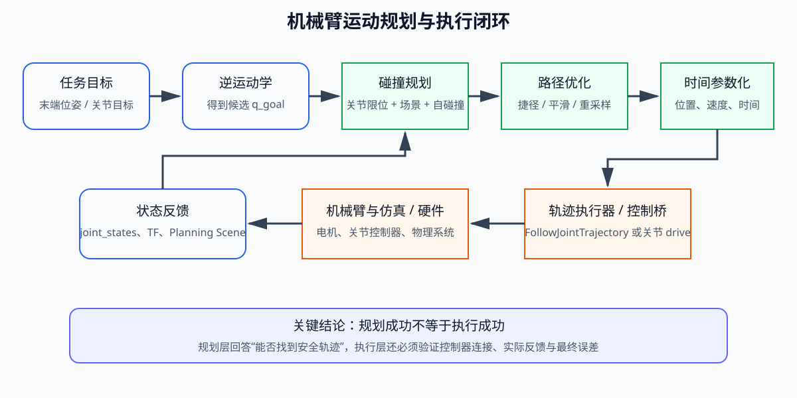

<p align="center"><b>图 11-2</b> 机械臂规划不是一次 IK，而是目标生成、碰撞规划、轨迹优化、执行和状态反馈组成的闭环</p>

图中最重要的边界是“规划”和“执行”的区别。规划成功只表示算法找到了理论上可行的轨迹；只有控制器收到轨迹、机器人实际运动、关节反馈持续更新并且最终误差满足阈值，才能认为执行成功。

**对应代码**：自编版本中，这七个条件分别落在不同模块上，下面这一小段 `plan_and_execute()` 就是整条闭环的骨架（详细解读见第六部分）。

```python
# 摘自 code/code_chapter11_1/demo_pick_red.py（plan_and_execute 的核心行）
result = planner.plan(start, goal)                  # 条件 1~4：从实测起点做无碰规划
repaired = repair.repair(result.path)               # 条件 3~4：局部碰撞监测与修复
optimized = optimizer.optimize(repaired)            # 条件 5：捷径优化后再次整体校验
trajectory = optimizer.time_parameterize(optimized) # 条件 6：按速度/加速度限制加时间
max_error = tracker.execute(
    trajectory, sim.step, rviz.publish_arm
)                                                   # 条件 7：闭环跟踪并返回最大误差
```

### 1.2 路径、轨迹与控制指令

机械臂规划中经常出现“路径”和“轨迹”两个词，它们不能混用。

**路径**只描述机械臂经过哪些关节位置，可以写成：

$$
\mathcal{P}=\{\mathbf{q}_0,\mathbf{q}_1,\ldots,\mathbf{q}_N\}
$$

路径中没有时间信息。它只能回答“从哪里经过”，不能回答“什么时候到达”和“运动多快”。RRT-Connect 输出的首先就是这样一条离散路径。

**轨迹**在路径上加入时间、速度，必要时还包含加速度：

$$
\mathcal{T}=\{t_k,\mathbf{q}_k,\dot{\mathbf{q}}_k,\ddot{\mathbf{q}}_k\}_{k=0}^{M}
$$

其中 $t_k$ 是从轨迹开始计算的时间（s）， $\dot{\mathbf{q}}_k$、 $\ddot{\mathbf{q}}_k$ 分别是关节速度（rad/s）与加速度（rad/s²）。一般 $M \gg N$：时间参数化会在每两个路径点之间插入很多采样点。

轨迹可以交给控制器执行。控制器再按照时间读取期望关节位置，并根据实际反馈驱动机器人。

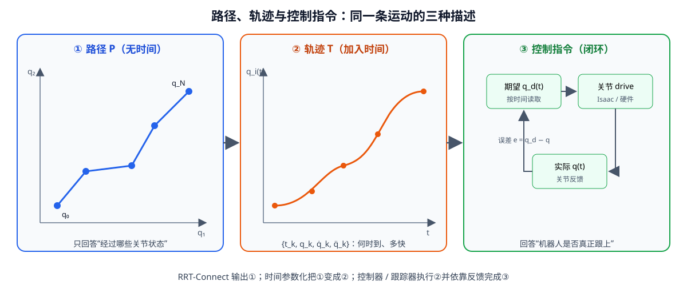

<p align="center"><b>图 11-3</b> 同一条运动的三种描述：路径只有几何，轨迹加入时间，控制指令依靠反馈闭环</p>

为了理解三者的关系，可以把完整过程概括为：

| 层级 | 主要输入 | 主要输出 | 解决的问题 |
|---|---|---|---|
| 任务与 IK | 末端目标 | 目标关节状态 | 最终要到哪里 |
| 路径规划 | 起点、终点、碰撞场景 | 无碰关节路径 | 从哪里绕过去 |
| 轨迹生成 | 路径、速度/加速度限制 | 带时间的轨迹 | 以多快的速度运动 |
| 轨迹跟踪 | 期望轨迹、实际反馈 | 关节驱动命令 | 机器人是否真正跟上 |

**对应代码**：自编版本用一个数据类表示轨迹点，正好对应 $\{t_k,\mathbf{q}_k,\dot{\mathbf{q}}_k\}$（教学实现没有显式存储加速度）。

```python
# 摘自 code/code_chapter11_1/trajectory_optimizer.py
@dataclass(frozen=True)
class TrajectoryPoint:
    time_from_start: float   # t_k，单位 s
    positions: np.ndarray    # q_k，7 维，单位 rad
    velocities: np.ndarray   # q̇_k，7 维，单位 rad/s
```

而路径就是 `list[np.ndarray]`——一串 7 维关节向量，没有任何时间字段。MoveIt 2 中对应的标准消息是 `trajectory_msgs/JointTrajectory`，其中每个点都带有 `time_from_start`。

> ⚠️ **注意**：把路径点“按固定频率逐个发出去”并不是轨迹。路径点间距不均匀时，这样做会让实际速度忽快忽慢，详见第四部分。

### 1.3 坐标系约定与案例任务点

工作空间是机械臂真实存在的三维空间。桌面、黄色阻挡物、红色目标和机械臂连杆都在工作空间中描述；规划器搜索的则是关节构成的配置空间（第二部分详细讲）。为了描述工作空间，本章两套代码的规划坐标系统一为 `arm_base_link`。G2 模型在该坐标系中的方向约定为：

- `x` 轴指向机器人前方；
- `y` 轴指向下方；
- `z` 轴指向机器人左方；
- 右机械臂工作区通常满足 `z < 0`。

RViz 更习惯使用 `x` 向前、`y` 向左、`z` 向上的坐标系。自编版本在发布 Marker 时直接完成坐标转换；MoveIt 2 版本通过 `world -> arm_base_link` 静态 TF 完成显示坐标转换。该转换只影响 RViz 中怎样显示，不会改变 MoveIt 在 `arm_base_link` 中进行的规划和碰撞检测。

案例中红色物体中心为：

$$
\mathbf{p}_{red}=[0.56,\ 0.535,\ -0.43]^{T}\ \mathrm{m}
$$

物体尺寸为 `0.075 m × 0.075 m × 0.075 m`。自编版本根据该位置定义三个任务点：

| 任务点 | 相对红色物体的偏移 | 绝对坐标（手算） | 作用 |
|---|---|---|---|
| 预抓取点 | `[0, -0.19, 0] m` | `[0.56, 0.345, -0.43]` | 先绕开阻挡物，到达目标上方安全位置 |
| 抓取点 | `[0, -0.065, 0] m` | `[0.56, 0.47, -0.43]` | 沿接近方向进入夹持区域 |
| 抬升点 | `[-0.02, -0.27, 0] m` | `[0.54, 0.265, -0.43]` | 夹持后将物体向上并略向后抬起 |

这里 `y` 轴向下，因此减小 `y` 表示向上运动。理解这一点非常重要，否则会把“抬升”误写成向桌面下方运动。

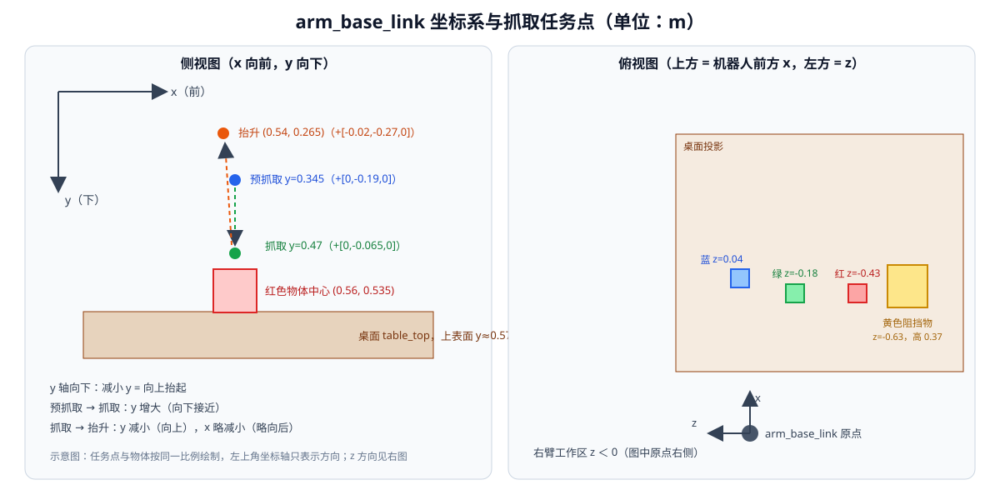

<p align="center"><b>图 11-4</b> arm_base_link 下的场景布局：左为侧视图（x 前、y 下），右为俯视图（x 前、z 左）</p>

**对应代码**：

```python
# 摘自 code/code_chapter11_1/config.py
HOME_JOINT_POSITIONS = np.array(
    [0.0, -0.35, 0.0, -1.10, 0.0, 0.35, 0.0], dtype=np.float64
)

RED_OBJECT_POSITION = np.array([0.56, 0.535, -0.43], dtype=np.float64)
RED_OBJECT_SIZE = np.array([0.075, 0.075, 0.075], dtype=np.float64)
PRE_GRASP_POSITION = RED_OBJECT_POSITION + np.array([0.0, -0.19, 0.0])
GRASP_POSITION = RED_OBJECT_POSITION + np.array([0.0, -0.065, 0.0])
LIFT_POSITION = RED_OBJECT_POSITION + np.array([-0.02, -0.27, 0.0])
```

同一文件还定义了整张桌面场景（全部是 `arm_base_link` 下的轴对齐盒子）：

```python
# 摘自 code/code_chapter11_1/config.py
SCENE_BOXES = (
    BoxObstacle("table_top", (0.72, 0.610, -0.28), (0.95, 0.08, 1.15), (0.48, 0.28, 0.12)),
    BoxObstacle("blocker", (0.59, 0.385, -0.630), (0.17, 0.37, 0.16), (0.95, 0.72, 0.08)),
    BoxObstacle("red_object", tuple(RED_OBJECT_POSITION), tuple(RED_OBJECT_SIZE), (0.90, 0.05, 0.05), False),
    BoxObstacle("green_object", (0.56, 0.535, -0.18), (0.075, 0.075, 0.075), (0.05, 0.75, 0.12)),
    BoxObstacle("blue_object", (0.62, 0.535, 0.04), (0.075, 0.075, 0.075), (0.05, 0.30, 0.92)),
)

# 机器人躯干的简化碰撞盒。右臂规划时只需防止手臂穿过躯干。
ROBOT_BODY_BOX = BoxObstacle(
    "robot_body", (-0.04, 0.05, 0.0), (0.48, 0.86, 0.50), (0.35, 0.35, 0.38)
)
```

**案例：验证红色物体正好“放在”桌面上。** 桌面中心 `y = 0.610`、厚度 `0.08`，上表面 $y = 0.610 - 0.04 = 0.570$ m；红色物体中心 `y = 0.535`、边长 `0.075`，底面 $y = 0.535 + 0.0375 = 0.5725$ m。两者只差 2.5 mm，说明物体贴着桌面（注意 y 向下，数值越大越靠下）。同理，抓取点 $y=0.47$ 比物体顶面 $0.535-0.0375=0.4975$ 高约 2.75 cm，夹爪中心停在物体上方一点点的位置。

> ⚠️ **注意**：红色物体最后一个参数是 `False`，即 `collision=False`。这是有意为之：目标物体不能被当成普通障碍，否则夹爪永远无法进入抓取位姿（见 2.7 节）。

### 1.4 一次抓取任务的完整状态链

本章案例不是一次从 HOME 到目标的单段运动，而是由多个规划—执行阶段组成：

1. 读取当前关节状态并张开夹爪；
2. 根据已知预抓取位置求解 IK；
3. 在桌面、阻挡物、非目标物体和机器人自身约束下规划到预抓取状态；
4. 根据最新反馈重新设置起点；
5. 允许夹爪进入目标区域，规划到抓取状态；
6. 闭合夹爪，并在规划场景中把红色物体改成附着物体；
7. 从当前反馈状态规划到抬升状态；
8. 执行轨迹并检查最终关节误差。

```text
[实测 q] ──规划/执行──▶ 预抓取 ──[实测 q]──规划/执行──▶ 抓取 ──闭合夹爪+附着──▶ [实测 q] ──规划/执行──▶ 抬升
    ▲                                  ▲                                         ▲
    └──── 每一段的起点都来自上一段结束后的真实关节反馈，而不是上一段的理想终点 ────┘
```

每一个阶段都应使用上一个阶段结束后的真实关节状态作为新起点。若程序一直使用理想终点作为下一阶段起点，而实际机械臂存在跟踪误差，规划器看到的状态就会逐渐偏离机器人真实状态，最终可能出现轨迹起点不匹配、Planning Scene 状态过期或执行被控制器拒绝等问题。

**对应代码**：自编版本中 `plan_and_execute()` 的返回值就是 `tracker.get_positions()`（实测关节角），并被赋给下一段的 `current`；MoveIt 2 版本则在每次规划前调用 `move_group.setStartStateToCurrentState()`。

```python
# 摘自 code/code_chapter11_1/demo_pick_red.py（main 中的任务序列，省略打印）
current = tracker.get_positions()
current = plan_and_execute(
    "头部深度地图避障到预抓取位姿", current, pre_grasp_q,
    planner, repair, optimizer, tracker, rviz, sim,
)
current = plan_and_execute(
    "按已知物块位姿运动到抓取点", current, grasp_q,
    planner, repair, optimizer, tracker, rviz, sim,
)
gripper.hold(False, 90, sim.step)
sim.attach_red_object()
current = plan_and_execute(
    "抓取后抬升", current, lift_q,
    planner, repair, optimizer, tracker, rviz, sim,
)
```

> 💡 **要点**：“用实测状态做下一段起点”这条规则在两套代码里都被严格执行，它是规划与执行能够闭环的前提。MoveIt 2 还会用 `allowed_start_tolerance=0.08 rad` 检查轨迹起点与当前状态的偏差，超过就拒绝执行（见 5.6 节）。

---

## 第二部分 构型空间与碰撞检测

### 2.1 工作空间与构型空间

**直观理解**：工作空间是“你眼睛看到的三维世界”；构型空间（Configuration Space，C 空间）是“所有关节角组合构成的抽象空间”，其中**一个点就代表机械臂的一整个姿态**。把机械臂压缩成一个点之后，“机械臂避障”就变成了“一个点在 C 空间里绕开禁区”，规划算法因此可以统一处理。

配置空间由所有关节变量构成。G2 右臂有 7 个旋转关节，因此配置空间是七维空间：

$$
\mathcal{C}\subset\mathbb{R}^{7}
$$

它可以分成两部分：

$$
\mathcal{C}=\mathcal{C}_{free}\cup\mathcal{C}_{obs},\qquad
\mathcal{C}_{obs}=\{\mathbf{q}\in\mathcal{C}\mid \mathcal{A}(\mathbf{q})\cap\mathcal{O}\neq\varnothing\ \text{或自碰撞或越限}\}
$$

其中 $\mathcal{A}(\mathbf{q})$ 表示机械臂在姿态 $\mathbf{q}$ 下占据的三维体积， $\mathcal{O}$ 是所有障碍物的并集。配置空间中的一个点代表一组完整关节角。某个关节状态如果会让连杆与桌面碰撞，那么这个点就属于碰撞区域 $\mathcal{C}_{obs}$。机械臂规划的目标，是在七维空间中从 $\mathbf{q}_s$ 找到一条通向 $\mathbf{q}_g$、且始终位于 $\mathcal{C}_{free}$ 的连续曲线：

$$
\sigma:[0,1]\rightarrow\mathcal{C}_{free},\qquad \sigma(0)=\mathbf{q}_s,\ \sigma(1)=\mathbf{q}_g
$$

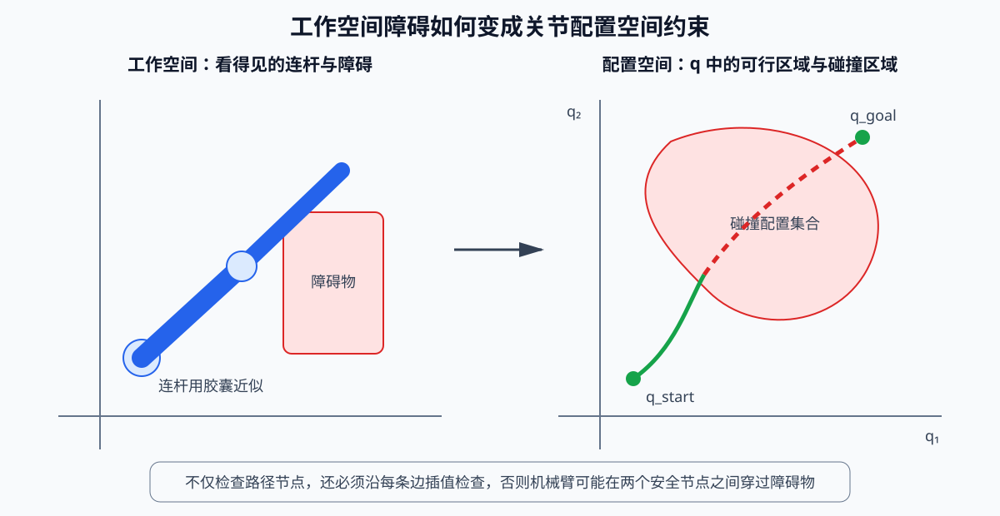

<p align="center"><b>图 11-5</b> 工作空间中的障碍物会映射为配置空间中的碰撞区域，规划器在关节空间中绕过这些区域</p>

**案例：平面两连杆的 C 空间。** 七维空间难以想象，先看一个二维小例子。平面两连杆机械臂，基座在原点，两段长度都是 $l_1=l_2=0.3$ m，关节角 $(q_1,q_2)$，正运动学为：

$$
\mathbf{p}_{elbow}=l_1(\cos q_1,\sin q_1),\qquad
\mathbf{p}_{end}=\mathbf{p}_{elbow}+l_2(\cos(q_1+q_2),\sin(q_1+q_2))
$$

假设桌面是半平面 $y\le -0.1$ m。检查三个姿态：

| $(q_1,q_2)$ | 肘部位置 | 末端位置 | 结论 |
|---|---|---|---|
| $(-30^\circ,0^\circ)$ | $(0.260,-0.150)$ | $(0.520,-0.300)$ | 肘部 $y=-0.15<-0.1$，碰撞 |
| $(0^\circ,-60^\circ)$ | $(0.300,0)$ | $(0.450,-0.260)$ | 末端 $y=-0.26<-0.1$，碰撞 |
| $(30^\circ,-60^\circ)$ | $(0.260,0.150)$ | $(0.520,0)$ | 都在桌面上方，无碰 |

在工作空间里，桌面只是一条直线；但在 $(q_1,q_2)$ 平面中，把所有“碰撞”的点涂红，会得到一块形状弯曲的区域——这就是图 11-5 右侧那团 $\mathcal{C}_{obs}$。工作空间里形状简单的障碍物，映射到 C 空间后通常形状复杂且无法解析写出，这正是规划器只能“逐点询问碰撞检测器”的原因。

> 💡 **要点**：规划器从不需要知道 $\mathcal{C}_{obs}$ 的完整形状，它只需要一个“碰撞查询函数”：给一个 $\mathbf{q}$，回答“是否合法”。本章的 `ArmCollisionChecker.state_is_valid()` 和 MoveIt 2 的 Planning Scene 碰撞检查扮演的都是这个角色。

### 2.2 碰撞检测需要覆盖的三类约束

碰撞检测至少要覆盖三类约束。

第一类是**关节限位**。每个关节必须满足：

$$
q_i^{min}\le q_i\le q_i^{max}
$$

G2 右臂的限位（单位 rad，与 URDF 中的 `<limit>` 一致）为：

| 关节 | 1 | 2 | 3 | 4 | 5 | 6 | 7 |
|---|---:|---:|---:|---:|---:|---:|---:|
| 下限 | -3.1067 | -2.0944 | -3.1067 | -2.5307 | -3.1067 | -1.0472 | -1.5708 |
| 上限 | 3.1067 | 2.0944 | 3.1067 | 1.0472 | 3.1067 | 1.0472 | 1.5708 |

第二类是**机械臂与环境碰撞**，例如连杆撞到桌面、黄色阻挡物、绿色物体或蓝色物体。

第三类是**机械臂自碰撞**，例如前臂绕回后与上臂或夹爪相撞。相邻连杆本来就在关节处连接，不能把这种正常接触误判为自碰撞，因此通常只检查具有一定拓扑间隔的非相邻连杆。

**对应代码**：`state_report()` 严格按“非法输入 → 关节限位 → 环境碰撞 → 自碰撞”的顺序检查，便宜的检查放前面，发现问题就立即返回原因字符串。

```python
# 摘自 code/code_chapter11_1/collision.py（ArmCollisionChecker.state_report 开头）
def state_report(self, joint_positions: Sequence[float]) -> CollisionReport:
    q = np.asarray(joint_positions, dtype=np.float64)
    if q.shape != (7,) or not np.all(np.isfinite(q)):
        return CollisionReport(True, "非法关节状态")          # 维度错误 / NaN
    if np.any(q < self.model.lower_limits) or np.any(q > self.model.upper_limits):
        return CollisionReport(True, "超过关节限位")          # 第一类约束
    # ... 后面是环境碰撞与自碰撞，见 2.3、2.4 节
```

> 💡 **要点**：返回 `CollisionReport(collision, reason)` 而不是单纯的 `bool`，是为了排查：起点或终点非法时，`plan()` 会把 `reason`（如“link_4 与 blocker 碰撞”）原样放进失败信息里。

### 2.3 简化几何：胶囊连杆与 AABB 障碍

`code_chapter11_1` 为了让算法易于阅读，采用简化几何模型：

- 每段连杆用带半径的线段，也就是**胶囊体**（capsule）近似；
- 桌面、物体和躯干使用**轴对齐包围盒**（Axis-Aligned Bounding Box，AABB）；
- 检测连杆与障碍物时，把 AABB 按连杆半径和安全距离向外扩展，再检测连杆中心线是否与盒体相交；
- 检测自碰撞时，计算非相邻连杆中心线之间的最短距离。

这种模型比三角网格碰撞更简单、更快，也更适合教学，但会丢失夹爪细节和复杂曲面。MoveIt 2 版本则使用 URDF 中的碰撞几何、Planning Scene 和默认 FCL（Flexible Collision Library）碰撞检测框架，工程组织更标准。

**连杆点从哪里来？** `arm_model.py` 沿第五章的运动学链逐段累乘变换，返回 9 个点：

```python
# 摘自 code/code_chapter11_1/arm_model.py
def link_points(self, joint_positions: Sequence[float]) -> np.ndarray:
    """返回肩部、七个关节点和夹爪中心，共 9 个点。"""
    q = np.asarray(joint_positions, dtype=np.float64)
    if q.shape != (7,):
        raise ValueError("joint_positions 必须包含 7 个关节角")
    current = np.eye(4, dtype=np.float64)
    points = [np.zeros(3, dtype=np.float64)]            # 点 0：arm_base_link 原点
    for origin, axis, angle in zip(
        self.kinematics.joint_origins, self.kinematics.joint_axes, q
    ):
        current = current @ origin                       # 先走到第 i 个关节原点
        points.append(current[:3, 3].copy())             # 点 1~7：七个关节中心
        current = current @ axis_rotation(axis, float(angle))  # 再绕关节轴转 q_i
    end = current @ self.kinematics.tool_transform
    points.append(end[:3, 3].copy())                     # 点 8：夹爪中心
    return np.asarray(points)
```

相邻两点连成一段连杆中心线。代码用 `zip(points[1:-1], points[2:])` 取出点 1→2、2→3、…、7→8 共 7 段（编号 `link_1`~`link_7`），点 0→1 这一段位于躯干内部，不参与检测。

**原理与公式：为什么“胶囊碰盒子”等价于“线段碰胀大的盒子”？** 半径为 $r$ 的胶囊是到中心线距离不超过 $r$ 的点集。胶囊与盒子 $B$ 相交，当且仅当中心线上存在一点到 $B$ 的距离 $\le r$，也就是中心线与 $B$ 的 $r$-邻域（Minkowski 和）相交。 $r$-邻域是“带圆角的胀大盒子”，代码用每边外扩 $r$ 的直角盒子近似它——在棱角附近略微保守（多判一点碰撞），但判断变成了简单的线段—AABB 测试：

$$
\text{inflation}=r_{link}+d_{safe},\qquad
\mathbf{b}_{lo}=\mathbf{c}-\tfrac{1}{2}\mathbf{s}-\text{inflation},\quad
\mathbf{b}_{hi}=\mathbf{c}+\tfrac{1}{2}\mathbf{s}+\text{inflation}
$$

其中 $\mathbf{c}$、 $\mathbf{s}$ 是障碍物中心与尺寸（m）， $r_{link}$ 是 `link_radius = 0.055 m`， $d_{safe}$ 是 `safety_margin = 0.0 m`。

线段写成 $\mathbf{p}(t)=\mathbf{a}+t\,\mathbf{d}$， $\mathbf{d}=\mathbf{b}-\mathbf{a}$， $t\in[0,1]$。**Slab 法**把盒子看成三对平行平面（三块“板”）的交集，对每个轴 $k$ 求线段进入、离开该板的参数：

$$
t_{1,k}=\frac{b_{lo,k}-a_k}{d_k},\qquad t_{2,k}=\frac{b_{hi,k}-a_k}{d_k}
$$

$$
t_{min}=\max\Big(0,\ \max_k\min(t_{1,k},t_{2,k})\Big),\qquad
t_{max}=\min\Big(1,\ \min_k\max(t_{1,k},t_{2,k})\Big)
$$

当且仅当 $t_{min}\le t_{max}$ 时线段与盒子相交。若某轴 $d_k\approx 0$（线段与该板平行），只需检查 $a_k$ 是否落在 $[b_{lo,k},b_{hi,k}]$ 内。

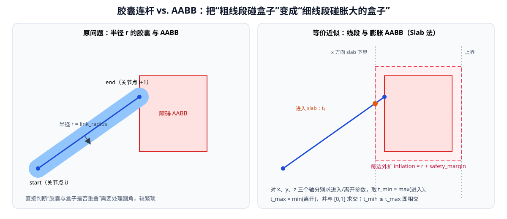

<p align="center"><b>图 11-6</b> 胶囊连杆与 AABB 的相交测试：把半径“转移”给盒子，再用 Slab 法判断线段与膨胀盒是否相交</p>

**对应代码**：

```python
# 摘自 code/code_chapter11_1/collision.py
def segment_intersects_box(start, end, obstacle, inflation) -> bool:
    """Slab 法检测线段是否与膨胀后的 AABB 相交。"""
    half = obstacle.size_array * 0.5 + inflation          # 半尺寸 + 膨胀量
    lower, upper = obstacle.center_array - half, obstacle.center_array + half
    direction = end - start                               # d = b - a
    t_min, t_max = 0.0, 1.0                               # 先限定在线段范围 [0,1]
    for axis in range(3):
        if abs(direction[axis]) < 1e-12:                  # 与该板平行
            if start[axis] < lower[axis] or start[axis] > upper[axis]:
                return False
            continue
        inv = 1.0 / direction[axis]
        t1 = (lower[axis] - start[axis]) * inv            # t_{1,k}
        t2 = (upper[axis] - start[axis]) * inv            # t_{2,k}
        t_min = max(t_min, min(t1, t2))                   # 最晚的“进入”
        t_max = min(t_max, max(t1, t2))                   # 最早的“离开”
        if t_min > t_max:                                 # 区间为空：提前判不相交
            return False
    return True
```

环境碰撞的主循环对 7 段连杆 × 每个障碍物调用它：

```python
# 摘自 code/code_chapter11_1/collision.py（state_report 中段）
points = self.model.link_points(q)
inflation = self.config.link_radius + self.config.safety_margin

for link_index, (start, end) in enumerate(
    zip(points[1:-1], points[2:]), start=1
):
    for obstacle in self.obstacles:
        # 肩部两段本来就从躯干内部伸出，不能按普通外部障碍处理。
        if obstacle.name == "robot_body" and link_index <= 3:
            continue
        if segment_intersects_box(start, end, obstacle, inflation):
            return CollisionReport(
                True, f"link_{link_index} 与 {obstacle.name} 碰撞"
            )
```

**案例：手算一段连杆是否碰到黄色阻挡物。** 阻挡物中心 $(0.59,0.385,-0.630)$，尺寸 $(0.17,0.37,0.16)$，膨胀 $0.055$，于是半尺寸为 $(0.140,0.240,0.135)$：

$$
\mathbf{b}_{lo}=(0.450,\ 0.145,\ -0.765),\qquad \mathbf{b}_{hi}=(0.730,\ 0.625,\ -0.495)
$$

设某段连杆中心线 $\mathbf{a}=(0.40,0.30,-0.40)$， $\mathbf{b}=(0.60,0.40,-0.52)$，则 $\mathbf{d}=(0.20,0.10,-0.12)$：

| 轴 | $t_1$ | $t_2$ | 进入 $\min$ | 离开 $\max$ |
|---|---:|---:|---:|---:|
| x | $(0.45-0.40)/0.20=0.25$ | $(0.73-0.40)/0.20=1.65$ | 0.25 | 1.65 |
| y | $(0.145-0.30)/0.10=-1.55$ | $(0.625-0.30)/0.10=3.25$ | -1.55 | 3.25 |
| z | $(-0.765+0.40)/(-0.12)=3.04$ | $(-0.495+0.40)/(-0.12)=0.79$ | 0.79 | 3.04 |

$t_{min}=\max(0,0.25,-1.55,0.79)=0.79$， $t_{max}=\min(1,1.65,3.25,3.04)=1$， $t_{min}\le t_{max}$，**相交**——参数 $t\in[0.79,1]$ 这一段（约占连杆长度的 21%，即 $0.21\times\lVert\mathbf{d}\rVert\approx0.21\times0.254\approx0.053$ m）进入了膨胀盒。

如果不膨胀（ $r=0$）， $b_{hi,z}=-0.630+0.08=-0.55$，z 轴的进入参数变为 $(-0.55+0.40)/(-0.12)=1.25>1$，判定**不相交**。也就是说，中心线本身离阻挡物顶面还有 $0.55-0.52=0.03$ m，但连杆有 0.055 m 的“粗细”，所以实际上已经蹭到了。这个例子说明了 `link_radius` 的意义。

> ⚠️ **注意**：`safety_margin=0.0` 表示**不对环境障碍物做额外预膨胀**，`link_radius` 只是机械臂自身的物理半径。想让机械臂离障碍更远，应调大 `safety_margin`，而不是把 `link_radius` 改成不真实的值。

### 2.4 简化自碰撞：非相邻线段的最短距离

自碰撞判断两段连杆中心线之间的最短距离是否小于阈值 `self_collision_distance = 0.085 m`。两线段 $\mathbf{a}_0+s\mathbf{u}$、 $\mathbf{b}_0+t\mathbf{v}$（ $s,t\in[0,1]$）的最短距离是一个小型凸二次问题：

$$
d_{min}=\min_{s,t\in[0,1]}\big\lVert(\mathbf{a}_0-\mathbf{b}_0)+s\mathbf{u}-t\mathbf{v}\big\rVert_2
$$

无约束极值由 $a=\mathbf{u}\cdot\mathbf{u},\ b=\mathbf{u}\cdot\mathbf{v},\ c=\mathbf{v}\cdot\mathbf{v},\ d=\mathbf{u}\cdot\mathbf{w},\ e=\mathbf{v}\cdot\mathbf{w}$（ $\mathbf{w}=\mathbf{a}_0-\mathbf{b}_0$）给出：

$$
s^*=\frac{be-cd}{ac-b^2},\qquad t^*=\frac{ae-bd}{ac-b^2}
$$

若 $s^*$、 $t^*$ 落在 $[0,1]$ 之外，就把它截断到边界并重新求另一个参数； $ac-b^2\approx 0$ 表示两线段平行，需要单独处理。`segment_segment_distance()` 正是按这个思路写的闭式实现（代码较长，这里只摘录主干）：

```python
# 摘自 code/code_chapter11_1/collision.py（省略边界截断分支）
def segment_segment_distance(a0, a1, b0, b1) -> float:
    """两线段距离；使用小型凸二次问题的稳定闭式实现。"""
    u, v, w = a1 - a0, b1 - b0, a0 - b0
    a, b, c = float(u @ u), float(u @ v), float(v @ v)
    d, e = float(u @ w), float(v @ w)
    denominator = a * c - b * b          # ac - b²，接近 0 时两线段平行
    # ... 求 s_n/s_d、t_n/t_d，并把参数截断到 [0, 1]
    sc = 0.0 if abs(s_n) < eps else s_n / s_d
    tc = 0.0 if abs(t_n) < eps else t_n / t_d
    return float(np.linalg.norm(w + sc * u - tc * v))
```

调用处只比较拓扑间隔至少为 3 的连杆对（`j >= i + 3`），避免把相邻、次相邻连杆在关节处的正常接近误判为碰撞：

```python
# 摘自 code/code_chapter11_1/collision.py（state_report 末段）
segments = list(zip(points[1:-1], points[2:]))
for i, first in enumerate(segments):
    for j in range(i + 3, len(segments)):
        threshold = self.config.self_collision_distance
        if segment_segment_distance(*first, *segments[j]) < threshold:
            return CollisionReport(True, f"link_{i + 1} 与 link_{j + 1} 自碰撞")
return CollisionReport(False)
```

**案例：** 7 段连杆中满足 $j\ge i+3$ 的组合有 $4+3+2+1=10$ 对。若前臂某段 $(0,0,0)\rightarrow(0.3,0,0)$ 折回后与上臂某段 $(0,0.08,0)\rightarrow(0.3,0.08,0)$ 平行，最短距离为 0.08 m < 0.085 m，判为自碰撞；若间距拉开到 0.10 m 则合法。0.085 m 大致对应两段连杆半径之和再留一点余量（教学近似值）。

> 💡 **要点**：MoveIt 2 不用“拓扑间隔”这种硬编码规则，而是在 SRDF 中用 `<disable_collisions>` 显式列出可以忽略的连杆对（见 5.2 节）。两者目的相同：不要把结构上必然接触的连杆当成碰撞。

### 2.5 状态碰撞与边碰撞

仅检查离散路径节点是不够的。设两个相邻节点 $\mathbf{q}_a$ 和 $\mathbf{q}_b$ 都无碰撞，机械臂在两点之间连续运动时仍可能穿过障碍物。因此还要沿边插值：

$$
\mathbf{q}(\alpha)=(1-\alpha)\mathbf{q}_{a}+\alpha\mathbf{q}_{b},\qquad \alpha\in[0,1]
$$

并对插值状态逐个检查。采样数由边长和分辨率 $\delta$ 决定：

$$
n=\max\Big(1,\ \Big\lceil\frac{\lVert\mathbf{q}_b-\mathbf{q}_a\rVert_2}{\delta}\Big\rceil\Big),\qquad
\alpha_k=\frac{k}{n},\ k=0,1,\ldots,n
$$

共检查 $n+1$ 个状态（含两个端点），相邻检查点在关节空间中的间距不超过 $\delta$。

`code_chapter11_1` 使用 `edge_resolution=0.045 rad` 控制边检查分辨率；MoveIt 2 配置使用 `longest_valid_segment_fraction=0.008` 控制 OMPL 状态空间中的最长有效检查段。分辨率过大容易漏碰撞，过小则会显著增加规划时间。

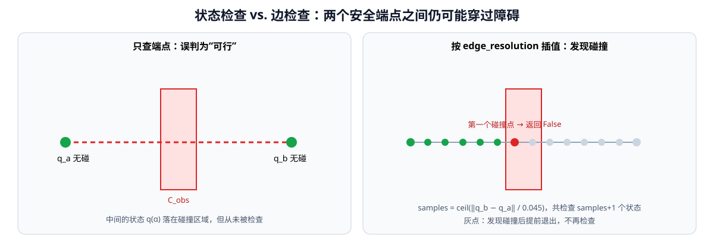

<p align="center"><b>图 11-7</b> 只检查端点会漏掉中间的碰撞；按 edge_resolution 插值检查，遇到第一个碰撞状态就提前返回</p>

**对应代码**：

```python
# 摘自 code/code_chapter11_1/collision.py
def edge_is_valid(self, start, goal) -> bool:
    q0 = np.asarray(start, dtype=np.float64)
    q1 = np.asarray(goal, dtype=np.float64)
    distance = float(np.linalg.norm(q1 - q0))          # ‖q_b - q_a‖
    samples = max(1, int(np.ceil(
        distance / self.config.edge_resolution         # n = ceil(L / δ)
    )))
    for ratio in np.linspace(0.0, 1.0, samples + 1):   # α_k = k/n，共 n+1 个
        if not self.state_is_valid(q0 + ratio * (q1 - q0)):
            return False                               # 第一个碰撞就退出
    return True

def path_is_valid(self, path) -> bool:
    return bool(path) and all(
        self.edge_is_valid(start, end) for start, end in zip(path[:-1], path[1:])
    )
```

**案例：一条边要检查多少次？** 以 `pick_red.cpp` 中的 HOME 与预抓取关节目标为例：

$$
\mathbf{q}_{home}=[0,-0.35,0,-1.10,0,0.35,0],\quad
\mathbf{q}_{pre}=[-0.3024,-0.3602,-0.2484,-1.5008,0.0349,0.2433,0.1062]
$$

差向量的范数为 $\lVert\Delta\mathbf{q}\rVert_2\approx 0.5813$ rad，于是 $n=\lceil 0.5813/0.045\rceil=13$，要检查 14 个状态。每个状态要做 7 段连杆 × 障碍物个数次 Slab 测试，外加最多 10 对自碰撞距离计算。自编版本用头部深度图生成的体素作为障碍（最多 600 个，见 `PerceptionConfig.map_max_points`），最坏情况下一次状态检查就要约 $7\times601\approx4200$ 次 Slab 测试——这可以帮助理解第七部分运行时“自编版本运行得很慢”的现象（纯 Python 逐点循环是可能的原因之一，本书未做专门的性能剖析）。

> ⚠️ **注意**：边检查分辨率是安全性与速度的直接权衡。不要为了提速盲目增大 `edge_resolution`；若一定要调，必须配合可视化验证，确认薄障碍物（如桌沿）不会被“跨过去”。

**MoveIt 2 中的对应物**：`ompl_planning.yaml` 中的

```yaml
# 摘自 code/code_chapter11_2/g2_chapter11_moveit/config/ompl_planning.yaml
right_arm:
  longest_valid_segment_fraction: 0.008
```

表示运动有效性检查时，最长不经检查的段长是状态空间最大范围（maximum extent）的 0.8%。它和 `edge_resolution` 作用相同，只是用“比例”而不是“绝对弧度”表达。

### 2.6 MoveIt 2 中的碰撞模型

MoveIt 2 版本不再手写胶囊和 AABB，而是从三处获得碰撞几何：

1. **机器人自身**：URDF 中每个 link 的 `<collision>` 元素。本章 URDF 用球体（半径 0.060 m）表示关节球，用圆柱（半径 0.044~0.052 m）表示连杆，用 `0.10 × 0.08 × 0.09` m 的盒子表示夹爪；
2. **已知物体**：通过 `PlanningSceneInterface` 添加的 `CollisionObject` / `AttachedCollisionObject`；
3. **感知环境**：头部深度点云经 `PointCloudOctomapUpdater` 写入的 OctoMap 体素。

```xml
<!-- 摘自 code/code_chapter11_2/g2_chapter11_moveit/urdf/g2_right_arm.urdf.xacro（节选） -->
<xacro:macro name="joint_ball" params="color:='0.72 0.75 0.80 1'">
  <xacro:joint_visual color="${color}"/>
  <collision><geometry><sphere radius="0.060"/></geometry></collision>
  <xacro:inertial_small/>
</xacro:macro>
<!-- ... -->
<link name="arm_r_link2">
  <xacro:joint_visual/>
  <collision><origin xyz="0 0 0.08725"/><geometry><cylinder radius="0.052" length="0.1745"/></geometry></collision><xacro:inertial_small/>
</link>
<!-- ... -->
<link name="gripper_r_center_link">
  <visual><origin xyz="0 0 0"/><geometry><box size="0.11 0.10 0.12"/></geometry>...</visual>
  <collision><origin xyz="0 0 0"/><geometry><box size="0.10 0.08 0.09"/></geometry></collision><xacro:inertial_small/>
</link>
```

URDF 中的视觉几何用于显示，碰撞几何用于碰撞检测。为了提高规划速度，碰撞几何通常应比精细渲染网格简单，但又不能简单到明显漏掉真实机械臂体积。注意上面夹爪的 visual 盒子（`0.11 × 0.10 × 0.12`）比 collision 盒子（`0.10 × 0.08 × 0.09`）略大——显示与碰撞几何本来就可以不同。

两套实现的碰撞模型对照：

| 方面 | `code_chapter11_1` | `code_chapter11_2`（MoveIt 2） |
|---|---|---|
| 连杆几何 | 线段 + 统一半径 0.055 m | URDF 中的球、圆柱、盒 |
| 环境几何 | AABB（场景盒或深度体素） | CollisionObject + OctoMap |
| 碰撞库 | 自写 Slab + 线段距离 | FCL（MoveIt 默认） |
| 自碰撞过滤 | 拓扑间隔 `j >= i + 3` | SRDF `<disable_collisions>` |
| 边检查 | `edge_resolution=0.045 rad` | `longest_valid_segment_fraction=0.008` |
| 安全余量 | `safety_margin=0.0` | `padding_offset=0.0`、`padding_scale=1.0` |

### 2.7 抓取目标、环境障碍与附着物体

抓取任务中的目标物体具有特殊碰撞语义。机械臂在远距离运动时应该避开目标，最后接近时夹爪又必须进入目标区域；抓住以后，目标还要随机械臂一起参与后续碰撞检查。

本章两套代码采用略有不同但目的相同的处理方式。

在**自编版本**中，红色物体在统一场景中用于显示和感知过滤，但其 `collision` 标志为关闭，因此规划器不会把红色目标当成普通外部障碍。桌面、黄色阻挡物、绿色物体、蓝色物体和机器人躯干仍然参与碰撞检测。闭合夹爪后，Isaac Sim 让红色可视物体跟随末端移动。

> 💡 **要点**：在完整案例 `demo_pick_red.py` 中，碰撞检测器实际使用的障碍是 `[ROBOT_BODY_BOX, *sensed_obstacles]`——躯干盒加上头部深度相机生成的 0.04 m 体素盒（`checker.set_obstacles(...)`）；`SCENE_BOXES` 主要用于 RViz 显示“已知场景模型”。因此桌面、阻挡物、绿/蓝物体是以“被相机看到的体素”的形式参与碰撞检测的，2.3 节用 `blocker` 盒子做的手算是对同一几何关系的简化演示。

实现上，`ArmCollisionChecker` 在构造和 `set_obstacles()` 时直接过滤掉 `collision=False` 的盒子：

```python
# 摘自 code/code_chapter11_1/collision.py
def set_obstacles(self, obstacles: Iterable[BoxObstacle]) -> None:
    self.obstacles = [obstacle for obstacle in obstacles if obstacle.collision]
```

而头部深度点云中属于红色物体的点，会按真实 AABB 被删掉，避免它以“体素障碍”的形式重新出现：

```python
# 摘自 code/code_chapter11_1/perception.py
def remove_known_target_points(
    points: np.ndarray, center=RED_OBJECT_POSITION, size=RED_OBJECT_SIZE
) -> np.ndarray:
    """按已知物块真实 AABB 从障碍点云中删除目标点，不增加额外边界。"""
    points = np.asarray(points)
    center = np.asarray(center, dtype=np.float64)
    half_size = 0.5 * np.asarray(size, dtype=np.float64)
    inside = np.all((points >= center - half_size) & (points <= center + half_size), axis=1)
    return points[~inside]
```

在 **MoveIt 2 版本**中，红色物体最初作为普通 `CollisionObject` 加入 Planning Scene。到达预抓取位姿后，程序暂时把它从世界碰撞物体中移除，使夹爪可以进入抓取区域；夹爪闭合后，再把同样尺寸的盒体作为 `AttachedCollisionObject` 附着到 `gripper_r_center_link`。抬升规划由此把“机械臂 + 已抓物体”作为一个整体检查碰撞（代码见 5.3 节）。

这一区别也说明了规划场景和物理仿真的边界：Planning Scene 中的附着物体用于规划碰撞语义；Isaac Sim 中的目标跟随用于画面和任务演示。当前案例没有模拟真实接触、摩擦、质量、夹紧力和物体滑落，不能把“附着成功”理解为完成了真实物理抓取验证。

> ⚠️ **注意**：自编版本在抬升阶段**没有**把红色物体加入碰撞模型，抬升时物体本身是否会蹭到其他东西并不被检查；MoveIt 2 版本通过附着物体弥补了这一点。这是两套实现在碰撞语义上的一个真实差别。

---

## 第三部分 采样规划与局部避障

### 3.1 为什么高维机械臂要用采样规划

**直观理解**：第十章的底盘在二维栅格地图上用 A* 搜索，因为二维格子数量有限。机械臂的 C 空间是七维的，把它切成格子再搜索，格子数量会爆炸；采样规划的思路是“不画完整地图，只在随机撒下的点之间连线试探”。

**维数灾难的手算。** 若对 G2 右臂七个关节的全部活动范围按 0.1 rad 划分栅格，各关节范围（上限−下限）分别为 6.2134、4.1888、6.2134、3.5779、6.2134、2.0944、3.1416 rad，格子总数约为：

$$
\prod_{i=1}^{7}\frac{q_i^{max}-q_i^{min}}{0.1}\approx 62.1\times41.9\times62.1\times35.8\times62.1\times20.9\times31.4\approx 2.4\times10^{11}
$$

每个格子都需要一次碰撞检查（前面算过，一次检查可能包含上千次 Slab 测试），这显然不可行。七维机械臂的配置空间维数较高，规则栅格搜索会产生维数灾难。本章自编规划器和 MoveIt 2 默认规划器都优先使用基于采样的 RRT-Connect。

采样规划器的共同骨架是：

1. 在 C 空间中随机**采样**一个状态；
2. 用碰撞检测器判断状态和连接边是否合法（2.5 节的 `edge_is_valid`）；
3. 把合法的状态和边加入一棵树或一张图；
4. 起点与终点被连通后，回溯得到路径。

这类算法通常是**概率完备**的：只要可行路径存在，随着采样次数增加，找到它的概率趋近于 1；但在有限迭代内不保证一定找到，也一般不保证路径最短。

关节空间中两个状态的距离使用欧氏距离：

$$
d(\mathbf{q}_a,\mathbf{q}_b)=\lVert\mathbf{q}_a-\mathbf{q}_b\rVert_2
$$

这意味着七个关节的角度变化被共同计入距离。该度量简单直观，但没有区分不同关节对末端位移和碰撞风险的影响（例如肩关节转 0.1 rad 带动的末端位移远大于腕关节转 0.1 rad），因此属于基础实现。

### 3.2 RRT：快速扩展随机树

**直观理解**：从起点种一棵“树”，每次往随机方向伸出一小截树枝；树枝撞墙就放弃，不撞就保留。由于随机点更可能落在大片未探索的区域，树会被“拉”着迅速铺满自由空间。

RRT（Rapidly-exploring Random Tree）一次迭代的三个关键操作：

$$
\mathbf{q}_{near}=\arg\min_{\mathbf{q}\in T} d(\mathbf{q},\mathbf{q}_{rand})
$$

$$
\mathbf{q}_{new}=\mathrm{Steer}(\mathbf{q}_{near},\mathbf{q}_{rand})=
\begin{cases}
\mathbf{q}_{rand}, & d(\mathbf{q}_{near},\mathbf{q}_{rand})\le\eta\\[4pt]
\mathbf{q}_{near}+\eta\,\dfrac{\mathbf{q}_{rand}-\mathbf{q}_{near}}{\lVert\mathbf{q}_{rand}-\mathbf{q}_{near}\rVert}, & \text{否则}
\end{cases}
$$

若边 $\mathbf{q}_{near}\rightarrow\mathbf{q}_{new}$ 无碰，就把 $\mathbf{q}_{new}$ 加入树，并记录父节点为 $\mathbf{q}_{near}$。其中 $\eta$ 是步长（本章 `step_size = 0.22 rad`）。

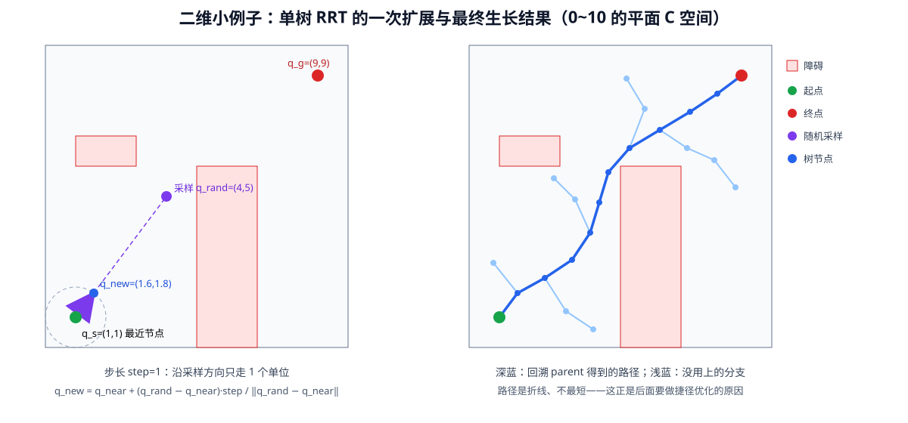

<p align="center"><b>图 11-8</b> 二维小例子：左为 RRT 的一次 Steer 扩展，右为树生长后回溯得到的折线路径</p>

**案例：手算一次 Steer。** 在 $[0,10]^2$ 的二维 C 空间中，起点 $\mathbf{q}_s=(1,1)$，步长 $\eta=1$，某次采样到 $\mathbf{q}_{rand}=(4,5)$。此时树里只有起点，所以 $\mathbf{q}_{near}=(1,1)$，距离 $\sqrt{3^2+4^2}=5>\eta$，于是：

$$
\mathbf{q}_{new}=(1,1)+1\times\frac{(3,4)}{5}=(1.6,\ 1.8)
$$

再检查边 $(1,1)\rightarrow(1.6,1.8)$ 是否碰撞，无碰则加入树。对应到七维机械臂，只是向量从 2 维变成 7 维、 $\eta$ 从 1 变成 0.22 rad，计算方式完全相同。

**对应代码**：自编规划器的 `_nearest`、`_steer`、`_extend` 就是上面三个公式：

```python
# 摘自 code/code_chapter11_1/motion_planner.py
@staticmethod
def _nearest(tree: list[_Node], sample: np.ndarray) -> int:
    distances = [np.linalg.norm(node.q - sample) for node in tree]   # 欧氏距离
    return int(np.argmin(distances))                                  # q_near 的下标

def _steer(self, start: np.ndarray, target: np.ndarray) -> np.ndarray:
    delta = target - start
    distance = float(np.linalg.norm(delta))
    if distance <= self.config.step_size:
        return target.copy()                                          # 够近：直接到达
    return start + delta * (self.config.step_size / distance)         # 否则只走 η

def _extend(self, tree, sample):
    nearest_index = self._nearest(tree, sample)
    candidate = self._steer(tree[nearest_index].q, sample)
    if not self.checker.edge_is_valid(tree[nearest_index].q, candidate):
        return None, False                                            # 边碰撞：放弃
    tree.append(_Node(candidate, nearest_index))                      # 记录父节点
    reached = float(np.linalg.norm(candidate - sample)) < 1e-8
    return len(tree) - 1, reached
```

> ⚠️ **注意**：`_nearest` 是对整棵树做线性扫描，树有 $k$ 个节点时代价为 $O(k)$。这对教学足够，工程实现（如 OMPL）会用 k-d 树、GNAT 等近邻数据结构加速。

### 3.3 RRT-Connect：双树与贪心连接

RRT-Connect 的核心思想是从起点和终点同时生长两棵随机树：

- 起点树从 $\mathbf{q}_s$ 出发；
- 终点树从 $\mathbf{q}_g$ 出发；
- 每次在关节限位内随机采样一个状态；
- 找到树中距离采样点最近的节点；
- 按固定步长向采样点扩展；
- 如果新边无碰撞，则把新节点加入树；
- 再让另一棵树尽可能连续地向新节点连接；
- 两棵树连接后，回溯父节点并拼接为完整路径。

与单树 RRT 相比，它有两个关键改进：一是**双向**，两棵树从两端相向生长；二是 **Connect 操作是贪心的**——另一棵树不是只走一步，而是沿同一方向反复 Extend，直到到达目标点或撞上障碍。在障碍不太密集的区域，这能一下子跨越很长的距离。

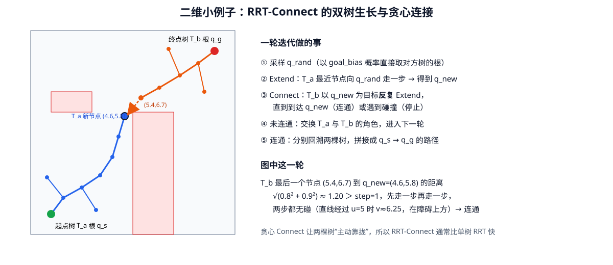

<p align="center"><b>图 11-9</b> 二维小例子：起点树新增节点后，终点树以它为目标连续扩展两步完成连接</p>

**案例：手算一次 Connect。** 接图 11-9：起点树刚扩展出 $\mathbf{q}_{new}=(4.6,5.8)$，终点树中离它最近的节点是 $(5.4,6.7)$，距离 $\sqrt{0.8^2+0.9^2}\approx1.204>\eta=1$。Connect 第一步：

$$
(5.4,6.7)+\frac{(-0.8,-0.9)}{1.204}\approx(5.4-0.664,\ 6.7-0.748)=(4.736,\ 5.952)
$$

剩余距离 $\approx0.204<\eta$，第二步直接到达 $(4.6,5.8)$，`reached=True`，两树连通。两步的边都要做碰撞检查：沿这条直线在 $u=5$ 处 $v\approx6.25$，位于下方障碍（ $v\le6$）之上，所以无碰。

**对应代码**：`_connect` 就是“反复 `_extend` 直到到达或失败”：

```python
# 摘自 code/code_chapter11_1/motion_planner.py
def _connect(self, tree, target):
    last_index = None
    while True:
        last_index, reached = self._extend(tree, target)
        if last_index is None:
            return None, False        # 撞到障碍：本次连接失败
        if reached:
            return last_index, True   # 到达 target：两树连通
```

主循环在两棵树之间交替扩展，并使用目标偏置提高相互连接概率：

```python
# 摘自 code/code_chapter11_1/motion_planner.py（plan 方法，省略结果封装）
start_tree, goal_tree = [_Node(start_q.copy(), None)], [_Node(goal_q.copy(), None)]
tree_a, tree_b = start_tree, goal_tree
a_is_start = True
for iteration in range(1, self.config.max_iterations + 1):
    if self.rng.random() < self.config.goal_bias:
        sample = tree_b[0].q.copy()               # 以 goal_bias 概率直接采对方树根
    else:
        sample = self.rng.uniform(
            self.checker.model.lower_limits,       # 在关节限位内均匀采样
            self.checker.model.upper_limits,
        )
    new_index, _ = self._extend(tree_a, sample)
    if new_index is not None:
        connect_index, connected = self._connect(tree_b, tree_a[new_index].q)
        if connected and connect_index is not None:
            path_a = self._trace(tree_a, new_index)
            path_b = self._trace(tree_b, connect_index)
            if a_is_start:                          # 保证路径方向始终是起点 → 终点
                path = path_a + list(reversed(path_b))[1:]
            else:
                path = path_b + list(reversed(path_a))[1:]
            return PlanResult(path, True, iteration, "RRT-Connect 找到路径")
    tree_a, tree_b = tree_b, tree_a                 # 交换两棵树的角色
    a_is_start = not a_is_start
return PlanResult([], False, self.config.max_iterations, "超过最大采样次数")
```

**代码解读**：

- `_trace` 沿 `parent` 指针回溯到树根，再反转得到“根 → 节点”的路径；两棵树在同一个点相遇，所以拼接时用 `[1:]` 去掉重复的连接点；
- 因为每轮结束都交换 `tree_a`、`tree_b`，需要 `a_is_start` 记住当前 `tree_a` 是哪一棵，才能把路径拼成正确方向；
- `random_seed` 决定 `self.rng`，相同种子会得到完全相同的随机序列和路径，便于复现实验（第七部分的 `--seed 23` 就是修改它）。

规划器首先检查起点和终点是否合法；如果起终点之间可以直接无碰连接，就直接返回两点路径；只有直连失败时才启动随机树搜索。这个顺序可以避免在简单场景中进行不必要的随机采样：

```python
# 摘自 code/code_chapter11_1/motion_planner.py（plan 方法开头）
for label, state in (("起点", start_q), ("终点", goal_q)):
    report = self.checker.state_report(state)
    if report.collision:
        return PlanResult([], False, 0, f"{label}无效：{report.reason}")
if self.checker.edge_is_valid(start_q, goal_q):
    return PlanResult([start_q.copy(), goal_q.copy()], True, 0, "直线连接成功")
```

`code_chapter11_1` 的默认全局规划参数为：

| 参数 | 默认值 | 含义 |
|---|---:|---|
| `step_size` | `0.22 rad` | 树每次扩展的最大关节空间距离 |
| `edge_resolution` | `0.045 rad` | 相邻状态之间的碰撞检查分辨率 |
| `goal_bias` | `0.18` | 直接向另一棵树根节点采样的概率 |
| `max_iterations` | `5000` | 最大采样迭代次数 |
| `random_seed` | `11` | 随机种子，便于复现实验 |
| `link_radius` | `0.055 m` | 连杆胶囊半径 |
| `safety_margin` | `0.0 m` | 对环境障碍物增加的额外安全边界 |
| `self_collision_distance` | `0.085 m` | 简化自碰撞距离阈值 |

```python
# 摘自 code/code_chapter11_1/config.py
@dataclass(frozen=True)
class PlannerConfig:
    step_size: float = 0.22
    edge_resolution: float = 0.045
    goal_bias: float = 0.18
    max_iterations: int = 5000
    random_seed: int = 11
    link_radius: float = 0.055
    # 不对障碍物做额外预膨胀；link_radius 只是机械臂自身物理半径。
    safety_margin: float = 0.0
    self_collision_distance: float = 0.085
```

**案例：一次扩展最多要检查几个状态？** `step_size=0.22`、`edge_resolution=0.045`，一条新边最多 $\lceil0.22/0.045\rceil=5$ 段、6 个状态。所以 `step_size` 与 `edge_resolution` 的比值决定了“每伸一步树枝的碰撞检查成本”。

> 💡 **要点**：`goal_bias=0.18` 意味着约 18% 的迭代直接朝对方树根采样，这让两棵树更快“对上眼”；但比例太高会让树在障碍前反复碰壁、探索不足。局部修复时把它提高到 0.28（3.5 节），是因为局部问题的起终点很近。

### 3.4 RRT* 与 PRM：MoveIt 2 中的回退规划器

MoveIt 2 版本通过 OMPL（Open Motion Planning Library）配置了三种采样规划器。除 RRTConnect 外，另外两种的思想如下。

#### RRT*：渐近最优的随机树

RRTstar 在随机树生长过程中不断选择和重连父节点，理论上具有渐近最优性质。和 RRT 相比，新增两步：

1. **选父节点**（ChooseParent）： $\mathbf{q}_{new}$ 不一定挂在 $\mathbf{q}_{near}$ 下，而是在半径 $\rho$ 内的邻居中选一个使“从根到 $\mathbf{q}_{new}$ 的代价”最小的节点：
$$
\mathbf{q}_{parent}=\arg\min_{\mathbf{q}\in\mathcal{N}(\mathbf{q}_{new},\rho)}\big[c(\mathbf{q})+d(\mathbf{q},\mathbf{q}_{new})\big]
$$
2. **重连**（Rewire）：对每个邻居 $\mathbf{q}_k$，若经过 $\mathbf{q}_{new}$ 到达它更便宜，即 $c(\mathbf{q}_{new})+d(\mathbf{q}_{new},\mathbf{q}_k)<c(\mathbf{q}_k)$，就把它的父节点改成 $\mathbf{q}_{new}$。

这里 $c(\cdot)$ 是从树根沿树到该节点的累计路径长度。随着采样增加，路径会逐渐变短，代价是每次迭代都要做邻域查询和更多碰撞检查。本章配置 `range=0.18`、`goal_bias=0.08`。它通常比 RRTConnect 慢，因此只在首选规划器失败后作为回退。

**小例子**：若 $\mathbf{q}_{near}$ 的累计代价是 3.0、到 $\mathbf{q}_{new}$ 距离 0.2，而另一个邻居 $\mathbf{q}_m$ 的累计代价是 2.6、到 $\mathbf{q}_{new}$ 距离 0.3，则 $3.0+0.2=3.2>2.6+0.3=2.9$，RRT* 会选 $\mathbf{q}_m$ 作父节点（前提是边 $\mathbf{q}_m\rightarrow\mathbf{q}_{new}$ 无碰）。

#### PRM：先建路线图再查询

PRM（Probabilistic Roadmap）先在自由空间采样并构建路线图，再在图上连接起点和终点。它适合同一环境中的多次查询。本章把 PRM 作为第三个回退选项，没有额外覆盖默认参数。

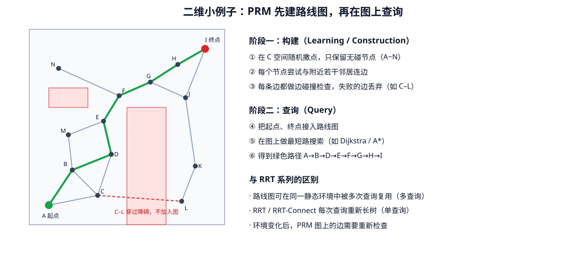

<p align="center"><b>图 11-10</b> 二维小例子：PRM 在构建阶段撒点连边（穿过障碍的边被丢弃），查询阶段在图上搜索最短路</p>

#### 三种规划器对比

| 规划器 | 结构 | 查询方式 | 最优性 | 本章角色与参数 |
|---|---|---|---|---|
| RRTConnect | 双树 + 贪心连接 | 单次查询 | 不保证 | 首选，`range=0.20`，规划时间 4.0 s |
| RRTstar | 单树 + 选父/重连 | 单次查询 | 渐近最优 | 回退 1，`range=0.18`、`goal_bias=0.08`，7.0 s |
| PRM | 路线图 | 多次查询 | 取决于图密度 | 回退 2，默认参数，7.0 s |

```yaml
# 摘自 code/code_chapter11_2/g2_chapter11_moveit/config/ompl_planning.yaml
planner_configs:
  RRTConnectkConfigDefault:
    type: geometric::RRTConnect
    range: 0.20
  RRTstarkConfigDefault:
    type: geometric::RRTstar
    range: 0.18
    goal_bias: 0.08
  PRMkConfigDefault:
    type: geometric::PRM
```

> 💡 **要点**：OMPL 的 `range` 与自编版本的 `step_size` 含义相近（树单次扩展的最大距离），两者分别是 0.20 和 0.22，属于同一量级。

### 3.5 机械臂局部避障：碰撞监测与局部路径修复

移动底盘常把局部规划理解为高频速度采样和短时域避障（第十章的 DWB 等）。机械臂的局部避障形式更多，本章两套实现采用的是“碰撞监测 + 从当前状态重新规划”，而不是连续的反应式速度控制。

`code_chapter11_1` 的局部修复流程是：

1. 从路径起点开始检查每一条边；
2. 找到第一条失效边；
3. 在失效边前后各保留一个小窗口；
4. 保留仍然安全的路径前段和后段；
5. 只对窗口两端之间重新运行 RRT-Connect；
6. 拼接新旧路径后，再检查整条路径是否有效。

窗口边界的公式为（ $i^*$ 为第一条失效边的下标， $w$ 为窗口大小， $N$ 为路径点数）：

$$
\text{left}=\max(0,\ i^*-w+1),\qquad \text{right}=\min(N-1,\ i^*+w)
$$

默认窗口大小为 4 个路径节点。局部规划最多迭代 2200 次，目标偏置提高到 0.28。这样做比完全丢弃整条路径更节省搜索时间，尤其适合障碍物只影响路径局部区域的情况。

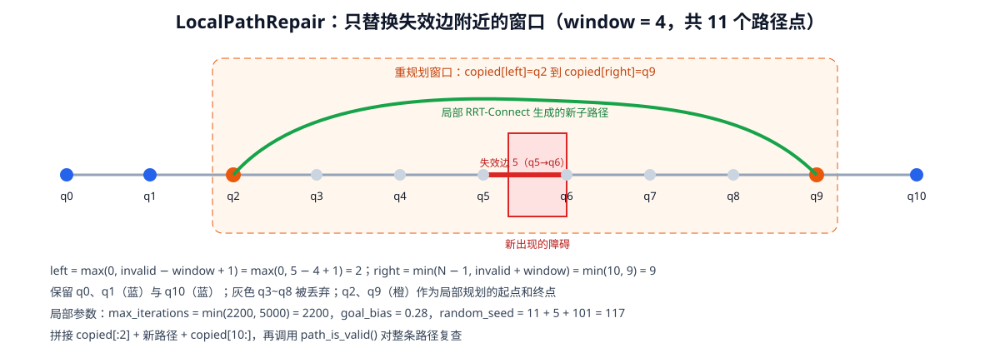

<p align="center"><b>图 11-11</b> LocalPathRepair 只替换失效边附近的窗口，保留安全的前后段</p>

**对应代码**：

```python
# 摘自 code/code_chapter11_1/local_avoidance.py
class LocalPathRepair:
    def __init__(self, checker: ArmCollisionChecker, window: int = 4) -> None:
        self.checker = checker
        self.window = max(2, int(window))

    def first_invalid_edge(self, path):
        for index, (start, end) in enumerate(zip(path[:-1], path[1:])):
            if not self.checker.edge_is_valid(start, end):
                return index                        # i*：第一条失效边
        return None

    def repair(self, path):
        copied = [np.asarray(q, dtype=np.float64).copy() for q in path]
        invalid = self.first_invalid_edge(copied)
        if invalid is None:
            return copied                           # 整条路径仍然有效：原样返回
        left = max(0, invalid - self.window + 1)
        right = min(len(copied) - 1, invalid + self.window)
        local_config = replace(
            self.checker.config,
            max_iterations=min(2200, self.checker.config.max_iterations),
            goal_bias=0.28,
            random_seed=self.checker.config.random_seed + invalid + 101,
        )
        result = RRTConnectPlanner(self.checker, local_config).plan(
            copied[left], copied[right]
        )
        if not result.success:
            raise RuntimeError(f"局部重规划失败：{result.message}")
        repaired = copied[:left] + result.path + copied[right + 1 :]
        if not self.checker.path_is_valid(repaired):
            raise RuntimeError("局部重规划生成了无效路径")
        return repaired
```

修复完成后还会重新检查整条拼接路径，避免局部新路径与保留的前后段产生新的无效连接。

**案例：手算窗口。** 路径有 $N=11$ 个点 $q_0\sim q_{10}$，新障碍让第 5 条边（ $q_5\rightarrow q_6$）失效， $w=4$：

- $\text{left}=\max(0,5-4+1)=2$， $\text{right}=\min(10,5+4)=9$；
- 局部 RRT-Connect 的起点是 $q_2$、终点是 $q_9$；
- 拼接结果为 `copied[:2] + 新路径 + copied[10:]`，即 $q_0,q_1$ + 新路径（含 $q_2$ 与 $q_9$）+ $q_{10}$；
- 局部随机种子为 $11+5+101=117$，与全局规划的种子不同，避免重复同一随机序列。

> ⚠️ **注意**：本章是静态场景，`repair()` 在默认案例中通常不会触发（`first_invalid_edge` 返回 `None`），终端里“2/4 局部碰撞监测与路径修复”这一步只是走了一遍检查。想观察修复效果，需要在规划完成后加入或移动障碍物（见课后练习）。

`code_chapter11_2` 没有实现持续运行的机械臂局部控制器，而是采用任务级低频重规划：

- 每次规划前调用 `setStartStateToCurrentState()`；
- 优先使用 RRTConnect；
- 快速规划失败后依次尝试 RRTstar 和 PRM；
- 执行失败后重新读取当前关节反馈并再次规划；
- Planning Scene 更新后，下一次规划自动使用最新障碍物。

```cpp
// 摘自 code/code_chapter11_2/g2_chapter11_moveit/src/local_replanner.cpp（省略日志）
const std::vector<std::string> planners = {
  "RRTConnectkConfigDefault",
  "RRTstarkConfigDefault",
  "PRMkConfigDefault"};

for (std::size_t attempt = 0; attempt < planners.size(); ++attempt) {
  move_group.setStartStateToCurrentState();        // 每次都从实测状态出发
  move_group.setJointValueTarget(joint_target);
  move_group.setPlannerId(planners[attempt]);      // 依次切换规划器
  move_group.setPlanningTime(attempt == 0 ? 4.0 : 7.0);

  MoveGroupInterface::Plan plan;
  const bool planned =
    move_group.plan(plan) == moveit::core::MoveItErrorCode::SUCCESS;

  if (planned &&
      move_group.execute(plan) == moveit::core::MoveItErrorCode::SUCCESS) {
    return true;                                    // 规划且执行成功
  }
  // 规划失败 → 换下一个规划器；执行失败 → 从当前反馈状态重新规划
}
```

两种“局部避障”思路对比：

| 方面 | `code_chapter11_1` 局部修复 | `code_chapter11_2` 当前状态重规划 |
|---|---|---|
| 触发 | 路径中某条边失效 | 规划失败或执行失败 |
| 范围 | 只重算失效边附近窗口 | 从当前状态到目标整段重算 |
| 规划器 | 同一个 RRT-Connect，参数调整 | RRTConnect → RRTstar → PRM |
| 障碍更新 | `set_obstacles()` | Planning Scene / OctoMap 自动更新 |

因此，本章中的“局部避障”应理解为场景更新后的在线重规划和局部路径修复。对于人员快速进入工作区、障碍物高速运动等场景，仅靠低频重规划通常不够，还需要 MoveIt Servo、Hybrid Planning、距离场速度缩放、独立安全控制器或急停系统。

---

## 第四部分 轨迹优化、时间参数化与轨迹跟踪

### 4.1 为什么无碰路径不能直接执行

RRT-Connect 的目标是尽快找到一条可行路径，而不是直接生成最短、最平滑或最好跟踪的路径。随机树找到的路径通常具有以下特点：

- 路径节点数量不固定；
- 相邻线段方向变化较大；
- 关节空间总长度可能明显大于必要长度；
- 路径点间距不均匀；
- 只有几何位置，没有速度和时间。

如果直接把这些路径点按固定频率发送给机械臂，不同路径段的实际速度会忽快忽慢，拐点处还可能出现速度突变。

**小例子**：若相邻路径点间距分别是 0.22 rad 和 0.02 rad，按 120 Hz 每帧发一个点，两段对应的期望关节速度分别约为 $0.22\times120=26.4$ rad/s 和 $0.02\times120=2.4$ rad/s——前者远超 1.25 rad/s 的速度上限，后者又慢了十倍。

轨迹优化的作用，就是在保持无碰的前提下改善路径几何形状，再把路径转换为满足运动学限制的时间轨迹。

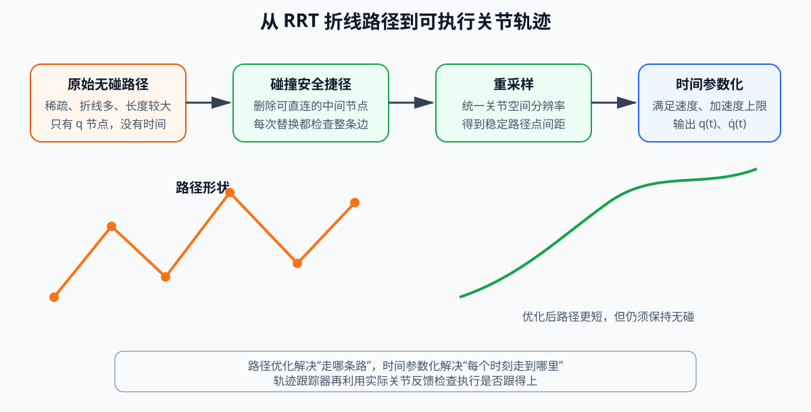

<p align="center"><b>图 11-12</b> 随机规划得到无碰路径后，还需要捷径化、重采样、时间参数化和反馈跟踪</p>

自编版本把前两步合并在 `optimize()` 中，并在最后再做一次整体碰撞复查：

```python
# 摘自 code/code_chapter11_1/trajectory_optimizer.py
def optimize(self, path):
    if len(path) < 2:
        raise ValueError("path 至少需要两个点")
    optimized = self.resample(self.shortcut(path))     # 先捷径、再重采样
    if not self.checker.path_is_valid(optimized):
        raise RuntimeError("优化后路径发生碰撞")         # 条件 5：优化后仍需安全
    return optimized
```

### 4.2 碰撞安全捷径与路径重采样

**直观理解**：RRT 的路径像喝醉的人走的路线。捷径化就是“拉直绳子”：随便挑路线上的两个点，如果它们之间能直接走过去且不撞，就把中间绕的弯删掉。

`code_chapter11_1` 首先执行随机捷径优化。每次随机选择路径中的两个非相邻节点 $\mathbf{q}_i$ 和 $\mathbf{q}_j$，如果两点之间可以直接无碰连接，就删除中间节点：

$$
\{\mathbf{q}_i,\mathbf{q}_{i+1},\ldots,\mathbf{q}_j\}
\quad\Rightarrow\quad
\{\mathbf{q}_i,\mathbf{q}_j\}
$$

是否允许替换不能只比较距离，还必须对新边进行完整碰撞检查。默认最多尝试 180 次。由三角不等式， $\lVert\mathbf{q}_j-\mathbf{q}_i\rVert\le\sum_{k=i}^{j-1}\lVert\mathbf{q}_{k+1}-\mathbf{q}_k\rVert$，所以每次成功的捷径都不会让路径变长。捷径优化不会保证得到全局最短路径，但实现简单，通常能够明显减少随机树产生的折线和冗余节点。

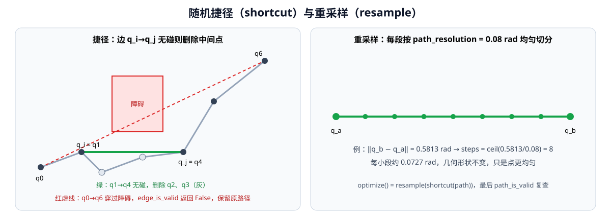

<p align="center"><b>图 11-13</b> 左：捷径只在新边无碰时删除中间点；右：重采样按 0.08 rad 把每段均匀切分</p>

**对应代码**：

```python
# 摘自 code/code_chapter11_1/trajectory_optimizer.py
def shortcut(self, path):
    result = [np.asarray(q, dtype=np.float64).copy() for q in path]
    for _ in range(self.config.shortcut_attempts):           # 最多 180 次
        if len(result) <= 2:
            break                                             # 已经是直线，提前结束
        i, j = sorted(self.rng.integers(0, len(result), size=2).tolist())
        if j <= i + 1:
            continue                                          # 相同或相邻：无可删
        if self.checker.edge_is_valid(result[i], result[j]):  # 新边必须无碰
            result = result[: i + 1] + result[j:]             # 删除 i 与 j 之间的点
    return result
```

注意优化器有自己的随机数生成器 `np.random.default_rng(1101)`，所以捷径结果同样可复现。

捷径化以后，程序按照 `path_resolution=0.08 rad` 对每段路径重新采样，使相邻点在七维关节空间中的距离较均匀。重采样不是为了改变路径形状，而是为了让后续时间参数化和轨迹执行使用稳定的离散分辨率。

```python
# 摘自 code/code_chapter11_1/trajectory_optimizer.py
def resample(self, path):
    output = [np.asarray(path[0], dtype=np.float64).copy()]
    for start, end in zip(path[:-1], path[1:]):
        q0, q1 = np.asarray(start), np.asarray(end)
        steps = max(1, int(np.ceil(np.linalg.norm(q1 - q0) / self.config.path_resolution)))
        output.extend(q0 + ratio * (q1 - q0) for ratio in np.linspace(0.0, 1.0, steps + 1)[1:])
    return [np.asarray(q, dtype=np.float64) for q in output]
```

路径长度使用关节空间线段长度之和衡量：

$$
L=\sum_{k=0}^{N-1}\lVert\mathbf{q}_{k+1}-\mathbf{q}_{k}\rVert_2
$$

```python
# 摘自 code/code_chapter11_1/trajectory_optimizer.py
@staticmethod
def length(path) -> float:
    return float(
        sum(np.linalg.norm(np.asarray(b) - np.asarray(a)) for a, b in zip(path[:-1], path[1:]))
    )
```

该指标适合比较同一任务中优化前后的关节运动量，但它不是末端在三维空间中的路径长度，也没有直接表示能耗、时间或最小障碍距离。终端日志中的“路径长度 A -> B rad”就是对原始路径和优化后路径分别调用 `length()` 的结果。

**案例：重采样的手算。** 若捷径后 HOME 到预抓取恰好是一条长 $0.5813$ rad 的直线边，则 $\lceil0.5813/0.08\rceil=8$，切成 8 段、每段约 $0.0727$ rad，输出 9 个点（含起点）。由于是在同一条直线上等分， $L$ 保持 0.5813 rad 不变——重采样不改变长度，只改变点的分布。

### 4.3 五次时间参数化

**直观理解**：时间参数化回答“每一段走多久”。走得太快会超过电机的速度/加速度上限；太保守则浪费时间。五次多项式让每一段“慢慢起步、中间加速、慢慢停下”，起止时速度和加速度都为零。

自编版本对每个相邻路径段使用五次 smoothstep 插值。设某段起点和终点分别为 $\mathbf{q}_0$、 $\mathbf{q}_1$，归一化时间为：

$$
\tau=\frac{t}{T},\qquad \tau\in[0,1]
$$

位置缩放函数为：

$$
h(\tau)=10\tau^3-15\tau^4+6\tau^5
$$

该段关节位置为：

$$
\mathbf{q}(t)=\mathbf{q}_0+h(\tau)(\mathbf{q}_1-\mathbf{q}_0)
$$

速度缩放函数为：

$$
\dot h(\tau)=\frac{30\tau^2-60\tau^3+30\tau^4}{T}
$$

因此：

$$
\dot{\mathbf{q}}(t)=\dot h(\tau)(\mathbf{q}_1-\mathbf{q}_0)
$$

**为什么是这个多项式？** 要求 $h(0)=0,\ h(1)=1$，且两端速度、加速度都为零： $h'(0)=h'(1)=0,\ h''(0)=h''(1)=0$。六个边界条件恰好确定一个五次多项式的六个系数，解出来就是 $10\tau^3-15\tau^4+6\tau^5$。可以验证：

$$
h'(\tau)=30\tau^2(1-\tau)^2,\qquad h''(\tau)=60\tau(1-\tau)(1-2\tau)
$$

两者在 $\tau=0$ 和 $\tau=1$ 处都为零。

五次曲线在每段起点和终点的速度为零，加速度也连续回到零，适合教学中演示从几何路径到时间轨迹的转换。

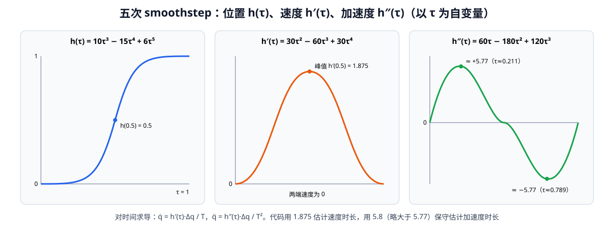

<p align="center"><b>图 11-14</b> 五次 smoothstep 的位置、速度、加速度曲线：速度峰值 1.875 出现在中点，加速度峰值约 ±5.77</p>

**推导两个时长下限。** 设某关节在这一段的变化量为 $\Delta q_i$。

- 速度： $|\dot q_i|=\dfrac{h'(\tau)}{T}|\Delta q_i|$， $h'$ 在 $\tau=0.5$ 取最大值 $30\times0.25\times0.25=1.875$。要求 $\dfrac{1.875|\Delta q_i|}{T}\le v_{i,max}$，得到 $T\ge\dfrac{1.875|\Delta q_i|}{v_{i,max}}$；
- 加速度： $|\ddot q_i|=\dfrac{|h''(\tau)|}{T^2}|\Delta q_i|$，令 $h'''(\tau)=60-360\tau+360\tau^2=0$ 得 $\tau=\dfrac{3-\sqrt3}{6}\approx0.211$，此时 $|h''|_{max}=\dfrac{10}{\sqrt3}\approx5.774$。要求 $\dfrac{5.774|\Delta q_i|}{T^2}\le a_{i,max}$，得 $T\ge\sqrt{\dfrac{5.774|\Delta q_i|}{a_{i,max}}}$。代码取 5.8，略大于 5.774，属于保守取整。

代码根据关节速度和加速度限制分别估算最短持续时间：

$$
T_v=\max_i\frac{1.875|\Delta q_i|}{v_{i,max}}
$$

$$
T_a=\max_i\sqrt{\frac{5.8|\Delta q_i|}{a_{i,max}}}
$$

最终使用：

$$
T=\max(0.12,T_v,T_a)
$$

默认关节速度上限为 `1.25 rad/s`，加速度上限为 `2.2 rad/s²`，自编轨迹生成时再乘以 `speed_scale=0.55`。轨迹按照 `1/120 s` 采样，与 Isaac Sim 的 120 Hz 物理步长对应。

**对应代码**：

```python
# 摘自 code/code_chapter11_1/trajectory_optimizer.py（time_parameterize）
velocity_limits = JOINT_VELOCITY_LIMITS * self.config.speed_scale         # 1.25 × 0.55
acceleration_limits = JOINT_ACCELERATION_LIMITS * self.config.speed_scale # 2.2 × 0.55
trajectory = [TrajectoryPoint(0.0, np.asarray(path[0]).copy(), np.zeros(7))]
current_time = 0.0
for start, end in zip(path[:-1], path[1:]):
    q0, q1 = np.asarray(start, dtype=np.float64), np.asarray(end, dtype=np.float64)
    delta = np.abs(q1 - q0)                                               # |Δq_i|
    # 五次曲线峰值速度约为 1.875*dq/T；保守加入加速度约束。
    duration_v = float(np.max(1.875 * delta / np.maximum(velocity_limits, 1e-6)))       # T_v
    duration_a = float(np.max(np.sqrt(5.8 * delta / np.maximum(acceleration_limits, 1e-6))))  # T_a
    duration = max(0.12, duration_v, duration_a)                          # T
    steps = max(2, int(np.ceil(duration / self.config.sample_dt)))        # 每段采样数
    for step in range(1, steps + 1):
        tau = step / steps
        scale = 10 * tau**3 - 15 * tau**4 + 6 * tau**5                    # h(τ)
        scale_dot = (30 * tau**2 - 60 * tau**3 + 30 * tau**4) / duration  # ḣ
        t = current_time + tau * duration
        trajectory.append(TrajectoryPoint(t, q0 + scale * (q1 - q0), scale_dot * (q1 - q0)))
    current_time += duration
```

```python
# 摘自 code/code_chapter11_1/config.py
JOINT_VELOCITY_LIMITS = np.full(7, 1.25, dtype=np.float64)
JOINT_ACCELERATION_LIMITS = np.full(7, 2.2, dtype=np.float64)

@dataclass(frozen=True)
class TrajectoryConfig:
    sample_dt: float = 1.0 / 120.0
    shortcut_attempts: int = 180
    path_resolution: float = 0.08
    speed_scale: float = 0.55
    tracking_tolerance: float = 0.10
    abort_tolerance: float = 0.38
```

> ⚠️ **注意**：代码中加速度上限也乘了 `speed_scale`，即实际使用 $a_{max}=2.2\times0.55=1.21$ rad/s²，速度上限 $v_{max}=1.25\times0.55=0.6875$ rad/s。

**案例：手算一段轨迹的时长。** 继续 4.2 节的例子：HOME→预抓取的直线被重采样成 8 段。整条边上变化最大的是关节 4： $|\Delta q_4|=|-1.5008-(-1.10)|=0.4008$ rad，因此每小段 $|\Delta q_4|\approx0.4008/8=0.0501$ rad。

| 量 | 计算 | 结果 |
|---|---|---:|
| $T_v$ | $1.875\times0.0501/0.6875$ | 0.137 s |
| $T_a$ | $\sqrt{5.8\times0.0501/1.21}$ | 0.490 s |
| $T$ | $\max(0.12,0.137,0.490)$ | 0.490 s |
| 每段采样点数 | $\lceil0.490\times120\rceil$ | 59 |
| 8 段总时长 | $8\times0.490$ | ≈ 3.92 s |

校验：中点峰值速度 $1.875\times0.0501/0.490\approx0.19$ rad/s，远低于 0.6875；峰值加速度 $5.774\times0.0501/0.490^2\approx1.20$ rad/s²，刚好不超过 1.21。可见这里是**加速度约束起决定作用**。

如果不重采样、整条边作为一段： $T_a=\sqrt{5.8\times0.4008/1.21}\approx1.39$ s，比 3.92 s 快得多。原因是五次曲线让每一小段都“从静止起步、在终点停下”，切成 8 段就要停 8 次。

> ⚠️ **注意**：这是教学实现“逐段五次插值”的固有特点：轨迹在每个重采样点处速度都回到零，整体呈“走—停—走”的节奏，总时长偏长。它的优点是简单、每段都满足限制，缺点是不够高效。MoveIt 2 使用的时间最优参数化不会在中间点强制停下。

### 4.4 MoveIt 2 中的时间参数化

MoveIt 2 版本不使用这段自编五次曲线，而是在 OMPL 规划请求适配器中启用 `AddTimeOptimalParameterization`。它根据路径和关节限制自动为轨迹分配时间。任务程序又调用速度缩放 0.55、加速度缩放 0.45，使实际使用的限制更加保守。

```yaml
# 摘自 code/code_chapter11_2/g2_chapter11_moveit/config/joint_limits.yaml（节选，7 个关节相同）
joint_limits:
  idx61_arm_r_joint1: {has_velocity_limits: true, max_velocity: 1.25, has_acceleration_limits: true, max_acceleration: 2.2}
  # ... idx62 ~ idx67 同上
```

```cpp
// 摘自 code/code_chapter11_2/g2_chapter11_moveit/src/pick_red.cpp
move_group.setMaxVelocityScalingFactor(0.55);
move_group.setMaxAccelerationScalingFactor(0.45);
```

**案例**：两套实现的有效限制对比——自编版本 $v=0.6875$ rad/s、 $a=1.21$ rad/s²；MoveIt 2 版本 $v=1.25\times0.55=0.6875$ rad/s、 $a=2.2\times0.45=0.99$ rad/s²。速度上限相同，MoveIt 2 的加速度上限更保守。

需要注意，“Time Optimal”表示在给定路径和限制下进行时间参数化，不表示它同时求得了全局最短路径。路径几何质量主要仍由 OMPL 规划和路径简化决定。

### 4.5 轨迹跟踪与误差保护

轨迹生成后，规划层得到的是期望值。实际机械臂是否准确到达，还取决于关节 drive、控制频率、物理参数、通信延迟和反馈质量。

自编版本的跟踪器在每个物理周期执行以下过程：

1. 读取右臂 7 个关节的实际位置；
2. 计算当前轨迹点与实际位置之间的最大绝对误差；
3. 误差不超过 `0.10 rad` 时，继续发送下一个期望点；
4. 误差大于 `0.10 rad` 时，暂时保持当前目标一帧，让底层 drive 追赶；
5. 误差超过 `0.38 rad` 时，立即中止执行；
6. 轨迹结束后继续保持最终目标 30 个物理周期。

最大关节误差定义为：

$$
e_{max}=\max_i |q_{d,i}-q_i|
$$

其中 $q_{d,i}$ 是第 $i$ 个关节的期望位置， $q_i$ 是实测位置（rad）。用 $\infty$-范数而不是 2-范数，是为了让“任意一个关节偏差过大”都能被及时发现。

```text
           error ≤ 0.10                0.10 < error ≤ 0.38           error > 0.38
   ┌──────────────────────┐   ┌──────────────────────────────┐   ┌──────────────────┐
   │ 发送当前轨迹点 q_d    │   │ 不发送新点，沿用上一次的目标 │   │ 抛出 RuntimeError │
   │ （正常推进）          │   │ （让底层 drive 追一帧）       │   │ （中止执行）      │
   └──────────────────────┘   └──────────────────────────────┘   └──────────────────┘
```

**对应代码**：

```python
# 摘自 code/code_chapter11_1/trajectory_tracker.py（execute）
maximum_error = 0.0
for point in trajectory[1:]:
    actual = self.get_positions()                                   # 7 个关节实测位置
    error = float(np.max(np.abs(point.positions - actual)))        # e_max
    maximum_error = max(maximum_error, error)
    if error > self.config.abort_tolerance:                        # > 0.38 rad：中止
        raise RuntimeError(f"轨迹跟踪误差过大：{error:.3f} rad")
    # 误差偏大时保持当前目标一帧，让底层 drive 追上，而不是继续超前。
    if error <= self.config.tracking_tolerance:                    # ≤ 0.10 rad：推进
        self.command(point.positions)
    if publish_callback is not None:
        publish_callback(point.positions, actual)                  # RViz 显示指令臂/实际臂
    step_callback()                                                # 推进一个物理周期
final = np.asarray(trajectory[-1].positions)
for _ in range(30):                                                # 末端保持 30 个周期
    self.command(final)
    step_callback()
return maximum_error
```

> ⚠️ **注意**：误差在 0.10~0.38 rad 之间时，循环**仍然前进到下一个轨迹点**，只是不发送新指令。所以“保持一帧”不会让轨迹整体延后，长时间落后时，后续点与实际位置的误差会继续增大并最终触发中止。

**案例**：按 4.3 节的结果，峰值速度约 0.19 rad/s，每个 1/120 s 周期期望位置前进约 0.0016 rad。只要 Isaac 关节 drive 正常工作，误差会远小于 0.10 rad；若日志中最大跟踪误差接近 0.10 rad，通常说明 drive 刚度不足或负载过大。

MoveIt 2 版本通过标准 `FollowJointTrajectory` Action 执行轨迹。C++ 控制桥以 100 Hz 在相邻轨迹点之间线性插值，把期望关节位置发布给 Isaac Sim；同时把 Isaac 反馈转发为标准 `/joint_states`，并通过 Action feedback 返回期望值、实际值和误差。轨迹时间结束后，控制桥继续保持最终目标；如果最大误差在 8 秒内降到 `0.10 rad` 以下，则返回成功，否则返回 `GOAL_TOLERANCE_VIOLATED`。

控制桥中的线性插值公式为（ $t_{k-1}\le t\le t_k$）：

$$
\mathbf{q}_d(t)=\mathbf{q}_{k-1}+\frac{t-t_{k-1}}{t_k-t_{k-1}}(\mathbf{q}_k-\mathbf{q}_{k-1})
$$

```cpp
// 摘自 code/code_chapter11_2/g2_chapter11_moveit/src/isaac_controller_bridge.cpp（interpolate）
for (std::size_t i = 1; i < points.size(); ++i) {
  const double right_time = seconds(points[i].time_from_start);
  if (elapsed <= right_time) {
    const double left_time = seconds(points[i - 1].time_from_start);
    const double denominator = std::max(1e-9, right_time - left_time);
    const double ratio = std::clamp((elapsed - left_time) / denominator, 0.0, 1.0);
    std::vector<double> result(points[i].positions.size());
    for (std::size_t joint = 0; joint < result.size(); ++joint) {
      result[joint] = points[i - 1].positions[joint] + ratio *
        (points[i].positions[joint] - points[i - 1].positions[joint]);
    }
    return result;
  }
}
return points.back().positions;
```

```cpp
// 摘自 code/code_chapter11_2/g2_chapter11_moveit/src/isaac_controller_bridge.cpp（execute 的收敛阶段）
const auto final_target = points.back().positions;
const auto settle_begin = std::chrono::steady_clock::now();
while (rclcpp::ok()) {
  publishCommand(final_target);                     // 持续保持最终目标
  std::vector<double> actual;
  if (readState(actual)) {
    double maximum_error = 0.0;
    for (std::size_t i = 0; i < joint_names_.size(); ++i) {
      maximum_error = std::max(maximum_error, std::abs(final_target[i] - actual[i]));
    }
    if (maximum_error < 0.10) {                     // 收敛：Action 成功
      auto result = std::make_shared<Follow::Result>();
      result->error_code = Follow::Result::SUCCESSFUL;
      goal_handle->succeed(result);
      busy_.store(false);
      return;
    }
  }
  const double settling = std::chrono::duration<double>(
    std::chrono::steady_clock::now() - settle_begin).count();
  if (settling > 8.0) {                             // 8 s 内未收敛：容差违反
    finishWithError(goal_handle, Follow::Result::GOAL_TOLERANCE_VIOLATED,
                    "Isaac 8 秒内最终关节跟踪误差仍超过 0.10 rad");
    return;
  }
  rate.sleep();
}
```

两套跟踪实现对照：

| 方面 | `code_chapter11_1` 跟踪器 | `code_chapter11_2` C++ 控制桥 |
|---|---|---|
| 运行频率 | 每个物理周期（120 Hz） | 100 Hz（`rclcpp::Rate rate(100.0)`） |
| 期望值来源 | 五次曲线采样点 | MoveIt 轨迹点之间线性插值 |
| 运行中保护 | 0.10 rad 暂停推进，0.38 rad 中止 | 发布 feedback（期望/实际/误差） |
| 结束判定 | 保持 30 周期，返回最大误差 | 8 s 内 < 0.10 rad 成功，否则 `GOAL_TOLERANCE_VIOLATED` |

因此，以下三个“成功”必须分别判断：

| 层级 | 成功条件 |
|---|---|
| IK 成功 | 目标位置或位姿误差满足求解阈值 |
| 规划成功 | 找到满足关节限位和碰撞约束的路径/轨迹 |
| 执行成功 | 控制器连接正常，机器人完成运动，最终反馈误差满足阈值 |

---

## 第五部分 MoveIt 2 框架：move_group、规划场景与控制器接口

### 5.1 MoveIt 2 在系统中的位置

**直观理解**：前四部分我们亲手写了碰撞检测、RRT-Connect、轨迹优化和跟踪器。MoveIt 2 把这些功能全部做成了可配置的插件，并用一个中心节点 `move_group` 把它们组织起来——你只需告诉它“机器人长什么样、环境里有什么、目标是什么”，它负责规划并把轨迹交给控制器。

MoveIt 2 不是一个单独的路径规划算法，而是一套机械臂运动规划与操作框架。它把机器人模型、运动学插件、碰撞场景、规划算法、轨迹处理、控制器接口和可视化工具组织在一起，并通过 `move_group` 为用户程序提供统一入口。

本章工程中的完整数据链为：

```text
任务程序或 RViz
→ MoveGroupInterface / MoveGroup Action
→ move_group
→ 当前状态 + URDF/SRDF + Planning Scene
→ KDL 运动学与 OMPL 规划流水线
→ 路径简化与时间参数化
→ Trajectory Execution Manager
→ MoveIt Simple Controller Manager
→ /right_arm_controller/follow_joint_trajectory
→ C++ Isaac Controller Bridge
→ /chapter11/isaac_joint_command
→ Isaac Sim G2 关节 drive
→ /chapter11/isaac_joint_states
→ /joint_states、TF 与 move_group 当前状态
```

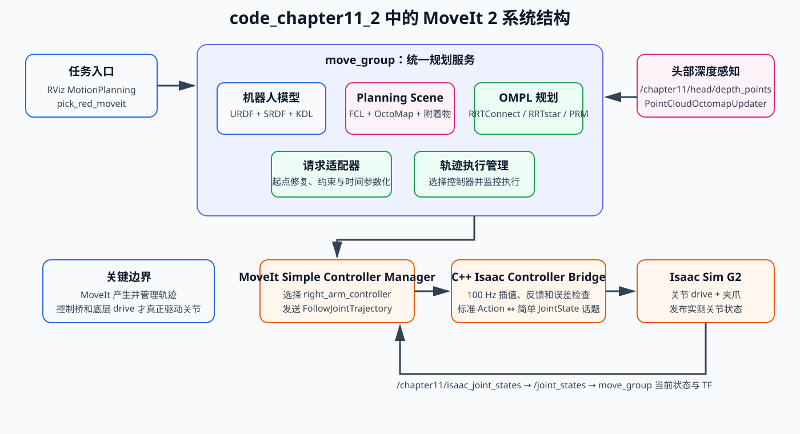

<p align="center"><b>图 11-15</b> 本章 MoveIt 2 工程中，move_group 负责规划组织，标准控制器接口负责轨迹执行，Isaac Sim 提供关节驱动和反馈</p>

图中可以看到，MoveIt 2 不直接操作 Isaac Sim articulation。它把轨迹发送到标准 `FollowJointTrajectory` Action；C++ 控制桥负责把标准轨迹转换为 Isaac 能接收的简单关节命令话题。这一分层与真实机器人中的“MoveIt → ros2_control 控制器 → 厂商驱动/硬件”相似。

把自编版本的模块与 MoveIt 2 的组件逐一对应，能帮助理解 MoveIt “内部在做什么”：

| 自编版本（`code_chapter11_1`） | MoveIt 2 组件（`code_chapter11_2`） |
|---|---|
| `arm_model.py`（复用第五章 FK/IK） | URDF + KDL 运动学插件 |
| `collision.py` + 场景盒/深度体素 | Planning Scene + FCL + OctoMap |
| 拓扑间隔自碰撞规则 | SRDF `<disable_collisions>` |
| `motion_planner.py`（RRT-Connect） | OMPL 规划流水线（RRTConnect / RRTstar / PRM） |
| `trajectory_optimizer.py` | OMPL 路径简化 + `AddTimeOptimalParameterization` |
| `local_avoidance.py` | `local_replanner.cpp`（当前状态重规划 + 规划器回退） |
| `trajectory_tracker.py` | Trajectory Execution Manager + 控制器 Action |
| `demo_pick_red.py` | `pick_red.cpp` |

**对应代码**：用户程序只和 `MoveGroupInterface` 打交道，它在内部通过 `/move_action` 等接口与 `move_group` 通信：

```cpp
// 摘自 code/code_chapter11_2/g2_chapter11_moveit/src/pick_red.cpp（main 开头）
rclcpp::init(argc, argv);
auto node = rclcpp::Node::make_shared("chapter11_pick_red_moveit");
rclcpp::executors::SingleThreadedExecutor executor;
executor.add_node(node);
std::thread spinner([&executor]() { executor.spin(); });   // 后台线程处理回调

moveit::planning_interface::MoveGroupInterface move_group(node, "right_arm");  // 规划组名来自 SRDF
moveit::planning_interface::PlanningSceneInterface scene;
```

> 💡 **要点**：`MoveGroupInterface(node, "right_arm")` 中的 `"right_arm"` 必须与 SRDF 中 `<group name="right_arm">` 一致，这是 SRDF 与用户代码之间最直接的联系。

### 5.2 URDF、SRDF 与 KDL：告诉 MoveIt “机器人是什么”

MoveIt 2 首先需要知道“机器人是什么”。本章使用四类信息共同构建规划模型。

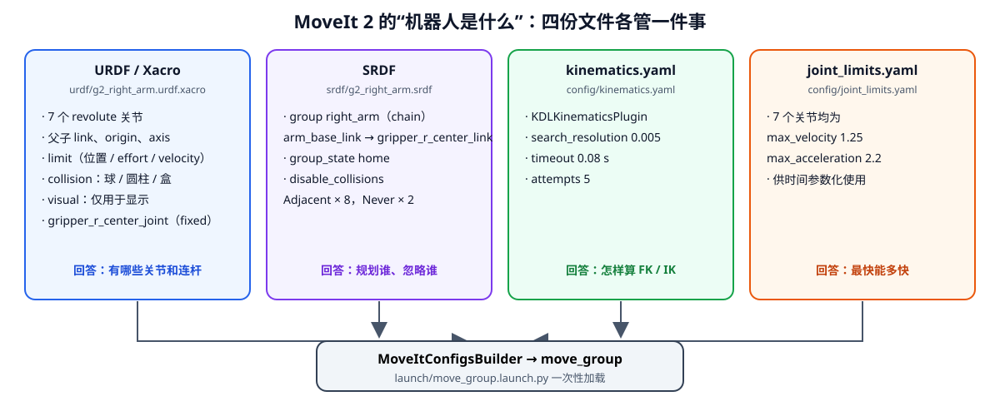

<p align="center"><b>图 11-16</b> 四份文件各管一件事，由 MoveItConfigsBuilder 一次性加载给 move_group</p>

**URDF/Xacro** 描述机器人运动学树和基础物理属性。本章文件 `g2_right_arm.urdf.xacro` 包含：

- `arm_base_link` 到 `gripper_r_center_link` 的七个旋转关节；
- 每个关节的父子链接、原点、旋转轴和位置限位；
- 连杆的简化圆柱、球体或盒体碰撞几何；
- 夹爪中心的固定连接。

```xml
<!-- 摘自 code/code_chapter11_2/g2_chapter11_moveit/urdf/g2_right_arm.urdf.xacro（第一个关节与末端固定关节） -->
<joint name="idx61_arm_r_joint1" type="revolute">
  <parent link="arm_base_link"/><child link="arm_r_link1"/>
  <origin xyz="0 0 -0.069" rpy="${pi} 0 0"/><axis xyz="0 0 1"/>
  <limit lower="-3.1067" upper="3.1067" effort="108" velocity="3.1416"/>
</joint>
<!-- ... idx62 ~ idx67 ... -->
<joint name="gripper_r_center_joint" type="fixed">
  <parent link="arm_r_link7"/><child link="gripper_r_center_link"/>
  <origin xyz="0.23645 0 0" rpy="${pi} ${-pi/2} 0"/>
</joint>
```

> ⚠️ **注意**：URDF 中 `<limit velocity="3.1416">` 是关节的物理速度上限；MoveIt 规划时实际使用的是 `joint_limits.yaml` 中的 `max_velocity: 1.25`（它会覆盖 URDF 的速度限制，并额外提供 URDF 无法表达的加速度上限 2.2）。两处数值不同是正常的。

**SRDF**（Semantic Robot Description Format，语义机器人描述格式）描述运动规划语义。本章 `g2_right_arm.srdf` 定义：

- 名为 `right_arm` 的规划组；
- 从 `arm_base_link` 到 `gripper_r_center_link` 的链；
- 名为 `home` 的命名状态；
- 相邻连杆和部分确定不会碰撞的连杆对。

```xml
<!-- code/code_chapter11_2/g2_chapter11_moveit/srdf/g2_right_arm.srdf（全文） -->
<?xml version="1.0"?>
<robot name="g2_right_arm">
  <group name="right_arm">
    <chain base_link="arm_base_link" tip_link="gripper_r_center_link"/>
  </group>
  <group_state name="home" group="right_arm">
    <joint name="idx61_arm_r_joint1" value="0.0"/>
    <joint name="idx62_arm_r_joint2" value="-0.35"/>
    <joint name="idx63_arm_r_joint3" value="0.0"/>
    <joint name="idx64_arm_r_joint4" value="-1.10"/>
    <joint name="idx65_arm_r_joint5" value="0.0"/>
    <joint name="idx66_arm_r_joint6" value="0.35"/>
    <joint name="idx67_arm_r_joint7" value="0.0"/>
  </group_state>
  <disable_collisions link1="arm_base_link" link2="arm_r_link1" reason="Adjacent"/>
  <disable_collisions link1="arm_r_link1" link2="arm_r_link2" reason="Adjacent"/>
  <disable_collisions link1="arm_r_link2" link2="arm_r_link3" reason="Adjacent"/>
  <disable_collisions link1="arm_r_link3" link2="arm_r_link4" reason="Adjacent"/>
  <disable_collisions link1="arm_r_link4" link2="arm_r_link5" reason="Adjacent"/>
  <disable_collisions link1="arm_r_link5" link2="arm_r_link6" reason="Adjacent"/>
  <disable_collisions link1="arm_r_link6" link2="arm_r_link7" reason="Adjacent"/>
  <disable_collisions link1="arm_r_link7" link2="gripper_r_center_link" reason="Adjacent"/>
  <disable_collisions link1="arm_base_link" link2="arm_r_link2" reason="Never"/>
  <disable_collisions link1="arm_base_link" link2="arm_r_link3" reason="Never"/>
</robot>
```

**代码解读**：

- `<chain base_link tip_link>`：规划组由链上所有关节组成，这里正好是 7 个 `revolute` 关节（固定关节 `gripper_r_center_joint` 不计入自由度）；
- `<group_state name="home">`：命名状态，值与 `config.py` 的 `HOME_JOINT_POSITIONS` 和 `pick_red.cpp` 的 `kHome` 完全一致，可在 RViz MotionPlanning 面板中直接选择；
- `reason="Adjacent"`：父子相邻的连杆在关节处天然接触，必须忽略，共 8 对；
- `reason="Never"`：在所有可达姿态下都不会碰撞的连杆对，忽略后可以减少碰撞检查次数，共 2 对。

**对照阅读：`code/srdf/g2_right_arm.srdf`。** 仓库中还有一份同名 SRDF，与上面相比有三处差别：

```xml
<!-- 摘自 code/srdf/g2_right_arm.srdf（与本章包内 SRDF 不同的部分） -->
<virtual_joint name="mobile_root" type="floating" parent_frame="odom" child_link="arm_base_link" />
<group_state name="home" group="right_arm">
  <joint name="idx61_arm_r_joint1" value="-0.739033" />
  <!-- ... 另一组 home 关节值 ... -->
</group_state>
<!-- ... 与本章相同的 10 条 disable_collisions ... -->
<disable_collisions link1="arm_r_link6" link2="gripper_r_center_link" reason="Adjacent" />
<!-- 两个转轴共用物理关节，杆件端部与下一级关节球体有设计重叠。 -->
<disable_collisions link1="arm_r_link1" link2="arm_r_link3" reason="Adjacent" />
<disable_collisions link1="arm_r_link3" link2="arm_r_link5" reason="Adjacent" />
<disable_collisions link1="arm_r_link5" link2="arm_r_link7" reason="Adjacent" />
```

1. 增加了 `virtual_joint`：把 `arm_base_link` 用浮动关节挂到 `odom` 坐标系下，用于机械臂随移动底盘一起运动的场景；
2. `home` 是另一组关节值；
3. 多禁用了 4 对碰撞，注释说明原因是“两个转轴共用物理关节，杆件端部与下一级关节球体有设计重叠”。

这份文件与 `code/code_chapter12/srdf/g2_right_arm.srdf` 内容相同，本章 launch 文件加载的是包内 `srdf/g2_right_arm.srdf`，不是它。它很好地展示了：SRDF 是“语义”而不是“几何”，同一个 URDF 可以根据使用场景配不同的 SRDF。

URDF 回答“有哪些关节和连杆”，SRDF 回答“哪些连杆组成规划组、哪些碰撞对可以忽略、有哪些语义状态”。两者职责不同，不能只配置其中一个。

> ⚠️ **注意**：`disable_collisions` 列得太多会掩盖真实碰撞。只应禁用“相邻”或“经验证永远不会碰”的连杆对；MoveIt Setup Assistant 会通过大量随机采样自动生成这份列表，手写时要格外谨慎。

**KDL 运动学插件**负责 MoveIt 中的 FK/IK。`kinematics.yaml` 为 `right_arm` 配置：

```yaml
# code/code_chapter11_2/g2_chapter11_moveit/config/kinematics.yaml
right_arm:
  kinematics_solver: kdl_kinematics_plugin/KDLKinematicsPlugin
  kinematics_solver_search_resolution: 0.005
  kinematics_solver_timeout: 0.08
  kinematics_solver_attempts: 5
```

| 参数 | 数值 | 含义 |
|---|---:|---|
| `kinematics_solver` | `KDLKinematicsPlugin` | 使用 KDL 数值运动学插件 |
| `kinematics_solver_search_resolution` | `0.005` | 冗余变量搜索分辨率 |
| `kinematics_solver_timeout` | `0.08 s` | 单次求解超时 |
| `kinematics_solver_attempts` | `5` | 求解尝试次数 |

本案例的 C++ 抓取程序直接使用预先离线求得的四组关节目标，把重点放在 MoveIt 的规划和执行链路上；但 RViz 或其他程序给出末端位姿目标时，MoveIt 仍会通过 KDL 插件执行 IK。

```cpp
// 摘自 code/code_chapter11_2/g2_chapter11_moveit/src/pick_red.cpp
// 本案例中红色物块位姿已知：中心为 (0.56, 0.535, -0.43)，坐标系 arm_base_link。
// 下列关节目标由该已知位姿离线求逆解得到，便于把重点放在 MoveIt 规划与执行流程。
const std::vector<double> kHome{0.0, -0.35, 0.0, -1.10, 0.0, 0.35, 0.0};
const std::vector<double> kPreGrasp{
  -0.302439188, -0.360194634, -0.248441966, -1.500835580,
   0.034931271,  0.243289332,  0.106226869};
const std::vector<double> kGrasp{
  -0.455824868, -0.664226570, -0.329120534, -1.148956005,
   0.024455005,  0.283677832,  0.088931390};
const std::vector<double> kLift{
  -0.215750212, -0.152865235, -0.205355940, -1.691462625,
   0.044111527,  0.150545802,  0.114957112};
```

**案例：四个目标之间的关节空间距离。** 用 $d=\lVert\mathbf{q}_b-\mathbf{q}_a\rVert_2$ 手算（保留 4 位）：HOME→预抓取 ≈ 0.5813 rad，预抓取→抓取 ≈ 0.4983 rad，抓取→抬升 ≈ 0.8047 rad。抬升段最长，其中关节 4 变化最大（ $|-1.6915-(-1.1490)|\approx0.5425$）、关节 2 次之（ $|-0.1529-(-0.6642)|\approx0.5114$），说明抬升主要靠肩部和肘部完成。这些数字可以用来预估每段轨迹时长量级，也可以与运行日志中的路径长度对比。

### 5.3 Planning Scene：机器人状态 + 环境碰撞信息

**Planning Scene** 把机器人当前状态与环境碰撞信息组合起来。其信息来源包括：

- `/joint_states` 提供当前关节位置；
- URDF/SRDF 提供机器人碰撞模型和允许碰撞关系；
- `CollisionObject` 提供已知场景物体；
- `AttachedCollisionObject` 提供随末端运动的抓取物体；
- 头部深度点云通过 OctoMap 更新三维占用环境。

Planning Scene 中看到障碍物，规划器才会避开它。只在 RViz 中画一个普通 Marker，并不会自动把它变成碰撞物体。

`move_group.yaml` 配置了 Planning Scene Monitor 订阅、发布的话题：

```yaml
# code/code_chapter11_2/g2_chapter11_moveit/config/move_group.yaml
planning_scene_monitor_options:
  name: planning_scene_monitor
  robot_description: robot_description
  joint_state_topic: /joint_states
  attached_collision_object_topic: /move_group/planning_scene_monitor
  publish_planning_scene_topic: /move_group/publish_planning_scene
  monitored_planning_scene_topic: /monitored_planning_scene
planning_pipelines:
  pipeline_names: [ompl]
plan_execution:
  record_trajectory_state_frequency: 10.0
moveit_manage_controllers: true
```

本章场景中，桌子、阻挡物和非目标物体**不**作为 `CollisionObject` 手工添加，而是由头部深度点云生成的 OctoMap 提供；只有红色目标作为盒子添加，以便后续移除和附着。红色物体的三种身份如下：

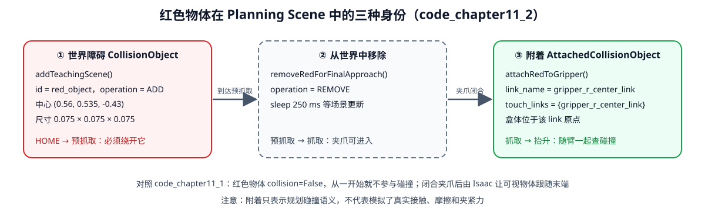

<p align="center"><b>图 11-17</b> 红色物体在规划场景中依次是世界障碍、被移除、附着到夹爪三种身份</p>

**对应代码**：`planning_scene.cpp` 首先用一个辅助函数构造盒子：

```cpp
// 摘自 code/code_chapter11_2/g2_chapter11_moveit/src/planning_scene.cpp
moveit_msgs::msg::CollisionObject makeBox(
  const std::string& id, const std::array<double, 3>& center,
  const std::array<double, 3>& size, const std::string& frame = "arm_base_link")
{
  moveit_msgs::msg::CollisionObject object;
  object.header.frame_id = frame;               // 盒子位姿所在坐标系
  object.id = id;
  shape_msgs::msg::SolidPrimitive primitive;
  primitive.type = primitive.BOX;
  primitive.dimensions = {size[0], size[1], size[2]};
  geometry_msgs::msg::Pose pose;
  pose.orientation.w = 1.0;                     // 无旋转
  pose.position.x = center[0];
  pose.position.y = center[1];
  pose.position.z = center[2];
  object.primitives.push_back(primitive);
  object.primitive_poses.push_back(pose);
  object.operation = object.ADD;
  return object;
}
```

然后把红色目标加入场景：

```cpp
// 摘自 code/code_chapter11_2/g2_chapter11_moveit/src/planning_scene.cpp
void addTeachingScene(
  moveit::planning_interface::PlanningSceneInterface& scene)
{
  // 桌子、阻挡物和非目标物体由 G2 头部深度点云生成的 OctoMap 提供。
  // 这里只保留抓取目标，便于最后接近时移除并在抓取后附着。
  scene.applyCollisionObject(
    makeBox(
      "red_object",
      {0.56, 0.535, -0.43},
      {0.075, 0.075, 0.075}));
}
```

进入最后接近阶段前，程序移除世界中的红色碰撞体：

```cpp
// 摘自 code/code_chapter11_2/g2_chapter11_moveit/src/planning_scene.cpp
void removeRedForFinalApproach(moveit::planning_interface::PlanningSceneInterface& scene)
{
  // 预抓取之前红色物体是普通障碍；进入最后几厘米时允许夹爪接触目标。
  moveit_msgs::msg::CollisionObject remove;
  remove.header.frame_id = "arm_base_link";
  remove.id = "red_object";
  remove.operation = remove.REMOVE;
  scene.applyCollisionObject(remove);
}
```

夹持后再把它附着到末端：

```cpp
// 摘自 code/code_chapter11_2/g2_chapter11_moveit/src/planning_scene.cpp（attachRedToGripper）
attached.link_name = "gripper_r_center_link";
attached.touch_links = {"gripper_r_center_link"};
attached.object = makeBox(
  "red_object",
  {0.0, 0.0, 0.0},
  {0.075, 0.075, 0.075},
  "gripper_r_center_link");
scene.applyAttachedCollisionObject(attached);
```

**代码解读**：

- 附着物体的坐标系是 `gripper_r_center_link`、中心在 `(0,0,0)`，意味着它“粘”在夹爪中心，随末端一起运动；
- `touch_links` 列出允许与附着物体接触的连杆。夹爪本来就握着物体，如果不把 `gripper_r_center_link` 列进去，每个状态都会被判为“夹爪与物体碰撞”，抬升规划永远失败；
- 附着后，红色物体会作为机器人的一部分参与与 OctoMap 等环境之间的碰撞检查。

> ⚠️ **注意**：URDF 中夹爪碰撞盒为 `0.10 × 0.08 × 0.09` m，附着物体为 `0.075` m 立方体，两者中心重合，物体被夹爪碰撞盒完全包住——这是教学简化。真实抓取时物体通常位于两指之间、偏离夹爪中心，需要按实际抓取位姿设置附着偏移。

### 5.4 OMPL 规划流水线与请求适配器

本章只启用名为 `ompl` 的规划流水线，规划插件为 `ompl_interface/OMPLPlanner`。配置了三个采样规划器（原理见 3.3、3.4 节）。

- **RRTConnect** 从起点和终点同时扩展两棵树，强调快速找到可行路径。本章把它作为首选规划器，配置 `range=0.20`。它通常适合高维机械臂的单次查询，但不保证路径最优。
- **RRTstar** 在随机树生长过程中不断选择和重连父节点，理论上具有渐近最优性质。本章配置 `range=0.18`、`goal_bias=0.08`。它通常比 RRTConnect 慢，因此只在首选规划器失败后作为回退。
- **PRM** 先在自由空间采样并构建路线图，再在图上连接起点和终点。它适合同一环境中的多次查询。本章把 PRM 作为第三个回退选项，没有额外覆盖默认参数。

任务代码的规划器回退顺序为：

| 顺序 | 规划器 | 单次规划时间 |
|---:|---|---:|
| 1 | `RRTConnectkConfigDefault` | `4.0 s` |
| 2 | `RRTstarkConfigDefault` | `7.0 s` |
| 3 | `PRMkConfigDefault` | `7.0 s` |

每次尝试前都会读取当前实测状态并重新设置目标。若规划成功但执行失败，程序不会返回旧起点，而是继续从最新反馈状态重新规划。

OMPL 规划器和请求适配器定义在 `ompl_planning.yaml`：

```yaml
# code/code_chapter11_2/g2_chapter11_moveit/config/ompl_planning.yaml
planning_plugin: ompl_interface/OMPLPlanner
request_adapters: >-
  default_planner_request_adapters/AddTimeOptimalParameterization
  default_planner_request_adapters/ResolveConstraintFrames
  default_planner_request_adapters/FixWorkspaceBounds
  default_planner_request_adapters/FixStartStateBounds
  default_planner_request_adapters/FixStartStateCollision
  default_planner_request_adapters/FixStartStatePathConstraints
start_state_max_bounds_error: 0.10
planner_configs:
  RRTConnectkConfigDefault:
    type: geometric::RRTConnect
    range: 0.20
  RRTstarkConfigDefault:
    type: geometric::RRTstar
    range: 0.18
    goal_bias: 0.08
  PRMkConfigDefault:
    type: geometric::PRM

right_arm:
  planner_configs:
    - RRTConnectkConfigDefault
    - RRTstarkConfigDefault
    - PRMkConfigDefault
  longest_valid_segment_fraction: 0.008
```

OMPL 输出几何路径后，请求适配器继续处理规划请求和结果。本章启用的适配器包括：

| 请求适配器 | 作用 |
|---|---|
| `AddTimeOptimalParameterization` | 为几何路径增加时间、速度和加速度信息 |
| `ResolveConstraintFrames` | 解析约束使用的参考坐标系 |
| `FixWorkspaceBounds` | 修正规划工作空间边界 |
| `FixStartStateBounds` | 修正轻微超出关节边界的起点 |
| `FixStartStateCollision` | 尝试处理起点碰撞问题 |
| `FixStartStatePathConstraints` | 处理起点与路径约束不一致的问题 |

`start_state_max_bounds_error: 0.10` 是 `FixStartStateBounds` 使用的阈值：起点超出关节边界不超过 0.10 rad 时，适配器会把它“拉回”边界内再规划，超出更多则不修复。

```text
规划请求 ──▶ [Fix* / Resolve* 适配器：修正起点与约束] ──▶ OMPL 规划器 ──▶ 几何路径
                                                                      │
          轨迹（带 time_from_start） ◀── [AddTimeOptimalParameterization] ◀┘
```

这些适配器可以修复一定范围内的输入问题，但不能替代正确的模型和场景。如果真实起点位于严重碰撞中、关节名称错误或目标完全不可达，增加规划时间和尝试次数也无法从根本上解决问题。

`pick_red.cpp` 还设置了多次规划尝试与重规划：

```cpp
// 摘自 code/code_chapter11_2/g2_chapter11_moveit/src/pick_red.cpp
move_group.setMaxVelocityScalingFactor(0.55);
move_group.setMaxAccelerationScalingFactor(0.45);
move_group.setNumPlanningAttempts(4);
move_group.allowReplanning(true);
move_group.setReplanAttempts(4);
move_group.setReplanDelay(0.15);
```

**案例：最坏情况要等多久？** 按 `local_replanner.cpp` 的回退顺序，一个目标的三次规划时间上限之和是 $4.0+7.0+7.0=18$ s。抓取任务共 4 个目标（HOME、预抓取、抓取、抬升），若每个都走到最后一个回退规划器，仅规划就可能耗时 $4\times18=72$ s。正常情况下 RRTConnect 第一次就成功，用时远小于 4 s。

### 5.5 三维感知、OctoMap 与碰撞场景更新

本章 MoveIt 2 工程使用 `PointCloudOctomapUpdater` 把头部深度点云转换为 OctoMap。关键数据链为：

```text
Isaac 头部深度图
→ rgbd_geometry.py 标定反投影
→ 工作区裁剪、已知目标过滤、机器人自滤波
→ /chapter11/head/depth_points
→ PointCloudOctomapUpdater
→ MoveIt OccupancyMapMonitor
→ Planning Scene 中的 OctoMap
```

```yaml
# code/code_chapter11_2/g2_chapter11_moveit/config/sensors_3d.yaml
sensors:
  - head_depth_camera

head_depth_camera:
  sensor_plugin: occupancy_map_monitor/PointCloudOctomapUpdater
  point_cloud_topic: /chapter11/head/depth_points
  max_range: 3.0
  point_subsample: 1
  # 按要求不对环境体素做预膨胀。
  padding_offset: 0.0
  padding_scale: 1.0
  max_update_rate: 1.0
  filtered_cloud_topic: /chapter11/head/filtered_cloud
```

`octomap_frame` 与 `octomap_resolution` 则作为 `move_group` 节点参数在 launch 文件中给出：

```python
# 摘自 code/code_chapter11_2/g2_chapter11_moveit/launch/move_group.launch.py
move_group = Node(
    package="moveit_ros_move_group",
    executable="move_group",
    output="screen",
    parameters=[moveit_config.to_dict(), {
        "publish_robot_description_semantic": True,
        "octomap_frame": "arm_base_link",
        "octomap_resolution": 0.04,
    }],
    arguments=["--ros-args", "--log-level", "info"],
)
```

主要参数为：

| 参数 | 数值 | 说明 |
|---|---:|---|
| 点云话题 | `/chapter11/head/depth_points` | Isaac 端发布的障碍点云 |
| `octomap_frame` | `arm_base_link` | OctoMap 参考坐标系 |
| `octomap_resolution` | `0.04 m` | 体素分辨率 |
| `max_range` | `3.0 m` | 最大点云距离 |
| `max_update_rate` | `1.0 Hz` | OctoMap 最大更新频率 |
| `padding_offset` | `0.0` | 不对环境体素增加固定膨胀 |
| `padding_scale` | `1.0` | 不按比例膨胀环境体素 |

红色目标位姿已知，因此点云处理会按红色物体真实 AABB 删除目标点，防止目标本身形成 OctoMap 障碍并阻挡最终接近。头部相机也会看见右臂和夹爪，所以 `robot_self_filter.py` 使用 G2 USD 的实际 OBB 和教学 FK 模型删除机器人自身点云。机器人运动较快时，程序暂缓发布该帧点云，机械臂静止后再恢复，以减少相机帧和关节反馈错位造成的夹爪残影。

**对应代码**：Isaac 端点云处理的顺序如下：

```python
# 摘自 code/code_chapter11_2/perception.py（head_obstacle_points，省略空点云判断）
# 运动时相机帧与关节反馈可能相差一帧。暂停该帧更新，避免夹爪残影。
velocities = np.asarray(self.simulation.robot.get_joint_velocities(), dtype=np.float64)
if np.max(np.abs(velocities[self._arm_indices])) > self.config.map_arm_stationary_velocity:
    return np.empty((0, 3), dtype=np.float32)            # 臂在动：本帧不发布
# ... 读取深度图并反投影到 arm_base_link
lo, hi = np.asarray(self.config.workspace_min), np.asarray(self.config.workspace_max)
valid = np.all(np.isfinite(points), axis=1)
valid &= np.all(points >= lo, axis=1) & np.all(points <= hi, axis=1)   # 工作区裁剪
points = remove_known_target_points(points[valid])                    # 删除红色目标
# ... 删除躯干、头部附近的点
# 过滤头部相机看到的右臂、夹爪和手指；这不是环境障碍物膨胀。
points = remove_points_inside_obbs(
    points,
    self._right_robot_obbs_arm(),
    self.config.robot_self_filter_tolerance,
)
# ... 再按 FK 胶囊删除右臂点（remove_right_arm_points）
# 只做 OctoMap 分辨率对应的体素采样，不额外膨胀障碍物。
voxel = self.config.map_voxel_size
keys = np.unique(np.floor(points / voxel).astype(np.int32), axis=0)
```

相关参数来自 `code/code_chapter11_2/config.py` 的 `PerceptionConfig`：`map_arm_stationary_velocity = 0.08`（任一右臂关节速度超过 0.08 rad/s 即暂停）、`robot_self_filter_tolerance = 0.008`、`map_voxel_size = 0.04`、`map_publish_hz = 1.0`、工作区 `workspace_min = (0.12, 0.12, -0.90)`、`workspace_max = (1.15, 0.66, 0.25)`。

**案例：判断一个点会不会被当成目标删除。** 红色物体 AABB 为中心 $\pm0.0375$： $x\in[0.5225,0.5975]$、 $y\in[0.4975,0.5725]$、 $z\in[-0.4675,-0.3925]$。点 $(0.56,0.55,-0.40)$ 三个坐标都在区间内，被删除；点 $(0.56,0.58,-0.40)$ 的 $y=0.58>0.5725$（已在物体下方、属于桌面），保留为障碍。由于删除边界“不增加额外边界”，桌面不会因为删除目标而被挖出一个洞。

这里要区分三个概念：目标过滤用于允许夹爪接近已知目标；机器人自滤波用于避免把机械臂自身写入环境地图；障碍物膨胀用于增加环境安全距离。本章前两项已实现，而 `padding_offset=0.0`、`padding_scale=1.0` 表示没有额外膨胀环境障碍物。

> ⚠️ **注意**：Isaac 端发布点云时把时间戳设为 0（`message.header.stamp.sec = 0`），源码注释说明这是为了让 MoveIt 自滤波查询最新机器人 TF，避免点云时间比 `robot_state_publisher` 快几毫秒时出现 Missing transform 并把夹爪写进 OctoMap。

### 5.6 轨迹执行、控制器参数与 ROS 接口

MoveIt 2 通过 `MoveItSimpleControllerManager` 查找控制器。本章配置一个 `right_arm_controller`：

- 类型为 `FollowJointTrajectory`；
- Action 命名空间为 `follow_joint_trajectory`；
- 完整 Action 为 `/right_arm_controller/follow_joint_trajectory`；
- 关节顺序严格为 `idx61_arm_r_joint1` 到 `idx67_arm_r_joint7`；
- 该控制器被设为默认控制器。

控制器名称、Action 命名空间和关节顺序定义在 `moveit_controllers.yaml`：

```yaml
# code/code_chapter11_2/g2_chapter11_moveit/config/moveit_controllers.yaml
moveit_controller_manager: moveit_simple_controller_manager/MoveItSimpleControllerManager

moveit_simple_controller_manager:
  controller_names:
    - right_arm_controller
  right_arm_controller:
    type: FollowJointTrajectory
    action_ns: follow_joint_trajectory
    default: true
    joints:
      - idx61_arm_r_joint1
      - idx62_arm_r_joint2
      - idx63_arm_r_joint3
      - idx64_arm_r_joint4
      - idx65_arm_r_joint5
      - idx66_arm_r_joint6
      - idx67_arm_r_joint7
trajectory_execution:
  allowed_execution_duration_scaling: 2.5
  allowed_goal_duration_margin: 4.0
  allowed_start_tolerance: 0.08
```

**完整 Action 名称的拼接规则**：`/` + `controller_names` 中的名字 + `/` + `action_ns`，即 `/right_arm_controller/follow_joint_trajectory`。

MoveIt 的控制器配置描述的是“怎样找到控制器、轨迹中包含哪些关节”。它并不会自动创建底层控制器。本章由 `isaac_controller_bridge.cpp` 实际提供 Action server。在真实机器人项目中，这个角色通常由 `ros2_control` 的 `joint_trajectory_controller` 和硬件接口承担。

轨迹执行相关参数为：

| 参数 | 数值 | 含义 |
|---|---:|---|
| `allowed_execution_duration_scaling` | `2.5` | 允许实际执行时间相对规划时间放大的倍数 |
| `allowed_goal_duration_margin` | `4.0 s` | 目标完成时间的额外裕量 |
| `allowed_start_tolerance` | `0.08 rad` | 当前状态与轨迹起点允许的误差 |
| `record_trajectory_state_frequency` | `10 Hz` | 执行状态记录频率 |

**案例：执行超时阈值。** 若规划轨迹时长为 3.0 s，按常见理解，MoveIt 允许的执行时长约为 $3.0\times2.5+4.0=11.5$ s，超过则认为执行超时并取消。C++ 控制桥自身在轨迹结束后最多再等 8 s 收敛，所以一条 3.0 s 的轨迹在控制桥内最长约 $3.0+8.0=11.0$ s 返回结果，落在 MoveIt 的允许范围内。（超时公式的具体实现以 MoveIt 源码为准，这里用于说明参数量级关系。）

C++ 控制桥还执行自己的接口检查：

- 拒绝关节名称、顺序或数量不匹配的轨迹；
- 同一时间只允许执行一条轨迹；
- 最多等待 5 秒接收 Isaac 关节反馈；
- 以 100 Hz 插值并发送关节位置命令；
- 最终误差小于 `0.10 rad` 才返回 Action 成功；
- 8 秒内不能收敛则返回目标容差违反。

```cpp
// 摘自 code/code_chapter11_2/g2_chapter11_moveit/src/isaac_controller_bridge.cpp
action_server_ = rclcpp_action::create_server<Follow>(
  this,
  "/right_arm_controller/follow_joint_trajectory",   // 必须与 moveit_controllers.yaml 拼出的名字一致
  std::bind(&IsaacControllerBridge::handleGoal, this, std::placeholders::_1,
            std::placeholders::_2),
  std::bind(&IsaacControllerBridge::handleCancel, this, std::placeholders::_1),
  std::bind(&IsaacControllerBridge::handleAccepted, this, std::placeholders::_1));

// handleGoal：接收前的接口检查
if (busy_.load()) {
  RCLCPP_WARN(get_logger(), "已有轨迹正在执行，拒绝新目标");
  return rclcpp_action::GoalResponse::REJECT;
}
if (goal->trajectory.joint_names != joint_names_ || goal->trajectory.points.empty()) {
  RCLCPP_ERROR(get_logger(), "轨迹关节名称/顺序错误，或轨迹为空");
  return rclcpp_action::GoalResponse::REJECT;
}
return rclcpp_action::GoalResponse::ACCEPT_AND_EXECUTE;
```

“最多等待 5 秒”来自 `execute()` 开头 500 次 × 10 ms 的等待循环：

```cpp
// 摘自 code/code_chapter11_2/g2_chapter11_moveit/src/isaac_controller_bridge.cpp（execute 开头）
for (int wait = 0; rclcpp::ok() && wait < 500; ++wait) {
  std::vector<double> state;
  if (readState(state)) {
    break;
  }
  if (wait == 499) {
    finishWithError(goal_handle, Follow::Result::INVALID_GOAL,
                    "5 秒内未收到 Isaac 关节反馈");
    return;
  }
  std::this_thread::sleep_for(10ms);
}
```

这三处信息必须严格一致：MoveIt 配置中的控制器名称、C++ Action server 的完整名称、轨迹中的关节名称和顺序。任意一处不一致，都可能出现“规划成功但控制器不可用”或“轨迹被 Action server 拒绝”。

从 MoveIt 到 Isaac 的关键 ROS 接口如下：

| 接口 | 类型 | 方向 | 作用 |
|---|---|---|---|
| `/move_action` | MoveGroup Action | 任务/RViz → move_group | 提交规划与执行请求 |
| `/right_arm_controller/follow_joint_trajectory` | FollowJointTrajectory Action | MoveIt → C++ 控制桥 | 执行标准关节轨迹 |
| `/chapter11/isaac_joint_command` | `sensor_msgs/JointState` | C++ 控制桥 → Isaac | 发送 7 关节期望位置 |
| `/chapter11/isaac_joint_states` | `sensor_msgs/JointState` | Isaac → C++ 控制桥 | 返回 7 关节实际位置和速度 |
| `/joint_states` | `sensor_msgs/JointState` | C++ 控制桥 → MoveIt/TF | 提供标准机器人状态 |
| `/chapter11/gripper_open` | `std_msgs/Bool` | 抓取程序 → Isaac | 控制右夹爪开合 |
| `/chapter11/attach_red` | `std_msgs/Bool` | 抓取程序 → Isaac | 控制教学目标跟随末端 |
| `/monitored_planning_scene` | PlanningScene | move_group → 外部 | 发布规划场景更新 |

> 💡 **要点**：`/joint_states` 不是 Isaac 直接发布的，而是 C++ 控制桥在严格检查名称、顺序、长度后转发的。这样可以保证 MoveIt 看到的状态永远是“七个右臂关节、固定顺序”，避免其他节点发布的同名话题干扰。

---

## 第六部分 代码结构与实现解析

前五部分已经把原理与关键代码片段对应起来。本部分只讨论代码结构、关键接口和调用顺序。两套实现必须分开阅读：`code_chapter11_1` 是用于拆解算法的自编教学链路，`code_chapter11_2` 是使用 MoveIt 2 的标准工程链路，二者不能混成同一套运行环境。

### 6.1 文件组织

第十一章相关目录如下：

```text
code/
├── code_chapter11_1/                 # 不使用 MoveIt 2
│   ├── config.py                     # 统一参数、场景与任务点
│   ├── arm_model.py                  # 复用第五章 FK/IK，提供连杆端点
│   ├── collision.py                  # 胶囊、AABB、关节限位、自碰撞
│   ├── motion_planner.py             # 双向 RRT-Connect
│   ├── local_avoidance.py            # 失效边检测与局部窗口修复
│   ├── trajectory_optimizer.py       # 捷径、重采样、五次时间参数化
│   ├── trajectory_tracker.py         # Isaac 关节轨迹跟踪与误差保护
│   ├── perception.py                 # 头部深度障碍点云
│   ├── rgbd_geometry.py              # 深度反投影
│   ├── gripper.py                    # 右夹爪开合
│   ├── simulation.py                 # G2 与桌面场景
│   ├── rviz_visualizer.py            # 场景、路径和机械臂 Marker
│   ├── demo_pick_red.py              # 完整抓取主程序
│   ├── run_rviz.sh
│   ├── run_teaching_arm.sh
│   └── tests/
│
└── code_chapter11_2/                 # ROS 2 Humble + MoveIt 2
    ├── config.py                     # Isaac 端场景和话题桥参数
    ├── simulation.py                 # Isaac G2 场景
    ├── perception.py                 # 头部深度点云处理
    ├── robot_self_filter.py          # 机器人自身点云过滤
    ├── trajectory_action_server.py   # Isaac 端 JointState 话题桥
    ├── isaac_moveit_bridge.py        # Isaac 主循环
    ├── build_moveit.sh
    ├── run_moveit_bridge.sh
    ├── run_moveit.sh
    ├── run_pick.sh
    ├── check_moveit.sh
    └── g2_chapter11_moveit/
        ├── CMakeLists.txt
        ├── package.xml
        ├── urdf/g2_right_arm.urdf.xacro
        ├── srdf/g2_right_arm.srdf
        ├── config/
        │   ├── kinematics.yaml
        │   ├── ompl_planning.yaml
        │   ├── joint_limits.yaml
        │   ├── moveit_controllers.yaml
        │   ├── move_group.yaml
        │   └── sensors_3d.yaml
        ├── launch/
        │   ├── move_group.launch.py
        │   └── pick_red.launch.py
        ├── src/
        │   ├── planning_scene.cpp
        │   ├── local_replanner.cpp
        │   ├── pick_red.cpp
        │   └── isaac_controller_bridge.cpp
        └── rviz/chapter11_moveit.rviz
```

此外，`code_chapter11_1/config/chapter11_1_planning.rviz` 是自编版本的 RViz 配置，`g2_chapter11_moveit/include/g2_chapter11_moveit/` 下的 `planning_scene.hpp`、`local_replanner.hpp` 是对应 C++ 源文件的头文件。

各个 shell 脚本的职责：

| 脚本 | 职责 |
|---|---|
| `code_chapter11_1/run_rviz.sh` | source ROS 2 Humble，设置 `RMW_IMPLEMENTATION=rmw_fastrtps_cpp`、`ROS_DOMAIN_ID=0`，用本章 rviz 配置启动 `rviz2` |
| `code_chapter11_1/run_teaching_arm.sh` | 用 Isaac Sim 的 `python.sh` 运行 `demo_pick_red.py`，并透传 `--headless`、`--no-rviz`、`--seed` 等参数 |
| `code_chapter11_2/build_moveit.sh` | 清理 Conda 路径后用 `colcon` 构建 `g2_chapter11_moveit`，产物放在 `ros2_build`、`ros2_install`、`ros2_log` |
| `code_chapter11_2/run_moveit_bridge.sh` | 用 Isaac Sim 的 `python.sh` 运行 `isaac_moveit_bridge.py` |
| `code_chapter11_2/run_moveit.sh` | `ros2 launch g2_chapter11_moveit move_group.launch.py`，透传 `use_rviz:=false` 等参数 |
| `code_chapter11_2/run_pick.sh` | `ros2 launch g2_chapter11_moveit pick_red.launch.py` |
| `code_chapter11_2/check_moveit.sh` | 依次打印节点、关键 Action、一帧 `/joint_states`、两段 TF 和规划场景 |

`code_chapter11_2` 中的 `ros2_build`、`ros2_install`、`ros2_log` 和 `ros2_runtime_log` 是构建或运行生成目录，不是主要教学源代码。修改顶层源码或 YAML 后，应重新执行 `build_moveit.sh`，再重启 MoveIt 相关进程，不能直接把生成目录中的副本当成长期维护入口。

推荐阅读顺序为：

```text
自编版本：
config → arm_model → collision → motion_planner
→ local_avoidance → trajectory_optimizer
→ trajectory_tracker → demo_pick_red

MoveIt 2 版本：
URDF → SRDF → kinematics.yaml → ompl_planning.yaml
→ planning_scene.cpp → local_replanner.cpp
→ isaac_controller_bridge.cpp → pick_red.cpp → launch
```

### 6.2 模块调用关系

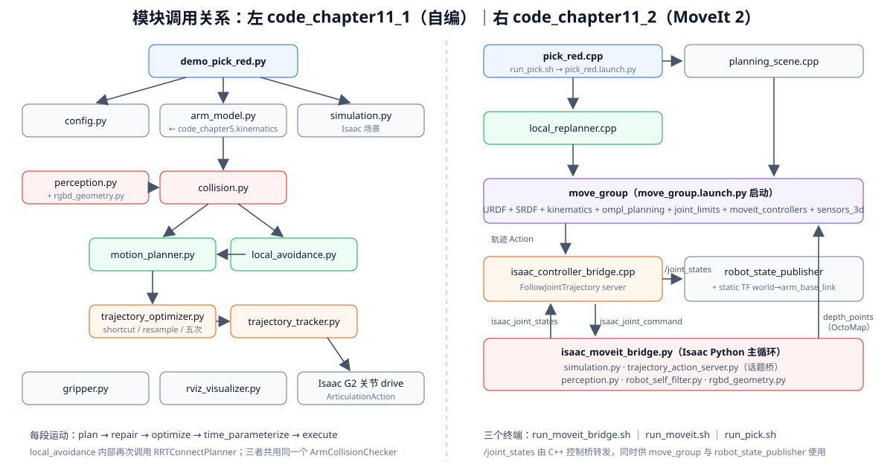

<p align="center"><b>图 11-18</b> 两套代码的模块调用关系：左侧为自编版本的单进程调用链，右侧为 MoveIt 2 版本的三终端、多节点结构</p>

两套代码在“进程结构”上有本质区别：

- `code_chapter11_1` 是**一个 Isaac Python 进程**完成全部工作：规划、优化、跟踪都是普通函数调用，RViz 只是旁路显示；
- `code_chapter11_2` 是**三个终端、多个 ROS 2 节点**协作：Isaac 进程（终端 1）、`move_group` + 控制桥 + `robot_state_publisher`（终端 2）、抓取客户端（终端 3），彼此之间只通过话题和 Action 通信。

### 6.3 关键流程逐段解读

#### 6.3.1 自编版本：从参数到主程序

**第 1 步：统一参数。** 自编版本首先在 `config.py` 中统一关节、场景、规划和轨迹参数。核心任务点与参数已经在 1.3 节、3.3 节、4.3 节展示，这里只强调两点：所有坐标都在 `arm_base_link` 下；`PlannerConfig`、`TrajectoryConfig` 都是 `frozen=True` 的数据类，修改参数要用 `dataclasses.replace()` 生成新对象（`local_avoidance.py` 正是这么做的）。

**第 2 步：复用第五章运动学。** `arm_model.py` 不重复编写一套运动学，而是复用第五章的 `G2ArmKinematics`：

```python
# 摘自 code/code_chapter11_1/arm_model.py
from code_chapter5.kinematics import G2ArmKinematics, IKResult, Pose, axis_rotation


class G2PlanningModel:
    def __init__(self) -> None:
        self.kinematics = G2ArmKinematics("right")

    def forward(self, joint_positions):
        return self.kinematics.forward(joint_positions)

    def inverse(self, target_position, initial_positions=None):
        # 抓取教学只约束位置，让 7 自由度冗余空间用于避开关节极限。
        return self.kinematics.inverse(
            target_position=target_position,
            target_rotation=None,
            initial_positions=initial_positions,
        )
```

这里使用位置式 IK，只约束末端位置，不约束夹爪朝向。这样可以利用七自由度机械臂的冗余空间寻找关节解。`link_points()` 则沿第五章运动学链逐段累乘变换，返回肩部、七个关节点和夹爪中心共 9 个点，供胶囊碰撞检测和 RViz 连杆显示使用（见 2.3 节）。

**第 3 步：先在纯 NumPy 层求解全部 IK。** `main()` 一开始就构造规划相关对象并求三个 IK，**在启动大型仿真之前**发现不可达目标：

```python
# 摘自 code/code_chapter11_1/demo_pick_red.py（main 前半部分）
args = parse_args()
planner_cfg = PlannerConfig(random_seed=args.seed)          # --seed 在这里生效
trajectory_cfg = TrajectoryConfig()
model = G2PlanningModel()
checker = ArmCollisionChecker(model, [ROBOT_BODY_BOX], planner_cfg)
planner = RRTConnectPlanner(checker, planner_cfg)
repair = LocalPathRepair(checker)
optimizer = TrajectoryOptimizer(checker, trajectory_cfg)

# 先在纯 NumPy 层求解全部目标，可在启动大型仿真前尽早发现不可达目标。
pre_grasp_q = solve_target(model, "预抓取", PRE_GRASP_POSITION, HOME_JOINT_POSITIONS)
grasp_q = solve_target(model, "抓取", GRASP_POSITION, pre_grasp_q)
lift_q = solve_target(model, "抬升", LIFT_POSITION, grasp_q)
```

注意 IK 的初值是“链式”的：预抓取用 HOME 作初值，抓取用预抓取解作初值，抬升用抓取解作初值。相邻目标的关节解因此更接近，后续规划的路径也更短。`solve_target()` 会打印 `[IK] 预抓取: success=..., iterations=..., error=... mm`，不收敛就抛出异常。

**第 4 步：启动仿真并用头部深度更新障碍。**

```python
# 摘自 code/code_chapter11_1/demo_pick_red.py（main 中段）
sim = G2ManipulationSimulation(
    SimulationConfig(headless=args.headless, enable_rviz=not args.no_rviz)
)
rviz = PlanningRvizPublisher(model, enabled=not args.no_rviz)
tracker = G2TrajectoryTracker(sim.robot, trajectory_cfg)
gripper = G2GripperController(sim.robot)
perception = G2HeadDepthPerception(sim, PerceptionConfig())
voxel_centers, sensed_obstacles = perception.capture_head_obstacles()
checker.set_obstacles([ROBOT_BODY_BOX, *sensed_obstacles])   # 用深度体素替换障碍集合
# 已知场景和头部深度 OctoMap 分开显示，便于理解“模型”和“感知地图”。
rviz.publish_scene(SCENE_BOXES)
rviz.publish_octomap(voxel_centers, perception.config.map_voxel_size)
```

由于 `planner`、`repair`、`optimizer` 持有的是**同一个** `checker` 对象，`set_obstacles()` 之后三者自动使用新的障碍集合。`capture_head_obstacles()` 返回的每个体素都是边长 `0.04 m` 的 `BoxObstacle`，并打印 `[头部深度] 工作区点云生成 N 个 0.04 m 未膨胀体素`。

**第 5 步：每段运动套用同一个模板。** 主程序先在纯 NumPy 层求解预抓取、抓取和抬升三个 IK 目标，再启动大型仿真。仿真启动后，头部深度感知生成障碍体素，碰撞检测器通过 `set_obstacles()` 更新环境，然后依次执行：

```text
张开夹爪并回到当前稳定状态
→ 头部深度地图避障到预抓取位姿
→ 按已知红色物块位置运动到抓取点
→ 闭合夹爪并建立教学用附着
→ 抓取后抬升
```

`demo_pick_red.py` 中的 `plan_and_execute()` 把一段运动固定组织为四个步骤，每一步打印一行日志：

```python
# 摘自 code/code_chapter11_1/demo_pick_red.py
def plan_and_execute(label, start, goal, planner, repair, optimizer, tracker, rviz, sim):
    print(f"\n[{label}] 1/4 RRT-Connect 全局规划", flush=True)
    result = planner.plan(start, goal)
    if not result.success:
        print(f"[{label}] 规划失败：{result.message}", flush=True)
        raise RuntimeError(f"{label} 规划失败：{result.message}")
    print(f"[{label}] 原始路径 {len(result.path)} 点，迭代 {result.iterations} 次", flush=True)

    print(f"[{label}] 2/4 局部碰撞监测与路径修复", flush=True)
    repaired = repair.repair(result.path)

    print(f"[{label}] 3/4 碰撞安全捷径优化与时间参数化", flush=True)
    optimized = optimizer.optimize(repaired)
    trajectory = optimizer.time_parameterize(optimized)
    print(
        f"[{label}] 路径长度 {optimizer.length(result.path):.3f} -> "
        f"{optimizer.length(optimized):.3f} rad，轨迹 {trajectory[-1].time_from_start:.2f} s",
        flush=True,
    )
    rviz.publish_paths(result.path, optimized)

    print(f"[{label}] 4/4 关节位置闭环轨迹跟踪", flush=True)
    max_error = tracker.execute(trajectory, sim.step, rviz.publish_arm)
    print(f"[{label}] 完成，最大跟踪误差 {max_error:.3f} rad", flush=True)
    return tracker.get_positions()
```

这种组织方式把每一段运动都变成同一个“规划—修复—优化—跟踪”模板，便于后续把目标来源替换为视觉、任务规划器或用户交互，而不需要重写底层运动规划流程。

> 💡 **要点**：若日志显示“原始路径 2 点，迭代 0 次”，说明 `plan()` 走的是“直线连接成功”分支——起终点之间直接无碰，根本没有启动随机树。

**第 6 步：异常处理与清理。** `main()` 用 `try/except/finally` 包裹仿真部分：出错时先打印 `[失败] 异常类型: 信息` 和完整 traceback（源码注释说明 `SimulationApp.close()` 可能使未刷新的 traceback 不可见），最后总是调用 `rviz.close()` 与 `sim.close()`。

#### 6.3.2 MoveIt 2 版本：配置加载与节点启动

MoveIt 2 版本首先由 Launch 读取所有模型和配置：

```python
# 摘自 code/code_chapter11_2/g2_chapter11_moveit/launch/move_group.launch.py（build_config）
moveit_config = (
    MoveItConfigsBuilder(
        "g2_right_arm",
        package_name="g2_chapter11_moveit",
    )
    .robot_description(file_path="urdf/g2_right_arm.urdf.xacro")
    .robot_description_semantic(file_path="srdf/g2_right_arm.srdf")
    .robot_description_kinematics(file_path="config/kinematics.yaml")
    .joint_limits(file_path="config/joint_limits.yaml")
    .trajectory_execution(file_path="config/moveit_controllers.yaml")
    .planning_pipelines(
        default_planning_pipeline="ompl",
        pipelines=["ompl"],
        load_all=False,
    )
    .sensors_3d(file_path="config/sensors_3d.yaml")
    .to_moveit_configs()
)
```

同一个 `move_group.launch.py` 启动五类节点：

```text
static_transform_publisher
robot_state_publisher
isaac_controller_bridge
move_group
rviz2（可选）
```

其中静态 TF 把 `arm_base_link` 绕 x 轴旋转 $-\pi/2$ 挂到 `world` 下，这正是 1.3 节所说的“`y` 向下 → RViz 中 `z` 向上”的显示转换：

```python
# 摘自 code/code_chapter11_2/g2_chapter11_moveit/launch/move_group.launch.py
static_tf = Node(
    package="tf2_ros",
    executable="static_transform_publisher",
    name="chapter11_world_to_arm_base",
    arguments=[
        "--x", "0", "--y", "0", "--z", "0",
        "--roll", "-1.5707963267948966", "--pitch", "0", "--yaw", "0",
        "--frame-id", "world", "--child-frame-id", "arm_base_link",
    ],
    output="log",
)
# ...
return LaunchDescription([
    DeclareLaunchArgument("use_rviz", default_value="true"),
    static_tf, state_publisher, controller_bridge, move_group, rviz,
])
```

**案例：验证坐标转换。** 绕 x 轴转 $-\pi/2$ 的旋转矩阵把子坐标系的 $(0,1,0)$（`arm_base_link` 的 y，向下）变成 $(0,\cos(-\pi/2),\sin(-\pi/2))=(0,0,-1)$，即 `world` 中的 $-z$，确实向下；子坐标系的 $(0,0,1)$（z，向左）变成 $(0,-\sin(-\pi/2),\cos(-\pi/2))=(0,1,0)$，即 `world` 中的 $+y$，确实向左。

`pick_red.launch.py` 只启动抓取客户端，它用同样的 `MoveItConfigsBuilder`（不含 `sensors_3d`）把机器人模型参数传给 `pick_red_moveit` 可执行文件，源码注释明确写着“move_group 和 Isaac bridge 应已运行”。

#### 6.3.3 MoveIt 2 版本：抓取任务主流程

`pick_red.cpp` 的 `main()` 在设置好速度缩放和重规划参数（5.4 节）之后，按以下顺序执行：

```cpp
// 摘自 code/code_chapter11_2/g2_chapter11_moveit/src/pick_red.cpp（main 主体，省略日志）
rclcpp::sleep_for(3s);                                  // 等待 /joint_states 与 action server
g2_chapter11_moveit::addTeachingScene(scene);           // 红色物体作为世界障碍
rclcpp::sleep_for(1s);
publishBool(gripper_pub, true);                         // 张开夹爪

bool ok = g2_chapter11_moveit::planAndExecuteWithLocalReplan(
  move_group, kHome, "回到 HOME");
ok = ok && g2_chapter11_moveit::planAndExecuteWithLocalReplan(
  move_group, kPreGrasp, "绕过阻挡物到预抓取位姿");

if (ok) {
  g2_chapter11_moveit::removeRedForFinalApproach(scene);   // 移除红色碰撞体
  rclcpp::sleep_for(250ms);
  ok = g2_chapter11_moveit::planAndExecuteWithLocalReplan(
    move_group, kGrasp, "按已知物块位姿运动到抓取点");
}

if (ok) {
  publishBool(gripper_pub, false);                      // 闭合夹爪
  rclcpp::sleep_for(900ms);
  if (!g2_chapter11_moveit::attachRedToGripper(scene)) {
    ok = false;
  }
  publishBool(attach_pub, ok);                          // 通知 Isaac 让物体跟随末端
  rclcpp::sleep_for(300ms);
  if (ok) {
    ok = g2_chapter11_moveit::planAndExecuteWithLocalReplan(
      move_group, kLift, "夹持后抬升");
  }
}
```

随后按照 HOME、预抓取、抓取和抬升四个关节目标执行任务。每个关节目标都与本章已知红色物体场景对应，是离线 IK 的结果。教学时应把它们理解为“任务层给出的目标状态”，而不是 MoveIt 2 必须固定使用的写法。实际项目可以把这些目标替换为在线 IK、视觉定位结果、抓取姿态生成器或 MoveIt Task Constructor 的阶段输出。

`publishBool()` 会把同一条消息连发 5 次、每次间隔 60 ms，这是一种简单的“防丢包”做法，确保 Isaac 端一定能收到夹爪和附着指令。

#### 6.3.4 MoveIt 2 版本：标准轨迹怎样进入 Isaac Sim

由于 ROS 2 Humble 的系统 Python 与 Isaac Sim Python 版本不同，本章没有在 Isaac Python 中直接实现 `control_msgs` Action，而是使用 C++ 控制桥。`trajectory_action_server.py` 的文件头注释说明：Isaac Sim 使用 Python 3.11，而 ROS 2 Humble 的 `control_msgs` Python 模块按 Python 3.10 编译，二者不能安全混用。

C++ 节点创建标准 Action server（代码见 5.6 节）。接收轨迹后，它以 100 Hz 在相邻轨迹点之间线性插值，并把期望关节位置发布到：

```text
/chapter11/isaac_joint_command
```

Isaac 端 `trajectory_action_server.py` 订阅该话题，把 7 个关节目标转换为 `ArticulationAction`：

```python
# 摘自 code/code_chapter11_2/trajectory_action_server.py（_command_arm）
self.articulation.apply_action(
    ArticulationAction(
        joint_positions=np.asarray(positions, dtype=np.float64),
        joint_indices=self.arm_indices,
    )
)
```

订阅回调会先检查关节名称、顺序、长度和数值合法性，不合格的命令直接丢弃：

```python
# 摘自 code/code_chapter11_2/trajectory_action_server.py
def _arm_command_callback(self, message) -> None:
    if tuple(message.name) != RIGHT_ARM_JOINT_NAMES or len(message.position) != 7:
        self.node.get_logger().error("收到的关节命令名称、顺序或长度不正确")
        return
    target = np.asarray(message.position, dtype=np.float64)
    if not np.all(np.isfinite(target)):
        self.node.get_logger().error("收到非法关节命令")
        return
    with self._lock:
        self._target = target.copy()          # 由 Isaac 主循环在 update() 中取用
```

Isaac 再以 30 Hz 发布实际关节位置和速度到：

```text
/chapter11/isaac_joint_states
```

```python
# 摘自 code/code_chapter11_2/trajectory_action_server.py（_publish_joint_states）
if self._sim_time - self._last_joint_publish < 1.0 / 30.0:
    return                                    # 30 Hz 节流
# ...
message.name = list(RIGHT_ARM_JOINT_NAMES)
message.position = positions[self.arm_indices].tolist()
message.velocity = velocities[self.arm_indices].tolist()
self.joint_pub.publish(message)
```

Isaac 主循环 `isaac_moveit_bridge.py` 每个物理周期调用一次 `bridge.update()`，依次执行“施加最新关节目标 → 施加夹爪目标 → 节流发布关节状态 → 节流发布点云”：

```python
# 摘自 code/code_chapter11_2/isaac_moveit_bridge.py（main）
sim = G2MoveItSimulation(SimulationConfig(headless=args.headless))
perception = G2HeadDepthPerception(sim)
bridge = IsaacTrajectoryTopicBridge(sim.robot, sim, perception)
try:
    print("[Bridge] 等待 MoveIt 2 规划和执行命令……", flush=True)
    while sim.is_running():
        bridge.update(sim.config.physics_dt)
        sim.step()
finally:
    bridge.close()
    sim.close()
```

C++ 控制桥严格过滤名称和顺序后，把该反馈转发为标准 `/joint_states`。`robot_state_publisher` 根据 `/joint_states` 发布机械臂 TF，`move_group` 也用它建立当前机器人状态。

```cpp
// 摘自 code/code_chapter11_2/g2_chapter11_moveit/src/isaac_controller_bridge.cpp（stateCallback）
if (message->name != joint_names_ || message->position.size() != joint_names_.size()) {
  RCLCPP_WARN_THROTTLE(
    get_logger(), *get_clock(), 3000,
    "忽略名称、顺序或长度不匹配的 Isaac 关节反馈");
  return;
}
// ... 保存 current_positions_，置 have_state_ = true
auto filtered = *message;
filtered.header.stamp = now();
joint_state_pub_->publish(filtered);        // 转发为 /joint_states
```

这一链路清楚地区分了四层：

```text
MoveIt 规划层
→ 标准 FollowJointTrajectory 控制器接口
→ Isaac/硬件适配层
→ articulation 或真实关节驱动
```

如果以后接入真实机械臂，应优先保留上层 MoveIt 模型、Planning Scene 和任务代码，只把本章 C++ Isaac 控制桥替换为经过验证的 `ros2_control` 控制器、厂商驱动和硬件安全链。

> 💡 **要点**：频率链条为 Isaac 物理 120 Hz → 关节状态发布 30 Hz → 控制桥插值 100 Hz → 点云 1 Hz → OctoMap 最多 1 Hz。控制桥以 100 Hz 发命令，但只能以 30 Hz 拿到反馈，所以 Action feedback 中的“实际值”最多滞后约 33 ms。

---

## 第七部分 代码运行

### 7.1 环境部署

> 💡 **路径约定**：下文命令中 `/path/to/project-root` 表示本仓库在你电脑上的根目录，`/path/to/isaac-sim` 表示 Isaac Sim 的安装目录，均为占位符，请替换为自己机器上的实际路径。

本章脚本默认项目位于：

```text
/path/to/project-root
```

Isaac Sim 默认位于：

```text
/path/to/isaac-sim
```

如果 Isaac Sim 安装在其他位置，可以在终端中设置 `ISAAC_SIM_ROOT`。运行前还应确认：

- G2 模型存在于 `assets/robot/G2_omnipicker/robot.usda`；
- 房间场景存在于 `assets/background/room/room_1/background.usda`；
- ROS 2 Humble 与 MoveIt 2 已安装；
- 需要显示 RViz 时具有可用图形环境；
- 多个终端使用相同的 `ROS_DOMAIN_ID` 和兼容的 DDS 实现；
- 不要在同一个终端混合 Isaac Python 环境、Conda 环境和系统 ROS 2 Python 环境。

> ⚠️ **注意**：当前仓库中的 `run_teaching_arm.sh` 与 `run_moveit_bridge.sh` 在未设置 `ISAAC_SIM_ROOT` 时使用的默认值是 `/root/isaacsim`（`ISAAC_SIM_ROOT="${ISAAC_SIM_ROOT:-/root/isaacsim}"`），与上面命令中的占位路径 `/path/to/isaac-sim` 不同。请以自己机器上的实际安装位置为准，显式设置 `ISAAC_SIM_ROOT`。

两套示例使用相同场景和关节名称，但启动的 ROS 节点可能互相影响。学习时建议先完整关闭一套，再启动另一套，避免重复 `/joint_states`、TF 或同名话题造成状态混乱。

**MoveIt 2 版本需要先构建。** 首次运行或修改 C++、Launch、URDF、SRDF、YAML 后，先构建 MoveIt 2 包：

```bash
cd /path/to/project-root
bash code/code_chapter11_2/build_moveit.sh
```

脚本只执行构建，不会启动 Isaac Sim。它会生成：

```text
code/code_chapter11_2/ros2_build
code/code_chapter11_2/ros2_install
code/code_chapter11_2/ros2_log
```

建议为三个运行终端设置相同的独立 ROS 域：

```bash
export ROS_DOMAIN_ID=111
```

> 💡 **要点**：自编版本的 `run_rviz.sh` 固定使用 `ROS_DOMAIN_ID=0` 与 `rmw_fastrtps_cpp`，`run_teaching_arm.sh` 在未设置时也默认使用 `0`。因此运行自编版本时不要在终端里 `export ROS_DOMAIN_ID=111`，否则 RViz 与 Isaac 端会处在不同的域，看不到 `/chapter11/*` 话题。

### 7.2 代码执行

#### 7.2.1 运行不使用 MoveIt 2 的教学规划器

终端 1 启动 RViz（加载 `config/chapter11_1_planning.rviz`，显示场景、体素、路径和机械臂 Marker）：

```bash
cd /path/to/project-root
bash code/code_chapter11_1/run_rviz.sh
```

终端 2 启动 Isaac Sim 与完整规划抓取案例（运行 `demo_pick_red.py`）：

```bash
cd /path/to/project-root
bash code/code_chapter11_1/run_teaching_arm.sh
```

无 Isaac 图形窗口运行，但保留 RViz 发布：

```bash
bash code/code_chapter11_1/run_teaching_arm.sh --headless
```

完全关闭 RViz/ROS 2 可视化发布：

```bash
bash code/code_chapter11_1/run_teaching_arm.sh --headless --no-rviz
```

修改随机种子以比较不同 RRT 路径（`--seed` 会写入 `PlannerConfig(random_seed=...)`）：

```bash
bash code/code_chapter11_1/run_teaching_arm.sh --seed 23
```

#### 7.2.2 运行纯算法测试

以下测试不需要 Isaac Sim、GPU 或 ROS 2，它用 Python 自带的 `unittest` 发现并运行 `code_chapter11_1/tests` 下的测试：

```bash
cd /path/to/project-root
PYTHONPATH="$PWD/code" python3 -m unittest discover \
  -s code/code_chapter11_1/tests -v
```

> ⚠️ **注意**：当前仓库快照的 `code/code_chapter11_1/` 下没有找到 `tests/` 目录。如果你的仓库里也没有，这条命令会因为找不到目录而报错。可以按 7.3.2 节列出的测试覆盖点自己补写测试（见课后练习）。

#### 7.2.3 运行 MoveIt 2 版本

终端 1 启动 Isaac Sim、G2、头部深度感知和 Isaac 话题桥：

```bash
cd /path/to/project-root
export ROS_DOMAIN_ID=111
bash code/code_chapter11_2/run_moveit_bridge.sh
```

无 Isaac 图形窗口运行：

```bash
bash code/code_chapter11_2/run_moveit_bridge.sh --headless
```

终端 2 启动静态 TF、`robot_state_publisher`、C++ 控制桥、`move_group` 和 RViz：

```bash
cd /path/to/project-root
export ROS_DOMAIN_ID=111
bash code/code_chapter11_2/run_moveit.sh
```

服务器无 RViz 运行：

```bash
bash code/code_chapter11_2/run_moveit.sh use_rviz:=false
```

终端 3 启动红色物体抓取任务：

```bash
cd /path/to/project-root
export ROS_DOMAIN_ID=111
bash code/code_chapter11_2/run_pick.sh
```

这里必须等待终端 1 已经持续发布 Isaac 关节反馈、终端 2 的 Action server 与 `move_group` 已完全启动，再运行终端 3。否则 MoveIt 可能没有当前状态，或者抓取程序找不到轨迹控制器。

#### 7.2.4 ROS 2 接口检查

三套程序都启动后，可以运行统一检查脚本（依次打印节点、关键 Action、关节状态、TF 和规划场景）：

```bash
bash code/code_chapter11_2/check_moveit.sh
```

也可以逐项检查。

确认 Isaac 原始反馈：

```bash
ros2 topic echo /chapter11/isaac_joint_states --once
```

确认 MoveIt 使用的标准关节状态：

```bash
ros2 topic echo /joint_states --once
ros2 topic hz /joint_states
```

确认 MoveGroup 和控制器 Action：

```bash
ros2 action list -t | grep -E 'move_action|follow_joint_trajectory'
```

确认 TF：

```bash
ros2 run tf2_ros tf2_echo world arm_base_link
ros2 run tf2_ros tf2_echo arm_base_link gripper_r_center_link
```

确认规划场景：

```bash
ros2 topic echo /monitored_planning_scene --once --field is_diff
```

### 7.3 运行结果

#### 7.3.1 自编版本的运行结果

正常运行时，终端日志会按每段任务输出四个阶段：

```text
1/4 RRT-Connect 全局规划
2/4 局部碰撞监测与路径修复
3/4 碰撞安全捷径优化与时间参数化
4/4 关节位置闭环轨迹跟踪
```

还应看到：

- 预抓取、抓取和抬升 IK 是否收敛；
- 原始路径点数和 RRT 迭代次数；
- 优化前后的关节空间路径长度；
- 轨迹总时长；
- 每段运动的最大关节跟踪误差；
- 最终“红色物体已被夹起”的完成提示。

RViz 中可以观察：

- 桌面、黄色阻挡物和三色物体；
- 头部深度相机生成的占用体素；
- 原始末端路径与优化后末端路径；
- 指令机械臂与实际机械臂的差异。

需要注意，RViz 中的线条是把关节路径通过 FK 转换为末端位置后绘制的。它便于理解路径形状，但真正的规划仍发生在七维关节空间中。

不使用moveit2的机械臂运行效果如下图所示，实际运行的过程中会发现，这个运行的很慢：

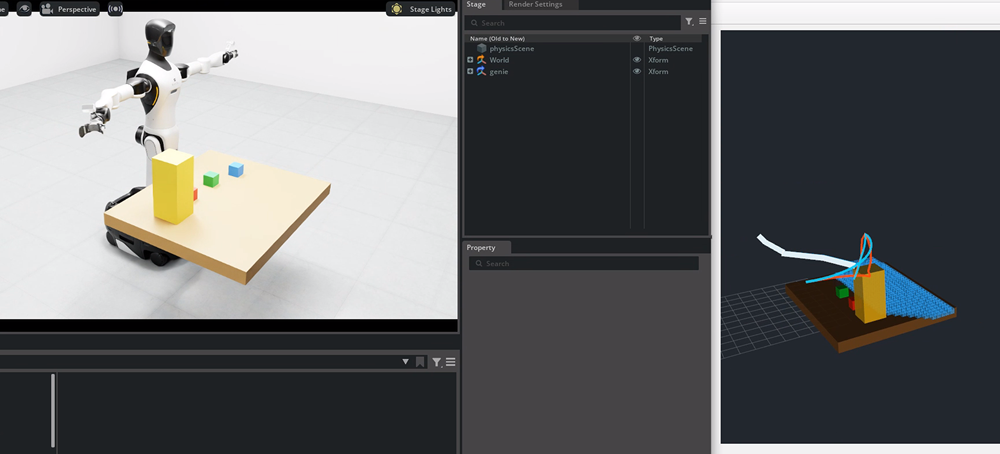

<p align="center"><b>图 11-19</b> 不使用 MoveIt 2 的自编规划器运行效果（一）</p>

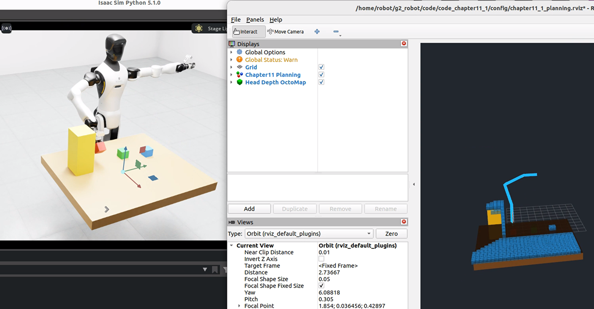

<p align="center"><b>图 11-20</b> 不使用 MoveIt 2 的自编规划器运行效果（二）</p>

**如何读懂这些输出**：

| 日志内容（来自 `demo_pick_red.py` 的打印格式） | 怎样解读 |
|---|---|
| `[IK] 预抓取: success=True, iterations=…, error=… mm` | 位置误差应在毫米级；`success=False` 会直接终止程序 |
| `[头部深度] 工作区点云生成 N 个 0.04 m 未膨胀体素` | N 越大，每次碰撞检查越慢；N 为 0 时会抛出“裁剪后为空” |
| `原始路径 K 点，迭代 M 次` | K=2、M=0 表示直线连接成功；M 很大说明场景较难 |
| `路径长度 A -> B rad` | 应有 B ≤ A，差值就是捷径优化省下的关节运动量 |
| `轨迹 T s` | 受加速度约束和“逐段停顿”影响（见 4.3 节），可与手算量级对比 |
| `完成，最大跟踪误差 E rad` | 应小于 0.10；接近 0.38 时程序会中止 |
| `[完成] 红色物体已被夹起；黄色阻挡物未发生碰撞。` | 全部三段运动成功 |

#### 7.3.2 纯算法测试的覆盖内容

测试覆盖：

- 预抓取、抓取和抬升目标的 IK 可达性；
- RRT-Connect 是否返回有效路径；
- 路径上的节点和边是否无碰；
- 随机捷径优化后路径是否仍然有效；
- 时间参数化结果是否包含递增时间；
- 已知红色目标 AABB 是否按真实边界从点云中删除。

纯算法测试通过只能证明 Python 算法层在当前依赖环境下工作，不能证明 Isaac Sim 场景、RViz、ROS 2 通信或真实机械臂执行成功。

#### 7.3.3 MoveIt 2 版本的运行结果

正常任务日志应依次包含：

```text
回到 HOME
绕过阻挡物到预抓取位姿
按已知物块位姿运动到抓取点
夹持后抬升
红色物体抓取完成
```

使用moveit2的机械臂规划结果如下所示：

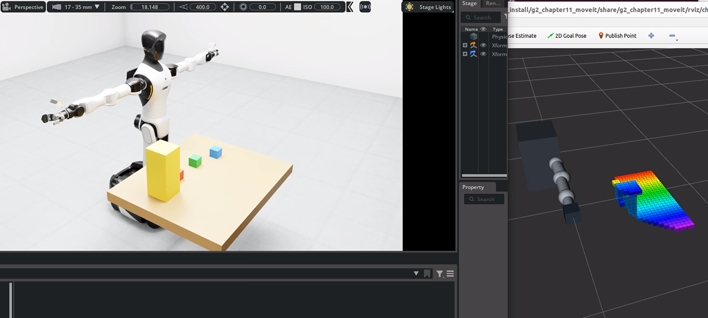

<p align="center"><b>图 11-21</b> 使用 MoveIt 2 的机械臂规划结果（一）</p>

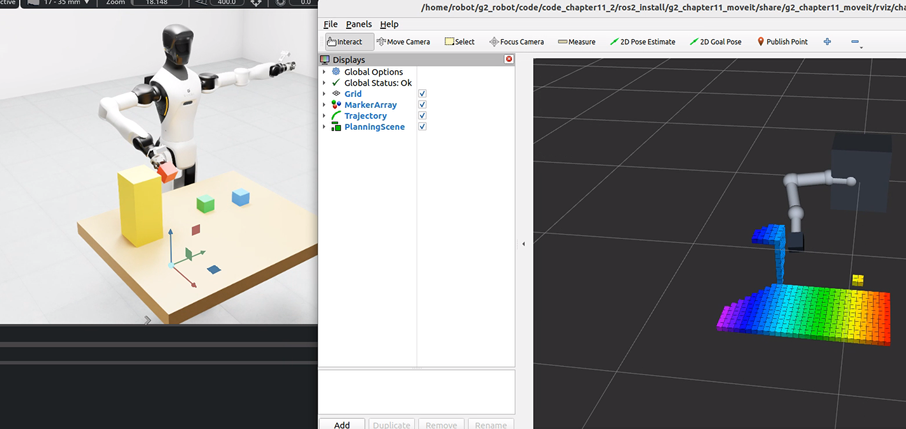

<p align="center"><b>图 11-22</b> 使用 MoveIt 2 的机械臂规划结果（二）</p>

`ros2 action list -t | grep -E 'move_action|follow_joint_trajectory'` 的期望至少包含：

```text
/move_action
/right_arm_controller/follow_joint_trajectory
```

**如何读懂这些输出**：

- 日志中的五个阶段名就是 `pick_red.cpp` 传给 `planAndExecuteWithLocalReplan()` 的 `label` 参数以及最后的完成提示；每段成功规划时，`local_replanner.cpp` 还会打印“`<label>: <规划器名> 规划成功，共 N 个轨迹点`”，其中 N 是经过时间参数化后的轨迹点数；
- 若出现“`<label>: RRTConnectkConfigDefault 未找到路径，更新当前状态后重试`”，说明进入了回退流程；若出现“执行失败，从当前反馈状态重新规划”，问题在执行层而不是规划层；
- 抓取失败时程序打印“抓取流程失败，请检查 /joint_states、action server 和规划场景”，并以返回码 1 退出；
- 对比两套版本时可以从原理上预期：MoveIt 2 版本把碰撞检查交给 C++ 实现的 FCL，并使用不在中间点强制停顿的时间参数化，运动通常更连贯；自编版本运行较慢，但更便于观察每一步的中间结果。

---

## 本章小结

### 知识回顾

本章建立了从机械臂运动学到工程规划框架的完整连接：

```text
当前关节反馈
→ 目标生成与 IK
→ 关节限位和碰撞检测
→ RRT-Connect 或 OMPL 搜索
→ 局部修复或当前状态重规划
→ 路径简化与时间参数化
→ FollowJointTrajectory 或关节 drive
→ 实际关节反馈和执行结果
```

| 主题 | 核心公式 / 结论 | 自编实现 | MoveIt 2 实现 |
|---|---|---|---|
| 规划问题 | IK 成功 ≠ 规划成功 ≠ 执行成功 | `plan_and_execute()` | `planAndExecuteWithLocalReplan()` |
| C 空间 | $\mathcal{C}=\mathcal{C}_{free}\cup\mathcal{C}_{obs}$，7 维 | `ArmCollisionChecker` | Planning Scene |
| 连杆—障碍碰撞 | 胶囊 ≈ 线段 + 膨胀 AABB，Slab 法 | `segment_intersects_box` | URDF 碰撞几何 + FCL |
| 自碰撞 | 非相邻线段最短距离 < 0.085 m | `segment_segment_distance` | SRDF `disable_collisions` |
| 边检查 | $n=\lceil L/\delta\rceil$， $\delta=0.045$ rad | `edge_is_valid` | `longest_valid_segment_fraction=0.008` |
| 采样规划 | Steer： $\mathbf{q}_{near}+\eta\,\hat{\mathbf{u}}$ | RRT-Connect，`step_size=0.22` | RRTConnect / RRTstar / PRM |
| 局部避障 | 窗口 $[i^*-w+1,\ i^*+w]$ | `LocalPathRepair` | 当前状态重规划 + 规划器回退 |
| 捷径优化 | 新边无碰才删除中间点 | `shortcut` + `resample` | OMPL 路径简化 |
| 时间参数化 | $h=10\tau^3-15\tau^4+6\tau^5$， $T=\max(0.12,T_v,T_a)$ | `time_parameterize` | `AddTimeOptimalParameterization` |
| 跟踪 | $e_{max}=\max_i\lvert q_{d,i}-q_i\rvert$ | 0.10 / 0.38 rad 阈值 | 100 Hz 插值，8 s 内 < 0.10 rad |
| 控制器接口 | 名称、Action、关节顺序三处一致 | — | `moveit_controllers.yaml` + C++ 控制桥 |

`code_chapter11_1` 的价值是把碰撞检测、随机规划、局部修复、轨迹优化和跟踪保护逐步展开，让初学者知道 MoveIt 2 内部需要解决哪些问题；`code_chapter11_2` 的价值是展示标准机器人模型、Planning Scene、OMPL、控制器 Action、RViz 和 Isaac Sim 适配层怎样组合为可复用系统。

学习完成后，应能够明确回答三个问题：机械臂为什么不能只做 IK；一条无碰路径怎样变成可执行轨迹；MoveIt 2 规划成功后，轨迹具体经过哪些 ROS 2 接口才真正驱动机器人。只有把这三条链路同时打通，才能从“机械臂能到达目标”进一步走向“机械臂能够安全、平滑并可验证地执行任务”。

### 课后练习

完成默认案例后，可以进行以下实验。

1. **（动手）比较不同 RRT 随机种子。** 修改自编版本的 `--seed`，记录规划迭代次数、原始路径长度和优化后路径长度。观察随机规划器为什么每次可能得到不同路径。
2. **（动手）改变扩展步长。** 分别减小和增大 `step_size`。较小步长通常更容易穿过狭窄区域，但树节点更多；较大步长搜索更快，但可能难以在障碍附近精细转弯。
3. **（动手）改变碰撞检查分辨率。** 调整 `edge_resolution` 或 MoveIt 的 `longest_valid_segment_fraction`，理解安全性和计算量之间的关系。该实验只能在可视化和碰撞检查充分验证后进行，不能为了提高速度而盲目降低检查密度。
4. **（动手）关闭路径捷径。** 比较原始 RRT 路径和优化后路径的长度、轨迹总时间和机械臂动作流畅程度。（提示：把 `TrajectoryConfig.shortcut_attempts` 设为 0。）
5. **（动手）改变速度和加速度缩放。** 降低 `speed_scale`，或调整 MoveIt 的速度/加速度缩放，观察轨迹时间和最大跟踪误差怎样变化。
6. **（动手）模拟场景更新。** 在规划完成后加入或移动一个障碍物。自编版本调用局部路径修复，MoveIt 2 版本更新 Planning Scene 并从当前状态重新规划，比较两种局部避障思路。
7. **（动手）从已知关节目标升级为在线任务目标。** 用视觉输出的目标位姿调用 IK，或在 MoveIt 中设置 Pose 目标。此时必须明确相机坐标系到 `arm_base_link` 的 TF，并保留目标置信度、可达性和碰撞检查。
8. **（手算）Slab 判定。** 对 2.3 节的阻挡物膨胀盒，判断线段 $(0.40,0.30,-0.40)\rightarrow(0.80,0.30,-0.40)$ 是否相交，并说明结论在不膨胀时是否改变。
9. **（手算）时间参数化。** 若某段 $\max_i|\Delta q_i|=0.08$ rad，在 `speed_scale=0.55` 下求 $T_v$、 $T_a$、 $T$ 和采样点数；再把 `speed_scale` 改为 1.0 重算，说明哪个约束起决定作用。
10. **（思考）** 为什么 4.3 节中“重采样后逐段五次插值”比“整条边一次五次插值”慢？如果要改成不在中间点停下的时间参数化，需要满足哪些连续性条件？
11. **（动手）补写测试。** 参照 7.3.2 节列出的覆盖点，为 `collision.py` 的 `segment_intersects_box` 写一个 `unittest`，用 2.3 节的手算例子作为断言。

### 参考资料

本章原文未列出外部参考资料。以下为本章内容所依据的仓库文件，以及便于延伸阅读的公开资料：

- 本章代码：`code/code_chapter11_1/`、`code/code_chapter11_2/`、`code/srdf/g2_right_arm.srdf`；
- 第五章：`code/code_chapter5/kinematics.py`（`G2ArmKinematics`）；
- MoveIt 2 官方文档（moveit.picknik.ai）：move_group、Planning Scene、MoveIt Setup Assistant、Trajectory Execution；
- OMPL 官方文档（ompl.kavrakilab.org）：RRTConnect、RRTstar、PRM 规划器说明；
- J. J. Kuffner, S. M. LaValle. RRT-Connect: An Efficient Approach to Single-Query Path Planning. ICRA, 2000；
- L. E. Kavraki 等. Probabilistic Roadmaps for Path Planning in High-Dimensional Configuration Spaces. IEEE Transactions on Robotics and Automation, 1996；
- S. Karaman, E. Frazzoli. Sampling-based Algorithms for Optimal Motion Planning. International Journal of Robotics Research, 2011。

