# 第十二章 移动操作综合实践：全场景自主导航操作

> **本章导读**：第九章让机器人能够“看见桌面上的物体并完成抓放”，第十章解决“底盘怎样绕过障碍到达目标”，第十一章介绍“机械臂怎样规划并执行运动”。本章是一个综合实践章，把这些能力接成一条完整任务链：**机器人先到源桌抓起一颗苹果，带着苹果穿过房间，在远桌停稳并放下，再把远桌原有的另一颗苹果放到同一块接收板上。**
>
> 本章不再引入新的单项算法，而是回答“几个各自正确的模块，怎样才能组合成一个正确的系统”：坐标怎样统一、时间怎样对齐、谁在什么时候被允许运动、动作“成功”之后怎样确认物理世界真的变了。最终要跑通的案例是 Isaac Sim 中 G2 Omnipicker 的**双桌苹果搬运任务**——三个终端分别启动仿真、ROS 能力系统和任务编排，任务结束时两颗苹果分别留在接收板的两个槽位上，任务状态为 `DONE`。

## 本章概览

### 本章要解决的问题

设想你已经分别调通了导航和抓取：Nav2 能把底盘送到桌边，MoveIt2 能让机械臂抓起固定在面前的苹果。现在把两者接起来，问题立刻出现：底盘移动后，相机和机械臂的位置都变了；导航报告到达时，机器人未必停在机械臂够得到的位置；夹爪闭合动作成功，也不代表苹果真的被拿起；张开夹爪之后，苹果也可能滚出接收板。

系统因此必须约定好**坐标、时间、数据接口和动作顺序**，并用反馈判断每一步是否真正完成。本章就是围绕这几件事展开的。

对应代码位于 `code/code_chapter12`，ROS 包名为 `g2_chapter12`。本章使用 Isaac Sim 中的 G2 Omnipicker、ROS 2 Humble、Nav2、MoveIt2，以及本章自带的 YOLO 苹果检测权重。左臂保持预设姿态，右臂执行抓放，移动底盘负责两张桌子之间的运输。

开始之前，先明确本案例的范围：

- **“全场景”指当前配置的双桌房间任务，不是任意未知环境中的通用移动操作。** 桌面、接收板、停靠点和障碍布局已知；待抓苹果的位置由在线视觉测量。
- **这是分阶段的移动操作，不是底盘和机械臂同时运动的全身规划。** 导航时收臂并保持夹持，操作时底盘必须停稳。
- **感知使用 YOLO + RGB-D + 几何候选，不调用 SAM2、GraspGenX、VLM 或 VLA。** 第九章提供了方法基础和检测权重，但运行本章不需要启动第九章，也不需要重新训练。
- **仿真传感器有所简化。** 默认地图由已知场景生成；激光是二维栅格射线模拟，里程计来自 Isaac 中底盘实际位姿，而不是带漂移的编码器估计。苹果抓取坐标不读取仿真物体真值，但不代表整个系统完全不用仿真真值。

> 💡 **要点**：建议先读懂“谁把什么数据交给谁”，再进行实际操作。第一至第六部分讲系统原理、数据流和源码对应关系；第七部分把源码按执行顺序串起来；第八部分集中给出环境准备、安装、启动和任务结果说明。

### 学习目标

学完本章你能：

- **解释**双桌搬运任务的状态机，说出每个阶段的通过条件，以及为什么“action 成功”不等于“阶段完成”。
- **画出**仿真、ROS 能力系统、任务编排三组进程之间的命令流与反馈流，区分 Nav2 局部控制器和本章机械臂控制器。
- **推导**从像素 $(u,v,z)$ 到 `odom` 下三维点的反投影与坐标变换，并说明 `map → odom → base_link` 每一段由谁发布。
- **解释**导航到达、精靠结束、允许伸臂三种不同容差的含义，并能手算一次精靠短路径。
- **运行**三终端默认任务和可选 SLAM 建图练习，读懂日志中的状态序列。
- **排查**“Nav2 成功但拒绝伸臂”“夹爪闭合但 LIFT 失败”“CARRY_LOST”等典型问题，按数据流定位而不是先降低阈值。

### 前置知识

- 第一章：Isaac Sim 安装与本地资产准备。
- 第四章：舵轮（swerve）底盘运动学；本章 `sim/base/` 直接沿用。
- 第九章：YOLO 苹果检测、RGB-D 物体抓取的基本流程。
- 第十章：地图、AMCL、Nav2 代价地图与路径规划。
- 第十一章：MoveIt2 的 IK、OMPL 规划、PlanningScene 与轨迹执行。
- 数学：齐次坐标变换、四元数、针孔相机模型、主成分分析（Principal Component Analysis, PCA）的直观含义。
- 编程：能读 Python 与 C++；了解 ROS 2 的 topic / service / action。

### 知识地图

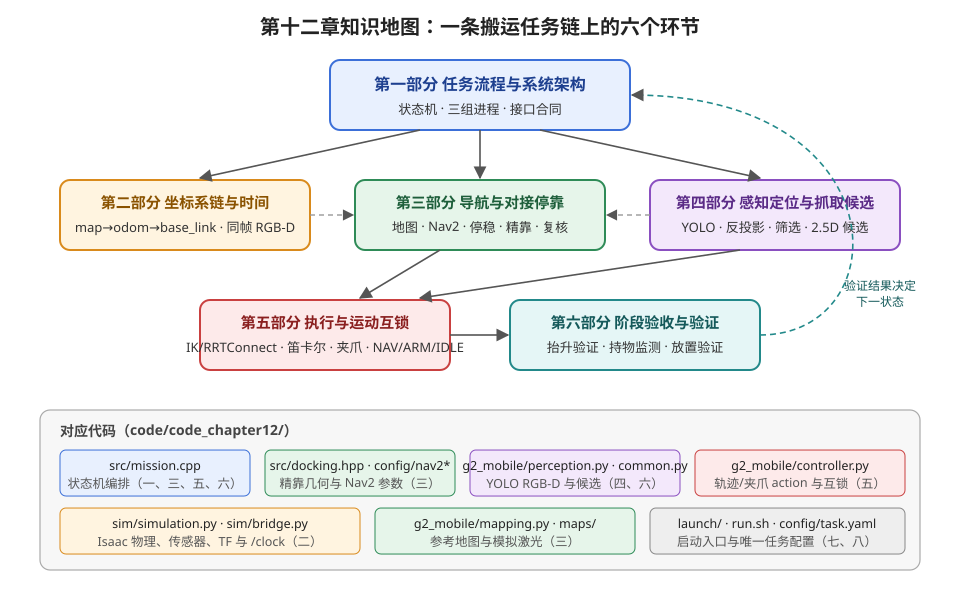

<p align="center"><b>图 12-1</b> 本章知识地图：任务流程与架构（第一部分）统领坐标系链（第二部分）、导航停靠（第三部分）和感知定位（第四部分），三者共同支撑执行与互锁（第五部分），阶段验证（第六部分）的结果再反过来决定状态机的下一步；底部为对应源码模块</p>

### 对应代码

- `code/code_chapter12/`：本章全部代码，ROS 包名 `g2_chapter12`。`run.sh` 是统一启动入口；`src/` 为 C++ 任务编排；`g2_mobile/` 为 ROS 控制、感知、几何工具、地图和遥控；`sim/` 为 Isaac 世界、ROS 桥接和底盘运动学；`config/task.yaml` 是唯一的场景与任务配置。

---

## 第一部分 任务流程与系统架构：从一次搬运任务理解系统

### 1.1 系统究竟要完成什么，什么才算完成

**直观理解**：把整次任务看成一条流水线，每一道工序都有明确的“交付标准”。只有交付标准满足，下一道工序才能开工。

两张桌子上各有一颗苹果和两个干扰物，干扰物为橙子与茶盒。远桌还有一块接收板，上面配置了两个放置槽位。这里的“槽位”是任务中的二维目标位置，不是通过视觉自动识别的凹槽。

任务输入来自两类信息：一类是 `config/task.yaml` 中的已知布局和动作参数，另一类是运行时收到的传感器、TF、关节反馈和 action 结果。任务输出也有两层：ROS 层输出导航目标、关节轨迹、夹爪命令和任务状态；物理层应该出现两颗苹果分别稳定留在指定位置的结果。

完整过程可以按下表理解：

| 任务阶段 | 此时要解决的问题 | 主要依据与通过条件 |
|---|---|---|
| 等待就绪、收臂 | 系统是否具备执行能力 | action 服务端就绪，TF 和关节反馈有效，右臂到达 `home`，夹爪张开 |
| 前往源桌 | 底盘是否处在可操作的位置 | Nav2 到达后停稳，必要时精靠，再复核实际位置和朝向 |
| 源桌感知与抓取 | 夹哪里、怎样靠近 | 新鲜 YOLO RGB-D 候选，有效 IK 和规划结果，夹爪闭合反馈 |
| 抬升与收臂 | 苹果是否真正被拿起 | 连续视觉观测确认抬升，持物回到 `home` |
| 持物导航至远桌 | 移动过程中是否仍在持物 | 收臂互锁、夹爪开度监测、Nav2 导航与精靠 |
| 放置第一颗苹果 | 苹果是否留在槽位 0 | 转移、下降、张开、撤离，随后连续观察指定槽位 |
| 抓放远桌苹果 | 不要把刚放好的苹果又抓走 | 感知排除接收板区域，重新生成候选，放入槽位 1 |
| 最后收臂 | 是否可以结束任务 | 第二次放置验证通过，右臂回 `home`，切换 `IDLE`，发布 `DONE` |

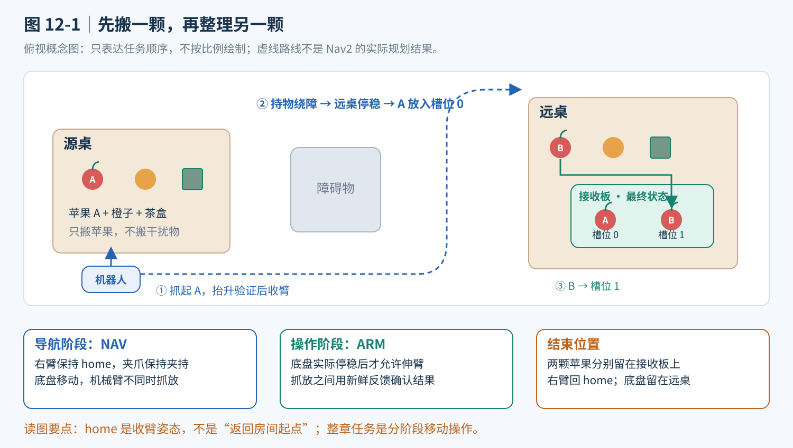

<p align="center"><b>图 12-2</b> 双桌搬运任务示意：苹果 A 从源桌运到远桌槽位 0，苹果 B 在远桌被放入槽位 1</p>

**读图说明——先搬一颗，再整理另一颗。** 图中用 A、B 区分两颗苹果的来源，接收板展示的是任务结束后的目标状态。沿编号理解“源桌抓取 → 持物导航 → 远桌两次放置”，再对照上表看每一步的通过条件；这是不按比例的概念图，不是仿真截图，虚线也不是实际规划路径。

`home` 在这里是七个右臂关节角构成的收臂姿态，**不是房间起点，也不意味着底盘最后会开回出发位置**。任务结束时，底盘仍在远桌附近。

**案例：用配置文件读出任务的几何布局。** `config/task.yaml` 中与任务路线有关的几行是：

```yaml
# 摘自 code/code_chapter12/config/task.yaml
start: [-3.6, -3.3, 0.0]
dock: [2.52, 2.6, 0.0]
# 源桌停靠点；与当前桌面布局和机械臂工作范围配套。
source_dock: [-3.66, -3.20, 0.0]
# 桌面/板子格式：[中心 x, y, z, 长, 宽, 厚]。
table: [3.40, 2.34, 0.848, 0.92, 1.08, 0.08]
tray: [3.00, 2.18, 0.892, 0.22, 0.20, 0.008]
source_table: [-2.72, -3.56, 0.848, 0.92, 1.08, 0.08]
items:
  - {name: apple, offset: [-0.23, 0.00]}
  - {name: orange, offset: [-0.23, -0.14]}
  - {name: tea_box, offset: [-0.23, 0.14]}
place_slots: [[3.00, 2.13], [3.00, 2.23]]
```

手算几个有用的量：

- 机器人起点 $(-3.6,-3.3)$ 与源桌停靠点 $(-3.66,-3.20)$ 只差约 $\sqrt{0.06^2+0.10^2}\approx 0.117$ m，第一次导航主要是“对准桌边”；而源桌停靠点到远桌停靠点 $(2.52, 2.6)$ 的直线距离约 $\sqrt{6.18^2+5.80^2}\approx 8.48$ m，这才是穿越房间的运输段（实际路径要绕开障碍，更长）。
- 两张桌子中心 z 都是 0.848 m、厚 0.08 m，所以桌面顶面高度是 $0.848+0.08/2=0.888$ m，**而不是 0.848 m**。
- 苹果出生在桌心偏移 $(-0.23, 0)$ 处：源桌苹果约在 $(-2.95,-3.56)$，远桌苹果约在 $(3.17, 2.34)$。这些出生位置只供仿真建场景，在线感知不使用它们。
- 两个槽位 $(3.00,2.13)$ 与 $(3.00,2.23)$ 沿 y 相距 0.10 m，都落在接收板（中心 $(3.00,2.18)$，宽 0.20 m）之内。

> ⚠️ **注意**：`items` 只是仿真出生布局，不是在线抓取目标列表；修改它不会改变任务“去哪里抓”，任务抓哪里完全由视觉候选决定。

### 1.2 用有限状态机组织任务

**直观理解**：`src/mission.cpp` 使用有限状态机（Finite State Machine, FSM）组织上述过程。可以把状态机理解为一张严格的工序单：只有当前工序满足条件，才允许进入下一步。

常见状态名包括 `WAIT_READY`、`STOW`、`NAVIGATE`、`SETTLE`、`DOCK`，以及带 `SOURCE_`、`DESTINATION_` 前缀的 `PERCEIVE`、`APPROACH`、`CLOSE`、`LIFT`、`HOME`、`TRANSFER`、`PLACE`、`RETREAT` 和 `VERIFY_PLACE`。

源码在前往源桌之前还发布 `NAVIGATE_SOURCE`，随后通用导航函数会发布 `NAVIGATE`。因此，日志中看到通用导航状态不代表源桌阶段被跳过。任务前缀也表示被处理苹果的来源：在远桌执行的 `SOURCE_PLACE`，含义仍然是“放置从源桌带来的苹果”。

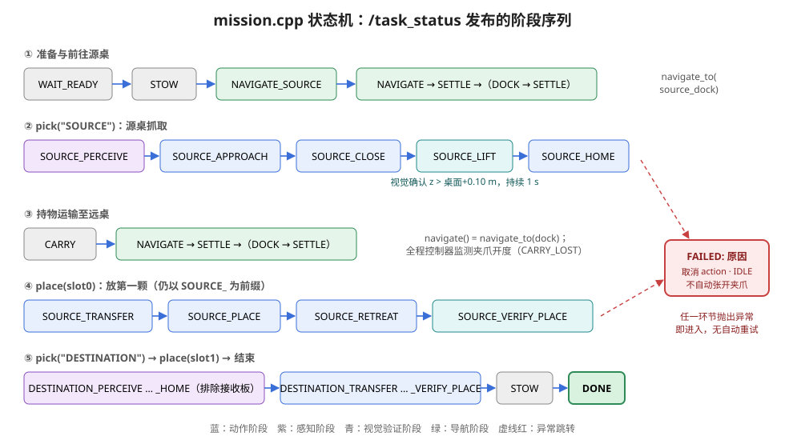

<p align="center"><b>图 12-3</b> mission.cpp 通过 /task_status 依次发布的阶段：五段工序串行执行，任一环节抛出异常即进入 FAILED</p>

**对应代码**：状态机并没有写成一张显式的转移表，而是用“顺序代码 + 异常”实现：每个阶段先调用 `state()` 发布阶段名，再执行动作；动作函数内部只要有一项检查不通过就抛出异常，整个 `run()` 立即中断。

```cpp
// 摘自 code/code_chapter12/src/mission.cpp（Mission::run，有删减）
void run()
{
  state("WAIT_READY");
  if (!plan_->wait_for_action_server(60s) || !nav_->wait_for_action_server(60s) ||
    !follow_->wait_for_action_server(30s) || !execute_->wait_for_action_server(30s) ||
    !grip_->wait_for_action_server(30s)) throw std::runtime_error("Nav2/MoveIt2/夹爪 action 未就绪");
  // ... 等待新鲜的 odom -> arm_base_link TF（最多 15 s）
  Group arm(node_, "right_arm", tf_);
  arm.setPoseReferenceFrame("odom");
  arm.setEndEffectorLink("gripper_r_center_link"); arm.setPlanningTime(5.); arm.setNumPlanningAttempts(3);
  arm.setPlannerId("RRTConnectkConfigDefault"); // ...
  Scene scene(node_); state("STOW"); mode("ARM"); add_scene(scene);
  joints(arm,cfg_["home"].as<std::vector<double>>()); gripper(.785);   // 收臂 + 张开夹爪

  auto pick = [&](const std::string & label, double table_top) { /* PERCEIVE→APPROACH→CLOSE→LIFT→HOME */ };
  auto place = [&](const std::vector<double> & slot, const geometry_msgs::msg::Pose & lift,
                   const std::string & label) { /* TRANSFER→PLACE→RETREAT→VERIFY_PLACE */ };

  state("NAVIGATE_SOURCE"); navigate_to(cfg_["source_dock"].as<std::vector<double>>());
  const auto source_top=cfg_["source_table"].as<std::vector<double>>()[2]+cfg_["source_table"].as<std::vector<double>>()[5]/2;
  auto first=pick("SOURCE",source_top);
  state("CARRY"); joints(arm,cfg_["home"].as<std::vector<double>>());
  navigate();                                          // = navigate_to(dock)
  place(cfg_["place_slots"][0].as<std::vector<double>>(),first.second,"SOURCE");
  const auto dest_top=cfg_["table"].as<std::vector<double>>()[2]+cfg_["table"].as<std::vector<double>>()[5]/2;
  auto second=pick("DESTINATION",dest_top);
  place(cfg_["place_slots"][1].as<std::vector<double>>(),second.second,"DESTINATION");
  state("STOW"); joints(arm,cfg_["home"].as<std::vector<double>>()); idle(); state("DONE");
}
```

**代码解读**：

- `state()` 既打印 `[TASK] xxx` 日志，又向 `/task_status` 发布同名字符串。感知节点订阅这个话题来切换观测逻辑（见第四、六部分），所以**状态名不仅是日志，也是模块间的接口**。
- `pick` 与 `place` 写成 lambda，同一段技能用 `"SOURCE"` / `"DESTINATION"` 两个标签复用两次。
- 桌面顶面高度 `source_top`、`dest_top` 用“中心 z + 厚度/2”计算，与 1.1 节手算一致。
- 状态之间没有“如果失败就重试”的分支，这正是本章“失败即停”的设计。

任一关键环节失败都会进入 `FAILED`。失败处理会请求取消相关 action、让底盘停止、让机械臂保持，并避免无条件张开夹爪。当前没有自动重新抓取、中途恢复或自动把物体放回出生位置的任务分支。

```cpp
// 摘自 code/code_chapter12/src/mission.cpp（Mission::fail）
void fail(const std::string & reason)
{
  if (!rclcpp::ok()) { return; }
  idle();                                  // 请求 IDLE：底盘停、臂保持
  state("FAILED: " + reason);
  // 取消仍在服务端的 action，禁止失败后继续运动；夹爪保持、不盲目松开。
  nav_->async_cancel_all_goals();
  follow_->async_cancel_all_goals();
  plan_->async_cancel_all_goals();
  execute_->async_cancel_all_goals();
  grip_->async_cancel_all_goals();
  if (grasp_debug_active_) { /* 尝试恢复碰撞矩阵，失败则提示重启 system */ }
}
```

**案例：从日志反推任务卡在哪里。** 假设 mission 终端最后几行是：

```text
[TASK] NAVIGATE_SOURCE
[TASK] NAVIGATE
[TASK] SETTLE
[TASK] DOCK
[TASK] SETTLE
[TASK] SOURCE_PERCEIVE
[TASK] FAILED: 停稳后没有新鲜 RGB-D 抓取候选：检查 system 终端 [perception] 的点云、TF、ROI 和候选数量诊断
```

（这是根据源码中的状态名与异常文本拼出的示意，不是实际运行记录。）由此可以读出：源桌导航与精靠都已通过（否则会停在 `SETTLE` 后的停靠异常），失败点在 `fresh_poses()` 等不到候选。下一步应去 system 终端看 `[perception]` 诊断，而不是去调导航参数。

> 💡 **要点**：日志里出现 `NAVIGATE` 不代表源桌阶段被跳过；`SOURCE_` / `DESTINATION_` 前缀表示“被处理苹果的来源”，不表示“机器人在哪张桌子旁”。

### 1.3 三组进程怎样协作，为什么不全部写在一个脚本里

本工程分成三组独立启动的进程。

**第一组是仿真与桥接。** `sim/simulation.py` 创建单一 Isaac World、房间、桌面、物体、机器人和相机，执行物理步进；`sim/bridge.py` 把这些结果发布为 ROS 消息，并接收速度、关节目标和运动模式。前者不直接订阅 ROS，后者才是 ROS 与仿真之间的入口。

**第二组是 ROS 能力系统。** `launch/system.launch.py` 启动定位或建图、Nav2、MoveIt2、`robot_state_publisher`、控制器、感知节点，以及可选的 RViz。它负责提供能力，**启动后不会自动开始搬运任务**。

**第三组是任务编排。** `launch/mission.launch.py` 启动 C++ 程序 `mission`。它不操作 Isaac 中的苹果对象，不直接设置关节，而是调用 Nav2、MoveIt2 和夹爪提供的标准接口。

可以把三者理解成：仿真提供“身体和感官”，ROS 能力节点提供“走路、规划、识别和执行技能”，任务节点决定“现在该做哪件事”。这样既能替换单个模块，也便于区分错误究竟出在感知、规划还是执行。

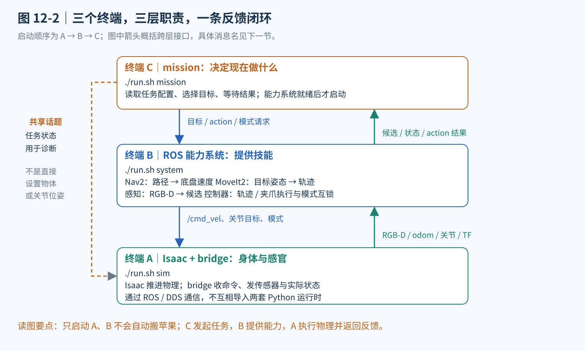

<p align="center"><b>图 12-4</b> 终端 C 编排任务、终端 B 提供 ROS 能力、终端 A 执行仿真，命令向下传递而观测与结果向上反馈</p>

**读图说明——三个终端不是三个独立任务。** 启动时按 A → B → C；读调用关系时从上往下看“任务 → 能力 → 物理执行”，再沿向上的箭头看反馈。左侧虚线表示任务状态也会送到桥接用于诊断，不是任务节点绕过控制器直接修改关节或苹果位姿。

| 模块与源码 | 主要输入 | 主要输出 | 不负责什么 |
|---|---|---|---|
| 仿真：`sim/simulation.py` | 本地资产、场景配置、桥接传来的目标 | 物理状态、RGB-D、实际关节与底盘位姿 | 不决定下一步任务 |
| 消息桥：`sim/bridge.py` | `/cmd_vel`、`/isaac/joint_command`、`/motion_mode` | `/clock`、`/odom`、`/scan`、相机、关节和 TF | 不求解 IK，不提供轨迹 action |
| 地图工具：`g2_mobile/mapping.py` | 墙体、桌子和障碍占地 | 参考地图；供桥接使用的模拟激光距离 | 不执行 SLAM 优化 |
| 定位或建图 | 地图、激光、里程计与 TF | `map → odom`；SLAM 模式还输出地图 | 不生成抓取姿态 |
| Nav2 | 导航目标、地图、激光、定位与里程计 | 全局路径、底盘速度、导航 action 结果 | 不判断夹爪是否抓到苹果 |
| 感知：`g2_mobile/perception.py` | 同帧 RGB、深度、内参、点云、TF、任务状态 | 物体观测中心与抓取候选 | 不执行机械臂，不读取苹果真值 |
| MoveIt2 | 机器人模型、关节状态、TF、碰撞场景、运动目标 | IK 解、规划轨迹、执行结果 | 不直接写 Isaac 关节 |
| 控制器：`g2_mobile/controller.py` | 标准 action、完整关节反馈、里程计、模式请求 | 关节目标、模式许可、action 反馈和结果 | 不搜索无碰撞路径 |
| 编排：`src/mission.cpp` | 配置、感知、反馈、action 结果 | 各模块调用、任务状态 | 不训练模型，不修改物体位姿 |

这里特别容易混淆的是两个“控制器”：Nav2 的局部控制器负责从底盘路径得到速度；本章 Python 控制器负责机械臂与夹爪 action，并管理运动互锁。它们不属于同一层。

**对应代码**：`system.launch.py` 把“能力”组装成一个 launch，`slam` 参数决定定位分支：

```python
# 摘自 code/code_chapter12/launch/system.launch.py（有删减）
localization = IncludeLaunchDescription(
    PythonLaunchDescriptionSource(str(nav / "launch/localization_launch.py")),
    condition=UnlessCondition(slam),            # slam:=false 时：map_server + AMCL
    launch_arguments={"map": LaunchConfiguration("map"), "params_file": params, ...}.items(),
)
mapping = Node(
    package="slam_toolbox", executable="async_slam_toolbox_node", name="slam_toolbox",
    condition=IfCondition(slam),                # slam:=true 时：SLAM Toolbox
    parameters=[str(root / "config/slam.yaml"), common], output="screen",
)
# ... navigation（Nav2）、robot_state_publisher、move_group、
#     controller.py、perception.py、rviz2（rviz:=false 时不启动）
```

而 `mission.launch.py` 只启动一个节点，并特意注明“system 启动不自动让机器人运动”：

```python
# 摘自 code/code_chapter12/launch/mission.launch.py
"""显式启动一次任务；system 启动不自动让机器人运动。"""
# ...
Node(
    package="g2_chapter12",
    executable="mission",
    output="screen",
    parameters=[module.moveit_config().to_dict(), {"use_sim_time": True}],
)
```

Isaac 侧使用自己的 Python 运行时，ROS 侧使用 `/usr/bin/python3`。两边通过 DDS 传递基础消息，而不是互相导入对方的 Python 二进制模块。标准 `control_msgs` action 服务端放在系统 ROS Python 中，正是为了避免混用两个运行时的 ABI。`run.sh` 已经分别处理这两套环境，不应通过手工拼接 Python 路径把它们合并。

```bash
# 摘自 code/code_chapter12/run.sh（有删减）
if [[ "$CMD" == sim ]]; then
  # ...
  unset OLD_PYTHONPATH PYTHONHOME CONDA_PREFIX
  # ...
  exec "$ISAAC_SIM_ROOT/python.sh" -m sim.bridge "$@"     # 仿真分支：Isaac 自带 Python
fi
# 固定系统 Python，避免 Conda 和 Isaac Python ABI 污染。
# ...
source /opt/ros/humble/setup.bash                          # ROS 分支：系统 Python + ROS
```

> 💡 **要点**：分进程的好处是“故障可归因”。如果 Isaac 窗口里机器人在动、但 RViz 里机器人不动，问题在桥接/TF；如果两边都不动而 `/cmd_vel` 有输出，问题在模式互锁。

### 1.4 把接口看成合同：消息中到底装了什么

ROS 接口可以简单分成三类：topic 持续传数据，service 完成一次请求与响应，action 管理需要等待、反馈和取消的长动作。导航和机械臂运动使用 action，是因为任务不仅要知道“命令发出”，还要知道“有没有接受、是否完成、何时取消”。

下表列出读懂本章最重要的数据接口。绝对话题名以 `/` 开头，名称应以当前源码为准，不要自行替换成其他章节的接口。

| 接口 | 类型 | 数据含义与调用关系 |
|---|---|---|
| `/clock` | `rosgraph_msgs/msg/Clock` | 桥接发布的仿真时间，本系统只应有一个有效发布者 |
| `/odom` | `nav_msgs/msg/Odometry` | 底盘位姿和实际运动速度；定位、Nav2、停稳互锁都要用 |
| `/scan` | `sensor_msgs/msg/LaserScan` | `base_scan` 下的二维模拟激光距离 |
| `/camera/color/image_raw` | `sensor_msgs/msg/Image` | `rgb8` 彩色图像 |
| `/camera/depth/image_raw` | `sensor_msgs/msg/Image` | `32FC1` 光轴深度，桥接输出单位为米 |
| `/camera/camera_info` | `sensor_msgs/msg/CameraInfo` | 图像尺寸、焦距、主点等相机内参 |
| `/camera/points` | `sensor_msgs/msg/PointCloud2` | 相机坐标系下的 XYZ/RGB 点云；用于显示及感知输入同步检查 |
| `/joint_states` | `sensor_msgs/msg/JointState` | 只包含 URDF 中的右臂七关节，供 MoveIt 和 RSP 使用 |
| `/isaac/joint_states` | `sensor_msgs/msg/JointState` | 完整仿真关节反馈，包含夹爪，供本章控制器检查 |
| `/grasp_candidates` | `geometry_msgs/msg/PoseArray` | `odom` 下多个 TCP 位姿；每个位姿包含米制位置与 `xyzw` 四元数 |
| `/target_center` | `geometry_msgs/msg/PointStamped` | `odom` 下当前目标的视觉观测中心，用于抬升与放置检查 |
| `/mode_request`、`/motion_mode` | `std_msgs/msg/String` | 前者是任务/遥控请求，后者是控制器实际批准的 `NAV`、`ARM` 或 `IDLE` |
| `/task_status` | `std_msgs/msg/String` | 任务阶段；采用 transient-local，后加入的订阅者可接收保留状态 |
| `/cmd_vel` | `geometry_msgs/msg/Twist` | 车体坐标下的 `linear.x`、`linear.y`、`angular.z`，单位为 m/s、m/s、rad/s |
| `/isaac/joint_command` | `sensor_msgs/msg/JointState` | 严格按约定名字发送的右臂关节目标，或单独夹爪关节目标 |

`/grasp_candidates` **不是轨迹**，没有各关节随时间的序列，也没有显式的置信度、夹爪宽度或物体 ID 字段。候选顺序由几何生成器决定，任务按顺序尝试。内部计算出的夹持宽度只用于可行性筛选，并没有作为另一个控制量发送出去。

`/target_center` 与抓取位姿中的位置也不必完全相等：前者是点云中位数观测，后者会结合目标高度调整夹持中心。不要把用于“验证物体在哪”的点，直接当成“TCP 应该去哪”的完整六维目标。

主要动作与服务的调用链如下：

| 调用者 → 服务端 | 接口 | 请求与返回 |
|---|---|---|
| `mission` → Nav2 | `/navigate_to_pose`，`nav2_msgs/action/NavigateToPose` | 输入 `map` 下目标位姿和本章行为树；返回导航 action 状态 |
| `mission` → Nav2 | `/follow_path`，`nav2_msgs/action/FollowPath` | 精靠输入 `odom` 下短路径，显式选择 `Dock` 与 `dock_goal_checker` |
| `mission` → MoveIt | `/move_action`，`moveit_msgs/action/MoveGroup` | 输入运动规划请求，设置只规划；返回 `planned_trajectory` |
| `mission` → MoveIt | `/compute_cartesian_path`，`moveit_msgs/srv/GetCartesianPath` | 输入当前状态和 TCP 路点；返回轨迹、错误码及完成比例 `fraction` |
| `mission` → MoveIt | `/execute_trajectory`，`moveit_msgs/action/ExecuteTrajectory` | 输入已规划的机器人轨迹，等待执行结果 |
| MoveIt → 本章控制器 | `/right_arm_controller/follow_joint_trajectory`，`control_msgs/action/FollowJointTrajectory` | 输入七关节轨迹和时间点；返回实际执行反馈及结果 |
| `mission` → 本章控制器 | `/gripper_controller/gripper_cmd`，`control_msgs/action/GripperCommand` | 输入开合目标；返回实际位置、到位或受阻状态 |
| `mission` → MoveIt | `/get_planning_scene`、`/apply_planning_scene` | 读取并更新环境、持物碰撞体和允许碰撞矩阵 |
| 操作者 → 本章控制器 | `/estop`、`/reset_estop`，`std_srvs/srv/Trigger` | 锁存软件急停，或在满足条件后复位 |

**对应代码**：任务对所有 action 的调用都经过同一个模板函数 `call<Action>()`，它把“合同”里的三件事——是否接受、是否完成、何时取消——都落实成了代码：

```cpp
// 摘自 code/code_chapter12/src/mission.cpp（Mission::call，有删减）
template<class Action>
typename rclcpp_action::ClientGoalHandle<Action>::WrappedResult call(
  typename rclcpp_action::Client<Action>::SharedPtr client, const typename Action::Goal & goal,
  double timeout, const std::string & action_name)
{
  auto accepted = client->async_send_goal(goal);
  if (accepted.wait_for(5s) != std::future_status::ready) {        // ① 5 s 内必须被接收
    client->async_cancel_all_goals();
    throw std::runtime_error(action_name + " 接收超时");
  }
  auto handle = accepted.get();
  if (!handle) { throw std::runtime_error(action_name + " 被拒绝"); }   // ② 服务端可以拒绝
  auto result = client->async_get_result(handle);
  const auto deadline = std::chrono::steady_clock::now() + std::chrono::duration<double>(timeout);
  while (rclcpp::ok() && std::chrono::steady_clock::now() < deadline) {
    if (result.wait_for(50ms) == std::future_status::ready) {
      auto value = result.get();
      if (value.code != rclcpp_action::ResultCode::SUCCEEDED) { /* 抛出 ABORTED / CANCELED */ }
      return value;                                                  // ③ 只接受 SUCCEEDED
    }
    std::string wanted; { std::lock_guard<std::mutex> lock(mutex_); wanted = requested_mode_; }
    if (!healthy(wanted)) { break; }                                 // ④ 运动模式丢失立刻中断
  }
  auto canceled = client->async_cancel_goal(handle);                 // ⑤ 超时/互锁丢失时主动取消
  canceled.wait_for(2s);
  throw std::runtime_error(action_name + " 超时/互锁丢失，已请求取消");
}
```

**代码解读**：

- ① ② 对应 action 的“接受”环节：控制器在模式不是 `ARM`、已有动作在执行或处于急停时会拒绝目标（见第五部分）。
- ③ 只认 `SUCCEEDED`；MoveIt 规划失败被包装成单独的 `PlanningFailure`，以便 `pick` 中换下一个候选重试。
- ④ 是本章特色：等待期间每 50 ms 检查一次控制器是否仍批准当前模式，一旦互锁丢失立即放弃等待。
- ⑤ 超时用的是 `steady_clock`（墙钟），不会因为仿真暂停而无限等待——这一点在第二部分“时间”中还会讲。

> ⚠️ **注意**：`/grasp_candidates` 的 `PoseArray` 中每个位姿只有位置和 `xyzw` 四元数。把它当成“含置信度的检测结果”或“可直接执行的轨迹”都是误读。

---

## 第二部分 坐标系链、单位与时间：让所有模块说同一种“位置语言”

### 2.1 两条 TF 主干：定位主干与操作主干

**直观理解**：同一个苹果在相机坐标中可能位于“前方 0.7 m”，在房间坐标中却是“左下角桌面附近”。坐标不统一，视觉测量和机械臂规划即使各自正确，接起来也会抓错位置。TF（Transform）树就是全系统共享的“坐标换算表”。

本章 TF 关系可以按两条主干理解：

- 定位主干是 **`map → odom → base_link`**。`map → odom` 由 AMCL 或 SLAM Toolbox 二选一发布，`odom → base_link` 由 Isaac 桥接根据实际底盘位姿发布。
- 操作主干是 **`base_link → arm_base_link → 右臂各连杆 → gripper_r_center_link`**。桥接提供底盘到机械臂基座的动态变换，RSP（robot_state_publisher）根据 URDF 和关节反馈发布右臂内部变换。桥接还负责 `base_link → base_scan` 与 `base_link → camera_optical_frame`。

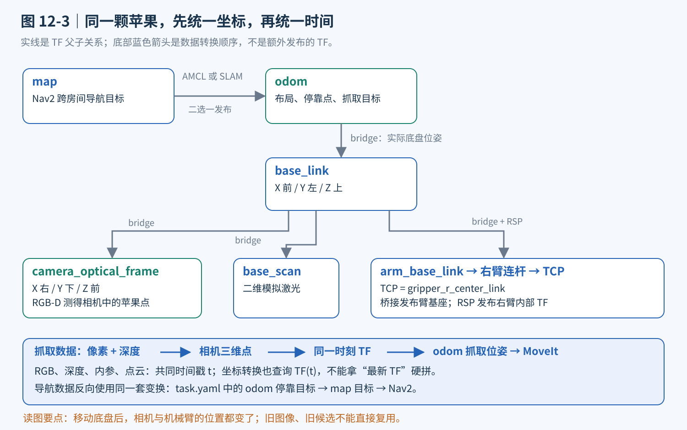

<p align="center"><b>图 12-5</b> map、odom、base_link 与相机、激光、右臂之间的 TF 关系，以及同帧 RGB-D 到 odom 抓取位姿的转换</p>

**读图说明——位置要在同一个坐标系，数据要来自同一个时刻。** 上半图回答“每个坐标系连到哪里、谁发布变换”；下半图回答“苹果点怎样变成抓取目标”。注意两个方向：抓取把相机点变到 `odom`，跨房间导航把配置中的 `odom` 停靠目标变到 `map`；两者都不能省略 TF。

**对应代码**：桥接在每个物理步都用同一个时间戳发布四条变换：

```python
# 摘自 code/code_chapter12/sim/bridge.py（主循环，有删减）
p = sim.pose()                                         # Isaac 中底盘实际 (x, y, yaw)
q = [0.0, 0.0, math.sin(p[2] / 2), math.cos(p[2] / 2)] # 绕 z 轴的 xyzw 四元数
publish_tf("odom", "base_link", [p[0], p[1], 0.0], q, stamp)
R = rotation(q)
ap, aq = sim.arm_prim.get_world_pose()
# base_link 为地面投影 frame；所有高度保留在 base→arm 中。
rel = R.T @ (ap - np.array([p[0], p[1], 0.0]))
arm_R = rotation([aq[1], aq[2], aq[3], aq[0]])         # Isaac 的 wxyz → ROS 的 xyzw
ar = matrix_to_quaternion(R.T @ arm_R)
publish_tf("base_link", "arm_base_link", rel, [ar[1], ar[2], ar[3], ar[0]], stamp)
publish_tf("base_link", "base_scan", [0, 0, 0.3], [0, 0, 0, 1], stamp)
cp, cq = sim.camera.get_world_pose(camera_axes="ros")
cr = matrix_to_quaternion(R.T @ rotation([cq[1], cq[2], cq[3], cq[0]]))
publish_tf("base_link", "camera_optical_frame", R.T @ (cp - [p[0], p[1], 0]),
           [cr[1], cr[2], cr[3], cr[0]], stamp)
```

**代码解读**：

- `odom → base_link` 的 z 固定为 0，体现“`base_link` 取地面投影”；机械臂基座的高度全部放在 `base_link → arm_base_link` 中。
- 世界系下的位置差 `ap - base` 左乘 $R^\top$，就是把世界向量转换到车体系下表达： $p_{\text{base}} = R_{\text{odom}\leftarrow\text{base}}^\top (p_{\text{odom}} - t)$。
- `aq[1], aq[2], aq[3], aq[0]` 这种重排出现了多次，正是在 Isaac 的 `w, x, y, z` 与 ROS 的 `x, y, z, w` 之间转换。

这里不能再保留固定机械臂示例中的静态 `world → arm_base_link`，也不能为了让 TF 看起来连通而补一条静态 `map → odom`。同一个 child frame 应有明确的发布者，否则不同节点可能同时争夺它的位置。

> ⚠️ **注意**：本章 `odom → base_link` 直接取自 Isaac 中底盘的实际位姿，没有编码器漂移，所以 `odom` 在本仿真中是“理想里程计”。把本例迁移到真机时，`odom` 会漂移，`map → odom` 的修正才真正体现价值。

### 2.2 轴向、四元数与单位约定

`base_link` 取地面投影，轴向为 X 前、Y 左、Z 上；相机光学坐标则是 X 右、Y 下、Z 前。ROS 位姿中的四元数顺序为 `x, y, z, w`，不要和部分 Isaac API 使用的 `w, x, y, z` 混用。相关转换函数已经封装在本地工具中。所有位置以米、角度以弧度表示。

**原理与公式**：单位四元数 $q=(x,y,z,w)$ 对应的旋转矩阵为

$$
R(q)=\begin{bmatrix}
1-2(y^2+z^2) & 2(xy-zw) & 2(xz+yw)\\
2(xy+zw) & 1-2(x^2+z^2) & 2(yz-xw)\\
2(xz-yw) & 2(yz+xw) & 1-2(x^2+y^2)
\end{bmatrix}.
$$

只绕 z 轴转 $\psi$（yaw）时， $q=(0,0,\sin\tfrac{\psi}{2},\cos\tfrac{\psi}{2})$；反过来从四元数取 yaw 用

$$
\psi=\operatorname{atan2}\big(2(wz+xy),\;1-2(y^2+z^2)\big).
$$

**对应代码**：

```python
# 摘自 code/code_chapter12/g2_mobile/common.py
def rotation(q):
    """ROS xyzw 四元数 → 旋转矩阵。"""
    q = np.asarray(q, dtype=float)
    if not np.isfinite(q).all() or np.linalg.norm(q) < 1e-9:
        raise ValueError("非法四元数")
    x, y, z, w = q / np.linalg.norm(q)          # 先归一化，再按 xyzw 解包
    return np.array(
        [
            [1 - 2 * (y * y + z * z), 2 * (x * y - z * w), 2 * (x * z + y * w)],
            [2 * (x * y + z * w), 1 - 2 * (x * x + z * z), 2 * (y * z - x * w)],
            [2 * (x * z - y * w), 2 * (y * z + x * w), 1 - 2 * (x * x + y * y)],
        ]
    )


def transform(points, translation, quaternion):
    return np.asarray(points) @ rotation(quaternion).T + translation   # 批量 p' = R p + t
```

C++ 侧 `mission.cpp::base_pose()` 用的正是上面的 yaw 公式：

```cpp
// 摘自 code/code_chapter12/src/mission.cpp（Mission::base_pose）
return {p.x, p.y, std::atan2(2 * (q.w * q.z + q.x * q.y),
    1 - 2 * (q.y * q.y + q.z * q.z))};
```

**案例：yaw = 0.5 rad 时的四元数往返。** $q=(0,0,\sin 0.25,\cos 0.25)=(0,0,0.2474,0.9689)$。代回 yaw 公式： $2wz=2\times0.9689\times0.2474=0.4794$， $1-2z^2=1-2\times0.0612=0.8776$， $\operatorname{atan2}(0.4794,0.8776)=0.500$ rad，往返一致。若误把它按 `wxyz` 读成 $(w,x,y,z)=(0,0,0.2474,0.9689)$，得到的就是绕另一根轴的近 180° 旋转——这就是顺序混用的危害。

> 💡 **要点**：`tests/test_core.py` 中的 `test_rotation` 检查了单位四元数 $(0,0,0,1)$ 对应单位矩阵、全零四元数抛出异常，可以作为改动 `rotation()` 后的最小回归检查。

### 2.3 配置在 odom，导航目标在 map：一次必要的坐标转换

`task.yaml` 的房间布局、源桌停靠点、远桌停靠点、接收板和槽位均在当前仿真 `odom` 下定义。机械臂抓取目标和 PlanningScene 也使用 `odom`。Nav2 跨房间目标使用 `map`，所以任务发送导航 action 前要通过 TF 把停靠目标从 `odom` 转到 `map`，而不是假设两者始终重合。

**原理**：设 TF 给出 $T_{\text{map}\leftarrow\text{odom}}=(R_{mo},t_{mo})$，则

$$
p_{\text{map}} = R_{mo}\,p_{\text{odom}} + t_{mo},\qquad \psi_{\text{map}}=\psi_{\text{odom}}+\psi_{mo}.
$$

**对应代码**：

```cpp
// 摘自 code/code_chapter12/src/mission.cpp（Mission::navigate_to，有删减）
geometry_msgs::msg::PoseStamped waypoint;
waypoint.header.frame_id = "odom";                       // 配置中的停靠点在 odom
waypoint.pose.position.x = target.x;
waypoint.pose.position.y = target.y;
waypoint.pose.orientation.z = std::sin(target.yaw / 2);
waypoint.pose.orientation.w = std::cos(target.yaw / 2);
auto map_tf = tf_->lookupTransform("map", "odom", tf2::TimePointZero,
    tf2::durationFromSec(3.));                           // 查询当前 map ← odom
Nav::Goal goal;
goal.behavior_tree = ament_index_cpp::get_package_share_directory("g2_chapter12") +
  "/config/navigate_to_pose.xml";                        // 显式指定本章行为树
tf2::doTransform(waypoint, goal.pose, map_tf);          // odom → map
goal.pose.header.stamp = node_->now();
```

**案例**：假设 AMCL 估计出 `map → odom` 只有平移 $(0.03,-0.02)$、旋转为 0（示意数字），则远桌停靠点 `odom` $(2.52,2.60,0)$ 在 `map` 中为 $(2.55,2.58,0)$。如果偷懒直接把 $(2.52,2.60)$ 当作 `map` 目标，底盘就会停在离真正停靠点约 $\sqrt{0.03^2+0.02^2}\approx0.036$ m 的地方——这已经吃掉了伸臂门槛 0.06 m 的一半以上。

### 2.4 MoveIt 怎样知道“机械臂基座在移动”

MoveIt 的 SRDF 使用 `odom → arm_base_link` 浮动虚拟关节来描述移动基座。它让 MoveIt 知道机械臂基座当前在哪里，**不意味着 MoveIt 会规划底盘运动**；实际规划组仍然只有右臂七关节。

```xml
<!-- 摘自 code/code_chapter12/srdf/g2_right_arm.srdf（有删减） -->
<virtual_joint name="mobile_root" type="floating" parent_frame="odom" child_link="arm_base_link" />
<group name="right_arm">
  <chain base_link="arm_base_link" tip_link="gripper_r_center_link" />
</group>
<group_state name="home" group="right_arm">
  <joint name="idx61_arm_r_joint1" value="-0.739033" />
  <!-- ... 其余六个关节 -->
</group_state>
```

**代码解读**：

- `virtual_joint ... type="floating"` 的父坐标是 `odom`，MoveIt 通过 TF 读取它的当前值，而不是把它作为可规划自由度。
- `right_arm` 是从 `arm_base_link` 到 `gripper_r_center_link` 的链，正好是七个右臂关节；TCP 名 `gripper_r_center_link` 与 `mission.cpp` 中 `setEndEffectorLink` 一致。
- `home` 的七个角与 `task.yaml` 的 `home` 一致。

> ⚠️ **注意**：正因为 MoveIt 的规划参考系是 `odom`（`arm.setPoseReferenceFrame("odom")`），视觉候选必须是 `odom` 下的位姿；`fresh_poses()` 会拒绝 `frame_id` 不是 `odom` 的候选。

### 2.5 两种时钟与“同一时刻”的数据

时间方面有两条规则：

1. **物理与轨迹按仿真时间推进。** ROS 规划、感知和显示节点使用 `use_sim_time=true`，由 `/clock` 驱动。暂停仿真时，轨迹插值不会按照现实时间偷偷向前跳。
2. **通信保护和动作总等待按墙钟计时。** 心跳失联、反馈过期或任务超时，不能因为仿真暂停就永远不触发。

在代码里，这两条规则体现为两种时钟的严格分工：`node_->now()` / `get_clock().now()` 是仿真时间（用于时间戳与轨迹插值），`std::chrono::steady_clock` / `time.monotonic()` 是墙钟（用于超时与心跳）。例如控制器的看门狗定时器显式使用墙钟：

```python
# 摘自 code/code_chapter12/g2_mobile/controller.py（Controller.__init__）
self.timer = self.create_timer(
    0.05, self.watchdog, clock=Clock(clock_type=ClockType.STEADY_TIME)
)
```

相机发布的 RGB、深度、内参和点云使用同一帧时间戳。感知节点为每种输入缓存最多 8 帧，寻找共同时间戳，并等待那个时间的 TF 到齐；抬升检查还需要同时间的 TCP TF。不能用旧深度、新 RGB，再配“最新 TF”拼成一个看似完整的观测。

```python
# 摘自 code/code_chapter12/g2_mobile/perception.py（有删减）
def cache(self, kind, msg):
    stamp = (msg.header.stamp.sec, msg.header.stamp.nanosec)
    self.frames[kind][stamp] = msg
    while len(self.frames[kind]) > 8:                 # 每种输入最多缓存 8 帧
        del self.frames[kind][min(self.frames[kind])]

def ready_stamp(self):
    stamps = set.intersection(*(set(frames) for frames in self.frames.values()))  # 四路共同时间戳
    for stamp in sorted(stamps, reverse=True):        # 从最新的共同帧开始尝试
        depth = self.frames['depth'][stamp]
        cloud = self.frames['cloud'][stamp]
        at = rclpy.time.Time.from_msg(depth.header.stamp)
        frames = {depth.header.frame_id, cloud.header.frame_id}
        if self.phase.endswith('_LIFT'):
            frames.add('gripper_r_center_link')       # 抬升阶段还要同时刻的 TCP TF
        if all(self.tf.can_transform('odom', frame, at) for frame in frames):
            return stamp
    return None
```

**案例：为什么不能用“最新 TF”。** 底盘以 0.55 m/s（DWB 的 `max_vel_x`）行驶时，若深度图是 0.2 s 前拍的、TF 却用最新的，两者之间底盘已走了 $0.55\times0.2=0.11$ m，反投影出的苹果位置就会错 11 cm——远超夹爪 1.4～7.4 cm 的可夹宽度范围。即使在桌边停稳时这种误差很小，抬升阶段机械臂在动，TCP TF 不同步同样会让“TCP 邻域 8 cm”的筛选失效。

本章相机配置为 320 × 240；桥接按步数降频发布 RGB-D，目标节奏约为每仿真秒 5 帧。这不等于墙钟下保证 5 Hz，渲染和 CPU 推理负载都会影响实际运行速度。点云先检查格式与时效，真正用于抓取几何的密集目标点则从 YOLO 框内的原始深度重新反投影，不能把 `/camera/points` 当成已经分好的苹果点云。

> 💡 **要点**：一句话记住本部分——**同一个坐标系、同一个时刻**。坐标系靠 TF 统一，时刻靠共同时间戳 + 同时间 TF 查询统一。

---

## 第三部分 导航与对接停靠：从“到达附近”走到“可以伸臂”

### 3.1 默认参考地图与可选 SLAM，不是同一件事

**直观理解**：地图是 Nav2 选路的“底图”。本章默认的底图不是机器人测出来的，而是按已知场景“画”出来的；SLAM 是另一条可选的练习分支。

默认运行方式使用 `maps/room.yaml` 和 `maps/room.pgm`。它们由 `g2_mobile/mapping.py` 根据 `task.yaml` 的墙体、桌面和障碍占地生成，构建时会重新生成，不是机器人先巡游一圈测出来的地图。

参考地图采用 0.05 m 分辨率，大小为 190 × 190，原点为 $(-4.75, -4.75)$。每个栅格回答的是“这小块平面能不能通过”，不包含完整的三维外观。两张桌子的整个水平占地都被视作障碍，机器人不会计划从桌下穿过。

**原理与公式**：第 $(i_x, i_y)$ 个栅格中心的世界坐标为

$$
x = x_0 + (i_x + 0.5)\,r,\qquad y = y_0 + (i_y + 0.5)\,r,
$$

其中 $r=0.05$ m 为分辨率， $(x_0,y_0)=(-4.75,-4.75)$ 为原点。反过来，世界点所在栅格为 $i_x=\lfloor (x-x_0)/r \rfloor$。 $190\times0.05=9.5$ m，正好覆盖 $[-4.75, 4.75]$ 的房间。

**对应代码**：

```python
# 摘自 code/code_chapter12/g2_mobile/mapping.py（有删减）
RES, ORIGIN, SIZE = 0.05, -4.75, 190

def boxes(cfg):
    # 边界实体墙由模拟器使用同一份定义创建。
    walls = [
        [0, -4.69, 1, 9.5, 0.12, 2],
        [0, 4.69, 1, 9.5, 0.12, 2],
        [-4.69, 0, 1, 0.12, 9.5, 2],
        [4.69, 0, 1, 0.12, 9.5, 2],
    ]
    return cfg["obstacles"] + [cfg["source_table"], cfg["table"]] + walls

def grid(cfg):
    data = np.zeros((SIZE, SIZE), dtype=bool)
    y, x = np.mgrid[:SIZE, :SIZE]
    x, y = ORIGIN + (x + 0.5) * RES, ORIGIN + (y + 0.5) * RES      # 栅格中心坐标
    for cx, cy, _, sx, sy, _ in boxes(cfg):
        data |= (abs(x - cx) <= sx / 2) & (abs(y - cy) <= sy / 2)   # 落在盒子水平投影内即占据
    return data
```

**代码解读**：`boxes()` 把障碍、两张桌子、四面墙统一成 `[中心x, 中心y, 中心z, 长, 宽, 高]` 的盒子；`grid()` 只用了 x、y 和长、宽，**高度信息被丢弃**——这就是“二维占据栅格”的含义。`sim/simulation.py` 也用同一个 `boxes()` 在 Isaac 中创建实体，因此地图与仿真场景天然一致。

**案例**：远桌 `table` 中心 $(3.40, 2.34)$、长 0.92、宽 1.08，占据 $x\in[2.94, 3.86]$、 $y\in[1.80, 2.88]$。远桌停靠点 $(2.52, 2.60)$ 离桌子左边缘 $2.94-2.52=0.42$ m，刚好大于底盘近似半径 0.40 m——停靠点紧贴桌边，这也解释了为什么第 3.2 节要把 `BaseObstacle.scale` 调得很小（见 `nav2_params.yaml` 注释），以免膨胀代价把底盘推离桌边。

桥接中的 `/scan` 同样来自这个二维占据栅格：从底盘位置沿 360 个方向射线采样，得到约 0.12～8 m 范围内的距离。它不是 Isaac RTX 激光，也不是对当前 USD 场景实时进行三维射线检测。

```python
# 摘自 code/code_chapter12/g2_mobile/mapping.py
def raycast(data, pose, count=360):
    """沿地图射线采样，非 RTX/真实激光。保留第十章可复现传感器模型。"""
    angles = np.linspace(-math.pi, math.pi, count) + pose[2]
    distances = np.arange(0.12, 8.01, RES / 2)                # 每 2.5 cm 采样一次
    x = pose[0] + np.cos(angles[:, None]) * distances
    y = pose[1] + np.sin(angles[:, None]) * distances
    ix, iy = np.floor((x - ORIGIN) / RES).astype(int), np.floor((y - ORIGIN) / RES).astype(int)
    outside = (ix < 0) | (iy < 0) | (ix >= SIZE) | (iy >= SIZE)
    hit = outside | data[np.clip(iy, 0, SIZE - 1), np.clip(ix, 0, SIZE - 1)]
    return np.where(hit.any(axis=1), distances[np.argmax(hit, axis=1)], 8.0).tolist()
```

因此必须注意一个范围限制：**如果在 Isaac 界面里临时添加障碍，而没有更新本章的栅格定义，模拟激光未必能看见它。** Nav2 确实在处理激光和代价地图，但不能据此宣称本例已经验证任意动态障碍场景。

默认 `slam:=false` 时，`map_server` 加载参考地图，AMCL（Adaptive Monte Carlo Localization，自适应蒙特卡洛定位）接收激光与里程计，估计 `map → odom`。AMCL 可以理解为“在已知地图上用许多可能位置反复比较激光观测”，最后把定位修正告诉其他节点。本例使用 `OmniMotionModel`，与可横移的底盘相配套。

```yaml
# 摘自 code/code_chapter12/config/nav2_params.yaml（amcl，有删减）
amcl:
  ros__parameters:
    robot_model_type: nav2_amcl::OmniMotionModel
    set_initial_pose: true
    initial_pose:
      x: -3.6
      y: -3.3
      z: 0.0
      yaw: 0.0
    min_particles: 500
    max_particles: 2000
    laser_model_type: likelihood_field
```

可以看到 AMCL 初始位姿 $(-3.6,-3.3,0)$ 与 `task.yaml` 的 `start` 一致——这是“默认参考地图原点 = 仿真 odom 原点”这一约定的直接体现。

`slam:=true` 时，启动文件不再启动 AMCL 和默认地图定位组合，而是启动 `async_slam_toolbox_node`，让它用激光与里程计构建地图并提供 `map → odom`。此时可以用本章遥控节点带机器人巡游、保存地图，再以定位模式加载保存的结果。

SLAM 分支主要用于理解“建图”和“在地图上导航”的区别。当前默认搬运任务不包含未知环境自主探索，SLAM 建图练习需要使用遥控带机器人巡游。更换地图坐标原点后，还要重新对齐 AMCL 初始位姿，不能只替换地图文件名。

> ⚠️ **注意**：AMCL 与 SLAM Toolbox 都会发布 `map → odom`，二者只能启动一个。`system.launch.py` 用 `IfCondition(slam)` / `UnlessCondition(slam)` 保证互斥，但手工另起节点就可能破坏这一点。

### 3.2 Nav2 的分工：全局选路线，局部选速度

任务给 Nav2 的不是一串轮子转角，而是目标位姿。Nav2 需要把这个目标逐步变成底盘可执行的速度。

**第一步：代价地图把障碍变成“通行难度”。** 全局代价地图在 `map` 下综合静态地图、激光障碍层和膨胀层；局部代价地图在 `odom` 下随车滚动，重点关注车附近的障碍。膨胀层在障碍周围增加代价，使路径不要紧贴桌边或墙角。

当前配置的全局分辨率为 5 cm，局部为 2 cm，局部窗口为 6 m × 6 m，底盘用半径 0.40 m 的圆近似。这个圆不是整个机器人高处机械臂和所持苹果的三维包络。因此，收臂和事先核查房间净空仍然重要；本章没有实现全机身三维导航碰撞规划。

**第二步：NavFn A\* 找跨房间路径。** `planner_server` 的 `GridBased` 使用 `NavfnPlanner`，并设置 `use_astar: true`。A* 可以理解为一边累计已经走过的代价，一边估算距离目标还剩多少，优先扩展更有希望的栅格。它输出的是位置序列，不直接输出电机命令。用公式表示，A* 每次扩展评估值最小的栅格：

$$
f(n) = g(n) + h(n),
$$

$g(n)$ 为从起点到栅格 $n$ 的累计代价（含膨胀代价）， $h(n)$ 为到目标的启发式估计（如直线距离）。

**第三步：DWB 从当前可用速度中选一个。** `controller_server` 使用 `DWBLocalPlanner` 与 `LimitedAccelGenerator`，采样平面速度组合 $(v_x, v_y, \omega)$，预测短时间内的运动，并按障碍、路径距离、目标距离、朝向、振荡等项评分。碰撞风险高或约束不满足的候选被排除，再从剩余候选中选择较好的速度。

```yaml
# 摘自 code/code_chapter12/config/nav2_params.yaml（controller_server，有删减）
controller_server:
  ros__parameters:
    controller_frequency: 20.0
    goal_checker_plugins:
    - goal_checker
    - dock_goal_checker
    controller_plugins:
    - FollowPath
    - Dock
    goal_checker:
      plugin: nav2_controller::SimpleGoalChecker
      xy_goal_tolerance: 0.08
      yaw_goal_tolerance: 0.12
    dock_goal_checker:
      plugin: nav2_controller::SimpleGoalChecker
      xy_goal_tolerance: 0.025
      yaw_goal_tolerance: 0.02
    FollowPath:
      plugin: dwb_core::DWBLocalPlanner
      trajectory_generator_name: dwb_plugins::LimitedAccelGenerator
      max_vel_x: 0.55
      max_vel_y: 0.55
      max_vel_theta: 1.0
      vx_samples: 13
      vy_samples: 13
      vtheta_samples: 41
      sim_time: 1.5
      # ...
      PathAlign.scale: 0.0 # 全向底盘不强制朝向路径切线，避免桌边局部极小值。
      PathDist.scale: 20.0
      GoalDist.scale: 32.0
      RotateToGoal.scale: 20.0
    Dock:
      plugin: dwb_core::DWBLocalPlanner
      max_vel_x: 0.12
      max_vel_y: 0.12
      max_vel_theta: 0.25
      vx_samples: 9
      vy_samples: 9
      vtheta_samples: 21
      # ...
```

**案例：DWB 一个周期评估多少条候选？** `FollowPath` 每周期最多采样 $13\times13\times41=6929$ 组 $(v_x,v_y,\omega)$，每组向前预测 `sim_time` = 1.5 s；`Dock` 为 $9\times9\times21=1701$ 组。控制频率 20 Hz 意味着每 50 ms 要完成一次评估，所以精靠配置注释中特意写明“低速动态窗口减少候选数量，避免沿用全速配置造成控制周期超时”。

由于 G2 本例是舵轮底盘，DWB 的 Y 向速度并没有被固定为零。桥接收到速度后，再调用本章 `sim/base/` 中沿用第四章的舵轮运动学：对于位置为 $(x_i, y_i)$ 的轮组，先计算局部速度分量 $v_{x,i} = v_x - \omega y_i$、 $v_{y,i} = v_y + \omega x_i$，再得到转向角和轮速目标，交给物理关节执行。这条链中，Nav2 负责“整车怎么走”，舵轮控制器负责“每个轮子怎么转”。

转向角与轮速为

$$
\delta_i = \operatorname{atan2}(v_{y,i},\,v_{x,i}),\qquad
\dot\phi_i = \frac{\sqrt{v_{x,i}^2+v_{y,i}^2}}{r_w},
$$

$r_w$ 为轮半径（`sim/base/config.py` 中 `wheel_radius = 0.070` m）。

```python
# 摘自 code/code_chapter12/sim/base/kinematics.py（SwerveKinematics.inverse，有删减）
for index, (wheel_x, wheel_y) in enumerate(self.wheel_positions):
    wheel_vx = velocity.vx - velocity.wz * wheel_y
    wheel_vy = velocity.vy + velocity.wz * wheel_x
    linear_speed = math.hypot(wheel_vx, wheel_vy)
    if linear_speed < 1e-8:
        hold_angle = 0.0 if current_angles is None else float(current_angles[index])
        states.append(WheelState(hold_angle, 0.0))           # 静止时保持当前转向角
        continue
    desired_angle = math.atan2(wheel_vy, wheel_vx)
    wheel_speed = linear_speed / self.wheel_radius
    if current_angles is not None:                           # 选“转向少于 90° + 反转车轮”的等价解
        desired_angle, wheel_speed = self._nearest_equivalent_state(
            desired_angle, wheel_speed, float(current_angles[index]))
    states.append(WheelState(desired_angle, wheel_speed))
```

**案例：当 $v_x=0.4$ m/s、 $v_y=0$、 $\omega=0.5$ rad/s 时左前轮怎样转？** 由 `config.py`，轴距 0.460 m、轮距 0.436 m，左前轮位于 $(x_i,y_i)=(0.230, 0.218)$。

- $v_{x,i}=0.4-0.5\times0.218=0.291$ m/s， $v_{y,i}=0+0.5\times0.230=0.115$ m/s；
- 转向角 $\delta=\operatorname{atan2}(0.115,0.291)\approx0.376$ rad $\approx21.6°$；
- 轮心线速度 $\sqrt{0.291^2+0.115^2}\approx0.313$ m/s，轮速 $0.313/0.070\approx4.47$ rad/s。

右前轮 $(0.230,-0.218)$ 则得 $v_{x,i}=0.509$、 $v_{y,i}=0.115$，转角约 0.223 rad——左右轮转角不同，正是绕车体中心旋转所需的几何关系。

**第四步：行为树组织规划、跟踪和恢复。** `config/navigate_to_pose.xml` 每秒触发全局重规划，并把路径交给 `FollowPath`。跨房间导航发生异常时，行为树可以清理代价地图、旋转、等待或后退。它只管理一次导航，不负责整章的苹果搬运工序；整个任务仍由 `mission.cpp` 管理。

```xml
<!-- 摘自 code/code_chapter12/config/navigate_to_pose.xml（有删减） -->
<RecoveryNode number_of_retries="6" name="NavigateRecovery">
  <PipelineSequence name="NavigateWithReplanning">
    <RateController hz="1.0">
      <RecoveryNode number_of_retries="1" name="ComputePathToPose">
        <ComputePathToPose goal="{goal}" path="{path}" planner_id="GridBased"/>
        <!-- ... -->
      </RecoveryNode>
    </RateController>
    <RecoveryNode number_of_retries="1" name="FollowPath">
      <FollowPath path="{path}" controller_id="FollowPath" goal_checker_id="goal_checker"/>
      <!-- ... -->
    </RecoveryNode>
  </PipelineSequence>
  <ReactiveFallback name="RecoveryFallback">
    <GoalUpdated/>
    <RoundRobin name="RecoveryActions">
      <!-- 清理代价地图 → Spin 1.57 rad → Wait 5 s → BackUp 0.30 m -->
    </RoundRobin>
  </ReactiveFallback>
</RecoveryNode>
```

本章有两套局部控制与到达检查器，调用时必须显式配对：普通导航使用 `FollowPath` 与 `goal_checker`，精靠使用 `Dock` 与 `dock_goal_checker`。在 YAML 中随意补一个 `current_goal_checker` 不能替代行为树或 action 请求中的选择。

> 💡 **要点**：普通导航的配对写在行为树 XML 里（`controller_id="FollowPath" goal_checker_id="goal_checker"`）；精靠的配对写在 `FollowPath` action 请求里（`controller_id = "Dock"`，`goal_checker_id = "dock_goal_checker"`）。两处都是“显式选择”。

### 3.3 为什么导航成功之后还要停稳、精靠、再复核

**直观理解**：Nav2 的“到了”是“到了附近”；机械臂需要的是“停得准”。设机械臂刚好能从桌边够到苹果，底盘比计划位置后退了 8 cm，导航仍可能认为已经到达，但机械臂的 IK 可能已经无解。底盘朝向偏一点，TCP 的可达区域也会旋转。对导航而言很小的误差，对桌边抓取不一定小。

**案例：0.12 rad 朝向误差对 TCP 意味着什么。** 设苹果距底盘中心约 0.8 m（示意数字），底盘朝向偏 0.12 rad（普通导航容差上限），则机械臂工作空间在苹果处横向偏移约 $0.8\times\sin0.12\approx0.096$ m，接近一个苹果直径的两倍；而任务门槛 0.05 rad 对应约 $0.8\times\sin0.05\approx0.04$ m。

此外，当前 NavFn 配置允许在目标附近 0.15 m 范围搜索可用终点，普通导航到达检查器的 XY/朝向容差是 0.08 m/0.12 rad。**Nav2 的 action 成功只说明它满足了导航自身条件，不等于满足本章伸臂条件。**

`mission.cpp::navigate_to()` 因此把导航分成一个完整的“到站流程”：

1. 从 `task.yaml` 读取 `odom` 下的停靠目标，转换为 `map` 位姿，调用 `/navigate_to_pose`。
2. 导航返回后发布 `SETTLE`，请求 `ARM` 模式。控制器只有确认实际里程计速度连续满足停稳条件超过 0.5 s，才会批准。
3. 读取新鲜的 `odom → base_link`，比较底盘实际位置、朝向与原始停靠目标。
4. 如果尚不合格，在允许范围内生成一次 `odom` 下的短路径，进入 `DOCK`，请求 `NAV`，调用 `/follow_path`。
5. 精靠完成后再次 `SETTLE`，切换到 `ARM`，连续复核 0.5 s，并确认 TF 确实在更新。

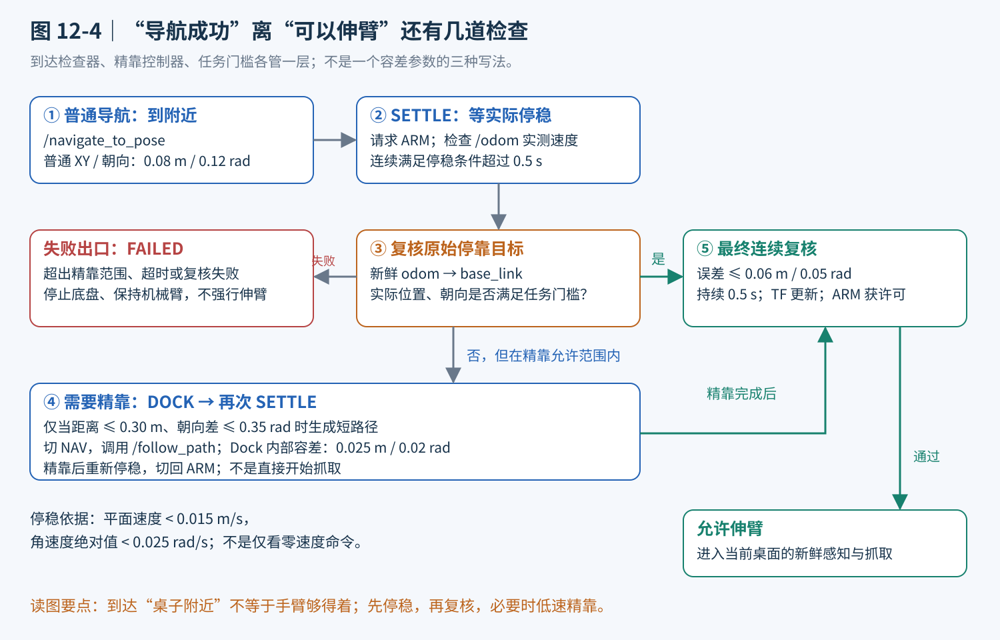

<p align="center"><b>图 12-6</b> 普通导航后先停稳并复核，必要时执行低速精靠，最终满足任务位置与朝向门槛才允许伸臂</p>

**读图说明——到附近、停得准、允许伸臂，是三件事。** 沿蓝色流程看正常到站与精靠分支，绿色表示通过检查后进入下一步，红色表示拒绝继续。图中数值对应本章当前配置；任一步超时、反馈失效或最终复核不通过，都不能因为 Nav2 已报成功就跳到抓取。

**对应代码**（接 2.3 节的坐标转换之后）：

```cpp
// 摘自 code/code_chapter12/src/mission.cpp（Mission::navigate_to，有删减）
call<Nav>(nav_, goal, remaining(), "/navigate_to_pose");
// Nav2 的成功是到达路径终点；NavFn 容差回退和 AMCL 修正均可能使它偏离精确停靠点。
state("SETTLE");
mode("ARM");  // 已有互锁要求新鲜 odom 且静止至少 0.5 s。
auto actual = base_pose();
if (!docking::within(actual, target)) {
  auto points = docking::short_path(actual, target);
  Follow::Goal precise;
  precise.controller_id = "Dock";
  precise.goal_checker_id = "dock_goal_checker";
  precise.path.header.frame_id = "odom";
  // ... 把 points 逐个转成 PoseStamped 放进 precise.path
  state("DOCK");
  mode("NAV");
  dock_path_pub_->publish(precise.path);                      // RViz 中可见 /dock_path
  call<Follow>(follow_, precise, std::min(45., remaining()), "/follow_path");
  state("SETTLE");
  mode("ARM");
}
// 使用动作完成之后收到的新 TF 连续复核 0.5 s，不能用旧缓存或单帧合格放行。
auto previous_stamp = fresh_base().header.stamp;
const auto stable_until = std::chrono::steady_clock::now() + 500ms;
while (rclcpp::ok() && std::chrono::steady_clock::now() < stable_until) {
  std::this_thread::sleep_for(50ms);
  if (!healthy("ARM")) { throw std::runtime_error("停靠复核时静止互锁丢失"); }
  actual = base_pose();
  if (!docking::within(actual, target)) {
    throw std::runtime_error("停靠仍超出 6 cm / 0.05 rad，拒绝伸臂");
  }
}
if (!rclcpp::ok() || rclcpp::Time(fresh_base().header.stamp) <= rclcpp::Time(previous_stamp)) {
  throw std::runtime_error("停靠复核期间 TF 未更新");
}
```

**代码解读**：

- `remaining()` 以 `nav_timeout`（默认 240 s）为整段到站流程的墙钟总时限；精靠用 `std::min(45., remaining())`，即“最多 45 s，且不超过剩余总时间”。
- 精靠前要从 `ARM` 切回 `NAV`，因为只有 `NAV` 模式下桥接才接收底盘速度；切回 `NAV` 又要求右臂在 `home` 附近——这保证了精靠时机械臂一定是收起的。
- 最后的复核循环要求 0.5 s 内每 50 ms 一次都合格，且 TF 时间戳确实前进，防止“TF 卡住、一直读到同一帧合格值”的假通过。
- `fresh_base()` 还要求 TF 年龄在 $[-0.1, 0.3]$ s 内，否则抛出“停靠复核 TF 过期或时钟不一致”。

### 3.4 精靠短路径：近距离修正而非第二次导航

短路径由 `src/docking.hpp` 生成，连接当前位姿与精确停靠点，角度按最短方向插值。它只允许起点距目标不超过 0.30 m、朝向差不超过 0.35 rad；超出这个范围就失败，而不是把近距离修正当成第二次远距离导航。

**原理与公式**：设起点 $s=(x_s,y_s,\psi_s)$、目标 $g=(x_g,y_g,\psi_g)$，距离 $L=\lVert g_{xy}-s_{xy}\rVert$，最短转角 $\Delta\psi=\operatorname{wrap}(\psi_g-\psi_s)\in(-\pi,\pi]$。分段数 $N=\max(1,\lceil L/0.025\rceil)$，第 $i$ 个路点（ $t=i/N$）为

$$
p_i = \big(x_s + t(x_g-x_s),\; y_s + t(y_g-y_s),\; \operatorname{wrap}(\psi_s + t\,\Delta\psi)\big),
$$

最后一个点强制等于 $g$。

```cpp
// 摘自 code/code_chapter12/src/docking.hpp（有删减）
inline double wrap(double angle) { return std::atan2(std::sin(angle), std::cos(angle)); }
inline double distance(const Pose & a, const Pose & b) { return std::hypot(a.x - b.x, a.y - b.y); }
inline bool within(const Pose & a, const Pose & b)
{
  return distance(a, b) <= .06 && std::abs(wrap(a.yaw - b.yaw)) <= .05;   // 任务伸臂门槛
}
inline std::vector<Pose> short_path(const Pose & start, const Pose & goal)
{
  // ... 检查六个数都是有限值
  const double length = distance(start, goal);
  const double turn = wrap(goal.yaw - start.yaw);
  // 这里只做已到桌旁的微调，不替代全局规划，不触发桌旁旋转/后退恢复行为。
  if (length > .30 || std::abs(turn) > .35) {
    throw std::runtime_error("超出近距离停靠范围 30 cm / 0.35 rad，拒绝局部直线路径");
  }
  const int segments = std::max(1, static_cast<int>(std::ceil(length / .025)));
  std::vector<Pose> path;
  for (int i = 0; i <= segments; ++i) {
    const double t = static_cast<double>(i) / segments;
    path.push_back({start.x + t * (goal.x - start.x), start.y + t * (goal.y - start.y),
      wrap(start.yaw + t * turn)});
  }
  path.back() = goal;  // 终点就是配置中的 odom 停靠点，不做栅格量化或容差替换。
  return path;
}
```

**案例：手算一次精靠。** 设导航结束后底盘实际位姿为 $s=(2.45, 2.55, 0.03)$（示意数字），目标为远桌停靠点 $g=(2.52, 2.60, 0)$：

1. $L=\sqrt{0.07^2+0.05^2}=\sqrt{0.0074}\approx0.086$ m > 0.06 m，`within()` 不通过，需要精靠；
2. $L\le0.30$、 $|\Delta\psi|=0.03\le0.35$，允许生成短路径；
3. $N=\lceil0.086/0.025\rceil=\lceil3.44\rceil=4$，共 5 个路点：

| $i$ | $t$ | $x$ | $y$ | $\psi$ |
|---|---|---|---|---|
| 0 | 0 | 2.450 | 2.550 | 0.0300 |
| 1 | 0.25 | 2.4675 | 2.5625 | 0.0225 |
| 2 | 0.50 | 2.485 | 2.575 | 0.0150 |
| 3 | 0.75 | 2.5025 | 2.5875 | 0.0075 |
| 4 | 1 | 2.520 | 2.600 | 0.0000 |

4. `Dock` 控制器以不超过 0.12 m/s 跟踪，`dock_goal_checker` 在 0.025 m / 0.02 rad 内结束；随后任务再以 0.06 m / 0.05 rad 门槛连续复核 0.5 s。

若起点是 $(2.20, 2.60, 0)$， $L=0.32$ m > 0.30 m，`short_path()` 直接抛异常，任务进入 `FAILED`——此时应检查导航本身为何停得这么远，而不是放大 0.30 m 的限制。

`Dock` 使用低速 DWB、局部障碍检查和独立到达检查器，XY/朝向内部容差为 0.025 m/0.02 rad。动作最多等待 45 s，并且不能超过总导航剩余时间。精靠直接调用 `FollowPath`，不执行桌旁旋转、后退等通用行为树恢复动作。

最后，任务以 **位置误差不超过 0.06 m、朝向误差不超过 0.05 rad** 作为伸臂门槛，并检查 TF 时效与运动模式。只要还有一项不合格，就拒绝抓取。

这里有三个不同概念，不要混为一个参数：普通导航容差决定“已到附近”，Dock 内部容差决定“短路径跟踪可以结束”，任务最终门槛决定“现在是否允许伸臂”。任务门槛不能替代控制器正确收敛，也不能靠不断重复发送同一个 `map` 目标来解决精靠问题。

| 层级 | 位置容差 | 朝向容差 | 定义位置 | 回答的问题 |
|---|---|---|---|---|
| NavFn 终点搜索 | 0.15 m | — | `planner_server.GridBased.tolerance` | 目标格不可达时可在多大范围内找替代终点 |
| 普通导航到达 | 0.08 m | 0.12 rad | `goal_checker` | 是否“已到附近” |
| 精靠到达 | 0.025 m | 0.02 rad | `dock_goal_checker` | 短路径跟踪是否可以结束 |
| 任务伸臂门槛 | 0.06 m | 0.05 rad | `docking::within()` | 现在是否允许伸臂 |
| 精靠适用范围 | 0.30 m | 0.35 rad | `docking::short_path()` | 是否属于“近距离修正” |

> ⚠️ **注意**：重复发送同一个 `map` 目标通常会“立即成功”（因为已在 0.08 m 容差内），并不能让底盘更准。这正是代码注释“不重复发送可能立即成功的 map 目标”的原因。

---

## 第四部分 感知定位：从 YOLO 框到 odom 下的抓取候选

### 4.1 YOLO 检测：先找目标

**直观理解**：YOLO（You Only Look Once）回答的是“图里哪儿有苹果”，给出的是二维矩形框，不是三维位置，更不是抓取姿态。

本章加载本地 `models/apple_yolo.pt`，优先使用随代码提供的 `vendor/ultralytics`。感知节点默认以 CPU 推理，只选类别名为 `apple` 的检测，置信度阈值来自 `task.yaml`，默认 0.40。橙子与茶盒用于构成干扰，而不是第二、第三类搬运任务。

> ⚠️ **注意**：上面关于 `vendor/ultralytics` 的说法沿用原文；但当前 `perception.py` 注释写的是“ROS 节点使用系统 Python 中通过 pip 安装的固定版本”，第八部分构建说明也写明“不再向 `install` 复制 vendor”。以当前代码为准：Ultralytics 从系统 Python 的 pip 安装位置导入。

```python
# 摘自 code/code_chapter12/g2_mobile/perception.py（Perception.detect_apples，有删减）
def detect_apples(self, image, rotated=False):
    h, w = image.shape[:2]
    apples = []
    for k in (range(4) if rotated else (0,)):            # 仅 LIFT 阶段做四个直角旋转视图
        view = np.ascontiguousarray(np.rot90(image, k))
        result = self.model.predict(
            view, conf=float(self.cfg.get('vision', {}).get('confidence', .4)),
            verbose=False, device='cpu')[0]
        for box in result.boxes:
            if str(result.names[int(box.cls[0])]).lower() != 'apple':
                continue                                  # 只要 apple 类
            x1, y1, x2, y2 = box.xyxy[0].detach().cpu().numpy()
            # ... k = 1/2/3 时把旋转视图中的框坐标还原到原图
            apples.append((np.asarray(coords), float(box.conf[0])))
    return apples
```

YOLO 不可用时，节点会记录模型故障并禁止产生正常抓取目标，不会退回“找红色区域”或读取苹果的仿真坐标。正常挑选待抓苹果仍需有效 YOLO 检测。

```python
# 摘自 code/code_chapter12/g2_mobile/perception.py（Perception._load_yolo，有删减）
try:
    from ultralytics import YOLO
    self.model = YOLO(str(path))
    self.get_logger().info(f'YOLO apple detector loaded: {path}')
except Exception as exc:
    self.model_error = str(exc)
    self.get_logger().warning('YOLO unavailable; grasp disabled (no fallback): ' + repr(exc))
```

### 4.2 深度反投影与坐标变换：从像素到房间坐标

模型输出的是图像中的矩形框。矩形框内既有苹果，也有桌面，不能简单把矩形中心乘上一个深度值就认为找到了可靠抓取点。本章采用已知桌面约束下的几何筛选，而不是 SAM2 实例分割。

**原理与公式**：对于像素 $(u, v)$、光轴深度 $z$ 和内参 $(f_x, f_y, c_x, c_y)$，反投影为：

$$
X_c = \frac{(u-c_x)z}{f_x},\qquad
Y_c = \frac{(v-c_y)z}{f_y},\qquad
Z_c = z.
$$

这里 $z$ 是沿相机光轴的深度，不是相机到该点的欧氏距离。 $f_x,f_y$ 为以像素计的焦距， $(c_x,c_y)$ 为主点像素坐标；结果 $(X_c,Y_c,Z_c)$ 单位为米，处于 `camera_optical_frame`（X 右、Y 下、Z 前）。随后按该帧时间戳查询相机到 `odom` 的旋转和平移：

$$
p_{\mathrm{odom}} = R_{\mathrm{odom}\leftarrow\mathrm{camera}}\,p_{\mathrm{camera}} + t_{\mathrm{odom}\leftarrow\mathrm{camera}}.
$$

这样得到的才是能交给任务和 MoveIt 使用的房间坐标。

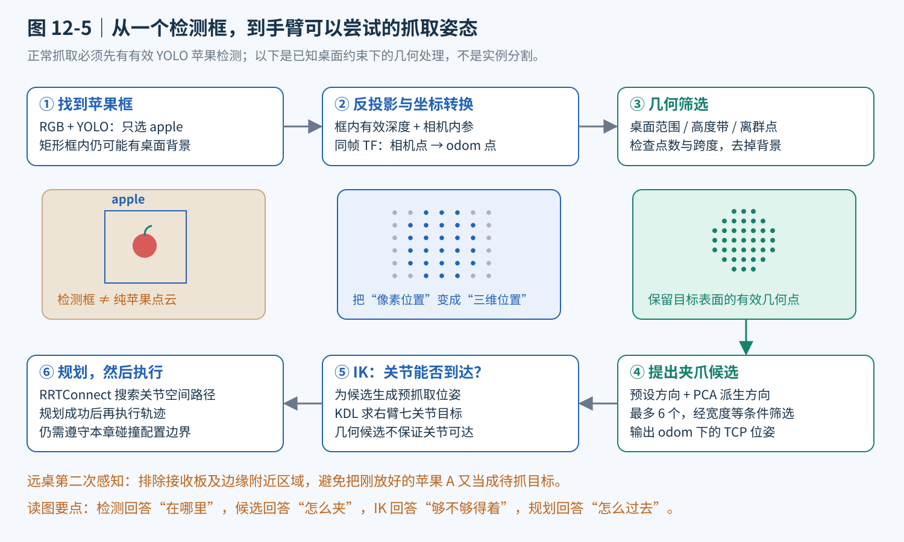

<p align="center"><b>图 12-7</b> YOLO 检测框经过深度反投影、TF 转换和几何筛选生成夹爪候选，再由 IK 和运动规划判断能否执行</p>

**读图说明——检测到苹果，不等于已经知道怎么抓。** 按上排从左到右、下排从右到左阅读：先找框，再提取有效三维点，再提出夹爪姿态，最后检查关节可达性并规划、执行。中间的点阵只是几何处理示意，不是真实传感器输出；每一层都可能拒绝当前目标，候选多也不保证抓取成功。

**对应代码**：

```python
# 摘自 code/code_chapter12/g2_mobile/perception.py（Perception._yolo_points，有删减）
stamp = rclpy.time.Time.from_msg(self.depth.header.stamp)
tf = self.tf.lookup_transform('odom', self.depth.header.frame_id, stamp)   # 用该帧时间戳查 TF
q, tr = tf.transform.rotation, tf.transform.translation
# ...
for coords, conf in boxes:
    x1,y1,x2,y2 = coords.astype(int)
    # ... 裁剪到图像范围
    yy,xx = np.mgrid[y1:y2+1,x1:x2+1]
    z = depth[y1:y2+1,x1:x2+1]                                  # 框内的原始深度
    valid = np.isfinite(z) & (z>.05) & (z<5.)                   # 只用 0.05~5 m 有效像素
    fx,fy,cx,cy = self.info.k[0],self.info.k[4],self.info.k[2],self.info.k[5]
    cam = np.column_stack(((xx[valid]-cx)*z[valid]/fx,          # X_c
                           (yy[valid]-cy)*z[valid]/fy,z[valid]))  # Y_c, Z_c
    pts = transform(cam,[tr.x,tr.y,tr.z],[q.x,q.y,q.z,q.w])     # p_odom = R p_cam + t
```

**代码解读**：`self.info.k` 是 `CameraInfo` 中按行展开的 3×3 内参矩阵 $K=\begin{bmatrix}f_x&0&c_x\\0&f_y&c_y\\0&0&1\end{bmatrix}$，所以 `k[0]`、`k[4]`、`k[2]`、`k[5]` 分别是 $f_x,f_y,c_x,c_y$。注意 TF 查询用的是深度帧自己的时间戳 `stamp`，而不是“现在”。

**案例：手算一个像素的反投影。** `sim/simulation.py` 中相机分辨率 320×240、焦距 24.0 mm、水平孔径 26.0 mm、垂直孔径 19.5 mm。按针孔模型估算 $f_x = 24/26\times320\approx295.4$ px， $f_y=24/19.5\times240\approx295.4$ px；若主点位于图像中心，则 $c_x=160$、 $c_y=120$（真实数值以运行时 `/camera/camera_info` 为准，这里只作估算）。取像素 $(u,v)=(200,150)$、深度 $z=0.70$ m：

$$
X_c=\frac{(200-160)\times0.70}{295.4}\approx0.095\text{ m},\quad
Y_c=\frac{(150-120)\times0.70}{295.4}\approx0.071\text{ m},\quad Z_c=0.70\text{ m}.
$$

即该点在相机前方 0.70 m、偏右 9.5 cm、偏下 7.1 cm。若误把 0.70 m 当作欧氏距离，真实光轴深度应为 $0.70/\sqrt{1+(40/295.4)^2+(30/295.4)^2}\approx0.690$ m，会引入约 1 cm 误差。

### 4.3 几何筛选：清掉桌面背景与邻近物体

普通桌面感知主要经过以下筛选：

- 舍弃无效深度，只使用 0.05～5 m 内的有效像素。
- 按当前桌子的水平范围和桌面上方约 0.006～0.14 m 的高度带去掉背景。
- 以点云 XY 中位数为参考，保留半径约 6 cm 内的点，降低邻近物体混入的影响。
- 检查点数，公共处理阶段至少需要 30 个点；XY 跨度过大时拒绝把多个物体当成一个目标。
- 在 `DESTINATION_PERCEIVE` 阶段排除接收板及其边缘附近的目标，避免重新抓取已放下的源桌苹果。

```python
# 摘自 code/code_chapter12/g2_mobile/perception.py（Perception._yolo_points，有删减）
if tracking_lift:
    pts = pts[np.linalg.norm(pts-goal,axis=1)<.08]            # 抬升阶段：TCP 周围 8 cm
else:
    pts = pts[(abs(pts[:,0]-table[0])<table[3]/2) &           # 桌面水平范围
              (abs(pts[:,1]-table[1])<table[4]/2) &
              (pts[:,2]>top+.006) & (pts[:,2]<top+.14)]       # 桌面上方高度带
if len(pts)<30: continue
med=np.median(pts,axis=0)
pts=pts[np.linalg.norm(pts[:,:2]-med[:2],axis=1)<.06]         # XY 中位数 6 cm 邻域
if len(pts)<30: continue
med=np.median(pts,axis=0)
tray=self.cfg['tray']
# 第二次抓取只选板外苹果，不能把刚放下的第一颗又抓走。
if self.phase == 'DESTINATION_PERCEIVE' and (
        abs(med[0]-tray[0])<tray[3]/2+.015 and
        abs(med[1]-tray[1])<tray[4]/2+.015):
    continue
score = -np.linalg.norm(med-goal) if goal is not None else conf
```

公共处理阶段（`process()`）还会再做一次检查：

```python
# 摘自 code/code_chapter12/g2_mobile/perception.py（Perception.process，有删减）
if len(points) < 30:
    self.diagnostic(f'真实 RGB-D 苹果点不足：{len(points)} / 30')
    return
center=np.median(points,axis=0)
if max(np.ptp(points[:,:2],axis=0))>.14:
    self.diagnostic('目标点云跨度过大，可能混入多个物体，拒绝合并抓取')
    return
```

**案例：远桌第二次抓取时怎样排除接收板。** 接收板中心 $(3.00, 2.18)$、长 0.22、宽 0.20，加 1.5 cm 余量后排除区域为 $|x-3.00|<0.125$、 $|y-2.18|<0.115$，即 $x\in(2.875,3.125)$、 $y\in(2.065,2.295)$。已放在槽位 0 $(3.00, 2.13)$ 的苹果落在其中，被跳过；远桌原有苹果出生于约 $(3.17, 2.34)$， $|x-3.00|=0.17>0.125$，不被排除，成为第二次抓取目标。

**案例：为什么需要 6 cm 邻域。** 苹果与橙子出生时沿 y 相距 0.14 m（`offset` 分别为 0.00 与 −0.14）。若 YOLO 框偏大、把橙子的一部分点也框进来，以苹果为主的 XY 中位数半径 6 cm 邻域可以剔除 14 cm 外的橙子点；若两物体点数相近导致中位数落在中间，最终 XY 跨度检查（>0.14 m 拒绝）也会把它拦下。

感知默认 `station=auto`，按底盘当前位置选择最近的一张桌子，再结合 `/task_status` 切换观测用途。因此，任务状态不仅用来打印日志，也会改变感知的目标选择逻辑。

```python
# 摘自 code/code_chapter12/g2_mobile/perception.py（Perception.process，有删减）
else:
    # 自动选择离机器人底盘最近的桌子，支持同一节点完成两站任务。
    try:
        bt=self.tf.lookup_transform('odom','base_link',rclpy.time.Time())
        bx,by=bt.transform.translation.x,bt.transform.translation.y
        candidates=(np.asarray(self.cfg['source_table'],float),np.asarray(self.cfg['table'],float))
        table=min(candidates,key=lambda x:(x[0]-bx)**2+(x[1]-by)**2)
    except TransformException:
        table=np.asarray(self.cfg['source_table'],float)
top=table[2]+table[5]/2
```

| 感知阶段（由 `/task_status` 决定） | 目标选择方式 | 特殊处理 |
|---|---|---|
| `*_PERCEIVE` 等普通阶段 | 桌面 ROI + 置信度最高 | `DESTINATION_PERCEIVE` 排除接收板 |
| `*_LIFT` | TCP 周围 8 cm，离 TCP 最近 | 四方向旋转检测 + TCP 局部窗口 |
| `*_RETREAT`、`*_VERIFY_PLACE` | 离指定槽位最近（≤ 0.10 m） | YOLO 无结果时允许槽位深度几何复核 |

模型置信度、有效点数、候选数量和当前阶段会写入感知诊断日志，排错时应先看这些信息。诊断日志按墙钟每 3 s 最多输出一次，格式形如 `phase=... station=... points=... center=[...] grasps=... backend=YOLO`。

### 4.4 2.5D 几何抓取候选：夹爪朝哪个方向

**直观理解**：苹果点云只描述物体表面，机器人还需要一个夹爪目标姿态。`g2_mobile/common.py::grasp_candidates()` 使用的是适合本教学小物体的 2.5D 几何方法，不是任意物体的完整六维姿态估计。

它先计算点云各轴的 2% 与 98% 分位数，减小少量离群点的影响，再估计目标高度、水平尺寸和夹持中心。抓取高度约取物体高度的 60%，同时不低于桌面上方 2.5 cm；目标高度需在约 2～10 cm，水平尺度也要满足本章夹爪与物体的范围假设。

然后对 XY 点云协方差做特征分解，也就是 PCA。直观地说，PCA 给出点云在平面上主要沿哪些方向展开，用来提出候选偏航角。但苹果接近球形，单视角遮挡会让这些方向不稳定，所以代码先尝试两种预设横向夹持方向，再尝试四种相隔 90° 的 PCA 派生方向，最多得到六个候选，经过宽度筛选后可能更少，也可能存在方向重复。

对于每个方向，代码沿夹爪闭合轴测量投影宽度并增加 6 mm 余量，要求估计值在 0.014～0.074 m 内。夹爪采用倾斜俯抓，默认倾角参数为 0.65 rad，目的在于适应当前桌边布局与腕部可达范围，而不是让腕部必须垂直处在 TCP 正上方。

**原理与公式**：设候选偏航角为 $\theta$、倾角为 $\tau$，闭合轴 $\mathbf{x}=(\cos\theta,\sin\theta,0)$，宽度估计

$$
w(\theta) = \max_k(\mathbf{p}_k\cdot\mathbf{x}) - \min_k(\mathbf{p}_k\cdot\mathbf{x}) + 0.006.
$$

代码直接写出候选姿态的四元数（`xyzw`）：

$$
q = \Big(\cos\tfrac{\tau}{2}\cos\tfrac{\theta}{2},\;\cos\tfrac{\tau}{2}\sin\tfrac{\theta}{2},\;\sin\tfrac{\tau}{2}\cos\tfrac{\theta}{2},\;\sin\tfrac{\tau}{2}\sin\tfrac{\theta}{2}\Big).
$$

```python
# 摘自 code/code_chapter12/g2_mobile/common.py
def grasp_candidates(points, table_top, tilt=0.65):
    """传统几何抓取：YOLO 点云 PCA、多偏航、朝桌内倾斜的俯抓。返回 xyz+xyzw。"""
    p = np.asarray(points, dtype=float)
    if p.ndim != 2 or p.shape[1] != 3 or len(p) < 30 or not np.isfinite(p).all():
        return []
    lo, hi = np.percentile(p, [2, 98], axis=0)            # 2% / 98% 分位数抗离群点
    height = hi[2] - table_top
    if not 0.020 < height < 0.10 or max(hi[:2] - lo[:2]) > 0.10:
        return []
    center = (lo + hi) / 2
    center[2] = max(table_top + height * 0.60, table_top + 0.025)   # 夹持高度
    _, axes = np.linalg.eigh(np.cov(p[:, :2].T))          # XY 协方差 PCA
    yaw = math.atan2(axes[1, 0], axes[0, 0])
    result = []
    # 球形苹果的 PCA 轴对遮挡很敏感；先试桌边横向夹持，再试 PCA。
    for angle in [math.pi / 2, 3 * math.pi / 2, *(yaw + np.arange(4) * math.pi / 2)]:
        x = np.array([math.cos(angle), math.sin(angle), 0])
        width = np.ptp(p @ x) + 0.006
        if 0.014 < width < 0.074:
            # R = Rz(yaw) Rx(pi)，TCP +Z 朝下，X 为闭合轴。
            # Ry(-tilt) Rz(angle) Rx(pi)：腕部位于目标靠机器人一侧，
            # 不再强迫腕部与 TCP 同 XY（该约束在桌边超过臂展）。
            c, s = math.cos(tilt / 2), math.sin(tilt / 2)
            a, b = math.cos(angle / 2), math.sin(angle / 2)
            result.append([*center, c*a, c*b, s*a, s*b])
    return result
```

**案例：给一颗苹果手算候选。** 源桌桌面顶 `table_top` = 0.888 m。设筛选后的点云 98% 分位 z 为 0.938 m，XY 两轴分位跨度均约 0.045 m：

1. $\text{height}=0.938-0.888=0.050$ m，在 $(0.02,0.10)$ 内；XY 最大跨度 0.045 ≤ 0.10，通过。
2. 夹持高度 $z=\max(0.888+0.6\times0.050,\;0.888+0.025)=\max(0.918,0.913)=0.918$ m。
3. 第一个方向 $\theta=\pi/2$：设沿 y 投影跨度 0.048 m，则 $w=0.054$ m，在 $(0.014,0.074)$ 内，保留。
4. 四元数： $\tau/2=0.325$， $\cos0.325=0.9476$， $\sin0.325=0.3193$； $\theta/2=\pi/4$， $\cos=\sin=0.7071$。得 $q=(0.6701, 0.6701, 0.2258, 0.2258)$，模长 $\sqrt{2\times0.4490+2\times0.0510}=1.000$，是合法单位四元数。

这一做法有明确边界：桌面高度来自已知配置，倾斜方向与两张桌子同向靠近的布局相配套。若把停靠方向旋转 90°，仅改停靠坐标未必够，还应检查候选朝向与 IK。候选满足几何条件也不代表关节可达，更不代表已经找到整条安全路径。

> 💡 **要点**：`/target_center` 发布的是点云**中位数**（用于验证），而候选位置是**分位数包围盒中心 + 60% 高度**（用于夹持）。两者相差几毫米到一两厘米是正常的。

---

## 第五部分 抓放执行与运动互锁：Nav2、MoveIt2 与控制器如何协作

### 5.1 IK 与关节空间规划：手臂怎样过去

**直观理解**：几何候选解决“夹爪朝哪”，IK 解决“有没有一组关节角能做到”，运动规划解决“怎样从现在的关节角安全地走过去”。

任务收到候选后，按如下方式调用 MoveIt：

1. `fresh_poses()` 只接受进入当前感知等待之后发布、仍然新鲜、坐标为 `odom` 的非空候选，不使用导航之前缓存的旧结果。
2. 为候选建立预抓取位姿：保持朝向，在抓取点上方增加 0.12 m。
3. `pose()` 以当前关节状态为种子，用 KDL 求满足完整 TCP 位姿的 IK，将位姿目标转换为七关节目标。
4. `planned()` 请求 `/move_action` 只规划，以 `RRTConnectkConfigDefault` 为主要规划器。
5. 返回轨迹成功后，再通过 `/execute_trajectory` 执行，不能把“规划成功”当成“机械臂已到达”。

```cpp
// 摘自 code/code_chapter12/src/mission.cpp（有删减）
geometry_msgs::msg::PoseArray fresh_poses()
{
  const auto since = node_->now();                       // 进入等待的时刻
  const auto deadline = std::chrono::steady_clock::now() + 15s;
  while (rclcpp::ok() && std::chrono::steady_clock::now() < deadline && healthy("ARM")) {
    {
      std::lock_guard<std::mutex> lock(mutex_);
      if (poses_.header.frame_id == "odom" && !poses_.poses.empty() &&
        rclcpp::Time(poses_.header.stamp) > since &&                      // 必须晚于进入时刻
        (node_->now() - rclcpp::Time(poses_.header.stamp)).seconds() < .5) // 且不超过 0.5 s
      { return poses_; }
    }
    std::this_thread::sleep_for(50ms);
  }
  // ... 区分“没有发布者”与“有发布者但没有新鲜候选”两种错误
}

void pose(Group & arm, const geometry_msgs::msg::Pose & target)
{
  arm.clearPoseTargets();
  // 以当前关节作 IK 种子，避免 pose 约束随机选到翻肘/绕背的远端解。
  arm.setJointValueTarget(arm.getCurrentJointValues());
  geometry_msgs::msg::PoseStamped goal;
  goal.header.frame_id = "odom";
  goal.pose = target;
  if (!arm.setJointValueTarget(goal, "gripper_r_center_link")) {
    throw PlanningFailure("目标没有有效 IK（当前关节种子）");
  }
  planned(arm);
}

void planned(Group & arm)
{
  arm.setStartStateToCurrentState();
  Plan::Goal goal;
  arm.constructMotionPlanRequest(goal.request);
  goal.planning_options.plan_only = true;                // 只规划，不让 move_group 自己执行
  auto r = call<Plan>(plan_, goal, 30., "/move_action");
  // ... 检查 error_code
  execute(r.result->planned_trajectory);                 // 再显式调用 /execute_trajectory
}
```

KDL 回答“有没有一组关节角能到这个姿态”，OMPL RRTConnect 回答“怎样从当前关节状态连接到那组关节角”。RRTConnect 可以理解为从起点和目标两侧逐步探索关节空间，尝试把两侧连起来；它不是简单地让所有关节同时直线插到目标角度。

```yaml
# 摘自 code/code_chapter12/config/kinematics.yaml
right_arm:
  kinematics_solver: kdl_kinematics_plugin/KDLKinematicsPlugin
  kinematics_solver_search_resolution: 0.005
  kinematics_solver_timeout: 0.08
  kinematics_solver_attempts: 5
```

```yaml
# 摘自 code/code_chapter12/config/ompl_planning.yaml（有删减）
planner_configs:
  RRTConnectkConfigDefault:
    type: geometric::RRTConnect
    range: 0.20
  RRTstarkConfigDefault:
    type: geometric::RRTstar
    range: 0.18
    goal_bias: 0.08
  PRMkConfigDefault:
    type: geometric::PRM
```

配置文件还列有 RRTstar 和 PRM，但当前 `mission.cpp` 显式选择 RRTConnect，不会默认轮流运行三种规划器。对候选的尝试也是在线逐个进行，不是预先把整次双苹果任务所有轨迹都规划完成后才执行。

**案例：候选逐个尝试的逻辑。** `pick` 中的循环是：

```cpp
// 摘自 code/code_chapter12/src/mission.cpp（pick lambda，有删减）
for (const auto & c:candidates.poses) { grasp=c; pre=c; pre.position.z+=.12;
  try { allow_touch(scene,false); pose(arm,pre); state(label+"_APPROACH");
        allow_touch(scene,true); cartesian(arm,grasp); found=true; break; }
  catch (const PlanningFailure & e) { if (!healthy("ARM")) throw; RCLCPP_WARN(node_->get_logger(),"候选不可达：%s",e.what()); }
}
if (!found) throw std::runtime_error(label+" 所有预抓取候选不可达");
```

以 4.4 节的候选为例，抓取点 z = 0.918 m，预抓取点 z = 1.038 m。若第一个候选 $\theta=\pi/2$ 的预抓取 IK 无解，只会打印“候选不可达”警告并尝试 $\theta=3\pi/2$；只有 `PlanningFailure`（IK 无解、规划失败、笛卡尔路径不完整）会换候选，执行失败、互锁丢失等其他异常会直接让任务失败。

### 5.2 笛卡尔直线路径与时间参数化

预抓取、持物回 `home`、移动到槽位上方等粗运动使用关节空间规划；最后接近、抬升、下降和撤离使用笛卡尔路径。原因很直观：接近苹果时希望 TCP 朝目标平顺下降，而不是让关节规划器选择一条绕过苹果侧面的自由路径。

`cartesian()` 调用 `/compute_cartesian_path`，使用当前机器人状态与目标 TCP 路点，最大插值步长为 0.008 m，并设置关节跳变检查。返回值中的 `fraction` 表示完成了多少路径，低于 0.999 就拒绝执行，不把“只算出前半段”当成可接受结果。

笛卡尔几何路径还缺少各路点到达时间。代码用 `IterativeParabolicTimeParameterization` 进行时间参数化，速度和加速度缩放均为 0.12，再交给统一的执行 action。普通 OMPL 规划则通过配置中的适配器进行时间参数化，两条分支不要混称为完全相同的处理过程。

```cpp
// 摘自 code/code_chapter12/src/mission.cpp（Mission::cartesian，有删减）
auto req = std::make_shared<moveit_msgs::srv::GetCartesianPath::Request>();
req->header.frame_id = "odom";
req->group_name = "right_arm";
req->link_name = "gripper_r_center_link";
moveit::core::robotStateToRobotStateMsg(*state, req->start_state);
req->start_state.is_diff = true;  // 保留场景中的持物碰撞体。
req->waypoints = {target};
req->max_step = .008;
req->jump_threshold = 3.0;
req->revolute_jump_threshold = .25;
// 只有显式开启的仿真抓取窗口关闭检查；放置阶段恢复检查。
req->avoid_collisions = !grasp_debug_active_;
// ... 发送请求，最多等待 10 s
if (result->error_code.val != 1 || result->fraction < .999) {
  throw PlanningFailure("直线路径不完整 fraction=" + std::to_string(result->fraction) + "，拒绝部分执行");
}
robot_trajectory::RobotTrajectory rt(arm.getRobotModel(), "right_arm");
rt.setRobotTrajectoryMsg(*state, result->solution);
// 保留 Cartesian IK 路点；TOTG 的路径拟合可能在限位附近越界。
trajectory_processing::IterativeParabolicTimeParameterization timing;
if (!timing.computeTimeStamps(rt, .12, .12)) { throw std::runtime_error("轨迹时间参数化失败"); }
```

OMPL 分支的时间参数化来自 `ompl_planning.yaml` 中的请求适配器 `default_planner_request_adapters/AddTimeOptimalParameterization`，而笛卡尔分支用的是迭代抛物线方法——这就是“两条分支不要混称”的具体含义。

**案例**：抬升距离 0.12 m、步长 0.008 m，笛卡尔路径至少被切成 $0.12/0.008=15$ 段（16 个路点）。若第 12 个路点开始 IK 无解，`fraction` = $11/15\approx0.73$，远低于 0.999，任务拒绝执行而不是“先抬 8.8 cm 再说”。

### 5.3 碰撞场景：规划附着与物理抓取要分开看

规划前，`mission.cpp` 把墙、障碍、桌面与接收板作为已知几何加入 PlanningScene。待抓目标的位置由视觉候选给出，碰撞体用约 5 cm 的立方体作教学近似，尺寸不是实时重建的精确网格。本版没有启用 OctoMap 在线障碍更新，因此相机点云出现在 RViz 中，**并不表示每个深度点已经自动进入 MoveIt 碰撞模型**。

```cpp
// 摘自 code/code_chapter12/src/mission.cpp（有删减）
void add_scene(Scene & scene)
{
  std::vector<moveit_msgs::msg::CollisionObject> objects;
  objects.push_back(box("table", cfg_["table"].as<std::vector<double>>()));
  objects.push_back(box("source_table", cfg_["source_table"].as<std::vector<double>>()));
  objects.push_back(box("tray", cfg_["tray"].as<std::vector<double>>()));
  // ... obstacles、四面墙、ground
}
moveit_msgs::msg::CollisionObject target_object(const geometry_msgs::msg::Pose & grasp)
{
  // ...
  return box("target", {grasp.position.x, grasp.position.y, grasp.position.z, .05, .05, .05});
}
```

抓住目标后，任务提交 `AttachedCollisionObject`，让 MoveIt 在后续规划中知道“夹爪上还带着一个物体”。释放后移除该附着碰撞体，并撤离夹爪。

需要区分两种完全不同的“附着”：

- **规划附着**是 MoveIt 中的碰撞建模，用来估计持物后的空间占用。
- **物理抓取**是 Isaac 中夹爪、苹果、摩擦和重力的接触结果。

本章不会在 Isaac 中把苹果强制绑定到 TCP，不会让苹果跟随末端位姿，也不会通过瞬移制造放置成功。因此，创建规划附着体并不能证明物理抓取成功，后面仍然需要真实观测。

另一个必须单独说明的机制是 `simulation_grasp_ignore_collisions`。当前默认值为 `true`，任务在抓取窗口开始时保存整张允许碰撞矩阵 ACM（Allowed Collision Matrix），再临时允许相关环境与自身碰撞；笛卡尔请求在同一窗口内也关闭碰撞检查。窗口覆盖预抓取、接近、闭合、抬升和持物回 `home`，返回 `home` 后恢复 ACM，放置阶段恢复检查。

```cpp
// 摘自 code/code_chapter12/src/mission.cpp（Mission::begin_grasp_debug，有删减）
// 仅供 Isaac 仿真调试。保存/恢复整张 ACM，不删除规划场景几何。
void begin_grasp_debug(Scene & scene, Group & arm)
{
  if (!cfg_["simulation_grasp_ignore_collisions"].as<bool>(false)) return;
  if (!node_->get_parameter("use_sim_time").as_bool())
    throw std::runtime_error("忽略抓取碰撞仅支持仿真 use_sim_time=true");
  // ...
  saved_acm_ = snapshot.allowed_collision_matrix;        // 先完整保存
  collision_detection::AllowedCollisionMatrix acm(saved_acm_);
  // ... 把所有连杆、环境物体和 target 两两设为允许碰撞
  grasp_debug_active_ = true;
  // ...
  RCLCPP_WARN(node_->get_logger(),
    "SIM ONLY：抓取/抬升/回 home 暂时忽略 MoveIt 环境及自身碰撞；Isaac 物理碰撞与 Nav2 避障不变");
}
```

这个开关不会关闭 Isaac 物理碰撞、Nav2 避障、关节限位、IK 或静止互锁，但仍然明显削弱了抓取规划保障。理解和复现默认实验可以保留原值；要研究严格碰撞规划，应将其改为 `false`，重新构建、重启并独立验收。不能承诺只改这一项就仍能沿原路径成功，可能还需要调整停靠点、机器人碰撞模型和候选姿态。

`src/scene_client.hpp` 为 PlanningScene 读写增加了响应等待与超时处理，并尽量保留已有持物信息。正常退出或捕获异常时会尝试恢复碰撞矩阵；若进程被强杀，或日志提示恢复失败，应重启 `system`，不要让下一次任务继承未知状态的 ACM。

```cpp
// 摘自 code/code_chapter12/src/scene_client.hpp（有删减）
bool applyPlanningScene(moveit_msgs::msg::PlanningScene diff)
{
  diff.is_diff = true;
  diff.robot_state.is_diff = true; // 不用空 RobotState 清除已有附着物。
  // ...
}
// call()：等待服务最多 5 s，等待响应最多 5 s，超时则抛出“响应超时/任务中断”
```

> ⚠️ **注意**：`task.yaml` 注释明确写着“真实设备必须为 false”。`simulation_grasp_ignore_collisions: true` 只适用于理解和复现本仿真实验。

### 5.4 控制器：标准轨迹怎样变成关节运动

MoveIt 通过 `config/moveit_controllers.yaml` 找到本章提供的 `FollowJointTrajectory` action。这里使用的是自定义标准 action 适配器，**没有要求额外启动一个 ros2_control 控制器管理器**。接口标准化不等于内部实现必须使用同一个控制框架。

```yaml
# 摘自 code/code_chapter12/config/moveit_controllers.yaml（有删减）
moveit_controller_manager: moveit_simple_controller_manager/MoveItSimpleControllerManager
moveit_simple_controller_manager:
  controller_names:
    - right_arm_controller
  right_arm_controller:
    type: FollowJointTrajectory
    action_ns: follow_joint_trajectory
    default: true
    joints:
      - idx61_arm_r_joint1
      # ... idx62 ~ idx67
```

`controller.py` 收到轨迹后，先验证关节名和顺序、轨迹维度、有限数值、关节限位、严格递增时间、段间速度及从实际状态进入首段的可执行性。右臂七关节是 `idx61_arm_r_joint1` 到 `idx67_arm_r_joint7`，不能发一个长度正确但顺序错误的列表，也不能让控制器自行猜测和重排。

```python
# 摘自 code/code_chapter12/g2_mobile/common.py（有删减）
ARM = tuple(f"idx6{i}_arm_r_joint{i}" for i in range(1, 8))

def validate_trajectory(names, points, times):
    p, t = np.asarray(points, dtype=float), np.asarray(times, dtype=float)
    if tuple(names) != ARM or p.ndim != 2 or p.shape[1] != 7 or len(p) != len(t) or not len(t):
        raise ValueError("关节顺序/轨迹维度错误")          # 顺序必须完全一致
    if not np.isfinite(p).all() or not np.isfinite(t).all():
        raise ValueError("轨迹包含 NaN/Inf")
    if t[0] < 0 or t[-1] <= 0 or t[-1] > 120 or np.any(np.diff(t) <= 0):
        raise ValueError("轨迹时间必须严格递增，持续时间 (0,120] 秒")
    if np.any(p < LOWER) or np.any(p > UPPER):
        # ... 报告越界的点和关节
    if len(t) > 1 and np.any(abs(np.diff(p, axis=0) / np.diff(t)[:, None]) > 3.1416 + 0.01):
        raise ValueError("轨迹超出关节速度上限")
    return p, t

def sample_trajectory(points, times, initial, elapsed):
    """第一点在未来时从实际关节插值，禁止瞬间跳到第一点。"""
    p, t = np.asarray(points), np.asarray(times)
    if t[0] > 0:
        p, t = np.vstack([initial, p]), np.r_[0.0, t]
    return np.array([np.interp(elapsed, t, p[:, i]) for i in range(7)])
```

执行时，控制器按仿真时间插值位置。如果第一轨迹点在未来，就从当前实际关节状态向第一点插值，而不是立即跳到第一点。插值目标通过 `/isaac/joint_command` 发送，桥接更新 Isaac 关节驱动目标，物理系统执行后再返回 `/isaac/joint_states`。控制器使用实际反馈检查跟踪误差和末端收敛，而不是只等轨迹时长结束就报成功。

**案例：首段插值。** `tests/test_core.py` 中有一个可直接验证的例子：轨迹只有一个点 $q$、时间 1 s，当前实际关节为 $q-0.1$。在 $t=0.5$ s 时，`sample_trajectory` 在 $[0,1]$ s 之间线性插值，得到 $(q-0.1)+0.5\times0.1=q-0.05$，与测试断言 `assert_allclose(sample_trajectory([q], [1], q-.1, .5), q-.05)` 一致。

控制器执行循环中的收敛判断（`execute_arm`）：路径段内任一关节误差超过 0.40 rad 报 `PATH_TOLERANCE_VIOLATED`；轨迹时长结束后所有关节与终点误差都 ≤ 0.015 rad 才 `succeed()`；超过终点时间 + 余量（默认 5 s）仍未收敛则报 `GOAL_TOLERANCE_VIOLATED`。

### 5.5 夹爪：角度语义与受阻完成

夹爪使用 `GripperCommand`，但本章适配器把 `command.position` 解释为主动夹爪关节角：**0 rad 为闭合目标，0.785 rad 为张开目标，不是以米表示的夹缝宽度。** 若未来替换成真实硬件驱动，必须重新核对并转换接口语义。

开合指令在约 0.6 s 仿真时间内平滑过渡，减少突然挤压轻物体。闭合时，被苹果挡住通常不会达到零角度；控制器允许稳定受阻作为闭合 action 的一种完成结果，但这只是“关节遇到阻挡”，不是接触力测量，也不是苹果识别。

**原理与公式**：设开始角 $q_0$、目标 $q^*$、归一化时间 $r=\min(\max(t/0.6,0),1)$，指令采用三次平滑步（smoothstep）：

$$
q_{\text{cmd}}(t) = q_0 + (q^*-q_0)\,(3r^2-2r^3).
$$

它在 $r=0$ 和 $r=1$ 处导数都为 0，起止都不会突变。

```python
# 摘自 code/code_chapter12/g2_mobile/controller.py（Controller.execute_gripper，有删减）
ratio = min(max(elapsed / 0.6, 0.0), 1.0)
# 第九章平滑开合：避免指令阶跃把轻小物体弹走。
command = initial + (target - initial) * (3 * ratio**2 - 2 * ratio**3)
self.send([GRIPPER], [command])
actual = float(self.actual([GRIPPER])[0])
if abs(actual - previous) > 0.003:
    stable = time.monotonic(); previous = actual
result.position = actual
result.reached_goal = ratio >= 1.0 and abs(actual - target) < 0.025
result.stalled = (
    ratio >= 1.0 and target < 0.1 and actual > 0.03
    and time.monotonic() - stable > 0.8                 # 闭合方向、停在 >0.03 rad 且 0.8 s 不再动
)
if result.reached_goal or result.stalled:
    with self.lock:
        if target < 0.1:   self.holding = True          # 闭合成功：锁存持物
        elif target > 0.7: self.holding = False         # 张开成功：解除持物
```

**案例：从 0.785 rad 闭合。** $t=0.3$ s 时 $r=0.5$， $3r^2-2r^3=0.5$，指令 $=0.785-0.785\times0.5=0.3925$ rad； $t=0.15$ s 时 $r=0.25$，系数 $0.1875-0.03125=0.15625$，指令约 0.662 rad。若苹果把关节挡在约 0.24 rad， $|0.24-0|>0.025$，`reached_goal` 为假；但 0.24 > 0.03 且 0.8 s 不再变化，`stalled` 为真，闭合 action 成功。`mission.cpp::gripper()` 中的判据 `r.result->reached_goal || (angle < .1 && r.result->stalled)` 与此对应。

### 5.6 运动模式互锁：阻止错误时机的动作

动作能否开始，还受模式互锁控制：

| 模式 | 获得许可需要什么 | 桥接允许什么 |
|---|---|---|
| `NAV` | 反馈和任务心跳新鲜、无急停/失持锁存、无执行中 action、右臂接近 `home`；若持物则夹爪开度正常 | 接收底盘速度，保持右臂与夹爪目标 |
| `ARM` | 反馈和心跳新鲜、无故障、底盘实际速度连续停稳超过 0.5 s | 接收右臂/夹爪目标，底盘不给运动速度 |
| `IDLE` | 默认或互锁不满足 | 底盘减速停止，机械臂保持，已闭合夹爪保留闭合驱动目标 |

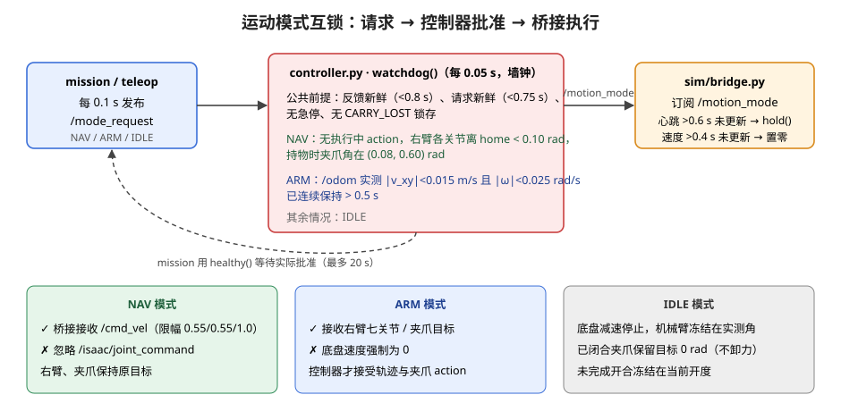

<p align="center"><b>图 12-8</b> 运动模式互锁：任务只能“请求”模式，控制器根据反馈新鲜度、静止状态、收臂与持物状态“批准”模式，桥接按批准的模式决定接收速度还是关节目标</p>

停稳判断使用平面实际速度模长小于 0.015 m/s、角速度绝对值小于 0.025 rad/s。这里检查的是 `/odom` 实测速度，不是 `/cmd_vel` 恰好为零。底盘可能在零指令后仍有惯性，不能立刻伸臂。

```python
# 摘自 code/code_chapter12/g2_mobile/common.py
def stopped(velocity):
    return (
        np.isfinite(velocity).all()
        and np.linalg.norm(velocity[:2]) < 0.015
        and abs(velocity[2]) < 0.025
    )
```

```python
# 摘自 code/code_chapter12/g2_mobile/controller.py（Controller.watchdog，有删减）
if not self.carry_fault and carry_valid and not self.estop and self.fresh() and time.monotonic() - self.request_at < 0.75:
    if (
        self.request == "NAV"
        and not self.busy
        and (not self.holding or
             self.cfg['carry_gripper_range'][0] < self.state[GRIPPER] <
             self.cfg['carry_gripper_range'][1])
        and max(abs(np.array([self.state[n] for n in ARM]) - self.cfg["home"])) < 0.10
    ):
        mode = "NAV"
    elif (
        self.request == "ARM"
        and self.stop_since
        and time.monotonic() - self.stop_since > 0.5
    ):
        mode = "ARM"
self.mode = mode
self.mode_pub.publish(String(data=mode))
```

**案例：停稳判定。** `/odom` 报告 $v=(0.010, 0.008, 0.02)$： $\sqrt{0.010^2+0.008^2}=0.0128<0.015$ 且 $0.02<0.025$，判为静止，开始计时；若 0.3 s 后出现一帧 $v_x=0.02$，`stop_since` 清零，必须重新连续静止 0.5 s 才批准 `ARM`。`tests/test_core.py::test_stationary_interlock` 验证了零速为静止、 $v_x=0.1$ 或 $\omega=0.1$ 或含 NaN 均不是静止。

任务约每 0.1 s 发布模式请求心跳，控制器约每 0.05 s 重新判断许可。控制器检查反馈和请求是否过期，桥接端还独立检查模式心跳与底盘速度消息是否过期。这样即使任务进程或控制器异常退出，执行端也不会永久沿用最后一条速度指令。

```python
# 摘自 code/code_chapter12/sim/bridge.py（有删减）
def joints(msg):
    if data["mode"] != "ARM" or time.monotonic() - data["mode_time"] > 0.6:
        return                                            # 非 ARM 或心跳过期：忽略关节目标
    # ... 名字与限位都对才写入 sim.arm_target / sim.grip_target
# 主循环：
expired = time.monotonic() - data["mode_time"] > 0.6
if expired and not stale:
    sim.hold()
vel = (data["vel"] if not expired and data["mode"] == "NAV"
       and time.monotonic() - data["vel_time"] < 0.4 else np.zeros(3))
sim.step(vel)
```

持物期间尤其要保留**闭合驱动目标**。例如，目标角是 0，实际关节因苹果阻挡停在约 0.24 rad；若进入 `IDLE` 时把目标也改成 0.24 rad，夹爪可能不再持续夹紧。当前实现明确区分目标与实测值，避免模式切换时无意卸掉夹持力。

```python
# 摘自 code/code_chapter12/sim/simulation.py（Simulation.hold）
def hold(self):
    self.arm_target = np.asarray(self.robot.get_joint_positions())[self.arm_ids].copy()
    # 闭合驱动是持物力的来源，IDLE/心跳超时只停止臂和底盘，不能
    # 把闭合目标 0 改成被物体挡住的实测开度（约 .25），否则失去夹紧力。
    # 未完成的开合仍冻结；显式 GripperCommand 才能松开已夹持的物体。
    if self.grip_target > .1:
        self.grip_target = float(self.robot.get_joint_positions()[self.grip_id])
```

成功闭合后，控制器锁存持物状态，只有成功显式张开才解除。持物开度正常范围由 `carry_gripper_range` 指定，默认严格位于 0.08～0.60 rad。异常会立即阻止运动，连续约 0.20 s 后锁存 `CARRY_LOST`；检查覆盖导航、精靠、停稳和机械臂操作，不会因为 `NAV → ARM` 切换而消失。只有已经接受的显式释放动作才暂时暂停开度检查。

**案例**：持物时夹爪实测 0.24 rad，在 $(0.08, 0.60)$ 内，正常。若运输途中苹果滑落，夹爪继续向 0 闭合到 0.02 rad，低于 0.08，`carry_valid` 立即为假，`NAV` 不再被批准（底盘停）；持续 0.20 s 后锁存 `CARRY_LOST`，日志打印“持物夹爪开度异常 q=0.020”。

开度监测只能发现一部分失持征兆，不能检测所有滑落。`CARRY_LOST` 也不能用 `/reset_estop` 清掉，应检查物体、重置仿真并重启系统和任务。软件互锁不是硬急停、安全 PLC 或真实整机安全认证，本教程不能直接作为实机部署规程。

> 💡 **要点**：互锁是“双保险”：控制器根据反馈批准模式，桥接再独立检查心跳和速度时效。任何一端失联，执行端都会退回安全的保持状态。

---

## 第六部分 阶段验收与验证：闭合、抬升、释放之后都要重新观察

### 6.1 为什么“动作成功”不等于“任务成功”

**直观理解**：action 成功只说明“命令被执行完了”，物体反馈才说明“世界真的变成了我们想要的样子”。

本章的“闭环”不只是低层关节反馈，还包括任务层的阶段验收。源码中的 `pick` 和 `place` 两段流程把规划、执行与视觉复核连在一起。

最后，**动作执行成功不自动等于物理任务成功**。夹爪动作完成后，苹果仍可能没有被拿起；张开夹爪后，苹果也可能滚出接收板。因此，抬升、持物与放置反馈是任务流程的一部分，不能仅用 action 的成功状态替代。

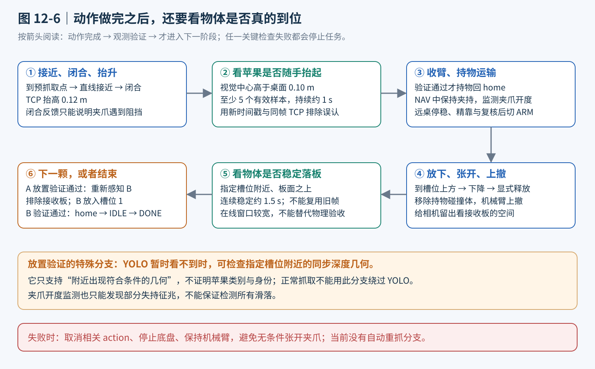

<p align="center"><b>图 12-9</b> 抓取后连续观察抬升、运输时监测夹持、释放后观察稳定落板，验证通过才处理下一颗苹果或结束任务</p>

**读图说明——命令成功只是中间结果，物体反馈才决定是否继续。** 上排看“抓起 → 验证 → 运走”，下排从右往左看“释放 → 验证 → 下一颗或结束”。特别区分绿色验证框与蓝色动作框：闭合并不证明抓到了苹果，释放也不证明苹果留在槽位；放置时的深度几何复核同样不能证明物体身份。

| 验证环节 | 观测来源 | 判据 | 持续时间 | 能证明什么 / 不能证明什么 |
|---|---|---|---|---|
| 夹爪闭合 | `/isaac/joint_states` | 到位或稳定受阻 | 停滞 0.8 s | 关节遇到阻挡；不能证明夹住的是苹果 |
| 抬升 | `/target_center`（YOLO + TCP 邻域） | $z>$ 桌面 $+0.10$ m | 1 s、≥5 样本 | 有苹果被抬离桌面；不能证明后续不会滑落 |
| 持物运输 | 夹爪实测角 | $0.08<q<0.60$ rad | 持续监测，异常 0.20 s 锁存 | 夹爪未闭空/张开；不能检测所有滑落 |
| 放置 | `/target_center`（YOLO 或槽位深度几何） | 距槽位每轴 $<0.10$ m，板面上方 $<0.075$ m | 1.5 s、≥5 样本 | 槽位附近有稳定物体；几何复核不能证明物体身份 |

### 6.2 通用验证函数 verify()：连续、新鲜、稳定

**原理**：验证不是“看一眼合格就放行”，而是要求一段时间内**连续**的、**新鲜**的、**位置稳定**的观测都满足判据。

```cpp
// 摘自 code/code_chapter12/src/mission.cpp（Mission::verify，有删减）
void verify(
  const std::function<bool(const geometry_msgs::msg::Point &)> & test, double duration,
  const std::string & error)
{
  const auto since = node_->now();
  auto first = since;
  auto previous_stamp = since;
  const auto deadline = std::chrono::steady_clock::now() + 20s;      // 墙钟 20 s 总时限
  geometry_msgs::msg::Point previous;
  bool tracking = false;
  int samples = 0;
  while (rclcpp::ok() && std::chrono::steady_clock::now() < deadline && healthy("ARM")) {
    geometry_msgs::msg::PointStamped obs;
    { std::lock_guard<std::mutex> lock(mutex_); obs = center_; }
    auto stamp = rclcpp::Time(obs.header.stamp);
    if (stamp > previous_stamp && stamp > since && (node_->now() - stamp).seconds() < .5) {
      const double delta = /* 与上一个样本的三维距离 */;
      if (!test(obs.point) ||
        (tracking && (delta > .015 || (stamp - previous_stamp).seconds() > .5)))
      {
        tracking = false;  samples = 0;                             // 不合格或跳变：重新计数
      } else {
        if (!tracking) { first = stamp; tracking = true; }
        if (++samples >= 5 && (stamp - first).seconds() >= duration) { return; }
      }
      previous = obs.point;
      previous_stamp = stamp;
    }
    std::this_thread::sleep_for(50ms);
  }
  throw std::runtime_error(error);
}
```

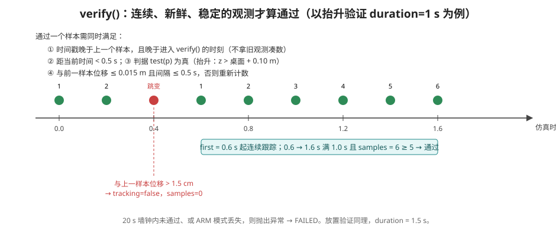

<p align="center"><b>图 12-10</b> verify() 的计数规则：每个样本必须新鲜且满足判据，与上一样本位移不超过 1.5 cm；一旦跳变就从头计数，满足“至少 5 个样本且跨度达到 duration”才通过</p>

**案例：按图 12-10 走一遍。** 设 RGB-D 约每 0.2 s 仿真时间产出一个 `/target_center`，抬升验证 `duration = 1.0` s：

1. $t=0.0$、 $0.2$ s 两个样本合格，`samples = 2`；
2. $t=0.4$ s 的样本相对上一样本跳了 2 cm（> 1.5 cm），`tracking = false`、`samples = 0`；
3. 从 $t=0.6$ s 起重新计数，`first = 0.6`；到 $t=1.4$ s 时 `samples = 5`，但跨度只有 0.8 s < 1.0 s，继续；
4. $t=1.6$ s，`samples = 6` ≥ 5 且跨度 1.0 s，通过。

可见即使只有一次跳变，也要多等约 0.6 s；若 20 s（墙钟）内始终凑不齐，就抛出异常进入 `FAILED`。

### 6.3 抬升验证：苹果真的被拿起了吗

**抓取阶段：** 获取新鲜候选，规划到预抓取点，沿笛卡尔路径接近，闭合夹爪，加入持物碰撞体，再把 TCP 抬高 0.12 m。抬升后不会立刻开始导航，而是等待视觉中心持续高于桌面 0.10 m。验证时要求新的时间戳、足够的新鲜度、至少 5 个有效样本，并持续约 1 s；位置突变超过 1.5 cm 或帧间间隔超过 0.5 s 会打断连续验证。

```cpp
// 摘自 code/code_chapter12/src/mission.cpp（pick lambda，有删减）
state(label+"_CLOSE"); gripper(0.);
moveit_msgs::msg::AttachedCollisionObject a; a.link_name="gripper_r_center_link";
a.touch_links={"gripper_r_center_link"}; a.object=target;
if (!scene.applyAttachedCollisionObject(a)) throw std::runtime_error("附着碰撞体失败");
state(label+"_LIFT"); auto lift=grasp; lift.position.z+=.12; cartesian(arm,lift);
verify([table_top](const auto & p){return p.z>table_top+.10;},1.,
       label+" 无法确认苹果抬升：缺少连续有效 RGB-D 观测（也需检查遮挡/漏检）");
// 持物先回 home，再恢复碰撞检查，之后才允许移动底盘。
state(label + "_HOME"); joints(arm,cfg_["home"].as<std::vector<double>>());
end_grasp_debug(scene);
```

**案例：判据的数值含义。** 源桌桌面顶 0.888 m，判据为观测中心 $z>0.988$ m。抓取时夹持点 z ≈ 0.918 m（4.4 节案例），抬升 0.12 m 后 TCP 约 1.038 m；苹果中心若跟随夹爪，大约在 1.03 m 附近，满足判据且有约 4 cm 余量。若苹果没被夹住而留在桌上，其中心约在 $0.888+0.025=0.913$ m，远低于 0.988 m，验证失败。

抬升中的苹果朝向与桌面上不同，还可能被夹爪遮挡。感知因此在 `_LIFT` 阶段对图像尝试 0°、90°、180°、270° 四种旋转检测，并将检测框还原到原图，再使用原始同步深度。代码还围绕同时间 TCP 的图像投影生成局部搜索窗口，以帮助找回夹持中的苹果。

```python
# 摘自 code/code_chapter12/g2_mobile/perception.py（Perception.detect_held_apples，有删减）
def detect_held_apples(self, image, goal, camera_tf):
    """以同帧 TCP 投影选取局部视图，仍须 YOLO 识别及原图真实深度验证。"""
    tr, q = camera_tf.translation, camera_tf.rotation
    camera = rotation([q.x, q.y, q.z, q.w]).T @ (np.asarray(goal) - [tr.x, tr.y, tr.z])  # TCP 转到相机系
    if not np.isfinite(camera).all() or camera[2] <= .12:
        return []
    fx, fy, cx, cy = self.info.k[0], self.info.k[4], self.info.k[2], self.info.k[5]
    u, v = fx * camera[0] / camera[2] + cx, fy * camera[1] / camera[2] + cy              # 针孔投影
    # 12 cm 搜索邻域，同时保留至少 60% 图宽的上下文；...
    h, w = image.shape[:2]
    rx = max(w * .30, fx * .12 / (camera[2] - .12))
    ry = max(w * .30, fy * .12 / (camera[2] - .12))
    # ... 裁剪出局部窗口，四方向旋转检测，再把框坐标加回偏移
```

**代码解读**：这里用的是反投影的逆运算——投影 $u=f_x X_c/Z_c+c_x$、 $v=f_y Y_c/Z_c+c_y$。以 320 像素宽的图像为例，`w * .30` = 96 px，局部窗口半宽至少 96 px，即窗口宽至少 192 px（60% 图宽），与注释一致。

TCP 只用于限定搜索区域，不充当苹果位置。抬升点云还要落在 TCP 周围约 8 cm 内，防止把仍在桌上的另一颗苹果当成抬升成功；没有有效检测时，不会用夹爪几何补出一个苹果。通过验证后，机械臂才持物回 `home`，恢复抓取调试窗口中的碰撞设置，再允许底盘运输。

### 6.4 放置验证：苹果留在槽位上了吗

**放置阶段：** 读取槽位 XY，移动到接收板上方，保持所选抓取方向，再沿笛卡尔路径下降。当前放置 TCP 高度设为板面上方约 4.5 cm，张开夹爪后移除持物碰撞体，随后上撤，给相机留出观察空间。

```cpp
// 摘自 code/code_chapter12/src/mission.cpp（place lambda，有删减）
mode("ARM");                     // 动作前再确认控制器持物互锁；掉物不能借 NAV->ARM 切换绕过。
auto tray=cfg_["tray"].as<std::vector<double>>(); auto above=lift;   // 保持抓取时的朝向
above.position.x=slot[0]; above.position.y=slot[1]; above.position.z=tray[2]+.22;
state(label+"_TRANSFER"); pose(arm,above); auto p=above; p.position.z=tray[2]+tray[5]/2+.045;
state(label+"_PLACE"); cartesian(arm,p); gripper(.785);
// ... 移除附着碰撞体与 target
state(label+"_RETREAT"); cartesian(arm,above);
state(label+"_VERIFY_PLACE"); verify([slot, tray](const auto & x){
  const double board_z = tray[2] + tray[5] / 2.0;
  return std::abs(x.x-slot[0])<.10 && std::abs(x.y-slot[1])<.10 &&
    x.z > board_z && x.z < board_z + .075;
},1.5,label+" 未稳定留在板子上");
allow_touch(scene,false);
```

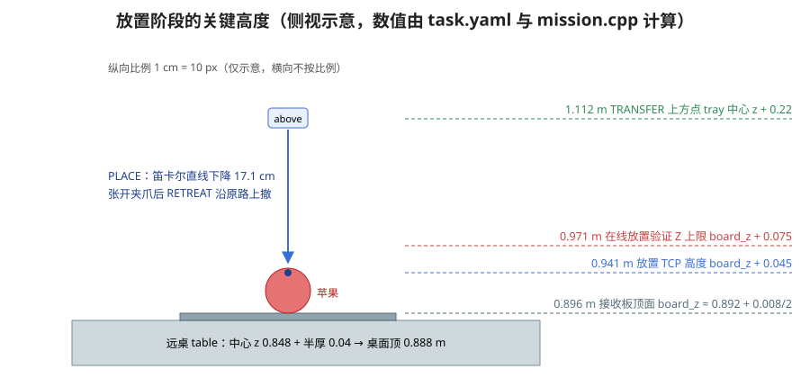

<p align="center"><b>图 12-11</b> 放置阶段的关键高度：TRANSFER 上方点 1.112 m，放置 TCP 0.941 m，接收板顶面 0.896 m，在线验证 Z 上限 0.971 m（由 task.yaml 中 tray 参数计算）</p>

**案例：手算放置高度。** `tray = [3.00, 2.18, 0.892, 0.22, 0.20, 0.008]`：

- 接收板顶面 `board_z` $=0.892+0.008/2=0.896$ m；
- TRANSFER 上方点 $z=0.892+0.22=1.112$ m；
- 放置 TCP $z=0.896+0.045=0.941$ m，下降距离 $1.112-0.941=0.171$ m；按 0.008 m 步长，笛卡尔路径约 $\lceil0.171/0.008\rceil=22$ 段；
- 在线验证要求观测中心 $0.896<z<0.971$ m。一颗直径约 5 cm 的苹果平放在板上，中心约 0.921 m，落在区间内；若苹果仍卡在夹爪里、随撤离回到 1.1 m 附近，则 z 超上限，验证失败。

在线放置判断要求观测中心接近指定槽位、位于板面之上且高度不过高，并连续稳定约 1.5 s，同样不能拿旧观测凑时间。源码的在线 XY 窗口为每轴 10 cm，Z 上限为板面上方 7.5 cm。这只是本教学场景的观测判据，两个槽位本身相距 10 cm，因此还需要更严格、区分物体身份的独立物理验收。

> ⚠️ **注意**：槽位 0 在 $(3.00,2.13)$、槽位 1 在 $(3.00,2.23)$。第二次放置的验证窗口是 $|y-2.23|<0.10$，即 $y\in(2.13,2.33)$；第一颗苹果在 $y\approx2.13$，恰在窗口边缘。感知会选“离槽位最近”的目标，一般不会误认，但这说明在线判据**不能区分两颗苹果的身份**。

这里存在一个与正常抓取不同的分支：在 `_RETREAT`、`_VERIFY_PLACE` 阶段，若 YOLO 暂时看不到已放下的苹果，感知可以从当前同步深度中，提取指定槽位附近的几何点进行复核。它没有读取仿真真值，也没有使用红色阈值，但**这只能说明槽位附近出现了符合条件的几何，不能证明检测器再次确认了苹果类别与身份**。公共处理还会执行点数和跨度检查。

```python
# 摘自 code/code_chapter12/g2_mobile/perception.py（Perception._yolo_points，有删减）
if not choices and verify_place:
    # 放置复核不强制 YOLO 再次识别：板上苹果可能被夹爪/板边遮挡。
    # 仍只使用当前同步 RGB-D 深度，在指定槽位的真实几何 ROI 内复核。
    # ... 全图有效深度反投影到 odom 得到 cloud
    board_z = tray[2] + tray[5] / 2.0
    near = cloud[(np.linalg.norm(cloud[:,:2]-goal[:2],axis=1)<.075) &
                 (cloud[:,2]>board_z+.010) & (cloud[:,2]<board_z+.14)]
    if len(near) >= 20:
        med = np.median(near,axis=0)
        near = near[np.linalg.norm(near-med,axis=1)<.055]
        if len(near) >= 20:
            return (near, 1.0), 'RGB-D 槽位几何复核（YOLO 遮挡）'
```

因此不能笼统写成“所有阶段都必须 YOLO 再识别成功”，也不能反过来把这个分支当成正常抓取的无检测兜底。在杂物更多或物体外观更复杂的场景中，还需要加强实例追踪和放置验证。

第一颗苹果验证放置后，第二次抓取重新感知，并排除板上区域。两次抓放既复用相同技能，又依据阶段改变目标选择；这就是本例任务状态机与感知模块的协作方式。

> 💡 **要点**：几何复核分支返回的点数门槛是 20（不同于正常检测的 30），之后还要经过 `process()` 中“至少 30 点”的公共检查——两层门槛都通过才会发布 `/target_center`。

---

## 第七部分 代码结构与实现解析

### 7.1 文件组织

本章目录与构建关系如下，供对照文件位置：

```text
code/
├── chapter12/
│   ├── assets/                    本章 SVG 图解（图 12-1～12-6）
│   └── 第十二章 移动操作综合实践：全场景自主导航操作.md
└── code_chapter12/
    ├── run.sh                      统一启动入口
    ├── setup_vision.sh             系统 Python、检测库、权重及推理检查
    ├── requirements-vision.txt     固定 Ultralytics 推理库版本
    ├── src/                        C++ 任务、停靠和场景服务封装
    ├── g2_mobile/                  ROS 控制、感知、数学、地图、遥控
    ├── sim/                        Isaac 世界、ROS 桥、底盘运动学
    ├── launch/                     系统与单次任务启动
    ├── config/                     任务、Nav2、SLAM、MoveIt、DDS 参数
    ├── urdf/、srdf/、rviz/          规划模型、语义配置与显示
    ├── models/、assets/            本地检测权重与仿真资产（不再携带 vendor）
    ├── maps/                       参考地图及可选保存的 SLAM 地图
    └── build/、install/、log/       本机构建、安装和运行产物
```

（上面的目录树沿用原文。原文中“图 12-1～12-6”指原章节的六张 SVG，在本教程中分别对应图 12-2、12-4、12-5、12-6、12-7、12-9。）

逐文件职责如下：

| 文件 | 职责 |
|---|---|
| `src/mission.cpp` | 任务状态机：就绪等待、导航到站、抓取、放置、失败处理 |
| `src/docking.hpp` | 无 ROS 依赖的近距离停靠几何：容差判断与短路径生成 |
| `src/scene_client.hpp` | PlanningScene 读写服务的有界等待封装 |
| `g2_mobile/common.py` | 配置加载、四元数、反投影、几何抓取候选、轨迹校验与插值、静止判断（两个 Python 运行时共享） |
| `g2_mobile/controller.py` | `FollowJointTrajectory` / `GripperCommand` action 服务端，运动模式互锁，急停 |
| `g2_mobile/perception.py` | YOLO + RGB-D 感知，发布 `/grasp_candidates` 与 `/target_center` |
| `g2_mobile/mapping.py` | 生成参考地图 `room.pgm/yaml`，提供模拟激光 `raycast()` |
| `g2_mobile/teleop.py` | 建图时的低速键盘遥控 |
| `sim/simulation.py` | 单一 Isaac World：房间、桌子、物体、机器人、相机与物理步进 |
| `sim/bridge.py` | Isaac 与 ROS 的消息桥：发布传感器/TF/时钟，接收速度与关节目标 |
| `sim/objects.py` | 第九章教学物体的本地几何副本（仅用于建场景） |
| `sim/base/` | 第四章舵轮底盘运动学、参数与底盘控制器 |
| `launch/system.launch.py` | 启动定位或 SLAM、Nav2、MoveIt2、RSP、控制器、感知、RViz |
| `launch/mission.launch.py` | 启动一次 `mission` 任务 |
| `config/task.yaml` | 唯一场景/任务配置 |
| `config/nav2_params.yaml`、`navigate_to_pose.xml` | Nav2 参数与本章行为树 |
| `config/kinematics.yaml`、`ompl_planning.yaml`、`joint_limits.yaml`、`moveit_controllers.yaml` | MoveIt 配置 |
| `config/slam.yaml`、`fastdds.xml` | SLAM Toolbox 参数与 DDS 配置 |
| `urdf/g2_right_arm.urdf.xacro`、`srdf/g2_right_arm.srdf` | 右臂规划模型与语义（浮动虚拟关节、`home`） |
| `tests/test_core.py` | 配置、地图、四元数、轨迹安全、静止互锁、反投影的单元测试 |
| `tests/check_runtime.py` | 只读的话题/action 就绪检查（不代表任务成功） |

### 7.2 模块调用关系

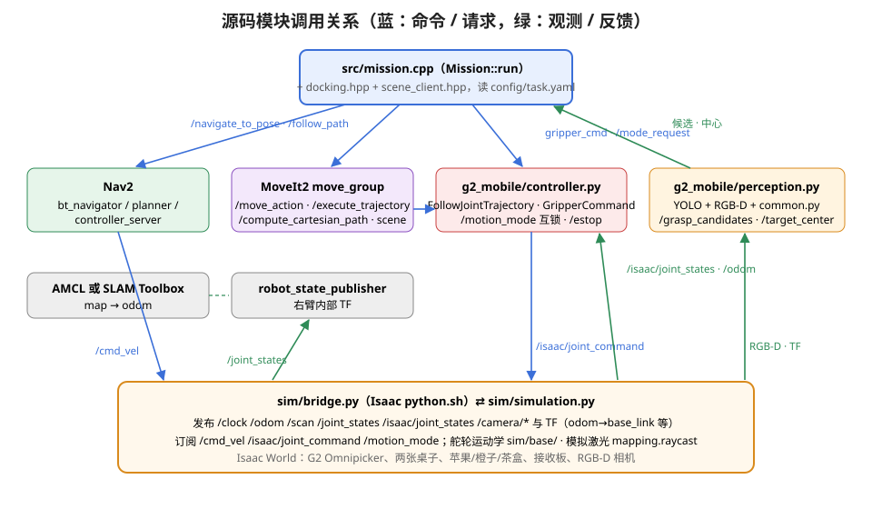

<p align="center"><b>图 12-12</b> 源码模块调用关系：mission.cpp 只调用 Nav2、MoveIt2、控制器的标准接口；控制器与 Nav2 再分别把关节目标和速度交给桥接；桥接把 Isaac 的物理状态作为传感器、关节反馈和 TF 发回</p>

`mission` 内部调用关系可以用下面的流程图对照日志；这是调用说明，不是另一份需要执行的脚本：

```text
./run.sh mission
  └─ ros2 launch g2_chapter12 mission.launch.py
     └─ mission 可执行程序
        ├─ Mission::run()：就绪、收臂、建立 PlanningScene
        ├─ navigate_to(source_dock)
        │  ├─ /navigate_to_pose
        │  └─ 停稳 → 必要时 /follow_path(Dock) → 复核
        ├─ pick("SOURCE")
        │  ├─ fresh_poses() ← /grasp_candidates
        │  ├─ pose() → KDL → /move_action → /execute_trajectory
        │  ├─ cartesian() → /compute_cartesian_path → /execute_trajectory
        │  ├─ gripper() → /gripper_controller/gripper_cmd
        │  └─ LIFT → verify() ← /target_center → HOME
        ├─ navigate_to(dock)：持物导航与精靠
        ├─ place(slot0)：TRANSFER → PLACE → RETREAT → VERIFY_PLACE
        ├─ pick("DESTINATION") → place(slot1)
        └─ STOW → IDLE → DONE

每次 /execute_trajectory 的实际下游：
MoveIt → /right_arm_controller/follow_joint_trajectory
       → controller.py → /isaac/joint_command
       → sim/bridge.py → Isaac 物理关节
       ← /isaac/joint_states 实际反馈
```

### 7.3 关键流程逐段解读

下面按一次任务的执行顺序，把前六部分讲过的代码串起来。

**① 启动入口 `run.sh`。** 所有命令都从 `run.sh` 进入：设置 `ROS_DOMAIN_ID`（默认 12）、Fast DDS 配置和日志目录；`sim` 走 Isaac Python，其余走系统 Python + ROS。运行 `system`/`mission`/`teleop` 前还会检查配置是否已重新构建：

```bash
# 摘自 code/code_chapter12/run.sh（有删减）
export ROS_DOMAIN_ID="${ROS_DOMAIN_ID:-12}"
export RMW_IMPLEMENTATION=rmw_fastrtps_cpp
export FASTRTPS_DEFAULT_PROFILES_FILE="$ROOT/config/fastdds.xml"
export ROS_LOG_DIR="$ROOT/log/runtime"
# ...
    if [[ "$CMD" == system || "$CMD" == mission || "$CMD" == teleop ]]; then
      for config in task.yaml nav2_params.yaml navigate_to_pose.xml; do
        cmp -s "$ROOT/config/$config" "$ROOT/install/g2_chapter12/share/g2_chapter12/config/$config" || {
          echo "$config 已修改：请重新 ./run.sh build，避免运行旧场景/导航参数"; exit 1;
        }
      done
    fi
# ...
      mission) exec flock -n "$ROOT/log/command.lock" ros2 launch g2_chapter12 mission.launch.py "$@" ;;
      teleop) exec flock -n "$ROOT/log/command.lock" /usr/bin/python3 -m g2_mobile.teleop ;;
```

可以看到 `mission` 与 `teleop` 共享同一把 `flock` 锁，这就是第八部分提到的“本地命令锁”。

**② 仿真主循环 `sim/bridge.py`。** 每个物理步：处理 ROS 回调 → 检查模式心跳 → 按模式决定是否给底盘速度 → `sim.step()` → 发布 `/clock`、TF、`/odom`、关节状态；每 3 步发布一次 `/scan`，每 6 步发布一次 RGB-D、内参与点云（注释写明“RGB-D 5 Hz”）。

**③ 感知节点 `perception.py`。** 定时器每 0.08 s 调用 `process()`：找共同时间戳（2.5 节）→ 检查点云格式与新鲜度 → 选桌子（4.3 节）→ `_yolo_points()` 检测与筛选（4.1～4.3 节）→ 点数与跨度检查 → 发布中心与候选（4.4 节）。

**④ 任务节点 `mission.cpp`。** `main()` 用多线程执行器在后台 spin，主线程执行 `Mission::run()`；任何异常被捕获后调用 `fail()`，进程以返回码 1 退出：

```cpp
// 摘自 code/code_chapter12/src/mission.cpp（main，有删减）
rclcpp::executors::MultiThreadedExecutor executor;
executor.add_node(node);
std::thread spinner([&] { executor.spin(); });
int code = 0;
try {
  Mission task(node);
  try { task.run(); }
  catch (const std::exception & e) { task.fail(e.what()); code = 1; }
} catch (const std::exception & e) {
  RCLCPP_ERROR(node->get_logger(), "启动失败：%s", e.what());
  code = 1;
}
```

`run()` 内依次为：`WAIT_READY`（1.2 节）→ `STOW` + PlanningScene（5.3 节）→ `navigate_to(source_dock)`（2.3、3.3、3.4 节）→ `pick("SOURCE")`（5.1、5.2、6.3 节）→ `CARRY` + `navigate()` → `place(slot0)`（6.4 节）→ `pick("DESTINATION")` → `place(slot1)` → `STOW` → `DONE`。

**⑤ 控制器 `controller.py`。** 看门狗每 0.05 s（墙钟）批准模式（5.6 节）；轨迹 action 先校验再按仿真时间插值执行并检查跟踪误差（5.4 节）；夹爪 action 平滑开合并锁存持物状态（5.5 节）。

**⑥ 单元测试 `tests/test_core.py`。** 用普通 Python 即可运行（`./run.sh test`），覆盖地图大小 190×190、模拟激光 360 束且在 0.12～8 m、四元数、轨迹顺序/越界/时间/NaN、首段插值、静止判断和反投影形状。它不需要 Isaac，可作为修改 `common.py` 或 `mapping.py` 后的第一道检查。

---

## 第八部分 代码运行

<div style="display: flex; justify-content: center; gap: 16px;">
  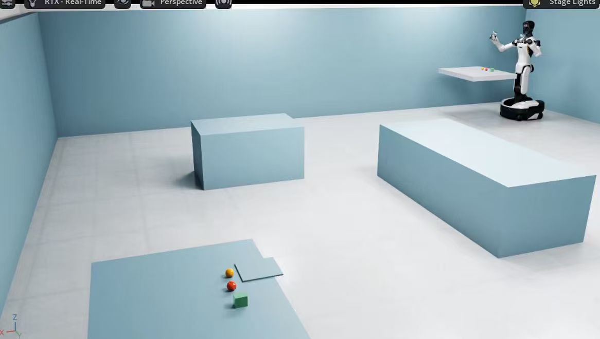
  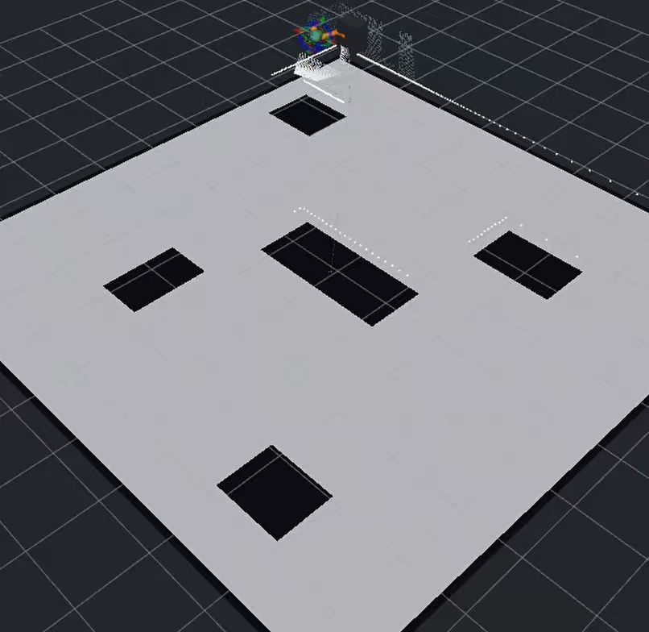
</div>

<p align="center"><b>图 12-13</b> 本章仿真场景（原文配图）</p>

以下集中给出操作命令和必要的接口示例。命令默认从本工作区运行；复制到其他机器时，首先修改项目与 Isaac 安装路径。除安装软件外，不需要另建 ROS 工作区，也不需要启动前面章节的节点。

### 8.1 环境部署

> 💡 **路径约定**：下文命令中 `/path/to/project-root` 表示本仓库在你电脑上的根目录，`/path/to/isaac-sim` 表示 Isaac Sim 的安装目录，均为占位符，请替换为自己机器上的实际路径。

#### 8.1.1 准备基础环境与本章文件

本章现有代码和验收记录以 **Ubuntu 22.04、ROS 2 Humble、Isaac Sim 5.1** 为基线。应先完成第一章的 Isaac 安装，并准备能够渲染 RGB-D 的 GPU、匹配的驱动和本地 Isaac 资产依赖。`--headless` 只是不打开 Isaac 窗口，不意味着不需要 GPU，也不意味着关闭相机渲染。

如果系统已经完成第十、十一章的 ROS 环境准备，通常只需补依赖。新机器必须先按 ROS 2 Humble 的 Ubuntu deb 安装流程配置 apt 软件源，再执行本节命令；不要在未配置 ROS 软件源时反复安装不存在的包，也不要直接用 Jazzy 的包替换 Humble。

进入本章代码目录，并设置 Isaac 安装路径：

```bash
cd /path/to/project-root/code/code_chapter12
export ISAAC_SIM_ROOT=/path/to/isaac-sim
```

`assets` 中还有被 USD 引用的子资产和纹理，打包时应保留完整目录。课程代码本地化不等于把 ROS、Isaac、GPU 驱动和 Isaac 内置材质库也复制进工程。资产与第三方权重来源见本章代码目录的 `THIRD_PARTY.md`。

（本章目录树见 7.1 节。）

#### 8.1.2 安装 ROS 依赖

先安装系统工具和 ROS 能力包。下面假定 Humble apt 软件源已经可用：

```bash
sudo apt update
sudo apt install -y \
  build-essential cmake libyaml-cpp-dev \
  python3-pip python3-colcon-common-extensions python3-rosdep \
  python3-numpy python3-yaml \
  ros-humble-desktop \
  ros-humble-navigation2 ros-humble-nav2-bringup \
  ros-humble-moveit ros-humble-slam-toolbox \
  ros-humble-xacro ros-humble-robot-state-publisher

source /opt/ros/humble/setup.bash

# 仅在此机器从未初始化 rosdep 时执行；初始化过就跳过。
# sudo rosdep init
rosdep update

cd /path/to/project-root/code/code_chapter12
rosdep install --from-paths . --ignore-src --rosdistro humble -y
```

`package.xml` 和 `CMakeLists.txt` 声明 ROS/C++ 依赖；rosdep 不会自动准备全部深度学习 Python 依赖。

#### 8.1.3 视觉运行依赖（当前机器）：保留已有推理依赖，只安装固定版本的 Ultralytics

建议使用未激活 Conda 的终端。如果提示符前有 `(base)` 或其他 Conda 环境名，先执行 `conda deactivate`；有嵌套环境时继续退出，直到不再处于 Conda 环境。

```bash
cd /path/to/project-root/code/code_chapter12

# 本机已有 PyTorch、OpenCV 等推理依赖；迁移时不升级整套依赖。
/usr/bin/python3 -m pip install --user --no-deps -r requirements-vision.txt

# 检查实际导入位置、模型加载，并执行一次 CPU 推理测试。
./setup_vision.sh
```

`requirements-vision.txt` 当前固定 `ultralytics==8.3.203`。已安装该版本后，日常启动只需检查，不必重复安装。不要改用不指定解释器的 `pip install ultralytics`，也不要直接升级到未验证的最新版本。

`setup_vision.sh` **只检查，不自动安装或升级依赖**。它会验证库版本、加载本地权重，并对测试图像执行一次 CPU 推理；通过仅表示这条推理路径可运行，不代表双桌物理任务已经完成。（检查成功时的输出见 8.3.1 节。）

#### 8.1.4 新机器：不能把 `--no-deps` 当作完整安装

上面的 `--no-deps` 仅适用于当前机器已有可用推理依赖的保守迁移，它会跳过 Ultralytics 声明的依赖安装。本机迁移时 NumPy 为 1.21.5，低于该包声明的 1.23.0，且缺少 polars、ultralytics-thop 的安装元数据；当前预测路径通过检查，不表示训练、导出和模型统计等功能也可用。

新机器应先按所选版本的依赖声明准备匹配的 PyTorch、torchvision、NumPy、OpenCV 等，再安装本章固定版本并执行 `./setup_vision.sh`。`requirements-vision.txt` 只固定推理库版本，**不是全环境锁定文件**；不能仅凭这一行依赖保证在任意新环境复现。不要为了补齐依赖而在已跑通的 ROS 环境里盲目升级 NumPy、OpenCV 或 PyTorch，也不要使用 `sudo pip`。

#### 8.1.5 为什么不使用 Conda Python

本章使用 apt 安装的 ROS 2 Humble，ROS Python 节点固定由本机的 `/usr/bin/python3`（Python 3.10）运行。`rclpy`、消息类型支持等二进制模块需要匹配的 Python ABI 和动态库。Conda 可能带入另一套 Python、NumPy、OpenCV 或 libstdc++，仅把 `/opt/ros` 加入 `PYTHONPATH` 并不能消除差异，可能出现 `rclpy`、`_rclpy_pybind11` 导入失败或动态库冲突。

这不是说 Conda 绝对不能使用，而是**本工程没有为 Conda 重建和验证整套 ROS 依赖**。`run.sh` 在 ROS 分支固定系统 Python 并加载 ROS 和本章工作区环境；只把 Ultralytics 安装到 Conda 中，不能保证感知节点能够导入它。

| 进程 | 使用的运行环境 | 依赖准备方式 |
|---|---|---|
| ROS Python 控制、感知节点 | `/usr/bin/python3` | ROS apt 包与系统 Python 的 pip 包 |
| Isaac 仿真与桥接 | `$ISAAC_SIM_ROOT/python.sh` | Isaac 自带运行环境 |
| C++ 任务、Nav2、MoveIt2 等 | ROS 2 编译后的可执行程序 | apt / colcon，而非切换 Python 解释器 |

Isaac 与 ROS 通过 DDS 交换消息，不需要互相导入对方的 Python 二进制模块。不要把上述系统 Python 推理包安装进 Isaac，也不要手工拼接两边的 `PYTHONPATH`。当前感知检测使用 CPU，与 Isaac 使用 GPU 渲染 RGB-D 并不矛盾。

#### 8.1.6 任务配置与构建

默认布局与机械臂可达范围配套。第一遍建议直接使用默认配置，关键参数如下。

| 配置项 | 默认值或结构 | 修改影响 |
|---|---|---|
| `start` | `[-3.6, -3.3, 0.0]` | 仿真底盘起点；修改后同步核对 AMCL 初始位姿 |
| `source_dock` | `[-3.66, -3.20, 0.0]` | 源桌精确停靠 XY/yaw |
| `dock` | `[2.52, 2.6, 0.0]` | 远桌精确停靠 XY/yaw |
| `source_table`、`table`、`tray` | `[中心x, 中心y, 中心z, 长, 宽, 厚]` | 同时影响仿真、地图、感知 ROI 与规划碰撞场景 |
| `items` | `name` 与桌面中心相对 XY 偏移 | 创建两桌初始物体，不是在线抓取目标列表 |
| `place_slots` | `[[3.00, 2.13], [3.00, 2.23]]` | 固定的两颗苹果落点 XY，位于 `odom` |
| `home`、`left_home` | 各七个关节角 | 右臂收臂/互锁、左臂预设姿态 |
| `vision.confidence` | `0.40` | YOLO 候选阈值，不建议先靠降低阈值解决遮挡问题 |
| `nav_timeout`、`motion_timeout` | `240.0`、`90.0` 秒 | 一次导航总等待、轨迹执行等待，不是整场任务时长 |
| `carry_gripper_range` | `[0.08, 0.60]` rad | 辅助失持检测范围 |
| `simulation_grasp_ignore_collisions` | `true` | 仅限前文所述仿真抓取调试窗口 |

所有位置以米、角度以弧度表示。桌面顶面高度应由中心 Z 加半厚度得到，不能把中心 Z 直接当成桌面高度。修改桌子、停靠点或物体尺度时，应同时核对底盘间隙、相机可见性、候选宽度、IK 和碰撞场景，不要只改一个坐标就认为系统已经适配新任务。

视觉环境检查通过后，构建本章工程：

```bash
cd /path/to/project-root/code/code_chapter12
./run.sh build
```

`build` 先运行地图生成模块，再通过 colcon 编译 C++ `mission`，安装 Python 包和 ROS 可执行节点，并把配置、URDF、SRDF、地图、模型等复制到本章 `install`。Ultralytics 从系统 Python 的 pip 安装位置导入，不再向 `install` 复制 vendor。本工程没有使用 `--symlink-install`，ROS 节点读取的可能是安装副本，不是你刚改过的源文件。

修改配置或 ROS 节点后，应重新构建并重启相关进程，让安装目录与运行进程使用更新后的内容。修改仿真场景时还需重启仿真。

复制工程到另一台机器后，应在新机器上重新构建，不直接搬运旧 `build/install`。构建成功不等于仿真中的完整任务成功，实际任务还需按下一节启动并观察物理结果。

### 8.2 代码执行

#### 8.2.1 三个终端启动默认任务

完整顺序是：**视觉环境检查 → build → 终端 A 仿真 → 终端 B 系统 → 终端 C mission**。环境与代码未改变时，不必每次重新安装依赖或构建。

所有终端进入同一个代码目录，使用同一个 `ROS_DOMAIN_ID`。`run.sh` 默认域 ID 为 12，统一使用 Fast DDS 及本地 UDPv4 配置。在同一域内只保留一套本章仿真与系统，避免多个 `/clock`、同名 action 或重复 TF 发布者。

**终端 A：启动仿真。** 这条命令通过 Isaac 自带的 `python.sh` 运行 `sim.bridge`，创建 Isaac 世界并开始发布 `/clock`、传感器和 TF。不要在该终端主动混入系统 ROS 的 Python 路径；脚本会为 Isaac 设置专门环境。

```bash
cd /path/to/project-root/code/code_chapter12
export ROS_DOMAIN_ID=12
export ISAAC_SIM_ROOT=/path/to/isaac-sim
./run.sh sim

# 无界面服务器改用下面这一条，两条不要同时启动。
# ./run.sh sim --headless
```

等待终端 A 的场景加载完成、仿真开始运行，保持该终端开启，再启动终端 B。

**终端 B：启动 ROS 能力系统。** 这条命令执行 `ros2 launch g2_chapter12 system.launch.py`，默认加载参考地图、AMCL、Nav2、MoveIt2、控制器、感知和 RViz。

```bash
cd /path/to/project-root/code/code_chapter12
export ROS_DOMAIN_ID=12
./run.sh system

# 没有 DISPLAY 的服务器改用：
# ./run.sh system rviz:=false
```

等待仿真与节点完成初始化。RViz 使用 `map` 作为固定坐标系，可以查看地图、TF、激光、机器人、RGB-D、抓取候选、全局路径和 MoveIt 规划场景。RViz 里的机器人是用于规划的简化模型，不应期待它与 Isaac USD 外观完全一致。

**终端 C：启动一次搬运任务。** 这条命令在命令锁保护下执行 `mission.launch.py`，开始状态机编排。

确认终端 A 的仿真正在运行、终端 B 的节点已经完成初始化，且没有持续报错，再启动任务：

```bash
cd /path/to/project-root/code/code_chapter12
export ROS_DOMAIN_ID=12
./run.sh mission
```

任务会先进入就绪等待，再按状态机执行。若一直等待或进入 `FAILED`，先查看终端 A/B/C 的日志，核对节点启动情况、TF 和反馈，以及修改后的配置是否已重新构建；不要反复启动多个任务进程。

默认 `system` 已包含 YOLO 感知、Nav2、MoveIt2 和 RViz2，不需要分别启动，也不需要启动其他章节。它使用参考地图与 AMCL，**无需先遥控建图**；启动系统本身不会自动执行任务，只有终端 C 的 `mission` 才开始任务编排。

这里的 `home` 指右臂收纳姿态，不是底盘返回起点；默认任务完成后底盘仍在远桌附近。

`mission` 和 `teleop` 共享本地 `flock` 命令锁，避免两个常用入口同时发命令，但这不是 ROS 网络访问控制。任务运行时不要再通过 RViz MoveIt 面板执行轨迹，也不要从其他工具发布底盘速度或夹爪 action。

日常启动速查（每个终端均进入 `code/code_chapter12`，并设置 `ROS_DOMAIN_ID=12`）：

| 终端 | 命令 | 作用 |
|---|---|---|
| A | `./run.sh sim` | 仿真；无界面时替换为 `./run.sh sim --headless` |
| B | `./run.sh system` | ROS 能力与 RViz；无需 RViz 时替换为 `./run.sh system rviz:=false` |
| C | `./run.sh mission` | 执行完整双桌任务 |

#### 8.2.2 软件急停与复位

需要停止时，在另一个终端使用软件急停（调用控制器的 `/estop` 服务，锁存急停、保持夹爪）：

```bash
cd /path/to/project-root/code/code_chapter12
export ROS_DOMAIN_ID=12
./run.sh estop
```

先结束 mission/teleop，检查场景、恢复反馈并确认底盘静止；仅普通软件急停且满足复位条件时，才单独执行（调用 `/reset_estop`）：

```bash
./run.sh reset
```

**`reset` 只解除满足条件的普通软件急停，不会恢复物体布局，也不会让失败任务从断点继续。** 不要把复位命令当成继续失败任务的按钮。一次任务结束或抓取失败后，要重新执行完整任务，应停止旧任务、重启仿真恢复初始物体布局，并建议同时重启 system，使 TF、时钟缓存和 PlanningScene 从一致状态开始。尤其在强杀、时钟回退或碰撞矩阵恢复失败后，不要只重启 `mission`。

复位条件来自 `controller.py::on_reset()`：反馈新鲜、底盘静止、没有执行中的 action、当前请求为 `IDLE`，且没有 `CARRY_LOST` 锁存；不满足时返回“需请求 IDLE、反馈新鲜、底盘静止且无执行中 action”。

完整重跑建议按以下顺序操作：

1. 终端 C 按 `Ctrl+C`，结束任务；若任务已经退出则跳过。
2. 终端 B 按 `Ctrl+C`，停止 ROS 系统。
3. 终端 A 按 `Ctrl+C`，退出仿真；等待旧进程退出。
4. 若改过代码或配置，重新 `./run.sh build`。
5. 按 A → B → C 重新启动，等待仿真与系统初始化完成后，在终端 C 执行 `./run.sh mission`。

#### 8.2.3 切换到 SLAM 建图练习

如果要练习 SLAM，先停止默认任务和旧 system，最好从新仿真场景开始。三个终端按下列方式分开运行，不能把三条长运行命令在同一终端一次粘贴后期待同时启动：

```bash
# 终端 A：进入代码目录并设置同一 ROS_DOMAIN_ID 后。
./run.sh sim

# 终端 B：只启动一套 SLAM 系统，不与默认定位系统并行。
./run.sh system slam:=true

# 终端 C：不启动 mission，改用本章遥控。
./run.sh teleop
```

遥控按键为 W/S 前后、A/D 横移、Q/E 旋转，空格停止，X 退出。程序要求真实交互终端，并且右臂已在 `home`；没有运动模式许可时不会执行速度。松键超时约 0.25 s 后速度自动归零。巡游时应覆盖可通行区域并观察 `/map` 是否逐渐完整，而不是只转动一下就认为完成建图。

（`teleop.py` 中 W/S、A/D 对应 ±0.18 m/s，Q/E 对应 ±0.3 rad/s，并持续请求 `NAV` 模式；只有控制器批准 `NAV` 时才发送非零速度。）

地图生成后，在额外终端保存（调用 `nav2_map_server` 的 `map_saver_cli`，输出到 `maps/slam_room`）；如果终端 C 已退出遥控，也可直接在该终端执行：

```bash
cd /path/to/project-root/code/code_chapter12
export ROS_DOMAIN_ID=12
./run.sh save-map
```

若用于后续定位，停止 SLAM system，再以保存地图的绝对路径启动定位模式。不要让 AMCL 与 SLAM 同时发布 `map → odom`：

```bash
cd /path/to/project-root/code/code_chapter12
export ROS_DOMAIN_ID=12
./run.sh system slam:=false map:="$PWD/maps/slam_room.yaml"
```

加载自建地图后，先用地图坐标检查或设置正确的 AMCL 初始位姿，确认地图、激光、机器人和 `map → odom` 对齐，再考虑任务。默认 `nav2_params.yaml` 中的初始位姿与默认参考地图配套，不能假定自建地图也沿用相同原点。若需修改配置，应重新 build 并重启 system。

### 8.3 运行结果

#### 8.3.1 视觉环境检查输出

`./setup_vision.sh` 检查成功时，输出应包含以下信息（安装路径因用户而异）：

```text
Python: /usr/bin/python3
Ultralytics: 8.3.203 .../site-packages/ultralytics/__init__.py
YOLO ready: .../code_chapter12/models/apple_yolo.pt
classes: ...
inference smoke test: OK, frames= 1
```

**如何读懂**：第一行确认用的是系统 Python 而不是 Conda；第二行确认版本恰为 8.3.203（脚本中版本不符会直接报错）；第三、四行确认本地权重加载成功并列出类别名（应包含 `apple`）；最后一行说明对一张 64×64 的全黑测试图完成了一次 CPU 推理，`frames= 1` 是返回结果的数量，不是检测到的苹果数。

#### 8.3.2 双桌搬运过程

搬运过程如下所示：

<div style="display: flex; justify-content: center; gap: 16px;">
  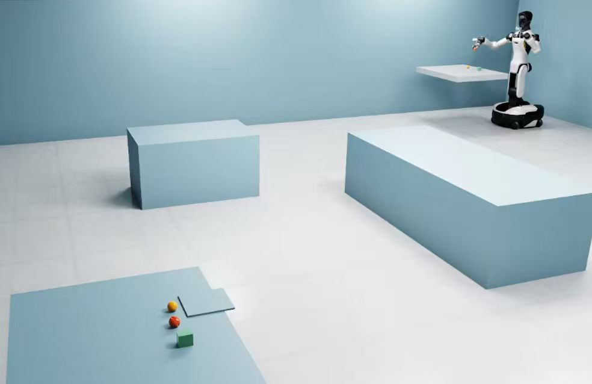
  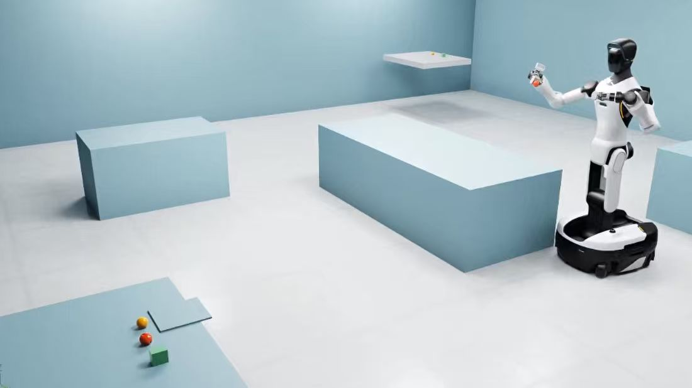
</div>

<div style="display: flex; justify-content: center; gap: 16px;">
  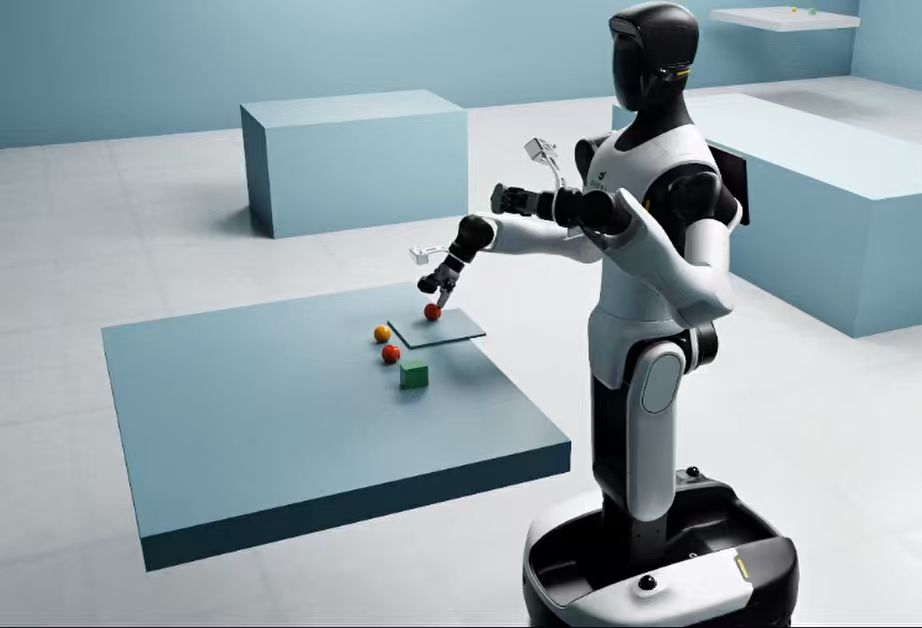
  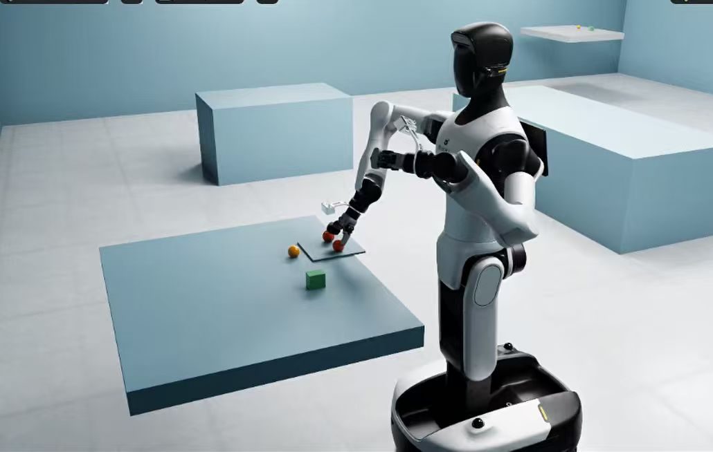
</div>

<p align="center"><b>图 12-14</b> 双桌搬运任务运行过程截图（原文配图）</p>

任务运行后，应能依次看到源桌抓取、抬升收臂、持物导航、远桌停靠、第一次放置和远桌苹果抓放。两颗苹果分别留在接收板的两个槽位，右臂回到 `home`，任务最后发布 `DONE`。若进入 `FAILED`，任务会停止继续执行，不自动释放夹爪中的物体。

日志默认位于 `log/runtime`。不同输出关注的内容如下：

| 输出来源 | 主要内容 |
|---|---|
| 仿真终端 | 场景加载、物理执行、相机渲染和 ROS 桥接信息 |
| system 终端 | YOLO 目标识别、Nav2 导航、MoveIt 规划和关节控制反馈 |
| mission 终端 | 当前任务阶段、停靠误差、抓放结果与失败原因 |
| Isaac 窗口 | 底盘移动、夹爪接触、苹果抬升与最终放置的实际过程 |
| RViz 窗口 | 地图、TF、机器人模型、抓取候选和规划路径 |

`DONE` 表示当前在线任务判据已经满足，不等于仅凭一条日志就能证明任意场景下都可靠。前文的抬升观测、持物互锁和放置判断都属于机器人任务本身的反馈闭环；阅读结果时，应结合物体实际运动理解这些阶段，而不是只关注 action 是否返回成功。

**如何读懂 mission 终端**：每行 `[TASK] xxx` 对应图 12-3 中的一个阶段；在 `SETTLE` 之后应能看到“导航后复核 odom=(…)，误差 … m / … rad”与“停靠通过：… m / … rad（连续静止复核）”，数字即为第三部分讲的停靠误差；`gripper target=0.000 actual=… stalled=1` 表示闭合时被苹果挡住、以受阻方式完成（5.5 节）；“SIM ONLY：抓取/抬升/回 home 暂时忽略 MoveIt 环境及自身碰撞…”与“抓取调试结束，已恢复 MoveIt 碰撞检查”成对出现，标志 ACM 调试窗口的开与关。这些日志文本来自 `mission.cpp` 源码，具体数值以实际运行为准。

#### 8.3.3 SLAM 建图结果

建图过程如下所示：

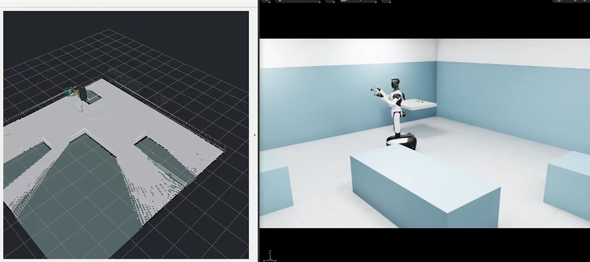

<p align="center"><b>图 12-15</b> 使用 SLAM Toolbox 与键盘遥控巡游建图的过程（原文配图）</p>

**如何读懂**：RViz 中 `/map` 应随巡游逐渐长出墙体、障碍和两张桌子的轮廓；与默认参考地图相比，SLAM 地图边缘会有噪点，且原点取决于建图起点。

---

## 本章小结

### 知识回顾

本章最重要的收获，不是记住某个启动命令，而是建立完整的工程判断链：**地图与定位让底盘知道怎么走，精靠与互锁保证到了能操作，视觉把物体变成三维目标，MoveIt 把目标变成轨迹，控制器把轨迹变成真实关节运动，阶段验证再决定任务能否继续。** 只有这些接口、坐标、时间和反馈同时对齐，独立的导航与抓取能力才真正组成一个可解释、可检查的移动操作系统。

| 环节 | 核心问题 | 关键机制 | 关键数值 | 源码 |
|---|---|---|---|---|
| 任务流程 | 先做什么、何时算完成 | 有限状态机 + 异常即失败 | 五段工序，无自动重试 | `src/mission.cpp` |
| 系统架构 | 谁负责什么 | 仿真 / 能力 / 编排三组进程，标准 action | 三个终端 A → B → C | `launch/`、`run.sh` |
| 坐标系链 | 位置说同一种语言 | `map → odom → base_link → arm_base_link → TCP` | 四元数 `xyzw` | `sim/bridge.py`、`common.py` |
| 时间 | 数据来自同一时刻 | 仿真时间驱动轨迹，墙钟驱动超时；共同时间戳 | 缓存 8 帧，RGB-D 约 5 帧/仿真秒 | `perception.py` |
| 地图与导航 | 怎么走到桌边 | 参考栅格地图、AMCL、NavFn A*、DWB | 0.05 m、190×190；半径 0.40 m | `mapping.py`、`nav2_params.yaml` |
| 对接停靠 | 停得够不够准 | 停稳 → 精靠短路径 → 连续复核 | 0.08/0.12 → 0.025/0.02 → 0.06 m/0.05 rad | `docking.hpp` |
| 感知定位 | 苹果在哪、怎么夹 | YOLO + 反投影 + ROI 筛选 + 2.5D 候选 | 置信度 0.40；≥30 点；宽 0.014～0.074 m | `perception.py`、`common.py` |
| 执行 | 手臂怎么过去 | KDL IK、RRTConnect、笛卡尔路径、时间参数化 | 步长 0.008 m，fraction ≥ 0.999 | `mission.cpp` |
| 互锁 | 何时允许动 | NAV / ARM / IDLE，持物开度监测 | 静止 0.015 m/s、0.025 rad/s 持续 0.5 s | `controller.py` |
| 阶段验证 | 世界真的变了吗 | `verify()` 连续新鲜稳定观测 | 抬升 +0.10 m/1 s；放置 ±0.10 m、+0.075 m/1.5 s | `mission.cpp`、`perception.py` |

### 课后练习

1. **（思考题）三种容差。** 普通导航到达（0.08 m / 0.12 rad）、Dock 到达（0.025 m / 0.02 rad）和任务伸臂门槛（0.06 m / 0.05 rad）分别回答什么问题？如果把任务门槛放宽到 0.10 m，可能会在哪一步出问题？为什么 Dock 内部容差要比任务门槛更严？
2. **（手算题）精靠短路径。** 设导航结束后底盘位姿为 $(-3.60, -3.10, 0.10)$，目标为源桌停靠点 $(-3.66, -3.20, 0.0)$。判断是否需要精靠、是否在 `short_path()` 的允许范围内，并写出分段数和全部路点。
3. **（手算题）反投影与放置判据。** 用 4.2 节估算的内参，求像素 $(160, 60)$、深度 0.65 m 对应的相机系坐标；再判断 `odom` 下观测中心 $(3.04, 2.20, 0.93)$ 是否满足第一次放置（槽位 0）的在线验证判据。
4. **（动手题）运行单元测试并扩展。** 执行 `./run.sh test` 运行 `tests/test_core.py`；然后仿照其中写法，为 `g2_mobile/common.py::grasp_candidates()` 增加一个测试：在桌面顶 0.888 m 上生成一个半径 2.5 cm 的球面点云（≥30 点），断言返回候选数不少于 1、所有四元数为单位长度、夹持高度等于 $\max(0.888+0.6h, 0.913)$。
5. **（动手题）观察互锁。** 在三终端系统运行（不启动 mission）时，用 `ros2 topic echo /motion_mode` 观察模式；再运行 `./run.sh teleop` 按 W 前进，观察模式变为 `NAV`、松键 0.25 s 后速度归零。思考：此时若有人在 RViz 中执行机械臂轨迹，控制器会怎样响应？
6. **（动手题，选做）严格碰撞实验。** 把 `config/task.yaml` 中 `simulation_grasp_ignore_collisions` 改为 `false`，重新 `./run.sh build` 并按 A → B → C 完整重启，记录任务在哪个阶段、以什么原因失败或成功，对照第五部分分析原因（可能涉及停靠点、碰撞模型和候选姿态）。

### 参考资料

- 本章代码：`code/code_chapter12/`（ROS 包 `g2_chapter12`），资产与第三方权重来源见该目录的 `THIRD_PARTY.md`。
- 前置章节：第一章（Isaac Sim 安装）、第四章（舵轮底盘运动学）、第九章（YOLO 与 RGB-D 抓取）、第十章（地图与 Nav2 导航）、第十一章（MoveIt2 运动规划）。
- 本章使用的外部软件：ROS 2 Humble、Nav2（NavFn、DWB、AMCL、行为树）、SLAM Toolbox、MoveIt2（KDL、OMPL RRTConnect）、Isaac Sim 5.1、Ultralytics 8.3.203。

