# 第十四章 视觉语言动作模型部署

> **本章导读**：第十三章中的 VLM 负责理解图像和语言，再把语义目标交给 Nav2、运动规划器或确定性控制器。本章进一步讨论 VLA（Vision-Language-Action，视觉—语言—动作模型）：模型不再只回答"看到了什么、应该做什么"，而是直接预测一段连续机器人动作。
>
> 本章以 Physical Intelligence 的 π 系列和本仓库内的 π0.5 教学实现为主线，在 Isaac Sim 中完成 G2 双臂机器人的"三色物块入盒"任务。教程先讲 VLA 的基本问题，再用一个完整的部分逐个拆解 π0、π0-FAST、π0.5、π0.6、π0.7（动机、结构、训练、推理、代码对应），然后说明动作表示与归一化、数据采集、LeRobot 数据格式、微调流程、代码结构、依赖安装、权重下载和案例运行。最终要跑通的案例是：OpenPI 模型服务与 Isaac Sim 客户端双进程闭环，让 G2 把红色物块真实放进盒子，并用本章采集的数据完成一次 LoRA 微调。

## 本章概览

### 本章要解决的问题

桌上有红、绿、蓝三个物块和一个空盒，G2 机器人头部和两个手腕各有一台相机。我们希望只给它一句话——"Pick up the red block and place it into the empty box."——它就能根据三路图像和当前关节状态，直接输出接下来几十步的关节目标，并在执行过程中不断重新观察、修正。这要求模型同时具备语义理解（哪个是红色物块）、空间感知（物块在哪）和精确的连续控制（每个关节转多少弧度）。本章要回答：这类模型内部是怎样把"看懂"和"动起来"接在一起的，π 系列每一代改了什么，以及怎样把一个公开的 π0.5 权重安全地接到 G2 上、再用自己的数据微调。

### 学习目标

- **解释** VLA 学习的条件分布 $\pi_\theta(A_t\mid o_t)$、动作块与滚动时域闭环，以及行为克隆的分布偏移问题；
- **对比** π0、π0-FAST、π0.5、π0.6、π0.7 各自要解决的问题、输入 token、主干与动作头、注意力掩码和训练损失；
- **推导并手算** flow matching 的训练目标与 Euler 积分，并把每一步对应到 OpenPI `Pi0.compute_loss` / `Pi0.sample_actions` 的代码；
- **手算** FAST 动作分词（DCT → 量化 → 展平 → BPE）的一个小例子，说明它在哪一步引入信息损失；
- **实现** G2 与 OpenPI 之间的数据合同：图像键、16/21 维状态、32 维补齐、delta/absolute 转换和分位数归一化；
- **运行** 权重下载、模型服务、Isaac Sim 闭环推理、数据采集、LeRobot 转换、归一化统计与 LoRA 微调全流程；
- **排查** checkpoint、norm_stats、WebSocket、动作维度、夹爪方向和显存等常见故障。

### 前置知识

- 第十三章（VLM 高层决策）与第十一、十二章（G2 机械臂、桌面场景与 IK）；
- Transformer 基础：token、自注意力、注意力掩码、KV 缓存；
- 概率基础：高斯分布、条件期望；数值积分中的前向 Euler 法；
- Python / NumPy，能读懂 JAX/Flax 风格的数组代码（`jnp` 与 `np` 用法基本一致）；
- 会使用 Linux 终端、虚拟环境和 NVIDIA GPU 驱动。

### 知识地图

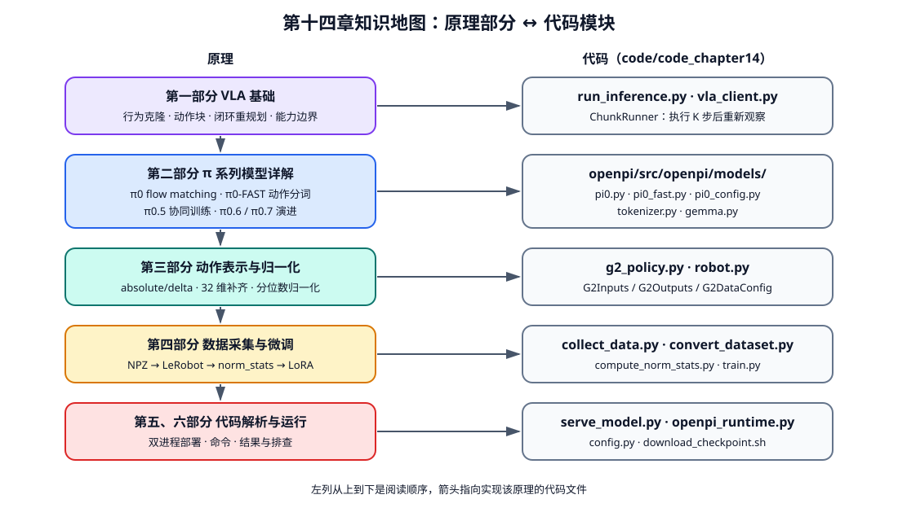

<p align="center"><b>图 14-1</b> 本章各部分之间的关系，以及与 code_chapter14 中代码模块的对应</p>

### 对应代码

- `code/code_chapter14/`：本章 G2 适配层、Isaac Sim 场景、数据采集、转换、训练和推理入口（`g2_policy.py`、`serve_model.py`、`vla_client.py`、`robot.py`、`run_inference.py` 等）。
- `code/code_chapter14/openpi/`：本章内嵌的 OpenPI 源码，π0/π0.5 的真实实现位于 `openpi/src/openpi/models/`（`pi0.py`、`pi0_config.py`、`pi0_fast.py`、`tokenizer.py`、`gemma.py`）。

> ⚠️ **注意**：当前工作区快照中 `code/code_chapter14/openpi/` 与 `checkpoints/` 一样没有随仓库一起提供，需要从完整项目资源恢复。本章摘录的 OpenPI 模型代码，核对自同一上游仓库 Physical-Intelligence/openpi 在 commit `15a9616` 的 vendored 副本（`VERSION.txt` 中记录了该 commit）。如果你恢复的内嵌版本不同，函数主体逻辑一致，但个别字段（例如 `image_augmentation`）可能不存在，摘录中已用 `# ...` 省略这类与原理无关的行。

---

## 第一部分 从视觉语言理解到连续机器人动作

### 1.1 VLA 学习的是什么

**直观理解**：VLM 是"看图说话"，VLA 是"看图动手"。输入不变（图像 + 语言），输出从一串文字变成一段关节轨迹。

一个机器人控制时刻可以写成：

$$
o_t=(I_t^1,I_t^2,\ldots,I_t^N,\ell,q_t)
$$

其中：

- $I_t^1,\ldots,I_t^N$ 是头部、腕部或环境相机图像；
- $\ell$ 是语言任务，例如"拿起红色物块并放进空盒"；
- $q_t$ 是机器人本体状态，例如关节位置（单位 rad）、夹爪开合量和腰部关节；
- $o_t$ 是模型在时刻 $t$ 能观察到的全部条件。

VLA 策略学习从观察到动作的条件分布：

$$
\pi_\theta(a_t\mid o_t)
$$

如果一次预测未来 $H$ 步，则输出动作块（action chunk）：

$$
A_t=(a_t,a_{t+1},\ldots,a_{t+H-1})
$$

在本章 G2 案例中， $N=3$（`top_head`、`hand_left`、`hand_right`）， $q_t$ 是 16 维（双臂 14 + 双夹爪 2）或 21 维（再加腰部 5）， $H$ 为 50 或 30。

与只输出文字的 VLM 相比，VLA 多了三个困难：

- **动作是连续且精确的。** 文字里"向左一点"可以模糊，机械臂关节目标却必须有明确数值和单位。
- **错误会改变下一帧输入。** 一次抓偏会让物体位置、相机画面和关节状态全部改变，之后的预测不能继续假设先前动作成功。
- **数据依赖机器人实体。** 同一句"张开夹爪"，在不同机械臂上的关节数量、符号、量程和控制频率都可能不同。

因此，VLA 不是把语言模型最后一层简单改成关节数，而是需要视觉语言表征、机器人状态适配、连续动作生成、时序训练和闭环执行共同组成一套系统。

### 1.2 行为克隆：从示教中学习动作

本章采用的基本训练范式是行为克隆（Behavior Cloning, BC）。数据集由专家示教组成：

$$
\mathcal{D}=\{(o_t,a_t)\}
$$

模型尽量复现专家在相似观察下的动作。最简单的回归损失可以写成：

$$
\mathcal{L}_{\mathrm{BC}}
=\mathbb{E}_{(o_t,a_t)\sim\mathcal{D}}
\left[\lVert \hat a_t-a_t\rVert_2^2\right]
$$

这种写法便于理解，但真实机器人动作往往具有多解：从杯子左侧抓和从右侧抓都可能成功。若直接用均方误差平均两种策略，结果可能变成"两边都不像"的中间动作。

**案例**：假设一半示教把手腕关节转到 $-1$ rad（从左侧抓），另一半转到 $+1$ rad（从右侧抓）。MSE 最优解是两者的平均 $0$ rad——正好对着物块中间撞上去，两种抓法都不是。第二部分 2.2.4 会用同一个双峰例子说明 flow matching 如何落到 $+1$ 或 $-1$ 之一，而不是 $0$。因此 π0 使用 flow matching 表达条件动作分布，而不是只回归一个均值。

行为克隆还存在"分布偏移"（distribution shift）：训练数据大多来自专家轨迹，部署时模型一旦偏离轨迹，就会看到训练集中较少出现的状态。缓解方法包括：

- 采集带位置、光照和初始姿态变化的数据；
- 保留一定数量的恢复动作与不完美轨迹，但必须正确标注其质量和结果；
- 每执行一小段动作重新观察和规划；
- 加入关节限位、碰撞检测和急停等独立安全约束；
- 在真实机器人上采用逐级放权，而不是首次运行就执行完整高速动作块。

> 💡 **要点**："保留不完美轨迹但标注质量"正是 π0.7 把"回合质量/速度"等元数据放进提示的动机（见 2.6 节）：数据可以更杂，但必须告诉模型它是哪一种行为。

### 1.3 动作块与闭环重规划

若模型每次只预测一步，高频推理会增加网络和 GPU 延迟；若一次预测很长的轨迹，后半段又容易因环境变化而失效。动作块是在两者之间折中：模型一次输出 $H$ 步，控制端执行其中 $K$ 步，然后重新采集观察。

$$
K\leq H
$$

这就是 receding horizon（滚动时域）思想。 $K$ 越小，闭环反馈越及时，但推理频率和通信开销越大； $K$ 越大，动作更连贯，但更容易盲目执行过时计划。

本章代码中：

- `instruction_and_robust_pi05` 的动作块长度为 50；
- `manipulation_pi05` 的动作块长度为 30；
- `--execute-chunk 0` 表示执行完整动作块；
- 可以用 `--execute-chunk 10` 只执行前 10 步后重新观察。

每个模型动作在 Isaac Sim 中维持 4 个物理步。这里必须区分"模型动作步""物理仿真步"和"相机采样帧"，不能把它们当成同一个频率。

**案例（频率换算）**：`config.py` 中物理频率 `physics_hz = 120`，`ControlConfig.physics_steps_per_action = 4`，所以每个模型动作在仿真中持续 $4/120\approx 0.033$ s，即动作执行频率约 30 Hz。instruction 模型一个完整动作块 $H=50$ 对应约 $50\times 4/120\approx1.67$ s 的开环执行；若 `--execute-chunk 10`，则每约 0.33 s 重新观察一次。采集示教时数据集频率 `DATASET_FPS = 10`，记录间隔是 $120/10=12$ 个物理步——这是第三种频率。

对应代码（`code/code_chapter14/vla_client.py`）：

```python
class ChunkRunner:
    """按顺序执行模型给出的绝对关节目标，不做缩放或低通滤波。"""
    # ...
    def execute(self, actions: np.ndarray) -> None:
        count = self.config.execute_chunk or len(actions)     # 0 表示执行完整块（K = H）
        for target in actions[:count]:                        # 只执行前 K 步
            applied = self.robot.apply_absolute(target, self.control_waist)
            for _ in range(self.config.physics_steps_per_action):  # 每个动作保持 4 个物理步
                self._task_step(applied)
```

`run_inference.py` 的主循环在每次 `execute` 之后重新 `capture()` 三路图像、读取状态再调用 `infer`，这就是滚动时域闭环。

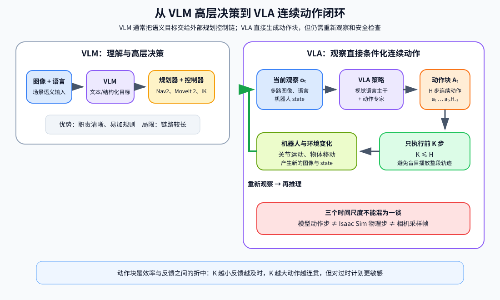

<p align="center"><b>图 14-2</b> VLM 高层决策链与 VLA 动作块闭环的区别</p>

### 1.4 VLA 的能力边界

VLA 可以把感知和动作学习放进统一模型，但"端到端"并不表示系统可以取消工程约束。至少还应独立检查：

- 输入图像是否来自正确相机，色彩、尺寸和通道顺序是否一致；
- 状态和动作是否采用同一关节顺序、单位和坐标约定；
- 输出是否包含 NaN、无穷大、越界关节和突变；
- 夹爪正负号、开合范围和 mimic 关节是否正确；
- 任务是否真的完成，而不是模型或日志"自报成功"；
- 通信断开、推理超时和视觉遮挡时机器人是否进入安全状态。

本章仿真任务的完成判定来自动态物块是否真实进入盒子，而不是模型输出一段成功文本。物块具有质量、碰撞和摩擦，搬运过程中也不会通过 `set_world_pose()` 被代码强制吸附到夹爪上。

### 1.5 本章的三个实现边界

需要先明确三个边界：

1. **研究模型不等于开源仓库支持范围。** 当前本章内嵌 OpenPI 直接支持 π0、π0-FAST 和 π0.5，其中 π0.5 的训练与推理使用 flow matching 动作头；π0.6 和 π0.7 在本章只用于理解技术演进，不能直接替换成本章案例模型。
2. **现成 checkpoint 不保证适配任意机器人。** 相机名称、状态维度、关节顺序、动作含义和归一化统计必须同时匹配。权重能够加载，不代表动作能够安全执行。
3. **当前仓库没有预置完整权重和共享 USD 资源目录。** `code/code_chapter14/checkpoints` 需要运行下载脚本后才会出现；代码还约定从 `code/assets` 读取 G2 与房间 USD，但当前工作区快照没有该目录。实际运行前应从完整项目资源包恢复共享资源，或同步修改 `config.py` 中的资源路径。模型服务器、Isaac Sim 客户端和训练环境也必须按本章方法分开配置。

---

## 第二部分 π 系列模型详解：π0、π0-FAST、π0.5、π0.6、π0.7

### 2.1 π 系列全景与阅读方法

π 系列是 Physical Intelligence 发布的一组 VLA 模型。它们共享同一个大方向——"预训练视觉语言模型 + 机器人动作生成"——但每一代针对的问题不同：

- **π0**：怎样让预训练 VLM 输出**连续、高频、多峰**的动作？→ 动作专家 + flow matching。
- **π0-FAST**：能否不加新模块，像生成文字一样**自回归生成动作**？→ FAST 动作分词。
- **π0.5**：怎样让机器人在**没见过的家庭**里完成长任务？→ 异构协同训练 + 高层子任务预测 + 离散/连续两种动作表示。
- **π0.6**：怎样用**更强主干**并让离散与连续动作训练互不伤害？→ 更大主干与动作专家 + 知识隔离；π\*0.6 进一步从自身经验中学习。
- **π0.7**：怎样让同一个模型按指定**方式**去做？→ 丰富的提示上下文（子步骤语言、子目标图像、回合元数据）。

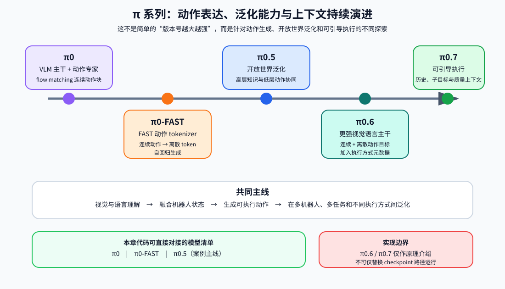

<p align="center"><b>图 14-3</b> π0 到 π0.7 在动作表达、泛化与上下文方面的演进及本章实现边界</p>

本部分每个模型都按同一个小结构展开，方便横向对比：

```text
动机（解决前一代什么问题）
  → 模型结构（输入 token / 主干 / 动作头 / 注意力掩码，配结构图）
  → 训练方法与损失
  → 推理过程（一步步）
  → 与 OpenPI 代码的对应（能对上就摘代码；对不上明确写"本章代码不包含"）
```

> ⚠️ **注意**：本部分区分三类信息来源。①"代码中"——直接摘自 OpenPI 源码，可以在本章环境里验证；②"论文/官方资料"——π0 论文 arXiv 2410.24164、π0.5 论文 arXiv 2504.16054、FAST 论文 arXiv 2501.09747、知识隔离论文 arXiv 2505.23705、π\*0.6 论文 arXiv 2511.14759 与 π0.6 model card、π0.7 官方博客与论文 arXiv 2604.15483；③核实不到的内容会明确标注。本章不复述论文中的实验数字。

### 2.2 π0：VLM 主干 + 动作专家 + flow matching

#### 2.2.1 动机：为什么不直接让 VLM"说出"动作

在 π0 之前，一种常见做法（如 RT-2、OpenVLA 一类模型）是把每个动作维度均匀分箱成 256 档，再把档位当作文字 token 输出。这种做法简单，但有两个问题：

1. **高频控制下 token 太多、太相关。** 一个 50 步 × 14 维的动作块就有 700 个 token；相邻时间步几乎相同，自回归逐个生成既慢又容易累积误差。
2. **均值回归 vs 多峰。** 如果改成直接回归连续值，又会遇到 1.2 节的"平均两种抓法"问题。

π0 的回答是：保留预训练 VLM 处理图像和语言，另加一个较小的**动作专家**（action expert），用 **flow matching** 一次性生成整个连续动作块。据 π0 论文，原始 π0 以约 30 亿参数的 PaliGemma 为 VLM 基础，动作专家约 3 亿参数、从头初始化，合计约 33 亿参数；动作块长度 $H=50$，推理时做 10 步积分，可支持最高约 50 Hz 的控制。

#### 2.2.2 模型结构

**输入 token**（以 OpenPI `Pi0`、`pi05=False` 为准）：

| 位置 | token 来源 | 数量 | 由谁处理 |
|---|---|---|---|
| 前缀 | 每路相机图像经 SigLIP（`So400m/14`）编码 | 每张 224×224 图像，224/14=16，即 16×16=256 个 | 专家 0：PaliGemma |
| 前缀 | 语言指令经 `PaligemmaTokenizer` 分词 | 最多 `max_token_len` 个（π0 默认 48） | 专家 0 |
| 后缀 | 连续状态 $q_t$ 经 `state_proj` 线性投影 | 1 个 | 专家 1：动作专家 |
| 后缀 | 带噪动作 $x_t$ 经 `action_in_proj`，并与时间编码拼接后过 `action_time_mlp` | $H$ 个 | 专家 1 |

**主干与动作头**：OpenPI 把两个 Gemma 结构放进同一个 `_gemma.Module(configs=[paligemma_config, action_expert_config])`。两个专家**层数相同、各自有独立权重**，在每一层的注意力里把前缀和后缀的 Q/K/V 拼在一起计算，所以动作 token 可以"读"到图像和语言的信息。`gemma.py` 中两种变体的规模为：

| 变体 | width | depth | mlp_dim | num_heads | head_dim |
|---|---:|---:|---:|---:|---:|
| `gemma_2b`（PaliGemma 主干） | 2048 | 18 | 16384 | 8 | 256 |
| `gemma_300m`（动作专家） | 1024 | 18 | 4096 | 8 | 256 |

最后由 `action_out_proj` 把后缀最后 $H$ 个输出映射回 32 维，得到速度场 $v_t$。

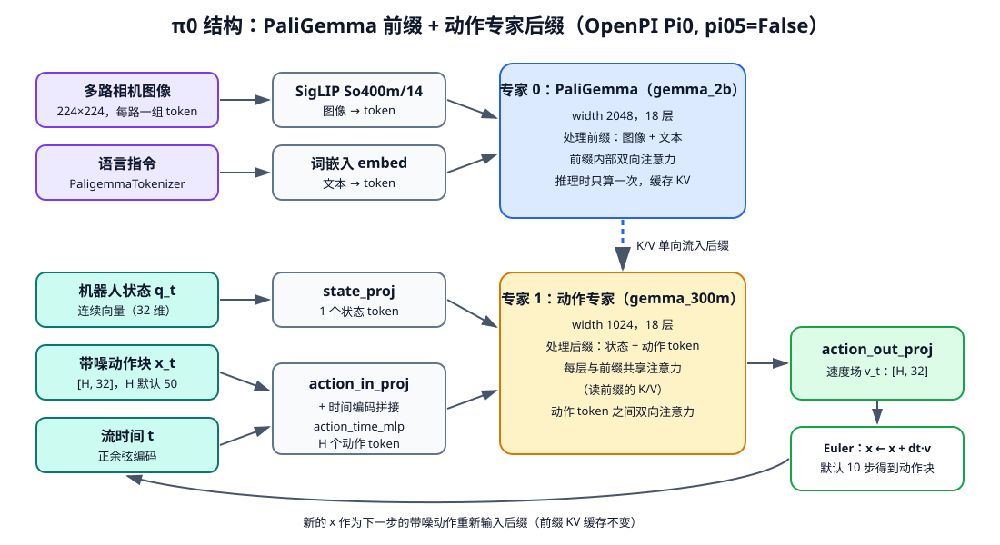

<p align="center"><b>图 14-4</b> π0 结构：PaliGemma 处理图像与语言前缀，动作专家处理状态与带噪动作后缀，输出速度场后 Euler 积分</p>

**注意力掩码**：OpenPI 用一个一维的 `mask_ar`（autoregressive mask）描述"块"的划分，再由 `make_attn_mask` 展开成二维掩码。规则是：**对 `mask_ar` 做累加得到 cumsum，token i 能看 token j 当且仅当 cumsum[j] ≤ cumsum[i]**。

```python
# 摘自 openpi/src/openpi/models/pi0.py
def make_attn_mask(input_mask, mask_ar):
    mask_ar = jnp.broadcast_to(mask_ar, input_mask.shape)
    cumsum = jnp.cumsum(mask_ar, axis=1)
    attn_mask = cumsum[:, None, :] <= cumsum[:, :, None]           # 列(key) 的块号 ≤ 行(query) 的块号
    valid_mask = input_mask[:, None, :] * input_mask[:, :, None]    # 去掉 padding
    return jnp.logical_and(attn_mask, valid_mask)
```

**手算一个掩码**：设前缀有 2 个图像 token + 1 个文本 token，后缀有 1 个状态 token + 3 个动作 token。按 `embed_prefix`/`embed_suffix` 的写法：

- 图像、文本：`mask_ar = False`（0）；
- 状态：`mask_ar = True`（1）——开启新块；
- 动作：`[True] + [False] * (H-1)` = `[1, 0, 0]`——再开一个新块，块内共享。

于是 `mask_ar = [0,0,0, 1, 1,0,0]`，cumsum = `[0,0,0, 1, 2,2,2]`，展开结果为（行 = query，列 = key，1 = 可见）：

```text
          图1 图2 文本 状态 动1 动2 动3
图1        1   1   1    0    0   0   0
图2        1   1   1    0    0   0   0
文本       1   1   1    0    0   0   0
状态       1   1   1    1    0   0   0
动作1      1   1   1    1    1   1   1
动作2      1   1   1    1    1   1   1
动作3      1   1   1    1    1   1   1
```

读法：前缀（图像+文本）内部全互看但**看不到**状态和动作；状态能看前缀和自己；动作能看所有 token，动作之间双向注意力。这就是 π0 论文所说的"块状因果"（blockwise causal）注意力。

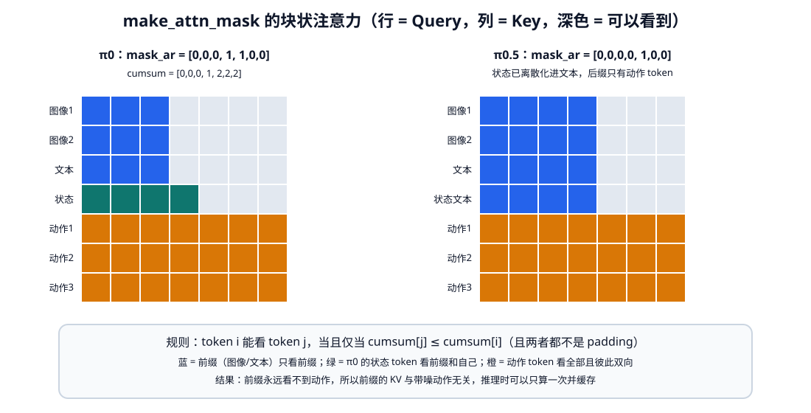

<p align="center"><b>图 14-5</b> make_attn_mask 生成的块状注意力：前缀不依赖动作，因此推理时可缓存前缀 KV</p>

> 💡 **要点**：前缀看不到后缀，意味着前缀每一层的 K/V 与带噪动作、流时间无关。推理时 10 步积分可以共用同一份前缀 KV 缓存，每步只重算较小的动作专家——这正是"单独使用较小动作专家"的计算意义。

#### 2.2.3 训练方法：flow matching

**直观理解**：把"从噪声变成动作"想象成一条从起点（随机噪声）到终点（真实动作）的直线。训练时随便在直线上取一个点，让网络学会"这一点应该往哪个方向走、走多快"；推理时从新噪声出发，沿网络给的方向一小步一小步走到终点。

**论文写法**：设真实动作块为 $A$，随机高斯噪声为 $\epsilon\sim\mathcal{N}(0,I)$。π0 使用一条从噪声到真实动作的线性概率路径：

$$
A^\tau=\tau A+(1-\tau)\epsilon,\qquad \tau\in[0,1]
$$

当 $\tau=0$ 时 $A^0$ 是随机噪声；当 $\tau=1$ 时 $A^1$ 就是真实动作。沿这条直线， $A^\tau$ 对 $\tau$ 的导数恒为 $A-\epsilon$。模型学习向量场 $v_\theta$，预测在当前观察 $o$ 的条件下动作应该朝哪个方向变化：

$$
\mathcal{L}_{\mathrm{flow}}
=\mathbb{E}\left[
\left\|v_\theta(A^\tau,o,\tau)-(A-\epsilon)\right\|_2^2
\right]
$$

推理时从随机动作噪声开始，用前向 Euler 积分前进：

$$
A^{\tau+\Delta\tau}
=A^\tau+\Delta\tau\,v_\theta(A^\tau,o,\tau)
$$

符号说明： $A,\epsilon,A^\tau,v_\theta$ 都是形状 $[H,D]$ 的数组（ $D$ 是动作维度，OpenPI 内部为 32），数值是**归一化之后**的动作（无量纲）； $\tau$ 是无量纲的流时间，与机器人物理时间无关。

**OpenPI 代码写法（时间方向相反！）**：OpenPI 源码注释明确说明它采用扩散文献更常见的约定—— $t=1$ 是噪声、 $t=0$ 是目标，"与 π0 论文相反"。两者的关系是 $t=1-\tau$：

| 量 | 论文（ $\tau$） | OpenPI 代码（ $t$） |
|---|---|---|
| 噪声端 / 动作端 | $\tau=0$ / $\tau=1$ | $t=1$ / $t=0$ |
| 插值点 | $A^\tau=\tau A+(1-\tau)\epsilon$ | `x_t = t * noise + (1 - t) * actions` |
| 回归目标 | $A-\epsilon$ | `u_t = noise - actions` |
| Euler 步长 | $\Delta\tau=+1/N$ | `dt = -1/num_steps` |

两种写法完全等价：时间反向，速度也取反，相乘后每一步的位移相同。

```python
# 摘自 openpi/src/openpi/models/pi0.py（Pi0.compute_loss）
def compute_loss(self, rng, observation, actions, *, train=False):
    preprocess_rng, noise_rng, time_rng = jax.random.split(rng, 3)
    observation = _model.preprocess_observation(preprocess_rng, observation, # ...（训练时的图像增强开关，省略）
    )

    batch_shape = actions.shape[:-2]
    noise = jax.random.normal(noise_rng, actions.shape)                      # ε ~ N(0, I)，形状 [b, H, 32]
    time = jax.random.beta(time_rng, 1.5, 1, batch_shape) * 0.999 + 0.001    # t ∈ [0.001, 1]
    time_expanded = time[..., None, None]
    x_t = time_expanded * noise + (1 - time_expanded) * actions              # 直线上的点
    u_t = noise - actions                                                    # 目标速度（代码约定）

    # one big forward pass of prefix + suffix at once
    prefix_tokens, prefix_mask, prefix_ar_mask = self.embed_prefix(observation)
    suffix_tokens, suffix_mask, suffix_ar_mask, adarms_cond = self.embed_suffix(observation, x_t, time)
    input_mask = jnp.concatenate([prefix_mask, suffix_mask], axis=1)
    ar_mask = jnp.concatenate([prefix_ar_mask, suffix_ar_mask], axis=0)
    attn_mask = make_attn_mask(input_mask, ar_mask)
    positions = jnp.cumsum(input_mask, axis=1) - 1
    (prefix_out, suffix_out), _ = self.PaliGemma.llm(
        [prefix_tokens, suffix_tokens], mask=attn_mask, positions=positions, adarms_cond=[None, adarms_cond]
    )
    v_t = self.action_out_proj(suffix_out[:, -self.action_horizon :])        # 只取最后 H 个动作 token

    return jnp.mean(jnp.square(v_t - u_t), axis=-1)                          # 对动作维度求均值，形状 [b, H]
```

**代码解读**：

- `jax.random.beta(..., 1.5, 1)`：Beta(1.5, 1) 的密度 $\propto t^{0.5}$，均值 0.6，抽到的 $t$ 更多偏向 1（噪声端）。直觉上，噪声大时"该往哪走"更难，多练这部分。`*0.999 + 0.001` 避免 $t=0$。
- 训练时**一次前向**同时算前缀和后缀，不需要缓存；`positions` 是有效 token 的序号，用于位置编码。
- 损失是速度场的逐元素平方误差，只在动作 token 上计算；图像和文本 token 没有损失。返回的是 `[b, H]` 的逐步损失，由训练循环再聚合。

后缀是怎么构造的（π0 分支）：

```python
# 摘自 openpi/src/openpi/models/pi0.py（Pi0.embed_suffix，pi05=False 分支）
if not self.pi05:
    state_token = self.state_proj(obs.state)[:, None, :]                    # 连续状态 → 1 个 token
    tokens.append(state_token)
    input_mask.append(jnp.ones((obs.state.shape[0], 1), dtype=jnp.bool_))
    ar_mask += [True]                                                        # 状态单独成块
action_tokens = self.action_in_proj(noisy_actions)                          # [b, H, 1024]
time_emb = posemb_sincos(timestep, self.action_in_proj.out_features, min_period=4e-3, max_period=4.0)
# ...（pi05 分支见 2.4 节）
    time_tokens = einops.repeat(time_emb, "b emb -> b s emb", s=self.action_horizon)
    action_time_tokens = jnp.concatenate([action_tokens, time_tokens], axis=-1)   # 动作与时间拼接
    action_time_tokens = self.action_time_mlp_in(action_time_tokens)
    action_time_tokens = nnx.swish(action_time_tokens)
    action_time_tokens = self.action_time_mlp_out(action_time_tokens)
# ...
ar_mask += [True] + ([False] * (self.action_horizon - 1))                   # 动作成一个块，块内双向
```

**训练配方**：π0 的价值不只是模型结构，还包括训练配方：先用大规模、多机器人、多任务数据获得通用能力，再用更小但质量更高的数据做后训练，使动作更稳定、流畅并符合具体任务要求。多而杂的数据有利于覆盖变化和恢复状态，高质量数据有利于形成一致策略，两者不能简单互相替代。

#### 2.2.4 玩具数值例子：手算 Euler 积分

为了看清 `sample_actions` 每一步在做什么，把动作块缩成**一个数**（ $H=1,D=1$），并且不用神经网络，直接写出"理想速度场"。

**理想速度场怎么来**：在代码约定下，若数据只有一个目标 $A$，那么 $x_t=t\epsilon+(1-t)A$，可解出 $\epsilon=(x_t-(1-t)A)/t$，代入 $u=\epsilon-A$ 得

$$
v^*(x,t)=\frac{x-A}{t}
$$

若目标有多个可能值，理想速度场是条件期望 $v^*(x,t)=\big(x-\mathbb{E}[A\mid x_t=x]\big)/t$。神经网络 $v_\theta$ 在训练中逼近的就是它。

**例 1：单一目标， $A=2$，噪声 $\epsilon=-1$，`num_steps = 4`**

`dt = -1/4 = -0.25`，初始 `(x_t, time) = (noise, 1.0) = (-1, 1.0)`：

| 步 | time $t$ | $x$ | $v=(x-2)/t$ | $x+dt\cdot v$ |
|---|---:|---:|---:|---:|
| 1 | 1.00 | −1.00 | −3.00 | −1.00 + 0.75 = **−0.25** |
| 2 | 0.75 | −0.25 | −3.00 | **0.50** |
| 3 | 0.50 | 0.50 | −3.00 | **1.25** |
| 4 | 0.25 | 1.25 | −3.00 | **2.00** |

4 步后 time = 0，正好到达 $A=2$。速度恒为 $-3$，因为路径本身就是直线；Euler 法对直线没有误差。

**二维版本**： $A=(2,-1)$， $\epsilon=(-1,1)$，速度恒为 $(x-A)/t=(-3,2)$，每步位移 $dt\cdot v=(0.75,-0.5)$： $(-1,1)\to(-0.25,0.5)\to(0.5,0)\to(1.25,-0.5)\to(2,-1)$。各维度独立地沿直线走到目标——真实动作块的 $[H,32]$ 个数也是这样同时被"运输"的。

**例 2：双峰目标， $A\in\{-1,+1\}$ 各占一半，起点 $x=0.3$**

此时可以算出 $\mathbb{E}[A\mid x_t=x]=\tanh\!\big((1-t)x/t^2\big)$，于是 $v^*(x,t)=\big(x-\tanh((1-t)x/t^2)\big)/t$。

`num_steps = 4`（`dt = -0.25`）：

| 步 | $t$ | $x$ | $\mathbb{E}[A\mid x]$ | $v$ | 新 $x$ |
|---|---:|---:|---:|---:|---:|
| 1 | 1.00 | 0.3000 | 0.0000 | 0.3000 | 0.2250 |
| 2 | 0.75 | 0.2250 | 0.0997 | 0.1671 | 0.1832 |
| 3 | 0.50 | 0.1832 | 0.3509 | −0.3353 | 0.2671 |
| 4 | 0.25 | 0.2671 | 0.9967 | −2.9186 | **0.9967** |

`num_steps = 2`（`dt = -0.5`）： $0.3 \to 0.15 \to$ **0.2913**——停在两峰之间。`num_steps = 10` 时结果为 **1.0000**。

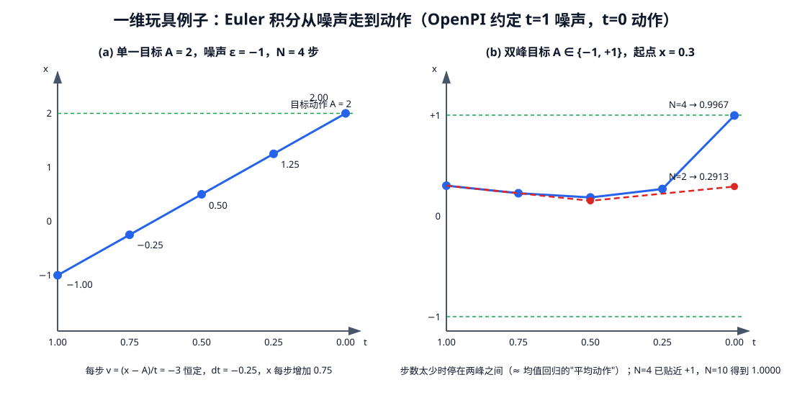

<p align="center"><b>图 14-6</b> 左：单一目标时速度恒定、4 步精确到达；右：双峰目标时步数足够才会"选定"一个峰，步数过少停在中间</p>

**从例子里读出的三件事**：

1. **多峰性**：起点 $x=0.3$ 略偏正，积分最后落到 $+1$；若起点是 $-0.3$ 则对称地落到 $-1$。不同噪声产生不同但都合理的动作，不会像 MSE 那样输出 $0$。
2. **前期速度小、后期速度大**：在 $t$ 接近 1 时 $\mathbb{E}[A\mid x]\approx 0$，模型"还没决定"；越接近 $t=0$ 越果断。
3. **积分步数是精度—延迟权衡**：OpenPI 默认 `num_steps=10`。步数越多越准，但每多一步就多跑一次动作专家。

> ⚠️ **注意**：上面的速度场是解析写出的"理想答案"。真实模型的 $v_\theta$ 是网络近似，还以图像、语言、状态为条件，因此同一场景下不同噪声得到的动作块会有差异；这也是部署时要做闭环重规划的原因之一。

#### 2.2.5 推理过程：对照 `sample_actions`

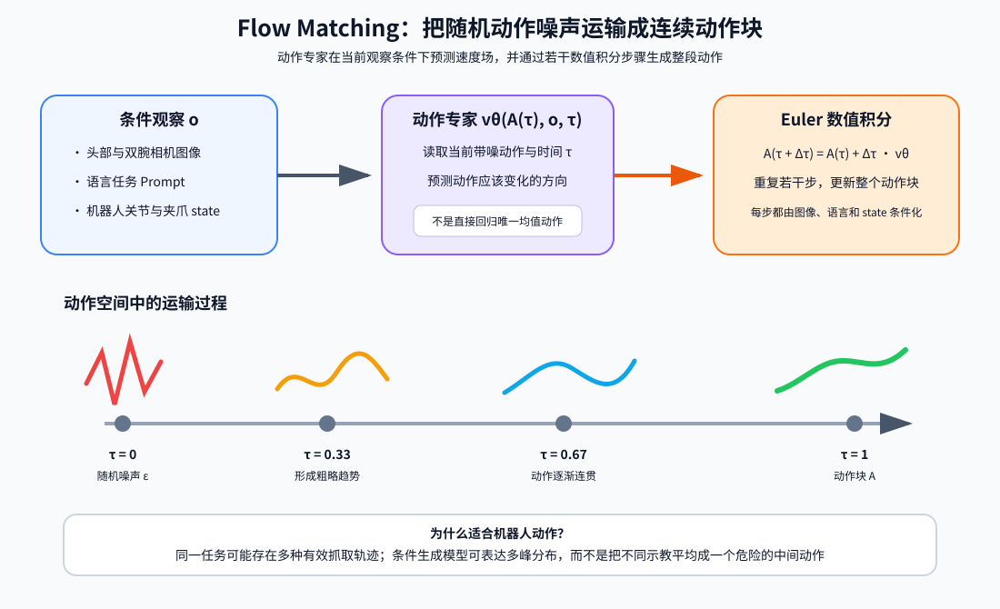

<p align="center"><b>图 14-7</b> 动作专家通过条件速度场和数值积分将随机噪声运输成连续动作块</p>

```python
# 摘自 openpi/src/openpi/models/pi0.py（Pi0.sample_actions）
def sample_actions(self, rng, observation, *, num_steps=10, noise=None):
    observation = _model.preprocess_observation(None, observation, train=False)
    # note that we use the convention more common in diffusion literature, where t=1 is noise and t=0 is the target
    # distribution. yes, this is the opposite of the pi0 paper, and I'm sorry.
    dt = -1.0 / num_steps                                                    # ① 步长为负
    batch_size = observation.state.shape[0]
    if noise is None:
        noise = jax.random.normal(rng, (batch_size, self.action_horizon, self.action_dim))  # ② 采噪声 [b,H,32]

    # first fill KV cache with a forward pass of the prefix
    prefix_tokens, prefix_mask, prefix_ar_mask = self.embed_prefix(observation)          # ③ 前缀只算一次
    prefix_attn_mask = make_attn_mask(prefix_mask, prefix_ar_mask)
    positions = jnp.cumsum(prefix_mask, axis=1) - 1
    _, kv_cache = self.PaliGemma.llm([prefix_tokens, None], mask=prefix_attn_mask, positions=positions)

    def step(carry):
        x_t, time = carry
        suffix_tokens, suffix_mask, suffix_ar_mask, adarms_cond = self.embed_suffix(
            observation, x_t, jnp.broadcast_to(time, batch_size)                         # ④ 用当前 x_t、t 构造后缀
        )
        suffix_attn_mask = make_attn_mask(suffix_mask, suffix_ar_mask)
        prefix_attn_mask = einops.repeat(prefix_mask, "b p -> b s p", s=suffix_tokens.shape[1])
        full_attn_mask = jnp.concatenate([prefix_attn_mask, suffix_attn_mask], axis=-1)  # 后缀可看全部前缀
        # ...（形状断言省略）
        positions = jnp.sum(prefix_mask, axis=-1)[:, None] + jnp.cumsum(suffix_mask, axis=-1) - 1
        (prefix_out, suffix_out), _ = self.PaliGemma.llm(
            [None, suffix_tokens], mask=full_attn_mask, positions=positions,
            kv_cache=kv_cache, adarms_cond=[None, adarms_cond],                          # ⑤ 只跑动作专家
        )
        v_t = self.action_out_proj(suffix_out[:, -self.action_horizon :])
        return x_t + dt * v_t, time + dt                                                 # ⑥ Euler 一步

    def cond(carry):
        x_t, time = carry
        return time >= -dt / 2                                                           # ⑦ 浮点安全的终止条件

    x_0, _ = jax.lax.while_loop(cond, step, (noise, 1.0))
    return x_0
```

**一步步说明**（并与 2.2.4 例 1 对照）：

1. **准备**：`dt = -1/num_steps`。例 1 中 `num_steps=4`，`dt=-0.25`。
2. **采噪声**：`noise` 形状 `[b, H, 32]`。例 1 中就是那个 $-1$。
3. **前缀前向 + KV 缓存**：图像和语言只过一次 PaliGemma，结果存在 `kv_cache`。
4. **构造后缀**：用当前 `x_t` 和 `time` 生成动作 token（π0 还会加状态 token）。
5. **只跑动作专家**：`[None, suffix_tokens]` 表示前缀不再计算，后缀通过 `full_attn_mask` 读取缓存的前缀 K/V。
6. **Euler 更新**：`x_t + dt * v_t`，`time + dt`。对应例 1 表格的最后一列。
7. **终止**：`time >= -dt/2`。例 1 中 time 依次为 1.0、0.75、0.5、0.25，执行 4 次后 time = 0，`0 >= 0.125` 为假，退出。用 `-dt/2` 而不是 `0` 是为了防止 `0.25` 累加 4 次后出现 `1e-9` 量级的浮点残差，多走或少走一步。
8. **输出**：`x_0` 是归一化空间的动作块，后续还要经过反归一化、`AbsoluteActions` 和 `G2Outputs` 裁剪（见第三部分）。

#### 2.2.6 与 OpenPI 代码的对应

| π0 概念 | OpenPI 位置 | 本章是否使用 |
|---|---|---|
| PaliGemma + SigLIP 前缀 | `Pi0.__init__`、`Pi0.embed_prefix` | 使用（π0.5 也走这段） |
| 连续状态 token | `Pi0.embed_suffix` 中 `if not self.pi05` 分支、`state_proj` | **不使用**（本章是 π0.5，`pi05=True`） |
| 时间 + 动作 MLP 融合 | `action_time_mlp_in/out` | **不使用**（π0.5 改为 adaRMSNorm） |
| flow matching 损失 | `Pi0.compute_loss` | 使用 |
| Euler 积分 + KV 缓存 | `Pi0.sample_actions` | 使用 |
| 默认 `max_token_len=48`、`action_horizon=50` | `Pi0Config.__post_init__` | π0.5 默认 200；本章另设 200/220 与 50/30 |
| 归一化方式 | `use_quantile_norm = model_type != ModelType.PI0` | π0 用均值/标准差，π0.5 用分位数 |
| π0 大规模预训练数据与配方 | — | **本章代码不包含** |

### 2.3 π0-FAST：把连续动作压缩成 token

#### 2.3.1 动机：π0 的动作专家能不能省掉

π0 需要额外的动作专家和新的损失函数；而 VLM 本身最擅长的是"预测下一个 token"。如果能把动作块变成**少量**、**信息密集**的离散 token，就可以完全复用语言模型的训练与解码方式。难点在 2.2.1 已经提到：朴素分箱（每个时间步每个维度一个 token）在高频控制下 token 数量多、相邻 token 几乎重复，模型很容易学成"抄上一个 token"。

FAST（Frequency-space Action Sequence Tokenization，论文 arXiv 2501.09747）的思路借鉴 JPEG 等信号压缩：**先变换到频率域，把能量集中到少数系数上，再量化和压缩**。π0-FAST 就是"PaliGemma + FAST 分词器"的自回归 VLA。据 FAST 论文与官方介绍，π0-FAST 的训练速度明显快于 π0、效果相近；而 OpenPI README 中也写道，π0-DROID 的推理比 π0-FAST-DROID 更快，但语言指令服从可能不如后者——两条路线各有取舍。

#### 2.3.2 FAST 分词的步骤

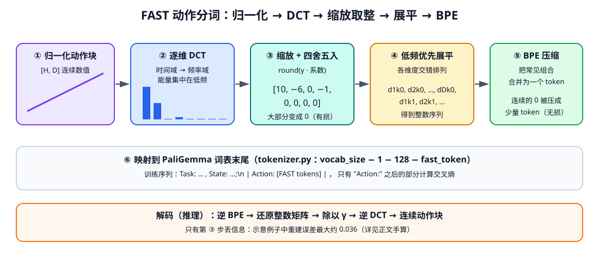

<p align="center"><b>图 14-8</b> FAST 分词：DCT 把动作变到频率域，量化后多数系数为 0，BPE 再把整数序列压缩成少量 token</p>

设归一化后的动作块为 $A\in\mathbb{R}^{H\times D}$：

1. **归一化**：把每个维度缩放到大致 $[-1,1]$（OpenPI 中 π0-FAST 使用分位数归一化）。
2. **逐维离散余弦变换（Discrete Cosine Transform, DCT）**：对每个动作维度 $d$ 的长度为 $H$ 的时间序列做 DCT：

   $$
   C_{k,d}=c_k\sum_{n=0}^{H-1}A_{n,d}\cos\!\left[\frac{\pi}{H}\left(n+\tfrac12\right)k\right],\quad
   c_0=\sqrt{1/H},\ c_{k>0}=\sqrt{2/H}
   $$

   $k=0$ 是"平均值"， $k$ 越大频率越高。平滑轨迹的能量集中在少数低频系数上。
3. **缩放并取整（量化）**： $\hat C_{k,d}=\mathrm{round}(\gamma\, C_{k,d})$， $\gamma$ 是控制精度的超参数。小系数被量化成 0。**这是唯一有损的一步。**
4. **低频优先展平**：把 $[H,D]$ 的整数矩阵按"先所有维度的 $k=0$，再所有维度的 $k=1$……"交错展平成一维整数序列。重要的低频信息排在最前面。
5. **字节对编码（Byte Pair Encoding, BPE）**：在大量动作数据上训练一个 BPE 词表，把经常一起出现的整数组合（尤其是成串的 0）合并成一个 token。BPE 是**无损**压缩。

**手算一个小例子**（单维度， $H=8$，正交 DCT-II， $\gamma=10$ 仅作示意，并非 FAST 的真实超参数）：

一段匀速抬升的关节轨迹（归一化后）：

```text
A        = [0.00, 0.10, 0.20, 0.30, 0.40, 0.50, 0.60, 0.70]
DCT(A)   = [0.9899, -0.6442, 0.0000, -0.0673, 0.0000, -0.0201, 0.0000, -0.0051]
round(10·DCT) = [10, -6, 0, -1, 0, 0, 0, 0]        ← 8 个数里只剩 3 个非零
逆变换(÷10) = [0.018, 0.114, 0.236, 0.323, 0.384, 0.471, 0.593, 0.689]
最大重建误差 ≈ 0.036
```

可以验证： $C_0=\sqrt{1/8}\times(0+0.1+\cdots+0.7)=0.35355\times2.8=0.9899$；对称性使所有偶数 $k\ge2$ 的系数恰好为 0。

若还有第二个维度（例如夹爪保持不动，量化后为 `[3, 0, 0, 0, 0, 0, 0, 0]`），低频优先交错展平得到：

```text
[10, 3,  -6, 0,  0, 0,  -1, 0,  0, 0,  0, 0,  0, 0,  0, 0]
 k=0      k=1    k=2     k=3    k=4 ...
```

后面 10 个连续的 0 正是 BPE 最容易合并的模式——比如一个学到的 token 可能就代表"0 0 0 0 0"。16 个整数最终只需要几个 token 表示（具体合并方式由在真实数据上训练出的词表决定，这里只是示意）。

> 💡 **要点**：与朴素分箱"每步每维一个 token"相比，FAST 的 token 数量随轨迹**复杂度**而不是**长度**增长：越平滑的动作，token 越少。代价是 token 数可变，且模型生成的任意 token 序列不一定能解码回合法的 $[H,D]$ 矩阵——OpenPI 的解码函数在解析失败时直接返回全零动作（见 2.3.5）。

#### 2.3.3 模型结构

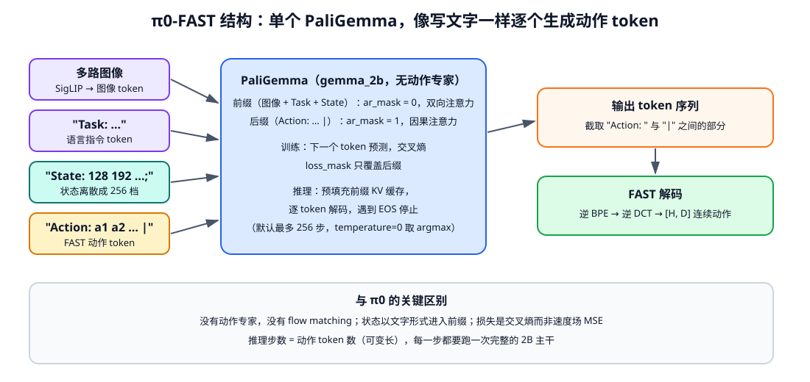

<p align="center"><b>图 14-9</b> π0-FAST 只有一个 PaliGemma：状态和动作都以文字 token 形式出现，前缀双向、动作后缀因果</p>

- **输入 token**：图像 token（SigLIP）+ 一整段文字 token：`Task: {指令}, State: {离散状态};\n` + `Action: {FAST tokens}|`。
- **状态处理**：连续状态在 `[-1,1]` 上均匀分成 256 档，转换成十进制数字写进文本。`np.digitize(state, bins=np.linspace(-1, 1, 257)[:-1]) - 1` 的效果是： $-1\to0$， $-0.3\to89$， $0\to128$， $0.25\to160$， $0.5\to192$， $0.999\to255$。
- **主干**：单个 `gemma_2b`（在 `gemma_fast.py` 中实现），**没有动作专家**。
- **动作 token 到词表的映射**：FAST token 被放到 PaliGemma 词表末尾（跳过最后 128 个特殊 token）：`vocab_size - 1 - 128 - fast_token`。
- **注意力掩码**：前缀（图像 + Task + State）`ar_mask = 0`，后缀（Action: … |）`ar_mask = 1`。按 `make_attn_mask` 的规则，每个后缀 token 都单独成块，形成标准的"前缀双向 + 后缀因果"（prefix-LM）。例如 3 个前缀 token + 3 个后缀 token：`mask_ar = [0,0,0,1,1,1]`，cumsum = `[0,0,0,1,2,3]`，展开后为下三角加前缀全连接：

```text
      p1 p2 p3 a1 a2 a3
p1     1  1  1  0  0  0
p2     1  1  1  0  0  0
p3     1  1  1  0  0  0
a1     1  1  1  1  0  0
a2     1  1  1  1  1  0
a3     1  1  1  1  1  1
```

对应代码（`openpi/src/openpi/models/tokenizer.py`，`FASTTokenizer.tokenize`）：

```python
cleaned_text = prompt.lower().strip().replace("_", " ")
# Convention: state gets discretized into 256 discrete bins (assumed range after normalization: [-1, 1])
discretized_state = np.digitize(state, bins=np.linspace(-1, 1, 256 + 1)[:-1]) - 1
state_str = " ".join(map(str, discretized_state))
prefix = f"Task: {cleaned_text}, State: {state_str};\n"
prefix_tokens = self._paligemma_tokenizer.encode(prefix, add_bos=True)

if actions is not None:
    action_tokens = self._fast_tokenizer(actions[None])[0]                      # DCT + 量化 + BPE
    action_tokens_in_pg = self._act_tokens_to_paligemma_tokens(action_tokens)   # 映射到词表末尾
    postfix_tokens = (
        self._paligemma_tokenizer.encode("Action: ")
        + action_tokens_in_pg.tolist()
        + self._paligemma_tokenizer.encode("|", add_eos=True)
    )
# ...
ar_mask = [0] * len(prefix_tokens) + [1] * len(postfix_tokens)        # 前缀双向，后缀因果
loss_mask = [False] * len(prefix_tokens) + [True] * len(postfix_tokens)  # 只在后缀上算损失
```

其中 `self._fast_tokenizer` 是 `AutoProcessor.from_pretrained("physical-intelligence/fast", trust_remote_code=True)` 加载的 FAST 分词器；DCT、量化和 BPE 的具体实现位于这个外部分词器包中，**本章内嵌代码中只有调用接口，不包含 FAST 分词器本身的源码**。

#### 2.3.4 训练方法与损失

π0-FAST 的损失是标准的**下一个 token 交叉熵**，只在 `loss_mask=True` 的后缀（"Action: …|"）上计算：

$$
\mathcal{L}_{\mathrm{FAST}}=-\frac{1}{\sum_i m_i}\sum_i m_i\log p_\theta(y_{i+1}\mid y_{\le i},\text{images})
$$

$m_i$ 即 `loss_mask`。对应代码（`openpi/src/openpi/models/pi0_fast.py`，`Pi0FAST.compute_loss`）：

```python
input_token_embeddings, input_mask, ar_mask = self.embed_inputs(observation)
attn_mask = make_attn_mask(input_mask, ar_mask)
# Compute one-hot targets: we predict *next* token, so shift the input tokens by one.
targets = jax.nn.one_hot(observation.tokenized_prompt[:, 1:], self.PaliGemma.llm.module.vocab_size)
# Each input predicts *next* token, so we don't input the last token.
pre_logits, _, _ = self.PaliGemma.llm(
    embedded_prefix=input_token_embeddings[:, :-1], mask=attn_mask[:, :-1, :-1], return_prelogits=True,
)
logits, _ = self.PaliGemma.llm(pre_logits=pre_logits[:, -targets.shape[1] :])
logp = jax.nn.log_softmax(logits, axis=-1)
loss_mask = observation.token_loss_mask[:, 1:]
token_pplx = jnp.sum(targets * logp, axis=-1)
return -jnp.sum(token_pplx * loss_mask, axis=-1) / jnp.clip(jnp.sum(loss_mask, -1), 1)
```

与 π0 对比：没有噪声、没有流时间、没有速度场；监督信号是"下一个 token 是哪个"。

#### 2.3.5 推理过程

1. 编码图像与前缀文字（不含 Action），`left_to_right_align` 把各样本对齐到右侧，便于批量解码；
2. 前缀一次前向，填满 KV 缓存，最后一个位置的 logits 用于预测第一个输出 token；
3. 循环：`temperature=0` 时取 argmax（否则按温度采样），写入 `output_tokens`，把新 token 嵌入后再跑一步主干；
4. 所有样本都生成 EOS，或达到 `max_decoding_steps`（默认 256）时停止；
5. 输出 transform `ExtractFASTActions` 调用 `FASTTokenizer.extract_actions`：解码成文本，截取 `"Action: "` 与 `"|"` 之间的部分，映射回 FAST token，再由 FAST 分词器逆 BPE、逆 DCT 得到 `[action_horizon, action_dim]` 连续动作；若文本中没有 `"Action: "`，返回全零动作块。

```python
# 摘自 openpi/src/openpi/models/tokenizer.py（FASTTokenizer.extract_actions）
decoded_tokens = self._paligemma_tokenizer.decode(tokens.tolist())
if "Action: " not in decoded_tokens:
    return np.zeros((action_horizon, action_dim), dtype=np.float32)       # 解析失败 → 全零
raw_action_tokens = np.array(
    self._paligemma_tokenizer.encode(decoded_tokens.split("Action: ")[1].split("|")[0].strip())
)
action_tokens = self._act_tokens_to_paligemma_tokens(raw_action_tokens)
return self._fast_tokenizer.decode([action_tokens.tolist()], time_horizon=action_horizon, action_dim=action_dim)[0]
```

> ⚠️ **注意**：π0 的推理步数固定为 `num_steps`（默认 10 次动作专家前向）；π0-FAST 的推理步数等于输出 token 数，每一步都要跑一次完整的 2B 主干。对需要高频控制的机械臂，这一点要实测延迟。

#### 2.3.6 与 OpenPI 代码的对应

| π0-FAST 概念 | OpenPI 位置 | 本章是否使用 |
|---|---|---|
| 模型与配置 | `pi0_fast.py`：`Pi0FASTConfig`（默认 `action_horizon=32`、`max_token_len=250`）、`Pi0FAST` | 本章案例**不运行** π0-FAST |
| 图像键 | `base_0_rgb`、`base_1_rgb`、`wrist_0_rgb`（与 π0/π0.5 的 `left/right_wrist_0_rgb` 不同） | — |
| 分词 / 解码 | `tokenizer.py`：`FASTTokenizer.tokenize / extract_actions` | — |
| 训练变换 | `training/config.py`：`ModelTransformFactory` 的 `PI0_FAST` 分支（`TokenizeFASTInputs` + `ExtractFASTActions`） | — |
| 官方示例配置 | `pi0_fast_droid`、`pi0_fast_libero` 等 | — |
| FAST 分词器内部实现（DCT/BPE 代码）、FAST+ 通用分词器训练 | 通过 `AutoProcessor` 外部加载 | **本章代码不包含** |

### 2.4 π0.5：面向开放世界泛化

#### 2.4.1 动机：从"在训练桌面复现"到"在陌生家庭工作"

π0 和 π0-FAST 主要解决"怎样表示动作"。π0.5（论文 arXiv 2504.16054）要解决的是另一个问题：机器人要在**没见过的家庭**、陌生物体摆放和**长时任务**（如"打扫厨房"）中工作，而不是只在训练桌面复现固定动作。论文的核心观点是：仅靠目标机器人的数据不够，需要把多种来源的知识**迁移**进来，这种迁移对泛化至关重要。

其关键变化包括：

1. **异构协同训练（co-training）。** 同时使用多种机器人数据、高层子任务预测、语言指令、目标检测等多模态任务和网页视觉语言数据。
2. **高层与低层统一。** 同一个模型先推断"下一步做什么"（例如"拿起盘子"），再由动作专家预测如何移动机械臂。
3. **离散 + 连续两种动作表示。** 预训练阶段用 FAST 离散 token，后训练阶段加入 flow matching 动作专家。
4. **知识隔离。** 让连续动作学习尽量不要破坏 VLM 已有的语义知识，同时又允许视觉语言知识为动作生成提供条件。
5. **更长任务。** 通过逐步预测子任务，把"整理厨房"分解成若干可执行技能，而不是一次生成一条极长的开环动作序列。

#### 2.4.2 模型结构

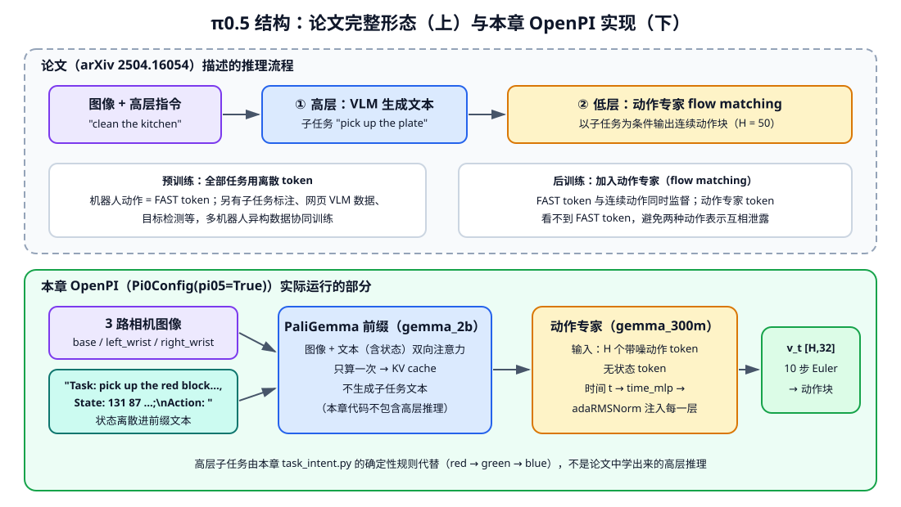

<p align="center"><b>图 14-10</b> π0.5：论文中的高层子任务 + 低层动作专家流程（上），以及本章 OpenPI 实际运行的部分（下）</p>

与 π0 相比，OpenPI 中的 π0.5 在结构上有两处改动，`pi0_config.py` 的注释写得很清楚：

```python
# 摘自 openpi/src/openpi/models/pi0_config.py
# Pi05 has two differences from Pi0:
# - the state input is part of the discrete language tokens rather than a continuous input that is part of the suffix
# - the action expert uses adaRMSNorm to inject the flow matching timestep
pi05: bool = False
```

**改动 1：状态离散进前缀文本。** `PaligemmaTokenizer.tokenize` 在 π0.5 格式下把状态写进提示：

```python
# 摘自 openpi/src/openpi/models/tokenizer.py（PaligemmaTokenizer.tokenize）
cleaned_text = prompt.strip().replace("_", " ").replace("\n", " ")
if state is not None:
    # This is the Pi05 format, where the state is part of the discrete language input.
    discretized_state = np.digitize(state, bins=np.linspace(-1, 1, 256 + 1)[:-1]) - 1
    state_str = " ".join(map(str, discretized_state))
    full_prompt = f"Task: {cleaned_text}, State: {state_str};\nAction: "
    tokens = self._tokenizer.encode(full_prompt, add_bos=True)
else:
    # This is the Pi0 format, where the state is part of the continuous action expert input.
    tokens = self._tokenizer.encode(cleaned_text, add_bos=True) + self._tokenizer.encode("\n")
```

本章的 G2 状态补齐到 32 维后，每一维都会变成一个 0–255 的整数写进提示，再加上指令文本，这就是本章把 `max_token_len` 设为 200（instruction）/ 220（manipulation）的原因。`state` 在进入分词器之前已经过分位数归一化（`Normalize` 位于 `model_transforms` 之前），所以落在 $[-1,1]$ 附近；超出范围的值会被 `np.digitize` 分到两端的档位。

**改动 2：流时间用 adaRMSNorm 注入。** π0 把时间编码和动作拼接后过 MLP；π0.5 把时间单独过 `time_mlp`，作为 `adarms_cond` 传给动作专家每一层的自适应 RMSNorm。论文也描述了这一点：时间步经单独 MLP 投影后通过 adaptive RMSNorm 注入动作专家的每一层。

```python
# 摘自 openpi/src/openpi/models/pi0.py（Pi0.embed_suffix，pi05=True 分支）
action_tokens = self.action_in_proj(noisy_actions)
time_emb = posemb_sincos(timestep, self.action_in_proj.out_features, min_period=4e-3, max_period=4.0)
if self.pi05:
    # time MLP (for adaRMS)
    time_emb = self.time_mlp_in(time_emb)
    time_emb = nnx.swish(time_emb)
    time_emb = self.time_mlp_out(time_emb)
    time_emb = nnx.swish(time_emb)
    action_expert_tokens = action_tokens          # 动作 token 不再拼接时间
    adarms_cond = time_emb                        # 时间作为归一化层的条件
```

构造模型时 `use_adarms=[False, True]`：只有动作专家（第二个专家）使用 adaRMSNorm，PaliGemma 主干不变。

**注意力掩码**：π0.5 后缀没有状态 token，只有 $H$ 个动作 token（`ar_mask = [1, 0, …, 0]`）。仍以 2 个图像 + 1 个文本 + 1 个状态文本 token + 3 个动作 token 为例：`mask_ar = [0,0,0,0, 1,0,0]`，cumsum = `[0,0,0,0,1,1,1]`——前缀 4 个 token 互看，动作 token 看全部（见图 14-5 右）。

论文中完整的 π0.5 还有一部分 OpenPI 没有：预训练时的 FAST 动作 token 与动作专家同时存在于序列中。据论文描述，FAST 动作 token 可以看前缀并自回归地看之前的 FAST token；动作专家的 token 可以看前缀和彼此，但**看不到 FAST token**，以避免两种动作表示之间的信息泄露。

#### 2.4.3 训练方法：异构协同训练、高层子任务、离散 + 连续、知识隔离

**(1) 异构协同训练数据**。据论文，π0.5 的训练混合包括：多种机器人的动作数据；带语义子任务标注的高层（high-level, HL）数据，例如在一段示范中标出当前子任务"pick up the cutting board"；网页数据；以及把图像观察、语言命令、目标检测、语义子任务预测和低层动作组合在一起的多模态样本。所有任务共享同一个模型。

**(2) 两阶段训练与组合损失**。据论文：

- **预训练**：所有任务（包括带机器人动作的任务）都用**离散 token** 表示，机器人动作用 FAST 分词器编码。这样模型就是一个标准 VLM Transformer，训练简单高效。
- **后训练**：加入动作专家，用 flow matching 目标训练，动作块长度 50；同时保留离散 token 的预测。

组合目标可以写成"文本/离散 token 的交叉熵 + α × flow matching 损失"：

$$
\mathcal{L}=\mathcal{L}_{\mathrm{CE}}(\text{子任务文本、FAST 动作 token、VLM 数据})+\alpha\,\mathcal{L}_{\mathrm{flow}}
$$

预训练阶段 $\alpha=0$（只有离散 token），后训练阶段引入动作专家后 $\alpha>0$。

**(3) 高层子任务预测**。HL 数据让模型学会：给定图像和高层指令（"clean the bedroom"），先用**文字**输出当前子任务（"pick up the pillow"），再以这个子任务为条件输出动作。高层推理和低层控制在**同一个模型**中完成。

**(4) 知识隔离（Knowledge Insulation）**。知识隔离论文（arXiv 2505.23705）指出：在预训练 VLM 上直接接一个从头初始化的连续动作专家并联合训练，会明显损害训练速度和知识迁移——新模块的梯度会冲刷 VLM 原有的语义表示。π0.6 model card 对这一做法的描述是：主干用 FAST 离散 token 学动作，动作专家预测连续动作，**动作专家的梯度不回传到 VLM 主干**（stop-gradient）。OpenPI README 说明 π0.5 是"使用知识隔离训练的"，`pi05_droid` checkpoint 也注明使用了知识隔离。

> ⚠️ **注意**：知识隔离发生在**训练官方 checkpoint** 的过程中。本章用 OpenPI 微调时只有 flow matching 损失，没有 FAST token 分支，也没有 stop-gradient 设计。本章对 π0.5 的保护手段是 LoRA（第四部分）：冻结主干原权重、只训练低秩增量。

#### 2.4.4 推理过程

论文中完整的 π0.5 推理：

1. 输入图像、高层指令和（离散化的）状态；
2. VLM 自回归生成**子任务文本**（如"pick up the plate"）；
3. 以子任务为条件，动作专家用 flow matching（10 步左右的积分）生成连续动作块；
4. 执行一段后重新观察，回到第 2 步，必要时切换子任务。

本章 OpenPI 中的 π0.5 推理：

1. `TaskIntent.prompt()` 根据已完成颜色**确定性地**给出单色子任务指令（red → green → blue）；
2. `G2Inputs` 组装三路图像与 16/21 维状态，补齐到 32 维；`Normalize` 做分位数归一化；`TokenizePrompt(discrete_state_input=True)` 把状态写进提示；
3. `Pi0.sample_actions`（`pi05=True`）：前缀 KV 缓存 + 10 步 Euler；
4. `Unnormalize` → `AbsoluteActions` → `G2Outputs` 得到 G2 绝对关节目标，经 WebSocket 返回。

#### 2.4.5 与 OpenPI 代码的对应

| π0.5 概念 | OpenPI / 本章位置 | 本章是否使用 |
|---|---|---|
| 状态离散进提示 | `PaligemmaTokenizer.tokenize(prompt, state)`；`TokenizePrompt(discrete_state_input=...)`；`Pi0Config.discrete_state_input`（默认等于 `pi05`） | 使用（`g2_policy.py` 显式 `discrete_state_input=True`） |
| adaRMSNorm 时间注入 | `Pi0.embed_suffix` 的 `pi05` 分支；`time_mlp_in/out`；`use_adarms=[False, True]` | 使用 |
| flow matching 动作专家 | `Pi0.compute_loss / sample_actions`（与 π0 共用） | 使用 |
| 分位数归一化 | `use_quantile_norm=model_config.model_type != ModelType.PI0` | 使用 |
| 官方示例配置 | `pi05_droid`、`pi05_libero`、`pi05_aloha` 等；`pi05_libero` 使用 `discrete_state_input=False` | 本章自建 `chapter14_*_runtime` 与 `pi05_g2_color_blocks` |
| 高层子任务文本生成 | — | **本章代码不包含**；以 `task_intent.py` 的确定性规则代替 |
| 预训练阶段的 FAST 离散动作 token、组合损失 | — | **本章代码不包含**（OpenPI README："只支持 π0.5 的 flow matching 头的训练和推理"） |
| 知识隔离（stop-gradient） | — | **本章代码不包含**（只体现在官方 checkpoint 中） |
| 异构协同训练数据（网页数据、HL 数据、多机器人混合） | — | **本章代码不包含** |

需要注意，研究论文中的 π0.5 高层—低层统一能力，不等于本章已经完整复现。本章的 `task_intent.py` 用确定性的 red → green → blue 顺序把长任务拆成三个清晰指令，它借鉴"高层动作意图"的思想，但不是论文中训练得到的高层推理器，也不是 ACoT-VLA。

### 2.5 π0.6 与 π\*0.6：更强主干，以及从经验中学习

> ⚠️ **注意**：π0.6 没有开源权重，本章内嵌 OpenPI 也不包含它。本节内容来自 Physical Intelligence 发布的 π0.6 model card（2025 年 11 月）和 π\*0.6 论文（arXiv 2511.14759），只写能从这两份资料核实的事实。

#### 2.5.1 动机

π0.5 证明了"知识迁移 + 高低层统一"能带来开放世界泛化，但两个问题仍然存在：一是主干规模和动作专家容量有限；二是模型只从示范中模仿，**无法从自己的成功和失败中变得更好**——在长时间、真实部署的任务中，示范数据覆盖不到的错误会反复出现。π0.6 主要回应第一点；π\*0.6 是在 π0.6 上用强化学习方法 RECAP 改进得到的版本，回应第二点。

#### 2.5.2 模型结构

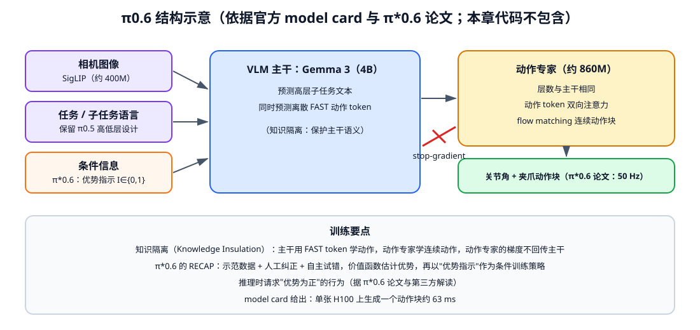

<p align="center"><b>图 14-11</b> π0.6：Gemma 3 4B 主干预测子任务与 FAST token，约 860M 的动作专家预测连续动作，两者之间做梯度隔离</p>

据 π0.6 model card 与 π\*0.6 论文：

- **延续 π0.5 的分层设计**：保留高层子任务预测和低层动作生成。
- **VLM 主干**：SigLIP（约 400M）视觉编码器 + Gemma 3（4B）语言模型。
- **动作专家**：约 860M 参数，**层数与主干相同**；送入动作专家的动作 token 之间使用双向注意力；用 flow matching 训练。
- **输出**：π\*0.6 论文描述为 50 Hz 的关节角与夹爪指令动作块。
- **延迟**：model card 给出单张 H100 上生成一个动作块约 63 ms。

原文提到"π0.6 允许把期望的速度或策略等执行方式元数据加入 Prompt"。能核实的相近事实是：π\*0.6 在输入中加入一个二值的**优势指示**（advantage indicator）作为条件；而"速度、质量等回合元数据"在 π0.7 的官方博客中有明确描述（见 2.6）。π0.6 基础模型本身的提示格式，本章未能从官方资料核实。

#### 2.5.3 训练方法

**知识隔离联合训练**（model card）：主干预测 FAST 离散动作 token，动作专家预测连续动作，动作专家的梯度**不回流**到主干。与 π0.5 先离散预训练、后加动作专家的两阶段做法相比，这相当于在同一次训练中同时学两种动作表示，但用 stop-gradient 保护主干。

**RECAP（π\*0.6）**：RL with Experience & Corrections via Advantage-conditioned Policies。据 π\*0.6 论文与官方介绍，它把三类数据组织在一起：

1. 初始示范数据；
2. 机器人出错时，人类专家给出的实时纠正；
3. 机器人自主执行产生的成功与失败经验。

训练一个单独的价值函数（由一个较小的预训练 VLM 初始化）来估计每个动作相对当前策略是否"有优势"；把优势是否超过阈值二值化为 $I\in\{0,1\}$，作为条件放进策略的输入，并在训练中以一定概率丢弃这个条件。直觉上，模型同时学会了"好的做法"和"不好的做法"分别长什么样；推理时把条件设为"有优势"，就能请求更好的行为。

#### 2.5.4 推理过程

1. 输入图像与任务语言（π\*0.6 还在输入中给出"优势为正"的条件）；
2. 主干推断子任务；
3. 动作专家以主干特征为条件，用 flow matching 生成连续动作块；
4. 执行后重新观察。

#### 2.5.5 与 OpenPI 代码的对应

**本章代码不包含** π0.6 / π\*0.6 的任何部分：没有 Gemma 3 主干变体（`gemma.py` 的 `Variant` 只有 `dummy`、`gemma_300m(_lora)`、`gemma_2b(_lora)`），没有 860M 动作专家配置，没有 FAST + 连续动作联合训练和 stop-gradient，没有价值函数与 RECAP。π0.6 的输入协议、模型规模和 checkpoint 与本章 G2 适配层都不同，不能把权重目录名称换一下就运行。

### 2.6 π0.7：可引导（steerable）的通用模型

> ⚠️ **注意**：本节依据 Physical Intelligence 官方博客"π0.7: a Steerable Model with Emergent Capabilities"与论文 arXiv 2604.15483（2026 年 4 月）。π0.7 没有在本章代码中实现。参数规模等只见于第三方解读的信息本节不写。

#### 2.6.1 动机：同一句任务，可以有很多种"做法"

当训练数据越来越多、越来越杂——不同机器人、不同操作员、不同熟练度、不同速度、甚至 RECAP 里的失败经验——模型就面临一个难题：同一句"折衣服"，数据里有快的、慢的、好的、差的做法，模型该学哪一种？如果直接混合训练，结果可能是"平均风格"；如果只用高质量数据，又浪费了大量数据。

π0.7 的回答是：**让提示（prompt）不仅说"做什么"，还说"以什么方式做"**。据官方博客，这种设计使得包含不同策略、不同行为、不同熟练程度的多样数据都可以被纳入训练。

#### 2.6.2 模型结构：更丰富的提示上下文

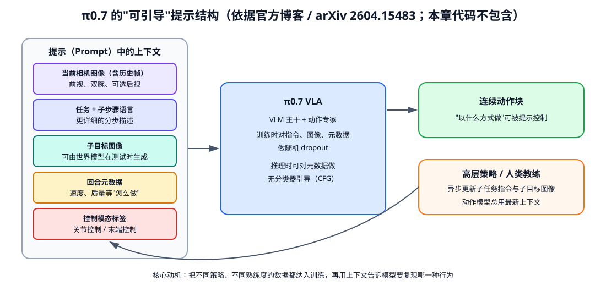

<p align="center"><b>图 14-12</b> π0.7：提示中包含历史图像、分步语言、子目标图像、回合元数据和控制模态，高层策略或人类可异步更新</p>

据官方博客与论文，π0.7 的提示可以包含：

- **更详细的语言**：描述整个任务以及各个子步骤；
- **回合元数据**：描述这次任务是如何完成的，例如速度和质量；
- **控制模态标签**：指明使用关节控制还是末端执行器控制；
- **视觉子目标图像**：展示当前子步骤结束时场景应该是什么样；这些图像可以在测试时由一个**世界模型**生成。据博客，世界模型的训练加入了网页数据、第一人称人类视频等视频数据，从中获得的语义与物理概念可以经由子目标图像迁移到 π0.7；
- **多路相机与历史帧**：据论文，模型最多接收 4 路相机（前视、两个手腕视角，可选后视），每路最多 6 帧历史，以及最多 3 张子目标图像；观测和子目标图像都被缩放到 448×448。

主干与动作专家的细节（层数、参数量等），本章未能从官方资料核实，不在此给出。

#### 2.6.3 训练方法

- **多样化提示训练**：训练样本的提示中同时出现任务描述、子步骤语言、生成的子目标图像和回合元数据；训练时混合真实的未来图像和生成的子目标图像。
- **条件 dropout**：训练时对指令、图像和元数据做随机丢弃，保证推理时可以灵活地只给部分提示。

#### 2.6.4 推理过程

1. 高层策略或人类"教练"给出/更新子任务指令与子目标图像；
2. 动作模型读取当前多路相机图像（含历史帧）与最新上下文，生成动作块；
3. 动作推理与子目标生成**异步**运行，动作模型总是使用最新可用的上下文；
4. 可以对回合元数据使用**无分类器引导**（Classifier-Free Guidance, CFG），以引出特定行为，例如更快或更高质量。

#### 2.6.5 与 OpenPI 代码的对应

**本章代码不包含** π0.7：没有多帧历史编码、子目标图像输入、世界模型、元数据 CFG 或控制模态标签。本章能对应的只有一点思想上的联系：`TaskIntent` 把长任务拆成更清晰的子任务指令，相当于一个极简的、由规则实现的"高层教练"。

这种设计试图回答"做什么"以外的"以什么方式做"。它也说明 VLA 的发展并不是一直扩大动作头，而是在数据组织、上下文表达、跨机器人迁移和训练目标上共同演进。

### 2.7 π 系列总对比

| 模型 | 主干 | 动作表示 / 动作头 | 状态输入 | 训练数据与目标 | 关键创新 | 本章 OpenPI 是否支持 |
|---|---|---|---|---|---|---|
| **π0** | PaliGemma（约 3B；OpenPI 中 SigLIP So400m/14 + `gemma_2b`） | 连续动作块；约 300M 动作专家（`gemma_300m`），flow matching，10 步 Euler | 连续状态 → 后缀中 1 个 token | 多机器人、多任务预训练 + 高质量后训练；速度场 MSE | VLM + 动作专家；块状因果注意力；前缀 KV 缓存 | **支持**（`Pi0Config(pi05=False)`；本章不运行） |
| **π0-FAST** | PaliGemma（`gemma_2b`），无动作专家 | 离散 FAST token（DCT + 量化 + BPE），自回归解码 | 离散 256 档写进文本前缀 | 下一个 token 交叉熵，只在动作后缀上计算 | 频率域动作压缩，复用语言模型训练方式 | **支持**（`Pi0FASTConfig`；本章不运行；FAST 分词器源码不在本章） |
| **π0.5** | PaliGemma 系主干 + 动作专家（OpenPI：`gemma_2b` + `gemma_300m`） | 论文：预训练 FAST 离散 token，后训练加 flow matching 动作专家；OpenPI：只有 flow matching 头 | 离散 256 档写进文本前缀 | 多机器人 + 高层子任务标注 + 网页数据等异构协同训练；CE + α·flow | 开放世界泛化；高低层统一；adaRMSNorm 时间注入；知识隔离 | **部分支持**（flow matching 头的训练与推理；本章案例主线） |
| **π0.6** | SigLIP（约 400M）+ Gemma 3 4B | 主干预测 FAST token + 约 860M 动作专家（flow matching） | 本章未能核实 | 知识隔离联合训练；π\*0.6 加 RECAP（示范 + 纠正 + 自主经验，优势条件化） | 更大主干与动作专家；从经验中学习 | **不支持** |
| **π0.7** | 本章未能从官方资料核实 | 连续动作块；提示可引导 | 多路相机 + 历史帧 | 多样化提示（子步骤语言、子目标图像、元数据）+ 条件 dropout | 可引导执行；子目标图像由世界模型生成；元数据 CFG | **不支持** |

截至本章代码快照，`code/code_chapter14/openpi` 的模型清单只直接列出 π0、π0-FAST 和 π0.5。

> 💡 **要点**：横向看，π 系列一直在回答同一个问题的不同侧面——"VLM 的知识怎样变成好动作"。π0 给出了连续动作头，π0-FAST 给出了离散 token 的高效表示，π0.5 把两者结合并加入高层推理与异构数据，π0.6 用更大模型和知识隔离把两者联合训练、并从经验中学习，π0.7 则让上下文决定"怎样做"。本章案例使用的是其中最成熟、开源支持最完整的一段：π0.5 的 flow matching 动作头。

---

## 第三部分 动作表示、维度适配与归一化

第二部分讲的是"模型内部怎么生成一个 $[H,32]$ 的数组"；这一部分讲"这个数组怎样和 G2 的真实关节对上"。这是部署中最容易出错、也最难从现象上定位的环节。

### 3.1 本章 π0.5 的配置参数

本章 π0.5 配置中的主要结构参数为：

```text
VLM variant:          gemma_2b
Action expert:        gemma_300m
Model action_dim:     32
Instruction horizon:  50
Manipulation horizon: 30
```

LoRA 微调时对应切换为 `gemma_2b_lora` 和 `gemma_300m_lora`（`gemma.py` 中分别是秩 16 和秩 32 的 LoRA，作用在注意力和前馈层）。这里的 32 是 OpenPI 模型内部统一动作维度，不代表 G2 实际有 32 个受控关节；本章适配层会把 G2 的 16 或 21 维数据补零到 32 维，并在输出时裁剪回来。

```python
# 摘自 code/code_chapter14/g2_policy.py
MODEL_SPECS = {
    "instruction": {"horizon": 50, "token_len": 200, "input_dim": 16, "output_dim": 16},
    "manipulation": {"horizon": 30, "token_len": 220, "input_dim": 21, "output_dim": 21},
    "finetuned": {"horizon": 50, "token_len": 200, "input_dim": 16, "output_dim": 16},
}

def make_runtime_config(model_kind: str, *, lora: bool = False):
    # ...
    spec = MODEL_SPECS[model_kind]
    return config.TrainConfig(
        name=f"chapter14_{model_kind}_runtime",
        model=pi0_config.Pi0Config(
            pi05=True,                                  # 走 π0.5 分支：状态进文本 + adaRMSNorm
            action_dim=32,
            action_horizon=spec["horizon"],
            max_token_len=spec["token_len"],
            discrete_state_input=True,
            paligemma_variant="gemma_2b_lora" if lora else "gemma_2b",
            action_expert_variant="gemma_300m_lora" if lora else "gemma_300m",
        ),
        # ...
    )
```

### 3.2 绝对动作、增量动作与关节顺序

动作数值本身没有脱离数据约定的意义。常见表示包括：

- 绝对关节目标： $a_t=q_{t+1}^{\mathrm{target}}$；
- 增量关节动作： $a_t=q_{t+1}^{\mathrm{target}}-q_t$；
- 末端位姿增量：位置和旋转变化，再由控制器或 IK 转成关节动作；
- 力、速度或混合控制量。

本章原始数据保存的是 **16 维绝对关节目标**：

```text
左臂7 + 右臂7 + 左夹爪1 + 右夹爪1
```

但 OpenPI 的 `G2DataConfig` 在模型训练前执行约定转换：前 14 个机械臂关节改成 delta，最后两个夹爪保持 absolute；模型输出后再恢复为执行端需要的绝对动作。对于 21 维 manipulation 布局，额外包含腰部 5 维。

```python
# 摘自 code/code_chapter14/g2_policy.py（G2DataConfig.create）
# manipulation原模型还包含腰部：14臂delta、2夹爪absolute、其余delta。
mask = (
    transforms.make_bool_mask(14, -2, 16)       # 14 个 True、2 个 False、16 个 True
    if self.manipulation_layout
    else transforms.make_bool_mask(14, -2)      # 14 个 True、2 个 False
)
data = data.push(
    inputs=[transforms.DeltaActions(mask)],     # 训练/推理输入：absolute → delta
    outputs=[transforms.AbsoluteActions(mask)], # 推理输出：delta → absolute
)
```

```python
# 摘自 openpi/src/openpi/transforms.py（DeltaActions.__call__）
state, actions = data["state"], data["actions"]
mask = np.asarray(self.mask)
dims = mask.shape[-1]
actions[..., :dims] -= np.expand_dims(np.where(mask, state[..., :dims], 0), axis=-2)  # 每一步都减去"当前"状态
```

**案例**：某帧右臂第 1 关节当前状态 $q=0.20$ rad，动作块前三步的绝对目标是 $0.22, 0.25, 0.27$ rad，右夹爪目标 $-0.785$（张开）。经过 `DeltaActions`：右臂第 1 关节变为 $0.02, 0.05, 0.07$（**都相对于同一个当前状态**，而不是相邻差分）；右夹爪 mask 为 False，保持 $-0.785$。推理时模型输出 delta，`AbsoluteActions` 再加回 $0.20$。

这说明"数据文件里是绝对动作"和"模型内部训练使用部分增量动作"可以同时成立。若跳过适配层或重复做一次 delta 转换，动作就会严重错误。

> ⚠️ **注意**：`G2Inputs` 在 manipulation 布局（`mask_manipulation_state=True`）下会把状态的 `[14:16]`（夹爪）和 `[16:20]` 以及动作的 `[16:20]` 置零，这是为了与公开 manipulation baseline 的训练约定一致。不要自行"修复"这几行，否则输入分布会与 checkpoint 不符。

### 3.3 输入适配：图像键与 32 维补齐

```python
# 摘自 code/code_chapter14/g2_policy.py（G2Inputs.__call__）
state = np.asarray(data["state"], dtype=np.float32).reshape(-1).copy()
if state.size != self.input_dim:
    raise ValueError(f"G2 state应为{self.input_dim}维，实际为{state.size}")
# ...
state = transforms.pad_to_dim(state, self.action_dim)        # 16/21 → 32，补 0
result = {
    "state": state,
    "image": {
        "base_0_rgb": _image(data["images"], "top_head"),         # 头部相机 → π0/π0.5 的 base 视角
        "left_wrist_0_rgb": _image(data["images"], "hand_left"),
        "right_wrist_0_rgb": _image(data["images"], "hand_right"),
    },
    "image_mask": {"base_0_rgb": np.True_, "left_wrist_0_rgb": np.True_, "right_wrist_0_rgb": np.True_},
}
```

`_image()` 把浮点图像乘 255 转为 `uint8`，并把 `[3,H,W]` 转成 `[H,W,3]`。之后 OpenPI 的 `ResizeImages(224, 224)` 统一尺寸，所以 Isaac Sim 输出的 320×240 图像可以直接送入。输出端 `G2Outputs` 只做一件事：`actions[..., :output_dim]`，把 32 维裁回 16 或 21 维。

### 3.4 归一化为何必须与 checkpoint 配套

不同关节的数值范围差异很大。若直接训练，变化较大的维度会主导损失。OpenPI 统计每个状态和动作维度的均值、标准差以及 1%/99% 分位数，并写入 `norm_stats.json`。策略创建时先归一化输入，模型输出后再反归一化。

概念上，标准化可以写成：

$$
\tilde x=\frac{x-\mu}{\sigma+\varepsilon}
$$

分位数归一化则利用 $q_{0.01}$ 和 $q_{0.99}$ 降低少量极端值的影响：

$$
\tilde x=\frac{x-q_{0.01}}{q_{0.99}-q_{0.01}+\varepsilon}\times2-1
$$

```python
# 摘自 openpi/src/openpi/transforms.py
def _normalize(self, x, stats: NormStats):
    mean, std = stats.mean[..., : x.shape[-1]], stats.std[..., : x.shape[-1]]
    return (x - mean) / (std + 1e-6)

def _normalize_quantile(self, x, stats: NormStats):
    # ...
    q01, q99 = stats.q01[..., : x.shape[-1]], stats.q99[..., : x.shape[-1]]
    return (x - q01) / (q99 - q01 + 1e-6) * 2.0 - 1.0          # 把 [q01, q99] 映射到 [-1, 1]
```

OpenPI 按模型类型选择：`use_quantile_norm=model_config.model_type != ModelType.PI0`，即 π0 用均值/标准差，π0-FAST 和 π0.5 用分位数。本章是 π0.5，因此用分位数归一化。

**案例**：某关节 $q_{0.01}=-0.5$、 $q_{0.99}=1.5$。 $x=0.5$ 时 $\tilde x=(1.0/2.0)\times2-1=0$； $x=1.5$ 时 $\tilde x=1$； $x=2.0$ 时 $\tilde x=1.5$——超出 $[-1,1]$ 不会被截断，但离散状态时会落进最高档 255。反过来，若误用另一份统计（例如 $q_{0.01}=0$、 $q_{0.99}=1$），同样的 $x=0.5$ 会被映射成 $0$ 而反归一化时却按原范围还原，动作就会整体偏移。

无论使用哪一种，统计量都隐含了：

- 机器人实体；
- 关节顺序；
- 状态和动作维度；
- 数据采集范围；
- absolute/delta 约定。

因此不能把 A checkpoint 的参数与 B 数据集的 `norm_stats.json` 随意组合。`serve_model.py` 会在 checkpoint 的 `assets` 下查找唯一一份统计文件，避免静默使用错误统计量：

```python
# 摘自 code/code_chapter14/openpi_runtime.py
def find_norm_stats(checkpoint: Path) -> Path:
    """兼容发布权重assets/norm_stats.json和训练权重assets/<id>/norm_stats.json。"""
    files = sorted((checkpoint / "assets").rglob("norm_stats.json"))
    if len(files) != 1:
        raise FileNotFoundError(
            f"{checkpoint / 'assets'}中应有且只有一个norm_stats.json，实际找到{len(files)}个"
        )
    return files[0].parent
```

### 3.5 一次推理中数据经过的完整变换链

把第二、三部分串起来，`policy_config.create_trained_policy` 组装的输入/输出变换顺序为：

```text
输入：repack（训练时：LeRobot 键 → images/state/actions/prompt）
   → InjectDefaultPrompt
   → G2Inputs（图像键重组，16/21 → 32 维补零）
   → DeltaActions（只有训练样本带 actions，推理时是空操作）
   → Normalize（分位数）
   → InjectDefaultPrompt → ResizeImages(224,224)   ← 以下为 model_transforms
   → TokenizePrompt(discrete_state_input=True)（状态写进提示）
   → PadStatesAndActions(32)
模型：Pi0.sample_actions（π0.5 分支，10 步 Euler）
输出：Unnormalize（分位数反变换）
   → AbsoluteActions（delta → absolute）
   → G2Outputs（32 → 16/21 维）
```

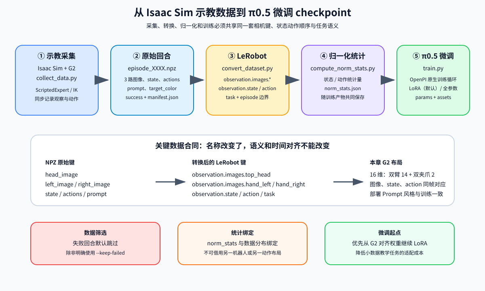

<p align="center"><b>图 14-13</b> NPZ 回合、LeRobot 数据、归一化统计与微调 checkpoint 之间的对应关系</p>

### 3.6 闭环执行不是简单播放动作

本章推理链路为：

```text
三路 RGB 图像 + G2 状态 + Prompt
                ↓ WebSocket
         π0.5 policy server
                ↓
       action chunk: [H, D]
                ↓
  形状/有限值检查、裁剪、夹爪转换
                ↓
        Isaac Sim 执行 K 步
                ↓
  重新采图、读状态、判断物块是否入盒
```

模型返回的是一段候选动作，不是已经验证的轨迹。客户端仍会检查二维形状、动作维度和有限值；`robot.py` 再进行关节限位裁剪。夹爪模型空间中打开约为 `-0.785`，闭合约为 `0.0`，转换到 OmniPicker 物理 outer joint 时会取反；inner joint 是 PhysX mimic 关节，不独立下发目标。

```python
# 摘自 code/code_chapter14/robot.py
def model_gripper_to_joint(value: float) -> float:
    return float(np.clip(-value, GRIPPER_CLOSED_RAD, GRIPPER_OPEN_RAD))   # 取反并限制在 [0, 0.785]

def gripper_closed_amount(model_value: float) -> float:
    joint = model_gripper_to_joint(model_value)
    return float((GRIPPER_OPEN_RAD - joint) / GRIPPER_OPEN_RAD)           # 0 = 全开，1 = 全闭

# G2Robot.apply_absolute 中：
arms = np.clip(action[:14], ARM_LOWER_14, ARM_UPPER_14)                   # 机械臂关节限位裁剪
grippers = np.clip(action[14:16], -GRIPPER_OPEN_RAD, -GRIPPER_CLOSED_RAD) # 模型空间 [-0.785, 0]
left_outer = model_gripper_to_joint(grippers[0])
right_outer = model_gripper_to_joint(grippers[1])
# inner关节在G2 USD中是outer的PhysX mimic关节，没有独立drive。
```

**案例**：模型输出右夹爪 $-0.785$ → outer joint $0.785$ rad，闭合量 $0$（全开）；输出 $-0.3925$ → outer joint $0.3925$，闭合量 $0.5$；输出 $+0.1$（越界）→ 先被裁剪到 $0$ → outer joint $0$，闭合量 $1$（全闭）。右臂第 4 关节若输出 $1.2$ rad，超过上限 `ARM_UPPER_7[3] = 1.0472`，会被裁剪为 $1.0472$。

> 💡 **要点**：客户端 `Pi05Client.infer` 负责"形状对不对、有没有 NaN"，`G2Robot.apply_absolute` 负责"数值在不在物理范围内"。这两层检查不能互相替代，也不能用来掩盖 checkpoint 或归一化错误。

---

## 第四部分 数据采集、LeRobot 格式与微调

### 4.1 示教数据如何采集

**直观理解**：行为克隆的上限由示教质量决定。VLA 数据最重要的不是"文件很多"，而是每一帧的观察、状态、动作和任务语义时间对齐。

本章使用脚本专家生成可重复的仿真示教：

1. G2 先回到公开数据使用的 home 姿态；
2. 红、绿、蓝按回合编号轮换；
3. 左臂保持不动，右臂用数值 IK 依次到达预抓取、抓取、抬起、盒子上方和放置位姿；
4. 夹爪真实闭合，依靠碰撞、摩擦和关节驱动夹住物块；
5. 以 10 Hz 记录三路图像、当前 16 维状态和本步实际下发的 16 维绝对目标；
6. 根据物块是否进入盒子记录 `success`。

```python
# 摘自 code/code_chapter14/expert.py（ScriptedExpert.run，删减）
q_above = self.solve(above)                    # 物块上方（pregrasp_clearance = 0.19 m）
q_grasp = self.solve(grasp, q_above)           # 抓取位，以上一个解作为 IK 初值
q_above_box = self.solve(above_box, q_above)
q_place = self.solve(place, q_above_box)
self.move(q_above, -0.785, 1.3)                # 张开夹爪移到上方，用时 1.3 s
self.move(q_grasp, -0.785, 0.8)                # 下降
self.move(q_grasp, 0.0, 0.75)                  # 原地闭合夹爪
self.move(q_above, 0.0, 1.2)                   # 抬起
self.move(q_above_box, 0.0, 1.3)               # 移到盒子上方
self.move(q_place, 0.0, 0.7)                   # 下降到放置位
self.move(q_place, -0.785, 0.45)               # 松开
self.move(q_above_box, -0.785, 0.8)
self.move_action(home, 1.3)                    # 回到 home
```

`_step()` 中先 `should_record()` 决定是否采样，再在**下发动作之前**读取图像和状态，下发后把实际应用（裁剪后）的动作写入数据——这保证了"这一帧看到的画面"与"这一帧做出的动作"是因果对齐的。`collect_data.py` 用 `sample_every = physics_hz // DATASET_FPS = 120 // 10 = 12` 控制采样间隔。

**案例**：一个回合的总时长约为 $1.5$（回 home） $+1.3+0.8+0.75+1.2+1.3+0.7+0.45+0.8+1.3=10.1$ s，按 10 Hz 记录约 101 帧（实际帧数以 `manifest.json` 为准）。用 instruction 模型 $H=50$ 训练时，每个样本是从某一帧开始的 50 帧动作块（5 s），回合末尾不足 50 帧的部分由 LeRobot 数据加载器处理。

脚本专家的意义是建立一个可控的教学数据源，不代表 VLA 部署时仍通过 IK 规划动作。采集用 `expert.py`，VLA 推理用 `run_inference.py`，两条路径是分开的。

每个回合只示教一种颜色：

```text
Pick up the red block and place it into the empty box.
```

这样少量数据更容易学到单一技能。部署时再由 `TaskIntent` 把三色长任务拆成三次单物块任务，比用几十个回合直接学习超长任务更稳定。

### 4.2 原始 NPZ 回合格式

`dataset.py` 将每个回合保存为 `episode_XXXX.npz`。主要字段为：

| 字段 | 含义 | 典型形状或类型 |
|---|---|---|
| `head_image` | 头部 RGB 图像序列 | `[T,H,W,3]`, `uint8` |
| `left_image` | 左腕 RGB 图像序列 | `[T,H,W,3]`, `uint8` |
| `right_image` | 右腕 RGB 图像序列 | `[T,H,W,3]`, `uint8` |
| `state` | 当前 G2 状态 | `[T,16]`, `float32` |
| `actions` | 本帧对应的绝对动作目标 | `[T,16]`, `float32` |
| `prompt` | 本回合语言指令 | 字符串 |
| `target_color` | 目标颜色 | 字符串 |
| `success` | 物块是否真实进入盒子 | 布尔值 |

目录中还会生成 `manifest.json`，记录每个回合的文件名、帧数、颜色、成功标志和 Prompt。转换脚本默认跳过失败回合；若研究失败恢复，可以显式保留失败回合（`--keep-failed`），但必须重新设计标签和训练目的，不能把失败动作当作成功专家动作直接监督。

> 💡 **要点**：π\*0.6 的 RECAP 与 π0.7 的元数据条件化，正是"如何正确使用不完美数据"的研究答案（2.5、2.6 节）。本章的简化做法是只训练成功回合。

### 4.3 转换成 LeRobot 数据集

OpenPI 使用 LeRobot 数据接口。本章的 `convert_dataset.py` 将 NPZ 转换为以下键：

```text
observation.images.top_head
observation.images.hand_left
observation.images.hand_right
observation.state
action
task
```

其中 `task` 保存语言指令。训练配置设置 `prompt_from_task=True`，加载时会把它变成策略所需的 Prompt。

16 维名称与顺序固定为：

```text
left_arm_1 ... left_arm_7,
right_arm_1 ... right_arm_7,
left_gripper, right_gripper
```

转换后的数据位于：

```text
code/code_chapter14/data/lerobot/chapter14/g2_color_blocks
```

```python
# 摘自 code/code_chapter14/convert_dataset.py（删减）
dataset = LeRobotDataset.create(
    repo_id=args.repo_id, root=output, robot_type="G2_omnipicker",
    fps=DATASET_FPS, features=features, use_videos=True, image_writer_threads=8,
)
for path in episodes:
    with np.load(path, allow_pickle=False) as data:
        prompt = str(data["prompt"])
        for head, left, right, state, action in zip(
            data["head_image"], data["left_image"], data["right_image"],
            data["state"], data["actions"], strict=True,           # strict=True：帧数不一致直接报错
        ):
            dataset.add_frame({
                "observation.images.top_head": head,
                "observation.images.hand_left": left,
                "observation.images.hand_right": right,
                "observation.state": state,
                "action": action,
                "task": prompt,
            })
        dataset.save_episode()
```

LeRobot 会组织元数据、帧索引和视频文件，便于按回合读取。更换相机名、状态名或关节顺序时，必须同步修改转换器、`G2DataConfig`、运行时输入和统计文件，不能只改数据表头。

### 4.4 数据质量与随机化

建议先采集固定位置数据，确认抓取、放置和时间对齐都正确，再逐渐增加 `--position-noise 0.01` 或 `0.02`。随机化太早可能让 IK 失败、抓取碰撞和视觉遮挡混在一起，难以判断模型问题还是数据源问题。

高质量数据至少应检查：

- 相机没有黑帧、冻结帧或 RGBA/RGB 混用；
- 图像、state 和 action 的帧数完全一致；
- 夹爪闭合发生在到达抓取位之后；
- 关节目标没有持续越界或突跳；
- 成功回合确实完成任务，失败回合没有误标；
- 数据包含部署时会遇到的物体位置和视角变化；
- Prompt 语言风格与部署指令一致。

"增加数据量"不能替代这些检查。大量错误时间对齐数据会让模型稳定地学到错误因果关系。

### 4.5 LoRA 与全参数微调

全参数微调会更新 VLM 主干和动作专家中的大量参数，适应能力强，但显存和优化器状态开销很大，也更容易破坏预训练语义能力。LoRA（Low-Rank Adaptation，低秩适配）将权重更新近似为低秩矩阵：

$$
W'=W+BA,\qquad B\in\mathbb{R}^{d\times r},\ A\in\mathbb{R}^{r\times k}
$$

其中秩 $r$ 远小于原矩阵维度，只训练 $A$ 和 $B$ 等少量参数。

**案例**：一个 $2048\times2048$ 的投影矩阵有 $4{,}194{,}304$ 个参数；`gemma_2b_lora` 使用秩 $r=16$，增量参数为 $16\times(2048+2048)=65{,}536$，只占约 $1.56\%$。动作专家 `gemma_300m_lora` 使用秩 32。

它的优点是显存需求更低、checkpoint 更小、适合教学和小数据；代价是容量有限，遇到机器人实体差异很大或任务分布变化很大时，未必足够。

冻结哪些参数由 `Pi0Config.get_freeze_filter()` 决定：

```python
# 摘自 openpi/src/openpi/models/pi0_config.py（get_freeze_filter，删减）
gemma_params_filter = nnx_utils.PathRegex(".*llm.*")               # 两个 Gemma 专家的全部参数
action_expert_params_filter = nnx_utils.PathRegex(".*llm.*_1.*")   # 第二个专家（动作专家）
if "lora" in self.paligemma_variant:
    filters.append(gemma_params_filter)
    if "lora" not in self.action_expert_variant:
        filters.append(nnx.Not(action_expert_params_filter))       # 只冻结主干时放开动作专家
    has_lora = True
# ...
if has_lora:
    filters.append(nnx.Not(nnx_utils.PathRegex(".*lora.*")))       # LoRA 参数本身始终可训练
```

本章 `--lora` 同时选择了 `gemma_2b_lora` 和 `gemma_300m_lora`，因此两个 Gemma 专家的原权重都被冻结，只训练 LoRA 增量；SigLIP 和 `action_in_proj`/`action_out_proj`/`time_mlp` 等不在 `llm` 路径下的参数仍参与训练。

本章推荐从已经做过 G2 对齐的 `instruction_and_robust_pi05` 继续 LoRA 微调，而不是直接从通用 `pi05_base` 开始。原因是前者已经学习了 G2 相机、关节和动作布局，本章数据只需进一步适配三色物块入盒任务。

`make_finetune_config` 中的优化设置：

```python
# 摘自 code/code_chapter14/g2_policy.py（make_finetune_config，删减）
lr_schedule=optimizer.CosineDecaySchedule(
    warmup_steps=min(500, max(10, train_steps // 10)),   # 10000 步时 warmup = 500
    peak_lr=5e-5,
    decay_steps=train_steps,
    decay_lr=1e-5,
),
optimizer=optimizer.AdamW(clip_gradient_norm=1.0),
ema_decay=None if lora else 0.99,                        # LoRA 不维护 EMA，节省显存
# ...
save_interval=min(1000, train_steps),
```

内嵌 OpenPI 给出的单卡资源估计为：推理大于 8 GB、LoRA 微调大于 22.5 GB、全参数微调大于 70 GB；实际占用还会受 batch size、图像、JAX 预分配和驱动版本影响。本章默认采用单卡 LoRA。当前本地交接记录中的双卡 JAX/XLA 路径曾出现 CUDA 非法内存访问，因此不能把 `--fsdp-devices 2` 当作已经验证的默认方案。

---

## 第五部分 代码结构与实现解析

### 5.1 文件组织

本章正式代码的结构如下。这里不包含测试目录和测试脚本。

```text
code/code_chapter14/
├── config.py                 # 路径、场景、关节、checkpoint 和训练配置常量
├── simulation.py             # Isaac Sim 场景、桌面、物块、盒子和相机
├── robot.py                  # G2 状态读取、动作下发、夹爪转换和相机封装
├── kinematics.py             # 采集示教所用右臂 FK/IK
├── expert.py                 # 单物块入盒脚本专家
├── dataset.py                # NPZ 回合记录器和 manifest
├── collect_data.py           # 启动仿真并批量采集示教
├── convert_dataset.py        # NPZ 转 LeRobot
├── compute_norm_stats.py     # 计算状态/动作归一化统计
├── g2_policy.py              # G2 与 OpenPI π0.5 的输入输出适配
├── openpi_runtime.py         # 固定本章 OpenPI、数据和 norm_stats 路径
├── train.py                  # 构造配置并调用 OpenPI 原生训练循环
├── serve_model.py            # 启动 instruction/manipulation/微调模型服务
├── vla_client.py             # WebSocket 客户端与动作块执行器
├── task_intent.py            # 把三色长任务拆成单色动作意图
├── run_inference.py          # Isaac Sim 视觉闭环推理入口
├── download_checkpoint.sh    # 从 ModelScope 下载 G2 π0.5 权重
├── README.md                 # 代码快速使用说明
└── openpi/                   # 本章内嵌的 OpenPI 源码和虚拟环境位置
    └── src/openpi/models/    # pi0.py、pi0_config.py、pi0_fast.py、tokenizer.py、gemma.py …
```

`config.py` 把 OpenPI、权重、数据和训练产物都限制在本章目录，避免静默加载系统里另一套 OpenPI。机器人和房间 USD 则约定复用 `code/assets` 中的公共资源；当前工作区缺少该目录，因此这是运行前必须补齐的外部项目资源，而不是已经通过存在性检查的本章文件。

各层职责：

- **仿真与机器人层**：`simulation.py` 创建 G2、房间、桌面、三个动态物块和空盒，并初始化 `head_front_Camera`、`Left_Camera`、`Right_Camera`。默认物理频率为 120 Hz，相机图像为 320×240 RGB。代码要求 NVIDIA 渲染 GPU，因为 Isaac Sim 的机载相机不是普通无图形依赖的数组生成器。`robot.py` 定义两种状态布局：16 维（双臂 14 + 双夹爪 2）和 21 维（16 维基础上增加腰部 5）。动作执行前会检查长度和有限值，机械臂关节按上下限裁剪。默认只执行前 16 维；只有 `manipulation` 模型并显式添加 `--control-waist` 时，才执行腰部输出。
- **数据与训练适配层**：`collect_data.py` 属于 Isaac Sim 环境，负责产生 NPZ；`convert_dataset.py`、`compute_norm_stats.py` 和 `train.py` 属于 OpenPI 环境，分别负责数据标准化、统计和训练。`g2_policy.py` 是最关键的适配文件：
  1. 将 LeRobot 的三个图像键重组为 OpenPI 图像字典；
  2. 把 16/21 维状态和动作补齐到模型内部 32 维；
  3. 将前 14 个手臂关节转换为 delta，夹爪保持 absolute；
  4. 为不同 checkpoint 设置 horizon、token 长度和输入输出维度；
  5. 推理输出只保留 G2 真正需要的维度。

模型规格为：

| 模型类型 | 输入/输出有效维度 | 动作块 | 最大 token 长度 | 用途 |
|---|---:|---:|---:|---|
| `instruction` | 16 | 50 | 200 | 颜色、形状和指令理解 baseline |
| `manipulation` | 21 | 30 | 220 | 包含腰部布局，更接近入盒任务 |
| `finetuned` | 16 | 50 | 200 | 本章数据微调结果 |

`manipulation` checkpoint 的 21 维顺序为双臂 14、双夹爪 2、腰部 5。若不加 `--control-waist`，客户端仍向模型提供 21 维状态，但执行端只采用前 16 维。

### 5.2 模块调用关系

OpenPI 的 JAX、Flax、Torch 和 Transformers 依赖不适合强行装进 Isaac Sim 自带 Python，因此本章采用两个进程：

```text
OpenPI .venv                         Isaac Sim Python
serve_model.py  <---- WebSocket ---> run_inference.py
GPU 模型推理                         场景、相机、关节和物理
```

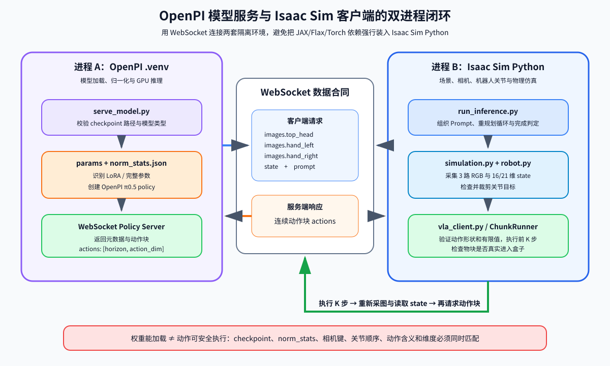

<p align="center"><b>图 14-14</b> 模型服务、WebSocket 数据合同与 Isaac Sim 动作执行闭环</p>

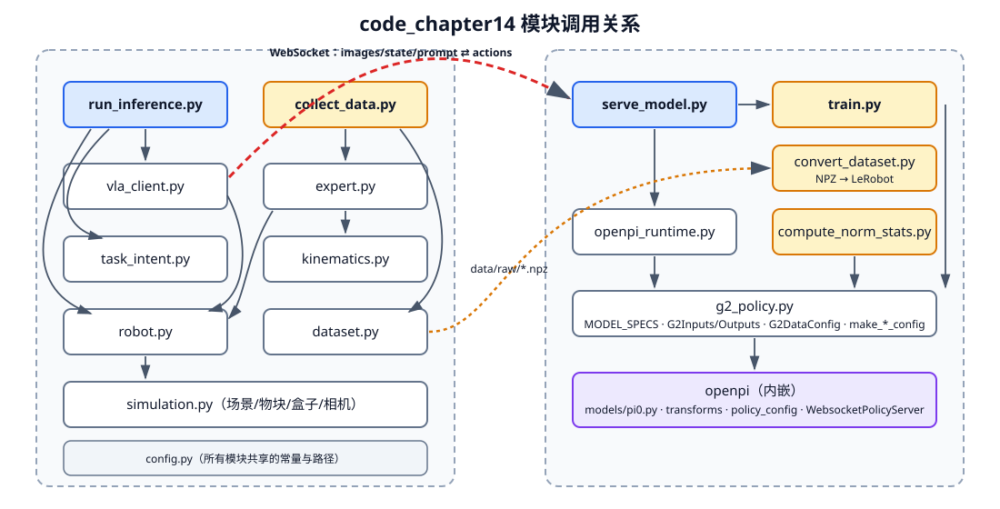

<p align="center"><b>图 14-15</b> 左侧在 Isaac Sim Python 中运行，右侧在 OpenPI 虚拟环境中运行；红线是推理时的 WebSocket，橙线是离线数据流</p>

`vla_client.py` 发送的数据合同为：

```text
images.top_head
images.hand_left
images.hand_right
state
prompt
```

服务返回：

```text
actions: [action_horizon, action_dim]
```

### 5.3 关键流程逐段解读

#### 5.3.1 服务端启动：`serve_model.py`

```python
# 摘自 code/code_chapter14/serve_model.py（main，删减）
if args.model == "finetuned" and not args.checkpoint:
    parser.error("请用 --checkpoint 指定已训练好的数字 step 目录；本部署不训练、不下载权重")
if args.checkpoint and not (Path(args.checkpoint).expanduser() / "params").is_dir():
    parser.error("本地 checkpoint 尚未放入或缺少 params；已停止，不会自动下载或训练")
prepare_openpi()                                                   # ① 只用本章内嵌 OpenPI，离线
# ...
config_kind = "finetuned" if args.model == "finetuned" else args.model
checkpoint = checkpoint_path("instruction" if args.model == "finetuned" else args.model, args.checkpoint)  # ② 路径必须在本章 checkpoints 内
norm_dir = find_norm_stats(checkpoint)                             # ③ 唯一一份 norm_stats.json
norm_stats = normalize.load(norm_dir)
uses_lora = checkpoint_uses_lora(checkpoint) if args.lora is None else args.lora  # ④ 从 Orbax 元数据判断 LoRA
config = make_runtime_config(config_kind, lora=uses_lora)          # ⑤ 3.1 节的 Pi0Config(pi05=True)
policy = policy_config.create_trained_policy(config, checkpoint, norm_stats=norm_stats)  # ⑥ 组装 3.5 节变换链
server = WebsocketPolicyServer(policy, host="127.0.0.1", port=args.port, metadata=policy.metadata)
server.serve_forever()
```

`serve_model.py`：

- 只允许读取 `code_chapter14/checkpoints` 内的权重；
- 加载配套 `norm_stats.json`；
- 自动检测 Orbax checkpoint 是否包含 LoRA 层（`checkpoint_uses_lora` 在 `params/array_metadatas` 中搜索字节串 `lora_`）；
- 通过 WebSocket 暴露策略和元数据（`policy_metadata` 中的 `state_dim`、`action_dim`、`action_horizon` 会被客户端读取）。

`prepare_openpi()` 还会：检查内嵌源码是否完整；若进程中已导入外部 `openpi`/`openpi_client` 直接报错；把 `HF_LEROBOT_HOME` 固定到本章 `data/lerobot`；设置 `HF_HUB_OFFLINE=1`、`TRANSFORMERS_OFFLINE=1`。

#### 5.3.2 三种模型入口不能混用

`serve_model.py` 显式区分：

- `--model instruction`：读取 `checkpoints/instruction_and_robust_pi05`；
- `--model manipulation`：读取 `checkpoints/manipulation_pi05`；
- `--model finetuned --checkpoint .../<step>`：读取本章训练结果。

三者的 horizon、维度、token 长度和统计文件可能不同。不要把某个 checkpoint 路径传给不匹配的 `--model` 类型，也不要手工复制另一模型的 `norm_stats.json` 来绕过错误。

#### 5.3.3 客户端闭环：`run_inference.py` + `vla_client.py`

```python
# 摘自 code/code_chapter14/run_inference.py（main 主循环，删减）
client = Pi05Client(args.host, args.port)                     # 连接并读取服务元数据
if client.state_dim not in (16, 21):
    raise ValueError(f"服务state_dim={client.state_dim}不是支持的G2布局")
# ...
runner.move_home()                                            # 五次多项式平滑回到数据集初始姿态
intent = TaskIntent((args.target_color,)) if args.target_color else TaskIntent()
for step in range(args.max_replans):
    prompt = intent.full_prompt if args.single_prompt else intent.prompt(sim.task.completed)
    images = sim.cameras.capture()                            # 三路 RGB（RGBA → RGB）
    state = robot.state(include_waist=client.state_dim == 21) # 16 或 21 维
    actions = client.infer(state, images, prompt)             # WebSocket 推理
    if args.debug_actions:
        runner.print_grippers(state, actions)
    if args.dry_run:
        delta = actions[0, :14] - state[:14]
        print(f"[DryRun] #{step + 1} {actions.shape=} max|dq|={np.max(np.abs(delta)):.3f}", flush=True)
        runner.hold()                                         # 不执行模型动作，只保持当前姿态
    else:
        runner.execute(actions)                               # 执行前 K 步
    if intent.is_complete(sim.task.completed):                # 以物理仿真中的真实入盒判定为准
        print(f"[完成] 第{step + 1}次重规划后完成{task_name}", flush=True)
        break
```

```python
# 摘自 code/code_chapter14/vla_client.py（Pi05Client.infer）
actions = np.asarray(result["actions"], dtype=np.float32)
if actions.ndim != 2 or actions.shape[0] == 0 or actions.shape[1] < self.action_dim:
    raise RuntimeError(f"模型返回动作形状错误：{actions.shape}")
actions = actions[:, : self.action_dim]
if not np.all(np.isfinite(actions)):
    raise RuntimeError("模型动作包含NaN或无穷大")
```

客户端检查动作形状和数值，再由 `ChunkRunner` 执行。`run_inference.py` 每次执行后读取仿真任务状态；当目标颜色物块真实进入盒子时才结束。

`TaskIntent` 的拆分逻辑只有几行：

```python
# 摘自 code/code_chapter14/task_intent.py
def prompt(self, completed: set[str]) -> str:
    color = self.next_color(completed)              # 按 red → green → blue 取第一个未完成的颜色
    if color is None:
        return "The task is complete. Keep the robot still."
    return f"Pick up the {color} block and place it into the empty box."
```

它生成的句子与采集数据时的 Prompt 完全相同，这正是 4.4 节"Prompt 语言风格与部署指令一致"的体现。

#### 5.3.4 训练入口：`train.py`

`train.py` 不复制训练框架，而是构造 `make_finetune_config(...)`，再用 `importlib` 加载内嵌的 `openpi/scripts/train.py` 并调用其 `main(config)`。`--overwrite` 与 `--resume` 互斥；`--init` 只能是 `instruction` 或 `base`，并检查 `params` 目录是否存在。`compute_norm_stats.py` 使用同一个 `make_finetune_config`，并只应用 repack 与 data transforms（不含 Normalize），保证统计的是 G2Inputs 补齐、DeltaActions 转换之后的数据——与训练时 Normalize 看到的输入完全一致。

---

## 第六部分 代码运行

### 6.1 环境部署

#### 6.1.1 硬件、系统与环境分层

建议环境：

- Ubuntu 22.04；
- 可运行项目 USD 资源的 Isaac Sim；
- NVIDIA 驱动和 CUDA 12 兼容 GPU；
- Python 3.11 或更高版本用于本章 OpenPI 环境；
- 推理建议至少 8 GB 显存，LoRA 训练建议至少约 24 GB；
- 足够磁盘空间保存模型、LeRobot 视频数据和 Orbax checkpoint。

进入代码目录：

```bash
cd /path/to/project-root/code/code_chapter14
```

路径 `/path/to/project-root` 和 `/path/to/isaac-sim` 都是占位符，前者请替换为本仓库在你电脑上的根目录，后者请替换为 Isaac Sim 的安装目录，后续命令应始终在 `code/code_chapter14` 中执行。

本章使用两套 Python：

| 环境 | 负责内容 | 主要包 |
|---|---|---|
| `openpi/.venv` | 模型、数据转换、统计和训练 | JAX、Flax、OpenPI、LeRobot、Orbax、Torch、Transformers |
| Isaac Sim Python | 仿真、三路相机和关节执行 | Isaac Sim API、NumPy、msgpack、websockets |

不要直接用系统 `pip install openpi` 替代本章内嵌源码。`openpi_runtime.py` 会拒绝已经导入的外部同名包。

#### 6.1.2 安装 OpenPI 依赖

先安装 `uv`，例如使用官方安装器：

```bash
curl -LsSf https://astral.sh/uv/install.sh | sh
source "$HOME/.local/bin/env"
uv --version
```

然后创建本章 OpenPI 环境：

```bash
cd /path/to/project-root/code/code_chapter14/openpi
GIT_LFS_SKIP_SMUDGE=1 uv sync
GIT_LFS_SKIP_SMUDGE=1 uv pip install -e .
cd ..
```

`GIT_LFS_SKIP_SMUDGE=1` 用于避免 LeRobot 依赖安装阶段意外拉取不需要的大文件。本地 `pyproject.toml` 固定了关键版本，包括：

```text
jax[cuda12] == 0.5.3
flax == 0.10.2
orbax-checkpoint == 0.11.13
torch == 2.7.1
transformers == 4.53.2
numpy >= 1.22.4, < 2.0.0
lerobot: 固定 Git commit
openpi-client: 本地 workspace 包
```

其余依赖还包括图像处理、数组类型、配置、日志和训练工具。应优先让 `uv sync` 按锁定关系安装，不要逐个升级包，否则 JAX、Flax、Orbax 和 Transformers 的兼容关系可能被破坏。

Isaac Sim 侧如缺少 WebSocket 依赖，可执行：

```bash
/path/to/isaac-sim/python.sh -m pip install msgpack websockets
```

这两个包只负责客户端通信，不能让 Isaac Python 获得完整 OpenPI 训练能力。

#### 6.1.3 下载 G2 π0.5 权重

下载脚本使用 ModelScope CLI，从 `agibot_world/GenieSim3.0-Dataset` 的 checkpoint 子目录复制权重。先将 ModelScope 安装到 OpenPI 环境：

```bash
cd /path/to/project-root/code/code_chapter14
uv pip install --python openpi/.venv/bin/python modelscope
```

为了让 Bash 找到虚拟环境中的 `modelscope` 命令，可以临时加入 PATH：

```bash
export PATH="$PWD/openpi/.venv/bin:$PATH"
```

下载 instruction 权重：

```bash
bash download_checkpoint.sh instruction_and_robust_pi05
```

下载更接近本章入盒任务的 manipulation 权重：

```bash
bash download_checkpoint.sh manipulation_pi05
```

下载完成后应出现：

```text
checkpoints/instruction_and_robust_pi05/params
checkpoints/instruction_and_robust_pi05/assets/.../norm_stats.json
checkpoints/manipulation_pi05/params
checkpoints/manipulation_pi05/assets/.../norm_stats.json
```

脚本不会自动执行，也不会在模型启动时静默联网。这样可以明确知道当前使用的是哪份权重，并避免运行过程中突然下载大文件。（`download_checkpoint.sh` 还接受 `spatial_pi05`，本章案例未使用。）

OpenPI 官方还提供 `pi05_base` 等基础权重，但本章 `download_checkpoint.sh` 下载的是针对公开 G2 数据布局准备的 baseline。若要从原始 `pi05_base` 微调，需要自行把完整 checkpoint 放入 `checkpoints/pi05_base`，并确保其中包含 `params` 和配套资产。

### 6.2 代码执行

#### 6.2.1 先运行现成模型

建议先运行 `manipulation` baseline，因为它的训练任务更接近 `place_block_into_box`。

终端 1 启动策略服务（加载 manipulation checkpoint 与其 norm_stats，在 8000 端口监听）：

```bash
cd /path/to/project-root/code/code_chapter14
CUDA_VISIBLE_DEVICES=0 openpi/.venv/bin/python serve_model.py \
  --model manipulation --port 8000
```

终端 2 用 Isaac Sim Python 启动单个红色物块任务。第一次建议不驱动机器人，只检查数据链路和动作输出：

```bash
cd /path/to/project-root/code/code_chapter14
/path/to/isaac-sim/python.sh run_inference.py \
  --host 127.0.0.1 --port 8000 \
  --target-color red --dry-run --debug-actions --max-replans 5
```

确认服务元数据、状态维度、动作形状和夹爪输出合理后，再去掉 `--dry-run`（真正执行完整动作块）：

```bash
/path/to/isaac-sim/python.sh run_inference.py \
  --host 127.0.0.1 --port 8000 \
  --target-color red --debug-actions
```

如果完整动作块过于开环，可以缩短每次执行长度（每执行 10 个动作就重新观察一次）：

```bash
/path/to/isaac-sim/python.sh run_inference.py \
  --host 127.0.0.1 --port 8000 \
  --target-color red --execute-chunk 10
```

不传 `--target-color` 时，程序依次执行红、绿、蓝三个物块。`--single-prompt` 会一次给出完整三物块指令；默认模式使用 `TaskIntent` 每次只下发一个清晰子任务。

instruction 模型服务命令为（16 维、动作块 50）：

```bash
CUDA_VISIBLE_DEVICES=0 openpi/.venv/bin/python serve_model.py \
  --model instruction --port 8000
```

现成模型即使输出数值正常，也可能因场景外观、相机位姿、物体尺度和动力学差异而失败。这不应被解释成"VLA 原理无效"，也不能被解释成"多运行几次就一定成功"；应通过数据合同检查和本场景微调来定位。

#### 6.2.2 采集、转换和归一化

采集 60 个固定位置回合（无界面运行脚本专家）：

```bash
cd /path/to/project-root/code/code_chapter14
/path/to/isaac-sim/python.sh collect_data.py \
  --episodes 60 --headless
```

固定位置成功率稳定后，再加入少量水平随机化：

```bash
/path/to/isaac-sim/python.sh collect_data.py \
  --episodes 60 --headless --position-noise 0.01
```

原始文件保存在：

```text
data/raw
```

转换为 LeRobot：

```bash
openpi/.venv/bin/python convert_dataset.py --overwrite
```

`--overwrite` 会重建转换后的 LeRobot 目录，不会删除原始 NPZ。默认只转换 `success=True` 的回合。

计算归一化统计：

```bash
openpi/.venv/bin/python compute_norm_stats.py
```

默认输出位置为：

```text
assets/pi05_g2_color_blocks/chapter14/g2_color_blocks/norm_stats.json
```

数据、统计和训练配置必须使用同一个 `REPO_ID=chapter14/g2_color_blocks`。若手工移动 LeRobot 目录，应同时正确设置 `HF_LEROBOT_HOME`，不要通过复制一个旧统计文件来跳过计算。

#### 6.2.3 LoRA 微调和加载

推荐的单卡 LoRA 命令：

```bash
cd /path/to/project-root/code/code_chapter14
CUDA_VISIBLE_DEVICES=0 XLA_PYTHON_CLIENT_MEM_FRACTION=0.90 \
openpi/.venv/bin/python train.py \
  --init instruction \
  --exp-name color_blocks_lora_v1 \
  --steps 10000 \
  --batch-size 2 \
  --fsdp-devices 1 \
  --lora
```

参数含义：

- `--init instruction`：从 G2 instruction checkpoint 初始化；
- `--exp-name`：决定训练输出目录名；
- `--steps`：优化步数，不等于数据回合数；
- `--batch-size`：每步训练批量，显存不足时首先减小；
- `--fsdp-devices 1`：当前默认单卡；
- `--lora`：冻结大部分基础参数，只训练低秩适配参数；
- `XLA_PYTHON_CLIENT_MEM_FRACTION=0.90`：允许 JAX 使用较高比例显存。

若同名实验已有有效 checkpoint 并希望继续：

```bash
CUDA_VISIBLE_DEVICES=0 XLA_PYTHON_CLIENT_MEM_FRACTION=0.90 \
openpi/.venv/bin/python train.py \
  --init instruction \
  --exp-name color_blocks_lora_v1 \
  --steps 15000 \
  --batch-size 2 \
  --fsdp-devices 1 \
  --lora --resume
```

`--resume` 和 `--overwrite` 不能同时使用。全参数微调可以不加 `--lora`，但会创建完整优化器和 EMA 状态，对显存要求显著更高，不建议作为本章首次运行方案。

训练 10000 步时，最后保存目录通常是 `9999`，因为步号从 0 开始。启动微调模型：

```bash
CUDA_VISIBLE_DEVICES=0 openpi/.venv/bin/python serve_model.py \
  --model finetuned \
  --checkpoint checkpoints/pi05_g2_color_blocks/color_blocks_lora_v1/9999 \
  --port 8000
```

服务端会从 Orbax 参数元数据判断是否为 LoRA 结构，一般不需要手动添加 `--lora`。然后在第二个终端运行与前面相同的 `run_inference.py`。

```bash
/path/to/isaac-sim/python.sh run_inference.py \
  --host 127.0.0.1 --port 8000 \
  --target-color red --debug-actions
```

### 6.3 运行结果

#### 6.3.1 现成 manipulation 模型的典型现象

注意：如果你使用的是现成的manipulation_pi05，可能会出现他在很远的地方空抓的情况，其实在右机械臂的视角下，他认为他已经到达红色物体旁边了，可以参考下面的两幅图：

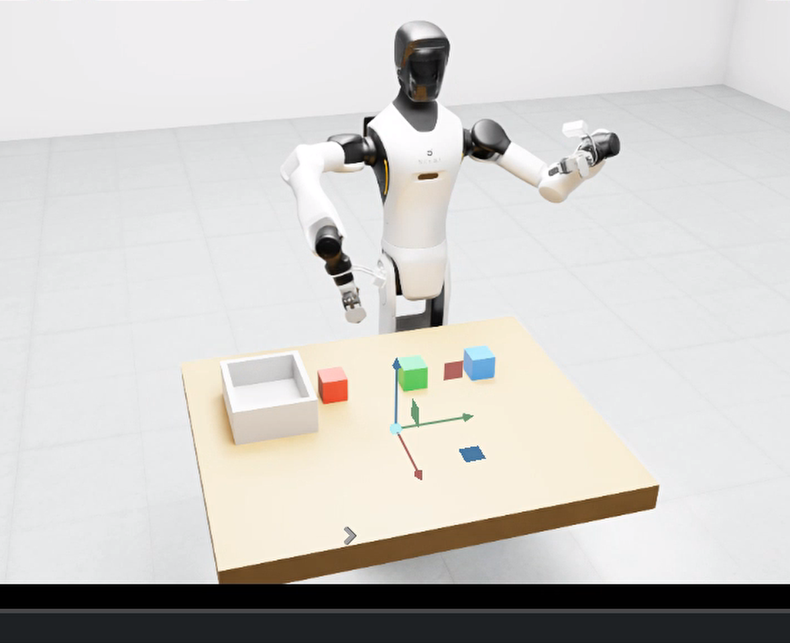

<p align="center"><b>图 14-16</b> 现成 manipulation_pi05 在远离红色物块的位置执行抓取</p>

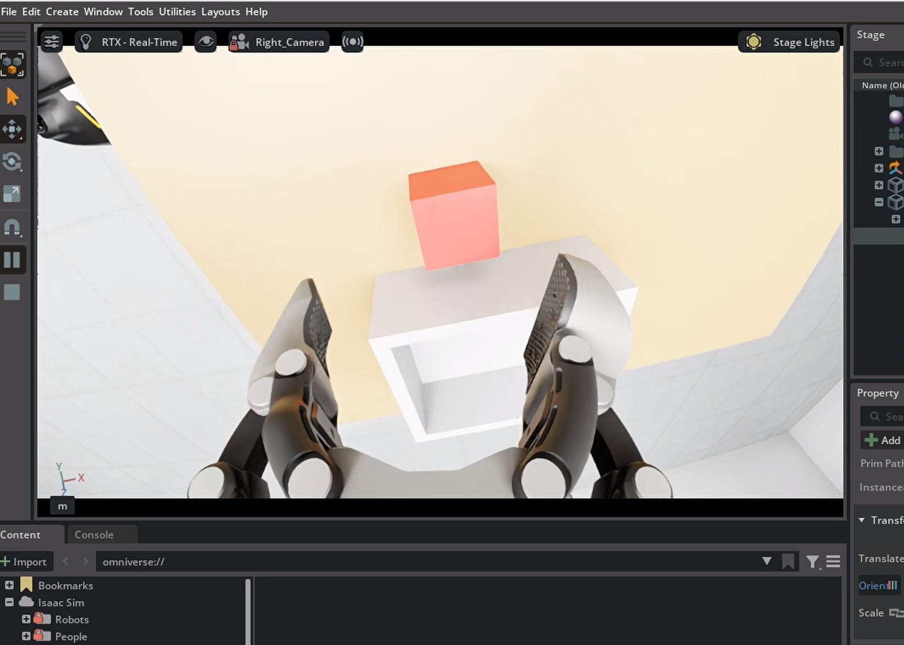

<p align="center"><b>图 14-17</b> 同一时刻右腕相机的画面：模型"认为"已经到达红色物块旁边</p>

**如果想要解决这个问题，可以用下面的微调模型，项目中也提供了完整的数据采集，数据格式转换，以及微调部署的完整流程，大家可以自己试一下，微调时间非常短，大家可以尽情的调试。**

**如何读懂这个现象**：模型只能通过腕部相机判断"离物块多近"。公开 baseline 的训练场景中物块尺寸、相机位姿和桌面外观与本章不同，画面中物块的视觉尺度与真实距离的对应关系就会错位——这是典型的分布偏移（1.2 节），而不是数据合同错误。用本场景数据微调后，这种错位会明显改善。

#### 6.3.2 微调后的效果

最终效果如下所示，大家运行的过程中可能会出现抓空的情况，是因为当前物块明显大于机械爪的抓取半径，所以会有一半是抓的斜边，并且训练数据中是固定位置，并不是随机位置的数据集采集，但是我也为大家提供了随机微动位置的数据采集方案，大家可以自己试试，微调时间非常短，大家可以尽情的调试，整体来说，相比没有微调的模型，微调过后的模型效果已经非常好了：

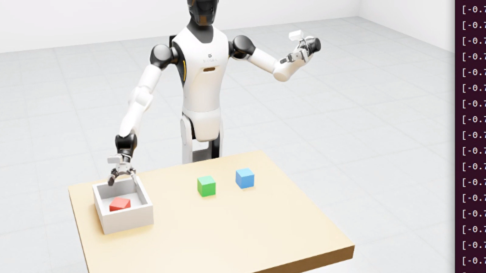

<p align="center"><b>图 14-18</b> 用本章数据 LoRA 微调后的 π0.5 在 Isaac Sim 中完成物块入盒</p>

#### 6.3.3 如何读懂终端输出

`run_inference.py` 和 `vla_client.py` 中打印的信息可以这样理解（以下是代码中的打印格式，具体数值以你的运行为准）：

| 打印前缀 | 来源 | 含义与检查点 |
|---|---|---|
| `[启动 1/4]` … `[启动 4/4]` | `run_inference.py` | 场景创建 → 连接服务 → 回 home → 开始闭环；卡在 2/4 通常是 WebSocket 问题 |
| `[VLA] 已连接，服务信息：{...}` | `vla_client.py` | 服务元数据：`model_kind`、`state_dim`、`action_dim`、`action_horizon`；manipulation 应为 21/21/30，instruction/finetuned 应为 16/16/50 |
| `[提示] manipulation模型输入保留腰部状态…` | `run_inference.py` | `state_dim == 21` 且没加 `--control-waist` 时出现，属于正常提示 |
| `[动作意图] Pick up the red block …` | `run_inference.py` | 当前下发给模型的 Prompt，仅在变化时打印 |
| `[夹爪调试] 当前=[…] 即将执行N步 [左, 右]=` | `ChunkRunner.print_grippers` | 模型空间夹爪值：接近 −0.785 为张开，接近 0 为闭合 |
| `[DryRun] #k actions.shape=(H, D) max\|dq\|=…` | `run_inference.py` | 第一步动作与当前臂关节的最大差（rad）；若持续很大（例如超过 1 rad），先检查 checkpoint 类型、norm_stats 和 delta/absolute |
| `[完成] 第k次重规划后完成…` / `[结束] 达到最大重规划次数…` | `run_inference.py` | 由仿真中物块是否真实入盒判定 |

---

## 本章小结

### 知识回顾

本章从行为克隆、动作块和 flow matching 出发，解释了 π0 的 VLM 主干与动作专家、π0-FAST 的频率域动作分词、π0.5 的开放世界泛化和高低层协同，以及 π0.6/π0.7 在更强主干、经验学习和丰富上下文方面的演进。工程上，最关键的不是只把模型"跑起来"，而是保持图像、状态、动作、关节顺序、delta/absolute 转换和归一化统计的一致，并通过服务端与 Isaac Sim 客户端隔离环境。

| 主题 | 要点 | 对应代码 |
|---|---|---|
| VLA 问题定义 | 学习 $\pi_\theta(A_t\mid o_t)$；动作块 $H$，执行 $K\le H$ 步后重规划 | `vla_client.py: ChunkRunner.execute` |
| 行为克隆 | MSE 会平均多峰动作；存在分布偏移 | `expert.py`、`collect_data.py` |
| π0 | PaliGemma 前缀 + 动作专家后缀；块状因果掩码；前缀 KV 缓存 | `pi0.py: embed_prefix / embed_suffix / make_attn_mask` |
| flow matching | 代码约定 $t=1$ 噪声、 $t=0$ 动作；目标 `u_t = noise - actions`；Beta(1.5,1) 采样时间；10 步 Euler | `pi0.py: compute_loss / sample_actions` |
| π0-FAST | DCT → 量化（唯一有损）→ 低频优先展平 → BPE；交叉熵；自回归解码 | `pi0_fast.py`、`tokenizer.py: FASTTokenizer` |
| π0.5 | 状态离散进文本；adaRMSNorm 注入时间；论文中还有子任务预测、FAST 预训练、知识隔离 | `pi0_config.py: pi05=True`、`tokenizer.py: PaligemmaTokenizer` |
| π0.6 / π\*0.6 | Gemma 3 4B + 约 860M 动作专家；知识隔离联合训练；RECAP 优势条件化 | 本章代码不包含 |
| π0.7 | 提示含子步骤语言、子目标图像、元数据、控制模态；元数据 CFG | 本章代码不包含 |
| 维度与动作约定 | 16/21 维补到 32；臂 delta、夹爪 absolute | `g2_policy.py: G2Inputs / G2DataConfig` |
| 归一化 | π0.5 用分位数映射到 $[-1,1]$；统计必须与 checkpoint 配套 | `openpi_runtime.py: find_norm_stats` |
| 数据与微调 | NPZ → LeRobot → norm_stats → LoRA（秩 16/32） | `convert_dataset.py`、`compute_norm_stats.py`、`train.py` |
| 部署 | 双进程 + WebSocket；形状/有限值检查 + 关节限位裁剪 | `serve_model.py`、`run_inference.py`、`robot.py` |

### 课后练习

1. **（思考）多峰与 MSE。** 用 1.2 节的手腕例子说明：为什么 MSE 回归会输出 0 rad？在 2.2.4 例 2 中，如果把起点改成 $x=-0.3$、`num_steps=4`，最终 $x$ 是多少？（提示：速度场关于 0 对称。）
2. **（手算）Euler 积分与终止条件。** 取 `num_steps=5`，`dt=-0.2`，单一目标 $A=1$、噪声 $\epsilon=0.5$，用 $v=(x-A)/t$ 逐步写出 5 步的 $(t,x)$。说明 `cond` 中为什么用 `time >= -dt/2` 而不是 `time > 0`。
3. **（手算）注意力掩码。** 对 π0 写出"1 个图像 token + 2 个文本 token + 1 个状态 token + 2 个动作 token"的 `mask_ar` 与 cumsum，并画出 6×6 的注意力矩阵。再对 π0.5（没有状态 token，状态在文本中）重复一次，比较差异。
4. **（手算）FAST。** 对单维动作 `[0.5, 0.5, 0.5, 0.5]`（ $H=4$）做正交 DCT-II，说明为什么只有 $k=0$ 的系数非零，以及它的值是多少；再对 `[0, 0.2, 0, 0.2]` 计算，比较两者量化后非零系数的数量，说明"token 数随轨迹复杂度增长"。
5. **（动手）动作块长度实验。** 用 manipulation 服务分别运行 `--execute-chunk 0`、`--execute-chunk 10` 和 `--execute-chunk 5`，配合 `--debug-actions` 记录完成所需的重规划次数和是否成功，解释 $K$ 对开环程度与推理次数的影响。
6. **（动手）数据规模与随机化。** 分别用 30 个固定位置回合、60 个固定位置回合、60 个 `--position-noise 0.01` 回合训练 LoRA（可把 `--steps` 降到 2000 节省时间），在相同的 `run_inference.py --target-color red` 下比较效果。每次都必须重新运行 `convert_dataset.py --overwrite` 和 `compute_norm_stats.py`，并说明为什么。

### 参考资料

- π0 论文：`https://arxiv.org/abs/2410.24164`
- π0.5 论文：`https://arxiv.org/abs/2504.16054`
- FAST 论文：`https://arxiv.org/abs/2501.09747`
- 知识隔离论文（Knowledge Insulating VLA）：`https://arxiv.org/abs/2505.23705`
- π\*0.6 论文：`https://arxiv.org/abs/2511.14759`；π0.6 model card：`https://website.pi-asset.com/pi06star/PI06_model_card.pdf`
- π0.7 官方博客：`https://www.pi.website/blog/pi07`；π0.7 论文：`https://arxiv.org/abs/2604.15483`
- OpenPI 官方仓库：`https://github.com/Physical-Intelligence/openpi`
- LeRobot 官方仓库：`https://github.com/huggingface/lerobot`
- 本章代码说明：`code/code_chapter14/README.md`
- 本章内嵌 OpenPI 说明：`code/code_chapter14/openpi/README.md`

