# 第十六章 潜在动作世界模型

> **本章导读**：第十四章让机器人根据图像、语言和自身状态输出动作（VLA），第十五章利用执行经验改进策略。本章换一个角度：**机器人在决定怎样运动时，能不能同时预测运动之后会看到什么？** 我们以 **Motus（A Unified Latent Action World Model，统一潜在动作世界模型）** 为主线，讲清楚世界模型的概念与动机、"潜在动作（latent action）"怎样让没有关节标签的视频参与动作预训练、三专家模型的结构和联合流匹配训练目标、潜在动作预训练的模型如何接到 G2 机器人的 16 维真实动作，以及怎样分层评估这样的模型。
>
> 本章最终要跑通的案例沿用 G2 Omnipicker 与 Isaac Sim 的三色物块入盒任务：示教采集 → 数据转换 → Stage 3 LoRA 微调 → 给定当前画面生成未来视频与动作 → 在仿真中以完整动作块闭环抓取。本章为后续"利用未来预测做失败检测、候选动作评价或任务级决策"打下基础。

## 本章概览

### 本章要解决的问题

假设任务仍然是"把红色物块放进盒子"。普通动作策略只需要回答"下一段关节目标是什么"；世界模型还要回答"如果这样运动，夹爪、物块和周围环境会发生怎样的变化"。前者关注行动，后者关注行动的后果。把两者放进同一个模型，就有机会在同一个表示空间中联系任务语义、环境变化和机器人控制，而不只是从一张图直接回归一组关节数值。

但这马上带来两个问题：第一，大量人类操作视频和其他机器人视频里"能看到运动"，却没有 G2 的关节标签，怎么拿来训练动作？第二，预训练出来的模型说的是"潜在动作"的语言，怎么让它最终输出 G2 能执行的 16 维绝对关节目标，并且在仿真里真的把物块放进盒子？本章就围绕这两个问题展开。

开始之前，先明确五个边界：

1. **世界模型与 VLA 不是互相排斥的两类产品。** 世界模型强调环境演化，VLA 强调视觉、语言到动作的策略映射。一个统一模型可以同时具有这两类能力。
2. **本章复用 Stage 2 权重，实际训练的是 G2 的 Stage 3。** 光流潜在动作学习和大规模视频预训练属于完整 Motus 算法，但本章脚本不会从零重复这些阶段。
3. **本章默认推理是视频—动作联合预测。** 离线案例和在线服务均调用同一个联合推理入口；在线服务只是没有把生成的视频传回仿真端，并非切换成了独立的纯 VLA 推理模式。
4. **预测未来不等于已经实现搜索式规划。** 当前代码没有候选动作采样、世界模型打分、价值排序或树搜索。它直接生成一段动作，执行后再观察。
5. **仿真成功不等于真实机器人安全认证。** 本章的关节限位和执行插值不能替代真实设备上的独立安全系统。

### 学习目标

- **解释** VLA、动作条件世界模型、视频—动作联合模型三者在"动作扮演什么角色"上的区别，并说出 Motus 的五种条件模式分别对应哪种噪声设置。
- **解释** 潜在动作为什么能让无动作标签的视频参与动作预训练，比较"逆动力学 + 前向动力学 + VQ 离散化"与 Motus"光流 + DC-AE + 连续低维向量"两条路线，并说明潜在动作为什么不能直接当关节指令执行。
- **推导** 联合流匹配的加噪公式、速度场目标与 Euler 反向积分，并用一维数字手算一次"从噪声回到动作"。
- **实现/阅读** 从 `qpos`/`command` 记录到训练样本的全链路：时间索引 $c+3,\dots,c+48$、三视图拼接、文本缓存、episode 级验证划分，以及 LoRA 与 16 维接口参数的保存与恢复。
- **运行** 数据采集与转换、冒烟与正式 Stage 3 LoRA 训练、未来视频生成和 Isaac Sim 闭环评测。
- **排查** 按"数据层 → 模型层 → 执行层"定位失败：目标选错、机械臂不动、夹爪提前张开、视频好看但控制失败等。

### 前置知识

- 第十四章：VLA 的输入输出、动作块（action chunk）、绝对关节目标与归一化的概念。
- 第十五章：G2 三色物块入盒场景、自动专家、Isaac Sim 运行方式（本章 `task_runtime/` 就来自该场景的本地副本）。
- 第五章：逆运动学（本章会专门区分"逆运动学"和"逆动力学模型"）。
- 数学：高斯噪声、均方误差、线性插值、矩阵低秩分解、softmax 注意力。
- 编程：PyTorch 张量形状、`nn.Linear`、`requires_grad`；Bash 与 conda 环境；多卡训练的基本概念（world size、梯度累积）。

### 知识地图

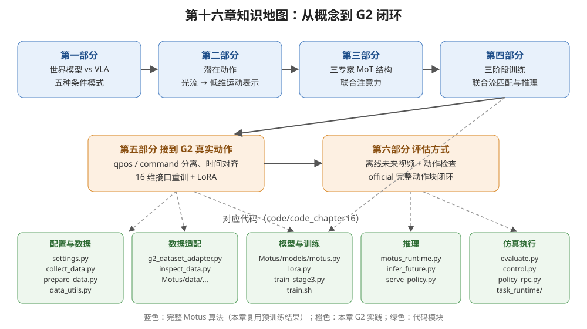

<p align="center"><b>图 16-1</b> 本章知识地图：蓝色为完整 Motus 算法（本章复用其预训练结果），橙色为本章在 G2 上的实践，绿色为对应代码模块</p>

### 对应代码

`code/code_chapter16/`：顶层脚本负责 G2 示教采集、数据转换、16 维接口适配、LoRA 训练封装、联合推理和仿真闭环执行；`code/code_chapter16/Motus/` 是随本章附带的 Motus 模型源码（三专家模型、数据加载、训练器）；`task_runtime/` 是 G2 场景与自动专家的本地副本。

---

## 第一部分 世界模型的概念与动机：从"输出动作"到"理解行动后果"

### 1.1 VLA 与世界模型分别解决什么问题

**直观理解**：VLA 像一个"会做事的人"——看一眼就知道该怎么动；世界模型像一个"会想象的人"——给他一个动作，他能在脑子里放一段"如果这么做会怎样"的录像。

先统一几个符号。记当前视觉观察为 $o_t$，机器人实测状态为 $s_t$，任务语言为 $\ell$；未来一段动作为 $A_t$，未来一段视觉观察为 $O_t^+$。观察可以包含多路相机，状态可以包含关节角和夹爪位置，动作可以是关节目标、末端位姿或其他控制量。

一个典型 VLA 策略学习：

$$
\pi_\theta(A_t\mid o_t,s_t,\ell)
$$

它回答的是：**"看到当前场景、知道任务和身体姿态之后，我应该怎么做？"**

例如，机器人看到红色物块在桌面右侧、夹爪尚未闭合，模型输出靠近、闭合、抬升和搬运的一段动作。训练时，通常使用示教动作或经过整理的执行经验来监督它。

动作条件世界模型则学习：

$$
p_\theta(O_t^+\mid o_t,s_t,A_t,\ell)
$$

这里语言可以是额外条件，并非所有世界模型都必须使用语言。它回答的是：**"如果从当前状态执行这段动作，之后的世界可能变成什么样？"**

例如，把"夹爪继续向下移动"作为条件，模型应预测夹爪接近物块的过程；把"夹爪闭合并上抬"作为条件，模型则需要预测物块是否随之离开桌面。真正困难的地方不是画出一只运动的机械臂，而是让运动、接触和物体变化之间保持合理联系。

为了避免概念混淆，可以把三种能力放在一起看：

| 比较项 | 典型 VLA 策略 | 动作条件世界模型 | 视频—动作联合模型 |
|---|---|---|---|
| 核心问题 | 应该采取什么动作 | 给定动作会产生什么结果 | 怎样行动，以及相应未来可能是什么 |
| 主要未知量 | 未来动作 | 未来观察或隐状态 | 未来动作与未来观察 |
| 动作的角色 | 输出 | 输入条件 | 与未来观察共同生成的输出 |
| 常见监督 | 专家动作、执行经验 | 状态或观察的时序变化 | 对齐的视频与动作序列 |
| 能否直接驱动机器人 | 接口适配后可以 | 通常还需要策略或动作搜索器 | 可以使用其中的动作输出 |
| 是否必然输出视频 | 不必 | 不必，也可以只预测隐状态 | 本章 Motus 会输出未来视频 |
| 是否天然就是规划器 | 不是 | 不是 | 不是 |

这个分类依据的是**学习目标和条件关系**，而不是"是否使用 Transformer""是否采用扩散或流匹配"。VLA 同样可以使用流匹配；世界模型也不必生成可观看的视频。Motus 的特别之处，是用一个网络组织多种条件分布，而不是给普通 VLA 换一个名字。

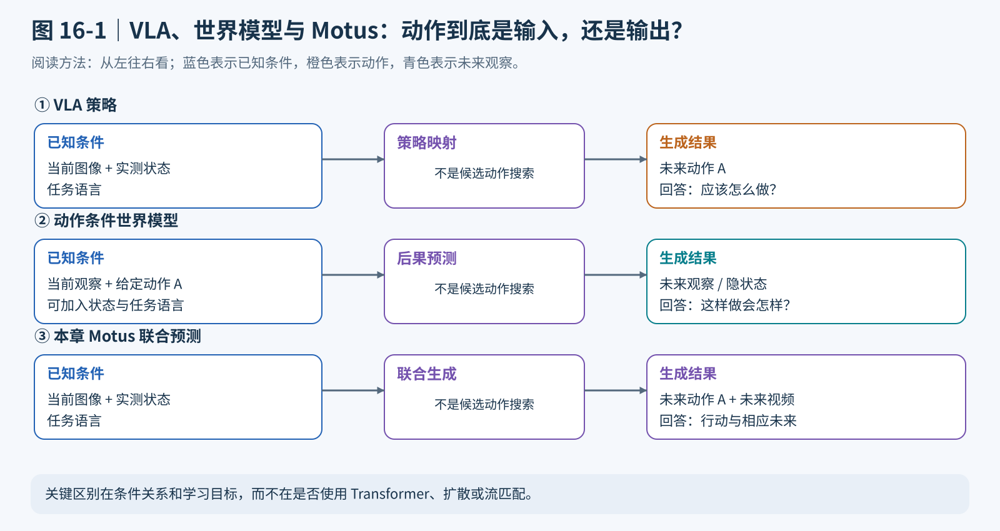

<p align="center"><b>图 16-2</b> 从动作的角色区分三种能力：VLA 生成动作，动作条件世界模型接收给定动作，Motus 联合预测同时生成动作与未来视频。图为概念示意，不代表所有模型都只能采用图中的条件组合</p>

**小例子：同一组变量，三种"问法"。** 设一条红色物块示教中某一时刻， $o_t$ 是三视图合成图， $s_t$ 是 16 维实测关节， $\ell$ 是"Pick up the red block and place it into the empty box."， $A_t$ 是接下来 16 个关节目标， $O_t^+$ 是接下来 8 帧画面。

- 问 VLA：已知 $(o_t,s_t,\ell)$，求 $A_t$。
- 问世界模型：已知 $(o_t,s_t,\ell,A_t)$，求 $O_t^+$。
- 问联合模型：已知 $(o_t,s_t,\ell)$，同时求 $(A_t,O_t^+)$。

三者用的是**同一条数据**，只是"把哪些变量当已知"不同。这正是 1.3 节"一个网络、五种模式"的出发点。

> 💡 **要点**：区分模型类别看"动作是输入、输出还是与视频一起被生成"，不看网络是不是 Transformer、是不是扩散模型。

### 1.2 为什么机器人需要预测未来，但不能只相信未来视频

从动作策略的角度看，视频预测多了一项任务，似乎只会增加开销。它的价值主要体现在三个方面。

**第一，让动作学习与场景变化建立联系。** 如果模型一边预测"夹爪已经闭合并抬起"，另一边却生成"物块仍然留在桌面"的视频，两种输出就存在不协调。联合建模为动作与视觉后果提供了相互利用的表示通道。不过，这是一种学习上的约束与归纳偏置，不是严格的物理一致性证明。

**第二，让没有关节标签的视频也发挥作用。** 人类拿杯子、机器人搬物体的视频包含大量接近、抓取、搬运、释放等运动信息，但往往没有对应的机器人动作。若能从画面变化中提取统一运动表示，就可以把这类数据用于动作专家的预训练。这就是第二部分"潜在动作"要解决的问题。

**第三，让模型的内部预测更容易观察。** 单看一个 $16\times16$ 的动作矩阵，很难直接判断模型误解了颜色，还是没有学会抓取。观察未来视频，可以辅助检查目标选择、运动方向和抓取阶段；再结合实际轨迹，能够缩小排查范围。

但要特别注意：**一段看起来成功的视频，只证明模型生成了成功的画面，不能证明输出动作真的会成功。** 视频可能出现物体凭空移动、夹爪穿模、视角不一致或接触关系错误；动作也可能受到关节跟踪误差、执行延迟和观测偏移影响。

因此，本章同时安排两类实践：一类检查模型"想象了什么"（第八部分案例一），另一类检查机器人"实际做成了什么"（案例二）。二者需要对照，不能互相替代。

> ⚠️ **注意**：不要用"生成视频看起来完成了任务"来替代成功率统计；也不要因为成功率低就断定视频分支没用——两者回答的是不同问题。

### 1.3 Motus 如何把五种能力统一到一个模型中

为了理解 Motus，可以先把它看作一个学习联合关系的生成模型：

$$
p_\theta(O_t^+,A_t\mid o_t,s_t,\ell)
$$

如果知道其中一部分变量，就把它们当成条件；如果不知道，就让模型生成。论文借助类似 UniDiffuser 的独立噪声时间设计，在一个网络中组织以下五种模式。

| 模式 | 已知条件的关键部分 | 需要生成什么 | 直观例子 |
|---|---|---|---|
| 视频生成 VGM | 当前画面、任务 | 未来画面 | 想象"把红块放入盒子"的后续视频 |
| 世界模型 WM | 当前画面、给定动作 | 未来画面 | 执行指定关节目标后，物块会怎样移动 |
| 逆动力学 IDM | 当前与未来画面 | 动作 | 已知夹爪从桌边到达物块上方，反推如何运动 |
| VLA | 当前画面、任务及可用状态 | 动作 | 直接生成完成任务的控制序列 |
| 视频—动作联合预测 | 当前画面、任务及可用状态 | 未来画面与动作 | 同时生成搬运视频和对应关节目标 |

这里的"逆动力学"要和第五章的逆运动学区分开。逆运动学通常根据期望末端位姿求关节配置；这里的逆动力学模型（Inverse Dynamics Model，IDM）根据一段视觉变化推断动作，输入并不是一个精确给定的末端位姿，两者不能混为一谈。

同样，视频生成模式和世界模型模式也不能混淆。仅凭当前画面和任务生成未来，未必回答了"这段指定动作会造成什么后果"。后者需要把动作作为明确条件。

**为什么"独立噪声时间"能切换模式？** 用一句话预告第四部分的结论：在扩散/流匹配里，"噪声强度为 0"等价于"这个变量已知"，"噪声强度为 1"等价于"这个变量完全未知"。如果视频和动作各自拥有一个噪声时间 $\sigma_v,\sigma_a$，那么：

| 模式 | $\sigma_v$（未来视频） | $\sigma_a$（未来动作） |
|---|---|---|
| WM | 1 → 0（生成） | 固定 0（给定） |
| IDM | 固定 0（给定） | 1 → 0（生成） |
| 联合预测 | 1 → 0 | 1 → 0 |

同一个网络，只要换一组 $(\sigma_v,\sigma_a)$ 的设置，就回答不同的问题。完整的五行表格见 4.4 节。

本章实际使用第五种模式：**视频和动作从噪声开始，一起生成。** 虽然论文解释了五种模式，但 `code_chapter16` 并未提供五套可以通过命令行直接切换的部署入口。特别是，`infer_future.py` 虽然以未来视频为展示重点，内部仍会生成动作。

### 1.4 世界模型、闭环控制与强化学习之间是什么关系

一个常见误解是：只要模型能预测未来，就已经具备了基于模型的强化学习或模型预测控制（Model Predictive Control，MPC）。

实际上，要用世界模型做候选动作规划，还需要一条额外链路：提出多组候选动作，分别预测后果，用任务奖励或价值函数打分，选择较好的动作方案并交给控制器执行。预测器、候选生成器和评价器是不同的角色。

```text
带候选优化的规划（本章没有）：
  观察 ──► 候选生成器 ──► {A¹, A², …, Aᴷ}
                              │ 逐个送入世界模型
                              ▼
                     {Ô¹, Ô², …, Ôᴷ} ──► 奖励/价值打分 ──► 选最优 A* ──► 执行

本章实际流程：
  观察 ──► Motus 联合生成 (视频, 16 个动作) ──► 完整执行 16 个目标 ──► 重新观察 ──► …
```

<p align="center"><b>图 16-3</b> 带候选优化的世界模型规划与本章"生成—执行—再观察"闭环的区别</p>

本章没有这套搜索过程。当前流程是：

**观察场景 → 联合生成视频和动作 → 完整执行 16 个动作目标 → 重新观察 → 再生成。**

这种"完整执行后再观察"的方式形成了反馈闭环：下一轮预测会利用机器人和物体的实际新状态，而不是一直沿用最初的观察。不过，当前模型没有对多组候选动作进行后果评分与优化，因此不能把这个闭环直接等同于带候选优化的 MPC。

与第十五章相比，两章的重点也不同：第十五章围绕执行经验、价值与优势标注更新策略；本章围绕视频运动先验、跨模态联合生成和目标机器人适配展开。当前 Stage 3 使用视频与动作的监督损失，没有奖励函数训练、Value 网络、优势标签或在线策略梯度更新。不能因为标题里出现"世界模型"，就把本章训练称为世界模型强化学习。

> 💡 **要点**：本章的"闭环"来自"执行后用真实新观察再预测"，不是来自"用预测视频挑选动作"。生成的视频不会被当作下一轮的观察输入。


---

## 第二部分 潜在动作：把"视频里的运动"变成动作预训练信号

### 2.1 为什么需要潜在动作

**直观理解**：看一段人类倒水的视频，你能说出"手向右移、再倾斜"，却说不出"肩关节转了 0.3 rad"。潜在动作就是让模型自己发明一套"描述画面里发生了什么运动"的紧凑语言，它不依赖任何具体身体的关节定义。

想用人类或多机器人视频训练动作专家，会遇到一个根本问题：视频里能看到运动，但未必知道运动者每个关节的目标，更不可能直接把人的动作数值当作 G2 的关节角。

可以把数据按"有没有动作标签"分成两堆：

| 数据 | 规模 | 有无动作标签 | 能否直接监督 G2 动作 |
|---|---|---|---|
| 人类第一人称视频、互联网视频 | 很大 | 无 | 不能 |
| 其他机器人的任务轨迹 | 中等 | 有，但维度/含义不同 | 不能直接用 |
| 目标机器人（G2）示教 | 很小、最贵 | 有 | 能 |

潜在动作的目标，是给前两堆数据也打上一种"动作式标签"，让它们也能训练动作专家。Motus 引入潜在动作，目标不是从一帧图像精确恢复全部真实控制量，而是学习一个**能够表达视觉变化、又具有较低维度的运动表示**。

### 2.2 背景：逆动力学 + 前向动力学 + 离散化的经典思路

在介绍 Motus 的做法之前，先看一类更早、也更常被提到的潜在动作学习方式，便于理解"潜在动作"这个词的来历。这一节是**领域背景**，不是 Motus 或本章代码的实现。

这类方法（例如 Genie、LAPA 等工作）通常由两个网络加一个瓶颈组成：

1. **逆动力学编码器（IDM）**：输入相邻两帧 $(o_t,o_{t+1})$，输出一个向量 $e_t$，意思是"从 $o_t$ 到 $o_{t+1}$ 发生了什么"。
2. **离散化瓶颈（VQ，Vector Quantization）**：维护一个只有 $K$ 个向量的码本 $\{c_1,\dots,c_K\}$，把 $e_t$ 替换为最近的码字：

   $$
   z_t=c_{k^{\ast}},\qquad k^{\ast}=\arg\min_k\lVert e_t-c_k\rVert_2^2
   $$

3. **前向动力学解码器（FDM）**：输入当前帧 $o_t$ 和潜在动作 $z_t$，重建下一帧 $\hat o_{t+1}$，训练目标是 $\lVert\hat o_{t+1}-o_{t+1}\rVert^2$（再加上 VQ 常用的码本损失与承诺损失）。

为什么这样就能学到"动作"？因为解码器已经看到了 $o_t$，它缺少的只是"变化"那部分信息；而瓶颈只允许通过有限个离散码，于是编码器被迫只把"最能解释变化的东西"——也就是运动——塞进 $z_t$。

**手算 VQ 取码的小例子**：设码本有 3 个二维码字 $c_1=(1,0)$、 $c_2=(0,1)$、 $c_3=(-1,0)$，编码器输出 $e=(0.9,0.2)$。

- $\lVert e-c_1\rVert^2=(0.1)^2+(0.2)^2=0.05$
- $\lVert e-c_2\rVert^2=(0.9)^2+(-0.8)^2=1.45$
- $\lVert e-c_3\rVert^2=(1.9)^2+(0.2)^2=3.65$

最近的是 $c_1$，于是这一步的潜在动作是"1 号动作"。可以把码本理解成一张"动作词表"。

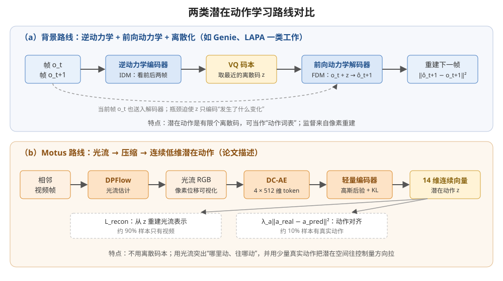

<p align="center"><b>图 16-4</b> 两类潜在动作学习路线：（a）IDM 编码 + VQ 离散码 + FDM 重建下一帧的经典思路；（b）Motus 论文的光流 + DC-AE + 连续 14 维潜在动作</p>

> ⚠️ **注意**：本章附带的 Motus 源码与配置中**没有** VQ 码本，也没有"用潜在动作重建下一帧图像"的前向动力学解码器。下面 2.3 节才是 Motus 的做法。不要把背景路线的细节套到本章代码上。

### 2.3 Motus 的做法：光流 → 压缩 → 低维连续潜在动作

论文中的处理链路可以概括为：

**相邻视频帧 → DPFlow 光流估计 → 光流 RGB 表示 → DC-AE 压缩特征 → 低维潜在动作。**

**为什么先算光流？** 光流描述像素在相邻帧之间的位移。例如，夹爪向右运动，会在相关像素区域产生一定方向的位移；物块被抬起后，也会出现随之变化的运动区域。与直接编码两帧外观相比，光流更突出"哪里发生了怎样的移动"，而桌面颜色、光照、背景纹理这些"不动的外观"在光流里几乎消失。这相当于先手工做了一步"只看变化"的预处理，替代了经典路线中"解码器已知 $o_t$、所以编码器只需编码变化"的那套机制。

**用一个 2×2 像素的玩具光流理解"光流 RGB"**：设夹爪所在的两个像素向右移动 3 个像素、向上 0 像素，其余两个像素静止。光流场是每个像素一个二维位移 $(u,v)$：

```text
 (3,0) (3,0)      ← 夹爪区域：向右
 (0,0) (0,0)      ← 桌面：静止
```

常见的可视化把位移方向映射为色相、把位移大小映射为饱和度，于是夹爪区域呈现"代表向右"的颜色，静止区域接近白色或黑色。这样光流就变成了一张可以被图像自编码器处理的 RGB 图。

**为什么再压缩？** 光流仍然是与图像同尺寸的高维场。论文使用 DC-AE 将光流表示压缩为四个 512 维 token，再由轻量编码器把拼接后的 $4\times512$ 维特征映射成一个 14 维潜在动作向量。这个 14 维是论文潜在动作表示的设计，不等于本章 G2 必须使用 14 维控制接口。可以算一下压缩比： $4\times512=2048$ 维 → 14 维，大约压缩了 146 倍，只有最主要的运动成分能通过这个瓶颈。

还需要强调两点。

**潜在动作不是光流本身。** 光流仍是高维的像素运动场；潜在动作是经过压缩和训练约束后的低维表示。

**潜在动作不是可直接执行的关节指令。** 相同的画面运动可以由不同身体结构和控制方式产生，光流还可能包含相机运动、遮挡和非刚体变化。低维向量与真实动作维数相似，只提供了对齐的便利，不保证每个维度具有固定的关节含义。

### 2.4 潜在动作的训练目标：重建 + 弱动作监督 + KL

为使这种表示不只学会压缩画面，论文还使用少量带真实动作的数据进行弱监督，并引入类似 AnyPos 的任务无关采样数据：利用 cuRobo 在目标机器人动作空间中采样运动，收集图像—动作对应关系，为潜在空间提供控制约束。

论文给出的潜在动作学习目标为：

$$
\mathcal{L}_{\mathrm{latent}}=\mathcal{L}_{\mathrm{recon}}+\lambda_{a}\lVert a_{\mathrm{real}}-a_{\mathrm{pred}}\rVert_{2}^{2}+\beta\mathcal{L}_{\mathrm{KL}}
$$

逐项解释：

| 符号 | 含义 | 作用 |
|---|---|---|
| $\mathcal{L}_{\mathrm{recon}}$ | 从潜在动作重建光流表示的误差 | 要求潜在表示保留光流运动信息；所有样本都有 |
| $a_{\mathrm{real}}$ | 真实动作（只在有标签样本上存在） | 弱监督信号 |
| $a_{\mathrm{pred}}$ | 由潜在表示预测出的动作 | 与真实动作对齐 |
| $\lambda_a$ | 动作对齐项权重 | 平衡"像光流"与"像动作" |
| $\mathcal{L}_{\mathrm{KL}}$ | 潜在后验与先验分布的 KL 散度 | 正则化潜在分布，避免表示过于零散 |
| $\beta$ | KL 权重 | 控制潜在空间的平滑程度 |

论文在该学习环节混合约 90% 无动作标签数据与 10% 有标签轨迹。可以这样理解：如果一个 batch 有 10 个样本，平均约 9 个只贡献重建项和 KL 项，约 1 个额外贡献动作对齐项。这 1 个样本像一根"锚"，把整个潜在空间往"和控制量有关"的方向拉，而不是任意学成一种只能重建光流的编码。

**KL 项的手算小例子**：若潜在后验是对角高斯 $\mathcal N(\mu,\sigma^2)$、先验是标准正态，则每一维

$$
\mathrm{KL}=\tfrac12\left(\mu^2+\sigma^2-1-\ln\sigma^2\right)
$$

- 某维 $\mu=0.5,\ \sigma^2=1$： $\tfrac12(0.25+1-1-0)=0.125$。
- 某维 $\mu=0,\ \sigma^2=0.5$： $\tfrac12(0+0.5-1+0.693)\approx0.097$。
- 某维 $\mu=0,\ \sigma^2=1$：恰好为 0。

均值偏离 0 或方差偏离 1 都会被惩罚，这就是"避免表示过于零散"的数学含义。

这个 90%/10% 比例与本章按 episode 划分训练集和验证集的比例**没有关系**：一个是潜在动作训练中的标签组成，另一个是 G2 数据的评估划分。

最后再区分两种"潜在"：Wan VAE 压缩的是**视频内容**；潜在动作编码器压缩的是**运动信息**。虽然两者都使用潜空间，但不是同一个编码器，也不承担同一个任务。

> ⚠️ **注意**：光流估计器、DC-AE 和潜在动作编码器的训练代码**不在**本章 `code_chapter16` 中。本章能看到的是它们的"产物"如何被消费：见 2.5 节。

### 2.5 代码中的潜在动作：Stage 2 怎样消费 14 维标签

虽然本章不训练潜在动作编码器，但附带的 Motus 源码保留了 Stage 2 使用潜在动作的数据集与配置，读它能看清"潜在动作标签长什么样、怎样喂给动作专家"。

**配置**（`code/code_chapter16/Motus/configs/latent_action.yaml`，节选）：

```yaml
common:
  # Latent Action dimensions
  action_dim: 14
  state_dim: 14
  num_video_frames: 8
  # ...
  global_downsample_rate: 6     # Global downsampling (e.g., 30Hz -> 5Hz)
  video_action_freq_ratio: 1    # Video:Action frequency ratio

dataset:
  type: "latent_action"
  dataset_dir:
    - "/share/dataset/preprocess/pretrain"
    - "/share/dataset/preprocess/egodexresized_human_1"
    # ... 多个机器人与人类视频来源
# Training mode: pretrain or finetune
training_mode: "pretrain"
```

**数据集**（`code/code_chapter16/Motus/data/latent_action/latent_action_dataset.py`，节选）：

```python
def _has_triplet_subdirs(directory: Path) -> bool:
    # 一个合法的叶子目录必须同时有视频、UMT5 文本特征和 14 维潜在动作
    return all((directory / sub).exists() for sub in ["videos", "umt5_wan", "latent_action_dim14"])

class LatentActionDataset(data.Dataset):
    # ...
    def _select_indices(self, total_frames: int):
        step = self.global_downsample_rate          # 配置中为 6
        max_cond = total_frames - 1 - self.num_video_frames * step
        condition_idx = 0 if max_cond < 0 else random.randint(0, max_cond)
        # 未来视频帧：c+6, c+12, ..., c+48
        video_indices = [condition_idx + (i + 1) * step for i in range(self.num_video_frames)]
        # 潜在动作取样位置：c, c+6, ..., c+42（作为相邻帧运动片段的起点）
        action_indices = [condition_idx + i * step for i in range(self.num_video_frames)]
        # ...
        return condition_idx, video_indices, action_indices

    def __getitem__(self, idx):
        # ...
        la_full = self._load_latent_action(episode["latent_action_path"])  # [T - 1, D]
        # ...
        action_sequence = la_full[act_idxs].float()
        # normalized_actions = normalize_actions_with_quantiles(...)  # 源码中已注释
        normalized_actions = action_sequence
        # ...
        return {
            "first_frame": first_frame,               # [C, H, W]
            "video_frames": video_frames,             # [F, C, H, W]
            "action_sequence": normalized_actions,    # [F, D]
            "language_embedding": language_embedding, # [L, E]
            "vlm_inputs": vlm_tokens,
            # Note: no initial_state
        }
```

**代码解读**：

- 潜在动作以 `latent_action_dim14/*.pt` 文件的形式**预先离线算好**，形状为 $[T-1,D]$：每个相邻帧间隔一个向量，所以比视频少一帧。训练 Motus 时不再在线跑光流和 DC-AE。
- 返回的样本**没有 `initial_state`**：人类视频没有"机器人关节状态"可言。这对应动作专家的 `pretrain` 模式（见 5.4 节）。
- 这里 `global_downsample_rate=6`、`video_action_freq_ratio=1`：8 个潜在动作配 8 帧未来视频，一一对应，都约为 5 Hz；这与本章 G2 Stage 3"两个动作配一帧视频"的设置不同。
- 源码目录 `Motus/data/utils/` 下有 `latent_action_q01_q99.json` 等统计文件，但数据集里分位数归一化一行被注释掉了，当前代码直接使用原始潜在动作值。

**手算索引**：若某条视频总共 100 帧，随机到条件帧 $c=10$，则

- 未来视频帧： $16,22,28,34,40,46,52,58$；
- 潜在动作取样位置： $10,16,22,28,34,40,46,52$。

第 $i$ 个潜在动作位置正好是第 $i-1$ 个视频帧（第 0 个对应条件帧），即"从这一帧出发的运动"，与"下一张未来画面"首尾相接。

```text
帧索引:   10      16      22      28   …   52      58
视频:    [条件]   v1      v2      v3   …   v7      v8
潜在动作: z1 ───► z2 ───► z3 ───► z4  …   z8 ───►
          (从 10 出发) (从 16 出发) …       (从 52 出发)
```

<p align="center"><b>图 16-5</b> Stage 2 潜在动作样本的时间索引（以 c=10、步长 6 为例）</p>

> 💡 **要点**：潜在动作在本章中的作用是**塑造 Stage 2 预训练基座**。本章 G2 推理直接输出真实动作目标，不会在部署时先提取光流再把 14 维潜在动作逐项翻译为 16 维关节指令。怎样从潜在动作过渡到真实动作，见第五部分 5.4 节。


---

## 第三部分 模型结构：三个专家如何共同工作

### 3.1 先看清整个模型，而不是把它理解成三个串联工具

**直观理解**：可以把 Motus 想象成三位各有专长的工程师坐在一张桌子前——"理解专家"读懂任务和画面，"视频专家"负责想象未来画面，"动作专家"负责写出控制序列。他们每一轮都先互相交换笔记（联合注意力），然后各自回到自己的专业计算（独立前馈网络），一共 30 轮。

Motus 的主体由视频生成专家、动作专家和理解专家组成。其中，理解专家接收预训练视觉语言模型的特征，视频专家继承预训练视频模型的生成能力。三个专家不是先后调用的独立服务，而是在每一层通过联合注意力交换信息。

可以用一条文字结构图把信息流串起来：

**当前三视图与任务 → Qwen3-VL → 理解特征；当前图像与未来视频噪声 → Wan 视频分支；当前机器人状态与动作噪声 → 动作分支；三路 token 经过 30 层联合注意力和各自前馈网络 → 视频速度场与动作速度场 → 迭代更新 → 未来视频与关节目标。**

另外，任务文字还经过 UMT5 编码，作为 Wan 视频分支的文本条件。这条路径和 Qwen 的视觉语言理解路径并存，不是二选一。

本章配置选用的主要组成如下：

| 组成 | 基础模型或实现 | 本章需要记住的作用 |
|---|---|---|
| 视频生成主干 | Wan2.2-TI2V-5B | 在视频潜空间中预测运动与场景变化 |
| 视频编解码器 | Wan VAE | 把图像序列压缩为视频潜变量，再还原成可观看的视频 |
| 视觉语言骨干 | Qwen3-VL-2B-Instruct | 从当前画面和任务中提取语义与空间特征，参数冻结 |
| 理解专家 | 512 维隐藏状态的 Transformer 分支 | 将 Qwen 特征接入联合生成过程 |
| 动作专家 | 1024 维隐藏状态的 Transformer 分支 | 将状态和带噪动作编码为 token，输出动作速度场 |
| 文本编码路径 | Wan 配套 UMT5 | 为视频分支提供预编码的文本条件 |

官方 README 将主要组件粗略统计为约 8B 参数，其中 Wan 约 5B，Qwen 约 2.13B，动作专家约 641.5M，理解专家约 253.5M。这是官方主要组件的量级说明，不代表某次 Python 进程只会占用"参数数量乘两字节"的显存。VAE、文本编码器是否同时驻留、激活、注意力中间量和训练状态都会影响实际资源需求。

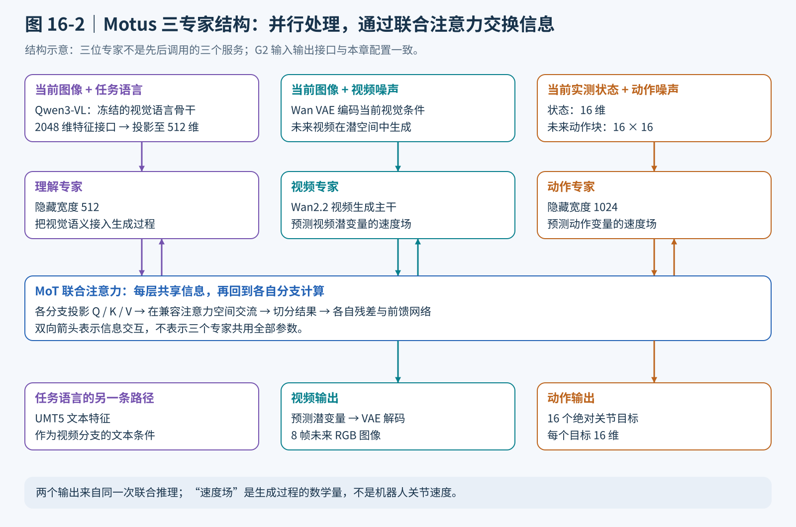

<p align="center"><b>图 16-6</b> Motus 三专家结构：先沿竖向阅读每个专家的输入输出，再看中间的双向信息交互。UMT5 是视频专家的另一条文本条件路径；图中省略了重复层、归一化和时间调制等细节</p>

### 3.2 理解、视频和动作各自怎样变成 token

**理解分支：把"看懂任务"变成可供动作使用的特征。**

当前合成图像和完整任务文字经过 Qwen 的输入处理器，得到视觉与文本输入。这里需要的不是让 Qwen 先生成一句中文或英文解释，而是让视觉语言特征参与后续的视频与动作生成。

本章在配置中将视觉语言特征接口宽度设为 2048，并指定 `mlp3x_silu` 投影器，将其接入隐藏维度为 512 的理解专家。Qwen 骨干保持冻结，后续专家的可训练范围由 LoRA 配置决定。因此，"冻结 VLM"不等于"语义特征不能参与 G2 适配"。这些数值可以直接在本章的配置文件和模型构建参数中核对：

```yaml
# code/code_chapter16/configs/stage3_g2_lora.yaml（节选）
model:
  vlm:
    checkpoint_path: ./weights/Qwen3-VL-2B-Instruct
    precision: bfloat16
    frozen: true
  action_expert:
    hidden_size: 1024
    ffn_dim_multiplier: 4
  und_expert:
    hidden_size: 512
    ffn_dim_multiplier: 4
    vlm:
      input_dim: 2048
      projector_type: mlp3x_silu
```

**视频分支：不是在原始像素上反复去噪。**

当前帧与未来帧先从 $[0,1]$ 转到 $[-1,1]$，再经过冻结的 Wan VAE 编码。VAE 负责压缩图像的空间与时间信息；后续视频 Transformer 在压缩后的潜空间中工作，最后才通过 VAE 解码回 RGB。

本章输入一帧条件图像，预测八帧未来图像，一共九帧。视频编码器将这段序列压缩为潜变量，再转成视频 token；当前帧提供已知的视觉锚点，未来部分是生成对象。本章代码负责给出帧数、图像大小与 VAE 权重路径，不自行实现视频编解码器。

要区分**八帧未来图像**和**八个视频 token**：一帧图像会对应多个空间 token，因此视频序列的 token 数远大于帧数。只知道帧数，不能直接推断注意力开销。

**算一算视频 token 有多少。** `Motus/models/motus.py` 在构造时预先计算潜空间网格：

```python
# code/code_chapter16/Motus/models/motus.py（节选）
lat_T = 1 + config.num_video_frames // 4
lat_H = config.video_height // 32
lat_W = config.video_width // 32
```

代入本章 $384\times320$、8 帧： $\text{lat\_T}=1+8/4=3$， $\text{lat\_H}=384/32=12$， $\text{lat\_W}=320/32=10$，潜空间网格为 $3\times12\times10=360$ 个位置。（Wan2.2-TI2V-5B 配置中 VAE 步长为 $(4,16,16)$、patch 大小为 $(1,2,2)$，空间上合计正好是 32 倍下采样，与上面的 `//32` 一致。）对比之下，动作分支只有 $1+16+4=21$ 个 token（见下文）。这就是"视频 token 远多于动作 token"的具体数字，也解释了为什么 Motus 要让视频比动作稀疏。

**动作分支：把当前状态与未来动作分别编码。**

当前状态告诉模型"机器人现在在哪里"，未来动作则是需要生成的控制目标，两者不能混为同一个输入。G2 的当前状态是一个 16 维向量，未来动作块包含 16 个 16 维目标。经过不同的编码器后，它们成为动作专家可以处理的内部特征，再与视频、理解分支交换信息。

```python
# code/code_chapter16/Motus/models/action_expert.py（节选，StateActionEncoder.forward）
state_encoded = self.state_encoder(state_tokens)     # [B, 1, dim]   状态 → 1 个 token
action_encoded = self.action_encoder(action_tokens)  # [B, 16, dim]  每个动作 → 1 个 token
encoded = torch.cat([state_encoded, action_encoded], dim=1)  # [B, 17, dim]
if registers is not None:
    encoded = torch.cat([encoded, registers], dim=1)  # [B, 17 + num_registers, dim]
encoded = encoded + self.pos_embedding[:, :seq_len, :]  # 固定正弦位置编码
```

`state_encoder` 和 `action_encoder` 都是 `mlp3x_silu`（三层线性 + SiLU）。`ActionExpertConfig` 中 `num_registers` 默认为 4，即额外 4 个可学习的"寄存器 token"，用于汇总全局信息，不代表额外的关节或控制步。所以一个样本的动作分支序列是 $1$（状态） $+16$（动作） $+4$（寄存器） $=21$ 个 token。输出时，代码切掉首个状态位置和末尾寄存器位置，只保留中间 16 个：

```python
# code/code_chapter16/Motus/models/motus.py（节选，inference_step）
action_pred_full = self.action_expert.decoder(action_tokens, action_head_time_emb)
# Extract middle action chunk (skip first state token and last register tokens)
action_velocity = action_pred_full[:, 1:-self.action_expert.config.num_registers, :]
```

本章可以直接核对的接口是：状态宽度为 16、动作宽度为 16、动作块长度为 16、动作专家隐藏维度为 1024。部署时只接收形状为 $16\times16$ 的动作数组。

> ⚠️ **注意**：**动作 token 的 1024 维是网络内部特征宽度；输出动作的 16 维是机器人控制接口宽度。** 增加隐藏维度并不意味着机器人增加了关节。

### 3.3 三模态联合注意力：先交换信息，再各自处理

三个专家不要求使用相同的隐藏宽度：本章动作专家配置为 1024，理解专家配置为 512，视频专家沿用 Wan 的结构（Wan2.2-TI2V-5B 配置中 `dim=3072`、`num_heads=24`、`num_layers=30`）。不同宽度的隐藏向量不能直接沿序列维拼接，因此需要先构造查询、键和值，将它们投影到兼容的注意力空间。

设视频、动作、理解三个分支分别记为 $v,a,u$。在一个联合注意力层中，可以用下式概括跨分支交互：

$$
Q=[Q_v;Q_a;Q_u],\qquad
K=[K_v;K_a;K_u],\qquad
V=[V_v;V_a;V_u]
$$

$$
Y=\mathrm{softmax}\left(\frac{QK^\top}{\sqrt{d_h}}\right)V
$$

其中分号表示沿 token 序列拼接， $d_h$ 表示每个注意力头的维度。该式省略了位置编码、归一化等实现细节，用来表达"不同模态可以访问彼此的信息"。

**维度怎样对齐？** Wan 的 3072 维被切成 24 个头、每头 $3072/24=128$ 维。动作专家要把自己的 1024 维 token 投影到同样的"24 头 × 128 维"空间，用的是一个四维参数张量 `wan_action_qkv`，形状为 $[3,24,1024,128]$（3 表示 Q/K/V 三份）：

```python
# code/code_chapter16/Motus/models/motus.py（节选，VideoModule.process_joint_attention）
# Action heads for WAN space (1024 -> 24*128)
a_qkv = torch.einsum("BTD,KNDE->KBTNE", norm_action, action_block.wan_action_qkv)
a_q_h, a_k_h, a_v_h = a_qkv[0], a_qkv[1], a_qkv[2]
# ... 理解分支同理，用 und_block.wan_und_qkv
# Call WAN self-attn with trimodal MoT
y, action_out_h, und_out_h = wan_layer.self_attn(
    norm_video, seq_lens, self.grid_sizes, freqs,
    action_q=a_q, action_k=a_k, action_v=a_v,
    und_q=u_q, und_k=u_k, und_v=u_v
)
und_out = und_block.wan_und_o(und_out_h.flatten(2))
action_out = action_block.wan_action_o(action_out_h.flatten(2))   # 3072 -> 1024 投影回去
video_tokens = video_tokens + y * v_mod[2].squeeze(2)
action_tokens = action_tokens + action_out * a_mod[2].squeeze(2)
und_tokens = und_tokens + und_out
```

**代码解读**：

- `einsum("BTD,KNDE->KBTNE")`：B 批量、T token 数、D=1024 输入维、K=3（QKV）、N=24 头、E=128 每头维度。一次乘法得到动作分支的 Q、K、V，直接位于 Wan 的注意力空间。
- `wan_layer.self_attn(...)`：Wan 原有的自注意力被扩展为接收三路 Q/K/V，拼接后做一次注意力，再把结果按各分支的 token 数切开返回。
- `wan_action_o`、`wan_und_o`：把注意力输出从 Wan 空间投影回各自的隐藏宽度，再做残差更新。视频和动作的残差带有 AdaLN 门控系数 `v_mod[2]`、`a_mod[2]`。

**手算一个两 token 的注意力小例子**：设一个视频 token 的查询 $q_v=(1,0)$，序列中有视频键 $k_v=(1,0)$ 和动作键 $k_a=(0,1)$，对应值 $v_v=(2,0)$、 $v_a=(0,4)$，取 $d_h=2$。

- 打分： $q_v\cdot k_v/\sqrt2=0.707$， $q_v\cdot k_a/\sqrt2=0$。
- softmax： $e^{0.707}\approx2.028$， $e^0=1$，权重约为 $0.670$ 与 $0.330$。
- 输出： $0.670\times(2,0)+0.330\times(0,4)=(1.34,1.32)$。

视频 token 的输出里有约三分之一来自动作 token 的值——这就是"视频分支能看到动作分支"的最小演示。反过来，动作 token 的查询也会读取视频与理解 token。

联合注意力计算后，再按照每个分支的 token 数切分结果，并映射回各自的隐藏空间。也就是说，三位专家共享的是信息交流过程，而不是必须共用全部网络参数。本章 `lora.py` 对动作与理解分支的专用 QKV 参数也注入低秩增量，使 G2 适配能够调整跨模态信息交换，而不仅仅修改最终动作输出。

随后，各专家继续使用自己的前馈网络。视频分支还会对 UMT5 文本特征进行交叉注意力。因此一层网络可以概括为：

**归一化及时间调制 → 三分支联合注意力 → 分支残差更新 → 视频文本交叉注意力 → 各分支独立前馈网络。**

```python
# code/code_chapter16/Motus/models/motus.py（节选，training_step 中的 30 层循环）
for layer_idx in range(self.config.num_layers):
    video_adaln_modulation = self.video_module.compute_adaln_modulation(video_adaln_params, layer_idx)
    action_adaln_modulation = self.action_module.compute_adaln_modulation(action_adaln_params, layer_idx)
    # Trimodal MoT: WAN + Action + Understanding Expert joint attention
    video_tokens, action_tokens, und_tokens = self.video_module.process_joint_attention(
        video_tokens, action_tokens, video_adaln_modulation, action_adaln_modulation, layer_idx,
        self.action_expert.blocks[layer_idx],
        und_tokens, self.und_expert.blocks[layer_idx]
    )
    # WAN cross
    video_tokens = self.video_module.process_cross_attention(video_tokens, video_adaln_params, layer_idx, processed_t5_context)
    # FFNs: WAN, Action, Understanding (each processes their own FFN)
    video_tokens = self.video_module.process_ffn(video_tokens, video_adaln_modulation, layer_idx)
    action_tokens = self.action_module.process_ffn(action_tokens, action_adaln_modulation, layer_idx)
    und_tokens = self.und_module.process_ffn(und_tokens, layer_idx)
```

可以把它想象为三位各有专长的工程师：每轮先共享信息，然后分别完成自己的专业计算。动作专家不必替代视频专家去学习全部图像细节，视频专家也不必用自己的输出头直接表达 G2 的 16 维关节目标。

这种结构称为 **Mixture-of-Transformers，MoT**。它不是常见的"一个路由器为每个 token 只挑选少数专家"的稀疏 MoE：联合生成中三个分支共同参与计算，关键在于**独立参数与联合注意力相结合**。

时间信息也不是可有可无的。模型必须知道当前输入是"几乎全是噪声"，还是"已经接近最终结果"，才能预测正确的更新方向。视频与动作分支通过时间嵌入和自适应调制（AdaLN）感知噪声程度，使同一网络能够在不同生成阶段预测更新方向。注意代码里视频和动作的时间嵌入是**分别**计算的（`video_t_embed` 与 `action_t_embed`），这是第四部分"独立噪声时间"的结构基础。

> 💡 **要点**：MoT = 每个专家自己的参数（norm、FFN、QKV 投影） + 一次共享的注意力。理解它，就能理解为什么本章 LoRA 必须同时改到"专家 QKV"这种非线性层参数（第五部分 5.5 节）。

### 3.4 为什么还需要 UMT5，以及为什么动作比视频更密

Qwen 已经处理了任务文字，为什么视频分支还要 UMT5？因为两者承接的是不同的预训练接口。

Qwen 的作用是联合理解当前画面与任务，输出可用于跨模态交互的特征。UMT5 则保持 Wan 原有的文本条件输入方式，让视频专家继续使用其预训练时熟悉的条件分布。直接删除其中一条路径，不只是减少一次编码，而是改变了原有模型结构。

本章任务文字只有三种主要变化，因此把 UMT5 编码结果提前缓存到磁盘，不必在每次请求中重新加载并运行大型文本编码器。**预编码 UMT5 不代表跳过 Qwen 的当前图像理解**：图像会变化，Qwen 仍需处理当前请求。

另外，Motus 使用"动作密、视频稀"的预测方式。机器人需要较密集的控制目标，但没有必要为每个目标都生成一张完整图像。视频 token 过多还会增加开销，使联合注意力中的模态比例更加失衡。论文给出了更稀疏的视频采样示例；本章采用本地 RoboTwin 风格配置，实际比例是两个动作对应一帧未来视频，而不是把论文示例中的比例照搬过来。

本章的时间关系是：

$$
30\ \mathrm{Hz\ 原始记录}
\xrightarrow{\text{每隔 3 帧取动作}}
10\ \mathrm{Hz\ 动作目标}
\xrightarrow{\text{每 2 个动作取视频帧}}
5\ \mathrm{Hz\ 未来视频}
$$

一次预测 16 个动作与八帧未来图像，覆盖约 1.6 秒的原始数据时间（ $16\times3/30=1.6$ s，或 $8\times6/30=1.6$ s，两条时间轴终点一致）。动作时序和视频时序虽然稀疏程度不同，但必须落在同一条时间轴上。具体索引将在第五部分与数据处理流程一起解释。


---

## 第四部分 训练目标：分阶段训练、联合流匹配与推理

### 4.1 六层数据金字塔与三阶段训练为什么要放在一起理解

大型具身模型面临的数据矛盾是：容易获得的数据通常离目标机器人较远，最贴近目标任务的数据却最昂贵。Motus 用六层数据金字塔组织不同来源，并让训练阶段与数据作用对应起来。

| 数据层级 | 数据来源 | 主要贡献 |
|---|---|---|
| Level 1 | 网络文字、图像与视频等基础数据 | 通用语义、视觉和生成先验，主要通过已有基础模型继承 |
| Level 2 | 第一人称人类视频 | 人类操作的时序结构与运动变化 |
| Level 3 | 合成数据 | 可扩展的视觉与交互样本 |
| Level 4 | 任务无关机器人运动数据 | 动作空间覆盖与图像—控制对应 |
| Level 5 | 多机器人任务轨迹 | 不同身体上的操作和交互经验 |
| Level 6 | 目标机器人任务轨迹 | 具体平台的动作接口、动力学与任务习惯 |

这是一种数据组织框架，并不是本章目录中必须出现六个文件夹。金字塔越靠近目标机器人，数据通常越有针对性，但规模也更受成本限制。

官方 `Motus/README.md` 给出了阶段与数据层级的对应：

| 阶段 | 使用的数据层级 | 训练内容 |
|---|---|---|
| Stage 1（VGM Training） | Level 2、3、5 | 只训练视频生成模型 |
| Stage 2（Motus Pretraining） | Level 2、3、4、5 | 三个专家一起训练，动作监督为**潜在动作** |
| Stage 3（Motus SFT） | Level 6 | 三个专家一起训练，动作监督为**真实动作** |

**Stage 1：先让视频专家适应机器人交互。**

从已有视频生成模型出发，利用人类视频、合成数据和多机器人轨迹等训练视频专家，让它更熟悉操作场景中的运动，而不只是生成一般互联网视频。主要任务是根据初始图像和语言生成后续视频。

**Stage 2：利用潜在动作进行统一预训练。**

把视频、语言和从运动中提取的潜在动作组织成联合训练样本，训练三个专家之间的配合，Qwen 骨干保持冻结。这一阶段让动作专家即使面对没有真实关节标签的视频，也能学习操作过程中的运动结构。

这里要把潜在动作表示学习与 Stage 2 的联合训练区分开：前者（第二部分）提供"从视频得到动作式标签"的途径，后者利用这些标签训练完整 Motus。它们相互衔接，但不是同一个损失函数。

**Stage 3：用目标机器人的真实动作做监督微调。**

在目标平台上采集图像、实测状态和实际发送的动作目标，用这些数据适配完整模型的控制接口与任务分布。本章就在这一阶段开展实践：初始化为公开 Stage 2 Motus，动作与状态改为 G2 的 16 维接口，使用 G2 三色抓取放置数据做 LoRA 微调。

为什么不直接加载 RoboTwin 的成品策略？因为本地 `Motus_robotwin2` 面向的是 14 维机器人接口，G2 则使用 16 维接口。即使视觉场景相似，关节顺序、夹爪约定、运动学与控制目标也不相同。Stage 3 的职责就是把通用先验落到具体身体上，而不是修改一个输出维度后假设策略自动可用。

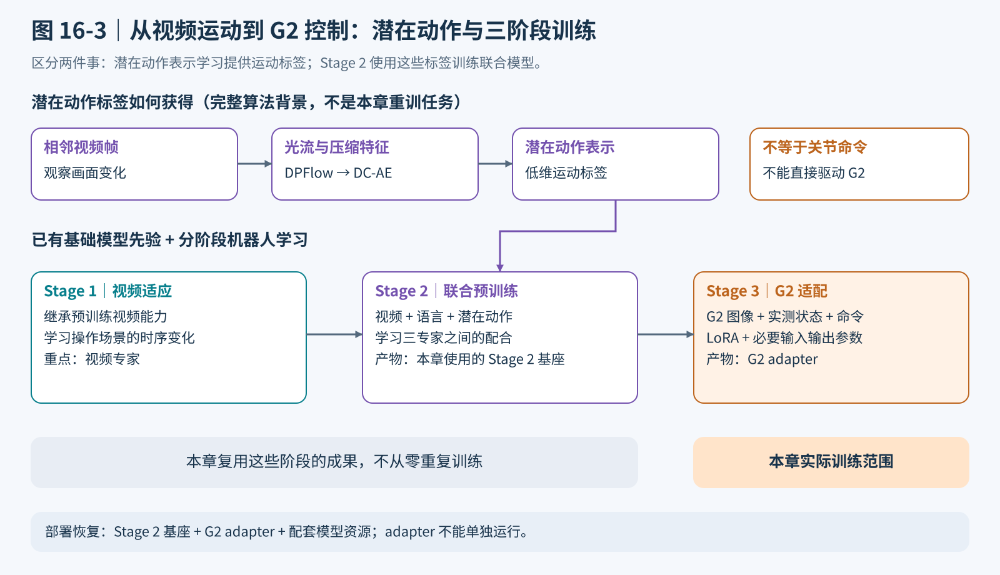

<p align="center"><b>图 16-7</b> 上方是从视频获取运动标签的途径，下方是使用这些数据训练模型的阶段。橙色区域是本章实际开展的 G2 Stage 3 适配，不要把它与潜在动作编码器训练混为一谈</p>

### 4.2 联合流匹配怎样训练视频与动作

**直观理解**：流匹配（Flow Matching）把"生成"看成一次搬运：在数据点和一团高斯噪声之间连一条直线，让网络学会"在这条线上任意一点，该往哪个方向走、走多快"。学会之后，从噪声出发沿着网络给的方向一步步走，就走回了数据。

潜在动作解决了预训练数据从哪里来的问题；联合流匹配解决的是模型怎样学习生成视频与动作。

设一条训练样本中，真实未来视频经过 Wan VAE 编码得到 $Z$，真实未来动作为 $A$。分别采样高斯噪声 $\epsilon_v$、 $\epsilon_a$，再分别选择噪声强度 $\sigma_v$、 $\sigma_a$，构造：

$$
Z_{\sigma_v}=(1-\sigma_v)Z+\sigma_v\epsilon_v
$$

$$
A_{\sigma_a}=(1-\sigma_a)A+\sigma_a\epsilon_a
$$

当 $\sigma=0$ 时，输入是干净数据；当 $\sigma=1$ 时，输入是纯噪声。模型看到的是"已经混入一定噪声的视频与动作"，需要预测它们沿这条直线路径变化的速度。

对上述路径关于 $\sigma$ 求导，得到监督目标：

$$
u_{v}^{\ast}=\frac{\partial Z_{\sigma_v}}{\partial\sigma_v}=\epsilon_v-Z,\qquad u_{a}^{\ast}=\frac{\partial A_{\sigma_a}}{\partial\sigma_a}=\epsilon_a-A
$$

模型预测 $v_{v}^{\theta}$ 与 $v_{a}^{\theta}$，通过均方误差训练：

$$
\mathcal{L}_{\mathrm{video}}
=\mathrm{MSE}\left(v_{v}^{\theta},u_{v}^{\ast}\right)
$$

$$
\mathcal{L}_{\mathrm{action}}
=\mathrm{MSE}\left(v_{a}^{\theta},u_{a}^{\ast}\right)
$$

$$
\mathcal{L}
=\lambda_v\mathcal{L}_{\mathrm{video}}
+\lambda_a\mathcal{L}_{\mathrm{action}}
$$

本章两项权重均为 1（YAML 中 `video_loss_weight: 1.0`、`action_loss_weight: 1.0`）。这里的"速度"是**生成过程中的数学速度场**，不是机器人关节速度；最终得到的 G2 动作仍然是绝对关节目标。

**对应代码**（`code/code_chapter16/Motus/models/motus.py`，`Motus.training_step` 节选）：

```python
# 1. 视频：[0,1] -> [-1,1]，条件帧与未来帧拼成 9 帧后用冻结 VAE 编码
first_frame_norm = (first_frame * 2.0 - 1.0).unsqueeze(2)
video_normalized = (video_frames * 2.0 - 1.0).permute(0, 2, 1, 3, 4)
full_video = torch.cat([first_frame_norm, video_normalized], dim=2)
with torch.no_grad():
    clean_full_latent = self.video_model.encode_video(full_video.to(self.dtype))       # Z
    condition_frame_latent = self.video_model.encode_video(first_frame_norm.to(self.dtype))

# 视频噪声时间：独立采样
timestep_id = torch.randint(0, self.fm_train_scheduler.num_train_timesteps, (B,))
sigma = self.fm_train_scheduler.sigmas[timestep_id].to(...).view(B, 1, 1, 1, 1)        # σ_v
video_noise = torch.randn_like(clean_full_latent, dtype=self.dtype)                   # ε_v
noisy_video_latent = clean_full_latent * (1 - sigma) + video_noise * sigma            # Z_σv
noisy_video_latent[:, :, 0:1] = condition_frame_latent   # Teacher Forcing：条件帧保持干净
video_target = video_noise - clean_full_latent           # u*_v = ε_v - Z
video_target[:, :, 0:1] = 0                              # 条件帧不计损失

# 2. 动作噪声时间：再独立采样一次
timestep_id_action = torch.randint(0, self.fm_train_scheduler_action.num_train_timesteps, (B,))
sigma_action = self.fm_train_scheduler_action.sigmas[timestep_id_action].to(...).view(B, 1, 1)  # σ_a
action_noise = torch.randn_like(actions, dtype=self.dtype)                            # ε_a
noisy_actions = actions * (1 - sigma_action) + action_noise * sigma_action            # A_σa
action_target = action_noise - actions                                                # u*_a = ε_a - A
# ...（编码 token、30 层 MoT 前向，见 3.3 节）...
video_pred_masked = video_pred.clone()
video_pred_masked[:, :, 0:1] = 0
video_loss = torch.nn.functional.mse_loss(video_pred_masked, video_target, reduction='mean')
action_loss = torch.nn.functional.mse_loss(action_pred, action_target, reduction='mean')
total_loss = (self.config.video_loss_weight * video_loss +
              self.config.action_loss_weight * action_loss)
```

**代码解读（逐段对应公式）**：

- `noisy_video_latent = clean*(1-sigma) + noise*sigma` 对应 $Z_{\sigma_v}$；`noisy_actions = ...` 对应 $A_{\sigma_a}$。
- `video_target = video_noise - clean_full_latent` 与 `action_target = action_noise - actions` 对应 $u^\ast=\epsilon-x$。
- 视频与动作分别调用 `torch.randint` 取时间索引，这就是"独立噪声时间"在代码里的样子。
- `noisy_video_latent[:, :, 0:1] = condition_frame_latent` 与 `video_target[:, :, 0:1] = 0`、`video_pred_masked[:, :, 0:1] = 0`：当前帧是已知条件，不应该被模型重新发明，也不计入损失。
- `self.fm_train_scheduler` 是 `FlowMatchScheduler(shift=5.0, sigma_min=0.0, extra_one_step=True, num_train_timesteps=1000)`，它决定 1000 个离散时间对应的 $\sigma$ 取值。

**手算一维小例子（图 16-8）**：只看某一个关节的某一个未来目标。设真实命令 $A=0.45$ rad，采到噪声 $\epsilon=-0.2$，噪声强度 $\sigma=0.3$。

1. 加噪： $A_\sigma=(1-0.3)\times0.45+0.3\times(-0.2)=0.315-0.06=0.255$。
2. 目标速度： $u^\ast=\epsilon-A=-0.2-0.45=-0.65$。
3. 若网络此时预测 $v^\theta=-0.60$，这一维的平方误差为 $(-0.60+0.65)^2=0.0025$。
4. 验证"速度"含义：从 $A_\sigma$ 沿 $\Delta\sigma=-0.3$ 走一步， $0.255+(-0.65)\times(-0.3)=0.255+0.195=0.45$，恰好回到 $A$。

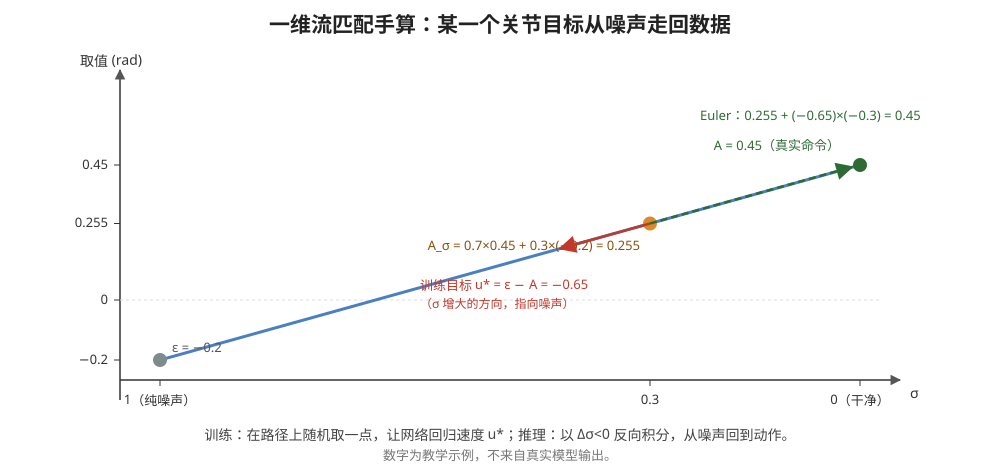

<p align="center"><b>图 16-8</b> 一维流匹配手算：直线连接噪声 ε 与真实动作 A，在 σ=0.3 处的训练目标速度为 ε−A=−0.65；推理时以负步长反向积分回到 A（数字为教学示例）</p>

动作分支在 Stage 3 中接收当前实测状态，监督对象是未来动作序列。理解分支没有另加一个"生成任务解释文本"的损失，它通过联合注意力参与视频与动作任务，并从联合目标获得训练信号；Qwen 骨干本身不更新。

**独立噪声时间是统一模型的关键。** 如果视频和动作永远拥有相同的噪声强度，模型主要看到"一起清晰、一起模糊"的组合。分别采样时间，可以让它接触"动作较清晰、视频较模糊"以及相反的组合，为条件模式切换提供基础。

需要区分"算法上的独立噪声时间"和"某个依赖版本采用的具体采样器"。本章 YAML 保留了 `time_distribution`（`timestep_sample_method: logit_normal`）配置字段，但从所附 `motus.py` 的 `training_step` 看，实际是用 `torch.randint` 在 `FlowMatchScheduler` 的 1000 个离散时间上均匀取索引，`time_distribution` 字段被读入 `model_config` 后并未在这段采样中使用。`train_stage3.py` 本身不实现噪声采样。复现实验应保存配置与所附 Motus 的版本信息，本节公式用于理解监督目标，不代替依赖版本的实现约定。

还要区分本节损失与第二部分潜在动作的损失：**当前 G2 Stage 3 不计算光流重建、潜在动作 KL 或潜在动作对齐项**。它使用的是视频速度场 MSE 加真实动作速度场 MSE。

> 💡 **要点**：Stage 2 与 Stage 3 用的是**同一个** `training_step`；区别只是 `actions` 里装的是 14 维潜在动作还是 16 维 G2 命令，以及有没有 `state`。

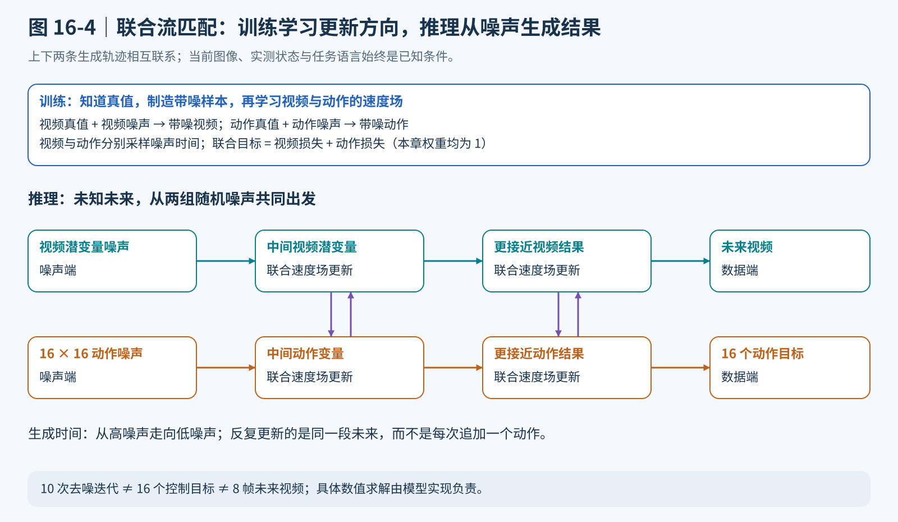

<p align="center"><b>图 16-9</b> 联合流匹配：横向表示生成过程从噪声走向结果，竖向双箭头表示视频与动作通过三专家交换信息。它不是机器人任务的物理时间轴；图中的中间状态数量也不代表实际去噪次数</p>

### 4.3 推理怎样从噪声得到视频与动作

训练时知道正确答案，可以制造带噪样本；推理时不知道未来，需要从噪声出发逐步生成。

本章实际推理按以下顺序进行：

1. 读取当前三视图、16 维实测状态与任务文字。
2. 将合成图像编码成条件帧潜变量，取得 UMT5 文本缓存与 Qwen 理解特征。
3. 初始化随机视频潜变量和形状为 $16\times16$ 的动作噪声，固定视频中的条件帧位置。
4. 让三个专家共同预测视频与动作的速度场。
5. 沿时间从 1 到 0 更新视频潜变量和动作，并再次恢复条件帧位置。
6. 重复若干次后，将视频潜变量解码为八帧未来图像，把动作结果作为 16 个绝对控制目标。

为了理解"从噪声逐步变成视频和动作"，可以用一阶 **Euler 积分**写出更新：

$$
X_{i+1}=X_i+\Delta\sigma_i\,v_\theta(X_i,\sigma_i),
\qquad \Delta\sigma_i<0
$$

其中 $X$ 分别代表视频潜变量和动作变量。负的时间步长很重要：训练目标定义的是由干净数据走向噪声的方向，生成时则从噪声沿相反时间方向走回数据。

**对应代码**（`code/code_chapter16/Motus/models/motus.py`，`Motus.inference_step` 节选）：

```python
num_total_latent_frames = 1 + self.config.num_video_frames // 4
video_latent = torch.randn((B, C_latent, num_total_latent_frames, H_latent, W_latent), ...)
video_latent[:, :, 0:1] = condition_frame_latent             # 条件帧固定
action_shape = (B, self.config.action_chunk_size, self.config.action_dim)   # (1, 16, 16)
action_latent = torch.randn(action_shape, ...)

# 3. Denoising loop: from noise (t=1) to clean (t=0)
timesteps = torch.linspace(1.0, 0.0, num_inference_steps + 1, ...)
for i in range(num_inference_steps):
    t = timesteps[i]
    t_next = timesteps[i + 1]
    dt = t_next - t                                           # Δσ < 0
    video_t_scaled = (t * 1000).expand(B).to(self.dtype)
    action_t_scaled = (t * 1000).expand(B).to(self.dtype)     # 联合预测：两者同一时间
    # ... 30 层三模态前向 ...
    video_velocity = self.video_module.apply_output_head(video_tokens, video_head_time_emb)
    action_velocity = action_pred_full[:, 1:-self.action_expert.config.num_registers, :]
    # Euler integration
    video_latent = video_latent + video_velocity * dt
    action_latent = action_latent + action_velocity * dt
    # Teacher Forcing
    video_latent[:, :, 0:1] = condition_frame_latent

decoded_frames = self.video_model.decode_video(video_latent)
predicted_frames = decoded_frames[:, :, 1:]                   # 去掉条件帧
predicted_frames = (predicted_frames + 1.0) / 2.0             # [-1,1] -> [0,1]
predicted_actions = action_latent.float()
```

**代码解读**：`torch.linspace(1.0, 0.0, 11)` 得到 $1.0,0.9,\dots,0.0$，十步每步 `dt=-0.1`，与公式中 $\Delta\sigma_i<0$ 对应；时间乘 1000 后送入时间嵌入，与训练时 0~1000 的离散时间刻度对齐。文件中还保留了被注释掉的 DPM++ 求解器版本与一个 UniPC 版本，当前生效的是上面这个 Euler 版本（本章 `MotusPolicy` 调用的就是它）。

**手算十步 Euler**：继续用 4.2 节的一维例子。假设网络已经学得完美，对任意 $x_\sigma$ 都输出 $v=\epsilon-A=-0.65$。从 $x_{1.0}=\epsilon=-0.2$ 出发，每步 $x\leftarrow x+(-0.65)\times(-0.1)=x+0.065$：

$$
-0.2\to-0.135\to-0.07\to-0.005\to0.06\to0.125\to0.19\to0.255\to0.32\to0.385\to0.45
$$

第 7 步正好经过 $\sigma=0.3$ 时的 $0.255$，第 10 步回到 $A=0.45$。真实网络的速度场不是常数，所以步数会影响质量，但"步数"只决定求解精度，不改变输出长度。

本章默认十次去噪迭代。**十次迭代、16 个动作和八帧视频是三个不同概念**：十次是生成求解步数；16 是动作块长度；八是未来视频帧数。增加去噪迭代并不会自动生成更多动作或更长视频。

本章 `MotusPolicy.predict_composite` 将 `inference_steps` 传给模型的联合推理接口，然后接收视频和动作；当前教学入口不提供求解器切换参数。

### 4.4 五种模式的噪声设置

论文五种模式的差别，可以进一步用噪声状态解释。下面的 0 表示干净、1 表示纯噪声，均针对**未来变量**；当前条件帧始终已知。

| 模式 | 未来视频的噪声状态 | 未来动作的噪声状态 |
|---|---|---|
| VGM | 从 1 逐步到 0 | 固定在纯噪声，不提供已知动作条件 |
| 世界模型 | 从 1 逐步到 0 | 固定为给定的干净动作，时间为 0 |
| IDM | 固定为给定的干净未来视频，时间为 0 | 从 1 逐步到 0 |
| VLA | 固定在纯噪声，不提供已知未来视频条件 | 从 1 逐步到 0 |
| 联合预测 | 从 1 逐步到 0 | 同时从 1 逐步到 0 |

因此，"不用未来视频作为条件"不等于把视频变量填成全零，而是按对应模式保留在纯噪声状态。类似地，世界模型模式需要把真实给定动作固定住，不能仍然让动作分支自由生成。

对照上面的推理代码，可以看清要改哪里才能切到别的模式。以世界模型模式为例（**以下为思路说明，不是本章提供的代码**）：`action_latent` 不再用 `torch.randn` 初始化，而是设为给定动作；`action_t_scaled` 固定为 0；循环中不再执行 `action_latent += action_velocity * dt`。

本章只把最后一行接入运行脚本。若要扩展其他模式，需要明确修改条件变量、分支时间与更新逻辑，再单独验证，而不是给现有命令追加一个不存在的模式参数。

> ⚠️ **注意**：本章 Stage 3 的训练损失对两个分支都计算，模型确实在训练中见过各种 $(\sigma_v,\sigma_a)$ 组合；但"见过"不等于每种模式在 G2 上都已被验证可用。


---

## 第五部分 把潜在动作接到机器人真实动作：G2 数据、接口与 LoRA 适配

这一部分回答本章第二个核心问题：一个"说潜在动作语言"的预训练模型，怎样变成输出 G2 16 维绝对关节目标的策略？答案由四件事组成：**正确的数据合同、对齐的时间轴、重新学习的输入输出接口、低秩适配的主体**。

### 5.1 从示教记录到训练样本：状态和动作不能混在一起

本章继续使用三色物块入盒场景，语言负责选择红、绿、蓝中的目标颜色。采集阶段由本地自动专家完成接近、抓取、抬升、搬运和释放；模型评测阶段不调用这个专家。

一条原始轨迹记录三路图像、实测状态、发送给机器人的绝对目标、任务文字与成功标志。最重要的数据合同是：

- **状态回答"机器人当前实际处于哪里"。** 原始字段为 `qpos`。
- **动作回答"控制器要求机器人接下来到哪里"。** 原始字段为 `command`。

```python
# code/code_chapter16/collect_data.py（节选）
@dataclass
class RawRecorder:
    # ...
    qpos: list[np.ndarray] = field(default_factory=list)
    command: list[np.ndarray] = field(default_factory=list)

    def add(self, images, state, action, **_metadata) -> None:
        head, left, right = images
        self.head.append(np.asarray(head, np.uint8))
        self.left.append(np.asarray(left, np.uint8))
        self.right.append(np.asarray(right, np.uint8))
        self.qpos.append(np.asarray(state, np.float32))      # 实测状态
        self.command.append(np.asarray(action, np.float32))  # 专家发出的绝对目标

    def save(self, success: bool, reason: str) -> Path:
        # ...
        np.savez_compressed(
            path,
            head_image=..., left_image=..., right_image=...,
            qpos=np.asarray(self.qpos, np.float32),
            command=np.asarray(self.command, np.float32),
            instruction=np.asarray(TASK_TEXT[self.color]),
            # ...
            success=np.asarray(bool(success)),
            raw_fps=np.asarray(RAW_FPS, np.int64),
        )
```

即使两者都是 16 维，它们也不应混为一谈。比如某关节当前实测为 0.30 rad，专家给出的目标为 0.45 rad，此时状态和动作相差 0.15 rad；若把状态复制成动作标签，就会把"要求继续运动"错误改成"维持当前测量位置"。在带跟踪滞后的系统里，这种错误会系统性地改变学习任务。

本章统一的 16 维排列为：

$$
[\underbrace{q_{L,1},\ldots,q_{L,7}}_{0\text{ 至 }6},
\underbrace{q_{R,1},\ldots,q_{R,7}}_{7\text{ 至 }13},
\underbrace{g_L,g_R}_{14,15}]
$$

前 14 维是左右臂关节角，后两维是左右夹爪的模型表示。夹爪约定为 **−0.785 表示打开，0 表示闭合**，并非通常想象的"0 打开、1 闭合"。底层接口会把这种模型表示转换为机器人实际夹爪关节目标：

```python
# code/code_chapter16/control.py（节选）
GRIPPER_OPEN_MAGNITUDE = 0.785

def _closed_fraction(value: float) -> float:
    """Convert the model gripper convention (-0.785=open, 0=closed)."""
    joint_like = float(np.clip(-float(value), 0.0, GRIPPER_OPEN_MAGNITUDE))
    return float((GRIPPER_OPEN_MAGNITUDE - joint_like) / GRIPPER_OPEN_MAGNITUDE)
```

**手算夹爪闭合比例**： $g=-0.785$ → $(0.785-0.785)/0.785=0$（全开）； $g=0$ → $(0.785-0)/0.785=1$（全闭）； $g=-0.3925$ → $0.5$（半闭）。若误把 1 当"闭合"送入，`np.clip(-1, 0, 0.785)=0`，结果是闭合比例 1——碰巧也闭合，但 $g=0.5$ 这种"想半开"的值同样会被截成全闭，这就是符号约定不一致会悄悄出错的原因。

当前案例主要操作右臂，但仍保存完整双臂与双夹爪接口。未主动运动的部分也需要被明确表达，不能训练时忽略左臂，部署时再临时补零。

采集默认按三种颜色均衡分配：clean 总计 150 条成功轨迹，每色 50 条；randomized 总计 1500 条，每色 500 条。randomized 在场景水平平面内对物块位置施加 ±0.01 m 随机扰动。这里的 clean 与 randomized 是**采集条件**，不是 train 与 validation。

```python
# code/code_chapter16/collect_data.py（节选）
def balanced_quotas(total: int, colors: list[str]) -> dict[str, int]:
    """Split an official total exactly and deterministically across selected tasks."""
    base, remainder = divmod(total, len(colors))
    return {color: base + int(index < remainder) for index, color in enumerate(colors)}
```

例如 `balanced_quotas(1500, ["red","green","blue"])`：`divmod(1500,3)=(500,0)`，每色 500；若总数是 100，则 `divmod(100,3)=(33,1)`，结果为红 34、绿 33、蓝 33。

失败尝试可以保留在原始 NPZ 中，但转换器会跳过显式标记失败的轨迹，所以原始文件总数可以大于最终成功配额。脚本支持检查已有成功数量并继续补采，不需要为了补充数据而删除原始轨迹。采集时若一条轨迹少于 49 帧，会被直接标记为 `too_short` 失败。

数据转换时，每条成功轨迹被拆成五类文件：实测状态、绝对动作目标、合成视频、文本和 UMT5 编码。`g2_dataset_adapter.py` 只改写官方 RoboTwin 数据类中与 G2 有关的扫描及状态—动作读取逻辑，保留官方的视频采样、视觉语言处理和训练样本组织方式。

```python
# code/code_chapter16/prepare_data.py（节选，convert_episode）
with np.load(path, allow_pickle=False) as episode:
    if "success" in episode and not bool(scalar(episode["success"])):
        return None                                  # 跳过失败轨迹
    qpos = np.asarray(episode["qpos"], np.float32)
    if "command" not in episode:
        raise ValueError(f"{path}: missing commanded actions; recollect this legacy episode")
    command = np.asarray(episode["command"], np.float32)
    # ... 形状检查 ...
    lengths = [len(qpos), len(command), len(episode["head_image"]), len(episode["left_image"]), len(episode["right_image"])]
    if len(set(lengths)) != 1 or lengths[0] < 49:
        raise ValueError(f"{path}: unaligned/short streams {lengths}; Stage 3 needs >=49 raw frames")
    # ...
    if overwrite or not qpos_path.exists():
        torch.save(torch.from_numpy(qpos.copy()), qpos_path)
    if overwrite or not command_path.exists():
        torch.save(torch.from_numpy(command.copy()), command_path)
```

这层适配的意义不是"换一种文件后缀"，而是让模型接收正确的语义：**条件状态来自实测，监督动作来自命令。** 旧版若已把实测状态当动作训练成 checkpoint，仅仅补齐 `commands` 文件不能修复已有模型；本章主线从 Stage 2 重新开始正确监督下的微调。

> ⚠️ **注意**：官方 RoboTwin 转换器把"命令关节目标"也叫 `qpos`（见 `g2_dataset_adapter.py` 文件头注释）。本章刻意把两者拆开存放，阅读官方代码时不要被同名字段误导。

### 5.2 图像、文本与时间对齐：让训练和部署看到同一件事

**三路相机必须使用相同的合成布局。**

本章把头部相机放在上方，左腕和右腕相机并排放在下方，形成 T 布局。磁盘 MP4 的高×宽是 $360\times320$；加载后通过保持比例的缩放和黑边补齐，变成模型使用的 $384\times320$。

```python
# code/code_chapter16/data_utils.py（节选）
def concatenate_views(head, left, right) -> np.ndarray:
    """Reproduce Motus' RoboTwin converter: full head over two half-size wrists."""
    head_image = rgb(head)
    source_w, source_h = head_image.size                  # PIL 是 (宽, 高)
    half_w, half_h = source_w // 2, source_h // 2
    combined = Image.new("RGB", (source_w, source_h + half_h))
    combined.paste(head_image, (0, 0))                                        # 上：头部
    combined.paste(rgb(left).resize((half_w, half_h), PIL_BILINEAR), (0, source_h))            # 左下
    combined.paste(rgb(right).resize((source_w - half_w, half_h), PIL_BILINEAR), (half_w, source_h))  # 右下
    combined = combined.resize((ROBOTWIN_VIDEO_WIDTH, ROBOTWIN_VIDEO_HEIGHT), PIL_BILINEAR)   # 320×360
    return np.asarray(combined, dtype=np.uint8)

def stitch_views(head, left, right) -> np.ndarray:
    """Return the final 384x320 model input produced by the official loader."""
    return resize_with_padding(concatenate_views(head, left, right), VIDEO_HEIGHT, VIDEO_WIDTH)
```

**手算一遍尺寸**：仿真相机 `image_size=(160, 120)`（宽 160、高 120，见 `task_runtime/config.py`）。头部图 $160\times120$ 放上方；两张腕部图各缩到 $80\times60$ 放下方；拼成宽 160、高 $120+60=180$ 的画布；再缩放到宽 320、高 360（数组形状 $360\times320\times3$）。`resize_with_padding` 到 $384\times320$：缩放比 $\min(384/360,\,320/320)=1$，尺寸不变，上下各补 $(384-360)/2=12$ 行黑边。

```text
┌──────────────── 320 ────────────────┐
│            黑边 12 行                │
├─────────────────────────────────────┤
│                                     │
│          头部相机（240 行）           │   360
│                                     │
├──────────────────┬──────────────────┤
│  左腕（120 行）   │  右腕（120 行）   │
├──────────────────┴──────────────────┤
│            黑边 12 行                │
└─────────────────────────────────────┘          共 384 行
```

<p align="center"><b>图 16-10</b> 三视图 T 布局与 384×320 模型输入（按 160×120 相机分辨率手算）</p>

这里的高宽顺序很容易写反：数组通常用高、宽、通道描述形状，而 PIL 的尺寸参数采用宽、高。本章三视图最终作为**一张合成图**进入模型，而不是三次独立推理。

离线转换与在线推理共用这些图像工具，以避免训练时看到一种相机排列，部署时却变成另一种排列。若只换掉相机顺序、改变腕部视图占比或使用不同的裁剪方式，模型输入分布就已经发生变化，即使分辨率仍然相同也不例外。

**任务文字必须保持一个规范版本。**

原始任务可以很短，例如要求抓取红色物块并放进空盒子；模型实际接收的文字还会附带固定场景前缀，描述工业场景、头部相机、左右腕部相机和 G2 机器人。

```python
# code/code_chapter16/settings.py（节选）
TASK_TEXT = {
    color: f"Pick up the {color} block and place it into the empty box."
    for color in COLORS
}
SCENE_PREFIX = (
    "The whole scene is in a realistic, industrial art style with three views: "
    "a fixed head camera, a movable left wrist camera, and a movable right wrist camera. "
    "The G2 robot is currently performing the following task: "
)

def stage3_prompt(instruction: str) -> str:
    """Return the single canonical Stage-3 prompt without double-prefixing."""
    text = str(instruction).strip()
    if not text:
        raise ValueError("instruction must not be empty")
    return text if text.startswith(SCENE_PREFIX) else SCENE_PREFIX + text
```

`stage3_prompt` 负责构造这个规范文本，并避免重复添加前缀。转换后的 metadata、UMT5 缓存和 Qwen 输入都应使用同一版本。缓存文件名根据完整文本的 SHA-256 摘要生成（`data_utils.cache_name`：取十六进制摘要前 16 位再加 `.pt`），因此多一个空格、修改场景前缀或换一种任务表达，都可能对应不同缓存。

当前服务没有为任意新指令在线运行 UMT5 的后备逻辑。缺少缓存时会明确报错，而不是自动泛化成"任何自然语言都可立即使用"。本章最稳妥的主线是沿用三种标准任务指令；要扩展指令，需要同步准备新文本缓存并评估语言泛化。

**一条训练样本怎样在时间轴上取帧。**

设条件帧位于原始轨迹索引 $c$，条件图像和条件状态都取自该位置。16 个动作标签的位置为：

$$
c+3,\ c+6,\ c+9,\ \ldots,\ c+48
$$

八帧未来图像的位置为：

$$
c+6,\ c+12,\ c+18,\ \ldots,\ c+48
$$

```python
# code/code_chapter16/data_utils.py（节选）
def stage3_indices(condition: int = 0) -> tuple[list[int], list[int]]:
    """Return official Stage-3 action/video raw-frame indices for one condition frame."""
    from settings import ACTION_CHUNK_SIZE, GLOBAL_DOWNSAMPLE_RATE, NUM_VIDEO_FRAMES, VIDEO_ACTION_FREQ_RATIO
    actions = [condition + (i + 1) * GLOBAL_DOWNSAMPLE_RATE for i in range(ACTION_CHUNK_SIZE)]
    videos = [actions[(i + 1) * VIDEO_ACTION_FREQ_RATIO - 1] for i in range(NUM_VIDEO_FRAMES)]
    return actions, videos
```

公式推导：第 $i$ 个动作（ $i=0..15$）位于 $c+3(i+1)$；第 $j$ 个视频帧（ $j=0..7$）取第 $2(j+1)-1$ 个动作的位置，即 $c+3\cdot2(j+1)=c+6(j+1)$。

如果从第 0 帧开始，那么第一个动作来自第 3 帧命令，第一个未来画面来自第 6 帧，第 16 个动作和第八个未来画面都落在第 48 帧。原始轨迹至少要有第 0 至第 48 帧，因此转换器要求不少于 49 帧。

**动手验证**（不需要 GPU，在 `code/code_chapter16` 下运行）：

```python
from data_utils import stage3_indices
actions, videos = stage3_indices(10)
print(actions)  # 预期 [13, 16, 19, ..., 58]，共 16 个
print(videos)   # 预期 [16, 22, 28, 34, 40, 46, 52, 58]
```

与 2.5 节 Stage 2 潜在动作样本对比：Stage 2 是"8 个潜在动作配 8 帧视频、步长 6"，Stage 3 是"16 个真实动作配 8 帧视频、动作步长 3"。**视频的时间轴完全相同**（ $c+6,\dots,c+48$），变的只是动作的密度与含义。这正是潜在动作能平滑过渡到真实动作的一个前提：视频专家在两个阶段看到的是同样节奏的未来。

这一约定并不是"把当前命令也放进未来动作块"，也不是"每个动作都配一张未来图像"。它将较密的控制序列与较稀疏的视觉序列放进同一个 1.6 秒窗口。

因此，不能只把一份旧数据的 FPS 字段改成 30 就当作新数据使用。真实采样节奏、图像与状态对应、命令记录时刻都必须匹配。对于已经正确记录两路数值且采样频率一致的本章数据，则可以直接重做转换，不必重新采集。

当前 G2 适配器读取的是原始量纲的绝对目标，没有额外执行 OpenPI 风格的动作分位数归一化或部署端反归一化。不要把第十四章的归一化文件直接套到这条链路上。

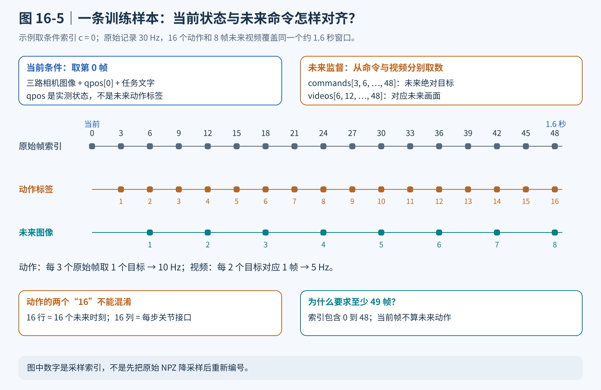

<p align="center"><b>图 16-11</b> 顶行标原始帧索引，下两行分别标动作与未来视频的序号。任取条件索引 c 时，将顶行索引整体加 c 即可；条件状态来自 qpos，动作监督来自 commands</p>

**G2 数据适配器怎样按索引取数**：

```python
# code/code_chapter16/g2_dataset_adapter.py（节选）
def load_state_action(qpos_path, action_indices, initial_state_idx):
    """Load measured condition state and commanded future absolute targets."""
    qpos_path = Path(qpos_path)
    command_path = command_path_from_qpos(qpos_path)      # .../qpos/x.pt -> .../commands/x.pt
    measured = torch.as_tensor(torch.load(qpos_path, map_location="cpu"), dtype=torch.float32)
    commands = torch.as_tensor(torch.load(command_path, map_location="cpu"), dtype=torch.float32)
    # ... 检查二者均为 [T,16] 且长度一致 ...
    state_index = min(max(int(initial_state_idx), 0), len(measured) - 1)
    indices = [int(index) for index in action_indices]
    if not indices:
        raise ValueError("action_indices must not be empty")
    if min(indices) < 0 or max(indices) >= len(commands):
        raise IndexError(...)
    return measured[state_index].clone(), commands[indices].clone()   # (s_t, A_t)
```

返回的两项分别对应前文公式中的当前状态 $s_t$ 与未来动作真值 $A_t$。函数对空动作索引、越界索引和不匹配的流长度报错，避免把坏数据默默送入训练。注意，`load_state_action()` 负责依据已有索引取数，并不自行决定视频采样策略。

### 5.3 潜在动作到真实动作：接口两端换新，中间主体继承

这一节把第二部分和第五部分接起来，回答"潜在动作怎样接到真实动作"。

**直观理解**：Stage 2 的动作专家像一位只会用"手势符号"（14 维潜在动作）记录动作的速记员；Stage 3 要让他改用"G2 关节表"（16 维命令）写字。他脑子里对"视觉变化与运动关系"的理解（30 层主体）可以保留，但他手里的"输入翻译器"和"输出笔"必须换成新的。

代码层面有三处直接体现这一点。

**① 输入编码器随训练模式切换。** `ActionExpert` 在构造时根据 `training_mode` 选择输入编码器：

```python
# code/code_chapter16/Motus/models/action_expert.py（节选）
if config.training_mode == 'pretrain':
    self.input_encoder = ActionEncoder(config)        # 只编码动作（潜在动作），没有状态
else:
    self.input_encoder = StateActionEncoder(config)   # 编码 16 维状态 + 16 维动作
```

`training_step` 中也对应分支：

```python
# code/code_chapter16/Motus/models/motus.py（节选）
if self.config.training_mode == 'pretrain':
    action_tokens = self.action_expert.input_encoder(None, noisy_actions, registers)
else:
    state_tokens = state.unsqueeze(1).to(self.dtype)
    action_tokens = self.action_expert.input_encoder(state_tokens, noisy_actions, registers)
# ...
if self.config.training_mode == 'pretrain':
    action_pred = action_pred_full[:, :up_len, :]
else:
    action_pred = action_pred_full[:, 1:up_len, :]     # 跳过状态位置
```

**② 加载 Stage 2 权重时跳过两端。** 微调模式下加载预训练权重会过滤掉动作专家的输入编码器与解码器：

```python
# code/code_chapter16/Motus/models/motus.py（节选，load_pretrain_weights）
"""Skips layers that depend on state vs action-only differences:
  - action_expert.input_encoder.*
  - action_expert.decoder.*
"""
filtered = {}
for k, v in state_dict.items():
    if ('action_expert.input_encoder' in k or 'action_expert.decoder' in k):
        continue
    filtered[k] = v
missing, unexpected = self.load_state_dict(filtered, strict=False)
```

原因不只是维度不同（14 → 16），还包括这两端需要匹配目标机器人的状态与动作含义。即便维度碰巧相同，潜在动作第 $k$ 维也没有"G2 第 $k$ 个关节"的含义，旧的编码器/解码器权重没有可迁移的语义。

**③ 两端完整训练，主体低秩适配。** 本章 `lora.py` 在 `train_io_layers: true` 时把这两端设为完整可训练（见 5.4 节），其余主体由冻结权重加 LoRA 增量组成。另外，`ActionExpert` 构造时把 `decoder.action_head` 最后一层权重和偏置初始化为 0，新接口在训练开始时输出零速度，不会一上来就输出随机大幅动作。

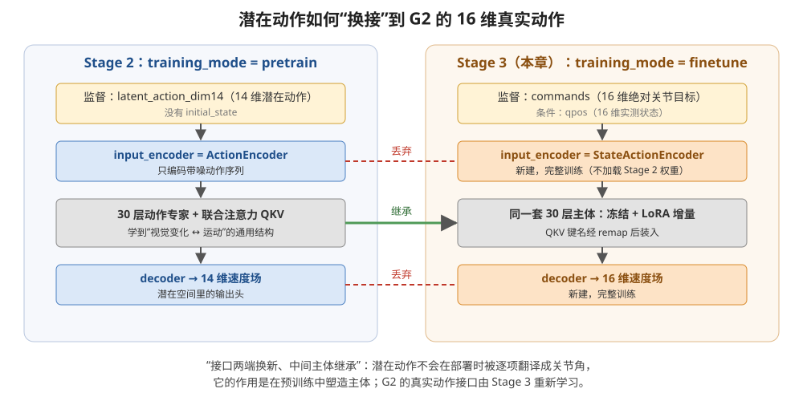

<p align="center"><b>图 16-12</b> 从 Stage 2（14 维潜在动作、无状态）到 Stage 3（16 维 G2 命令 + 实测状态）：输入编码器和解码器丢弃重建，30 层主体与联合注意力继承</p>

**小例子：一次 Stage 3 加载会发生什么。** 设 Stage 2 checkpoint 里有键 `action_expert.decoder.action_head.0.weight`（形状对应 14 维输出）和 `action_expert.blocks.0.wan_action_qkv`。

1. 过滤：前者含 `action_expert.decoder`，被跳过；后者保留。
2. 重映射：本章 LoRA 已把 `wan_action_qkv` 参数化，真实存储名变成 `action_expert.blocks.0.parametrizations.wan_action_qkv.original`，`remap_stage2_state_dict` 把旧键改成新名后再装入。
3. 结果：主体 QKV 拿到 Stage 2 的值；16 维 decoder 保持新初始化，等待 Stage 3 训练。

> 💡 **要点**：潜在动作在 G2 部署中"看不见"——它的全部作用是在 Stage 2 把主体训练成"懂视觉运动"的样子。真正连接到机器人的是 Stage 3 重新学习的 16 维接口。

> ⚠️ **注意**：论文用少量真实动作对齐潜在空间，让潜在动作和真实控制"大致可对齐"，但这只降低了迁移难度，不代表可以跳过 Stage 3。本章的结果也说明，单任务族、LoRA 规模的 Stage 3 仍有明显的跨机器人泛化问题（见第八部分 8.3 节）。

### 5.4 Stage 3 LoRA 实际更新什么，为什么适配器不能单独使用

本章不是训练一个新的小模型，而是保留大型 Motus 的主体权重，只更新低秩增量和少量与 G2 适配相关的参数。

对一个线性映射，LoRA（Low-Rank Adaptation，低秩适配）可以简写为：

$$
y=Wx+\frac{\alpha}{r}BAx
$$

其中 $W$ 是冻结的原始权重， $A$ 和 $B$ 是可训练的低秩矩阵， $r$ 是秩， $\alpha$ 是缩放系数。本章正式配置使用 $r=16$、 $\alpha=32$，线性 LoRA 路径还使用 0.05 的 dropout。缩放系数 $\alpha/r=2$。

```python
# code/code_chapter16/lora.py（节选）
class LoRALinear(nn.Module):
    def __init__(self, base: nn.Linear, rank: int, alpha: float, dropout: float):
        super().__init__()
        self.weight = base.weight                      # 原 W，冻结
        self.bias = base.bias
        self.weight.requires_grad_(False)
        # ...
        self.scaling = self.alpha / self.rank          # α / r
        self.lora_A = nn.Parameter(base.weight.new_empty(self.rank, self.in_features))
        self.lora_B = nn.Parameter(base.weight.new_zeros(self.out_features, self.rank))  # B 初始为 0
        nn.init.kaiming_uniform_(self.lora_A, a=math.sqrt(5))

    def forward(self, value):
        base = F.linear(value, self.weight, self.bias)                                  # Wx + b
        update = F.linear(F.linear(self.dropout(value), self.lora_A), self.lora_B)      # B A x
        return base + update * self.scaling
```

**手算参数量**：以动作专家 FFN 第一层为例，`nn.Linear(1024, 4096)`，原权重 $1024\times4096=4\,194\,304$ 个参数；LoRA 只新增 $A:16\times1024$ 与 $B:4096\times16$，共 $16\,384+65\,536=81\,920$ 个，约为原来的 1.95%。又因为 $B$ 初始化为 0，训练第一步时 $BAx=0$，模型输出与 Stage 2 完全相同，微调从"原模型"平滑出发。

直观地说，原始模型保留通用知识，新增的小矩阵学习"在 G2 场景中怎样调整这些知识"。这会减少需要保存和优化的参数，但不会使冻结模型在推理时消失。

本章的 LoRA 不只装在动作输出层，而是覆盖三个专家中配置允许的线性层。同时，动作和理解分支的联合注意力 QKV 并非普通线性模块，而是四维参数张量；`LoRAWeightDelta` 为这些张量加入专门的低秩参数化，否则只扫描线性层会漏掉重要的跨模态交互参数。

```python
# code/code_chapter16/lora.py（节选）
class LoRAWeightDelta(nn.Module):
    """LoRA parametrization for Motus' non-Linear 4-D expert QKV tensors."""
    def __init__(self, weight, rank, alpha):
        super().__init__()
        self.shape = tuple(weight.shape)                       # [3, heads, in, head_dim]
        input_dim = self.shape[2]
        output_dim = self.shape[0] * self.shape[1] * self.shape[3]
        # ...
        self.lora_A = nn.Parameter(weight.new_empty(self.rank, input_dim))
        self.lora_B = nn.Parameter(weight.new_zeros(output_dim, self.rank))

    def forward(self, weight):
        delta = (self.lora_B @ self.lora_A).reshape(self.shape)
        return weight + delta * self.scaling
```

代入动作分支 QKV 形状 $[3,24,1024,128]$：`input_dim=1024`，`output_dim` $=3\times24\times128=9216$，于是 $B:9216\times16$、 $A:16\times1024$。`apply_lora` 用 `torch.nn.utils.parametrize.register_parametrization` 把它挂到每层的 `wan_action_qkv` 与 `wan_und_qkv` 上，前向读取该参数时自动得到"原值 + 低秩增量"。

另外，目标机器人接口需要重新学习，因此本章允许动作输入编码器和动作解码器进行完整参数更新，并开放选定的归一化、调制和寄存器参数：

```python
# code/code_chapter16/lora.py（节选，apply_lora）
for parameter in model.parameters():
    parameter.requires_grad_(False)                    # 先全部冻结
for name, module in list(model.named_modules()):
    branch = _branch(name)                             # wan / action / understanding
    if branch is None or not targets[branch] or not isinstance(module, nn.Linear):
        continue
    # G2's 16-D state/action adapters are new in Chapter 16 and need full updates.
    if name.startswith("action_expert.input_encoder.") or name.startswith("action_expert.decoder."):
        continue
    _set_submodule(model, name, LoRALinear(module, rank, alpha, dropout))
# ... 为动作/理解分支 QKV 注册 LoRAWeightDelta ...
if config["train_io_layers"]:
    for parameter in model.action_expert.input_encoder.parameters():
        parameter.requires_grad_(True)
    for parameter in model.action_expert.decoder.parameters():
        parameter.requires_grad_(True)
for name, parameter in model.named_parameters():
    # ...
    if config["train_norms"] and ".norm" in name:
        parameter.requires_grad_(True)
    if config["train_modulation"] and (name.endswith(".modulation") or name.endswith(".registers")):
        parameter.requires_grad_(True)
```

由此可见，保存文件虽然叫 adapter，却不只是两组低秩矩阵，而是**LoRA 加上显式放开的 G2 专用参数**。

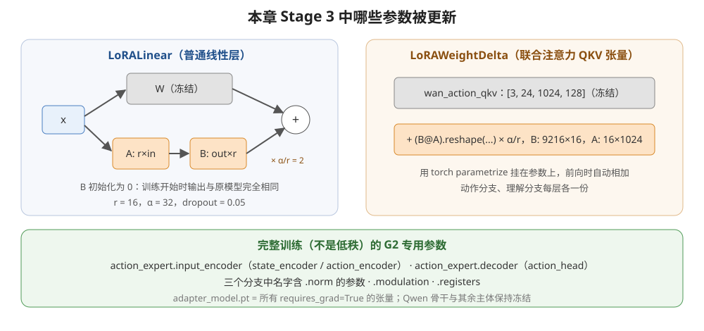

<p align="center"><b>图 16-13</b> 本章 Stage 3 的可训练参数：普通线性层用 LoRALinear，专家 QKV 张量用 LoRAWeightDelta，G2 输入输出接口与 norm/modulation/registers 完整训练</p>

Stage 2 初始化时，会跳过动作输入编码器和解码器的权重（5.3 节）。LoRA 的加载器还会重映射 QKV 参数键名，以适应参数化之后的结构：

```python
# code/code_chapter16/lora.py（节选）
def _remap_parametrized_qkv_key(key: str) -> str:
    for leaf in ("wan_action_qkv", "wan_und_qkv"):
        if key.endswith("." + leaf):
            return key[: -(len(leaf))] + f"parametrizations.{leaf}.original"
    return key
```

因此，推理恢复的正确逻辑是：

**按 G2 的 16 维结构建立模型 → 注入相同 LoRA 结构 → 加载 Stage 2 主体 → 加载 G2 adapter 与可训练接口参数 → 切换评估模式。**

```python
# code/code_chapter16/motus_runtime.py（节选，build_model）
model = Motus(config).to(device=device)          # action_state_dim=16, action_dim=16
if lora_config is not None:
    apply_lora(model, lora_config)                # 注入相同结构
    model.load_pretrain_weights(str(STAGE2_ROOT)) # 加载 Stage 2（已被替换为带 remap 的版本）
    adapter_file = checkpoint / "adapter_model.pt" if checkpoint.is_dir() else checkpoint
    _, unexpected = load_lora_adapter(model, adapter_file)
    if unexpected:
        raise RuntimeError(f"unexpected LoRA adapter keys: {unexpected[:8]}")
# ...
model.eval()
```

不能只拿一个约百 MiB 的 adapter 文件就删除所有基础权重。运行时仍需要对应的 Stage 2 基座、Wan 配置与 VAE、Qwen 配置及处理器，以及任务文本缓存。更换 Stage 2 基座也会改变适配器所依赖的模型，不能把"文件能够读入"当作模型兼容性证明。

### 5.5 训练配方：有效 batch、更新步数与 checkpoint

正式配置采用两卡、每卡 micro batch 为 1、梯度累积 4 次，因此有效 batch 为：

$$
B_{\mathrm{effective}}=1\times2\times4=8
$$

当前正式配置的 6000 步指 **6000 次真正的 optimizer update**，不是 6000 次小批次前向。训练封装在梯度累积边界才推进全局更新计数，日志与保存间隔也以该计数为依据：

```python
# code/code_chapter16/train_stage3.py（节选，install_accumulating_loop）
def train_micro_step(self, batch):
    self.model.train()
    with self.accelerator.accumulate(self.model):
        first, video, language, state, actions, vlm = _move_batch(batch, self.device, self.dtype)
        model = self.model.module if hasattr(self.model, "module") else self.model
        losses = model.training_step(
            first_frame=first, video_frames=video, state=state, actions=actions,
            language_embeddings=language, vlm_inputs=vlm, return_dict=True,
        )
        self.accelerator.backward(losses["total_loss"])
        if self.accelerator.sync_gradients:
            grad_clip = float(getattr(self.config.training, "grad_clip_norm", 1.0))
            self.accelerator.clip_grad_norm_(self.model.parameters(), grad_clip)
        # AcceleratedOptimizer/DeepSpeed deliberately no-op these calls until
        # the configured accumulation boundary is reached.
        self.optimizer.step()
        # ...
        updated = bool(self.accelerator.sync_gradients)
    # ...
    return metrics, updated

# train() 外层循环中：
metrics, updated = train_micro_step(self, batch)
micro_count += 1
# ...
if not updated:
    continue
self.global_step += 1        # 只有真正同步更新才计数
```

**手算数据量**：6000 次更新 × 有效 batch 8 = 48 000 个训练样本（每个样本是一条轨迹上随机选取的一个 1.6 秒窗口）。若训练集约有 $1650\times0.9\approx1485$ 条 episode，平均每条 episode 被抽到约 $48000/1485\approx32$ 次（这是期望意义下的粗算，实际取决于数据加载器的采样方式）。

BF16 与 DeepSpeed ZeRO-1 用于控制训练资源，LoRA 用于减少可训练参数与优化器开销。但是，ZeRO-1 不会把整个冻结主干自动均匀拆到两张卡；"两张 32 GB GPU"不等于每个进程拥有一个 64 GB 显存池。实际能否运行还取决于注意力后端、激活、同时驻留的模型和其他进程。

默认 checkpoint 只保存 adapter 和配置，不保存完整优化器与调度器状态（YAML 注释写明：`false` 只保存约 130 MiB adapter，`true` 还会额外保存约 30 GiB 的精确 DeepSpeed 状态）。它适合部署，也允许重新加载权重继续训练，但这种续训会重启优化器和调度器，**不等于训练过程的精确断点恢复**。需要精确恢复时，要使用完整状态保存路径，并承担显著更高的存储开销。

### 5.6 怎样划分验证数据

本章在允许的三个任务中，按完整 episode 做稳定的训练—验证划分。划分依据由随机种子、采集组、任务名和 episode 标识组成，再通过哈希映射决定归属。同一条轨迹不会因为本次进程启动顺序改变，就从训练集跑到验证集。

```python
# code/code_chapter16/g2_dataset_adapter.py（节选）
def is_validation_episode(split, task, stem, fraction, seed) -> bool:
    """Deterministically assign a complete episode to train or validation."""
    key = f"{int(seed)}:{split}/{task}/{stem}".encode("utf-8")
    bucket = int.from_bytes(hashlib.sha256(key).digest()[:8], "big") / float(2**64)
    return bucket < float(fraction)
```

**怎样理解**：把 `"16016:clean/pick_red_block/episode_000000"` 做 SHA-256，取前 8 字节当作一个 64 位无符号整数，再除以 $2^{64}$ 得到 $[0,1)$ 内的一个"伪随机数"。小于 0.1 就进验证集。若某条 episode 的前 8 字节恰好对应 $0.0732$，它进验证集；对应 $0.4180$ 则进训练集（这两个数是举例，不是真实哈希结果）。由于哈希只依赖字符串，换机器、换进程都得到同样结果。

划分比例约为 90% 与 10%，但它不是严格的逐组定额抽样，因此实际验证集未必恰好等于总数的十分之一。相邻帧不会被拆到两个集合，降低了"验证样本其实是训练轨迹的下一帧"这种直接泄漏。

不过，episode 分离只解决轨迹重叠，不自动提供分布外验证。特别是 clean 条件下的重复示教可能非常相似；若想检验泛化，还需要额外使用未见位置、不同扰动或新的任务条件。

`install_g2_dataset_adapter()` 将这些规则接入数据加载流程，同时筛掉本章三个颜色任务之外的数据，并检查五类配套文件是否齐全。这里适配的是机器人数据语义与集合划分，不是光流编码器，也不是另一套损失函数。

正式 LoRA 配置将验证间隔设为 100000，而总训练步数为 6000，因而本轮不会触发周期性在线验证。这样做是当前双卡训练规避验证同步问题的工程选择，不应写成"训练期间已经持续验证并确认收敛"。冒烟配置的验证间隔为 2，行为与正式配置不同，出现同步问题时需要单独排查。

还要防止把不同训练规模混为一谈。当前 G2 默认是 1650 条成功轨迹、单个抓取放置任务族、6000 次更新的 LoRA 配方；官方多任务设置和旧版参考 YAML 的数据量、步数与训练范围并不相同（`settings.py` 中记录官方 `Motus_robotwin2` 发布模型使用 2500 条 clean + 25000 条 randomized 示教、40000 次优化步）。`stage3_g2.yaml`、`stage3_g2_public_1m.yaml` 等文件保留了不同规模的参考配置，而当前训练入口明确要求 `train_scope` 为 `lora`。因此，本章可执行主线应选择两份带 `lora` 的配置，不能把参考文件都当成当前入口支持的训练命令。


---

## 第六部分 评估方式：同一个模型怎样用于未来展示与闭环执行

### 6.1 三层评估：先分清"想象"和"做成"

结果检查至少要分三层：

1. **数据层**：图像、状态、命令是否对齐，颜色是否均衡，夹爪符号是否正确。
2. **模型层**：视频和动作 loss 是否有限，生成动作是否有异常跳变，未来视频是否识别正确目标。
3. **执行层**：机器人是否真正抓取并放入盒子，失败时是否存在关节范围裁剪、等待延迟或夹爪提前释放。

三层都检查，才有可能区分"模型不会做"和"数据、接口或执行方式错误"。仅凭总 loss 下降，不能断言抓取成功率提高。

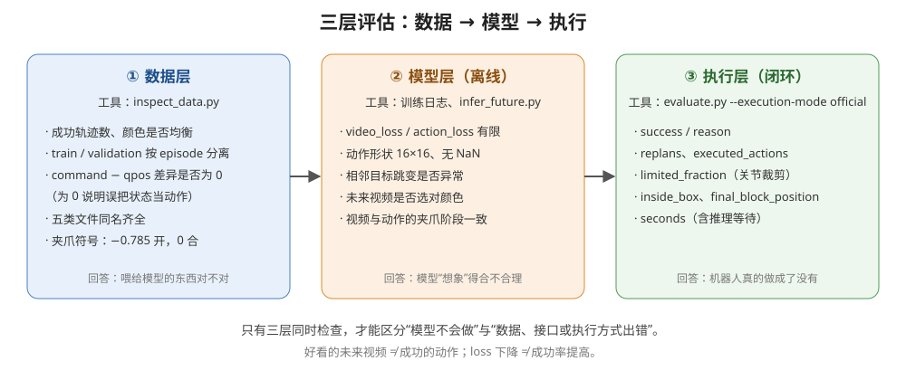

<p align="center"><b>图 16-14</b> 三层评估：数据层（inspect_data.py）、模型层（训练日志与 infer_future.py）、执行层（evaluate.py official 闭环），各层对应的检查项</p>

**数据层的一个关键指标**：`inspect_data.py` 对所有成功轨迹统计 $\overline{|{\rm command}-{\rm qpos}|}$：

```python
# code/code_chapter16/inspect_data.py（节选）
if ok:
    command_delta.append(np.abs(episode["command"] - episode["qpos"]))
# ...
"mean_abs_command_minus_measured": None if not len(deltas) else float(deltas.mean()),
```

它的意义是"状态与命令有没有被误复制"：若这个值恰好为 0，几乎可以肯定动作被错误地写成了状态的副本。它不应被当作越小越好的训练指标，具体大小受轨迹和跟踪动态影响。

### 6.2 共用推理入口：MotusPolicy

离线和在线案例都通过 `MotusPolicy` 加载模型、拼接图像、读取文本缓存并调用联合推理，因此它们共享同一套观察与动作接口。

```python
# code/code_chapter16/motus_runtime.py（节选）
@dataclass
class Prediction:
    frames: np.ndarray  # [8,H,W,3], uint8
    actions: np.ndarray  # [16,16], float32

class MotusPolicy:
    # ...
    @torch.inference_mode()
    def predict_composite(self, composite, state, instruction) -> Prediction:
        # ...
        prompt = stage3_prompt(instruction)
        image = Image.fromarray(np.asarray(composite, np.uint8), mode="RGB")
        first = image_tensor(image).unsqueeze(0).to(self.device, dtype=torch.bfloat16)
        state_tensor = torch.as_tensor(state, dtype=torch.bfloat16, device=self.device).reshape(1, STATE_DIM)
        vlm = self.preprocess_vlm_messages(prompt, image, self.processor)
        frames, actions = self.model.inference_step(
            first_frame=first,
            state=state_tensor,
            num_inference_steps=self.inference_steps,
            language_embeddings=self.language_embedding(prompt),
            vlm_inputs=[vlm],
        )
        return Prediction(to_frame_array(frames), actions[0].detach().float().cpu().numpy())

    def predict(self, images, state, instruction) -> Prediction:
        return self.predict_composite(stitch_views(*images), state, instruction)
```

返回值包含视频和动作两部分，而不是先生成视频，再把视频交给另一套策略模型。这就是本章"统一未来预测与动作生成"最直接的代码对应：同一次模型调用，产生两个相关但用途不同的结果。

**随机种子的行为**：`MotusPolicy` 在初始化时设置一次种子，之后每次请求继续推进随机状态（与 RoboTwin 评测一致）；只有显式开启 `reseed_each_request` 才会每次请求重设种子，这仅用于明确标注的消融实验。

### 6.3 离线评估：给定当前观察，看模型"想象了什么"

离线案例从 NPZ 中取得某一帧的三视图、状态和任务，输出条件图、未来视频、GIF、九宫格以及动作数组。使用 NPZ 的优点是图像、状态与文字天然来自同一条记录。若改用单张图片输入，代码在没有状态文件时会使用全零状态；这只能用于观察接口行为，不能当作真实机器人当前姿态，更不宜据此评价控制能力。

```python
# code/code_chapter16/infer_future.py（节选）
def load_condition(args):
    if args.episode:
        with np.load(args.episode, allow_pickle=False) as episode:
            i = min(max(args.frame, 0), len(episode["qpos"]) - 1)
            image = stitch_views(episode["head_image"][i], episode["left_image"][i], episode["right_image"][i])
            state = np.asarray(episode["qpos"][i], np.float32)
            instruction = args.instruction or str(episode["instruction"].item())
    else:
        # ...
        state = np.zeros(STATE_DIM, np.float32) if args.state is None else np.load(args.state).astype(np.float32)
    return image, state, instruction
```

看视频时建议依次问四个问题：目标颜色是否正确；夹爪运动方向是否合理；物块是否在夹爪闭合之后才随动；未来图像与动作中夹爪开合阶段是否对应。不要要求任意初始帧的 1.6 秒预测都包含完整放置过程，完整任务通常需要多次生成与执行。

动作数组可以做两项轻量检查：形状与有限性，以及相邻目标的最大跳变。比如若某关节 16 个目标依次为 $0.10,0.14,0.18,\dots$，相邻差约 0.04 rad，属于平滑；若中间某处从 0.18 突然跳到 0.90，相邻差 0.72 rad，就要警惕。具体命令见第八部分。

### 6.4 在线评估：official 完整动作块闭环

在线案例将两个环境分开：Motus 在训练/推理 Python 环境中运行，Isaac Sim 使用自己的 Python 启动。两进程通过轻量 TCP 协议传递三路图像、状态与文字，服务端仅返回 $16\times16$ 的动作块。协议传递的是 NumPy 数组，不要求仿真端安装完整的大模型训练依赖。

```python
# code/code_chapter16/policy_rpc.py（节选）
_HEADER = struct.Struct("!Q")          # 8 字节大端长度头

def send(sock, payload: bytes) -> None:
    sock.sendall(_HEADER.pack(len(payload)) + payload)

def pack(**values) -> bytes:
    buffer = BytesIO()
    np.savez_compressed(buffer, **values)
    return buffer.getvalue()

def unpack(payload: bytes) -> dict:
    with np.load(BytesIO(payload), allow_pickle=False) as values:   # 禁用 pickle
        return {key: np.asarray(values[key]) for key in values.files}
```

```python
# code/code_chapter16/serve_policy.py（节选）
request = unpack(receive(connection))
images = tuple(request[name] for name in ("head", "left", "right"))
result = policy.predict(images, request["state"], str(request["instruction"].item()))
response = pack(actions=result.actions, error=np.asarray(""))     # 只回传动作
```

服务端仍然执行视频分支并解码未来帧，只是在网络响应中不发送视频。因而"只收到动作"不能说明视频生成计算已被优化掉。服务端异常会把错误信息传回客户端，使本次 episode 能明确记录失败原因，而不是继续使用错误动作。

本章统一采用 `official` 完整动作块协议。一次预测不是只提供下一个关节目标，而是提供接下来连续执行的 16 个目标；执行器按顺序完成整个动作块，然后才开始下一轮观察与预测。

| 项目 | `official` 完整动作块协议 |
|---|---|
| 每轮执行长度 | 16 个动作目标全部执行 |
| 重新观察时机 | 完整动作块执行结束之后 |
| 目标范围处理 | 只裁剪到关节物理范围，不施加逐步动作变化限制 |
| 底层执行方式 | 从当前实测状态到目标做平滑插值 |
| 成功检查时机 | 完整动作块结束后检查，不在块内提前结束 |
| 实验含义 | 对齐 Motus 完整动作块约定的 G2 适配 |

`official` 只是本章对完整动作块执行约定的命名，不意味着换成 G2 场景后就与官方 RoboTwin 基准完全等价。相机、机器人动力学、成功判据、插值控制和等待方式都需要分别说明。（`evaluate.py` 还保留了一个 `receding` 模式，只执行前缀并带逐步变化限制，属于本章的可选便利模式，不是主线评测协议。）

**评测主循环**（`code/code_chapter16/evaluate.py`，节选）：

```python
for replan in range(args.max_replans):
    replans = replan + 1
    if sim.task.success(color):
        reason = "success"
        break
    images = sim.cameras.capture()
    state_snapshot = robot.state().copy()
    instruction = TASK_TEXT[color]
    # ... 同步或后台线程调用 policy.predict ...
    if chunk.shape != (16, 16):
        raise ValueError(f"expected action chunk (16,16), got {chunk.shape}")
    for raw in chunk[:execute_steps]:                 # official：execute_steps 必须为 16
        current = robot.state()
        if args.execution_mode == "official":
            target, report = clip_joint_limits(raw, current)
        # ...
        execute_target(sim, robot, target, args.action_seconds)
        executed += 1
```

**物理范围裁剪与平滑插值**：

```python
# code/code_chapter16/control.py（节选）
ARM_LOWER_7 = np.array([-3.1067, -2.0944, -3.1067, -2.5307, -3.1067, -1.0472, -1.5708], np.float32)
ARM_UPPER_7 = np.array([3.1067, 2.0944, 3.1067, 1.0472, 3.1067, 1.0472, 1.5708], np.float32)
LOWER = np.concatenate([np.tile(ARM_LOWER_7, 2), [-0.785, -0.785]]).astype(np.float32)
UPPER = np.concatenate([np.tile(ARM_UPPER_7, 2), [0.0, 0.0]]).astype(np.float32)

def clip_joint_limits(raw, current):
    """Official-like execution: absolute qpos targets with physical clipping only."""
    raw, current = _vectors(raw, current)
    result = np.clip(raw, LOWER, UPPER).astype(np.float32)
    return result, {
        "limited": bool(not np.allclose(result, raw, atol=1e-6)),
        "raw_max_arm_delta": float(np.max(np.abs(raw[:14] - current[:14]))),
        "raw_max_gripper_delta": float(np.max(np.abs(raw[14:] - current[14:]))),
    }
```

```python
# code/code_chapter16/evaluate.py（节选）
def execute_target(sim, robot, target, seconds=0.1):
    start = robot.state().astype(np.float32)
    steps = max(1, round(seconds * sim.cfg.physics_hz))     # 0.1 × 120 = 12
    for index in range(1, steps + 1):
        alpha = index / steps
        alpha = alpha * alpha * (3.0 - 2.0 * alpha)          # smoothstep
        applied = robot.apply(start + alpha * (target - start))
        sim.task.update(closed_fraction(applied[15]))
        sim.step(True)
```

**手算 smoothstep 插值**：设某关节当前 0.30 rad、目标 0.42 rad，12 个物理步。第 3 步 $\alpha_0=3/12=0.25$， $\alpha=0.25^2\times(3-0.5)=0.15625$，施加 $0.30+0.15625\times0.12=0.31875$；第 6 步 $\alpha_0=0.5$， $\alpha=0.5$，施加 $0.36$；第 12 步 $\alpha=1$，到达 $0.42$。两端变化慢、中间快，避免目标突变。

**手算裁剪**：若模型给右臂第 4 关节（第 10 维）目标 1.20 rad，上限为 1.0472，则裁剪为 1.0472，`limited=True`。若某块 16 个目标中有 4 个被裁剪过，这一块贡献的裁剪比例为 $4/16=0.25$；`limited_fraction` 是整条 episode 被裁剪的动作数 / 已执行动作数。

每个目标默认执行 0.1 秒，底层在当前实测状态与目标之间做平滑插值，并按 120 Hz 物理步进推进。因此十赫兹是目标更新节奏，不是物理仿真步频；16 个目标约对应 1.6 秒执行时间，不包括模型推理等待。

默认等待推理时，RPC 在后台线程运行，仿真主线程保持请求时姿态并持续刷新画面。这样窗口不会看起来卡死，但物理世界仍在前进，物体可能继续落下或滑动。它不是"机器人一边执行上一段动作，一边提前预测下一段"的流水线，旧观察与新动作之间也可能出现时间偏差。使用暂停等待选项可以冻结推理等待期的仿真，但那又不等价于真实系统中的实时执行。

因此，完整动作块内部的目标序列不会因新画面而重新生成，但底层仍会读取实测关节状态进行插值执行。块结束后的新观察才用于修正下一轮预测。评估这个闭环时，应同时记录模型推理等待与任务总时长，不能只用约 1.6 秒的动作块时长推算实际任务速度。

### 6.5 成功判据与诊断字段

当前成功判据由仿真任务模块负责：物块进入带容差的盒内区域，并在夹爪足够打开时被记为完成，最终还需仍位于盒内。

```python
# code/code_chapter16/task_runtime/simulation.py（节选，BlockTask）
def inside_box(self, color):
    pos = self.block_position(color)
    box = np.asarray(self.cfg.box_position)
    hx, hz = np.asarray(self.cfg.box_inner_size) / 2
    return bool(
        abs(pos[0] - box[0]) <= hx + 0.02
        and abs(pos[2] - box[2]) <= hz + 0.02
        and self.box_top_y - self.cfg.block_size / 2
        <= pos[1]
        <= self.cfg.table_top_y + self.cfg.block_size / 2
    )

def update(self, right_gripper_closed):
    if right_gripper_closed >= 0.45:      # 夹爪仍较闭合时不记完成
        return
    for color in COLORS:
        if color not in self.completed and self.inside_box(color):
            self.completed.add(color)

def success(self, color):
    return color in self.completed and self.inside_box(color)
```

它不是"夹爪曾经碰到物块"，也没有额外要求在盒中稳定静置数秒；如要进行更严格的工程评测，应另加稳定性检查并明确更改了指标。

单条报告中的主要诊断字段如下：

| 字段 | 解释 |
|---|---|
| `success`、`reason` | 是否成功，失败或异常的原因 |
| `protocol`、`execution_mode` | 应分别为 `motus_official_full_chunk` 与 `official`，确认采用完整动作块协议 |
| `execute_steps`、`replans`、`executed_actions` | 每轮执行长度应为 16；其余两项记录实际预测轮数与已执行动作数量 |
| `limited_fraction` | 因关节物理范围裁剪而被修改的动作比例 |
| `max_raw_arm_delta` | 原始目标相对当前实测状态的最大臂关节变化 |
| `max_raw_gripper_delta` | 原始夹爪目标相对当前状态的最大变化 |
| `right_gripper_target_range` | 最终应用的右夹爪目标范围 |
| `inside_box`、`final_block_position` | 最终物块位置与盒内判定 |
| `seconds` | 整条任务的墙钟耗时，不是纯模型推理延迟 |

在 `official` 模式中，`limited_fraction` 只反映关节物理范围裁剪，不表示施加了逐步动作变化限制。平滑插值负责把当前实测状态连接到目标，物理范围裁剪负责把目标限制在允许区间，两者不是同一件事。

**读一条真实记录**：本章 `code/code_chapter16/outputs/eval_pickplace_6k.json` 中保存了一条红色物块的记录，其关键字段为 `success: true`、`replans: 4`、`executed_actions: 48`、`limited_fraction: 0.6458…`、`seconds: 59.69…`。可以这样解读：

- 第 1~3 轮各执行了完整 16 个动作，共 $3\times16=48$ 个；第 4 轮开始时 `sim.task.success` 已为真，直接退出，所以 `replans=4` 但没有再执行动作。
- 动作执行时间约 $48\times0.1=4.8$ 秒，而总耗时约 59.7 秒，剩余约 55 秒主要是三次模型推理等待——这直接说明"不能只用动作块时长推算任务速度"。
- `limited_fraction≈0.646` 意味着 48 个动作中约 31 个被物理范围裁剪过（ $0.6458\times48=31$）。成功了不等于动作"干净"，这个比例偏高时值得检查是哪些关节越界。

这只是一条 episode，不能当作成功率。

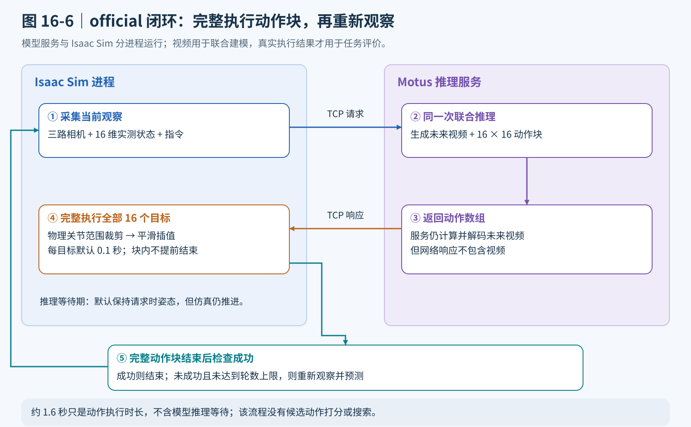

<p align="center"><b>图 16-15</b> official 完整动作块执行闭环：闭环反馈来自实际环境的新观察，不是把生成视频当成下一次的真实观察。动作块结束后才检查是否继续；在线服务不传视频，但当前联合推理仍计算视频</p>

### 6.6 按层定位失败

推荐按以下顺序定位失败：

1. **目标选错**：先看文本规范、颜色数据和条件图，再看未来预测是否也选择错误物块。
2. **机械臂几乎不动或动作滞后**：核对命令监督是否被实测状态替代，以及时间采样是否匹配。
3. **目标跳变大、频繁触发关节范围裁剪**：检查绝对目标与增量目标是否混用、动作维度与顺序是否正确。
4. **碰到物块但抓不住**：检查夹爪符号、闭合时机、状态—命令差异与接触轨迹。
5. **抓起后立即掉落**：对照预测动作中是否提前打开夹爪，区分模型动作问题与物理接触问题。
6. **视频很好看但控制失败**：不要把生成画面当作真实动力学证据，应对照实际动作与环境响应。
7. **任务执行耗时较长**：统计完整动作块的预测轮数与墙钟耗时，区分动作执行时间和模型推理等待，检查耗时是否主要来自大模型推理。

比较不同 checkpoint 或不同训练配方时，应保持完整动作块协议、场景分布、等待方式及随机种子设置一致，避免把执行设置变化误认为模型能力提升。服务端和仿真端的种子含义不同：前者控制模型采样，后者控制场景随机化。

本章不把历史日志中的某次成功、官方 RoboTwin 的公开指标或不同数据语义下的旧 checkpoint，当成当前 G2 配方的效果保证。最终结果应来自读者实际完成、设置明确且可重复的评测。


---

## 第七部分 代码结构与实现解析

### 7.1 文件组织

```text
code/code_chapter16/
├── settings.py              # 全局合同：路径、16 维接口、30 Hz/降采样、图像尺寸、场景前缀 stage3_prompt
├── environment.py           # 载入 task_runtime 中的 G2 场景，并把记录频率设为 30 Hz
├── collect_data.py          # 自动专家示教采集：RawRecorder 分别保存 qpos 与 command
├── data_utils.py            # 三视图拼接、补边缩放、缓存命名、stage3_indices 时间索引
├── prepare_data.py          # NPZ → qpos/commands/videos/metas/umt5_wan 五类文件 + UMT5 编码
├── inspect_data.py          # 数据审计：成功数、划分、command−qpos 差异
├── g2_dataset_adapter.py    # 补丁 Motus RoboTwin 数据类：状态来自 qpos、动作来自 commands、episode 级划分
├── motus_compat.py          # 把附带的 Motus 加入导入路径；选择 FlashAttention / SDPA
├── lora.py                  # LoRALinear、LoRAWeightDelta、apply_lora、adapter 保存与加载
├── train_stage3.py          # 训练入口：预检查、LoRA 注入、真梯度累积、adapter-only checkpoint
├── train.sh                 # torch.distributed.run + DeepSpeed ZeRO-1 启动脚本
├── motus_runtime.py         # build_model 与 MotusPolicy：离线和在线共用的推理
├── infer_future.py          # 案例一：生成未来视频、GIF、九宫格与动作数组
├── policy_rpc.py            # NumPy-over-TCP 协议与 RemotePolicy 客户端
├── serve_policy.py          # 推理服务：返回 16×16 动作块
├── evaluate.py              # 案例二：Isaac Sim 中 official 完整动作块闭环评测
├── control.py               # 关节物理范围裁剪、可选速率限制与抓取守护
├── setup_env.sh / requirements.txt / download_weights.sh
├── configs/                 # stage3_g2_lora*.yaml（主线）、其他参考配置、zero1.json
├── task_runtime/            # G2 场景、机器人接口、自动专家、运动学（来自第十五章场景的本地副本）
├── Motus/                   # 附带的 Motus 模型源码：models/、train/、data/、utils/、bak/（Wan 等）
├── weights/                 # Stage 2 基座与 Wan、Qwen 资源（需下载）
├── checkpoints/             # 本章训练得到的 G2 adapter
├── data/                    # raw/、processed/、cache/t5/
└── outputs/                 # 推理与评测结果
```

**本章将 Motus 模型源码放在 `code_chapter16/Motus` 中，与 G2 适配代码一起组织。** 顶层脚本负责示教数据、16 维机器人接口、LoRA 训练封装和仿真执行；`Motus` 子目录提供模型主体、数据加载与训练设施。两部分共同组成运行工程，不能只保留顶层脚本和模型权重。

这里要特别区分：`Motus/` 是模型源码，`weights/Motus/` 是 Stage 2 预训练参数，`checkpoints/` 保存本章训练得到的 adapter，三者用途不同。

建议按照"配置 → 数据 → 模型训练 → 模型推理 → 仿真执行"的顺序阅读：

| 环节 | 文件与关键入口 | 阅读时应确认的问题 |
|---|---|---|
| 全局合同 | `settings.py`、`stage3_prompt` | 16 维顺序、帧率、图像大小、文本前缀是否统一 |
| 场景接口 | `environment.py`、`task_runtime/robot.py`、`simulation.py` | 状态怎样测量，动作怎样施加，成功怎样定义 |
| 示教采集 | `collect_data.py`、`RawRecorder`、`collect_group` | 当前状态与实际发送的目标是否分别保存 |
| 图像与索引 | `data_utils.py`、`stitch_views`、`stage3_indices` | 三视图布局、动作与视频时间轴是否一致 |
| 数据转换 | `prepare_data.py`、`convert_episode`、`encode_instructions` | 五类文件是否完整，UMT5 是否使用完整提示词 |
| G2 数据适配 | `g2_dataset_adapter.py`、`load_state_action` | 条件来自实测，监督来自命令，episode 是否分离 |
| 数据审计 | `inspect_data.py` | 成功轨迹数、训练验证划分和状态命令差异是否合理 |
| 兼容层 | `motus_compat.py` | 是否找到本章附带的 `Motus` 目录，实际注意力后端是什么 |
| 参数高效微调 | `lora.py`、`apply_lora`、`save_lora_adapter` | 哪些参数被冻结，哪些增量与接口参数被保存 |
| 训练启动 | `train.sh`、`train_stage3.py` | 预检查、真梯度累积和 adapter 保存是否生效 |
| 共用推理 | `motus_runtime.py`、`build_model`、`MotusPolicy` | Stage 2 与 adapter 如何恢复，输出形状是否正确 |
| 未来展示 | `infer_future.py` | 条件帧、未来视频与动作怎样落盘 |
| 跨进程推理 | `serve_policy.py`、`policy_rpc.py` | 请求包含什么，服务失败如何返回 |
| 动作执行 | `evaluate.py`、`execute_target`、`control.py` | official 完整动作块如何执行，关节范围裁剪与平滑插值分别负责什么 |

### 7.2 模块调用关系

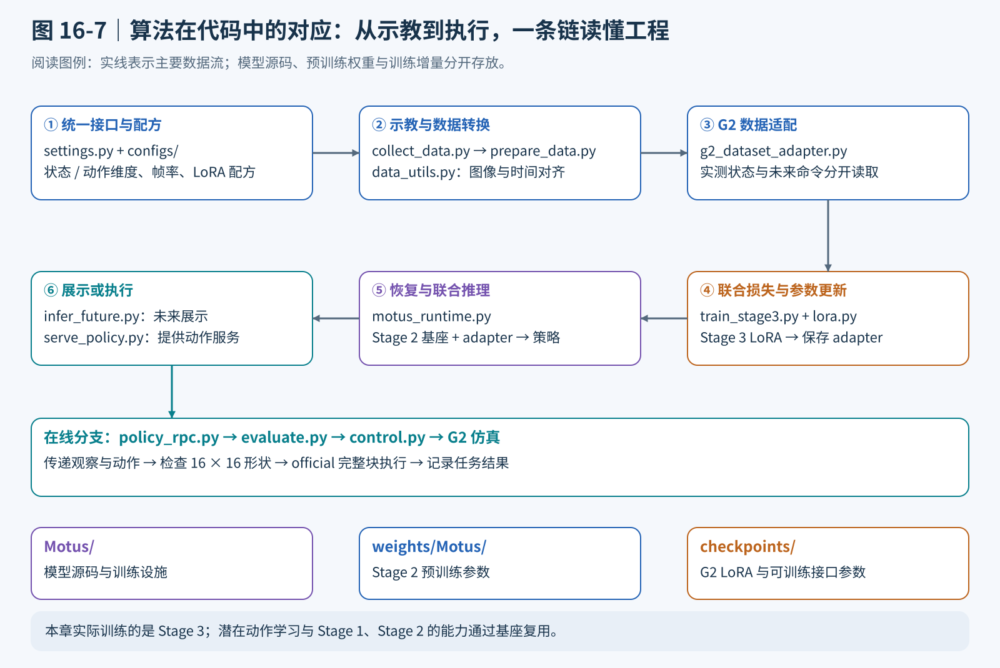

<p align="center"><b>图 16-16</b> 代码对应关系：按上排从左到右、下排从右到左阅读，再接到在线执行分支。底部三个目录分别存源码、基座权重和训练增量，不能互相替代</p>

阅读时应沿着 **"配置约束 → 示教记录 → 训练样本 → LoRA 与联合损失 → adapter 恢复 → 视频动作联合预测 → official 完整动作块执行"** 的数据流逐步追踪。特别要记住：**光流潜在动作学习和 Stage 1、Stage 2 已经体现在预训练基座中，本章没有重新训练这些模块。** "完整对应"指把完整算法链中的复用部分与本章实际实现部分区分清楚，而不是宣称本章文件重新实现了整套 Motus。

### 7.3 关键流程逐段解读

下面按执行顺序把核心代码串起来。前文各部分已经摘录了大部分关键片段，这里重点说明"本章传入什么、取得什么、如何使用结果"。

**1. `settings.py` 与 `configs/stage3_g2_lora.yaml`：把模型接口和训练配方统一起来。**

`settings.py` 首先确定机器人接口：`STATE_DIM` 和 `ACTION_DIM` 都是 16，分别对应实测关节状态和未来绝对关节目标。两个值相等不代表两组数据可以互换。`RAW_FPS=30` 与 `GLOBAL_DOWNSAMPLE_RATE=3` 共同确定动作监督的十赫兹节奏，`NUM_VIDEO_FRAMES=8` 与 `VIDEO_ACTION_FREQ_RATIO=2` 则决定一个样本包含八帧未来视频和 16 个动作（`ACTION_CHUNK_SIZE = NUM_VIDEO_FRAMES * VIDEO_ACTION_FREQ_RATIO`）。

这几个常量共同描述同一段约 1.6 秒的未来，而不是四组彼此独立的超参数。如果仅把动作块改成更长，却不检查视频帧数、采样间隔和数据长度，模型接收的"未来画面"和"未来动作"就可能不再覆盖同一个时间范围。`stage3_prompt()` 还统一场景描述和任务文字，保证数据转换、UMT5 缓存与在线请求使用相同文本。

YAML 将这些约束传入训练过程，同时明确三专家的配置、视频和动作损失权重、LoRA 范围，以及学习率、梯度累积和保存周期。`motus_runtime.build_model()` 在推理时也显式填写模型构建参数，因此修改接口时要同时检查训练 YAML 和这个构建函数，不能认为改一份配置会自动影响所有入口。本章默认两边均采用 16 维接口、1024 维动作专家和 512 维理解专家。

**2. `collect_data.py` 与 `environment.py`：把专家演示变成"观察—状态—命令"记录。**

`collect_data.py` 的 `collect_group()` 按颜色和场景类型组织采集，调用本章仿真环境与自动专家完成抓取放置。`balanced_quotas()` 将配额分配给各颜色，`successful_episodes()` 统计已有成功轨迹；失败记录可以保留用于排查，但不会抵扣成功示教的采集数量。这些轨迹是 Stage 3 的监督示教，不是第十五章带 Value 或 Advantage 标签的强化学习经验。

真正重要的接口是 `RawRecorder.add()`（5.1 节）：它接收同一次记录中的三路图像、实测状态和专家命令，分别追加到图像列表、`qpos` 列表和 `command` 列表。`save()` 再把它们写进同一个 NPZ，附带任务文字、颜色、场景类型、成功标记和原始帧率。这样，后续转换器不必猜测"这一帧动作到底是传感器读数，还是专家要求机器人到达的目标"。

例如，专家要求某关节转到 0.5 rad 时，实测位置可能暂时只有 0.3 rad。记录必须同时保留这两个值：0.3 描述当前条件，0.5 描述控制意图。若用前者覆盖后者，模型学习到的动作可能表现为滞后或不动。`environment.py` 负责把本章的记录节奏与 G2 仿真接口连接起来（`MotusSimulationConfig.record_every = physics_hz // RAW_FPS`，即 $120/30=4$，每 4 个物理步记录一帧）；自动专家只用于示教，后面的策略评测不会借用它完成任务。

**3. `data_utils.py` 与 `prepare_data.py`：让图像布局、文本条件和未来时间轴对齐。**

`concatenate_views()` 把头部、左腕和右腕相机组合成固定布局。转换器保存的是高 360、宽 320 的三视图视频；在线 `stitch_views()` 再通过 `resize_with_padding()` 得到高 384、宽 320 的模型输入，`image_tensor()` 将 RGB 转成模型需要的通道优先张量。这里的目标不是任意把三张图拼到一起，而是让训练和推理始终在相同位置看到相同相机。

`stage3_indices()` 可以直接用于检查前文的时间关系。它是本章提供的时间对齐检查函数，并不是一份重新实现的 Motus 视频数据加载器。理解这一边界后，才能既用本章文件验证采样约定，又不误认为训练的全部采样过程都发生在这个函数里。

`prepare_data.convert_episode()` 检查成功标记、状态与命令的形状，以及轨迹是否达到最小长度，再分别保存实测 `qpos`、目标 `commands`、三视图 `videos` 和完整任务 `metas`。它不会把三十赫兹原始轨迹预先压缩成只有 16 步的短文件；训练阶段还需要从完整轨迹中选择条件时刻和对应未来片段。

`encode_instructions()` 为规范化文字生成 UMT5 特征，`cache_name()` 根据完整提示词生成缓存名称，同一条任务文字可以复用编码结果：

```python
# code/code_chapter16/prepare_data.py（节选）
def encode_instructions(rows, device, overwrite):
    unique = sorted({text for _, text in rows})          # 本章只有 3 条不同的完整提示词
    missing = [text for text in unique if overwrite or not (T5_CACHE_ROOT / cache_name(text)).is_file()]
    encoder = make_t5_encoder(device) if missing else None
    for index, text in enumerate(missing, 1):
        encoded = encoder([text], torch.device(device))
        # ...
        torch.save(tensors, T5_CACHE_ROOT / cache_name(text))
    # ...
    for output, text in rows:
        link_or_copy(T5_CACHE_ROOT / cache_name(text), output)   # 每条 episode 硬链接到同一份缓存
```

因此，文本缓存也属于数据合同：改了场景描述却沿用旧缓存，等于让两条文本条件路径看见不同任务。转换完成后，`inspect_data.py` 会统计原始成功数、处理后轨迹数、训练验证划分和状态—命令差异，为训练前审计提供依据。

**4. `g2_dataset_adapter.py`：让联合监督真正使用未来命令，并避免轨迹泄漏。**

`load_state_action()`（5.2 节）是状态与动作语义的最终检查点；`is_validation_episode()`（5.6 节）则保证同一条 episode 的所有片段进入同一个集合。`install_g2_dataset_adapter()` 用"猴子补丁"的方式替换官方 `RobotWinTaskDataset` 的三个方法：

```python
# code/code_chapter16/g2_dataset_adapter.py（节选）
dataset_class.__init__ = adapted_init                 # 增加 validation_fraction / split_seed / allowed_tasks
dataset_class._scan_task_folder = scan_task_folder    # 只收三色任务、五类文件齐全、按哈希分 train/val
dataset_class._load_robot_data = load_robot_data      # 状态取 qpos、动作取 commands
dataset_class._chapter16_g2_adapter = True
```

10% 是划分概率，不是保证每个小任务组恰好有十分之一的轨迹进入验证集。

**5. `lora.py`：让三专家学习 G2，同时保留预训练能力。**

`apply_lora()` 先冻结模型参数，再根据配置选择视频、动作和理解分支中的线性层（5.4 节）。但不能只搜索普通线性层：跨模态信息交换还用到动作与理解分支的专用 QKV 参数，`LoRAWeightDelta` 配合参数化机制为这些张量增加低秩更新。这个实现细节对应 MoT 的核心：G2 适配不仅要学会"怎样输出关节数值"，也要调整"动作分支怎样从视觉和语义中取得有用信息"。

G2 状态编码器、动作编码器和动作解码器承担 16 维机器人接口适配，按配置完整训练；归一化、调制参数及可学习寄存器也可以被设为可训练；Qwen 骨干和不在目标范围内的参数仍保持冻结。因此，本章准确的说法是"LoRA 加小规模接口参数微调"，而不是"模型里只有两个低秩矩阵能够更新"。

`remap_stage2_state_dict()` 与 `_install_stage2_loader()` 处理参数化后发生变化的权重键名，避免 Stage 2 中已有的 QKV 权重因名字变化而没有正确装入。加载顺序和权重键名都属于算法落地的一部分，而不是可忽略的文件操作。

**6. `train_stage3.py`：把联合流匹配损失接入真正的参数更新。**

`main()` 的执行顺序是：

```python
# code/code_chapter16/train_stage3.py（节选）
def main() -> None:
    path = config_argument()
    preflight(path)                       # 低成本预检查
    install_motus_imports()               # 把 Motus/train、Motus、Motus/bak 加入 sys.path
    configure_attention()                 # FlashAttention 或 torch SDPA
    lora_options = configure_lora(path)   # 包装 Motus.__init__：构造完立即 apply_lora
    install_g2_dataset_adapter()          # 补丁数据类
    # ...
    namespace = runpy.run_path(str(trainer_file), run_name="chapter16_motus_official_train")
    trainer_class = namespace["UniDiffuserTrainer"]
    install_accumulating_loop(trainer_class, namespace)   # 替换为真梯度累积循环
    # ... 替换 save_checkpoint / load_checkpoint 为 adapter 版本 ...
    namespace["main"]()                   # 运行官方训练主函数
```

`preflight()` 在启动大模型前检查训练模式、16 维接口、Stage 2 权重与完整数据是否存在，并要求训练范围为 LoRA。这是一次成本较低的入口检查，目的是在占用大量显存之前发现"权重选错、动作文件缺失、配置不匹配"等问题。`motus_compat.install_motus_imports()` 与 `configure_attention()` 没有实现新的 Motus 算法。

在每个微批次内，`_move_batch()` 把数据字段整理成模型调用参数。对应关系如下：

| 本章 batch 字段 | 传入模型的参数 | 对应的算法角色 |
|---|---|---|
| `first_frame` | `first_frame` | 当前视觉条件，不是待猜测的未来 |
| `video_frames` | `video_frames` | 含当前条件的训练视频序列，为未来视频学习提供真值 |
| `initial_state` | `state` | 条件时刻的实测机器人状态 |
| `action_sequence` | `actions` | 从命令流取出的未来绝对动作监督 |
| `language_embedding` | `language_embeddings` | UMT5 文本条件 |
| `vlm_inputs` | `vlm_inputs` | 当前图像与任务文字的视觉语言输入 |

`install_accumulating_loop()` 中的 `train_micro_step()` 调用模型训练接口取得 `video_loss`、`action_loss` 与 `total_loss`（5.5 节）。前文讲解的加噪、速度场预测和两项 MSE 在该接口内部完成；本章负责提供对齐后的输入、对总损失反向传播，并分别记录两项损失。这里没有奖励打分、Value 网络或 Advantage 条件更新。

真正的优化次数由 `accelerator.accumulate()` 和 `sync_gradients` 控制。默认双卡、每卡微批量 1、累计 4 次，有效批量是 8；只有达到同步更新边界，外层循环才增加 `global_step`，并以这个步数控制日志和 checkpoint。每个微批次的优化器调用由 Accelerate/DeepSpeed 包装器管理，不能看到一次 `step()` 调用就把它当作一次独立更新。

因此，正式配置的 6000 步是 **6000 次优化更新**，不是 6000 个原始帧，也不是 6000 个微批次。验证集合已经独立划出，但默认 `val_interval=100000` 大于总训练步数，本次训练不会自动触发周期验证；"有验证数据"与"已经做了验证"仍需分开报告。

**7. `lora.py` 与 `motus_runtime.build_model()`：把训练增量恢复成可推理的完整策略。**

`adapter_state_dict()` 只收集可训练参数，`save_lora_adapter()` 保存这些参数及 LoRA 配置。训练入口中的 `save_checkpoint_once()` 再保存训练配置和步数信息，并用保存标记避免同一步重复写入：

```python
# code/code_chapter16/lora.py（节选）
def adapter_state_dict(model):
    """Return only LoRA and explicitly trainable Stage-3 parameters."""
    return {name: parameter.detach().cpu().clone()
            for name, parameter in model.named_parameters() if parameter.requires_grad}

def load_lora_adapter(model, path):
    # ...
    expected = {name for name, parameter in model.named_parameters() if parameter.requires_grad}
    absent = sorted(expected.difference(state))
    if absent:
        raise RuntimeError(f"LoRA adapter is incomplete: {len(absent)} trainable tensors are missing; ...")
    missing, unexpected = model.load_state_dict(state, strict=False)
    return list(missing), list(unexpected)
```

因而 adapter 中不仅有低秩矩阵，还包括被允许更新的 G2 接口等参数；冻结的 Stage 2 主体不在这份小文件里。推理时 `build_model()` 按 5.4 节的顺序恢复。`load_lora_adapter()` 会检查预期可训练张量是否齐全，缺项时明确报错。另一个容易混淆的问题是续训：默认 adapter 保存不包含完整优化器和调度器状态，`load_checkpoint_with_adapter()` 可以恢复参数与步数（步数从目录名中的 `step_数字` 解析），但不等于逐比特精确断点续训。

**8. `MotusPolicy` 与 `infer_future.py`：一次调用同时生成未来视频和动作。**

`MotusPolicy` 将离线展示与在线控制共用的推理逻辑集中起来（6.2 节）。初始化时加载模型、视觉语言输入处理器和随机种子；`language_embedding()` 对任务做相同的文本规范化，找到 UMT5 缓存并放到推理设备。缓存不存在时直接报错，避免把缺少条件误判为模型效果不好。

`to_frame_array()` 将模型视频结果统一整理为可保存的 RGB 数组；动作结果去掉批量维，成为一个 $16\times16$ 的控制目标块。`infer_future.load_condition()` 从同一个 NPZ 时刻取得图像、状态和文字，再用这套共用策略生成视频、GIF、九宫格和动作数组。十次生成迭代是求解参数，八帧视频和 16 个动作是输出长度；调整迭代次数不等于调整任务预测时域。离线结果适合检查未来是否合理、动作是否可解释，但它没有执行物理抓取，不能直接当成成功率。

**9. `policy_rpc.py`、`serve_policy.py` 与 `evaluate.py`：把联合策略接到 official 完整动作块执行。**

`RemotePolicy.predict()` 将头部、左右腕相机图像、实测状态和任务文字打包为请求。`pack()` 使用压缩 NumPy 格式，`send()` 与 `receive()` 使用长度头传递完整消息，`unpack()` 禁用 pickle 读取。这样，仿真环境只需处理图像和数组，不必在 Isaac Sim 的 Python 中安装整套训练依赖。

`serve_policy.py` 启动时只构建一次 `MotusPolicy`。每个请求调用共用的联合预测流程，但响应仅包含动作数组和错误信息，不返回生成视频。

`evaluate.py` 在一次请求前取得三视图和状态快照，收到结果后检查形状必须为 $16\times16$。本章统一使用 `official`：依次执行全部 16 个目标，整个动作块结束后检查成功，再决定是否根据新观察进行下一轮预测。动作块内部不重新生成剩余目标，也不因中途满足成功判据而提前结束。

每个目标先通过 `control.clip_joint_limits()` 裁剪到物理关节范围，再由 `execute_target()` 读取当前状态并进行平滑插值。默认每个目标执行 0.1 秒，120 Hz 的仿真步进意味着一个目标通常对应 12 个物理步。这层插值负责把离散目标变成连续执行过程，不会把绝对关节目标改成模型输出的关节速度，也不施加逐步动作变化限制。

`wait_for_prediction()` 在等待后台推理时保持请求时姿态并推进仿真；因此等待不是没有物理后果的空白时间。任务成功由 `task_runtime/simulation.py` 的任务接口判断，结果和执行统计写入 JSON。评测最终考察的是"模型动作经由约定执行流程是否完成任务"，不是"生成视频是否看起来已经完成任务"。

**10. 把代码链串回算法：哪些已实现，哪些只是复用了能力。**

| 前文算法概念 | 本章中的落点 | 应当怎样理解边界 |
|---|---|---|
| 潜在动作与大规模预训练 | Stage 2 权重及其加载配置；`Motus/data/latent_action/`、`Motus/configs/latent_action.yaml` | 复用已有先验，本章不训练光流编码器或重复 Stage 1、Stage 2 |
| 三专家联合生成 | YAML、`build_model()`、训练与推理调用接口 | 本章配置、调用和适配三专家，不另写网络内部前向 |
| 视频—动作联合监督 | 数据转换、`load_state_action()`、训练入口 | 保证真值对齐，接收并反传两项联合损失 |
| 目标机器人适配 | `lora.py`、16 维接口与训练配置 | 学习低秩增量及必要接口参数 |
| 未来预测可视化 | `MotusPolicy`、`infer_future.py` | 联合推理结果的离线展示，不是执行验证 |
| official 控制闭环 | RPC、`evaluate.py` 与 G2 仿真接口 | 完整执行 16 个目标后重新观察，以真实环境结果评价 |

建议读者最后尝试口头追踪一条红色物块示教：当前状态为什么进入 `qpos`，未来命令为什么进入 `commands`，完整文字如何找到缓存，训练如何得到两项损失，adapter 如何与 Stage 2 基座合并恢复，以及动作块为何要全部执行后才再预测。能把这条链解释清楚，比单独记住某个模型类的内部行号更有助于迁移到自己的机器人。


---

## 第八部分 代码运行

以下命令中 `/path/to/project-root`（仓库根目录）和 `/path/to/isaac-sim`（Isaac Sim 安装目录）都是占位符，请替换为自己机器上的实际路径，并按需替换环境名称。每个新开的数据处理或模型终端都应重新激活所选环境，并将 `MOTUS_ROOT` 指向本章目录中的 `Motus` 子目录；这些终端直接使用 `python3`。Isaac Sim 终端则始终使用其自带的 `/path/to/isaac-sim/python.sh`。

> 💡 **友情提醒**：由于本章数据采集、转换数据以及训练时间过长，推荐直接下载以下数据和权重，前往 8.2 节"案例一"直接测试。
>
> data 以及权重数据下载：
> https://huggingface.co/Datawhale/hello-robotics-chapter16/tree/main
>
> 同时需要将 assets 文件放入 code_chapter16 中的两个位置处：https://huggingface.co/datasets/Datawhale/g2_assets

目录关系如下：

```text
code/
├── chapter16/
│   └── 第十六章 潜在动作世界模型.md
└── code_chapter16/
    ├── assets/                    # G2 场景
    ├── Motus/                     # 随本章附带的模型源码与训练设施
    ├── configs/                   # 本章训练配置
    ├── task_runtime/    
    │   └── assets/                # 按完整提示词缓存的 UMT5 特征
    ├── tests/                     # 数据、LoRA、RPC 与接口测试
    ├── data/
    │   ├── raw/                   # 原始轨迹 NPZ
    │   ├── processed/             # Motus Stage 3 数据布局
    │   └── cache/t5/              # 按完整提示词缓存的 UMT5 特征
    ├── weights/                   # Stage 2 基座与配套模型资源
    ├── checkpoints/              # G2 Stage 3 adapter
    ├── logs/
    └── outputs/
```

### 8.1 环境部署

代码 README 使用名为 `openpi` 的已有环境；它只是环境名称，本章模型训练本身走 PyTorch/Motus，而非 OpenPI/JAX。若已有兼容环境，可以直接激活；若没有，建议建立独立环境，避免修改前面章节的依赖。

二选一准备环境：

```bash
# 方案 A：已有可用的 openpi 环境时复用。
conda activate openpi
```

```bash
# 方案 B：没有可用环境时，新建独立 Motus 环境。
conda create -n motus python=3.10 -y
conda activate motus
```

随后进入代码目录，检查当前环境的解释器：

```bash
cd /path/to/project-root/code/code_chapter16
mkdir -p logs outputs

python3 -c 'import sys; print(sys.executable)'
nvidia-smi
```

若环境还没有合适的 PyTorch，可以参考本地安装脚本保留的 CUDA 12.8 组合；已配置好的机器不必重复安装。驱动与 GPU 支持仍需在自己的机器上核对：

```bash
python3 -m pip install torch==2.7.1 torchvision==0.22.1 \
  --index-url https://download.pytorch.org/whl/cu128

bash setup_env.sh

python3 -c \
  'import torch; print(torch.__version__, torch.version.cuda, torch.cuda.is_available())'
```

`setup_env.sh` 检查 PyTorch 版本（要求 2.7 及以上）并安装本章依赖；`requirements.txt` 固定了 `transformers==5.0.0rc0`，同时还有若干仅约束最低版本的依赖。因此它不是完整锁定环境，不宜把任意最新依赖组合都视为已经验证兼容。环境跑通后，应保留自己的版本清单：

```bash
python3 -m pip freeze > logs/motus_environment.txt
```

注意力后端可以使用 FlashAttention，也可以使用本章兼容层提供的 PyTorch SDPA。后文命令显式选择 SDPA，便于与本地 README 的运行方式保持一致；若切换后端，需要重新检查显存和耗时。

下载或复用权重，也可以采用modelscope下载：

```bash
bash download_weights.sh
```

脚本依赖 `huggingface-cli`。若当前 Hugging Face 工具只提供 `hf` 命令，可以使用同一来源手动下载到脚本约定的目录，而不是改变代码中的权重位置：

```bash
hf download motus-robotics/Motus \
  --local-dir weights/Motus

hf download Wan-AI/Wan2.2-TI2V-5B \
  --local-dir weights/Wan2.2-TI2V-5B

hf download Qwen/Qwen3-VL-2B-Instruct \
  --local-dir weights/Qwen3-VL-2B-Instruct
```

所需资源与用途如下：

| 目录 | 用途 |
|---|---|
| `weights/Motus` | Stage 2 联合预训练权重，正式 G2 微调的初始化来源 |
| `weights/Wan2.2-TI2V-5B` | Wan 配置、VAE、UMT5 权重与 tokenizer 等 |
| `weights/Qwen3-VL-2B-Instruct` | Qwen 配置、处理器与模型资源 |
| `weights/Motus_robotwin2` | 可选的官方 14 维 RoboTwin 成品模型，不是本章 G2 部署权重 |

下载脚本可能以硬链接复用旧目录中的文件，避免重复占据磁盘空间。硬链接并非互相独立的副本，不应原地编辑这些权重文件。脚本用标志文件检查是否跳过下载，也不等于验证全部分片完整；若加载时报缺文件，应核查整个对应模型目录。

**使用本章附带的 Motus 源码，不再单独克隆到工程外。** 目录应为 `/path/to/project-root/code/code_chapter16/Motus`，其中包含 `models`、`train`、`data`、`utils` 与 `bak` 等子目录。

原文写作时 `settings.py` 的默认路径仍指向上一级目录中的 Motus（当前代码中 `MOTUS_ROOT` 的默认值已是 `ROOT / "Motus"`，即本章目录下的 `Motus`）。为使本节命令在任何版本下都明确使用内置目录，仍建议先设置环境变量：

```bash
cd /path/to/project-root/code/code_chapter16
export MOTUS_ROOT=/path/to/project-root/code/code_chapter16/Motus

# 检查实际路径、导入和模型接口，不加载大模型权重。
python3 - <<'PY_DEP'
import inspect
from pathlib import Path
from motus_compat import install_motus_imports
from settings import MOTUS_ROOT

expected = Path("/path/to/project-root/code/code_chapter16/Motus").resolve()
assert MOTUS_ROOT == expected, f"模型目录不正确：{MOTUS_ROOT}"
install_motus_imports()
from models.motus import Motus, MotusConfig

model_file = Path(inspect.getfile(Motus)).resolve()
assert MOTUS_ROOT in model_file.parents, f"实际导入了其他副本：{model_file}"
print("Motus source:", MOTUS_ROOT)
print("Loaded model:", model_file)
print("Config:", MotusConfig.__name__)
print("Training API:", inspect.signature(Motus.training_step))
print("Inference API:", inspect.signature(Motus.inference_step))
PY_DEP
```

这里同时检查配置路径与实际导入位置，避免机器上保留多个 Motus 副本时误用旧目录。导入检查不能代替数据加载、权重恢复、冒烟训练和单次推理验证；发布时应保持所附源码、训练配置与 adapter 配套，并记录源码来源和版本。复制来的源码目录不一定包含 Git 元数据，因此这里不要求在该目录执行 Git 提交查询。

以后每次打开数据处理、训练或推理终端，在激活环境后执行：

```bash
export MOTUS_ROOT=/path/to/project-root/code/code_chapter16/Motus
```

注意，`MOTUS_ROOT` 指向**模型实现目录**，`weights/Motus` 存放**预训练参数**，二者不能互相替代。`train.sh` 默认通过当前环境的 `python3 -m torch.distributed.run` 启动训练，下面直接调用该脚本即可。

### 8.2 代码执行

接下来按运行顺序完成采集、转换、冒烟训练、未来展示和闭环评测。以下命令使用前面已经激活的 Python 环境与已设置的 `MOTUS_ROOT`；仿真入口仍使用 Isaac Sim 自带 Python。

#### 步骤 1：采集示教

如果已有本章正确记录的原始 NPZ，包含实测 `qpos`、命令 `command` 和 30 Hz 同步图像，可跳过采集，直接转换。首次从零采集时，先看配额计划，不启动仿真：

```bash
cd /path/to/project-root/code/code_chapter16
python3 collect_data.py --plan-only
```

正式采集必须使用 Isaac Sim 的 Python，下面这条命令按 clean 150 条、randomized 1500 条（±0.01 m 扰动）、三色均衡的配额无界面采集，并把日志同时写入文件：

```bash
PYTHONUNBUFFERED=1 /path/to/isaac-sim/python.sh collect_data.py \
  --clean-total 150 \
  --randomized-total 1500 \
  --randomized-noise 0.01 \
  --colors red green blue \
  --headless \
  2>&1 | tee logs/collect_pickplace.log
```

配额表示最终应达到的成功轨迹数，不是盲目新生成多少文件。脚本会逐组读取已有成功数量继续补采；失败轨迹不会抵扣成功配额。三种颜色总计 1650 条是当前教学配方，不是 Motus 所有任务的统一数据门槛。

#### 步骤 2：转换数据并审计

转换原始轨迹，并准备 UMT5 缓存；随后运行数据审计，把结果写入 JSON：

```bash
python3 prepare_data.py \
  --encode-t5 \
  --device cuda:0 \
  2>&1 | tee logs/prepare_state_command.log

python3 inspect_data.py | tee outputs/data_inspection.json
```

不加 `--overwrite` 时，已有视频和已保存的数值文件会被复用，缺少的 `commands` 会补建，过期的裸任务文本会刷新成完整前缀文本。若原始文件内容已经改变，旧的数值文件和视频不会自动全部重建，需要在确认备份与输出目录后显式使用覆盖选项。

先运行不依赖完整仿真和大模型训练的单元测试：

```bash
PYTEST_DISABLE_PLUGIN_AUTOLOAD=1 python3 -m pytest -q
```

当前源码有一个需要单独注意的静态不一致：`tests/test_config.py` 的正式 LoRA 配置测试仍断言 8000 步，而 `stage3_g2_lora.yaml` 已改为 6000 步。若失败正好来自这项比较，应先确认使用哪一版训练配方，再同步配置与测试预期；不要为了消除一个旧断言，就无意间改变本章正式训练方案。其他测试失败仍需要逐项排查，不能一概归因于这个已知不一致。

> ⚠️ **注意**：当前仓库中的 `code/code_chapter16/` 下没有 `tests/` 目录；若运行 pytest 时提示没有收集到测试，需要从完整工程（如上面 Hugging Face 链接所在的发布包）取得测试文件。

#### 步骤 3：冒烟训练

冒烟训练的目标只是验证模型加载、数据输入、反向传播、保存与加载路径，不是训练出能抓取的策略。先使用两卡、两次更新配置：

```bash
cd /path/to/project-root/code/code_chapter16

export CUDA_VISIBLE_DEVICES=0,1
export MOTUS_ATTN_BACKEND=sdpa
export PYTORCH_ALLOC_CONF=expandable_segments:True
export MASTER_PORT=29516

bash train.sh 2 configs/stage3_g2_lora_smoke.yaml
```

冒烟配置使用梯度累积 1 次，与正式配置的 4 次不同；它还会在第 2 步触发验证。若双卡在验证阶段停住，应查看各 rank 日志与同步路径，不能把训练前向已经成功等同于整条冒烟链路通过。正式配置关闭本轮周期验证，也不构成对冒烟同步问题的自动修复。

#### 步骤 4：正式 Stage 3 LoRA 训练

正式训练使用：

```bash
bash train.sh 2 configs/stage3_g2_lora.yaml
```

`train.sh` 内部已经用 `tee` 保存带时间戳的日志，无需再套一层相同日志重定向。当前正式配置的核心参数为：

| 参数 | 当前取值 | 教学含义 |
|---|---|---|
| 每卡 batch | 1 | 控制单卡激活显存 |
| GPU 数量 | 命令中为 2 | 两个分布式训练进程 |
| 梯度累积 | 4 | 四次 micro-step 才完成一次有效更新 |
| 有效 batch | 8 | $1\times2\times4$ |
| 最大更新次数 | 6000 | 真实 optimizer update 数 |
| 学习率 | $5\times10^{-5}$ | 当前微调配方 |
| 预热 | 200 步 | 按更新步数进行学习率预热 |
| 梯度裁剪 | 0.5 | 在同步更新边界限制梯度范数 |
| LoRA | rank 16、alpha 32、dropout 0.05 | 低秩增量配置 |
| 保存间隔 | 2000 步 | 中间与最终 adapter 保存节奏 |
| 验证间隔 | 100000 步 | 当前 6000 步训练不会触发周期验证 |
| 保存完整状态 | false | 默认只保存可训练增量和元数据 |

如需 adapter 续训，可在单独的配置副本中将 `resume.checkpoint_path` 指向已有 adapter 目录，再使用该配置启动。此时权重继续，但优化器和调度器会重启。恢复时全局步数还会参考目录名中的 `step_数字`，因此不要任意重命名 checkpoint 后期待进度自动完全恢复。

不要把只训练两步的冒烟 adapter 当成性能测试对象，也不要把历史 `checkpoint_step_8000` 自动当作当前 6000 步配方的结果。比较模型时应读取各自保存的 `train_config.yaml`，核对数据语义、训练步数和基座来源。

#### 步骤 5：案例一——给定当前观察，生成未来视频与动作

正式 checkpoint 存在后，从一条原始轨迹的第 0 帧构造输入，用 10 步去噪、种子 42 生成未来视频与动作：

```bash
cd /path/to/project-root/code/code_chapter16

python3 infer_future.py \
  --checkpoint checkpoints/stage3_g2_lora/g2_pickplace_lora_r16_v2/checkpoint_step_6000 \
  --episode data/raw/clean/pick_red_block/episode_000000.npz \
  --frame 0 \
  --steps 10 \
  --seed 42 \
  --output outputs/future_red_v2
```

示例路径需要替换为实际存在、想要观察的轨迹；编号最小的轨迹不保证一定是成功示教。若用于检查模型泛化，应选择没有参与训练的 held-out episode，而不仅仅挑选训练中最熟悉的一条。

可以运行一个简单的动作检查，确认形状、有限性、右夹爪取值范围与相邻目标最大跳变：

```bash
python3 - <<'PY'
import numpy as np

path = "outputs/future_red_v2/predicted_actions.npy"
actions = np.load(path)
assert actions.shape == (16, 16), actions.shape
assert np.isfinite(actions).all(), "动作包含 NaN 或 Inf"
print("shape:", actions.shape)
print("right gripper min/max:", actions[:, 15].min(), actions[:, 15].max())
print("max adjacent arm change:", np.abs(np.diff(actions[:, :14], axis=0)).max())
PY
```

这个片段只检查数据结构和相邻预测间的跳变；它没有比较第一个目标与当前实测状态的差异，也没有验证目标是否可执行。真正的执行诊断仍应看仿真评测报告。

如果只给外部图片，必须另外注意：该图片应已具有训练时的三视图语义，随意输入一张普通场景照片并不等价；若没有提供真实状态，默认零状态也不能用于评价机器人动作准确性。

#### 步骤 6：案例二——启动推理服务，在 Isaac Sim 中闭环抓取

终端 A 运行 Motus 服务。激活前面实际使用的环境，若选择了独立环境则用 `motus`；若复用了现有环境则替换为 `openpi`。

```bash
conda activate motus
cd /path/to/project-root/code/code_chapter16

export MOTUS_ROOT=/path/to/project-root/code/code_chapter16/Motus
export MOTUS_ATTN_BACKEND=sdpa
export PYTORCH_ALLOC_CONF=expandable_segments:True

python3 serve_policy.py \
  --checkpoint checkpoints/stage3_g2_lora/g2_pickplace_lora_r16_v2/checkpoint_step_6000 \
  --device cuda:0 \
  --inference-steps 10 \
  --seed 42 \
  --host 127.0.0.1 \
  --port 8616
```

服务默认仅监听本机。该轻量协议没有认证与加密机制，教程不需要将它暴露到公网。服务会在启动时设置一次随机种子，后续请求继续推进随机状态；不要默认每次请求使用完全相同的噪声。

终端 B 使用 Isaac Sim 自带 Python，先进行少量轨迹检查，再扩大评测规模。下面是红色十次的完整动作块评测：

```bash
cd /path/to/project-root/code/code_chapter16

/path/to/isaac-sim/python.sh evaluate.py \
  --host 127.0.0.1 \
  --port 8616 \
  --colors red \
  --episodes-per-color 10 \
  --execution-mode official \
  --position-noise 0.01 \
  --max-replans 20 \
  --seed 42 \
  --headless \
  --output outputs/eval_pickplace_6k.json
```

服务端和仿真端的种子含义不同：前者控制模型采样，后者控制场景随机化。比较多个 checkpoint 时，应保持两端设置、颜色顺序、episode 数和执行协议一致，最好在每轮比较前重启服务，以避免前一轮请求消耗的随机状态影响后续对照。

`official` 模式每轮必须完整执行 16 个动作目标，动作块内部不因成功判据满足而提前结束。每条 episode 最多进行 20 次重新预测，默认每个动作目标执行 0.1 秒；理论最大动作执行时间约为 32 秒，但实际墙钟时间还包括每次模型推理和等待，可能明显更长；报告的 `seconds` 从该 episode 重置后的准备结束时开始计时。

默认等待推理时仿真继续刷新。若要冻结等待期，需显式增加：

```text
--pause-during-inference
```

是否冻结需要写入实验记录。当前输出 JSON 并没有自动保存服务端 checkpoint、全部随机种子、全部等待参数和依赖版本，因此还应保留启动命令、服务日志及模型配置；仅保留成功率 JSON 不足以完整复现实验。

推理模型与 Isaac Sim 都可能使用 GPU。即使训练能在两张卡上运行，也不能保证把推理、仿真与其他程序放在同一张卡上仍有足够显存。应先结束不再需要的训练进程，并根据设备资源分别配置进程使用的 GPU。

#### 步骤 7：汇总评测结果

评测输出是逐条 episode 的 JSON 列表，可以汇总每种颜色的成功次数与成功率：

```bash
python3 - <<'PY'
import json
from pathlib import Path

path = Path("outputs/eval_pickplace_v2.json")
rows = json.loads(path.read_text(encoding="utf-8"))
if not rows:
    raise SystemExit("没有可统计的评测记录")

for color in sorted({row["color"] for row in rows}):
    group = [row for row in rows if row["color"] == color]
    success = sum(bool(row["success"]) for row in group)
    print(f"{color}: {success}/{len(group)} = {success / len(group):.1%}")

total_success = sum(bool(row["success"]) for row in rows)
print(f"overall: {total_success}/{len(rows)} = {total_success / len(rows):.1%}")
print("protocols:", sorted({row.get("protocol", "unknown") for row in rows}))
print("errors:", sum(str(row.get("reason", "")).startswith("error:") for row in rows))
PY
```

> ⚠️ **注意**：上面脚本读取的是 `outputs/eval_pickplace_v2.json`，而步骤 6 的评测命令写出的是 `outputs/eval_pickplace_6k.json`。实际使用时请把脚本中的路径改成你评测命令里 `--output` 指定的文件。

统计之前先确认 episode 数是否达到预期。脚本在每条 episode 后写入结果，因此被中断的评测文件也可能是合法 JSON，但不代表全部试验完成。服务连接或推理错误同样需要单独报告，不能悄悄从分母中删除后仍声称是完整测试。

### 8.3 运行结果

**数据转换结果。** 处理后的单任务目录应为：

```text
data/processed/clean/pick_red_block/
├── qpos/episode_000000.pt          # [T,16]，实测状态
├── commands/episode_000000.pt      # [T,16]，绝对命令目标
├── videos/episode_000000.mp4       # 30 Hz，360×320 三视图视频
├── metas/episode_000000.txt        # 统一的完整提示词
└── umt5_wan/episode_000000.pt      # 相同提示词的 UMT5 特征
```

检查报告时重点看：

- 若按完整默认配额采集并全部成功转换，`processed.episodes` 应为 1650；小规模练习则按实际配额判断。
- `held_out_split.train` 与 `validation` 都应有数据，完整三任务数据的两者之和应对应有效 episode 总数。
- `mean_abs_command_minus_measured` 不应被当作越小越好的训练指标。它帮助发现状态与命令是否被误复制，具体大小受轨迹和跟踪动态影响。
- 五类文件必须使用相同 episode 名称；只生成 MP4 和状态文件还不能训练。
- 检查器是结构审计，不会证明视频每一帧都正确对齐，仍应抽看若干轨迹，尤其是闭合、抬升和释放时刻。

**冒烟训练预期输出目录为：**

```text
checkpoints/stage3_g2_lora_smoke/
└── g2_pickplace_lora_smoke_v2/
    └── checkpoint_step_2/
        ├── adapter_model.pt
        ├── lora_config.json
        ├── train_config.yaml
        └── trainer_state.json
```

这里的"预期"指配置约定的输出，不表示本章文字已经替读者在其机器上运行成功。需要检查日志中确实完成两次 optimizer update，并确认 adapter 文件能够被推理入口读回。

**正式训练预期最终目录：**

```text
checkpoints/stage3_g2_lora/
└── g2_pickplace_lora_r16_v2/
    └── checkpoint_step_6000/
        ├── adapter_model.pt
        ├── lora_config.json
        ├── train_config.yaml
        └── trainer_state.json
```

训练完成后，至少检查两类信息。第一类是数值健康：`video_loss`、`action_loss` 和总损失应为有限值；第二类是训练语义：保存步数应等于真正的更新次数，adapter 配置应与训练配置一致。训练日志每步打印的格式来自 `train_stage3.py`：`Step %d/%d, Loss: %.4f (Video: %.4f, Action: %.4f), LR(main/wan): %.2e/%.2e, Time/update: %.2fs`。

**案例一：未来视频与动作。**

给定的初始图像：

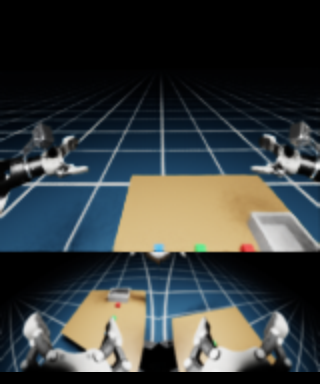

<p align="center"><b>图 16-17</b> 案例一的条件图（condition.png）：上方为头部相机，下方左右为两路腕部相机，上下有黑边补齐到 384×320</p>

生成的图像：

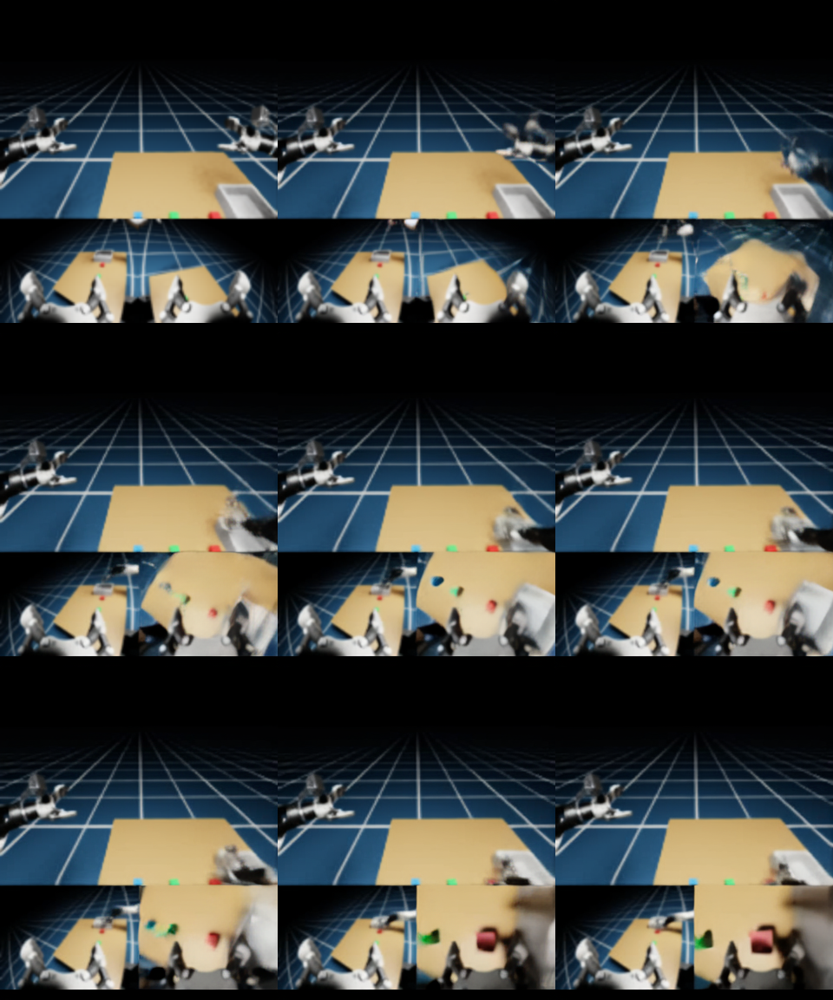

<p align="center"><b>图 16-18</b> 生成的九宫格（future_grid.png）：第一格为条件帧，其后八格为模型预测的未来帧（每帧间隔约 0.2 秒）</p>

gif动图：

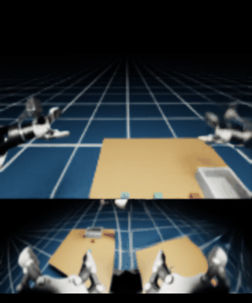

<p align="center"><b>图 16-19</b> 生成的未来视频动图（future.gif，每帧 0.2 秒循环播放）</p>

输出包括：

| 文件 | 用途 |
|---|---|
| `condition.png` | 确认当前三视图排列、颜色与裁剪 |
| `future.mp4` | 以 5 FPS 展示八帧预测未来 |
| `future.gif` | 便于直接预览未来序列 |
| `future_grid.png` | 一张条件帧加八张未来帧的九宫格 |
| `predicted_actions.npy` | $16\times16$ 的绝对动作目标 |

**如何读懂这些输出**：九宫格按"条件帧 + 8 帧未来"从左到右、从上到下排列，共 3 行 3 列（`save_grid` 每 3 张拼一行）。读图时对照 6.3 节的四个问题：是否朝红色物块运动、夹爪方向是否合理、物块是否在闭合后才随动、视频中的夹爪开合是否与 `predicted_actions.npy` 第 15 维（右夹爪，−0.785 开、0 合）的变化阶段一致。1.6 秒的预测通常只覆盖任务的一个阶段。

**案例二：Isaac Sim 闭环执行效果：**

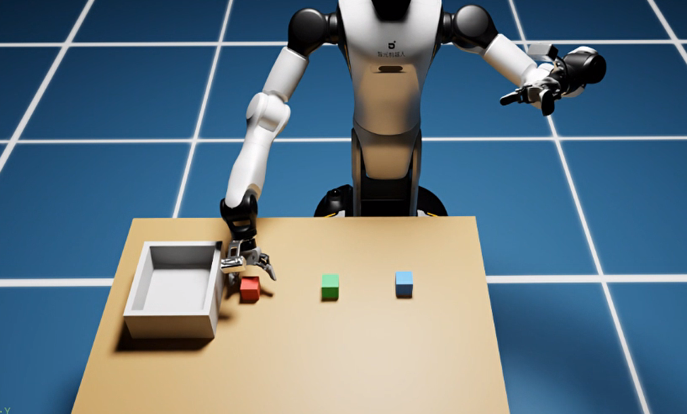

<p align="center"><b>图 16-20</b> 闭环执行效果（一）</p>

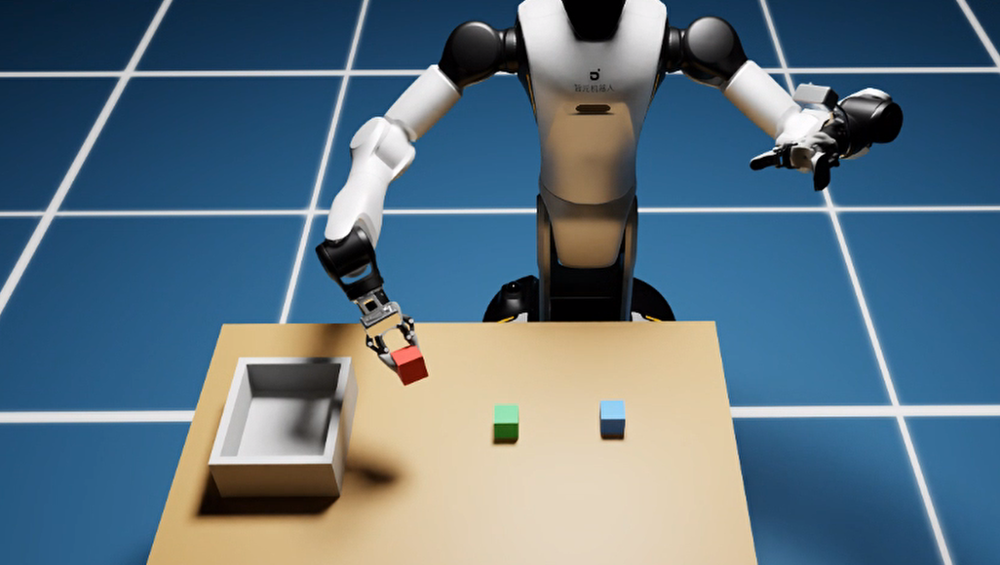

<p align="center"><b>图 16-21</b> 闭环执行效果（二）</p>

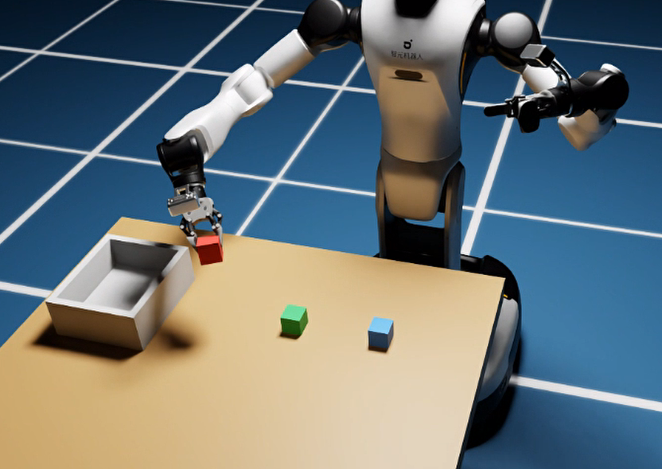

<p align="center"><b>图 16-22</b> 闭环执行效果（三）</p>

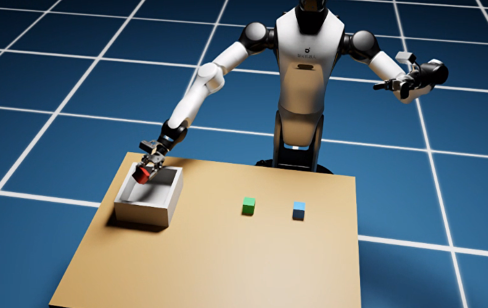

<p align="center"><b>图 16-23</b> 闭环执行效果（四）</p>

红色的物块10次大概能成功4-6次左右，但是有的也是抓边成功的，蓝色和绿色物块的抓取效果并不好，可能是因为采集的数据本来就是全自动采集，并不像人工采集那样的精准，同时，世界模型的未来帧生成也会存在误差，绿色和蓝色的物块本来就不在右机械臂方便夹取的位置，需要斜向抓取，所以大大降低了成功率。

初步考虑是lora微调并不能够完全解决跨机器人泛化存在的问题，因为motus模型本身并没有基于g2机器人进行训练微调，机器人的动作维度也不同，所以可能会存在一定的问题，有条件的可以考虑采用全量微调尝试一下。

通过微调，已经证明了世界模型学习机器人操作的可行性，本章主要是让大家对世界模型的具体实现和应用有一个具象的理解，方便大家进行后续更加深入的科研学习～

**如何读懂这些结果**：

- 每条 episode 一行 JSON，先看 `protocol` 是否为 `motus_official_full_chunk`、`execute_steps` 是否为 16，确认评测协议正确，再看成功率。
- 10 次中成功 4~6 次意味着成功率大约 40%~60%；只有 10 次试验时这个估计的波动很大，比较不同 checkpoint 时应增加 episode 数并保持种子与场景一致。
- "抓边成功"说明成功判据只看物块最终是否在盒内（6.5 节），不评价抓取姿态质量。
- 绿色、蓝色效果差，可以结合 `limited_fraction`、`max_raw_arm_delta` 与 `final_block_position` 判断问题是出在关节越界、动作跳变，还是夹爪闭合时机。仓库中 `outputs/eval_pickplace_6k.json` 的那条红色记录的解读见 6.5 节。


---

## 本章小结

### 知识回顾

本章从 VLA 与世界模型的区别出发，解释了 Motus 如何把任务理解、未来预测和动作生成放到同一套模型中。最重要的不是记住几个模型名称，而是掌握下面这条逻辑：

**通用基础模型提供语义和生成先验 → 视频运动经过潜在动作表示变成可利用的预训练信号 → 三个专家通过联合注意力学习视频与动作的关系 → Stage 3 使用目标机器人的真实状态和命令完成适配 → 在部署中联合生成未来视频与动作，再通过实际观察形成控制闭环。**

| 主题 | 核心结论 | 关键公式/数字 | 代码落点 |
|---|---|---|---|
| 世界模型 vs VLA | 区别在于动作是输出、输入条件，还是与视频一起生成 | $\pi_\theta(A\mid o,s,\ell)$、 $p_\theta(O^+\mid o,s,A,\ell)$、 $p_\theta(O^+,A\mid o,s,\ell)$ | `MotusPolicy.predict_composite` |
| 五种模式 | 由视频、动作各自的噪声时间决定 | 0=已知，1=未知 | 本章只接入联合预测 |
| 潜在动作 | 把无标签视频的运动压缩成低维连续表示，用于 Stage 2 | 光流 → DC-AE $4\times512$ → 14 维； $\mathcal L_{\rm recon}+\lambda_a\lVert a-\hat a\rVert^2+\beta\mathcal L_{\rm KL}$；约 90%/10% | `Motus/data/latent_action/`、`latent_action.yaml` |
| 背景路线 | IDM 编码 + VQ 码本 + FDM 重建下一帧 | $k^{\ast}=\arg\min_k\lVert e-c_k\rVert^2$ | 不在本章代码中 |
| 模型结构 | MoT：独立参数 + 共享联合注意力，30 层 | 动作 1024、理解 512；动作 token $1+16+4=21$；视频潜空间 $3\times12\times10$ | `motus.py` `process_joint_attention` |
| 训练目标 | 视频与动作独立加噪、回归速度场 | $x_\sigma=(1-\sigma)x+\sigma\epsilon$， $u^\ast=\epsilon-x$， $\lambda_v=\lambda_a=1$ | `Motus.training_step` |
| 推理 | Euler 反向积分，条件帧 Teacher Forcing | 10 步， $\Delta\sigma=-0.1$ | `Motus.inference_step` |
| 潜在→真实动作 | 输入编码器/解码器丢弃重建，主体继承 + LoRA | `pretrain`→`finetune`；14 维→16 维 | `load_pretrain_weights`、`apply_lora` |
| 数据合同 | 状态来自 qpos、动作来自 command | 动作 $c+3..c+48$，视频 $c+6..c+48$，≥49 帧 | `load_state_action`、`stage3_indices` |
| 训练配方 | 6000 次真更新，有效 batch 8，r=16、α=32 | $1\times2\times4=8$ | `train_stage3.py`、`stage3_g2_lora.yaml` |
| 评估 | 数据层 → 模型层 → 执行层；official 完整动作块 | 16 目标 × 0.1 s × 120 Hz | `inspect_data.py`、`infer_future.py`、`evaluate.py` |

世界模型回答行动后果，VLA 回答应当采取的行动；两者可以在统一模型中协同工作。潜在动作让没有关节标签的视频进入动作预训练，但不意味着视频运动天然就是可执行控制。流匹配让视频和动作沿噪声路径联合生成，但其数学速度场也不等于机器人关节速度。

落到工程上，决定教程能否真正复现的往往是容易忽略的细节：状态与命令是否分离、图像和动作是否对齐、动作维度和夹爪符号是否一致、加载的是 Stage 2 基座还是其他平台的成品策略，以及评测是否始终遵循 official 完整动作块协议、等待方式与随机种子是否记录清楚。

完成本章后，读者应能够沿着现有代码解释一条数据怎样变成训练样本，一次联合前向怎样产生两个速度场，一个 G2 adapter 怎样恢复成完整策略，以及预测出的动作怎样在仿真中执行。同时也应知道当前系统尚未完成什么：它没有候选动作搜索，没有基于预测未来的奖励优化，也没有因为生成了视频就获得精确物理仿真能力。

这为后续决策闭环实践提供了清晰基础：可以进一步研究如何利用未来预测进行失败检测、候选动作评价或任务级决策，但这些能力需要额外设计、实现与验证，不能仅凭"世界模型"这个名称推定已经具备。

### 课后练习

1. **（概念题）** 用本章五种模式表格解释：为什么"把未来视频变量填成全零"不等于 VLA 模式？如果要实现世界模型模式，`Motus.inference_step` 中至少要改哪三处？
2. **（手算题）** 设某关节真实命令 $A=-0.30$ rad，噪声 $\epsilon=0.50$， $\sigma=0.6$。求 $A_\sigma$ 与目标速度 $u^\ast$；若网络完美预测，从 $\sigma=1$ 开始做 5 步 Euler（每步 $\Delta\sigma=-0.2$），写出每一步的值，验证最终回到 $A$。
3. **（手算题）** 若把 `NUM_VIDEO_FRAMES` 改为 4、`VIDEO_ACTION_FREQ_RATIO` 保持 2，动作块长度、预测时域（秒）、最少原始帧数分别变为多少？`stage3_indices(0)` 的输出是什么？视频潜空间网格 `lat_T` 是多少？
4. **（动手题，无需 GPU）** 在 `code/code_chapter16` 下用 Python 调用 `data_utils.stage3_indices` 与 `collect_data.balanced_quotas`，验证本章的时间索引与 `balanced_quotas(100, ["red","green","blue"])` 的结果；再用 `g2_dataset_adapter.is_validation_episode` 对 `clean/pick_red_block/episode_000000` 到 `episode_000099` 统计进入验证集的条数，观察它为什么不恰好是 10。
5. **（动手题，无需 GPU）** 用 `torch.nn.Linear(1024, 4096)` 构造一个层，套上 `lora.LoRALinear(rank=16, alpha=32, dropout=0.0)`，验证：初始化时 LoRA 层输出与原层完全相同；可训练参数数量为 81 920。再对一个 `[3, 24, 1024, 128]` 的张量构造 `LoRAWeightDelta`，打印 `lora_A`、`lora_B` 的形状。
6. **（思考 + 动手题）** 用 `evaluate.py --execution-mode official` 与 `--pause-during-inference` 各跑 5 条红色 episode（保持其他参数不变），比较成功率、`seconds` 和 `final_block_position`。结合 6.4 节解释差异可能来自哪里，并说明为什么这两组结果不能直接合并统计。

### 参考资料

本文以 `code/code_chapter16` 中的 G2 适配脚本及其 `Motus` 子目录组织工程说明；Motus 整体算法依据论文与官方公开资料解释。模型源码随本章目录提供，不再假设存在工程外的独立安装。涉及配置、调用接口和模型行为时，应以本章实际提供并验证的版本为准。主要资料如下：

- **Motus 论文**：*Motus: A Unified Latent Action World Model*，arXiv:2512.13030，本文核对 v1 的 §3、§4.1—§4.3 与附录 §7.1。主要用于世界模型/VLA 条件关系、MoT、光流潜在动作、数据金字塔、三阶段训练与五模式调度说明。
- **官方项目介绍**：公开项目 `thu-ml/Motus`。本章源码位于 `code/code_chapter16/Motus`。用于基础组件与公开训练、部署背景，不将官方基准成绩视为本章 G2 成绩。
- **本章 G2 实现**：`code/code_chapter16` 中的配置、数据转换、LoRA、推理、控制与测试文件。对应 16 维合同、命令监督、当前 6000 步正式配置、adapter 保存和本地评测行为。
- **潜在动作背景路线（2.2 节）**：Genie（Bruce et al., *Genie: Generative Interactive Environments*, 2024）与 LAPA（Ye et al., *Latent Action Pretraining from Videos*, 2024）等工作中的"逆动力学编码 + VQ 离散化 + 前向动力学重建"思路；本章仅作概念背景，未复现其细节。
- **相关方法**：UniDiffuser（多模态独立噪声时间的联合扩散）、Flow Matching / Rectified Flow（直线路径流匹配）、LoRA（Hu et al., *LoRA: Low-Rank Adaptation of Large Language Models*）。

本文中的训练与评测命令是复现步骤，不代表已在读者设备上完成训练，也不提供未经验证的成功率、收敛结论或显存保证。
