# 第四章 移动底盘运动学与控制

> **本章导读**：前几章我们学会了安装 Isaac Sim、在场景中加载模型并调用基本 API。从本章开始，G2 机器人要真正"动起来"。移动底盘是移动机器人的"腿"：后续的移动抓取、SLAM 建图、自主导航，乃至执行大模型生成的任务，都建立在"底盘能稳定移动、准确停车"之上。本章从最基础的位姿、速度和坐标系出发，讲解 G2 四轮独立转向底盘的结构、正逆运动学、转向优化与轮速缩放、二维位姿反馈控制，并用 Isaac Sim 代码把它们串起来。
>
> 本章最终要跑通两个案例：**速度控制示例**（前进、横移、原地旋转、斜向并旋转、平滑停车）和**航点控制示例**（依次闭环到达 4 个目标位姿，走出一个约 1 m × 1 m 的方形轨迹）。本章建立的"底盘速度接口 $(v_x,v_y,\omega_z)$"会在后续导航章节中被反复复用。

## 本章概览

### 本章要解决的问题

假设你在键盘上按下"向左平移 0.35 m/s"，或者导航程序告诉机器人"去房间里 $(1.0,1.0)$ 这个点，并且朝向 $90^\circ$"。G2 的底盘并不认识这些指令——它只有 4 个可以改变朝向的转向关节和 4 个可以转动的驱动关节。那么：每个轮子应该转到什么角度？每个轮子应该以多快的速度转动？当机器人已经转了一个角度，"去目标点"又该怎样换算成机器人自身的前后左右速度？如果某个轮子算出来的速度超过电机上限，或者通信中断，机器人又该怎么办？本章就是要回答这一连串问题。

### 学习目标

学完本章，你能够：

- **解释**世界坐标系与底盘坐标系的区别，说明为什么航点控制中必须先做坐标变换；
- **推导**四轮独立转向（Swerve Drive）底盘的逆运动学公式，并手算任意 $(v_x,v_y,\omega_z)$ 下四个轮子的转向角和驱动轮速；
- **推导**正运动学的最小二乘角速度估计公式，并用它实现轮速里程计；
- **解释**转向最短路径（翻转 $180^\circ$ 并反转轮速）与轮速统一缩放的原理，并能用数值说明"统一缩放"为什么比"单独截断"好；
- **实现**一个二维位姿比例控制器，手算给定位姿误差下的速度指令；
- **运行** `demo_velocity_control.py` 和 `demo_waypoint_control.py`，读懂终端输出；

### 前置知识

- 第一至三章：Isaac Sim 的安装、Python 环境（`python.sh`）以及 World、Articulation 等基本概念；
- 数学：平面向量的加法与点积、二维旋转矩阵、三角函数与 `atan2`、弧度制；
- 物理：刚体平面运动中"线速度 = 角速度 × 半径"的关系；
- 编程：Python 的 `dataclass`、类与方法、`math` 模块。

### 知识地图

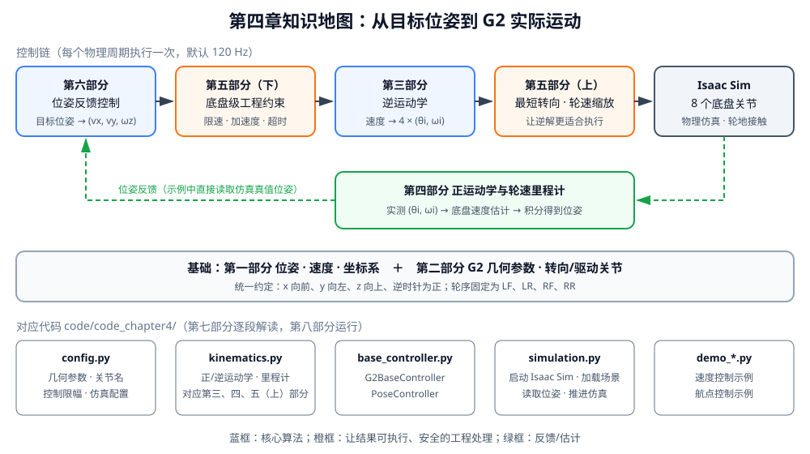

<p align="center"><b>图 4-1</b> 本章知识地图：上排是每个控制周期依次执行的计算链，绿色虚线是位姿反馈，下排是对应的代码文件</p>

### 对应代码

本章代码位于 `code/code_chapter4/`：`config.py`（参数配置）、`kinematics.py`（正逆运动学与里程计）、`base_controller.py`（底盘控制器与位姿控制器）、`simulation.py`（Isaac Sim 环境）以及两个演示程序 `demo_velocity_control.py`、`demo_waypoint_control.py`。使用的机器人模型是 `assets/robot/G2_omnipicker/robot.usda`，仿真环境是 `assets/background/room/room_1/background.usda`。

本章前六部分集中讲概念、结构、数学原理和关键算法，每个知识点后面紧跟对应的真实源码片段；第七部分再把这些片段按执行顺序串成完整程序；第八部分负责运行和结果分析。

---

## 第一部分 移动底盘控制基础

### 1.1 从机器人位姿到速度控制

**直观理解**：描述一个在地面上移动的机器人，只需要回答两个问题——"它现在在哪、朝哪"（位姿），以及"它接下来怎么动"（速度）。

在平面环境中，可以使用二维位姿描述机器人状态：

$$
\mathbf{p}=[x,\ y,\ \psi]^{T}
$$

上标 $T$ 表示转置，因此方括号中的三个分量按列向量理解。其中：

- $x$、 $y$ 表示机器人在世界坐标系中的位置，单位为米；
- $\psi$ 表示机器人绕竖直轴的朝向角，也称为航向角或 `yaw`，单位为弧度。

位姿回答的是"机器人在哪里、朝向哪里"，而速度描述的是"机器人接下来怎样运动"。平面底盘速度通常写成：

$$
\mathbf{v}=[v_x,\ v_y,\ \omega_z]^{T}
$$

三个速度分量的含义如下：

| 分量 | 单位 | 正方向 | 含义 |
|---|---:|---|---|
| $v_x$ | m/s | 机器人前方 | 前后移动速度 |
| $v_y$ | m/s | 机器人左方 | 左右横移速度 |
| $\omega_z$ | rad/s | 逆时针 | 绕底盘中心旋转的角速度 |

因此：

- $v_x>0$、 $v_y=0$、 $\omega_z=0$ 表示向前移动；
- $v_x=0$、 $v_y>0$、 $\omega_z=0$ 表示向左横移；
- $v_x=0$、 $v_y=0$、 $\omega_z>0$ 表示逆时针原地旋转；
- 三个分量同时不为零时，机器人会一边斜向平移，一边旋转。

**对应代码**：在 `code/code_chapter4/kinematics.py` 中，位姿和速度分别用两个数据类表示，注释里直接写明了单位和正方向：

```python
# 摘自 code/code_chapter4/kinematics.py
@dataclass(frozen=True)
class ChassisVelocity:
    """底盘坐标系中的速度指令。"""

    vx: float = 0.0       # 前向速度，m/s
    vy: float = 0.0       # 左向速度，m/s
    wz: float = 0.0       # 逆时针角速度，rad/s


@dataclass
class Pose2D:
    """平面位姿。"""

    x: float = 0.0
    y: float = 0.0
    yaw: float = 0.0
```

`ChassisVelocity` 被声明为 `frozen=True`（不可修改），因为一条速度指令一旦生成就不应被就地篡改，每次限幅都会创建一个新对象；`Pose2D` 则需要在里程计中被反复累加，所以是可变的。

**合速度与限速**：$v_x$ 和 $v_y$ 是同一个二维线速度向量的两个分量，合速度大小为：

$$
v=\sqrt{v_x^2+v_y^2}
$$

例如， $v_x=0.7\text{ m/s}$、 $v_y=0.7\text{ m/s}$ 时，合速度约为 $0.99\text{ m/s}$，而不是 $0.7\text{ m/s}$。因此底盘限速时要限制二维合速度，不能只分别截断两个分量。本章代码的做法是"按比例缩放整个向量"（第五部分 5.4 节详细讲解）：若上限为 $0.70\text{ m/s}$，则缩放系数 $s=0.70/0.99\approx0.707$，结果为 $(0.495,\ 0.495)$，方向仍是 $45^\circ$ 斜向，只是变慢了。

**角度单位**：角度和角速度通常使用弧度：

$$
\pi\text{ rad}=180^\circ,\qquad
\frac{\pi}{2}\text{ rad}=90^\circ
$$

角度有一个特殊性质：$\psi$ 和 $\psi+2\pi$ 表示同一个朝向。因此代码里所有"角度差"都要先归一化到 $[-\pi,\pi)$，否则 $3.1$ rad 和 $-3.1$ rad 之间会被误认为差了 $6.2$ rad，而实际只差约 $0.083$ rad。归一化函数非常短：

```python
# 摘自 code/code_chapter4/kinematics.py
def normalize_angle(angle: float) -> float:
    """把角度归一化到 [-pi, pi)。"""
    return (angle + math.pi) % (2.0 * math.pi) - math.pi
```

**代码解读**：先加 $\pi$ 把目标区间平移到 $[0,2\pi)$，用 Python 的取模（对负数也返回非负结果）折回该区间，再减 $\pi$ 移回 $[-\pi,\pi)$。例如 `normalize_angle(3.5)` $\approx -2.783$，`normalize_angle(math.pi)` 返回 $-\pi$（区间右端开、左端闭）。

> ⚠️ **注意**：需要特别区分底盘角速度 $\omega_z$ 和车轮自转角速度 $\omega_i$。前者表示整个机器人绕底盘中心转得多快，后者表示某个驱动轮绕自身轴线转得多快。两者单位相同（rad/s），但物理意义不同。代码里前者叫 `wz`，后者叫 `wheel_speed`。

### 1.2 世界坐标系与底盘坐标系

**直观理解**：世界坐标系像房间地板上画的方格，永远不动；底盘坐标系像贴在机器人身上的"前/左"标签，跟着机器人一起走、一起转。机器人控制中最容易出现的问题之一，就是没有区分这两者。

世界坐标系固定在仿真场景中，不会随着机器人运动。房间中的航点、物体位置和机器人全局位姿都使用世界坐标系描述。

底盘坐标系固定在机器人身上，会跟随机器人一起平移和旋转。本章统一采用右手坐标系：

- 底盘 $x$ 轴指向机器人前方；
- 底盘 $y$ 轴指向机器人左方；
- 底盘 $z$ 轴指向机器人上方；
- 绕 $z$ 轴的正方向为从上向下看逆时针。

底盘速度 $(v_x,v_y,\omega_z)$ 在机器人自身坐标系中表达。例如，机器人已经相对世界坐标系旋转了 $90^\circ$，此时继续给出正的 $v_x$，机器人会沿自己的前方移动，而不是固定沿世界坐标系的 $x$ 正方向移动。

这一点在航点控制中尤其重要。航点位置位于世界坐标系，而底盘速度位于机器人坐标系，所以不能直接把世界坐标误差当作 $v_x$ 和 $v_y$，必须先做坐标变换。

**两个方向的变换公式**（本章会反复用到，记住一对就够了）：设机器人航向为 $\psi$，

- 世界 → 底盘（用于位姿控制，把误差转到机器人视角）：

$$
\begin{bmatrix}a^{body}_x\\ a^{body}_y\end{bmatrix}
=\begin{bmatrix}\cos\psi & \sin\psi\\ -\sin\psi & \cos\psi\end{bmatrix}
\begin{bmatrix}a^{world}_x\\ a^{world}_y\end{bmatrix}
$$

- 底盘 → 世界（用于里程计，把机器人速度积分到地图上）：

$$
\begin{bmatrix}a^{world}_x\\ a^{world}_y\end{bmatrix}
=\begin{bmatrix}\cos\psi & -\sin\psi\\ \sin\psi & \cos\psi\end{bmatrix}
\begin{bmatrix}a^{body}_x\\ a^{body}_y\end{bmatrix}
$$

两个矩阵互为转置（也互为逆），因为旋转矩阵是正交矩阵。

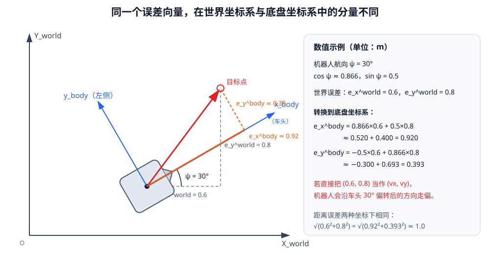

<p align="center"><b>图 4-2</b> 同一个误差向量（红色）在世界坐标系中是 (0.6, 0.8)，在航向 30° 的底盘坐标系中约为 (0.92, 0.39)</p>

**案例**：机器人航向 $\psi=30^\circ$（$\cos\psi\approx0.866$，$\sin\psi=0.5$），目标点相对机器人的世界误差为 $(0.6,\ 0.8)$ m。

$$
e_x^{body}=0.866\times0.6+0.5\times0.8\approx0.920\text{ m}
$$

$$
e_y^{body}=-0.5\times0.6+0.866\times0.8\approx0.393\text{ m}
$$

验证：$\sqrt{0.920^2+0.393^2}\approx1.000$，与 $\sqrt{0.6^2+0.8^2}=1.0$ 相同——旋转不改变向量长度，只改变它在不同坐标轴上的分解。如果直接把 $(0.6,0.8)$ 当作 $(v_x,v_y)$ 发给机器人，它实际会朝世界坐标下 $30^\circ+53.1^\circ=83.1^\circ$ 的方向走，而目标方向是 $53.1^\circ$，偏了整整 $30^\circ$。

> 💡 **要点**：判断一个量属于哪个坐标系，就问"机器人转身后它会不会跟着变"。航点、物体位置不会变（世界系）；"向前""向左"会变（底盘系）。

### 1.3 常见底盘与本章控制目标

常见移动底盘主要包括差速底盘、麦克纳姆轮底盘和四轮独立转向底盘。

| 底盘类型 | 可直接控制的速度 | 能否直接横移 | 特点 |
|---|---|---|---|
| 差速底盘 | $v_x$、$\omega_z$ | 不能 | 结构简单；靠左右轮速差转向，要到侧面需先转向再前进 |
| 麦克纳姆轮底盘 | $v_x$、$v_y$、$\omega_z$ | 能 | 利用轮缘斜向滚子产生横向分力；运动效果易受滚子接触、地面摩擦和负载变化影响 |
| 四轮独立转向（Swerve Drive） | $v_x$、$v_y$、$\omega_z$ | 能 | 每个轮组都能独立改变朝向和驱动速度，G2 采用此方案 |

差速底盘通过左右轮速差完成转向，一般只能直接控制前后速度和旋转速度，不能直接横移。机器人要移动到侧面时，通常需要先转向再前进。

麦克纳姆轮底盘利用轮缘上的斜向滚子产生横向分力，可以直接实现前后、左右和旋转运动，但运动效果容易受到滚子接触、地面摩擦和负载变化影响。

G2 使用四轮独立转向底盘，也称为 Swerve Drive。四个轮组都能独立改变朝向和驱动速度，因此可以直接控制完整的 $(v_x,v_y,\omega_z)$，实现前进、横移、斜向运动、原地旋转以及平移与旋转的组合运动。能够独立控制全部三个平面自由度的底盘称为**全向（holonomic）底盘**。

本章要建立的完整控制链是：

**动作或目标位姿 → 底盘速度 → 四个轮子状态 → 八个底盘关节 → 轮地接触 → G2 实际运动。**

本章不会通过直接修改世界位姿让机器人瞬移，也不会调用 Isaac Sim 已经封装好的底盘控制器。`base_controller.py` 的文件头注释写得很明确：

```python
# 摘自 code/code_chapter4/base_controller.py（模块文档字符串）
"""G2 底盘控制器。

这里没有调用 Isaac Sim 自带的 DifferentialController、HolonomicController
或 WheelBasePoseController。底盘运动学和位姿反馈控制均由本代码实现。
"""
```

运动学和控制逻辑由本章代码自行实现，Isaac Sim 只负责关节执行和物理仿真。

---

## 第二部分 G2 机器人底盘结构

### 2.1 四轮独立转向结构与几何参数

**直观理解**：做运动学之前，必须先知道"轮子在哪里、有多大"。就像算圆周运动要先知道半径一样。

G2 模型包含移动底盘、升降机构、机械臂和其他关节，当前整个 articulation 共有 46 个自由度。本章只使用其中与移动底盘直接相关的 8 个主动关节。

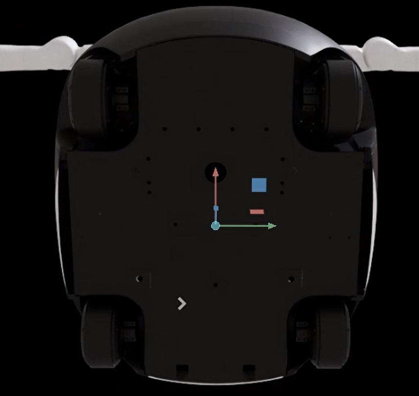

<p align="center"><b>图 4-3</b> G2 机器人的四轮独立转向移动底盘</p>

底盘包含四个轮组，并统一按以下顺序处理：

1. 左前轮 LF（Left Front）；
2. 左后轮 LR（Left Rear）；
3. 右前轮 RF（Right Front）；
4. 右后轮 RR（Right Rear）。

统一顺序非常重要。轮子位置、转向关节、驱动关节和运动学计算必须一一对应，否则机器人可能出现错误横移、异常旋转或四个轮子互相对抗。`config.py` 中专门用注释强调了这一点：

```python
# 摘自 code/code_chapter4/config.py
# 顺序必须始终保持：左前、左后、右前、右后。
WHEEL_NAMES = ("left_front", "left_rear", "right_front", "right_rear")
```

底盘运动学需要三个基本几何参数：

| 参数 | 符号 | 数值 | 含义 |
|---|---:|---:|---|
| 轮子半径 | $r$ | 0.070 m | 轮子中心到轮缘的距离 |
| 轴距（wheel base） | $L$ | 0.460 m | 前后轮中心之间的距离 |
| 轮距（track width） | $W$ | 0.436 m | 左右轮中心之间的距离 |

底盘坐标系原点位于四轮几何中心。半轴距和半轮距分别为：

$$
\frac{L}{2}=0.230\text{ m},\qquad
\frac{W}{2}=0.218\text{ m}
$$

四个轮子在底盘坐标系中的位置为：

| 轮子 | $x_i$ | $y_i$ |
|---|---:|---:|
| 左前 LF | $+0.230$ m | $+0.218$ m |
| 左后 LR | $-0.230$ m | $+0.218$ m |
| 右前 RF | $+0.230$ m | $-0.218$ m |
| 右后 RR | $-0.230$ m | $-0.218$ m |

这里规定前方 $x$ 为正、后方为负，左侧 $y$ 为正、右侧为负。

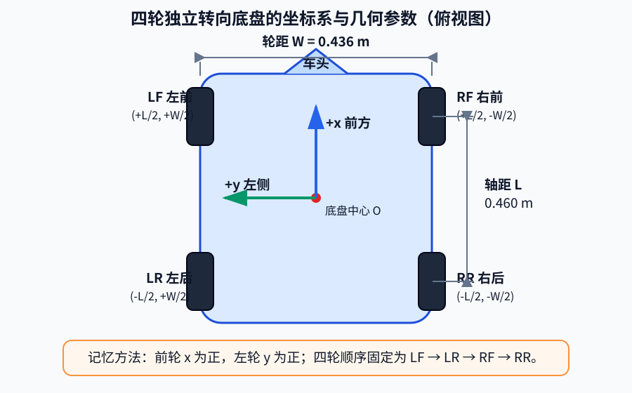

<p align="center"><b>图 4-4</b> 四轮独立转向底盘坐标系与几何参数：从俯视角度看，车头方向为 +x，机器人左侧为 +y，四个轮子的坐标符号由它们相对底盘中心的位置直接确定</p>

**对应代码**：几何参数和轮子位置统一由 `RobotGeometry` 管理，轮子位置不是手写的四组常数，而是由轴距、轮距计算出来的属性，保证改一个参数时四个位置同步更新：

```python
# 摘自 code/code_chapter4/config.py
@dataclass(frozen=True)
class RobotGeometry:
    """G2 四轮独立转向底盘的几何尺寸，单位为米。"""

    wheel_radius: float = 0.070
    wheel_base: float = 0.460
    track_width: float = 0.436

    @property
    def wheel_positions(self) -> tuple[tuple[float, float], ...]:
        """每个轮子在底盘坐标系中的 (x, y)。

        坐标约定：x 向前，y 向左，z 向上。
        """
        half_length = self.wheel_base / 2.0
        half_width = self.track_width / 2.0
        return (
            (+half_length, +half_width),  # 左前
            (-half_length, +half_width),  # 左后
            (+half_length, -half_width),  # 右前
            (-half_length, -half_width),  # 右后
        )
```

轮子位置在纯平移时影响不明显，但在旋转运动中非常重要。底盘绕中心旋转时，每个轮子都要沿自己的圆周切线方向运动。轮子离底盘中心越远，在相同底盘角速度下所需的轮心线速度越大。G2 每个轮子到中心的距离都是：

$$
\rho=\sqrt{0.230^2+0.218^2}\approx0.317\text{ m}
$$

因此，轮径、轴距或轮距填写错误，会直接影响旋转速度、组合运动轨迹和里程计精度。

> ⚠️ **注意**：如果把轮子半径错写成 0.080 m，逆运动学算出的轮速会偏小 $0.07/0.08=87.5\%$，机器人实际速度也只有指令的 87.5%；而正运动学会把真实速度高估，里程计会越积越"远"。

### 2.2 转向关节与驱动关节

每个 G2 轮组包含两个主动自由度：

- **转向关节**控制轮子的朝向。在 Isaac Sim 中，它接收**位置目标**，单位为弧度。转向角决定轮子速度向量指向哪里。
- **驱动关节**控制轮子绕自身轴线旋转。在 Isaac Sim 中，它接收**速度目标**，单位为弧度每秒。驱动轮速决定轮心速度的大小和正反方向。

四个转向关节为：

| 轮组 | 转向关节名称 |
|---|---|
| 左前 | `idx111_chassis_lwheel_front_joint1` |
| 左后 | `idx121_chassis_lwheel_rear_joint1` |
| 右前 | `idx131_chassis_rwheel_front_joint1` |
| 右后 | `idx141_chassis_rwheel_rear_joint1` |

四个驱动关节为：

| 轮组 | 驱动关节名称 |
|---|---|
| 左前 | `idx112_chassis_lwheel_front_joint2` |
| 左后 | `idx122_chassis_lwheel_rear_joint2` |
| 右前 | `idx132_chassis_rwheel_front_joint2` |
| 右后 | `idx142_chassis_rwheel_rear_joint2` |

命名规律：`idx1` 后第二位数字 1/2/3/4 依次对应左前/左后/右前/右后，最后一位 1 表示转向（`joint1`）、2 表示驱动（`joint2`）。

```python
# 摘自 code/code_chapter4/config.py
STEERING_JOINT_NAMES = (
    "idx111_chassis_lwheel_front_joint1",
    "idx121_chassis_lwheel_rear_joint1",
    "idx131_chassis_rwheel_front_joint1",
    "idx141_chassis_rwheel_rear_joint1",
)
DRIVE_JOINT_NAMES = (
    "idx112_chassis_lwheel_front_joint2",
    "idx122_chassis_lwheel_rear_joint2",
    "idx132_chassis_rwheel_front_joint2",
    "idx142_chassis_rwheel_rear_joint2",
)
```

当前模型加载后，转向关节索引为 22、23、24、25，驱动关节索引为 26、27、28、29。不过程序不直接写死索引，而是根据关节名称动态查找。这样即使 USD 模型调整了自由度顺序，只要关节名称不变，控制器仍然能够找到正确关节；如果关节缺失，程序会立即给出明确错误：

```python
# 摘自 code/code_chapter4/base_controller.py
def _find_joint_indices(all_names: Sequence[str], required_names: Sequence[str]) -> list[int]:
    """严格查找关节，缺少任意一个关节都立即报错。"""
    name_to_index = {name: index for index, name in enumerate(all_names)}
    missing = [name for name in required_names if name not in name_to_index]
    if missing:
        raise RuntimeError(
            "G2 USD 中缺少底盘关节："
            + ", ".join(missing)
            + "\n实际可用关节："
            + ", ".join(all_names)
        )
    return [name_to_index[name] for name in required_names]
```

**代码解读**：先建立"名称 → 索引"字典；再找出所有缺失的名称，一次性报告（并附上实际可用的全部关节名，方便排查拼写）；最后按 `required_names` 的顺序返回索引——所以返回列表的顺序天然就是 LF、LR、RF、RR。

### 2.3 从关节目标到机器人运动

一个轮子的实际轮心速度由转向角和驱动速度共同决定：

- 转向角决定速度向量方向；
- 驱动轮速决定速度向量大小和正负方向。

例如，轮子朝向前方并正向转动，轮心速度向前；轮子仍朝向前方但反向转动，轮心速度向后。轮子朝向左侧并正向转动，轮心速度向左。

用公式表达，转向角 $\theta_i$、轮速 $\omega_i$ 的轮子产生的轮心速度为：

$$
\mathbf{v}_i = r\,\omega_i\,[\cos\theta_i,\ \sin\theta_i]^T
$$

这个式子就是第四部分正运动学的出发点；而第三部分的逆运动学，则是在已知 $\mathbf{v}_i$ 时反解出 $(\theta_i,\omega_i)$。

因此，底盘控制不能只计算四个轮速，还必须同时计算四个转向角。

本章在 Isaac Sim 中向四个转向关节发送位置目标，向四个驱动关节发送速度目标。随后由 Isaac Sim 计算关节响应、轮地接触和摩擦力，接触力再推动整个 G2 移动。机器人世界位姿不会被控制程序直接修改。

这种实现方式比直接设置世界坐标更接近真实机器人，也能真实反映转向延迟、加速过程、轮地摩擦和停车误差，为后续的移动抓取、SLAM 和导航提供可靠基础。

> 💡 **要点**：转向关节 = 位置控制（"转到某个角度"），驱动关节 = 速度控制（"以某个速度一直转"）。这两种目标在代码中分别对应 `ArticulationAction(joint_positions=...)` 和 `ArticulationAction(joint_velocities=...)`，详见第七部分。

---

## 第三部分 四轮独立转向逆运动学

### 3.1 逆运动学推导：从底盘速度求轮子状态

**直观理解**：上层只关心"整台车往哪走、转多快"，但每个轮子只关心"我该朝哪、转多快"。逆运动学（Inverse Kinematics）就是一个"翻译器"，把 3 个底盘速度翻译成 8 个关节目标。

上层希望使用容易理解的底盘速度：

$$
(v_x,v_y,\omega_z)
$$

但四个轮组真正需要的是：

$$
(\theta_i,\omega_i),\qquad i=1,2,3,4
$$

其中：

- $\theta_i$ 是第 $i$ 个轮子的转向角；
- $\omega_i$ 是第 $i$ 个轮子的自转角速度。

把底盘速度转换为四个轮子状态的过程称为逆运动学。

**第 1 步：把底盘看作平面刚体。** 刚体上任一点的速度由两部分叠加而成：

- 底盘中心平移产生的速度；
- 底盘绕中心旋转产生的切向速度。

底盘中心的平移速度为：

$$
\mathbf{v}_c=[v_x,\ v_y]^{T}
$$

第 $i$ 个轮子相对底盘中心的位置为：

$$
\mathbf{r}_i=[x_i,\ y_i]^{T}
$$

底盘角速度为：

$$
\boldsymbol{\omega}=[0,\ 0,\ \omega_z]^{T}
$$

**第 2 步：求旋转在轮心处产生的速度。** 旋转在轮心处产生的速度为叉乘：

$$
\mathbf{v}_{rotation,i}=\boldsymbol{\omega}\times\mathbf{r}_i
=[-\omega_z y_i,\ \omega_z x_i]^{T}
$$

把叉乘展开写一遍（把 $\mathbf{r}_i$ 补成三维 $[x_i,y_i,0]^T$）：

$$
\begin{vmatrix}
\mathbf{i} & \mathbf{j} & \mathbf{k}\\
0 & 0 & \omega_z\\
x_i & y_i & 0
\end{vmatrix}
=\mathbf{i}(0\cdot0-\omega_z y_i)-\mathbf{j}(0\cdot0-\omega_z x_i)+\mathbf{k}(0)
=[-\omega_z y_i,\ \omega_z x_i,\ 0]^T
$$

几何上看：这个向量与 $\mathbf{r}_i$ 垂直（点积 $-\omega_z y_i x_i+\omega_z x_i y_i=0$），大小为 $|\omega_z|\cdot|\mathbf{r}_i|$——正是"线速度 = 角速度 × 半径"，方向沿圆周切线。

**第 3 步：叠加。** 轮心总速度等于平移速度和旋转速度之和：

$$
\mathbf{v}_i=\mathbf{v}_c+\mathbf{v}_{rotation,i}
$$

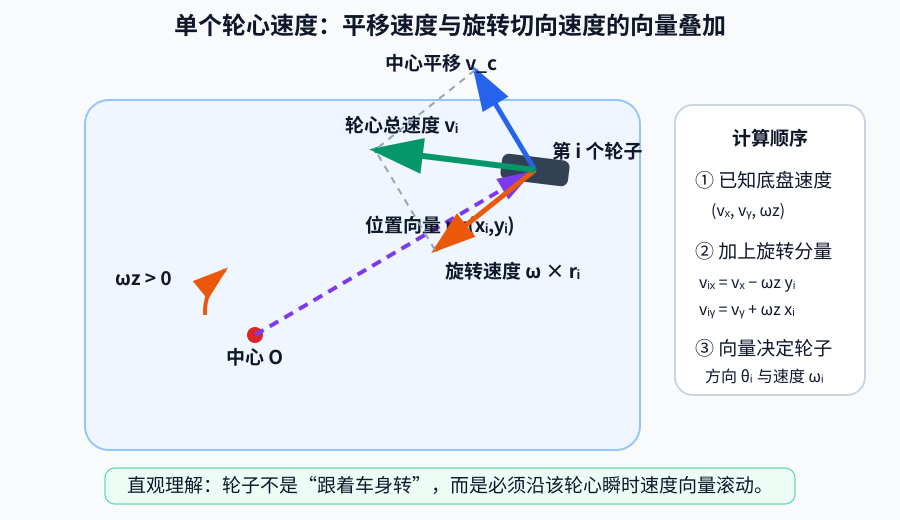

<p align="center"><b>图 4-5</b> 单个轮心速度的向量分解：蓝色向量是底盘中心平移带来的速度，橙色向量是绕底盘中心旋转带来的切向速度，绿色向量是二者相加后该轮真正需要实现的轮心速度，车轮转向角应与绿色向量方向一致</p>

因此得到逆运动学最核心的两个公式：

$$
\boxed{v_{ix}=v_x-\omega_z y_i}
$$

$$
\boxed{v_{iy}=v_y+\omega_z x_i}
$$

**第 4 步：由轮心速度求转向角和轮速。** 轮子应沿轮心速度向量方向滚动，因此转向角为：

$$
\boxed{\theta_i=\mathrm{atan2}(v_{iy},v_{ix})}
$$

这里必须用 `atan2` 而不是 `atan`：`atan(v_iy/v_ix)` 只能返回 $(-\pi/2,\pi/2)$，分不清"向前"和"向后"，而且 $v_{ix}=0$ 时会除零；`atan2` 根据两个参数的符号返回完整的 $(-\pi,\pi]$ 范围。

轮心线速度大小为：

$$
v_i=\sqrt{v_{ix}^2+v_{iy}^2}
$$

轮缘线速度与车轮自转角速度满足 $v_i=r\omega_i$（轮子纯滚动、不打滑时），所以：

$$
\boxed{
\omega_i=\frac{\sqrt{v_{ix}^2+v_{iy}^2}}{r}
}
$$

这四个公式完成了从底盘速度到每个轮子转向角和驱动轮速的转换。

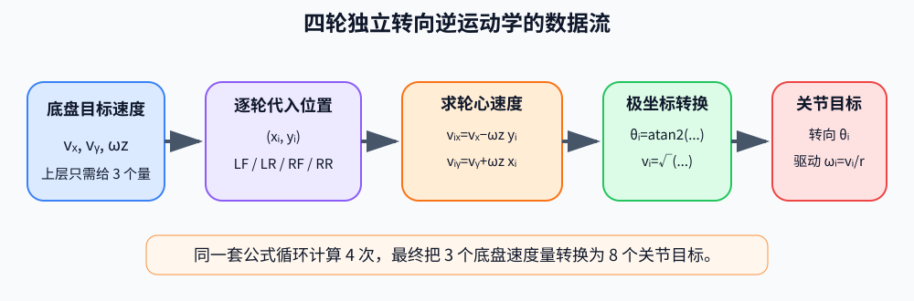

<p align="center"><b>图 4-6</b> 四轮独立转向逆运动学的数据流：上层只给出 3 个底盘速度分量，运动学模块对四个轮子分别计算，最终生成 4 个转向角和 4 个驱动轮速，共 8 个关节目标</p>

**对应代码**：逆运动学集中在 `SwerveKinematics.inverse()`。它遍历四个轮子，根据轮子位置计算轮心速度，再得到转向角和驱动轮速：

```python
# 摘自 code/code_chapter4/kinematics.py（SwerveKinematics.inverse，省略参数检查）
def inverse(
    self,
    velocity: ChassisVelocity,
    current_angles: Sequence[float] | None = None,
    max_wheel_speed: float | None = None,
) -> list[WheelState]:
    # ...
    states: list[WheelState] = []
    for index, (wheel_x, wheel_y) in enumerate(self.wheel_positions):
        wheel_vx = velocity.vx - velocity.wz * wheel_y      # v_ix = vx - wz*y_i
        wheel_vy = velocity.vy + velocity.wz * wheel_x      # v_iy = vy + wz*x_i
        linear_speed = math.hypot(wheel_vx, wheel_vy)       # |v_i|

        if linear_speed < 1e-8:                             # 零速度：方向无定义
            hold_angle = 0.0 if current_angles is None else float(current_angles[index])
            states.append(WheelState(hold_angle, 0.0))
            continue

        desired_angle = math.atan2(wheel_vy, wheel_vx)      # θ_i
        wheel_speed = linear_speed / self.wheel_radius      # ω_i = |v_i| / r

        if current_angles is not None:                      # 转向最短路径（第五部分）
            desired_angle, wheel_speed = self._nearest_equivalent_state(
                desired_angle,
                wheel_speed,
                float(current_angles[index]),
            )

        states.append(WheelState(desired_angle, wheel_speed))

    return self._desaturate(states, max_wheel_speed)        # 轮速统一缩放（第五部分）
```

代码变量与数学量的对应关系如下：

| 数学量 | 代码变量 |
|---|---|
| $x_i$ | `wheel_x` |
| $y_i$ | `wheel_y` |
| $v_{ix}$ | `wheel_vx` |
| $v_{iy}$ | `wheel_vy` |
| $\|\mathbf{v}_i\|$ | `linear_speed` |
| $\theta_i$ | `desired_angle` |
| $\omega_i$ | `wheel_speed` |

每个轮子的计算结果用 `WheelState` 保存：

```python
# 摘自 code/code_chapter4/kinematics.py
@dataclass(frozen=True)
class WheelState:
    """一个转向轮的目标状态。"""

    steering_angle: float  # 转向角，rad
    wheel_speed: float     # 车轮自转角速度，rad/s
```

`inverse()` 末尾的两个"后处理"——`_nearest_equivalent_state`（转向最短路径）和 `_desaturate`（轮速统一缩放）——以及零速度时保持转向角的处理，会在第五部分展开。

### 3.2 基本运动与组合运动

在代入具体数值之前，可以先通过下面的俯视图建立直觉。图中的深色短线表示车轮的滚动方向，蓝色箭头表示对应轮心的速度方向和相对大小。

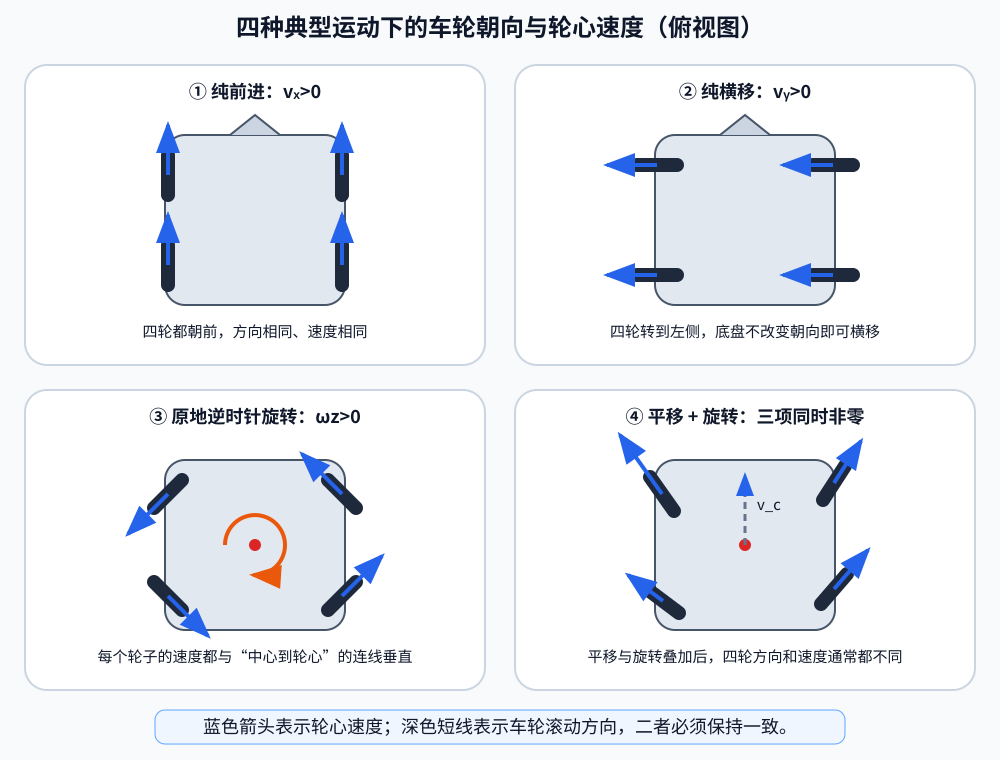

<p align="center"><b>图 4-7</b> 四轮独立转向底盘的四种典型运动：纯前进、纯横移、原地逆时针旋转、平移与旋转组合</p>

观察时只需抓住一个原则：**每个车轮都必须转到自身轮心速度向量的方向，再通过驱动轮速实现该向量的大小。** 纯平移时四个向量相同；只要存在旋转分量，四个轮心的速度向量就会因位置不同而产生差异。

下面四个数值案例正好对应速度控制示例 `demo_velocity_control.py` 中的前四段动作。

#### 纯前进

设：

$$
v_x=0.4\text{ m/s},\qquad v_y=0,
\qquad\omega_z=0
$$

因为没有旋转，对四个轮子都有 $v_{ix}=0.4$、 $v_{iy}=0$。所以四个轮子的转向角都为 $\mathrm{atan2}(0,0.4)=0$。

轮子半径为 $0.070\text{ m}$，驱动角速度为：

$$
\omega_i=\frac{0.4}{0.070}\approx5.714\text{ rad/s}
$$

四个轮子全部朝前并以相同速度正向转动，底盘向前移动。

#### 纯横移

设：

$$
v_x=0,
\qquad v_y=0.35\text{ m/s},
\qquad\omega_z=0
$$

四个轮子都有 $v_{ix}=0$、 $v_{iy}=0.35$，所以转向角都为 $\mathrm{atan2}(0.35,0)=\pi/2$，驱动角速度为：

$$
\omega_i=\frac{0.35}{0.070}=5.0\text{ rad/s}
$$

四个轮子先朝向左侧，再正向转动，底盘直接向左横移。

#### 原地旋转

设：

$$
v_x=0,
\qquad v_y=0,
\qquad\omega_z=0.65\text{ rad/s}
$$

以左前轮为例，其位置为 $(0.230,0.218)$，因此：

$$
v_{LF,x}=-0.65\times0.218=-0.1417\text{ m/s}
$$

$$
v_{LF,y}=0.65\times0.230=0.1495\text{ m/s}
$$

轮心线速度大小约为：

$$
\sqrt{(-0.1417)^2+0.1495^2}\approx0.206\text{ m/s}
$$

对应驱动轮角速度约为：

$$
\frac{0.206}{0.070}\approx2.94\text{ rad/s}
$$

其他三个轮子的速度大小相同（四个轮子到中心距离都是 $0.317$ m，$0.65\times0.317\approx0.206$），但方向不同。把四个轮子都算出来：

| 轮子 | $v_{ix}$ (m/s) | $v_{iy}$ (m/s) | $\theta_i$（不做最短路径优化时） | $\omega_i$ (rad/s) |
|---|---:|---:|---:|---:|
| LF | $-0.1417$ | $+0.1495$ | $+133.5^\circ$ | 2.94 |
| LR | $-0.1417$ | $-0.1495$ | $-133.5^\circ$ | 2.94 |
| RF | $+0.1417$ | $+0.1495$ | $+46.5^\circ$ | 2.94 |
| RR | $+0.1417$ | $-0.1495$ | $-46.5^\circ$ | 2.94 |

四个轮子分别沿绕底盘中心圆周的切线方向滚动，于是 G2 绕中心原地旋转。注意 LF、LR 的原始转向角超过了 $90^\circ$，第五部分的最短路径优化会把它们翻转为 $-46.5^\circ$ / $+46.5^\circ$ 并反转轮速——这就是为什么原地旋转时四个轮子看起来摆成一个"菱形"，但左侧两个轮子是倒着转的。

#### 平移与旋转同时发生

当 $v_x$、 $v_y$ 和 $\omega_z$ 同时不为零时，每个轮子都要把底盘平移速度和自身位置产生的旋转速度叠加起来。因此四个轮子的方向和速度通常都不同。以示例中第四段动作"斜向并旋转" $(0.30,-0.18,-0.35)$ 为例：

| 轮子 | $v_{ix}=0.30+0.35y_i$ | $v_{iy}=-0.18-0.35x_i$ | $\theta_i$ | $\omega_i$ (rad/s) |
|---|---:|---:|---:|---:|
| LF | $0.3763$ | $-0.2605$ | $-34.7^\circ$ | 6.54 |
| LR | $0.3763$ | $-0.0995$ | $-14.8^\circ$ | 5.56 |
| RF | $0.2237$ | $-0.2605$ | $-49.4^\circ$ | 4.91 |
| RR | $0.2237$ | $-0.0995$ | $-24.0^\circ$ | 3.50 |

四个轮子朝向各不相同，速度也各不相同，但它们都是同一个刚体运动在不同位置上的"投影"，彼此之间严格协调。

这也是四轮独立转向底盘比差速底盘更灵活的原因：每个轮组都可以独立满足自己的目标速度向量，从而共同实现复杂底盘运动。

### 3.3 手算案例：边前进边左转

**题目**：当 $v_x=0.4\text{ m/s}$、$v_y=0$、$\omega_z=0.5\text{ rad/s}$ 时，四个轮子的转向角和驱动轮速分别是多少？

**解**：先算每个轮子的旋转贡献 $(-\omega_z y_i,\ \omega_z x_i)$：$\omega_z\cdot0.218=0.109$，$\omega_z\cdot0.230=0.115$。

左前轮 LF $(+0.230,+0.218)$：

$$
v_{LF,x}=0.4-0.5\times0.218=0.291,\qquad v_{LF,y}=0+0.5\times0.230=0.115
$$

$$
\theta_{LF}=\mathrm{atan2}(0.115,0.291)\approx0.376\text{ rad}\approx21.6^\circ,\qquad
\omega_{LF}=\frac{\sqrt{0.291^2+0.115^2}}{0.070}=\frac{0.313}{0.070}\approx4.47\text{ rad/s}
$$

右前轮 RF $(+0.230,-0.218)$：

$$
v_{RF,x}=0.4+0.109=0.509,\qquad v_{RF,y}=0.115
$$

$$
\theta_{RF}=\mathrm{atan2}(0.115,0.509)\approx0.222\text{ rad}\approx12.7^\circ,\qquad
\omega_{RF}=\frac{0.522}{0.070}\approx7.45\text{ rad/s}
$$

后轮与前轮关于 $x$ 轴对称，$v_{iy}$ 变号，所以 $\theta_{LR}\approx-21.6^\circ$、$\theta_{RR}\approx-12.7^\circ$，轮速分别与同侧前轮相同。

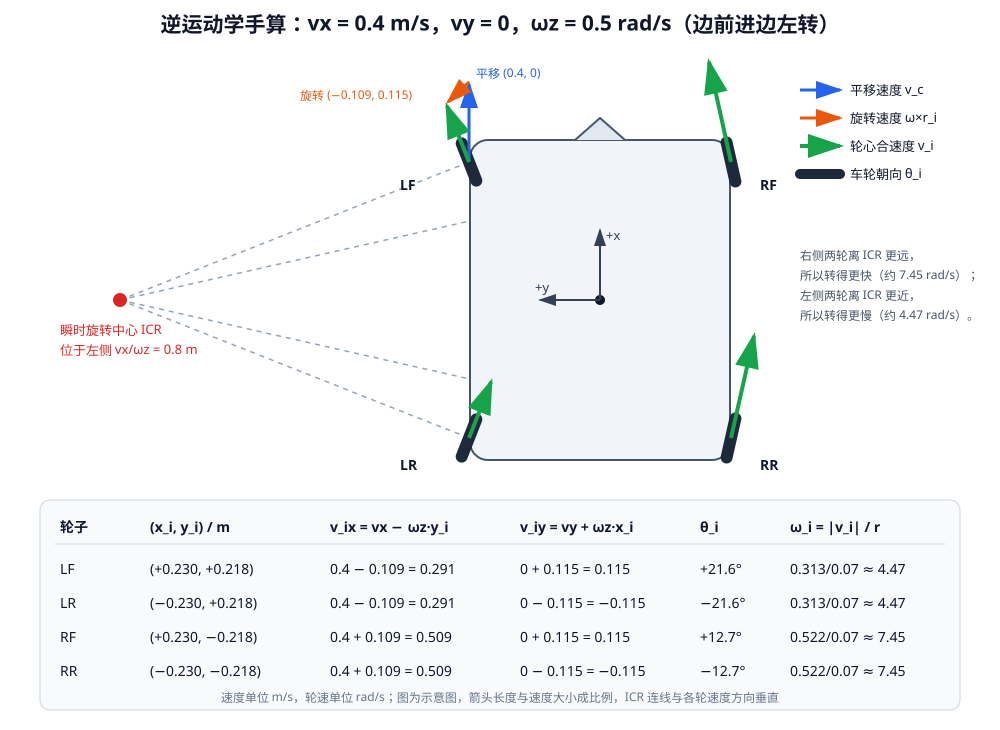

<p align="center"><b>图 4-8</b> 逆运动学手算案例：vx=0.4 m/s、ωz=0.5 rad/s 时四个轮子的速度分解、朝向与轮速，所有轮速方向都垂直于各自到瞬时旋转中心（ICR）的连线</p>

**结果解读**：

- 左转时右侧（外侧）两轮比左侧（内侧）两轮快：$7.45$ vs $4.47$ rad/s，就像汽车转弯时外侧车轮跑得更远；
- 前轮"向左打"、后轮"向右打"，四个轮子的法线都汇聚到车身左侧的同一个点——**瞬时旋转中心（Instantaneous Center of Rotation, ICR）**。对于 $v_y=0$ 的情况，ICR 位于 $y=v_x/\omega_z=0.8$ m 处。这是检查逆运动学结果是否正确的一个好办法：如果四个轮子的法线不交于一点，轮子之间就会互相"拉扯"。

**动手验证**：在 `code/code_chapter4/` 目录下用任意 Python 3.10+ 运行下面几行（`kinematics.py` 与 `config.py` 不依赖 Isaac Sim，可以单独导入），输出应与上表一致：

```python
from config import RobotGeometry
from kinematics import ChassisVelocity, SwerveKinematics

g = RobotGeometry()
k = SwerveKinematics(g.wheel_positions, g.wheel_radius)
for s in k.inverse(ChassisVelocity(0.4, 0.0, 0.5)):
    print(round(s.steering_angle, 3), round(s.wheel_speed, 2))
# 预期：0.376 4.47 / -0.376 4.47 / 0.222 7.45 / -0.222 7.45
```

> 💡 **要点**：逆运动学只有加减乘、`atan2` 和开方，对每个轮子独立计算，没有迭代也没有近似——这是 Swerve 底盘逆运动学的一大优点。
>
> ⚠️ **注意**：$\omega_z$ 的符号决定 $\pm\omega_z y_i$ 中哪一侧加速。若实测"给正 $\omega_z$ 机器人却顺时针转"，优先检查轮子顺序或 USD 关节轴方向，而不是改公式。

---

## 第四部分 正运动学与轮速里程计

### 4.1 正运动学：从轮子状态估算底盘速度

**直观理解**：逆运动学完成"底盘速度到轮子状态"的转换，正运动学（Forward Kinematics）则完成相反过程——"看着四个轮子怎么转，猜整台车在怎么动"。它可用于检查实际轮子状态、估算底盘速度以及实现基础轮速里程计。

**第 1 步：恢复轮心速度。** 已知第 $i$ 个轮子的转向角 $\theta_i$ 和自转角速度 $\omega_i$，先恢复轮心线速度：

$$
v_i=r\omega_i
$$

再投影到底盘坐标系：

$$
v_{ix}=r\omega_i\cos\theta_i
$$

$$
v_{iy}=r\omega_i\sin\theta_i
$$

**第 2 步：为什么要"估算"？** 底盘只有 3 个未知量 $(v_x,v_y,\omega_z)$，但四个轮子给出了 8 个方程（每轮 $v_{ix}$、$v_{iy}$ 各一个）。理想情况下这 8 个方程完全一致；但实际仿真或真实机器人中，轮子会有测量噪声、轻微打滑、转向尚未到位，8 个方程会互相矛盾。这种"方程比未知数多"的情况称为**超定方程组**，标准做法是求**最小二乘（Least Squares）解**：找一组 $(v_x,v_y,\omega_z)$，使它按逆运动学"预测"出的轮心速度与实测值之差的平方和最小：

$$
J=\sum_{i=1}^{4}\Big[(v_{ix}-v_x+\omega_z y_i)^2+(v_{iy}-v_y-\omega_z x_i)^2\Big]
$$

**第 3 步：对三个未知量分别求偏导并令其为零。**

$$
\frac{\partial J}{\partial v_x}=0\ \Rightarrow\ \sum_i(v_{ix}-v_x+\omega_z y_i)=0
\ \Rightarrow\ v_x=\frac{1}{4}\sum_i\big(v_{ix}+\omega_z y_i\big)
$$

$$
\frac{\partial J}{\partial v_y}=0\ \Rightarrow\ v_y=\frac{1}{4}\sum_i\big(v_{iy}-\omega_z x_i\big)
$$

$$
\frac{\partial J}{\partial \omega_z}=0\ \Rightarrow\ 
\sum_i\Big[y_i(v_{ix}-v_x+\omega_z y_i)-x_i(v_{iy}-v_y-\omega_z x_i)\Big]=0
$$

最后一式展开后含有 $v_x\sum_i y_i$ 和 $v_y\sum_i x_i$ 两项。**G2 的四个轮子关于底盘中心对称，所以 $\sum_i x_i=0$、$\sum_i y_i=0$**，这两项消失，三个方程解耦，得到：

$$
\boxed{
\omega_z=
\frac{
\sum_i(-y_i v_{ix}+x_i v_{iy})
}{
\sum_i(x_i^2+y_i^2)
}
}
$$

这就是"对于对称布置的四轮底盘，可以使用四个轮子的速度共同估算底盘角速度"的来历。分子中的 $-y_i v_{ix}+x_i v_{iy}$ 正是轮心速度对底盘中心的"力矩"（$\mathbf{r}_i\times\mathbf{v}_i$ 的 $z$ 分量），分母是四个轮子到中心距离的平方和，对 G2 为 $4\times(0.230^2+0.218^2)=0.401696\ \text{m}^2$。

得到 $\omega_z$ 后，由逆运动学关系反推出底盘中心平移速度：

$$
v_x=v_{ix}+\omega_z y_i
$$

$$
v_y=v_{iy}-\omega_z x_i
$$

四个轮子都会给出一组底盘中心速度估计，对这些结果取平均即可得到最终的 $v_x$ 和 $v_y$——这正是第 3 步中 $\partial J/\partial v_x=0$ 推出的结果。

> ⚠️ **注意**：上面的闭式解依赖"轮子关于中心对称"这一前提。如果轮子布置不对称（$\sum x_i\neq0$ 或 $\sum y_i\neq0$），就需要求解完整的 $3\times3$ 法方程，不能直接套用这个公式。

**对应代码**：

```python
# 摘自 code/code_chapter4/kinematics.py（SwerveKinematics.forward，省略参数检查）
def forward(self, wheel_states: Sequence[WheelState]) -> ChassisVelocity:
    # ...
    wheel_vectors: list[tuple[float, float]] = []
    rotation_numerator = 0.0
    rotation_denominator = 0.0

    for state, (wheel_x, wheel_y) in zip(wheel_states, self.wheel_positions):
        linear_speed = state.wheel_speed * self.wheel_radius          # v_i = r·ω_i
        wheel_vx = linear_speed * math.cos(state.steering_angle)      # v_ix
        wheel_vy = linear_speed * math.sin(state.steering_angle)      # v_iy
        wheel_vectors.append((wheel_vx, wheel_vy))

        rotation_numerator += -wheel_y * wheel_vx + wheel_x * wheel_vy   # 分子
        rotation_denominator += wheel_x * wheel_x + wheel_y * wheel_y    # 分母

    wz = rotation_numerator / rotation_denominator
    count = len(wheel_vectors)
    vx = sum(
        wheel_vx + wz * wheel_y
        for (wheel_vx, _), (_, wheel_y) in zip(wheel_vectors, self.wheel_positions)
    ) / count                                                          # 平均 v_ix + ωz·y_i
    vy = sum(
        wheel_vy - wz * wheel_x
        for (_, wheel_vy), (wheel_x, _) in zip(wheel_vectors, self.wheel_positions)
    ) / count                                                          # 平均 v_iy − ωz·x_i
    return ChassisVelocity(vx, vy, wz)
```

源码的文档字符串也说明了这一点："利用对称轮组的最小二乘闭式结果估计 vx、vy、wz"。

**案例 1：正逆运动学互为逆运算。** 把 3.2 节"原地旋转"的结果代回去：四个轮子的 $-y_iv_{ix}+x_iv_{iy}$ 都等于 $0.65\times(0.230^2+0.218^2)=0.65\times0.100424\approx0.06528$，求和后除以 $0.401696$ 得 $\omega_z=0.65$；而 $\sum_i(v_{ix}+\omega_z y_i)$ 中旋转部分恰好抵消，$v_x=v_y=0$。逆运动学的输出经正运动学还原，得到的正是原始指令。

**案例 2：有误差时的估计。** 设四个轮子转向角都为 $0$，左侧两轮实测 $5.714$ rad/s，右侧两轮只有 $5.600$ rad/s（比如右侧轻微打滑）。则左侧 $v_{ix}=5.714\times0.07\approx0.39998$，右侧 $v_{ix}=0.392$，$v_{iy}$ 全为 0：

$$
\omega_z=\frac{-0.218\times0.39998\times2+0.218\times0.392\times2}{0.401696}
=\frac{0.436\times(0.392-0.39998)}{0.401696}\approx-0.0087\text{ rad/s}
$$

$$
v_x=\frac{2\times0.39998+2\times0.392}{4}\approx0.3960\text{ m/s},\qquad v_y=0
$$

右轮慢、左轮快，估计出一个很小的顺时针角速度——与直觉一致：右侧轮子慢，车会微微向右偏。

### 4.2 轮速里程计

**直观理解**：知道了每一时刻"车在怎么动"，把这些速度一点点累加起来，就能推算出"车现在在哪"。这就是轮速里程计（Wheel Odometry），类似闭着眼睛数步子估计自己走了多远。

正运动学得到的速度位于底盘坐标系。若要估算机器人在世界坐标系中的位置，需要根据当前航向角 $\psi$ 进行坐标变换（1.2 节的"底盘 → 世界"公式）：

$$
v_x^{world}=\cos\psi\,v_x-\sin\psi\,v_y
$$

$$
v_y^{world}=\sin\psi\,v_x+\cos\psi\,v_y
$$

然后使用物理时间步长 $\Delta t$ 进行积分（欧拉积分）：

$$
x_{k+1}=x_k+v_x^{world}\Delta t
$$

$$
y_{k+1}=y_k+v_y^{world}\Delta t
$$

$$
\psi_{k+1}=normalize(\psi_k+\omega_z\Delta t)
$$

```text
每个物理步（Δt = 1/120 s）：

 实测 4×(θi, ωi) ──► forward() ──► (vx, vy, ωz)_body
                                         │  用当前 ψ 旋转
                                         ▼
                                 (vx, vy)_world, ωz
                                         │  × Δt 累加
                                         ▼
                        x += vx_w·Δt,  y += vy_w·Δt,  ψ = normalize(ψ + ωz·Δt)
```

<p align="center"><b>图 4-9</b> 轮速里程计的单步更新流程</p>

**对应代码**：

```python
# 摘自 code/code_chapter4/kinematics.py（SwerveOdometry）
def update(self, wheel_states: Sequence[WheelState], dt: float) -> Pose2D:
    if dt <= 0.0:
        raise ValueError("dt 必须大于 0")

    velocity = self.kinematics.forward(wheel_states)        # 底盘系速度
    cos_yaw = math.cos(self.pose.yaw)
    sin_yaw = math.sin(self.pose.yaw)

    world_vx = cos_yaw * velocity.vx - sin_yaw * velocity.vy   # 底盘 → 世界
    world_vy = sin_yaw * velocity.vx + cos_yaw * velocity.vy
    self.pose.x += world_vx * dt                                # 积分
    self.pose.y += world_vy * dt
    self.pose.yaw = normalize_angle(self.pose.yaw + velocity.wz * dt)
    return Pose2D(self.pose.x, self.pose.y, self.pose.yaw)
```

**案例**：机器人当前 $\psi=\pi/2$（车头朝世界 $+y$），正运动学估计 $v_x=0.4$、$v_y=0$、$\omega_z=0$，$\Delta t=1/120$ s。则 $v_x^{world}=\cos(\pi/2)\times0.4=0$，$v_y^{world}=\sin(\pi/2)\times0.4=0.4$，一步后 $y$ 增加 $0.4/120\approx0.00333$ m，$x$ 不变——车头朝 $+y$ 时"向前走"就是沿世界 $+y$ 走，符合直觉。

> ⚠️ **注意**：轮速里程计适合理解运动学和短时间估计，但会受到轮胎打滑、轮径误差、地面不平和关节测量误差影响，误差会随时间累积。真实导航系统还需要融合 IMU、视觉或激光雷达定位结果。
>
> 💡 **要点**：本章的两个示例并没有使用 `SwerveOdometry` 做闭环——航点示例的位姿反馈直接读取仿真中的真值位姿 `get_pose2d()`，速度示例只在结束时调用一次正运动学 `measured_chassis_velocity()` 检查是否停稳。`SwerveOdometry` 是为后续定位章节准备的基础组件。

---

## 第五部分 转向优化、轮速缩放与工程约束

### 5.1 从底盘速度到关节目标的关键控制流程

本章底盘控制的核心不是某个单独函数，而是一条连续计算链：

1. 上层给出目标底盘速度 $(v_x,v_y,\omega_z)$；
2. 读取四个轮子的当前转向角；
3. 使用逆运动学计算四个轮心速度；
4. 根据轮心速度计算四个目标转向角和驱动轮速；
5. 为每个轮子选择转向距离更短的等价状态；
6. 在车轮速度超限时对四个轮速统一缩放；
7. 向四个转向关节发送角度目标；
8. 向四个驱动关节发送速度目标；
9. 推进一步物理仿真，并在下一周期重新计算。

```text
 set_velocity(vx,vy,wz)          ← 上层每周期调用
        │ 合速度限幅 0.70 m/s，角速度限幅 1.20 rad/s
        ▼
 update(dt) ─┬─ 超时 0.5 s 无新指令？→ 目标置零
             ├─ 加速度限制（0.80 m/s², 1.80 rad/s²）
             ├─ 读取当前转向角 current_angles
             ├─ inverse(): 逆运动学 → 最短转向 → 轮速统一缩放(18 rad/s)
             └─ 写入 4 个转向位置目标 + 4 个驱动速度目标
        ▼
 simulation.step()               ← Isaac Sim 推进 1/120 s
```

<p align="center"><b>图 4-10</b> 一个控制周期内从底盘速度到关节目标的完整流程</p>

这个流程以固定物理频率持续运行。本章默认物理频率为 $120\text{ Hz}$，即每秒进行 120 次控制计算和物理更新，每个周期 $\Delta t=1/120\approx0.00833$ s。

其中真正决定 G2 怎样运动的关键算法有两个：

- 四轮独立转向逆运动学；
- 二维目标位姿反馈控制。

逆运动学负责把速度变成轮子状态，位姿反馈控制负责根据当前位置和目标位置实时生成底盘速度。转向优化和轮速统一缩放则保证逆运动学结果更适合实际执行。

### 5.2 转向最短路径

**直观理解**：轮子朝向某个方向并正向转动，与朝向相反方向并反向转动，可以产生相同的轮心速度。就像推购物车后退，你不需要把车掉个头，直接往回拉就行。

例如：

- 转向角为 $0$、驱动轮速为 $+5\text{ rad/s}$；
- 转向角为 $\pi$、驱动轮速为 $-5\text{ rad/s}$。

两种状态都能产生向前的轮心速度。数学上：$r\omega[\cos\theta,\sin\theta]^T=r(-\omega)[\cos(\theta+\pi),\sin(\theta+\pi)]^T$，因为 $\cos(\theta+\pi)=-\cos\theta$、$\sin(\theta+\pi)=-\sin\theta$。

因此，控制器需要根据轮子当前角度选择最近的等价解。设目标角度为 $\theta_d$，当前角度为 $\theta_c$，先将角度差归一化到 $[-\pi,\pi)$：

$$
\Delta\theta=normalize(\theta_d-\theta_c)
$$

如果 $|\Delta\theta|\leq\pi/2$，直接转到目标方向；如果 $|\Delta\theta|>\pi/2$，则将目标方向翻转 $180^\circ$，同时把驱动轮速取反：

$$
\Delta\theta' = normalize(\Delta\theta+\pi),\qquad \omega' = -\omega,\qquad \theta_{cmd}=\theta_c+\Delta\theta'
$$

这样每次转向最多只需转 $90^\circ$。

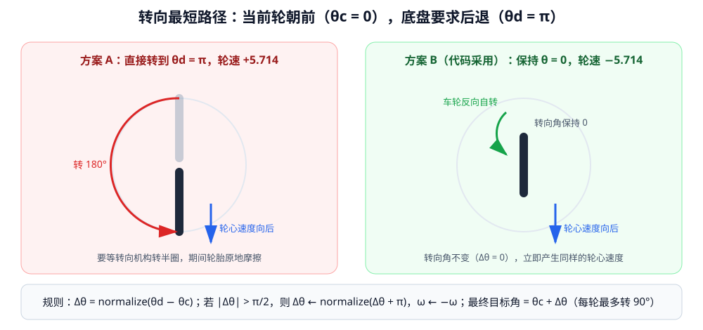

<p align="center"><b>图 4-11</b> 转向最短路径：轮子当前朝前、底盘要求后退时，方案 A 需要转 180°，方案 B 保持角度不变、只反转车轮</p>

这个算法可以减少转向等待时间和轮胎原地摩擦。例如，轮子当前朝前，底盘突然要求后退时，轮子不必先旋转 $180^\circ$，可以保持接近当前方向并直接反向转动。

**对应代码**：

```python
# 摘自 code/code_chapter4/kinematics.py
@staticmethod
def _nearest_equivalent_state(
    desired_angle: float,
    wheel_speed: float,
    current_angle: float,
) -> tuple[float, float]:
    """选择离当前角度最近的等价"转向角 + 轮速"组合。"""
    delta = normalize_angle(desired_angle - current_angle)
    if abs(delta) > math.pi / 2.0:
        delta = normalize_angle(delta + math.pi)   # 目标方向翻转 180°
        wheel_speed = -wheel_speed                 # 轮速取反
    return current_angle + delta, wheel_speed
```

**手算案例**：

| 情形 | $\theta_c$ | 原始 $(\theta_d,\ \omega)$ | $\Delta\theta=normalize(\theta_d-\theta_c)$ | 是否翻转 | 输出 $(\theta_{cmd},\ \omega')$ |
|---|---:|---:|---:|---|---:|
| ① 朝前时要求后退 0.4 m/s | $0$ | $(\pi,\ 5.714)$ | $-\pi$（$\pi$ 归一化为 $-\pi$） | 是 | $(0,\ -5.714)$ |
| ② 跨越 $\pm\pi$ 边界 | $0.3$ | $(-2.5,\ 5.0)$ | $normalize(-2.8)=-2.8$ | 是 | $(0.3+0.342,\ -5.0)=(0.642,\ -5.0)$ |
| ③ 目标偏左 $114.6^\circ$ | $0$ | $(2.0,\ 5.0)$ | $2.0$ | 是 | $(-1.142,\ -5.0)$ |
| ④ 原地旋转的 LF 轮 | $0$ | $(2.329,\ 2.94)$ | $2.329$（$133.5^\circ$） | 是 | $(-0.812,\ -2.94)$，即 $-46.5^\circ$ |
| ⑤ 小角度调整 | $0$ | $(0.376,\ 4.47)$ | $0.376$ | 否 | $(0.376,\ 4.47)$ |

以情形 ② 为例：$\theta_d-\theta_c=-2.8$，已在 $[-\pi,\pi)$ 内，$|-2.8|>1.571$，于是 $\Delta\theta'=normalize(-2.8+\pi)=0.342$，最终目标 $0.642$ rad，轮速 $-5.0$。验证：方向 $0.642$ rad 反转等价于方向 $0.642-\pi=-2.5$ rad 正转，与原始目标一致；而转向量从 $2.8$ rad 降到 $0.342$ rad。

> ⚠️ **注意**：函数返回的是 `current_angle + delta`，**没有再归一化**。这样做是为了让转向关节的位置目标与当前位置连续（不会出现从 $+3.1$ 跳到 $-3.1$ 让关节转一大圈的情况）。代价是：理论上转向角目标可能随时间累积到 $[-\pi,\pi)$ 之外，这对转向关节是否有行程限位提出了要求。

### 5.3 轮速统一缩放

**直观理解**：组合运动可能让某个驱动轮速度超过允许上限。如果只把超速的那个轮子"砍"到上限，其他轮子不变，四个轮子就不再对应同一个刚体运动，车会走偏、打滑。正确的做法是四个轮子"一起按比例减速"——就像整段视频放慢播放，画面内容不变，只是变慢了。

本章不单独截断某一个轮子，而是使用统一比例缩放。设四个轮子中的最大绝对速度为 $\omega_{largest}$，最大允许速度为 $\omega_{wheel,max}$，则：

$$
s=\frac{\omega_{wheel,max}}{\omega_{largest}}
$$

所有轮速同时乘以 $s$：

$$
\omega_i'=s\omega_i
$$

统一缩放会降低整体速度，但能保持四个轮速之间的比例，使实际底盘运动方向尽量不偏离目标。为什么？因为逆运动学对 $(v_x,v_y,\omega_z)$ 是线性的：把底盘速度整体乘以 $s$，每个轮心速度也乘以 $s$，转向角不变、轮速乘以 $s$。所以"四轮速度统一乘以 $s$"严格等价于"底盘指令变成 $(s v_x,\ s v_y,\ s\omega_z)$"——轨迹的形状（如转弯曲率 $\omega_z/v_x$）完全不变。

**对应代码**：

```python
# 摘自 code/code_chapter4/kinematics.py
@staticmethod
def _desaturate(
    states: list[WheelState],
    max_wheel_speed: float | None,
) -> list[WheelState]:
    """等比例缩放所有轮速，保持期望运动方向不变。"""
    if max_wheel_speed is None:
        return states

    largest = max(abs(state.wheel_speed) for state in states)
    if largest <= max_wheel_speed:
        return states                              # 未超限：原样返回

    scale = max_wheel_speed / largest              # s
    return [
        WheelState(state.steering_angle, state.wheel_speed * scale)   # 转向角不变
        for state in states
    ]
```

注意 `largest` 取的是**绝对值**最大值，因为经过最短路径优化后轮速可能为负。

**手算案例**：指令 $(v_x,v_y,\omega_z)=(0.7,\ 0,\ 1.2)$，为了演示，假设轮速上限为 $10$ rad/s。

- 逆运动学：LF/LR 轮心速度 $\sqrt{(0.7-1.2\times0.218)^2+(1.2\times0.230)^2}=\sqrt{0.4384^2+0.276^2}\approx0.518$ m/s → $7.40$ rad/s；RF/RR $\sqrt{0.9616^2+0.276^2}\approx1.000$ m/s → $14.29$ rad/s，超限。
- 统一缩放：$s=10/14.29\approx0.700$，四轮变为 $5.18,\ 5.18,\ 10.0,\ 10.0$。用正运动学反算底盘速度约为 $(0.490,\ 0,\ 0.840)$，正好是原指令乘以 $0.700$，曲率 $0.840/0.490=1.714=1.2/0.7$ 不变。
- 若单独截断：四轮变为 $7.40,\ 7.40,\ 10.0,\ 10.0$，正运动学反算约为 $(0.556,\ 0,\ 0.792)$，曲率变成 $1.425$，转弯半径从 $0.583$ m 变成 $0.702$ m——车走了一条更大的弯。而且这组轮速本身并不对应任何刚体运动，实际中会产生打滑。

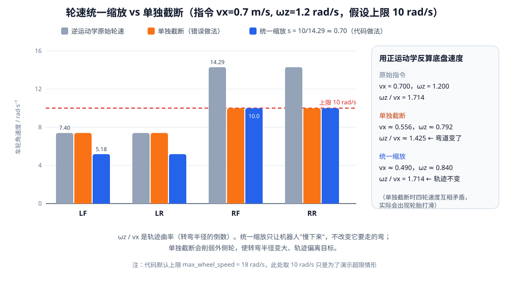

<p align="center"><b>图 4-12</b> 轮速统一缩放与单独截断对比：统一缩放保持轨迹曲率，单独截断会改变转弯半径</p>

**在默认参数下会触发吗？** 本章默认 `max_wheel_speed = 18.0` rad/s，底盘限速为 $0.70$ m/s、$1.20$ rad/s。最坏情况是平移方向与某个轮子的旋转切向速度同向：$|\mathbf{v}_i|\le0.70+1.20\times0.317\approx1.080$ m/s，对应 $1.080/0.070\approx15.4$ rad/s $<18$。所以在默认配置下统一缩放实际上不会被触发，它是一道"安全网"：如果你调大了底盘限速，它会自动保护驱动电机。

### 5.4 零速度时保持转向角

当目标轮心速度接近零时，零速度向量本身没有方向——$\mathrm{atan2}(0,0)$ 在数学上没有定义（Python 返回 $0$，但这个 $0$ 没有物理意义）。如果不加处理，机器人每次停车时四个轮子都会"回正"到 $0$，下次起步又要重新转向，既浪费时间又磨损轮胎。

本章让驱动轮速度变为零，同时保持当前转向角，避免机器人停车后四个转向轮仍然无意义地摆动。对应 `inverse()` 中的这一段：

```python
# 摘自 code/code_chapter4/kinematics.py（SwerveKinematics.inverse 内）
if linear_speed < 1e-8:
    hold_angle = 0.0 if current_angles is None else float(current_angles[index])
    states.append(WheelState(hold_angle, 0.0))
    continue
```

注意零速度判定是**逐轮**进行的：原地旋转时不会有轮子速度为零；但若指令的 ICR 恰好落在某个轮子上，那个轮子就会保持当前角度、轮速为零，其余轮子照常计算。

### 5.5 底盘级工程约束

运动学和位姿反馈决定机器人应当怎样运动，而速度限制、加速度限制和超时停车属于保证控制稳定与安全的工程措施，应当与关键控制算法区分开来。这些参数集中放在 `ControlLimits` 中：

```python
# 摘自 code/code_chapter4/config.py
@dataclass(frozen=True)
class ControlLimits:
    """速度、加速度与安全超时限制。"""

    max_linear_speed: float = 0.70       # m/s，限制 sqrt(vx^2 + vy^2)
    max_angular_speed: float = 1.20      # rad/s
    max_wheel_speed: float = 18.0        # rad/s
    max_linear_acceleration: float = 0.80   # m/s^2
    max_angular_acceleration: float = 1.80  # rad/s^2
    command_timeout: float = 0.50        # s，超时后自动刹车
```

#### 底盘速度限制

本章默认最大线速度为 $0.70\text{ m/s}$，最大角速度为 $1.20\text{ rad/s}$。

线速度按照二维合速度统一缩放，保持原始移动方向；角速度限制在正负最大值之间。这样可以防止上层给出过大的速度命令。

```python
# 摘自 code/code_chapter4/base_controller.py
def _limit_linear_speed(command: ChassisVelocity, max_speed: float) -> ChassisVelocity:
    length = math.hypot(command.vx, command.vy)
    if length <= max_speed or length < 1e-12:
        return command
    scale = max_speed / length
    return ChassisVelocity(command.vx * scale, command.vy * scale, command.wz)


class G2BaseController:
    # ...
    def set_velocity(self, vx: float, vy: float, wz: float) -> None:
        """设置底盘速度；调用 update() 才会真正写入关节。"""
        command = ChassisVelocity(float(vx), float(vy), float(wz))
        command = _limit_linear_speed(command, self.limits.max_linear_speed)   # 合速度限幅
        command = ChassisVelocity(
            command.vx,
            command.vy,
            max(-self.limits.max_angular_speed, min(self.limits.max_angular_speed, command.wz)),
        )                                                                       # 角速度截断
        self._requested = command
        self._time_since_command = 0.0                                          # 重置看门狗
```

`set_velocity()` 只记录"想要的速度"，并不立即写关节；真正写入发生在 `update()` 中。案例见 1.1 节：$(0.7,0.7)$ 被缩放为 $(0.495,0.495)$。

#### 加速度限制

速度不能在一个物理周期内从零瞬间跳到最大值。设最大线加速度为 $a_{max}$，单次允许的最大线速度变化为：

$$
\Delta v_{max}=a_{max}\Delta t
$$

本章默认 $a_{max}=0.80\text{ m/s}^2$。二维速度变化量整体限幅，避免斜向加速时合加速度超限。

角速度也使用相同思想逐渐接近目标值。本章默认最大角加速度为 $1.80\text{ rad/s}^2$。

```python
# 摘自 code/code_chapter4/base_controller.py
def _move_toward(current: float, target: float, max_change: float) -> float:
    difference = target - current
    if abs(difference) <= max_change:
        return target
    return current + math.copysign(max_change, difference)

# G2BaseController._apply_acceleration_limit
def _apply_acceleration_limit(
    self, desired: ChassisVelocity, dt: float
) -> ChassisVelocity:
    # 对二维线速度增量整体限幅，避免斜向运动时合加速度超限。
    delta_vx = desired.vx - self._applied.vx
    delta_vy = desired.vy - self._applied.vy
    delta_length = math.hypot(delta_vx, delta_vy)
    max_linear_change = self.limits.max_linear_acceleration * dt
    if delta_length > max_linear_change and delta_length > 1e-12:
        scale = max_linear_change / delta_length
        delta_vx *= scale
        delta_vy *= scale

    new_wz = _move_toward(
        self._applied.wz,
        desired.wz,
        self.limits.max_angular_acceleration * dt,
    )
    return ChassisVelocity(
        self._applied.vx + delta_vx,
        self._applied.vy + delta_vy,
        new_wz,
    )
```

**手算案例**：$\Delta t=1/120$ s 时，每步线速度最多变化 $0.80/120\approx0.00667$ m/s，角速度最多变化 $1.80/120=0.015$ rad/s。

- 从静止加速到 $v_x=0.40$ m/s 需要 $0.40/0.80=0.5$ s（60 个物理步），这段时间内只走了 $\frac12\times0.40\times0.5=0.10$ m，而不是"指令速度 × 时间"的 $0.20$ m；
- 从静止开始原地左转到 $0.65$ rad/s 需要 $0.65/1.80\approx0.36$ s；
- 假如直接从"向左横移" $(0,0.35)$ 切换到"斜向" $(0.30,-0.18)$（示例中两者之间还隔着一段原地旋转，这里只是演示），速度差向量为 $(0.30,-0.53)$，长度约 $0.609$ m/s，需要约 $0.76$ s。整体限幅保证这期间速度沿着差向量方向**直线**过渡；如果对 $v_x$、$v_y$ 分别限幅，$v_x$ 会先到位，过渡路径变成折线，且合加速度可达 $0.80\sqrt2\approx1.13\text{ m/s}^2$。

加速度限制主要用于减少启动和停车冲击，使轮地接触更稳定。这也解释了第八部分中"最终位置不能按速度乘时间直接相加"的原因之一。

#### 指令超时停车

在真实机器人中，速度命令可能来自网络或上位机。如果通信中断而机器人一直保持最后一条非零命令，会产生安全风险。

本章记录距离上次速度命令经过的时间，超过 $0.50\text{ s}$ 没有收到新命令时，将目标速度设为零，并在加速度限制作用下减速停车。这种机制常被称为**看门狗（watchdog）**：

```python
# 摘自 code/code_chapter4/base_controller.py（G2BaseController.update 开头）
self._time_since_command += dt
desired = self._requested
if self._time_since_command > self.limits.command_timeout:
    desired = ChassisVelocity()  # 看门狗：通信中断时自动减速停车
```

在 120 Hz 下，$0.50$ s 对应 60 个物理步。控制器初始化时 `_time_since_command = math.inf`，所以如果从来没有调用过 `set_velocity()`，`update()` 输出的始终是零速度。

因此，上层控制程序应周期性发送速度命令，而不是只发送一次后永久等待。两个示例程序都在每个物理步调用一次 `set_velocity()`。

#### 停车时的轮子方向

普通停车只需要把四个驱动轮速度设为零，默认保持当前转向角。只有在明确需要轮子回正时，才向转向关节发送零角度目标：

```python
# 摘自 code/code_chapter4/base_controller.py
def stop(self, center_steering: bool = False) -> None:
    """立即停止车轮；默认保持当前转向角，避免不必要的原地摆动。"""
    from isaacsim.core.utils.types import ArticulationAction

    self._requested = ChassisVelocity()
    self._applied = ChassisVelocity()
    self._time_since_command = math.inf

    self.articulation.apply_action(
        ArticulationAction(
            joint_velocities=np.zeros(len(self.drive_indices), dtype=np.float64),
            joint_indices=self.drive_indices,
        )
    )
    if center_steering:
        self.articulation.apply_action(
            ArticulationAction(
                joint_positions=np.zeros(len(self.steering_indices), dtype=np.float64),
                joint_indices=self.steering_indices,
            )
        )
```

> ⚠️ **注意**：`stop()` 与"超时停车"不同。`stop()` 直接把 `_applied` 清零并把驱动轮速度目标设为 0，**不经过加速度限制**，属于"立即停车"；超时停车则是把目标置零，再由加速度限制平滑减速。速度示例中的"平滑停车"段是通过持续发送零速度、经加速度限制实现的，最后才调用 `stop()`。

---

## 第六部分 二维目标位姿反馈控制

### 6.1 从开环速度到闭环位姿控制

**直观理解**：直接给出 $(v_x,v_y,\omega_z)$ 适合遥控或演示基本运动，这是**开环**控制——发出指令后不管实际走到哪里。如果希望机器人自动到达某个位置，则需要根据当前位姿与目标位姿之间的误差实时计算速度，像开车时眼睛一直盯着停车位、离得远就快点、离得近就慢慢挪——这就是**闭环（反馈）控制**。

当前位姿为：

$$
(x,y,\psi)
$$

目标位姿为：

$$
(x_t,y_t,\psi_t)
$$

### 6.2 误差计算与坐标变换

世界坐标系中的位置误差为：

$$
e_x^{world}=x_t-x
$$

$$
e_y^{world}=y_t-y
$$

距离误差和航向误差为：

$$
e_d=\sqrt{(e_x^{world})^2+(e_y^{world})^2}
$$

$$
e_\psi=normalize(\psi_t-\psi)
$$

航向误差必须归一化：例如当前 $\psi=3.10$、目标 $\psi_t=-3.10$，原始差值为 $-6.20$ rad，归一化后为 $+0.083$ rad——机器人只需逆时针再转约 $4.8^\circ$，而不是顺时针转将近一圈。

由于底盘速度在机器人自身坐标系中表达，需要把世界坐标误差转换到底盘坐标系（1.2 节的"世界 → 底盘"变换，见图 4-2）：

$$
e_x^{body}=\cos\psi\,e_x^{world}+\sin\psi\,e_y^{world}
$$

$$
e_y^{body}=-\sin\psi\,e_x^{world}+\cos\psi\,e_y^{world}
$$

### 6.3 比例控制、限幅与到达判定

然后使用直观的比例控制（Proportional Control，P 控制）：

$$
v_x=K_p e_x^{body}
$$

$$
v_y=K_p e_y^{body}
$$

$$
\omega_z=K_\psi e_\psi
$$

本章默认位置比例增益 $K_p=1.2$（单位 1/s），航向比例增益 $K_\psi=2.0$（单位 1/s）。误差大时输出速度较大，接近目标时输出速度自然减小。

**为什么比例控制会"自然减速"？** 忽略限幅和加速度限制，沿某一方向有 $\dot e=-K_p e$，解为 $e(t)=e_0\,e^{-K_p t}$：误差按指数衰减，时间常数 $1/K_p\approx0.83$ s。每过 $0.83$ s 误差缩小到约 $37\%$，速度也同比缩小，所以机器人会平滑地"滑"进目标，而不是全速撞上去再急刹。

**输出限幅**：`PoseController` 自身还有一层限幅，默认最大线速度 $0.55$ m/s、最大角速度 $1.0$ rad/s（比底盘控制器的 $0.70$ m/s、$1.20$ rad/s 更保守）。因此当 $e_d>0.55/1.2\approx0.458$ m 时，线速度饱和在 $0.55$ m/s；当 $|e_\psi|>0.5$ rad 时，角速度饱和在 $1.0$ rad/s。

机器人同时满足位置和航向要求时，才认为到达目标：

$$
e_d\leq0.04\text{ m}
$$

$$
|e_\psi|\leq0.05\text{ rad}
$$

如果位置已经满足要求而航向仍有误差，控制器停止平移，只继续调整朝向。

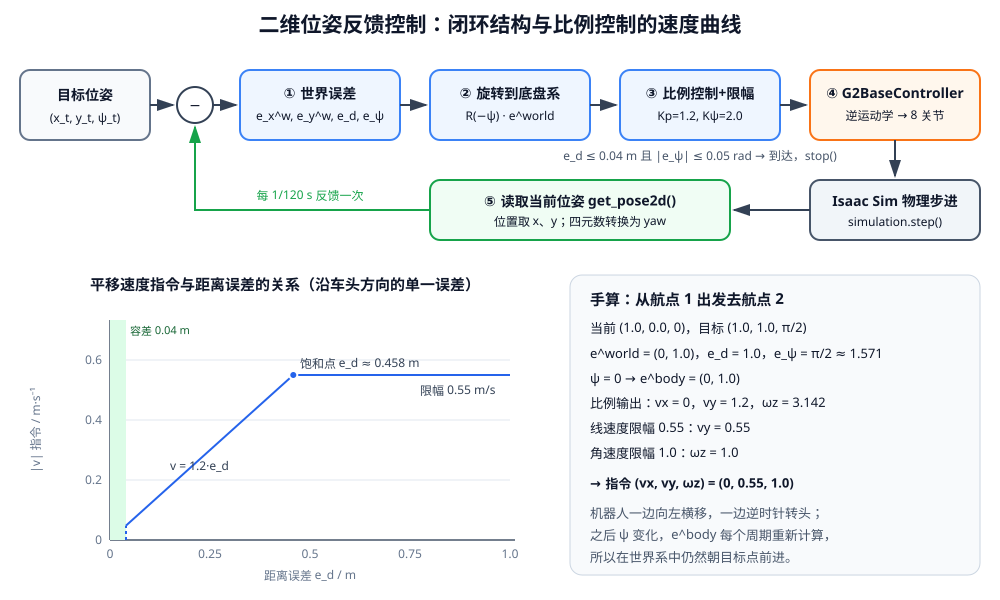

<p align="center"><b>图 4-13</b> 二维位姿反馈控制：上方是闭环结构，左下是平移速度指令随距离误差的变化（容差内为零、线性区、饱和区），右下是从航点 1 到航点 2 的手算</p>

**对应代码**：

```python
# 摘自 code/code_chapter4/base_controller.py
class PoseController:
    """简单、直观的二维位姿比例控制器。

    位置误差先从世界坐标系转换到底盘坐标系，再输出 vx、vy；因此 G2 可以
    不先转头，直接向任意方向平移。该控制器只负责局部闭环，不负责避障。
    """

    def __init__(
        self,
        position_gain: float = 1.2,
        yaw_gain: float = 2.0,
        max_linear_speed: float = 0.55,
        max_angular_speed: float = 1.0,
        position_tolerance: float = 0.04,
        yaw_tolerance: float = 0.05,
    ) -> None:
        # ...（逐个保存为同名属性）

    def compute(self, current: Pose2D, target: Pose2D) -> PoseControlResult:
        error_world_x = target.x - current.x                       # e_x^world
        error_world_y = target.y - current.y                       # e_y^world
        distance_error = math.hypot(error_world_x, error_world_y)  # e_d
        yaw_error = normalize_angle(target.yaw - current.yaw)      # e_ψ

        reached = (
            distance_error <= self.position_tolerance
            and abs(yaw_error) <= self.yaw_tolerance
        )
        if reached:                                                # 两个条件同时满足才算到达
            return PoseControlResult(ChassisVelocity(), distance_error, yaw_error, True)

        cos_yaw = math.cos(current.yaw)
        sin_yaw = math.sin(current.yaw)
        error_body_x = cos_yaw * error_world_x + sin_yaw * error_world_y    # 世界 → 底盘
        error_body_y = -sin_yaw * error_world_x + cos_yaw * error_world_y

        if distance_error <= self.position_tolerance:              # 位置已到：只转不移
            vx = 0.0
            vy = 0.0
        else:
            vx = self.position_gain * error_body_x                 # v_x = Kp·e_x^body
            vy = self.position_gain * error_body_y                 # v_y = Kp·e_y^body

        command = _limit_linear_speed(                             # 合速度限幅 0.55
            ChassisVelocity(vx, vy, self.yaw_gain * yaw_error),    # ω_z = Kψ·e_ψ
            self.max_linear_speed,
        )
        command = ChassisVelocity(
            command.vx,
            command.vy,
            max(-self.max_angular_speed, min(self.max_angular_speed, command.wz)),  # 角速度限幅 1.0
        )
        return PoseControlResult(command, distance_error, yaw_error, False)
```

返回值 `PoseControlResult` 同时带回了速度指令、距离误差、航向误差和是否到达，方便上层打印和判断：

```python
# 摘自 code/code_chapter4/base_controller.py
@dataclass(frozen=True)
class PoseControlResult:
    command: ChassisVelocity
    distance_error: float
    yaw_error: float
    reached: bool
```

### 6.4 手算案例

**案例 1：从航点 1 出发去航点 2。** 当前 $(1.0,\ 0.0,\ 0)$，目标 $(1.0,\ 1.0,\ \pi/2)$。

1. 世界误差 $(0,\ 1.0)$，$e_d=1.0$ m，$e_\psi=\pi/2\approx1.571$ rad；
2. $\psi=0$，所以 $e^{body}=e^{world}=(0,\ 1.0)$；
3. 比例输出 $v_x=0$，$v_y=1.2\times1.0=1.2$，$\omega_z=2.0\times1.571=3.142$；
4. 限幅：合速度 $1.2>0.55$ → $v_y=0.55$；$|\omega_z|>1.0$ → $\omega_z=1.0$。

最终指令 $(0,\ 0.55,\ 1.0)$：机器人一边向左横移，一边逆时针转头。随后 `G2BaseController` 还会对它做加速度限制，所以实际速度是从 $0$ 逐步爬升上来的。

**案例 2：转到一半时。** 设机器人走到了 $(1.0,\ 0.5,\ \pi/4)$，目标仍是 $(1.0,\ 1.0,\ \pi/2)$。

1. 世界误差 $(0,\ 0.5)$，$e_d=0.5$，$e_\psi=\pi/4\approx0.785$；
2. 转到底盘系：$e_x^{body}=\cos45^\circ\times0+\sin45^\circ\times0.5\approx0.354$，$e_y^{body}=-\sin45^\circ\times0+\cos45^\circ\times0.5\approx0.354$；
3. 比例输出 $(0.424,\ 0.424)$，合速度 $0.6>0.55$，缩放系数 $0.55/0.6\approx0.917$ → $(0.389,\ 0.389)$；$\omega_z=2.0\times0.785=1.571$ → 限幅为 $1.0$。

此时车头已经指向世界坐标系的 $45^\circ$ 方向，目标点在世界 $+y$（$90^\circ$）方向，对机器人来说就是"前方偏左 $45^\circ$"——$e^{body}$ 两个分量相等且为正，正好对应这个方向。机器人以 $0.55$ m/s 朝世界 $+y$ 方向前进，同时继续转头。这正说明坐标变换的作用：**无论车头朝哪，速度方向在世界系中始终指向目标点**。

**案例 3：位置到了、航向没到。** 当前 $(0.02,\ 0.01,\ 0.3)$，目标 $(0,\ 0,\ 0)$。$e_d=\sqrt{0.02^2+0.01^2}\approx0.022\le0.04$，但 $|e_\psi|=0.3>0.05$，未到达；位置已满足，所以 $v_x=v_y=0$，$\omega_z=2.0\times(-0.3)=-0.6$ rad/s——原地顺时针转回 $0$。

**动手验证**：`base_controller.py` 只在函数内部导入 Isaac Sim，顶层仅依赖 `numpy`，因此在装有 numpy 的普通 Python 中也能单独验证 `PoseController`：

```python
import math
from base_controller import PoseController
from kinematics import Pose2D

pc = PoseController()
print(pc.compute(Pose2D(1.0, 0.0, 0.0), Pose2D(1.0, 1.0, math.pi / 2)))
# 预期 command ≈ ChassisVelocity(vx=0.0, vy=0.55, wz=1.0)，reached=False
```

### 6.5 控制器适用边界

这种控制方式会不断执行"读取当前位姿、计算误差、生成速度、执行运动、再次读取位姿"，因此属于闭环控制。它能修正实际运动误差，但不包含路径搜索和障碍物规避，不等同于完整导航算法。

本章位姿控制器只负责向目标收敛，不会检查路径中是否存在障碍物。航点必须放在可通行区域。地图、定位、路径规划和局部避障将在后续 SLAM 与导航章节中加入。

> 💡 **要点**：比例控制在接近目标时速度很小，最终会在误差刚好跌入容差边界时被判定"到达"。所以第八部分的运行结果中，到达时的位置误差几乎都是 $0.039\sim0.040$ m——这不是精度不够，而是到达判定的阈值本身就是 $0.04$ m。想要更精确，可以减小 `position_tolerance`，代价是到达时间变长。
>
> ⚠️ **注意**：只用比例控制、没有积分项，如果存在持续的外部扰动（例如地面倾斜），可能出现稳态误差；本章场景是平地，问题不明显。

---

## 第七部分 代码结构与实现解析

### 7.1 文件组织

本章代码采用"运动学、控制器、仿真环境和演示程序分离"的结构：

```text
code/code_chapter4/
├── __init__.py
├── README.md
├── config.py
├── kinematics.py
├── base_controller.py
├── simulation.py
├── demo_velocity_control.py
└── demo_waypoint_control.py
```

各文件职责如下：

| 文件 | 主要职责 |
|---|---|
| `__init__.py` | 包入口，导出 `ChassisVelocity`、`Pose2D`、`SwerveKinematics`、`WheelState` |
| `config.py` | 模型路径、场景路径、关节名称、几何尺寸和控制参数 |
| `kinematics.py` | 底盘数据结构、角度归一化、正逆运动学和轮速里程计 |
| `base_controller.py` | 关节查找、底盘控制、工程约束和位姿反馈控制 |
| `simulation.py` | 启动 Isaac Sim、加载 room_1 和 G2、读取位姿、推进仿真 |
| `demo_velocity_control.py` | 演示直接控制 $v_x$、 $v_y$、 $\omega_z$ |
| `demo_waypoint_control.py` | 演示多个二维目标位姿闭环控制 |

> ⚠️ **注意**：上面的目录树沿用原文，其中列出了 `README.md`；当前仓库的 `code/code_chapter4/` 中实际没有这个文件，不影响运行。

建议按照 `config.py`、`kinematics.py`、`base_controller.py`、两个演示程序、`simulation.py` 的顺序阅读。`kinematics.py` 只依赖 Python 标准库，`base_controller.py` 的顶层只依赖 numpy，二者都可以脱离 Isaac Sim 单独测试；只有 `simulation.py` 和关节写入部分需要 Isaac Sim 环境。

### 7.2 模块调用关系

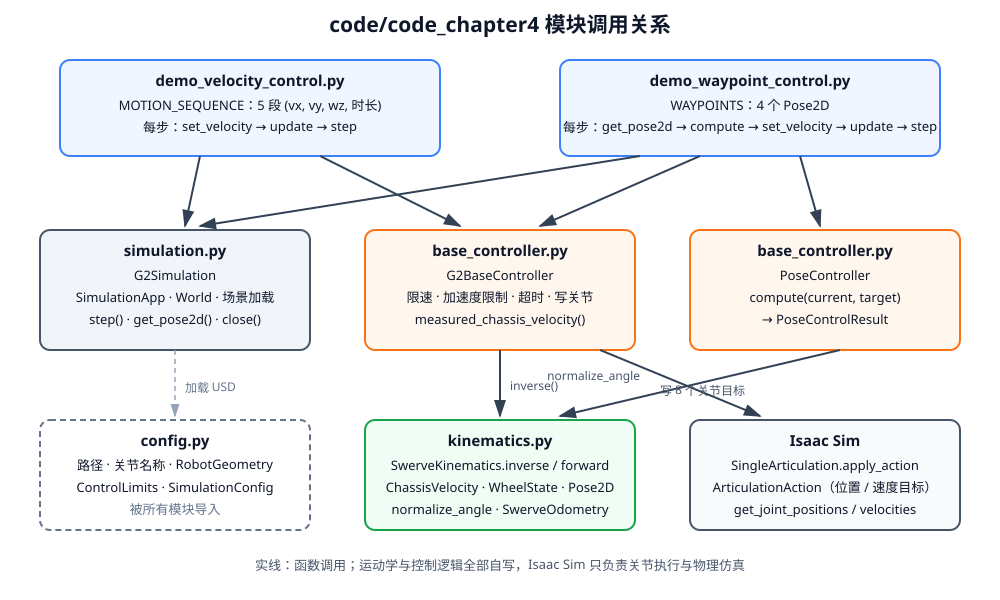

<p align="center"><b>图 4-14</b> code/code_chapter4 的模块调用关系：两个演示程序位于顶层，控制器调用运动学，最终通过 ArticulationAction 写入 Isaac Sim</p>

用文字概括，代码形成完整调用关系：

```text
动作序列或目标航点
        ↓
底盘速度 ChassisVelocity
        ↓
G2BaseController
        ↓
SwerveKinematics.inverse
        ↓
四个 WheelState
        ↓
ArticulationAction
        ↓
G2 转向关节与驱动关节
        ↓
Isaac Sim 物理运动
```

<p align="center"><b>图 4-15</b> 从上层指令到物理运动的数据流</p>

### 7.3 关键流程逐段解读

下面按程序实际执行的顺序，把前面各部分讲过的代码串起来。

#### ① 统一配置：`config.py`

`config.py` 首先集中保存模型路径和 Prim 路径：

```python
# 摘自 code/code_chapter4/config.py
PROJECT_ROOT = Path(__file__).resolve().parents[2]
ROBOT_USD = PROJECT_ROOT / "assets/robot/G2_omnipicker/robot.usda"
ROOM_USD = PROJECT_ROOT / "assets/background/room/room_1/background.usda"
ROBOT_PRIM_PATH = "/genie"
ROOM_PRIM_PATH = "/World"
```

`Path(__file__).resolve().parents[2]` 是从 `config.py` 所在目录向上两级：`code/code_chapter4/config.py` → `code/code_chapter4` → `code`。所以 `ROBOT_USD` 实际指向 `code/assets/robot/G2_omnipicker/robot.usda`——这就是第八部分要求把 `assets` 放到 `code` 目录下的原因。

关节名称（2.2 节）、`RobotGeometry`（2.1 节）、`ControlLimits`（5.5 节）前面已经讲过。仿真频率、渲染频率、是否无窗口运行和机器人初始位姿由 `SimulationConfig` 管理：

```python
# 摘自 code/code_chapter4/config.py
@dataclass(frozen=True)
class SimulationConfig:
    """Isaac Sim 的最小运行配置。"""

    physics_hz: int = 120
    rendering_hz: int = 60
    headless: bool = False
    renderer: str = "RaytracedLighting"
    warmup_steps: int = 120
    robot_position: tuple[float, float, float] = (0.0, 0.0, -0.01)
    robot_orientation: tuple[float, float, float, float] = (1.0, 0.0, 0.0, 0.0)

    @property
    def physics_dt(self) -> float:
        return 1.0 / self.physics_hz
```

物理频率 120 Hz、渲染频率 60 Hz，即每渲染一帧要推进两次物理。初始朝向四元数 `(1, 0, 0, 0)` 按 $(w,x,y,z)$ 顺序表示"不旋转"，即初始 $\psi=0$。

#### ② 启动仿真：`simulation.py`

`G2Simulation` 负责启动 Isaac Sim。必须先创建 `SimulationApp`，然后再导入大部分 Isaac Sim 模块：

```python
# 摘自 code/code_chapter4/simulation.py（G2Simulation.__init__）
if not ROBOT_USD.is_file():
    raise FileNotFoundError(f"找不到 G2 USD：{ROBOT_USD}")
if not ROOM_USD.is_file():
    raise FileNotFoundError(f"找不到 room_1 USD：{ROOM_USD}")
# ...
# 必须先创建 SimulationApp，再导入大部分 Isaac Sim 模块。
from isaacsim import SimulationApp

self.app = SimulationApp(
    {
        "headless": config.headless,
        "disable_viewport_updates": config.headless,
        "renderer": config.renderer,
        "limit_cpu_threads": 16,
        "extra_args": shlex.split(os.environ.get("HELLO_ROBOT_KIT_ARGS", "")),
    }
)
```

程序一开始就检查两个 USD 文件是否存在，资源没放对位置会立即报 `FileNotFoundError`。`extra_args` 会读取环境变量 `HELLO_ROBOT_KIT_ARGS` 作为附加启动参数，未设置时为空。

随后创建物理世界并加载 room_1：

```python
# 摘自 code/code_chapter4/simulation.py（G2Simulation._build_world）
self.world = World(
    stage_units_in_meters=1.0,
    physics_dt=self.config.physics_dt,
    rendering_dt=1.0 / self.config.rendering_hz,
)
# room_1 的 defaultPrim 是 /World。引用到 /World 后会加载完整仓库环境。
add_reference_to_stage(str(ROOM_USD), ROOM_PRIM_PATH)

# 保留一个可靠的物理地面，做法与仓库原有 G2 示例一致。
self.world.scene.add_default_ground_plane()
```

再加载 G2，设置初始位姿，并在场景预热后创建 articulation：

```python
# 摘自 code/code_chapter4/simulation.py（G2Simulation._build_world，省略打印）
add_reference_to_stage(str(ROBOT_USD), ROBOT_PRIM_PATH)
SingleXFormPrim(
    prim_path=ROBOT_PRIM_PATH,
    position=np.array(self.config.robot_position, dtype=np.float64),
    orientation=np.array(self.config.robot_orientation, dtype=np.float64),
)

# 先让 USD 和物理场景完成加载，再创建 Python articulation 句柄。
self.world.play()
self._set_camera()
time.sleep(1.0)
for _ in range(self.config.warmup_steps):
    self.world.step(render=not self.config.headless)
time.sleep(0.5)

self.robot = SingleArticulation(
    prim_path=ROBOT_PRIM_PATH,
    name="G2_chapter4",
)
self.world.scene.add(self.robot)
self.robot.initialize()
```

顺序很关键：先 `play()` 并预热 120 步（约 1 s 仿真时间），让大型 G2 USD 的材质和物理数据完成同步加载，再创建 `SingleArticulation` 句柄。源码注释说明这样做也"避免 reset() 重置浮动底座"。

读取 G2 世界位姿时，保留位置的 $x$、 $y$ 分量，并把四元数转换为航向角：

```python
# 摘自 code/code_chapter4/simulation.py
def get_pose2d(self) -> Pose2D:
    position, quaternion = self.robot.get_world_pose()
    return Pose2D(
        x=float(position[0]),
        y=float(position[1]),
        yaw=self._quaternion_to_yaw(quaternion),
    )

@staticmethod
def _quaternion_to_yaw(quaternion) -> float:
    w, x, y, z = (float(value) for value in quaternion)
    sin_yaw = 2.0 * (w * z + x * y)
    cos_yaw = 1.0 - 2.0 * (y * y + z * z)
    return math.atan2(sin_yaw, cos_yaw)
```

**代码解读**：对只绕 $z$ 轴旋转 $\psi$ 的四元数 $q=(\cos\frac\psi2,0,0,\sin\frac\psi2)$，有 `sin_yaw` $=2\cos\frac\psi2\sin\frac\psi2=\sin\psi$，`cos_yaw` $=1-2\sin^2\frac\psi2=\cos\psi$，`atan2` 即得 $\psi$。例如 $\psi=\pi/2$ 时 $q\approx(0.707,0,0,0.707)$，算得 `sin_yaw`=1、`cos_yaw`=0，yaw $=\pi/2$。

#### ③ 创建控制器

两个演示程序的 `main()` 开头几乎相同：

```python
# 摘自 code/code_chapter4/demo_waypoint_control.py（main）
sim_config = replace(
    SimulationConfig(),
    headless=args.headless,
    physics_hz=args.physics_hz,
)
geometry = RobotGeometry()
limits = ControlLimits()

simulation = G2Simulation(sim_config)
kinematics = SwerveKinematics(geometry.wheel_positions, geometry.wheel_radius)
base = G2BaseController(simulation.robot, kinematics, limits)
pose_controller = PoseController()
```

因为 `SimulationConfig` 是 frozen 的，这里用 `dataclasses.replace` 根据命令行参数创建一个修改过的新副本。`G2BaseController.__init__` 会用 `_find_joint_indices` 查找 8 个关节（2.2 节）并打印"底盘关节检查通过"及索引。

#### ④ 每个控制周期：`G2BaseController.update()`

真正的周期控制位于 `update()`。它把工程约束、逆运动学和关节写入连接起来：

```python
# 摘自 code/code_chapter4/base_controller.py
def update(self, dt: float) -> list[WheelState]:
    """执行一次控制计算。应在每个物理步调用一次。"""
    if dt <= 0.0:
        raise ValueError("dt 必须大于 0")

    self._time_since_command += dt
    desired = self._requested
    if self._time_since_command > self.limits.command_timeout:
        desired = ChassisVelocity()  # 看门狗：通信中断时自动减速停车

    self._applied = self._apply_acceleration_limit(desired, dt)   # 5.5 节
    current_angles = self._read_steering_angles()                  # 读当前转向角
    wheel_states = self.kinematics.inverse(                         # 第三部分 + 5.2/5.3 节
        self._applied,
        current_angles=current_angles,
        max_wheel_speed=self.limits.max_wheel_speed,
    )
    self._write_wheel_states(wheel_states)                          # 写 8 个关节
    return wheel_states
```

计算出四个轮子状态后，向转向关节发送位置目标，向驱动关节发送速度目标：

```python
# 摘自 code/code_chapter4/base_controller.py
def _read_steering_angles(self) -> list[float]:
    all_positions = np.asarray(self.articulation.get_joint_positions())
    return [float(all_positions[index]) for index in self.steering_indices]

def _write_wheel_states(self, wheel_states: Sequence[WheelState]) -> None:
    from isaacsim.core.utils.types import ArticulationAction

    steering_targets = np.array(
        [state.steering_angle for state in wheel_states], dtype=np.float64
    )
    drive_targets = np.array(
        [state.wheel_speed for state in wheel_states], dtype=np.float64
    )

    self.articulation.apply_action(
        ArticulationAction(
            joint_positions=steering_targets,       # 转向：位置目标
            joint_indices=self.steering_indices,
        )
    )
    self.articulation.apply_action(
        ArticulationAction(
            joint_velocities=drive_targets,          # 驱动：速度目标
            joint_indices=self.drive_indices,
        )
    )
```

读取实际转向角和驱动轮速后，可以调用正运动学估算当前底盘速度：

```python
# 摘自 code/code_chapter4/base_controller.py
def measured_wheel_states(self) -> list[WheelState]:
    """读取仿真中的转向角和车轮实际角速度。"""
    all_positions = np.asarray(self.articulation.get_joint_positions())
    all_velocities = np.asarray(self.articulation.get_joint_velocities())
    return [
        WheelState(float(all_positions[steer]), float(all_velocities[drive]))
        for steer, drive in zip(self.steering_indices, self.drive_indices)
    ]

def measured_chassis_velocity(self) -> ChassisVelocity:
    """由实际关节状态通过正运动学估计底盘速度。"""
    return self.kinematics.forward(self.measured_wheel_states())
```

#### ⑤ 示例 1：速度控制主循环

速度控制示例定义了五段动作：

```python
# 摘自 code/code_chapter4/demo_velocity_control.py
# (名称, vx, vy, wz, 持续时间)
MOTION_SEQUENCE = (
    ("前进",       0.40,  0.00,  0.00, 2.5),
    ("向左横移",   0.00,  0.35,  0.00, 2.5),
    ("原地左转",   0.00,  0.00,  0.65, 3.0),
    ("斜向并旋转", 0.30, -0.18, -0.35, 3.5),
    ("平滑停车",   0.00,  0.00,  0.00, 1.5),
)
```

每个物理周期持续发送速度、更新控制器并推进仿真：

```python
# 摘自 code/code_chapter4/demo_velocity_control.py（main）
for name, vx, vy, wz, duration in MOTION_SEQUENCE:
    print(
        f"[动作] {name:<10} "
        f"vx={vx:+.2f} m/s, vy={vy:+.2f} m/s, "
        f"wz={wz:+.2f} rad/s"
    )
    steps = int(duration / sim_config.physics_dt)
    for _ in range(steps):
        if not simulation.is_running():
            return
        # 持续发送命令，模拟真实机器人周期性的速度指令。
        controller.set_velocity(vx, vy, wz)
        controller.update(sim_config.physics_dt)
        simulation.step()

controller.stop()
pose = simulation.get_pose2d()
measured = controller.measured_chassis_velocity()
# ...打印最终位姿与正运动学估计
```

"持续时间"被换算为物理步数 `steps`，每一步都重新 `set_velocity()`，所以看门狗不会触发。所有动作完成后调用 `stop()`，读取仿真真值位姿和正运动学速度估计并打印。`finally` 块中还会再次 `stop()` 并 `simulation.close()`，保证异常退出时也能停车并关闭 Isaac Sim。

#### ⑥ 示例 2：航点控制主循环

航点控制示例定义四个目标位姿：

```python
# 摘自 code/code_chapter4/demo_waypoint_control.py
WAYPOINTS = (
    Pose2D(1.0, 0.0, 0.0),
    Pose2D(1.0, 1.0, math.pi / 2.0),
    Pose2D(0.0, 1.0, math.pi),
    Pose2D(0.0, 0.0, 0.0),
)
```

每个物理周期读取当前位姿、计算反馈速度并交给底盘控制器：

```python
# 摘自 code/code_chapter4/demo_waypoint_control.py（main）
for index, target in enumerate(WAYPOINTS, start=1):
    # ...打印航点信息
    max_steps = int(args.timeout / sim_config.physics_dt)

    for step in range(max_steps):
        if not simulation.is_running():
            return

        current = simulation.get_pose2d()                    # ⑤ 读取位姿
        result = pose_controller.compute(current, target)    # ①②③ 误差 → 速度
        if result.reached:
            base.stop()
            print(
                f"[到达] 位置误差={result.distance_error:.3f} m, "
                f"角度误差={result.yaw_error:.3f} rad"
            )
            break

        command = result.command
        base.set_velocity(command.vx, command.vy, command.wz)  # ④ 交给底盘控制器
        base.update(sim_config.physics_dt)
        simulation.step()

        if step % sim_config.physics_hz == 0:                # 每秒打印一次进度
            print(
                f"  当前=({current.x:+.2f}, {current.y:+.2f}, {current.yaw:+.2f}) "
                f"误差=({result.distance_error:.2f} m, {result.yaw_error:+.2f} rad)"
            )
    else:
        raise RuntimeError(
            f"航点 {index} 在 {args.timeout:.1f} 秒内未到达；"
            "请检查轮子方向、地面摩擦或控制参数"
        )
```

**代码解读**：

- 外层循环遍历航点，内层循环最多执行 `timeout / dt` 步（默认 `--timeout 20.0`，即 2400 步）；
- 到达后 `break`，跳过 `for ... else` 中的 `else`；如果循环正常跑完都没到达，就进入 `else` 抛出 `RuntimeError`——这是 Python `for-else` 语法的典型用法；
- `step % physics_hz == 0` 表示每 120 步（1 s）打印一次当前位姿和误差，用来观察收敛过程；
- 位姿控制器 `PoseController` 和底盘控制器 `G2BaseController` 是两层：前者只管"该以什么速度走"，后者负责"怎样安全地把这个速度变成关节动作"。

---

## 第八部分 代码运行

### 8.1 环境部署

**仿真资源下载：** 后续章节共同所需的 `assets` 仿真资源可以从huggingface中的 [Datawhale/g2_assets](https://huggingface.co/datasets/Datawhale/g2_assets/tree/main) 下载。下载并解压后，将完整的 `assets` 文件夹放到项目的 `code` 目录下，最终目录结构应为 `code/assets/`。请不要只复制某个 USD 文件，因为 USD 场景可能继续引用同目录或子目录中的纹理、材质和其他模型资源。

放置完成后，至少应能找到以下两个文件：

```text
code/assets/robot/G2_omnipicker/robot.usda
code/assets/background/room/room_1/background.usda
```

下载并放置仿真资源后，项目的 `code` 目录整体结构如下。这里主要展示共享资源和各章节代码之间的对应关系。

```text
code/
├── assets/                         # 各章节共用的 Isaac Sim 仿真资源
│   ├── background/                 # 房间、地面等环境场景
│   │   └── room/room_1/
│   │       └── background.usda
│   └── robot/                      # 机器人本体模型
│       └── G2_omnipicker/
│           └── robot.usda
│
├── code_chapter4/                  # 第四章：移动底盘运动学与控制
├── code_chapter5/                  # 第五章：机械臂运动学与关节控制
├── code_chapter7/                  # 第七章：视觉感知算法
├── code_chapter8/                  # 第八章：雷达点云建图
│
├── code_chapter10_1/               # 第十章方案一：教学版规划与导航算法
├── code_chapter10_2/               # 第十章方案二：ROS 2 Nav2 导航框架
├── code_chapter11_1/               # 第十一章方案一：自编机械臂规划算法
├── code_chapter11_2/               # 第十一章方案二：ROS 2 MoveIt 2 框架
│
├── code_chapter13/                 # 第十三章：VLM 接入与 Prompt 工程
└── code_chapter14/                 # 第十四章：VLA 模型部署与微调
```

其中，`code/assets/` 是多个章节共同使用的仿真资源目录，各 `code_chapter*` 目录保存对应章节的教学代码。每个章节目录都包含自身运行所需的配置、控制、感知或仿真代码，第十章和第十一章分别提供自编教学算法与 ROS 2 标准框架两套实现，因此各自拆分为 `_1` 和 `_2` 两个目录。

> 💡 **要点**：资源路径由 `config.py` 中的 `PROJECT_ROOT = Path(__file__).resolve().parents[2]` 推出（见 7.3 节①），所以 `assets` 必须恰好位于 `code/assets/`。放错位置时程序启动即报 `找不到 G2 USD：...` 或 `找不到 room_1 USD：...`。

### 8.2 代码执行

进入本地项目根目录（即包含 `code`、`chapter4` 和 `chapter5` 的目录）。下面的 `/path/to/project-root` 是路径占位符，请替换为自己电脑上的实际路径：

```bash
cd /path/to/project-root
```

仿真程序必须使用 Isaac Sim 自带的 Python 环境，不要直接使用普通系统 Python。下列 `/path/to/isaac-sim/python.sh` 是路径占位符，请替换为自己电脑上 Isaac Sim 的实际安装路径。

带图形界面运行速度控制示例（依次执行前进、横移、原地左转、斜向并旋转、平滑停车五段动作）：

```bash
/path/to/isaac-sim/python.sh \
    code/code_chapter4/demo_velocity_control.py
```

无图形界面运行（`--headless`，不打开窗口、不渲染视口，适合服务器或只看终端输出）：

```bash
/path/to/isaac-sim/python.sh \
    code/code_chapter4/demo_velocity_control.py \
    --headless
```

运行二维航点控制示例（依次闭环到达 4 个目标位姿）：

```bash
/path/to/isaac-sim/python.sh \
    code/code_chapter4/demo_waypoint_control.py
```

无图形界面运行：

```bash
/path/to/isaac-sim/python.sh \
    code/code_chapter4/demo_waypoint_control.py \
    --headless
```

如果需要增加每个航点的最大控制时间（`--timeout`，单位秒，默认 20.0；超时未到达会抛出 `RuntimeError`）：

```bash
/path/to/isaac-sim/python.sh \
    code/code_chapter4/demo_waypoint_control.py \
    --timeout 30
```

两个示例还都支持 `--physics-hz` 参数（默认 120），用于修改物理与控制频率。

### 8.3 运行结果

#### 速度控制结果

程序启动后会加载 `room_1/background.usda`，注册包含 46 个自由度的 G2 articulation，并找到四个转向关节和四个驱动关节。

速度示例依次执行：

1. 以 $0.40\text{ m/s}$ 向前移动 2.5 秒；
2. 以 $0.35\text{ m/s}$ 向左横移 2.5 秒；
3. 以 $0.65\text{ rad/s}$ 原地左转 3 秒；
4. 以 $(0.30,-0.18,-0.35)$ 完成斜向平移和顺时针旋转；
5. 将目标速度设为零并平滑停车。

典型终端输出如下：

```text
[G2Simulation] room_1 场景已加载
[G2Simulation] G2 已加载：46 个自由度
[G2BaseController] 底盘关节检查通过
  转向关节索引: [22, 23, 24, 25]
  驱动关节索引: [26, 27, 28, 29]

=== 第四章示例 1：底盘速度控制 ===
坐标：vx 向前，vy 向左，wz 逆时针为正

[动作] 前进         vx=+0.40 m/s, vy=+0.00 m/s, wz=+0.00 rad/s
[动作] 向左横移     vx=+0.00 m/s, vy=+0.35 m/s, wz=+0.00 rad/s
[动作] 原地左转     vx=+0.00 m/s, vy=+0.00 m/s, wz=+0.65 rad/s
[动作] 斜向并旋转   vx=+0.30 m/s, vy=-0.18 m/s, wz=-0.35 rad/s
[动作] 平滑停车     vx=+0.00 m/s, vy=+0.00 m/s, wz=+0.00 rad/s
```

本项目的一次实际无窗口运行结果为：

```text
[完成] 最终仿真位姿：x=2.110 m, y=1.495 m, yaw=0.440 rad
[完成] 轮速正运动学估计：vx=-0.006, vy=0.003, wz=0.001
```

**如何读懂这些输出**：

- 前几行确认场景加载成功、G2 有 46 个自由度，并且 8 个底盘关节都按名称找到了（索引 22–25 为转向、26–29 为驱动，与 2.2 节一致）。如果这里报 `G2 USD 中缺少底盘关节`，说明模型版本不对；
- 每一行 `[动作]` 在该段动作开始时打印，是指令值，不是实测值；
- 停车后正运动学估计的三个速度分量都接近零，说明四个驱动轮已经基本停止。

最终位置不能简单地按照每段目标速度乘以持续时间后直接相加，因为：

- 启动和停车受到加速度限制（5.5 节：仅从 0 加速到 0.40 m/s 就要 0.5 s）；
- 切换运动方向时转向轮需要调整角度；
- 速度在机器人自身坐标系中表达；
- 组合运动过程中机器人航向持续变化；
- 轮地摩擦和物理接触会产生小幅误差。

尤其是第 3 条：第 2 段横移结束时机器人航向仍为 $0$，而第 3 段原地左转后航向已改变，第 4 段的 $(0.30,-0.18)$ 是相对**转过之后**的车身方向执行的，在世界系中的方向与"车头朝 $x$ 轴时"并不相同。

不同设备上的最后几位数可能略有差异，但动作方向和整体轨迹应保持一致。

#### 航点控制结果

航点示例控制 G2 依次到达：

| 航点 | 目标位置 | 目标航向 |
|---|---|---:|
| 1 | $(1.0,0.0)$ | $0$ |
| 2 | $(1.0,1.0)$ | $\pi/2$ |
| 3 | $(0.0,1.0)$ | $\pi$ |
| 4 | $(0.0,0.0)$ | $0$ |

这些目标组成一个约 $1\text{ m}\times1\text{ m}$ 的方形闭环轨迹。控制器每个周期读取当前位置和航向，计算世界坐标误差，将误差转换到底盘坐标系，再生成新的 $(v_x,v_y,\omega_z)$。

```text
 y ▲
 1 │  ③(0,1,π) ◄──────── ②(1,1,π/2)
   │     │                   ▲
   │     ▼                   │
 0 │  ④(0,0,0) ────────► ①(1,0,0)
   └──────────────────────────────► x
     0                      1
```

<p align="center"><b>图 4-16</b> 航点控制示例的 4 个目标位姿（从原点出发，逆时针走一圈回到原点）</p>

一次实际运行中的到达信息如下：

```text
[航点 1/4] x=1.00, y=0.00, yaw=0.00
[到达] 位置误差=0.040 m, 角度误差=-0.000 rad

[航点 2/4] x=1.00, y=1.00, yaw=1.57
[到达] 位置误差=0.040 m, 角度误差=0.016 rad

[航点 3/4] x=0.00, y=1.00, yaw=3.14
[到达] 位置误差=0.039 m, 角度误差=0.038 rad

[航点 4/4] x=0.00, y=0.00, yaw=0.00
[到达] 位置误差=0.039 m, 角度误差=-0.049 rad
```

最终结果为：

```text
[完成] 所有航点已到达，最终位姿：x=0.033, y=-0.021, yaw=0.049
```

最终位置距离原点约为：

$$
\sqrt{0.033^2+(-0.021)^2}\approx0.039\text{ m}
$$

它满足 $0.04\text{ m}$ 的位置容差；最终航向误差 $0.049\text{ rad}$ 也满足 $0.05\text{ rad}$ 的航向容差。因此程序正确判断四个航点全部到达。

**如何读懂这些输出**：

- 位置误差全部是 $0.039\sim0.040$ m：比例控制越接近目标越慢，误差一跌进 $0.04$ m 的容差就被判定到达并立即 `stop()`（见 6.5 节要点），所以到达误差总是贴着阈值；
- 航向误差在 $-0.049\sim0.038$ rad 之间，同样都在 $\pm0.05$ rad 内；
- 航点 3 的目标航向打印为 `yaw=3.14`（即 $\pi$）。由于 `normalize_angle` 的区间是 $[-\pi,\pi)$，实测航向在 $\pi$ 附近可能显示为 $-3.1x$，但航向误差经过归一化后仍是很小的数，这正是 6.2 节强调"航向误差必须归一化"的原因；
- 最终位姿 $(0.033,-0.021,0.049)$ 与航点 4 的 $(0,0,0)$ 之差就是最后一条 `[到达]` 中的误差；
- 实际运行时，两条 `[航点]`/`[到达]` 之间还会每秒打印一行 `当前=(...) 误差=(...)` 的进度信息，可以用它观察误差的收敛过程。

速度示例验证了 G2 的前进、横移、旋转和组合运动能力；航点示例则进一步验证了世界坐标误差转换、位姿比例控制和底盘闭环执行能力。

---

## 本章小结

### 知识回顾

本章最终建立了两层可复用能力：

- 底层将 $(v_x,v_y,\omega_z)$ 转换为四个转向角和四个驱动轮速；
- 上层根据当前位姿与目标位姿的误差生成底盘速度。

最核心的四轮独立转向逆运动学公式为：

$$
\boxed{v_{ix}=v_x-\omega_z y_i}
$$

$$
\boxed{v_{iy}=v_y+\omega_z x_i}
$$

$$
\boxed{\theta_i=\mathrm{atan2}(v_{iy},v_{ix})}
$$

$$
\boxed{\omega_i=\frac{\sqrt{v_{ix}^2+v_{iy}^2}}{r}}
$$

| 知识点 | 核心公式 / 规则 | 默认参数 | 代码位置 |
|---|---|---|---|
| 位姿与速度 | $\mathbf p=[x,y,\psi]^T$，$\mathbf v=[v_x,v_y,\omega_z]^T$ | — | `kinematics.py`: `Pose2D`, `ChassisVelocity` |
| 坐标变换 | 世界→底盘：$R(-\psi)$；底盘→世界：$R(\psi)$ | — | `PoseController.compute`, `SwerveOdometry.update` |
| 几何参数 | 轮心 $(\pm L/2,\pm W/2)$ | $r=0.070$, $L=0.460$, $W=0.436$ m | `config.py`: `RobotGeometry` |
| 逆运动学 | 上面四个方框公式 | — | `SwerveKinematics.inverse` |
| 正运动学 | $\omega_z=\frac{\sum(-y_iv_{ix}+x_iv_{iy})}{\sum(x_i^2+y_i^2)}$，$v_x,v_y$ 取平均 | — | `SwerveKinematics.forward` |
| 轮速里程计 | 转到世界系后欧拉积分 | $\Delta t=1/120$ s | `SwerveOdometry.update` |
| 转向最短路径 | $\|\Delta\theta\|>\pi/2$ 时翻转 $180^\circ$ 并反转轮速 | — | `_nearest_equivalent_state` |
| 轮速统一缩放 | $s=\omega_{max}/\omega_{largest}$，四轮同乘 $s$ | 18.0 rad/s | `_desaturate` |
| 底盘限速 | 合速度等比缩放，角速度截断 | 0.70 m/s, 1.20 rad/s | `set_velocity` |
| 加速度限制 | 二维增量整体限幅 $\Delta v_{max}=a_{max}\Delta t$ | 0.80 m/s², 1.80 rad/s² | `_apply_acceleration_limit` |
| 超时停车 | 超过时限未收到指令则目标置零 | 0.50 s | `update` |
| 位姿 P 控制 | $v=K_pe^{body}$，$\omega_z=K_\psi e_\psi$，再限幅 | $K_p=1.2$, $K_\psi=2.0$, 0.55 m/s, 1.0 rad/s | `PoseController` |
| 到达判定 | $e_d\le0.04$ m 且 $\|e_\psi\|\le0.05$ rad | — | `PoseController.compute` |

未来无论速度命令来自键盘遥控、轨迹规划、视觉跟踪、Nav2 还是大模型决策，都可以继续复用本章的底盘速度接口控制 G2 移动。

### 课后练习

1. **（手算）** 当 $v_x=0$、$v_y=0.3\text{ m/s}$、$\omega_z=-0.4\text{ rad/s}$ 时，求右前轮 RF 的 $v_{ix}$、$v_{iy}$、转向角和驱动轮速。（提示：$v_{RF,x}=0-(-0.4)(-0.218)$，答案约 $v_{ix}=-0.087$、$v_{iy}=0.208$、$\theta\approx112.7^\circ$、$\omega\approx3.22$ rad/s；若当前转向角为 $0$，最短路径优化后又是多少？）
2. **（思考）** 为什么正运动学中 $\omega_z$ 的闭式解要求四个轮子关于中心对称？如果把 G2 的前轮整体前移 5 cm，应该怎样修改估计方法？
3. **（动手，无需 Isaac Sim）** 在 `code/code_chapter4/` 下写一个小脚本：对若干组随机 $(v_x,v_y,\omega_z)$ 调用 `SwerveKinematics.inverse()` 再调用 `forward()`，验证能还原原始速度；再给轮速加入 $\pm2\%$ 的随机噪声，观察估计误差的大小。
4. **（动手，无需 Isaac Sim）** 用 `SwerveOdometry` 模拟：以 $\Delta t=1/120$ s 输入"原地左转 0.65 rad/s 持续 3 s"对应的轮子状态，检查积分后的 yaw 是否约为 $1.95$ rad 归一化后的值，位置是否保持在原点附近。
5. **（动手，Isaac Sim）** 把 `PoseController` 的 `position_gain` 分别改为 $0.6$ 和 $2.4$ 运行航点示例，比较每个航点的到达时间和进度打印，解释现象；再把 `position_tolerance` 改为 $0.01$，观察 `[到达]` 行的位置误差变化。
6. **（动手，Isaac Sim）** 在 `demo_velocity_control.py` 中，把某一段动作的循环改为只在第一步调用 `set_velocity()`，观察机器人约 0.5 s 后开始减速停车的现象，并说明是哪段代码导致的。

### 参考资料

- 本章代码：`code/code_chapter4/`
- G2 仿真资源：[Datawhale/g2_assets](https://huggingface.co/datasets/Datawhale/g2_assets/tree/main)
