# 第五章 机械臂运动学与关节控制

> **本章导读**：前几章我们学会了在 Isaac Sim 中加载场景、操作机器人和运行仿真。从本章开始，我们真正去"指挥"机器人的手臂：先把"末端执行器要到哪里"翻译成"每个关节应该转多少"，再把关节平滑、稳定地推到目标角度。本章以 G2 机器人的双七自由度机械臂为对象，依次讲解坐标系与位姿、G2 机械臂结构、正运动学（Forward Kinematics, FK）、几何 Jacobian、阻尼最小二乘逆运动学（Damped Least Squares Inverse Kinematics, DLS-IK）、关节轨迹与关节 PD 控制、双臂同步控制。
>
> 本章最终要跑通三个 Isaac Sim 实验：逐关节控制（单臂/双臂视觉同向）、FK→IK 闭环验证（末端误差约 0.18 mm），以及直接输入末端三维位置让双臂同步到达。补充部分还介绍早期 G2 示例中的 Lula IK、PD 速度控制与"预抓取—下降—闭合—抬升"抓取流程。本章得到的"目标位姿 → IK → 关节目标 → 控制执行"链路，将在第六章与移动底盘结合，完成"移动到桌前并抓取物体"的综合任务。

> [!CAUTION]
> ⚠️ Alpha 内测版本警告：本章补充部分（第六部分 6.3–6.5 节）引用的是仓库中的 G2 早期示例代码，用来讲解 Lula IK 与关节 PD 控制，接口后续可能会继续整理。如果大家在复刻时遇到接口变化，可以优先查看 `code_pre_alpha/g2_robot` 下的最新实现。本章主线代码位于 `code/code_chapter5`。

## 本章概览

### 本章要解决的问题

假设桌上有一个方块，视觉系统告诉你它在机械臂基座前方 0.5 m、左侧 0.35 m、高 0.45 m 的位置，你希望 G2 的左手夹爪中心正好移到那里。问题是：G2 的每条手臂有 7 个旋转关节，控制器只能接受"7 个关节角"这样的命令，而且每个关节都有转动范围，两条手臂还是镜像安装的。于是我们需要回答一连串问题：给定 7 个关节角，夹爪到底在哪里（FK）？想让夹爪到达某个位置，关节角应该是多少（IK）？算出来的关节角怎样平滑地执行而不是"瞬移"（轨迹与 PD 控制）？两只手怎样做到同时出发、同时到达，并且动作看起来对称（双臂同步与镜像）？

### 学习目标

- **解释**关节空间与任务空间、位置/姿态/位姿、齐次变换的含义，以及为什么所有目标都必须先变换到 `arm_base_link` 坐标系；
- **推导**二连杆平面机械臂的正运动学、Jacobian 和解析逆运动学，并能手算一组具体数值；
- **解释**几何 Jacobian 每一列的几何意义，并对照 `kinematics.py` 说明 `jacobian()` 如何计算；
- **推导** DLS-IK 的更新公式 $\Delta\mathbf{q}=\mathbf{J}^T(\mathbf{J}\mathbf{J}^T+\lambda^2\mathbf{I})^{-1}\mathbf{e}$，说明阻尼、步长限制和零空间居中各自解决什么问题；
- **实现/读懂**三次时间缩放轨迹和关节 PD 控制律，能说出 $K_p$、 $K_d$ 调大调小的现象；
- **运行**本章三个 Isaac Sim 示例，读懂日志中的 IK 残差、关节误差和"自编 FK 与 USD 核对"结果；

### 前置知识

- 第一至三章：Isaac Sim 的安装、基本使用、场景加载与仿真步进；
- 线性代数：矩阵乘法、转置、逆矩阵、向量叉乘；知道"奇异值"的直观含义更好（本章会解释）；
- 三角函数与弧度制；
- Python 与 NumPy 基础：数组切片、`@` 矩阵乘法、`np.linalg.solve`。

### 知识地图

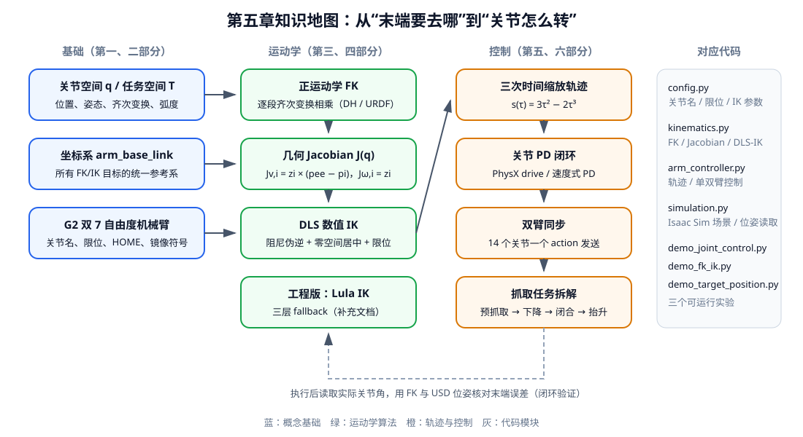

<p align="center"><b>图 5-1</b> 本章知识地图：蓝色为概念基础，绿色为运动学算法，橙色为轨迹与控制，右侧为对应代码模块</p>

### 对应代码

- `code/code_chapter5/`：本章主线代码。纯 NumPy 实现的 FK、Jacobian、DLS-IK（`kinematics.py`），单臂/双臂关节控制器（`arm_controller.py`），Isaac Sim 场景封装（`simulation.py`）和三个演示程序。使用的机器人模型是 `assets/robot/G2_omnipicker/robot.usda`，仿真环境是 `assets/background/room/room_1/background.usda`。
- `code_pre_alpha/g2_robot/`（补充，早期示例）：基于 Isaac Sim Lula 求解器的 IK、Ruckig 轨迹、关节 PD 速度控制器和抓取演示，见第六部分 6.3–6.5 节。

---

## 第一部分 机械臂运动学与控制基础

### 1.1 从关节运动到末端运动

**直观理解**：移动底盘主要改变机器人整体在环境中的位置，机械臂则负责把末端执行器移动到需要操作物体的位置。后续的定点抓取、视觉引导抓取、移动抓取以及视觉语言动作模型，最终都需要转换为机械臂可以执行的关节命令。可以把机械臂想象成你的胳膊：大脑想的是"手伸到杯子那里"（任务空间），肌肉执行的却是"肩转多少、肘弯多少、腕转多少"（关节空间）。

机械臂由多个连杆和关节串联组成。G2 的每条机械臂有 7 个旋转关节，因此一条机械臂的关节状态可以写成：

$$
\mathbf{q}= \begin{bmatrix} q_1&q_2&q_3&q_4&q_5&q_6&q_7 \end{bmatrix}^{T}
$$

其中 $q_i$ 是第 $i$ 个关节的转角，单位通常为弧度（rad）。对应的关节角速度为：

$$
\dot{\mathbf{q}}= \begin{bmatrix} \dot q_1&\dot q_2&\dot q_3&\dot q_4&\dot q_5&\dot q_6&\dot q_7 \end{bmatrix}^{T}
$$

$\dot q_i$ 的单位是 rad/s，上方的点表示对时间求导。

机械臂控制通常从两个空间理解。

第一种是**关节空间**（joint space）。控制器直接给出 7 个关节角，例如：

$$
\mathbf{q}_{d}= \begin{bmatrix} 0.3&-0.5&0.2&-1.2&0.1&0.4&-0.2 \end{bmatrix}^{T}
$$

下标 $d$ 表示 desired（期望值）。关节空间控制容易实现，也容易检查关节限位，但用户很难只看这 7 个数就判断末端会到达哪里。

第二种是**任务空间**（task space），也称笛卡尔空间（Cartesian space）。用户直接给出末端执行器（end effector, EE）的位置和朝向，例如让夹爪中心到达某个三维位置：

$$
\mathbf{p}_{d}= \begin{bmatrix} x_d\\ y_d\\ z_d \end{bmatrix}
$$

$x_d,y_d,z_d$ 的单位是米。如果还要求夹爪朝向，则目标还要包含旋转矩阵 $\mathbf{R}_d$ 或四元数。任务空间目标更符合"把手移动到这里"的直觉，但机器人最终仍然只能驱动关节，因此必须通过逆运动学把末端目标转换成关节角。

两种空间之间的关系可以概括为：

```text
关节角 q  --正运动学 FK-->  末端位姿 T
末端位姿 T --逆运动学 IK-->  关节角 q
```

正运动学通常有唯一结果：给定完整关节角后，末端位姿可以直接计算。逆运动学可能没有解、只有一组解或存在多组解，因此通常比正运动学更困难。

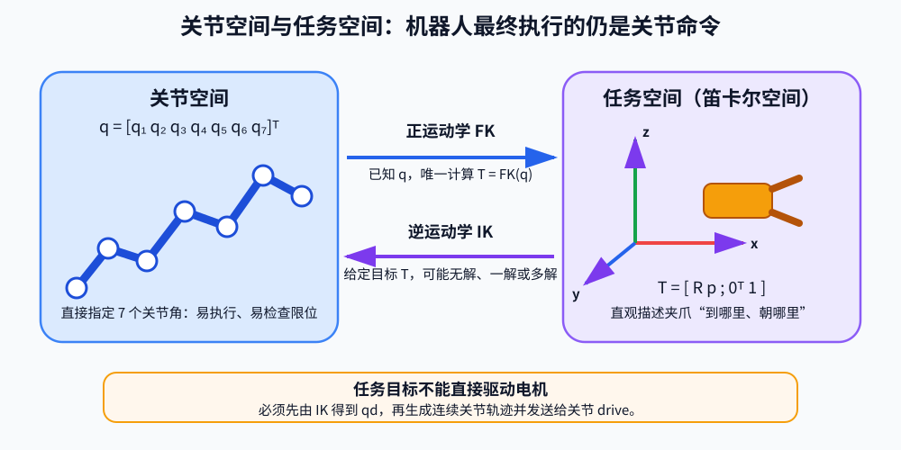

<p align="center"><b>图 5-2</b> FK 把关节角映射为末端位姿，IK 把末端目标转换为机器人可执行的关节目标</p>

> 💡 **要点**：FK 是"已知原因求结果"，像做加法；IK 是"已知结果求原因"，像解方程——可能无解、唯一解或多解。本章 4.1 节会用二连杆手臂把这三种情况都算一遍。

### 1.2 位置、姿态和位姿

三维空间中的末端状态由位置和姿态共同组成。

**位置**描述末端在哪里：

$$
\mathbf{p}= \begin{bmatrix} x\\ y\\ z \end{bmatrix}
$$

**姿态**描述末端朝向哪里。本章内部主要使用旋转矩阵：

$$
\mathbf{R}\in SO(3)
$$

$SO(3)$（special orthogonal group，三维特殊正交群）就是"所有合法三维旋转矩阵"的集合。旋转矩阵的三列分别是末端坐标系 $x$、 $y$、 $z$ 轴在参考坐标系中的方向（单位向量），它满足：

$$
\mathbf{R}^{T}\mathbf{R}=\mathbf{I}, \qquad \det(\mathbf{R})=1
$$

第一个式子说明三根轴两两垂直且长度为 1；第二个式子排除了"镜像翻转"。

位置和姿态合在一起称为**位姿**（pose）。为了让多段连杆变换可以直接相乘，机器人学通常使用 $4\times4$ **齐次变换矩阵**（homogeneous transformation matrix）：

$$
\mathbf{T}= \begin{bmatrix} \mathbf{R}&\mathbf{p}\\ \mathbf{0}^{T}&1 \end{bmatrix}
$$

其中左上角 $3\times3$ 部分是旋转矩阵，右上角 $3\times1$ 部分是位置向量，最后一行固定为 $[0\ 0\ 0\ 1]$。用它乘以齐次坐标 $[x,y,z,1]^T$，就能一次完成"先旋转、再平移"。

如果已知坐标系 $B$ 相对坐标系 $A$ 的变换 $\mathbf{T}_A^B$，以及坐标系 $C$ 相对坐标系 $B$ 的变换 $\mathbf{T}_B^C$，那么坐标系 $C$ 相对坐标系 $A$ 的变换为：

$$
\mathbf{T}_{A}^{C} = \mathbf{T}_{A}^{B}\mathbf{T}_{B}^{C}
$$

机械臂正运动学正是按照这种方式，把基座到第一个关节、第一个关节到第二个关节，一直到末端执行器的变换依次相乘。

**案例：一次齐次变换相乘**。设 $B$ 相对 $A$ 只是沿 $z$ 平移 0.2 m， $C$ 相对 $B$ 先绕 $z$ 转 90° 再沿 $B$ 的 $x$ 平移 0.1 m：

$$
\mathbf{T}_A^B=\begin{bmatrix}1&0&0&0\\0&1&0&0\\0&0&1&0.2\\0&0&0&1\end{bmatrix},\quad
\mathbf{T}_B^C=\begin{bmatrix}0&-1&0&0.1\\1&0&0&0\\0&0&1&0\\0&0&0&1\end{bmatrix}
\ \Rightarrow\
\mathbf{T}_A^C=\begin{bmatrix}0&-1&0&0.1\\1&0&0&0\\0&0&1&0.2\\0&0&0&1\end{bmatrix}
$$

$C$ 的原点在 $A$ 中位于 $(0.1, 0, 0.2)$， $C$ 的 $x$ 轴指向 $A$ 的 $+y$ 方向（第一列为 $[0,1,0]^T$）。

Isaac Sim 接口经常使用四元数表示姿态。本章统一采用：

$$
\mathbf{q}_{rotation}=[w,x,y,z]
$$

绕单位轴 $\mathbf{u}$ 旋转角度 $\theta$ 的四元数为 $[\cos\frac{\theta}{2},\ \mathbf{u}\sin\frac{\theta}{2}]$。例如 $[0,1,0,0]$ 表示绕 $x$ 轴转 180°——早期抓取示例中的 `GRASP_ORIENT = np.array([0.0, 1.0, 0.0, 0.0])` 就是这样一个 `wxyz` 顺序的四元数，表示夹爪朝下的抓取姿态。四元数适合接口传递，旋转矩阵适合进行矩阵运算。二者表达的是同一个姿态，不能把旋转四元数和机械臂关节向量 $\mathbf{q}$ 混为一谈。

对应代码（`code/code_chapter5/kinematics.py`）中，`Pose` 数据类内部存旋转矩阵，需要时再转成 `[w, x, y, z]`：

```python
@dataclass(frozen=True)
class Pose:
    """三维位姿：位置单位为 m，旋转矩阵形状为 (3, 3)。"""

    position: np.ndarray
    rotation: np.ndarray

    @property
    def quaternion(self) -> np.ndarray:
        """返回 Isaac Sim 常用的 [w, x, y, z] 四元数。"""
        return matrix_to_quaternion(self.rotation)
```

如果实验只关心末端到达某个位置，不关心夹爪朝向，可以只给 $\mathbf{p}_d$，这种情况称为**位置式 IK**。如果同时约束 $\mathbf{p}_d$ 和 $\mathbf{R}_d$，则称为**完整位姿 IK**。

> ⚠️ **注意**：`matrix_to_quaternion()` 最后会保证 $w\ge0$（`return q if q[0] >= 0.0 else -q`）。 $\mathbf{q}$ 与 $-\mathbf{q}$ 表示同一个旋转，所以比较两个四元数时不要逐元素相减，而应比较旋转误差。

### 1.3 坐标系、弧度和完整控制流程

机械臂控制中最容易出现的错误不是公式本身，而是混用了不同坐标系。

本章所有 FK、Jacobian 和 IK 目标都统一使用 G2 的 `arm_base_link` 坐标系。末端执行器使用夹爪中心：

```text
左臂末端：gripper_l_center_link
右臂末端：gripper_r_center_link
```

因此，目标位置 `[x, y, z]` 表示末端相对 `arm_base_link` 的位置，而不是相对世界坐标系的位置。机器人底盘移动以后，`arm_base_link` 在世界中的位姿会变化，但机械臂内部的运动学仍然可以在这个局部坐标系中计算。

如果以后视觉系统给出的是相机坐标系目标，或者导航系统给出的是世界坐标系目标，必须先通过坐标变换把目标转换到 `arm_base_link`，再交给本章 IK 求解器：

$$
\mathbf{p}_{base} = (\mathbf{T}_{world}^{base})^{-1}\,\mathbf{T}_{world}^{camera}\,\mathbf{p}_{camera}
$$

（这里 $\mathbf{p}$ 写成齐次坐标 $[x,y,z,1]^T$。）

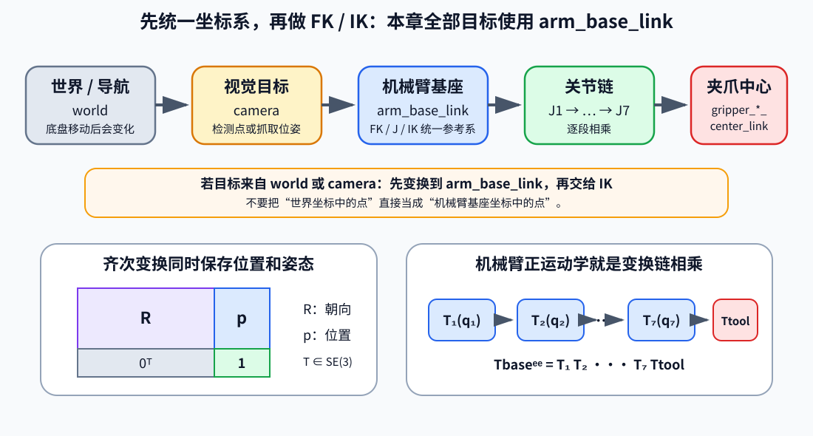

<p align="center"><b>图 5-3</b> 外部目标先转换到 <code>arm_base_link</code>；机械臂内部再通过逐段齐次变换得到夹爪中心位姿</p>

机械臂角度在代码和 Isaac Sim 接口中统一使用弧度：

$$
180^\circ=\pi\text{ rad}
$$

常见换算为：

$$
30^\circ\approx0.524\text{ rad}, \qquad 90^\circ\approx1.571\text{ rad}
$$

日志为了方便观察，会把关节角转换成角度输出，但控制计算始终使用弧度。例如演示程序中让关节转动 `0.30 rad`，日志打印的是 $0.30\times180/\pi\approx17.2^\circ$。

从用户目标到机器人实际运动的完整流程为：

```text
用户输入关节角或末端目标
        ↓
检查数据形状、数值和关节限位
        ↓
若输入末端目标，则通过 IK 求目标关节角
        ↓
生成连续、首尾速度为零的关节轨迹
        ↓
每个物理步向 Isaac Sim 发送关节位置目标
        ↓
USD 中的关节 drive 执行位置闭环
        ↓
读取实际关节角并通过 FK 检查末端误差
```

<p align="center"><b>图 5-4</b> 从用户目标到机械臂实际运动的完整控制流程</p>

这里要区分三个层次：

- FK/IK 解决"关节角与末端位姿如何转换"；
- 轨迹生成解决"怎样从当前关节角平滑走到目标关节角"；
- 关节 drive（或 PD 控制器）解决"物理关节怎样跟踪每一个位置目标"。

只计算 IK 而不生成连续轨迹，机械臂可能突然跳到目标；只生成轨迹而不检查 IK，目标可能根本不可达。完整控制需要把这三个层次连接起来。

"检查数据形状、数值"这一步在代码里由一个小工具函数完成（`code/code_chapter5/kinematics.py`），所有对外接口都先经过它：

```python
def _as_vector(values: Sequence[float], length: int, name: str) -> np.ndarray:
    vector = np.asarray(values, dtype=np.float64)
    if vector.shape != (length,):
        raise ValueError(f"{name} 必须包含 {length} 个数，实际形状为 {vector.shape}")
    if not np.all(np.isfinite(vector)):
        raise ValueError(f"{name} 中不能包含 NaN 或无穷大")
    return vector
```

> ⚠️ **注意**：坐标系写错往往不会报错，只会让夹爪"安静地"去错地方。拿到一个目标点时先问自己：它是在哪个坐标系里表示的？单位是米还是毫米？角度是弧度还是度？

---

## 第二部分 G2 双机械臂结构

### 2.1 双七自由度机械臂与关节名称

G2 是一个带移动底盘、躯干、头部和双臂的复合机器人。它具有左右两条机械臂，每条机械臂包含 7 个旋转关节，两条机械臂一共包含 14 个主动关节自由度（Degree of Freedom, DoF）。本章只讨论机械臂控制，但要记住：机械臂末端位姿是整条运动链共同决定的，躯干和头部的姿态也会影响"机械臂基座在哪"（这一点在使用 Lula IK 时尤其重要，见 6.3 节）。

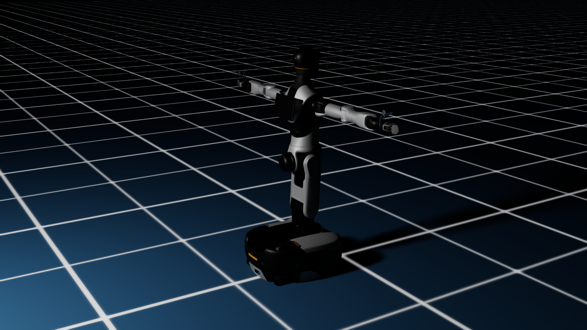

<p align="center"><b>图 5-5</b> G2 在 Isaac Sim 中加载后的初始姿态。这个视角适合用来说明仿真世界、机器人基准位姿和双臂初始状态</p>

左臂关节名称为：

| 关节 | Isaac Sim / USD 自由度名称 |
|---|---|
| J1 | `idx21_arm_l_joint1` |
| J2 | `idx22_arm_l_joint2` |
| J3 | `idx23_arm_l_joint3` |
| J4 | `idx24_arm_l_joint4` |
| J5 | `idx25_arm_l_joint5` |
| J6 | `idx26_arm_l_joint6` |
| J7 | `idx27_arm_l_joint7` |

右臂关节名称为：

| 关节 | Isaac Sim / USD 自由度名称 |
|---|---|
| J1 | `idx61_arm_r_joint1` |
| J2 | `idx62_arm_r_joint2` |
| J3 | `idx63_arm_r_joint3` |
| J4 | `idx64_arm_r_joint4` |
| J5 | `idx65_arm_r_joint5` |
| J6 | `idx66_arm_r_joint6` |
| J7 | `idx67_arm_r_joint7` |

在 `code/code_chapter5/config.py` 中，这两组名称通过固定规则生成：

```python
ARM_JOINT_NAMES = {
    "left": tuple(f"idx2{i}_arm_l_joint{i}" for i in range(1, 8)),
    "right": tuple(f"idx6{i}_arm_r_joint{i}" for i in range(1, 8)),
}
```

早期示例 `code_pre_alpha/g2_robot/core/constants.py` 中则直接写成列表，内容完全一致：

```python
RIGHT_ARM_JOINT_NAMES = [
    "idx61_arm_r_joint1", "idx62_arm_r_joint2", "idx63_arm_r_joint3",
    "idx64_arm_r_joint4", "idx65_arm_r_joint5", "idx66_arm_r_joint6",
    "idx67_arm_r_joint7",
]

LEFT_ARM_JOINT_NAMES = [
    "idx21_arm_l_joint1", "idx22_arm_l_joint2", "idx23_arm_l_joint3",
    "idx24_arm_l_joint4", "idx25_arm_l_joint5", "idx26_arm_l_joint6",
    "idx27_arm_l_joint7",
]
```

程序不会把关节索引写死，而是在模型加载后根据自由度名称动态查找索引（`code/code_chapter5/arm_controller.py`）：

```python
def _find_joint_indices(self) -> np.ndarray:
    dof_names = list(self.articulation.dof_names)          # 整个 G2 的所有自由度名
    missing = [name for name in self.joint_names if name not in dof_names]
    if missing:
        raise RuntimeError(f"G2 模型缺少机械臂关节：{missing}")
    # 按 J1..J7 的顺序取出它们在 articulation 中的下标
    return np.array([dof_names.index(name) for name in self.joint_names], dtype=np.int64)
```

这样即使 USD 中的自由度排列发生变化，只要关节名称不变，代码仍然可以控制正确的关节。

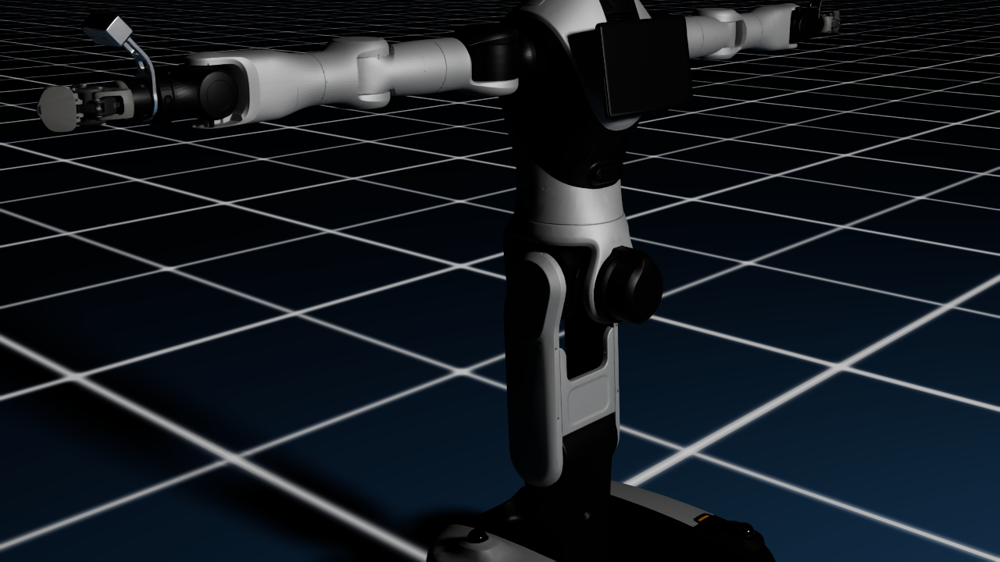

<p align="center"><b>图 5-6</b> G2 右臂链路近景。观察这一视角时，可以把肩、肘、腕各关节和前面介绍的 7 自由度运动链对应起来</p>

7 自由度机械臂比完成一般三维位姿任务所需的 6 自由度多一个自由度，因此属于**冗余机械臂**（redundant manipulator）。冗余自由度意味着末端保持在同一个位姿时，手臂内部仍然可能有不同姿态。例如，肘部可以在一定范围内抬高或降低，而夹爪位置保持近似不变——就像你把手掌按在桌面上不动，仍然可以抬起或放低手肘。

冗余性可以用来：

- 远离关节上下限；
- 调整肘部姿态；
- 避开障碍物；
- 提高操作灵活性；
- 在完成末端任务的同时优化其他目标。

本章先使用零空间关节居中，让 IK 解尽量远离关节限位（4.4 节）。碰撞规避和更复杂的冗余优化留到后续章节。

### 2.2 关节限位、HOME 姿态和机械臂链

每个关节都有物理角度范围。即使数学上的 IK 可以得到某个解，只要它超出关节限位，真实模型就不能执行。

G2 单臂关节限位如下（来自 G2 URDF，左右臂相同）：

| 关节 | 下限 | 上限 | 约合角度范围 |
|---|---:|---:|---:|
| J1 | -3.1067 rad | 3.1067 rad | -178° ～ 178° |
| J2 | -2.0944 rad | 2.0944 rad | -120° ～ 120° |
| J3 | -3.1067 rad | 3.1067 rad | -178° ～ 178° |
| J4 | -2.5307 rad | 1.0472 rad | -145° ～ 60° |
| J5 | -3.1067 rad | 3.1067 rad | -178° ～ 178° |
| J6 | -1.0472 rad | 1.0472 rad | -60° ～ 60° |
| J7 | -1.5708 rad | 1.5708 rad | -90° ～ 90° |

本章还设置了统一关节速度上限：

$$
\dot q_{max}=3.1416\text{ rad/s}
$$

为了避免一开始就靠近限位，实验使用一个适合教学的 HOME 姿态：

$$
\mathbf{q}_{home}= \begin{bmatrix} 0&-0.35&0&-1.10&0&0.35&0 \end{bmatrix}^{T}
$$

转换成角度约为：

$$
\begin{bmatrix} 0^\circ&-20.1^\circ&0^\circ&-63.0^\circ&0^\circ&20.1^\circ&0^\circ \end{bmatrix}^{T}
$$

这个姿态不是唯一的"正确初始姿态"，而是一个避开多数关节极限、便于观察后续动作的起始姿态。

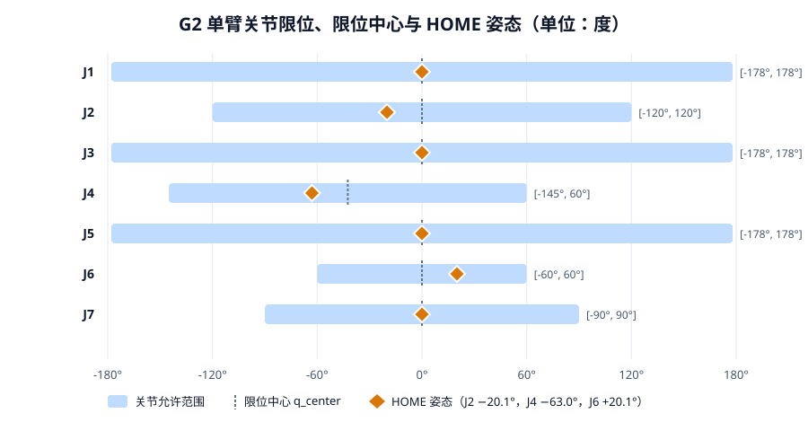

<p align="center"><b>图 5-7</b> G2 单臂 7 个关节的允许范围（蓝条）、限位中心（虚线）与 HOME 姿态（橙色菱形）。注意 J4 的范围不对称，中心在 -42.5°</p>

从图 5-7 可以读出两件事：J4（肘）的范围是 $[-145^\circ, 60^\circ]$，中心并不在 0，而在 $(-2.5307+1.0472)/2=-0.7418$ rad $\approx-42.5^\circ$；J6 的范围只有 $\pm60^\circ$，最窄，HOME 中的 $+20.1^\circ$ 已经占去三分之一的单侧余量。4.4 节的零空间居中会利用这些信息。

对应代码（`code/code_chapter5/config.py`）：

```python
# 关节限位来自 G2 URDF，单位为 rad。
JOINT_LOWER_LIMITS = np.array(
    [-3.1067, -2.0944, -3.1067, -2.5307, -3.1067, -1.0472, -1.5708],
    dtype=np.float64,
)
JOINT_UPPER_LIMITS = np.array(
    [3.1067, 2.0944, 3.1067, 1.0472, 3.1067, 1.0472, 1.5708],
    dtype=np.float64,
)
JOINT_VELOCITY_LIMITS = np.full(7, 3.1416, dtype=np.float64)

# 一个避开关节极限、适合开始教学实验的姿态。
HOME_JOINT_POSITIONS = np.array(
    [0.0, -0.35, 0.0, -1.10, 0.0, 0.35, 0.0], dtype=np.float64
)
```

控制器在发送任何目标之前都会做一次限位裁剪（`arm_controller.py`）：

```python
def clamp_positions(self, positions: Sequence[float]) -> np.ndarray:
    """把关节目标裁剪到 G2 的物理限位内。"""
    return np.clip(self._check_positions(positions), self.lower_limits, self.upper_limits)
```

**案例**：若给 J6 下发 1.20 rad（约 68.8°），`np.clip` 会把它裁成 1.0472 rad（60°）。机械臂不会报错，但末端不会到达你以为的位置——所以 IK 求解器内部也必须考虑限位，而不是只在最后裁剪。

机械臂运动学模型还需要知道相邻关节之间的固定几何关系。本章根据 G2 模型参数构建七段关节原点变换，并在最后加入 `arm_link7` 到夹爪中心的工具变换。末端工具长度使用实际仿真模型对应的 `0.23645 m`。

对于左臂和右臂，J2 到 J7 的内部链参数相同，主要区别在第一段安装变换：

- 左臂第一关节位于 `arm_base_link` 的一侧（沿 $z$ 方向 +0.069 m）；
- 右臂第一关节位于另一侧（沿 $z$ 方向 -0.069 m），并带有绕 $x$ 轴的 $\pi$ 旋转；
- 这使左右机械臂形成镜像结构。

因此，不能只创建一个完全相同的运动学模型后同时用于左右臂。本章的 `G2ArmKinematics` 会根据 `arm="left"` 或 `arm="right"` 构造对应的第一段变换（代码见 3.1 节）。

### 2.3 左右臂镜像关系

G2 双臂是镜像安装的。"两只机械臂同时运动"包含两个不同概念。

第一个概念是**时间同步**。左右臂在同一个物理步收到目标，同时开始、同时运动、同时结束。

第二个概念是**视觉同向**。左右臂对应关节在画面中表现为相同方向（关于身体中线对称）的动作。由于镜像安装，如果左右两侧所有关节都使用相同正增量，J1、J3、J5、J7 会表现为相反方向。

**为什么偏偏是奇数关节？** 右臂第一段多了一个绕 $x$ 轴转 $\pi$ 的安装变换，它把局部 $y$、 $z$ 轴都反向。在 HOME 附近，J1、J3、J5、J7 的转轴大致沿 $\pm z$ 方向（"扭转"类关节），J2、J4、J6 的转轴沿 $\pm y$ 方向（"俯仰"类关节）。镜像以后，扭转类关节正方向在画面中相反，俯仰类关节在两侧看起来仍然同向（3.4 节给出的 HOME Jacobian 数值可以印证这一点）。

若左臂相对某个中心姿态的关节增量为：

$$
\Delta\mathbf{q}_{L}= \begin{bmatrix} \Delta q_1&\Delta q_2&\Delta q_3&\Delta q_4&\Delta q_5&\Delta q_6&\Delta q_7 \end{bmatrix}^{T}
$$

视觉同向的右臂增量应为：

$$
\Delta\mathbf{q}_{R}= \begin{bmatrix} -\Delta q_1&\Delta q_2&-\Delta q_3&\Delta q_4&-\Delta q_5&\Delta q_6&-\Delta q_7 \end{bmatrix}^{T}
$$

可以写成逐元素乘法（ $\odot$ 表示对应元素相乘，又称 Hadamard 积）：

$$
\boxed{ \Delta\mathbf{q}_{R} = \mathbf{s}_{q}\odot\Delta\mathbf{q}_{L} }
$$

其中：

$$
\mathbf{s}_{q}= \begin{bmatrix} -1&1&-1&1&-1&1&-1 \end{bmatrix}^{T}
$$

因此，围绕中心姿态 $\mathbf{q}_c$ 的镜像目标为：

$$
\mathbf{q}_{L,d}=\mathbf{q}_c+\Delta\mathbf{q}_{L}
$$

$$
\mathbf{q}_{R,d}=\mathbf{q}_c+\mathbf{s}_{q}\odot\Delta\mathbf{q}_{L}
$$

**案例**：以 HOME 为中心，让 J1 做 $\Delta q_1=0.30$ rad 的动作：

$$
\mathbf{q}_{L,d}=[0.30,\,-0.35,\,0,\,-1.10,\,0,\,0.35,\,0]^T,\qquad
\mathbf{q}_{R,d}=[-0.30,\,-0.35,\,0,\,-1.10,\,0,\,0.35,\,0]^T
$$

日志中显示为"J1：左 +17.2°，右 -17.2°"。若换成 J2，则左右都是 +17.2°。

在本章统一使用的 `arm_base_link` 坐标系中，视觉同向的左右末端位置还满足一个与当前 G2 模型坐标约定有关的关系。若左臂目标为：

$$
\mathbf{p}_{L,d}= \begin{bmatrix} x&y&z \end{bmatrix}^{T}
$$

对应的右臂镜像目标为：

$$
\boxed{ \mathbf{p}_{R,d}= \begin{bmatrix} x&y&-z \end{bmatrix}^{T} }
$$

这里 $x$、 $y$ 保持不变，只有 $z$ 反号。这个关系来自当前 G2 的 `arm_base_link` 轴方向和左右臂安装方式（左右臂第一关节分别位于 $z=\pm0.069$ m，即这个坐标系的 $z$ 轴指向身体左右两侧），不应直接套用到其他机器人。用 FK 可以验证：HOME 姿态下左臂末端在 $[0.6356, 0, 0.6699]$ m，右臂末端在 $[0.6356, 0, -0.6699]$ m（3.3 节手算）。

对应代码（`code/code_chapter5/config.py`）：

```python
# 左右臂是镜像安装。若希望两侧关节在画面中表现为"同向动作"，
# J1/J3/J5/J7 的增量需要反号，J2/J4/J6 保持同号。
MIRRORED_JOINT_DELTA_SIGNS = np.array(
    [-1.0, 1.0, -1.0, 1.0, -1.0, 1.0, -1.0], dtype=np.float64
)

# 在 arm_base_link 坐标系中，视觉同向的左右末端位置满足：
# right_position = [left_x, left_y, -left_z]。
# 注意 y 不反号；旧示例把 y、z 都反号，会让两侧奇数关节同号并表现为反向。
MIRRORED_END_EFFECTOR_POSITION_SIGNS = np.array(
    [1.0, 1.0, -1.0], dtype=np.float64
)
```

需要特别注意：镜像关系用于**构造**双臂任务目标。IK 已经分别使用左右臂真实运动学模型求出了真实关节角，得到 IK 结果以后不能再把右臂奇数关节额外翻转一次，否则会重复镜像并得到错误动作。

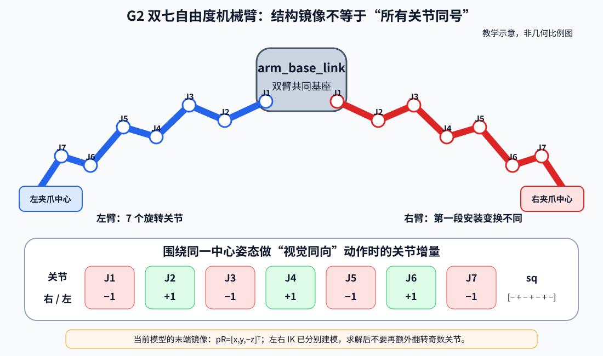

<p align="center"><b>图 5-8</b> G2 左右臂的安装变换不同；构造视觉同向的关节动作时，奇数关节增量反号、偶数关节保持同号</p>

正确顺序是：

```text
构造左右镜像目标
        ↓
左右臂分别执行 FK 或 IK
        ↓
得到两组真实关节角
        ↓
直接同步执行两组 IK 结果
```

> ⚠️ **注意**：`mirrored_targets()` 的文档字符串明确写着"这里只用于人工设计的对称关节动作。FK/IK 返回的是真实关节角，不应再经过该符号转换。"镜像只做一次，而且只在"构造目标"那一步做。

### 2.4 末端执行器与夹爪中心

FK/IK 中的"末端"并不是第 7 个连杆 `arm_link7` 的原点，而是夹爪中心 `gripper_l_center_link` / `gripper_r_center_link`。二者之间相差一个固定的工具变换（tool transform），长度约 0.23645 m。如果漏掉工具变换，IK 会把"手腕"送到目标点，夹爪中心则会偏出二十多厘米。

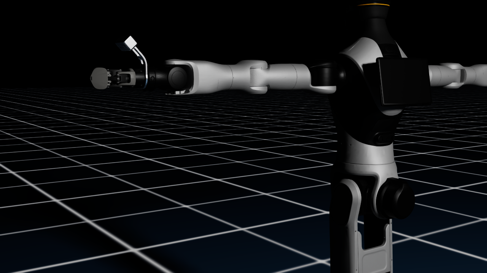

<p align="center"><b>图 5-9</b> G2 末端执行器近景。IK 的输出最终会通过关节控制改变这一区域的空间位置和姿态</p>

在 `config.py` 中，末端和基座的 Prim 路径集中保存，仿真核对时会用到：

```python
ROBOT_PRIM_PATH = "/genie"
ARM_BASE_PRIM_PATH = f"{ROBOT_PRIM_PATH}/arm_base_link"
END_EFFECTOR_PRIM_PATHS = {
    "left": f"{ROBOT_PRIM_PATH}/gripper_l_center_link",
    "right": f"{ROBOT_PRIM_PATH}/gripper_r_center_link",
}
```

---

## 第三部分 机械臂正运动学与 Jacobian

### 3.1 单个关节变换与整条机械臂变换

**直观理解**：正运动学解决的问题是：已知 7 个关节角，计算夹爪中心相对机械臂基座的位置和姿态。可以把它想象成"接力"：从基座出发，每经过一个关节就"先沿连杆走一段固定的路，再转一个关节角"，走完 7 段再加上夹爪长度，就到了末端。

对串联机械臂来说，每个关节都可以写成一个坐标变换：

$$
{}^{i-1}\mathbf{T}_{i}(q_i)=
\begin{bmatrix}
{}^{i-1}\mathbf{R}_{i}(q_i) & {}^{i-1}\mathbf{p}_{i}(q_i) \\
\mathbf{0}^T & 1
\end{bmatrix}
$$

左上标 $i-1$ 表示"在第 $i-1$ 个连杆坐标系中描述"，右下标 $i$ 表示"第 $i$ 个连杆坐标系"。从基座到末端的总变换就是沿运动链逐级相乘：

$$
{}^{0}\mathbf{T}_{ee}(\mathbf{q}) =
{}^{0}\mathbf{T}_{1}(q_1)
{}^{1}\mathbf{T}_{2}(q_2)
\cdots
{}^{6}\mathbf{T}_{ee}(q_7)
$$

**每一段变换怎么写？有两种常见约定。**

**（1）DH 参数（Denavit–Hartenberg）**。经典教材用 4 个参数描述相邻两个关节： $\theta_i$（绕 $z_{i-1}$ 的关节角）、 $d_i$（沿 $z_{i-1}$ 的偏移，m）、 $a_i$（沿 $x_i$ 的连杆长度，m）、 $\alpha_i$（绕 $x_i$ 的连杆扭角，rad）。标准 DH 的单段变换为：

$$
{}^{i-1}\mathbf{T}_{i}=\mathrm{Rot}_z(\theta_i)\,\mathrm{Trans}_z(d_i)\,\mathrm{Trans}_x(a_i)\,\mathrm{Rot}_x(\alpha_i)
=\begin{bmatrix}
\cos\theta_i & -\sin\theta_i\cos\alpha_i & \sin\theta_i\sin\alpha_i & a_i\cos\theta_i\\
\sin\theta_i & \cos\theta_i\cos\alpha_i & -\cos\theta_i\sin\alpha_i & a_i\sin\theta_i\\
0 & \sin\alpha_i & \cos\alpha_i & d_i\\
0&0&0&1
\end{bmatrix}
$$

对于旋转关节， $\theta_i=q_i+\theta_{i,0}$ 是变量，其余三个是常数。DH 的优点是参数少、便于手推；缺点是坐标系必须按规则摆放，与 URDF/USD 中的连杆坐标系往往不一致。

**（2）URDF 风格：固定原点变换 + 绕关节轴旋转**。本章代码采用这种写法。把第 $i$ 段拆成两部分：

1. 从上一连杆坐标系移动到该关节原点的固定变换 $\mathbf{T}_{origin,i}$（由 URDF 中 joint 的 `xyz` 和 `rpy` 给出）；
2. 围绕该关节轴旋转 $q_i$ 的可变变换 $\mathbf{T}_{axis,i}(q_i)$。

$$
\mathbf{T}_{i}(q_i) = \mathbf{T}_{origin,i}\mathbf{T}_{axis,i}(q_i)
$$

URDF 中经常用 `xyz` 和 `rpy` 描述固定变换。若滚转（roll）、俯仰（pitch）、偏航（yaw）角分别为 $r, p, y$，本章采用 URDF 常用顺序：

$$
\mathbf{R}_{rpy} = \mathbf{R}_{z}(y)\mathbf{R}_{y}(p)\mathbf{R}_{x}(r)
$$

如果关节轴不是简单的 $x$、 $y$ 或 $z$ 轴，可以使用 Rodrigues 公式计算绕任意单位轴 $\mathbf{a}$ 旋转角度 $q$ 的旋转矩阵：

$$
\mathbf{R}(\mathbf{a},q) = \cos q\,\mathbf{I} +(1-\cos q)\mathbf{a}\mathbf{a}^{T} +\sin q\,[\mathbf{a}]_{\times}
$$

其中 $[\mathbf{a}]_{\times}$ 是由旋转轴构成的反对称矩阵，满足 $[\mathbf{a}]_\times\mathbf{v}=\mathbf{a}\times\mathbf{v}$：

$$
[\mathbf{a}]_{\times}=\begin{bmatrix}0&-a_z&a_y\\a_z&0&-a_x\\-a_y&a_x&0\end{bmatrix}
$$

验证一下：取 $\mathbf{a}=[0,0,1]^T$，Rodrigues 公式退化为熟悉的 $\mathbf{R}_z(q)$。

从 `arm_base_link` 开始，把 7 个关节变换和最后的工具变换依次相乘：

$$
\boxed{ \mathbf{T}_{base}^{ee}(\mathbf{q}) = \mathbf{T}_{1}(q_1) \mathbf{T}_{2}(q_2) \cdots \mathbf{T}_{7}(q_7) \mathbf{T}_{tool} }
$$

最终矩阵可以拆成：

$$
\mathbf{T}_{base}^{ee} = \begin{bmatrix} \mathbf{R}_{ee}&\mathbf{p}_{ee}\\ \mathbf{0}^{T}&1 \end{bmatrix}
$$

于是得到末端位置 $\mathbf{p}_{ee}$ 和末端姿态 $\mathbf{R}_{ee}$。

**为什么本章不维护 DH 表？** 在 G2 项目里，更稳妥的做法是把 URDF/USD 作为运动学真值来源：URDF 中每个 joint 的 `origin`、`axis`、`parent` 和 `child` 决定了这条链的固定偏置与旋转轴，Lula/Isaac Sim 也会据此构建运动学模型。这样做的好处是代码、仿真模型和可视化模型共享同一份结构描述，减少"文档里的连杆长度"和"仿真里的连杆长度"不一致的问题。DH 方法则作为理解原理的工具，下一节用它手推二连杆。

正运动学不是在仿真中试着转动机械臂再读取结果，而是根据几何参数直接计算，因此可以在不启动 Isaac Sim 的情况下运行。仿真中的真实末端位姿主要用于核对自编模型是否正确。

### 3.2 手算案例：二连杆平面机械臂的正运动学

先用最小的例子把 FK 算清楚。平面二连杆机械臂有两个旋转关节，连杆长度 $l_1=0.30$ m、 $l_2=0.25$ m，关节轴都垂直于纸面。它的 DH 参数表为：

| 段 $i$ | $\theta_i$ | $d_i$ | $a_i$ | $\alpha_i$ |
|---|---|---|---|---|
| 1 | $q_1$ | 0 | $l_1=0.30$ | 0 |
| 2 | $q_2$ | 0 | $l_2=0.25$ | 0 |

代入 DH 公式（ $\alpha=0$， $d=0$），每一段只剩平面旋转加沿 $x$ 平移，两段相乘后取位置分量：

$$
x = l_1\cos q_1 + l_2\cos(q_1+q_2),\qquad
y = l_1\sin q_1 + l_2\sin(q_1+q_2),\qquad
\phi = q_1+q_2
$$

$\phi$ 是末端朝向角。取 $q_1=30^\circ$、 $q_2=60^\circ$：

- 肘部： $(l_1\cos30^\circ,\ l_1\sin30^\circ)=(0.30\times0.866,\ 0.30\times0.5)=(0.260,\ 0.150)$ m；
- 末端： $q_1+q_2=90^\circ$， $\cos90^\circ=0$， $\sin90^\circ=1$，所以 $(0.260+0,\ 0.150+0.25)=(0.260,\ 0.400)$ m，末端朝向 $\phi=90^\circ$（竖直向上）。

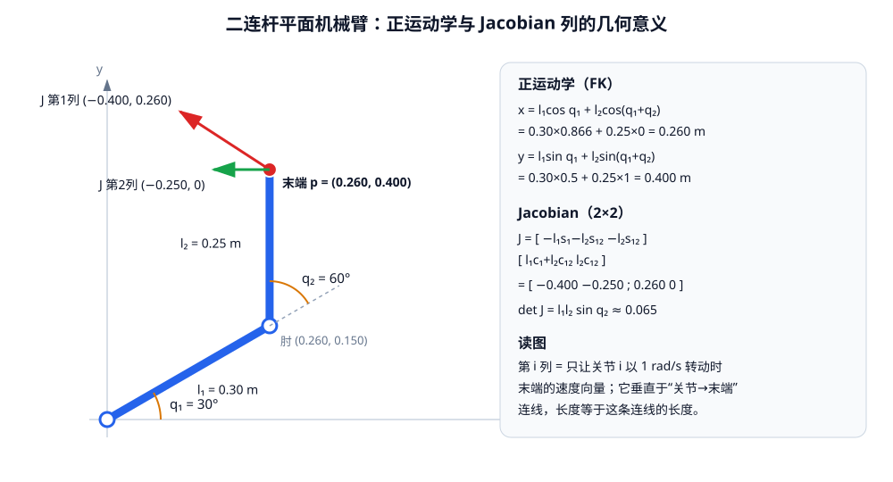

<p align="center"><b>图 5-10</b> 二连杆平面机械臂：q = (30°, 60°) 时末端位于 (0.260, 0.400) m；红、绿箭头是 Jacobian 的两列（见 3.4 节）</p>

可以用几行 NumPy 自己验证（不依赖本章代码）：

```python
import numpy as np
l1, l2 = 0.30, 0.25
q1, q2 = np.radians([30, 60])
x = l1 * np.cos(q1) + l2 * np.cos(q1 + q2)
y = l1 * np.sin(q1) + l2 * np.sin(q1 + q2)
print(round(x, 4), round(y, 4))   # 0.2598 0.4
```

> 💡 **要点**：G2 的 7 轴 FK 与二连杆本质相同——都是"固定偏移 × 关节旋转"的连乘，只是从平面变成了三维、从 2 段变成了 7 段再加一个工具变换。

### 3.3 G2 正运动学的代码实现与手算核对

**对应代码**：齐次变换由平移 `xyz` 和欧拉角 `rpy` 构造，任意轴旋转使用 Rodrigues 公式（`code/code_chapter5/kinematics.py`）：

```python
def transform(xyz=(0.0, 0.0, 0.0), rpy=(0.0, 0.0, 0.0)) -> np.ndarray:
    """按照 URDF 约定生成齐次变换：R = Rz(yaw) Ry(pitch) Rx(roll)。"""
    roll, pitch, yaw = rpy
    result = np.eye(4, dtype=np.float64)
    result[:3, :3] = rotation_z(yaw) @ rotation_y(pitch) @ rotation_x(roll)  # 对应 R_rpy
    result[:3, 3] = np.asarray(xyz, dtype=np.float64)                         # 对应 p
    return result


def axis_rotation(axis: Sequence[float], angle: float) -> np.ndarray:
    """Rodrigues 公式：绕任意单位轴旋转。"""
    axis = _as_vector(axis, 3, "axis")
    norm = np.linalg.norm(axis)
    if norm < 1e-12:
        raise ValueError("旋转轴长度不能为 0")
    x, y, z = axis / norm                                   # 先归一化成单位轴 a
    c, s, one_c = math.cos(angle), math.sin(angle), 1.0 - math.cos(angle)
    rotation = np.array(
        [
            [c + x * x * one_c, x * y * one_c - z * s, x * z * one_c + y * s],
            [y * x * one_c + z * s, c + y * y * one_c, y * z * one_c - x * s],
            [z * x * one_c - y * s, z * y * one_c + x * s, c + z * z * one_c],
        ],
        dtype=np.float64,
    )
    # ... 写入 4x4 齐次矩阵的左上角后返回
```

代码解读：矩阵中 `c*I` 对应 $\cos q\,\mathbf{I}$，`x*y*one_c` 这类项对应 $(1-\cos q)\mathbf{a}\mathbf{a}^T$，`± z*s` 这类项对应 $\sin q[\mathbf{a}]_\times$，三项逐元素相加就是 Rodrigues 公式。

左右机械臂根据不同的第一段安装变换构建链（`G2ArmKinematics.__init__`）：

```python
first_xyz = (0.0, 0.0, 0.069) if arm == "left" else (0.0, 0.0, -0.069)
first_rpy = (0.0, 0.0, 0.0) if arm == "left" else (pi, 0.0, 0.0)   # 右臂多绕 x 转 π
self.joint_origins = (
    transform(first_xyz, first_rpy),                          # T_origin,1
    transform((0.0, 0.0, 0.1745), (pi / 2.0, 0.0, 0.0)),      # T_origin,2
    transform((0.0, 0.0, 0.0), (-pi / 2.0, 0.0, 0.0)),        # T_origin,3
    transform((0.018, 0.0, 0.287), (pi / 2.0, 0.0, 0.0)),     # T_origin,4
    transform((-0.018, 0.0, 0.0), (-pi / 2.0, 0.0, 0.0)),     # T_origin,5
    transform((0.0, 0.0, 0.314), (pi / 2.0, 0.0, 0.0)),       # T_origin,6
    transform((0.0, 0.0, 0.0), (pi / 2.0, 0.0, pi / 2.0)),    # T_origin,7
)
self.joint_axes = tuple(np.array([0.0, 0.0, 1.0]) for _ in range(7))   # 每个关节都绕局部 z 轴转

# arm_link7 -> gripper_center 的组合固定变换。当前 G2 USD 与仓库中
# 辅助 URDF 的末端长度略有差异，因此以实际仿真模型的 0.23645 m 为准。
self.tool_transform = transform(
    (0.23645, 0.0, 0.0), (pi, -pi / 2.0, 0.0)
)
```

链式计算一边得到末端变换，一边保存每个关节的位置和轴（后者给 Jacobian 用）：

```python
def _chain(self, joint_positions: Sequence[float]):
    q = _as_vector(joint_positions, 7, "joint_positions")
    current = np.eye(4, dtype=np.float64)                 # 从 arm_base_link 出发
    joint_points, joint_axes = [], []

    for origin, local_axis, angle in zip(self.joint_origins, self.joint_axes, q):
        current = current @ origin                        # ① 乘固定变换 T_origin,i，到达关节 i 原点
        joint_points.append(current[:3, 3].copy())        #   记录 p_i（基座系下的关节位置）
        joint_axes.append(current[:3, :3] @ local_axis)   #   记录 z_i（基座系下的关节轴方向）
        current = current @ axis_rotation(local_axis, float(angle))   # ② 乘 T_axis,i(q_i)

    end_transform = current @ self.tool_transform         # ③ 最后乘工具变换 T_tool
    return end_transform, joint_points, joint_axes
```

正运动学只需取出最终变换：

```python
def forward(self, joint_positions: Sequence[float]) -> Pose:
    """正运动学：7 个关节角 -> 末端在 arm_base_link 下的位姿。"""
    end_transform, _, _ = self._chain(joint_positions)
    return Pose(end_transform[:3, 3].copy(), end_transform[:3, :3].copy())
```

**手算案例 1：全零姿态**。 $\mathbf{q}=\mathbf{0}$ 时手臂完全伸直。由链参数可见，沿链方向的长度依次是 0.069、0.1745、0.287、0.314、0.23645 m，而 J4、J5 两处的 $x$ 偏移 +0.018 与 -0.018 相互抵消，所以末端应位于

$$
z = 0.069+0.1745+0.287+0.314+0.23645 = 1.08095\ \text{m}
$$

运行 `G2ArmKinematics("left").forward(np.zeros(7))` 得到位置 `[0, 0, 1.081]`、四元数 `[1, 0, 0, 0]`（姿态与基座一致），与手算吻合。这也说明 `arm_base_link` 的 $z$ 轴是左臂伸出的方向。

**手算案例 2：HOME 姿态**。HOME 中 J1、J3、J5、J7 都是 0，只有三个"俯仰"关节 J2、J4、J6 有角度，所以整条手臂落在 $x$– $z$ 平面内，可以像二连杆一样手推。记沿当前连杆方向的偏移为 $(a, c)$（ $a$ 为垂直分量， $c$ 为沿连杆分量），手臂相对 $z$ 轴向 $x$ 倾斜角 $\varphi$ 时，该偏移在基座中的增量是 $\Delta x=a\cos\varphi+c\sin\varphi$、 $\Delta z=c\cos\varphi-a\sin\varphi$。三个俯仰关节的轴在 HOME 下都指向 $-y$，所以倾斜角依次累加：

| 段 | 起点 | 累计倾斜 $\varphi$ | 偏移 $(a,c)$ | 终点 $(x, z)$ |
|---|---|---|---|---|
| J2 → J4 | $(0, 0.2435)$ | $20.05^\circ$ | $(0.018, 0.287)$ | $(0.1153, 0.5069)$ |
| J4 → J6 | $(0.1153, 0.5069)$ | $20.05^\circ+63.03^\circ=83.08^\circ$ | $(-0.018, 0.314)$ | $(0.4249, 0.5626)$ |
| J6 → 夹爪中心 | $(0.4249, 0.5626)$ | $83.08^\circ-20.05^\circ=63.03^\circ$ | $(0, 0.23645)$ | $(0.6356, 0.6699)$ |

以第一行为例： $\Delta x=0.018\times0.9394+0.287\times0.3428=0.1153$， $\Delta z=0.287\times0.9394-0.018\times0.3428=0.2634$， $0.2435+0.2634=0.5069$。最终左臂 HOME 末端位于 $[0.6356,\ 0,\ 0.6699]$ m，末端朝向相对基座绕 $y$ 轴转了 $63.03^\circ$，对应四元数 $[\cos31.5^\circ, 0, \sin31.5^\circ, 0]=[0.8525, 0, 0.5227, 0]$。这些数与 `forward(HOME_JOINT_POSITIONS)` 的输出、`_chain()` 记录的关节位置完全一致；右臂结果为 $[0.6356, 0, -0.6699]$，正好印证 2.3 节的 $[x,y,-z]$ 镜像关系。

> ⚠️ **注意**：J4 的 $(+0.018)$ 和 J5 的 $(-0.018)$ 只在伸直时抵消；一旦 J4 弯曲，这两个小偏移就会在不同方向上，忽略它们会产生毫米到厘米级的误差。这也是为什么本章坚持"按模型参数逐段相乘"，而不是凭直觉简化成几根直杆。

### 3.4 几何 Jacobian 的含义和计算

**直观理解**：正运动学描述有限关节角对应的末端位姿，Jacobian 描述关节发生**微小**变化时，末端会怎样变化。它就像一张"灵敏度表"：第 $i$ 列告诉你"只让关节 $i$ 转一点点，末端会往哪个方向、以多快的速度动"。

机械臂末端线速度和角速度合在一起称为末端速度或 twist：

$$
\mathbf{v}_{ee}= \begin{bmatrix} \dot{\mathbf{p}}_{ee}\\ \boldsymbol{\omega}_{ee} \end{bmatrix}
$$

$\dot{\mathbf{p}}_{ee}$ 是线速度（m/s）， $\boldsymbol{\omega}_{ee}$ 是角速度（rad/s）。对于 7 自由度机械臂，几何 Jacobian 是一个 $6\times7$ 矩阵：

$$
\boxed{ \mathbf{v}_{ee} = \mathbf{J}(\mathbf{q})\dot{\mathbf{q}} }
$$

其中：

$$
\mathbf{J}= \begin{bmatrix} \mathbf{J}_{v}\\ \mathbf{J}_{\omega} \end{bmatrix}
$$

$\mathbf{J}_v$ 的三行描述关节速度对末端线速度的影响， $\mathbf{J}_\omega$ 的三行描述关节速度对末端角速度的影响。注意 $\mathbf{J}$ 依赖当前关节角 $\mathbf{q}$：手臂姿态一变，灵敏度表也跟着变。

对于第 $i$ 个旋转关节，设：

- $\mathbf{p}_i$ 为关节轴上一点在基座坐标系中的位置；
- $\mathbf{z}_i$ 为关节旋转轴在基座坐标系中的方向（单位向量）；
- $\mathbf{p}_{ee}$ 为末端位置。

那么该关节对应的 Jacobian 列为：

$$
\boxed{ \mathbf{J}_{v,i} = \mathbf{z}_i\times (\mathbf{p}_{ee}-\mathbf{p}_i) }
$$

$$
\boxed{ \mathbf{J}_{\omega,i}=\mathbf{z}_i }
$$

这个公式可以直观理解：旋转关节使末端绕关节轴做圆周运动。圆周切向速度方向由关节轴与"关节到末端"的位置向量叉乘得到，大小等于角速度乘以末端到转轴的距离（ $v=\omega r$）。而末端的角速度就是绕这根轴的角速度，所以 $\mathbf{J}_{\omega,i}$ 直接等于 $\mathbf{z}_i$。

计算 FK 时，程序已经依次得到了每个关节原点和关节轴，因此可以在同一次链式变换中保存这些量，再构造 Jacobian。

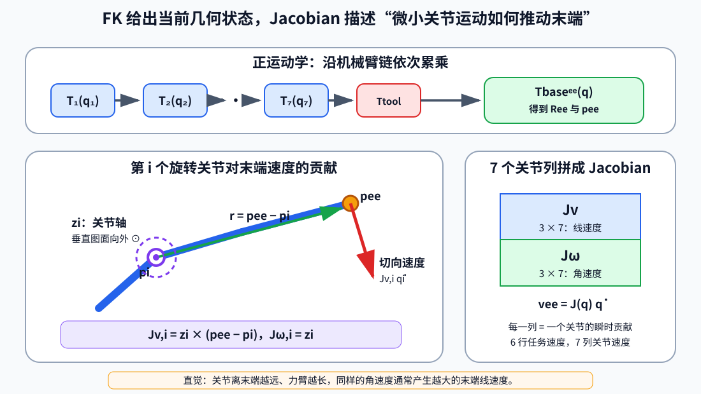

<p align="center"><b>图 5-11</b> FK 逐段累乘得到末端位姿；Jacobian 的每一列描述一个关节轴对末端线速度和角速度的瞬时贡献</p>

**对应代码**（`code/code_chapter5/kinematics.py`）：

```python
def jacobian(self, joint_positions: Sequence[float]) -> np.ndarray:
    """计算 6x7 几何 Jacobian，上三行为线速度，下三行为角速度。"""
    end_transform, joint_points, joint_axes = self._chain(joint_positions)
    end_position = end_transform[:3, 3]                                   # p_ee
    jacobian = np.zeros((6, 7), dtype=np.float64)
    for i, (point, axis) in enumerate(zip(joint_points, joint_axes)):    # p_i, z_i
        jacobian[:3, i] = np.cross(axis, end_position - point)            # J_v,i = z_i × (p_ee − p_i)
        jacobian[3:, i] = axis                                            # J_ω,i = z_i
    return jacobian
```

**手算案例 1：二连杆 Jacobian**。平面中关节轴都是 $\mathbf{z}=[0,0,1]^T$， $\mathbf{z}\times[r_x, r_y, 0]^T=[-r_y, r_x, 0]^T$，即"把关节到末端的向量逆时针转 90°"。在 $q=(30^\circ,60^\circ)$ 时：

- 关节 1 在原点， $\mathbf{p}_{ee}-\mathbf{p}_1=(0.260, 0.400)$，第 1 列 $=(-0.400,\ 0.260)$；
- 关节 2 在肘部， $\mathbf{p}_{ee}-\mathbf{p}_2=(0, 0.250)$，第 2 列 $=(-0.250,\ 0)$。

$$
\mathbf{J}_v=\begin{bmatrix}-0.400&-0.250\\0.260&0\end{bmatrix},\qquad \det\mathbf{J}_v=l_1l_2\sin q_2=0.075\times0.866\approx0.065
$$

也可以对 FK 公式直接求偏导： $\partial x/\partial q_1=-l_1\sin q_1-l_2\sin(q_1+q_2)=-0.15-0.25=-0.40$，与叉乘结果完全一致。图 5-10 中的红、绿箭头就是这两列：都垂直于"关节→末端"的连线。

**手算案例 2：G2 左臂 HOME 的第 1 列**。由 3.3 节，J1 位于 $\mathbf{p}_1=(0,0,0.069)$，轴 $\mathbf{z}_1=(0,0,1)$，末端 $\mathbf{p}_{ee}=(0.6356,0,0.6699)$：

$$
\mathbf{J}_{v,1}=(0,0,1)\times(0.6356,\ 0,\ 0.6009)=(0,\ 0.6356,\ 0),\qquad \mathbf{J}_{\omega,1}=(0,0,1)
$$

即"J1 以 1 rad/s 转动时，夹爪以 0.636 m/s 沿 $+y$ 方向扫过"。程序输出的 HOME 完整 Jacobian 为（每列对应 J1–J7，保留 4 位小数）：

```text
[[ 0.     -0.4264  0.     -0.163  -0.     -0.1073 -0.    ]
 [ 0.6356  0.      0.4508  0.     -0.0811  0.     -0.2364]
 [-0.      0.6356 -0.      0.5203  0.      0.2107  0.    ]
 [ 0.      0.      0.3429  0.      0.9927  0.      0.4536]
 [ 0.     -1.     -0.     -1.     -0.     -1.     -0.    ]
 [ 1.      0.      0.9394  0.      0.1205  0.     -0.8912]]
```

读法：J2、J4、J6 三列的角速度部分都是 $(0,-1,0)$（俯仰轴沿 $-y$），线速度只在 $x$– $z$ 平面内；J1、J3、J5、J7 的线速度只有 $y$ 分量——这正是 2.3 节"奇数关节是扭转类、偶数关节是俯仰类"的数值证据。

Jacobian 有三个重要用途：

- 根据关节速度估算末端瞬时速度；
- 根据期望末端微小位移计算关节微小变化；
- 判断机械臂是否接近**奇异姿态**（singular configuration）。

**奇异性的直觉**：二连杆的 $\det\mathbf{J}_v=l_1l_2\sin q_2$。当 $q_2=0$（手臂伸直）或 $q_2=\pm180^\circ$（完全折叠）时行列式为 0：两列平行，末端无论怎么转关节都无法沿"手臂延长线"方向瞬时移动。对于非方阵（如 G2 的 $3\times7$ 或 $6\times7$），用奇异值来衡量：最小奇异值越接近 0，越接近奇异。G2 左臂 HOME 的位置 Jacobian $\mathbf{J}_v$ 奇异值为 $0.9606, 0.8184, 0.1271$，说明有一个方向的"运动能力"明显偏弱，但并未奇异。

本章的数值 IK 正是不断使用 Jacobian，把当前末端误差转换成关节修正量。

### 3.5 位置误差、姿态误差和模型核对

位置误差可以直接相减：

$$
\mathbf{e}_{p} = \mathbf{p}_{d}-\mathbf{p}(\mathbf{q})
$$

其大小（欧氏距离，m）为：

$$
\|\mathbf{e}_{p}\|_2
$$

姿态不能直接把两个旋转矩阵逐元素相减（相减的结果不再是旋转矩阵，也没有明确的物理意义）。设目标旋转为 $\mathbf{R}_d$，当前旋转为 $\mathbf{R}_c$，从当前姿态转到目标姿态的相对旋转为：

$$
\mathbf{R}_{error} = \mathbf{R}_{d}\mathbf{R}_{c}^{T}
$$

再把相对旋转转换成轴角形式：

$$
\mathbf{e}_{R}=\theta\mathbf{u}
$$

其中 $\mathbf{u}$ 是单位旋转轴， $\theta$ 是需要旋转的角度。 $\mathbf{e}_R$ 的方向表示应绕哪个方向旋转，长度表示还差多少弧度。

**对应代码**（`code/code_chapter5/kinematics.py`）——先把相对旋转转成四元数 $[w, \mathbf{v}]=[\cos\frac\theta2, \mathbf{u}\sin\frac\theta2]$，再还原出 $\theta\mathbf{u}$：

```python
def orientation_error(target: np.ndarray, current: np.ndarray) -> np.ndarray:
    """计算从 current 转到 target 的世界坐标系旋转误差向量。"""
    relative = np.asarray(target, dtype=np.float64) @ np.asarray(
        current, dtype=np.float64
    ).T                                              # R_error = R_d R_c^T
    quaternion = matrix_to_quaternion(relative)      # [w, x, y, z]，且 w >= 0
    vector = quaternion[1:]                          # = u * sin(θ/2)
    vector_norm = float(np.linalg.norm(vector))
    if vector_norm < 1e-10:
        return 2.0 * vector                          # θ 极小时 θu ≈ 2 * u sin(θ/2)
    angle = 2.0 * math.atan2(vector_norm, float(quaternion[0]))   # θ
    return vector * (angle / vector_norm)            # θ * u
```

**案例**：若 $\mathbf{R}_d=\mathbf{R}_z(10^\circ)\mathbf{R}_c$，则 $\mathbf{R}_{error}=\mathbf{R}_z(10^\circ)$，四元数为 $[\cos5^\circ,0,0,\sin5^\circ]$，函数返回 $\mathbf{e}_R=[0,0,0.1745]$ rad。

完整位姿误差可以组合为：

$$
\mathbf{e}= \begin{bmatrix} \mathbf{e}_{p}\\ w_R\mathbf{e}_{R} \end{bmatrix}
$$

其中 $w_R$ 是姿态权重。位置单位是米，姿态单位是弧度，二者数值尺度不同，使用权重可以调节 IK 对位置和姿态的关注程度。本章默认：

$$
w_R=0.35
$$

直观地说： $w_R=0.35$ 意味着 1 rad 的姿态误差在 IK 眼中"相当于" 0.35 m 的位置误差；上例 0.1745 rad 的姿态误差加权后为 0.061，相当于 6.1 cm 的位置误差。

如果只做位置控制，则只使用：

$$
\mathbf{e}=\mathbf{e}_p, \qquad \mathbf{J}=\mathbf{J}_v
$$

**模型核对**。自编运动学模型必须与实际 USD 模型一致，否则 IK 在数学模型中显示成功，仿真中的夹爪却会到达错误位置。本章会在机械臂执行完动作后同时计算：

1. 自编 FK 得到的末端位姿；
2. Isaac Sim 从 USD Prim 读取的真实末端位姿；
3. 两者之间的位置和姿态差。

核对时，程序先读取 `arm_base_link` 和夹爪中心的世界变换，再计算相对变换：

$$
\mathbf{T}_{base}^{ee} = (\mathbf{T}_{world}^{base})^{-1} \mathbf{T}_{world}^{ee}
$$

对应代码（`code/code_chapter5/simulation.py`）：

```python
cache = UsdGeom.XformCache(Usd.TimeCode.Default())
base_world = np.asarray(cache.GetLocalToWorldTransform(base_prim), dtype=np.float64).T   # T_world^base
child_world = np.asarray(cache.GetLocalToWorldTransform(child_prim), dtype=np.float64).T # T_world^ee
relative = np.linalg.inv(base_world) @ child_world                                       # T_base^ee
return relative[:3, 3].copy(), relative[:3, :3].copy()
```

> ⚠️ **注意**：USD 的 `Gf.Matrix4d` 采用"行向量"约定，平移放在最后一行，所以代码里要加 `.T` 转置成本章使用的"列向量"约定（平移在最后一列）。漏掉转置是读取 USD 位姿时最常见的错误之一。

比较两者的代码在 `demo_fk_ik.py` 的 `report_final_pose()` 中：

```python
sim_position, sim_rotation = sim.get_end_effector_pose(side)
model_position_error = np.linalg.norm(sim_position - predicted.position)
model_rotation_error = np.linalg.norm(
    orientation_error(sim_rotation, predicted.rotation)
)
```

如果自编 FK 与 USD 的误差很小，说明关节顺序、关节轴、固定变换和工具长度基本正确。

---

## 第四部分 逆运动学与阻尼最小二乘

### 4.1 数值 IK 与解析 IK 的区别

逆运动学（Inverse Kinematics, IK）回答的问题正好与 FK 相反：如果希望末端到达目标位姿，应该选择怎样的关节角？

$$
\mathbf{q}^{*} = \mathrm{IK}(\mathbf{p}_{d},\mathbf{R}_{d})
$$

**解析 IK** 是根据机械臂的特定几何结构推导封闭形式公式，输入目标位姿后直接计算关节角。解析法计算速度快，但推导依赖具体机械臂结构，加入关节限位、冗余优化或更换机器人以后，公式通常需要重新设计。

**数值 IK** 不要求提前写出完整解析解，而是把 IK 看成一个迭代逼近问题。设第 $k$ 次迭代的关节角为：

$$
\mathbf{q}_{k} = \begin{bmatrix} q_{1,k}&q_{2,k}&\cdots&q_{7,k} \end{bmatrix}^{T}
$$

先通过正运动学计算当前末端位姿：

$$
\mathbf{T}_{k} = \mathrm{FK}(\mathbf{q}_{k})
$$

然后比较当前末端位姿与目标末端位姿。如果目标可达且迭代过程稳定，关节角序列将逐步趋近某个可行解：

$$
\mathbf{q}_{0} \rightarrow \mathbf{q}_{1} \rightarrow \cdots \rightarrow \mathbf{q}^{*}
$$

数值 IK 的结果会受到初始关节角影响。同一个末端目标可能从不同初值收敛到不同的肘部姿态，也可能因为目标不可达、初始值不合适或接近奇异姿态而无法收敛。本章默认使用机械臂当前关节角作为初始值，使求解结果倾向于靠近当前姿态。

对于结构复杂、带关节限位和冗余自由度的 7 自由度机械臂，直接推导完整解析解并不适合入门教学。本章主线采用阻尼最小二乘数值逆运动学 DLS-IK，并在 `kinematics.py` 中完整手写；早期 G2 示例则调用 Isaac Sim 的 Lula 求解器（第六部分）。两者遵循相同的数学思想。

**手算案例：二连杆解析 IK**。为了理解"多解"和"无解"，先对二连杆求解析解。目标点 $(x,y)=(0.260, 0.400)$（即 3.2 节的末端）。由余弦定理：

$$
\cos q_2=\frac{x^2+y^2-l_1^2-l_2^2}{2l_1l_2}=\frac{0.0675+0.16-0.09-0.0625}{0.15}=\frac{0.075}{0.15}=0.5
\ \Rightarrow\ q_2=\pm60^\circ
$$

$$
q_1=\operatorname{atan2}(y,x)-\operatorname{atan2}(l_2\sin q_2,\ l_1+l_2\cos q_2)
$$

其中 $\operatorname{atan2}(0.400,0.260)=57.0^\circ$。

- $q_2=+60^\circ$： $\operatorname{atan2}(0.2165, 0.425)=27.0^\circ$， $q_1=57.0^\circ-27.0^\circ=30.0^\circ$——回到了原来的解；
- $q_2=-60^\circ$： $\operatorname{atan2}(-0.2165,0.425)=-27.0^\circ$， $q_1=57.0^\circ+27.0^\circ=84.0^\circ$——另一组"肘上"解。

把 $(84.0^\circ,-60^\circ)$ 代回 FK，同样得到 $(0.260,0.400)$。

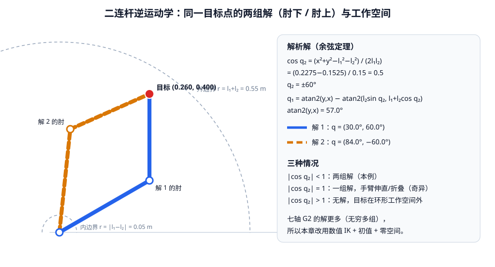

<p align="center"><b>图 5-12</b> 二连杆逆运动学：同一目标点有"肘下 / 肘上"两组解；目标在环形工作空间之外则无解，在边界上手臂伸直或折叠（奇异）</p>

> 💡 **要点**：二连杆已经有 2 组解；6 轴机械臂一般最多 8 组或 16 组；7 轴冗余机械臂对同一末端位姿通常有**无穷多组**解（一条连续的"自运动"曲线）。数值 IK 最终收敛到哪一组，由初值和附加目标（如关节居中）决定。

### 4.2 从末端误差到关节修正

**直观理解**：DLS-IK 的核心思想可以概括为：从机械臂当前关节角出发，先用 FK 计算夹爪当前位姿，再计算当前位姿与目标位姿之间的误差，然后通过 Jacobian 把末端误差转换成一小步关节角修正。重复这个过程，直到夹爪足够接近目标。像蒙着眼睛下山：每次只看脚下的坡度（Jacobian），朝下降方向迈一小步，再重新感受坡度。

沿用 3.5 节定义，当前末端位置为 $\mathbf{p}(\mathbf{q}_k)$，目标位置为 $\mathbf{p}_d$，位置误差为：

$$
\mathbf{e}_{p} = \mathbf{p}_{d}-\mathbf{p}(\mathbf{q}_{k})
$$

例如：

$$
\mathbf{e}_{p} = \begin{bmatrix} 0.03\\ -0.01\\ 0.02 \end{bmatrix}\text{m}
$$

表示夹爪还需要沿三个坐标轴分别移动 `3 cm`、`-1 cm` 和 `2 cm`。如果同时约束姿态，还要加入轴角形式的姿态误差 $\mathbf{e}_R$：

$$
\mathbf{e} = \begin{bmatrix} \mathbf{e}_{p}\\ w_R\mathbf{e}_{R} \end{bmatrix}
$$

本章姿态权重为 $w_R = 0.35$。如果只要求末端到达目标位置，则使用：

$$
\mathbf{e}=\mathbf{e}_p, \qquad \mathbf{J}=\mathbf{J}_v
$$

Jacobian 给出了当前姿态附近，关节微小变化和末端微小变化之间的一阶近似关系（一阶泰勒展开）：

$$
\Delta\mathbf{x} \approx \mathbf{J}(\mathbf{q}_{k})\Delta\mathbf{q}
$$

因此，为了消除当前末端误差，希望找到一组关节修正量，使：

$$
\boxed{ \mathbf{J}(\mathbf{q}_{k})\Delta\mathbf{q} \approx \mathbf{e} }
$$

对于位置式 IK， $\mathbf{J}$ 是 $3\times7$ 矩阵；对于完整位姿 IK， $\mathbf{J}$ 是 $6\times7$ 矩阵。G2 单臂有 7 个关节，因此 Jacobian 不是可以直接求普通逆矩阵的方阵——方程个数少于未知数个数，解有无穷多个。

需要注意，这个关系只在当前关节姿态附近近似成立，所以不能期望一次计算就直接到达目标。数值 IK 每次只走一小步，然后在新的关节姿态下重新计算 FK、误差和 Jacobian。

**对应代码**：DLS-IK 主循环开头先计算误差和 Jacobian，并根据是否给定姿态选择 3 行或 6 行（`kinematics.py` 中 `G2ArmKinematics.inverse()`）：

```python
for iteration in range(1, cfg.max_iterations + 1):
    pose = self.forward(q)                               # FK：p(q_k), R(q_k)
    position_delta = target_p - pose.position            # e_p
    position_norm = float(np.linalg.norm(position_delta))

    full_jacobian = self.jacobian(q)                     # 6x7 几何 Jacobian
    if target_r is None:                                 # 位置式 IK
        error = position_delta
        jacobian = full_jacobian[:3]                     # 只取 J_v（3x7）
        orientation_norm = 0.0
    else:                                                # 完整位姿 IK
        rotation_delta = orientation_error(target_r, pose.rotation)   # e_R
        orientation_norm = float(np.linalg.norm(rotation_delta))
        error = np.concatenate(
            (position_delta, cfg.orientation_weight * rotation_delta) # [e_p; w_R e_R]
        )
        jacobian = np.vstack(
            (full_jacobian[:3], cfg.orientation_weight * full_jacobian[3:])  # [J_v; w_R J_ω]
        )
    # ...
```

> 💡 **要点**：姿态误差乘了 $w_R$，Jacobian 的角速度行也必须乘同样的 $w_R$，这样 $\mathbf{J}\Delta\mathbf{q}\approx\mathbf{e}$ 两边的缩放才一致。

### 4.3 从最小二乘到阻尼最小二乘

最直接的方法是使用 Jacobian 伪逆（Moore–Penrose pseudo-inverse）：

$$
\Delta\mathbf{q} = \mathbf{J}^{\dagger}\mathbf{e},\qquad \mathbf{J}^{\dagger}=\mathbf{J}^T(\mathbf{J}\mathbf{J}^T)^{-1}\ \ (\text{行满秩时})
$$

它对应于寻找一组关节变化，使 $\mathbf{J}\Delta\mathbf{q}$ 尽量接近末端误差 $\mathbf{e}$，并在所有可行解中选择 $\|\Delta\mathbf{q}\|$ 最小的那一个。但机械臂接近奇异姿态时，某些任务方向上的运动能力会变得很弱。普通伪逆为了消除这些方向上的少量末端误差，可能计算出非常大的关节变化，从而造成关节跳变、震荡或超出限位。

DLS 在末端误差目标之外，额外惩罚过大的关节变化。它求解下面的正则化最小二乘问题：

$$
\boxed{ \min_{\Delta\mathbf{q}} \left( \|\mathbf{J}\Delta\mathbf{q}-\mathbf{e}\|_2^2 + \lambda^2\|\Delta\mathbf{q}\|_2^2 \right) }
$$

其中第一项要求关节修正尽量实现期望末端移动，第二项要求本次关节修正不要过大。参数 $\lambda$ 是阻尼系数，用于控制两者之间的折中。

**推导**：对 $\Delta\mathbf{q}$ 求梯度并令其为零： $2\mathbf{J}^T(\mathbf{J}\Delta\mathbf{q}-\mathbf{e})+2\lambda^2\Delta\mathbf{q}=\mathbf{0}$，得 $\Delta\mathbf{q}=(\mathbf{J}^T\mathbf{J}+\lambda^2\mathbf{I}_7)^{-1}\mathbf{J}^T\mathbf{e}$。利用恒等式 $(\mathbf{J}^T\mathbf{J}+\lambda^2\mathbf{I})^{-1}\mathbf{J}^T=\mathbf{J}^T(\mathbf{J}\mathbf{J}^T+\lambda^2\mathbf{I})^{-1}$，可以把需要求逆的矩阵从 $7\times7$ 换成更小的 $3\times3$ 或 $6\times6$。该优化问题对应的 DLS 伪逆为：

$$
\boxed{ \mathbf{J}_{DLS}^{\dagger} = \mathbf{J}^{T} \left( \mathbf{J}\mathbf{J}^{T}+\lambda^2\mathbf{I} \right)^{-1} }
$$

于是主任务的关节修正量为：

$$
\boxed{ \Delta\mathbf{q}_{task} = \mathbf{J}_{DLS}^{\dagger}\mathbf{e} }
$$

本章默认阻尼系数为：

$$
\lambda=0.04
$$

阻尼越小，DLS 越接近普通伪逆。机械臂远离奇异点时通常收敛较快，但接近奇异点时更容易产生较大的关节步长。阻尼越大，关节修正越保守、数值稳定性越好，但求解速度可能变慢，也可能保留更大的末端误差。因此阻尼并不是越大越好，而是在收敛速度和稳定性之间进行折中。

**对应代码**（`kinematics.py`）：

```python
# J# = J^T (J J^T + lambda^2 I)^-1，比直接求普通逆矩阵更稳健。
task_size = jacobian.shape[0]                                   # 3（位置式）或 6（完整位姿）
damped = jacobian @ jacobian.T + (cfg.damping ** 2) * np.eye(task_size)   # J J^T + λ² I
pseudo_inverse = jacobian.T @ np.linalg.solve(damped, np.eye(task_size))  # J^T (...)^-1
delta_q = pseudo_inverse @ error                                # Δq_task = J#_DLS e
```

代码解读：`np.linalg.solve(damped, I)` 等价于求 `damped` 的逆，但数值上比 `np.linalg.inv` 更稳；由于加了 $\lambda^2\mathbf{I}$，`damped` 永远正定可逆，即使 $\mathbf{J}$ 本身秩亏也不会报错。

**手算案例：二连杆的一步 DLS**。仍取 $q=(30^\circ,60^\circ)$，末端 $(0.260,0.400)$，希望末端向下移动 2 cm，即 $\mathbf{e}=(0,-0.02)$， $\lambda=0.04$：

1. $\mathbf{J}\mathbf{J}^T=\begin{bmatrix}0.2225&-0.1039\\-0.1039&0.0675\end{bmatrix}$，加上 $\lambda^2\mathbf{I}=0.0016\mathbf{I}$ 得 $\begin{bmatrix}0.2241&-0.1039\\-0.1039&0.0691\end{bmatrix}$；
2. 解线性方程 $(\mathbf{J}\mathbf{J}^T+\lambda^2\mathbf{I})\mathbf{y}=\mathbf{e}$，得 $\mathbf{y}=(-0.4436,\ -0.9566)$；
3. $\Delta\mathbf{q}=\mathbf{J}^T\mathbf{y}=(-0.400\times(-0.4436)+0.260\times(-0.9566),\ -0.250\times(-0.4436))=(-0.0711,\ 0.1109)$ rad，约 $(-4.07^\circ,\ +6.35^\circ)$。

对比普通伪逆（此处 $\mathbf{J}$ 是方阵，即 $\mathbf{J}^{-1}\mathbf{e}$）： $(-0.0770,\ 0.1232)$ rad。远离奇异点时，两者只差约 10%。更新后 $q=(25.93^\circ, 66.35^\circ)$，重新做 FK，末端误差从 20 mm 降到 0.97 mm；继续迭代，误差依次为 0.069 mm、0.0055 mm……3 步就收敛了。

### 4.4 DLS 为什么能缓解奇异问题

可以通过 Jacobian 的奇异值分解（Singular Value Decomposition, SVD） $\mathbf{J}=\mathbf{U}\boldsymbol{\Sigma}\mathbf{V}^T$ 理解阻尼的作用： $\mathbf{U}$ 的各列是末端空间中相互正交的"任务方向"， $\sigma_i$ 是该方向上关节运动转化为末端运动的"效率"。普通伪逆在第 $i$ 个奇异方向上的误差放大系数近似为：

$$
\frac{1}{\sigma_i}
$$

其中 $\sigma_i$ 是 Jacobian 的第 $i$ 个奇异值。机械臂接近奇异姿态时，某个 $\sigma_i$ 会接近零，于是：

$$
\frac{1}{\sigma_i} \rightarrow \infty
$$

这意味着该方向上很小的末端误差也可能被放大成非常大的关节修正。

加入阻尼以后，对应的放大系数变为：

$$
\boxed{ \frac{\sigma_i}{\sigma_i^2+\lambda^2} }
$$

当 $\sigma_i$ 接近零时：

$$
\frac{\sigma_i}{\sigma_i^2+\lambda^2} \rightarrow 0
$$

而且它有上界：在 $\sigma_i=\lambda$ 时取最大值 $\frac{1}{2\lambda}$。对 $\lambda=0.04$，任何方向的放大系数都不超过 12.5。

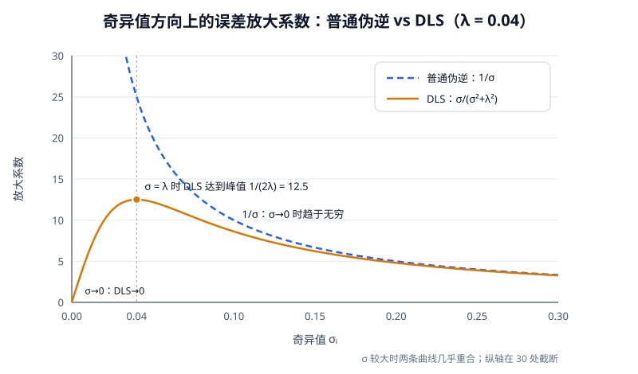

<p align="center"><b>图 5-13</b> 奇异值方向上的误差放大系数：σ 较大时 DLS 与普通伪逆几乎相同；σ 趋于 0 时普通伪逆趋于无穷，DLS 反而趋于 0，峰值为 1/(2λ) = 12.5</p>

| $\sigma_i$ | 普通伪逆 $1/\sigma_i$ | DLS $\sigma_i/(\sigma_i^2+\lambda^2)$， $\lambda=0.04$ |
|---:|---:|---:|
| 0.50 | 2.0 | 1.99 |
| 0.10 | 10.0 | 8.62 |
| 0.04 | 25.0 | 12.5 |
| 0.01 | 100.0 | 5.88 |

**手算案例：接近伸直的二连杆**。令 $q=(30^\circ, 5^\circ)$，手臂几乎伸直（末端距原点 0.549 m，接近 0.55 m 的外边界）。此时 $\mathbf{J}_v$ 的奇异值为 $0.6036$ 和 $0.0108$，弱方向 $\mathbf{u}_2\approx(0.841, 0.541)$ 大致指向"沿手臂向外"。若要求末端沿弱方向移动 1 cm：

- 普通伪逆： $\Delta\mathbf{q}=(0.382,\ -0.841)$ rad，约 $(21.9^\circ, -48.2^\circ)$——为了 1 cm 让关节转了近 50°，放大约 92 倍；
- DLS（ $\lambda=0.04$）： $\Delta\mathbf{q}=(0.026,\ -0.057)$ rad，约 $(1.5^\circ, -3.3^\circ)$，放大约 6.3 倍，与表中 $\sigma=0.01$ 那一行（5.88）同一量级。

DLS 宁可这一步少走一点，也不让关节剧烈翻转；剩下的误差在后续迭代中、姿态远离奇异后再慢慢消除。

因此，DLS 不会无限放大机械臂难以实现的运动方向，而是选择更小、更保守的关节修正。它可以缓解奇异点附近的数值发散，但不能消除机械臂结构本身的奇异性，也不能让不可达目标变得可达。

### 4.5 冗余自由度、零空间和关节限位

**直观理解**：G2 单臂有 7 个关节，而完整末端位姿只有 6 个约束，因此 Jacobian 有 7 列、最多 6 个独立任务方向。多出的自由度形成 Jacobian 的**零空间**（null space）。在零空间里动关节，相当于"手不动、胳膊动"。

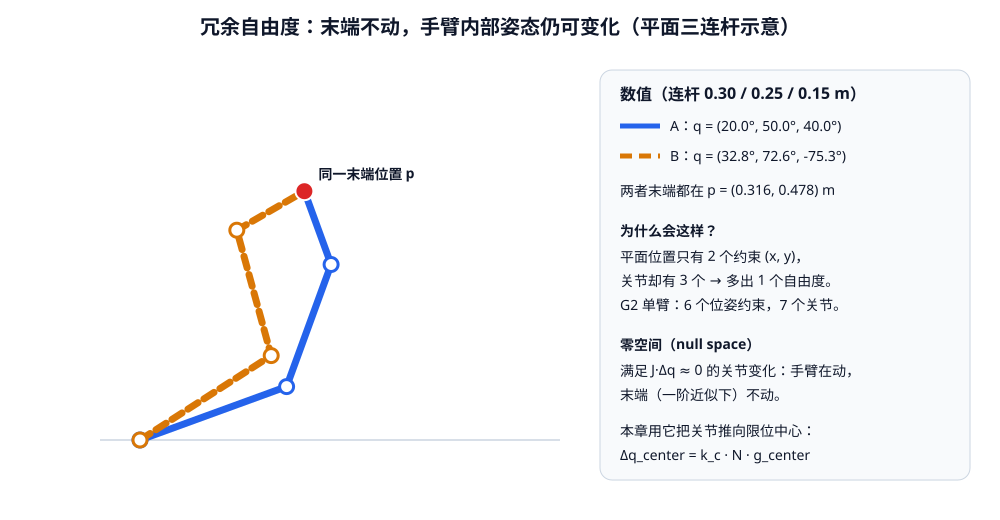

<p align="center"><b>图 5-14</b> 平面三连杆（3 个关节、2 个位置约束）的两种构型：末端位置完全相同，内部姿态不同。构型之间的连续变化就是在零空间中运动</p>

图 5-14 的数值可以自行验证：连杆 0.30/0.25/0.15 m，构型 A $q=(20^\circ,50^\circ,40^\circ)$ 与构型 B $q=(32.8^\circ,72.6^\circ,-75.3^\circ)$ 的末端都位于 $(0.316, 0.478)$ m。

零空间中的关节变化满足：

$$
\mathbf{J}\Delta\mathbf{q}_{null}\approx\mathbf{0}
$$

这表示机械臂可以改变部分内部姿态，同时尽量不影响当前末端任务。

DLS 伪逆对应的零空间投影矩阵为：

$$
\mathbf{N} = \mathbf{I}-\mathbf{J}_{DLS}^{\dagger}\mathbf{J}
$$

$\mathbf{N}$ 是 $7\times7$ 矩阵，任何向量乘上它以后，都会被"去掉"会影响末端的那部分。由于 DLS 有阻尼， $\mathbf{N}$ 只是近似投影：以 G2 左臂 HOME 的位置 Jacobian 为例， $\|\mathbf{J}\mathbf{N}\|\approx0.012$，而 $\|\mathbf{J}\|\approx1.27$，残留影响约 1%，可以忽略。

关节上下限中心为：

$$
\mathbf{q}_{center} = \frac{\mathbf{q}_{min}+\mathbf{q}_{max}}{2}
$$

为了让关节远离限位，可以构造指向关节中心的修正方向，再投影到零空间：

$$
\Delta\mathbf{q}_{center} = k_c\mathbf{N}\mathbf{g}_{center}
$$

代码中 $\mathbf{g}_{center}$ 的第 $i$ 个分量为 $g_i=\dfrac{q_{center,i}-q_i}{h_i^2}$， $h_i=\dfrac{q_{max,i}-q_{min,i}}{2}$ 是半量程。除以 $h_i^2$ 的作用是：量程窄的关节（如 J6 只有 $\pm60^\circ$）偏离中心同样角度时，被推回去的力度更大。 $k_c$ 是关节居中增益，本章默认 `0.03`。最终修正量为：

$$
\boxed{ \Delta\mathbf{q} = \mathbf{J}_{DLS}^{\dagger}\mathbf{e} + \Delta\mathbf{q}_{center} }
$$

更新以后还要执行关节限位裁剪：

$$
\mathbf{q} = \mathrm{clip} (\mathbf{q},\mathbf{q}_{min},\mathbf{q}_{max})
$$

**对应代码**（`kinematics.py`）：

```python
center = (self.lower_limits + self.upper_limits) * 0.5                       # q_center
half_range = np.maximum((self.upper_limits - self.lower_limits) * 0.5, 1e-6) # h
# ...（循环内）
# 冗余自由度用于远离关节上下限。
normalized_center_error = (center - q) / (half_range * half_range)           # g_center
nullspace = np.eye(7) - pseudo_inverse @ jacobian                            # N = I − J# J
delta_q += cfg.joint_center_gain * (nullspace @ normalized_center_error)     # + k_c N g
```

**手算案例**：在 HOME 处， $\mathbf{g}_{center}$ 的非零分量为：J2： $(0-(-0.35))/2.0944^2=0.0798$；J4： $(-0.7418-(-1.10))/1.7889^2=0.1119$；J6： $(0-0.35)/1.0472^2=-0.3192$。可见 J6 被推回中心的意愿最强。乘以 $k_c=0.03$ 后最大只有约 0.01 rad，比主任务修正量小得多——它只是"顺手"利用冗余，不会抢走末端任务。

零空间关节居中不能保证避开所有奇异姿态，也不能代替碰撞检测，但它比完全忽略冗余自由度更稳定，尤其适合展示 7 自由度机械臂为什么会出现多组 IK 解。

IK 的初始值也会影响最终结果。本章默认使用当前关节角作为初始值，使求解结果倾向于靠近机械臂当前姿态，通常可以减少突然翻肘或跨越较大关节角的情况。若调用 `inverse()` 时不传初值，代码会改用限位中心作为初值：

```python
if initial_positions is None:
    q = (self.lower_limits + self.upper_limits) * 0.5
else:
    q = _as_vector(initial_positions, 7, "initial_positions").copy()
q = np.clip(q, self.lower_limits, self.upper_limits)
```

### 4.6 完整迭代过程与停止条件

从初始关节角 $\mathbf{q}_0$ 开始，一次 DLS-IK 迭代包含以下步骤：

1. 使用 FK 计算当前末端位置和姿态；
2. 计算当前位置误差，完整位姿 IK 还要计算姿态误差；
3. 计算当前关节姿态下的 Jacobian；
4. 使用 DLS 伪逆计算主任务关节修正量；
5. 加入 4.5 节介绍的零空间关节居中修正；
6. 限制单次最大关节步长并执行关节限位裁剪；
7. 更新关节角，再次计算末端误差；
8. 若误差足够小则返回成功，否则继续迭代。

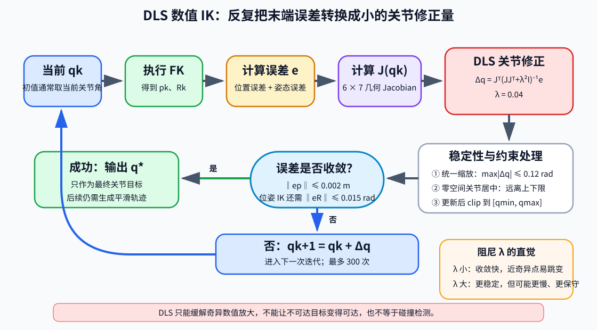

<p align="center"><b>图 5-15</b> DLS IK 在 FK、误差、Jacobian 和关节修正之间循环，并同时处理步长、零空间居中和关节限位</p>

关节角更新为：

$$
\mathbf{q}_{k+1} = \mathbf{q}_{k}+\Delta\mathbf{q}_{k}
$$

本章限制单次最大关节修正量为：

$$
\max_i|\Delta q_i| \le 0.12\text{ rad}
$$

如果某次计算得到的最大关节增量超过该值，就对整个 $\Delta\mathbf{q}$ 进行统一缩放，而不是分别裁剪每个分量。这样可以保留关节修正方向，只减小本次迭代的步长。

```python
largest_step = float(np.max(np.abs(delta_q)))
if largest_step > cfg.max_joint_step:
    delta_q *= cfg.max_joint_step / largest_step       # 等比例缩放，方向不变
q = np.clip(q + delta_q, self.lower_limits, self.upper_limits)
```

位置式 IK 的收敛条件为：

$$
\|\mathbf{e}_{p}\|_2 \le 0.002\text{ m}
$$

即末端位置误差不超过 `2 mm`。完整位姿 IK 还要求：

$$
\|\mathbf{e}_{R}\|_2 \le 0.015\text{ rad}
$$

（约 0.86°）。如果达到最大 300 次迭代仍未满足条件，求解器返回 `success=False`，而不是把未收敛结果直接发送给机械臂。

```python
if position_norm <= cfg.position_tolerance and (
    target_r is None or orientation_norm <= cfg.orientation_tolerance
):
    return IKResult(q.copy(), True, iteration - 1,
                    position_norm, orientation_norm)
# ...（循环结束仍未返回）
return IKResult(q.copy(), False, cfg.max_iterations,
                position_norm, orientation_norm)
```

注意收敛检查发生在本轮更新**之前**，所以返回的 `iterations = iteration - 1` 是"实际做了多少次关节更新"。

以上所有参数统一由数据类保存（`config.py`），调节容差和阻尼时不需要修改 IK 主循环：

```python
@dataclass(frozen=True)
class IKConfig:
    """阻尼最小二乘 IK 参数。"""

    max_iterations: int = 300
    position_tolerance: float = 0.002       # m
    orientation_tolerance: float = 0.015    # rad
    damping: float = 0.04
    max_joint_step: float = 0.12            # 每次迭代的最大关节增量，rad
    orientation_weight: float = 0.35
    joint_center_gain: float = 0.03
```

IK 结果用数据类返回：

```python
@dataclass(frozen=True)
class IKResult:
    """逆运动学求解结果。"""

    joint_positions: np.ndarray
    success: bool
    iterations: int
    position_error: float
    orientation_error: float
```

### 4.7 案例：在 G2 左臂上跟踪一次 IK 迭代

`kinematics.py` 只依赖 NumPy，可以不启动 Isaac Sim 直接运行。以 `demo_target_position.py` 的默认左臂目标 $\mathbf{p}_d=[0.50, 0.35, 0.45]$ m、从 HOME 出发的位置式 IK 为例：

- **第 0 步**：HOME 末端在 $[0.6356, 0, 0.6699]$，误差 $\mathbf{e}_p=[-0.1356,\ 0.35,\ -0.2199]$， $\|\mathbf{e}_p\|=435$ mm；
- **主任务修正**： $\mathbf{J}_{DLS}^\dagger\mathbf{e}_p=[0.331, 0.827, 0.235, -1.373, -0.042, -0.102, -0.123]$ rad，最大分量是 J4 的 1.373 rad——远超 0.12 rad 的步长上限；
- **零空间项**：约 $[0, 0.0018, 0, 0.0019, 0, -0.0100, 0]$ rad，很小；
- **统一缩放**：整体乘以 $0.12/1.373\approx0.0875$，J4 这一步只走 -0.12 rad，其余分量同比例缩小；
- **结果**：更新后误差降到 397 mm。

继续迭代，每一步的位置误差（mm）依次为：

```text
435.011 → 396.551 → 349.956 → 292.117 → 216.011 → 96.570 → 8.798 → 0.371
```

前 5 步受步长限制，几乎匀速逼近；离目标较近后不再触发缩放，DLS 发挥"类牛顿法"的快速收敛，第 7 次更新后误差 0.371 mm < 2 mm，返回 `success=True, iterations=7`，关节角约 $[17.52, -10.36, 15.66, -94.89, -2.37, 12.42, -7.23]^\circ$，与 8.3 节仿真日志中的位置式 IK 结果一致。若把目标改成明显不可达的 $[3.0, 0, 0]$ m，300 次迭代后残差仍有约 2.17 m，返回 `success=False`。

> 💡 **要点**：步长限制 0.12 rad 让 IK 在离目标很远时"稳稳地走"，阻尼 0.04 让它在奇异点附近"不乱跳"，零空间居中让它"顺便远离限位"，容差 2 mm / 0.015 rad 决定"什么时候停"。四个参数各管一件事。

### 4.8 DLS-IK 在完整控制链中的位置

DLS-IK 只负责把末端目标转换成最终目标关节角：

```text
目标末端位姿
      ↓
DLS 数值 IK
      ↓
目标关节角 q*
```

它本身不是关节控制器，也不会直接产生平滑的物理运动。IK 成功以后，还要由第五部分的轨迹生成器把当前关节角和目标关节角连接成连续轨迹，再由 USD/PhysX 中的关节 drive 跟踪每个物理步的位置目标：

```text
目标关节角 q*
      ↓
关节轨迹生成
      ↓
连续位置目标 q(t)
      ↓
关节 drive 位置闭环
      ↓
机械臂实际运动
```

因此，DLS-IK 解决的是"关节角与末端位姿之间如何转换"，轨迹生成解决的是"如何平滑到达目标"，关节 drive 解决的是"物理关节如何跟踪每一个轨迹点"。三者不能相互替代。

DLS 可以提高奇异点附近的数值稳定性，但仍不包含自身碰撞检测、环境碰撞检测和全局路径规划。IK 返回成功只表示在当前运动学模型和误差阈值下找到了关节解，不代表从当前姿态到该目标的整段运动一定安全。

控制器层对 IK 做了一层很薄的封装，默认把当前关节角作为初值（`arm_controller.py`）：

```python
def solve_ik(self, target_position, target_rotation=None, initial_positions=None) -> IKResult:
    """调用本章自行实现的阻尼最小二乘 IK。"""
    seed = self.get_joint_positions() if initial_positions is None else initial_positions
    return self.kinematics.inverse(target_position, target_rotation, seed)
```

---

## 第五部分 关节轨迹、关节 PD 控制与双臂同步

### 5.1 三次时间缩放轨迹

**直观理解**：IK 只给出最终目标关节角，不应该在一个物理步内让关节直接从当前位置跳到目标。就像开车不能从 0 瞬间变到 60 km/h，机械臂也需要"起步慢、中间快、到站前减速"。为了得到平滑运动，本章使用三次时间缩放（cubic time scaling）。

设轨迹总时间为 $T$（s），归一化时间为：

$$
\tau=\frac{t}{T}, \qquad0\le\tau\le1
$$

三次时间缩放函数为：

$$
\boxed{ s(\tau)=3\tau^2-2\tau^3 }
$$

关节轨迹为：

$$
\boxed{ \mathbf{q}(t) = \mathbf{q}_0+s(\tau) (\mathbf{q}_d-\mathbf{q}_0) }
$$

其中 $\mathbf{q}_0$ 是起点关节角， $\mathbf{q}_d$ 是目标关节角， $s$ 是从 0 到 1 的"进度"。所有关节共用同一个 $s(\tau)$，所以它们同时出发、同时到达，在关节空间中走的是一条直线。该函数满足：

$$
s(0)=0, \quad s(1)=1, \quad \dot s(0)=0, \quad \dot s(1)=0
$$

**推导**：设 $s(\tau)=a_0+a_1\tau+a_2\tau^2+a_3\tau^3$，四个边界条件 $s(0)=0$、 $s(1)=1$、 $s'(0)=0$、 $s'(1)=0$ 依次给出 $a_0=0$、 $a_1=0$、 $a_2+a_3=1$、 $2a_2+3a_3=0$，解得 $a_2=3$、 $a_3=-2$。

因此机械臂从静止开始，在终点以零速度停止，比关节角线性跳变更平滑。速度为 $\dot{\mathbf{q}}(t)=\frac{6\tau(1-\tau)}{T}(\mathbf{q}_d-\mathbf{q}_0)$，在 $\tau=0.5$ 时最大，等于平均速度 $\frac{\mathbf{q}_d-\mathbf{q}_0}{T}$ 的 1.5 倍。

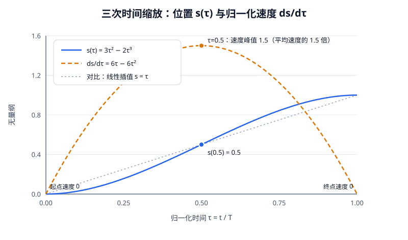

<p align="center"><b>图 5-16</b> 三次时间缩放：位置进度 s(τ) 呈 S 形，速度 ds/dτ 呈抛物线，首尾为 0、中点峰值 1.5；灰色虚线为线性插值对比</p>

程序还根据关节角变化和速度上限自动检查最短持续时间。为了给物理关节留出跟踪余量，平均关节速度不超过模型速度上限的 60%。如果用户指定时间过短，程序会自动延长轨迹时间：

$$
T_{min}=\max_i\frac{|q_{d,i}-q_{0,i}|}{0.6\,\dot q_{max,i}}
$$

**对应代码**（`code/code_chapter5/arm_controller.py`）：

```python
def make_trajectory(self, target_positions, duration, dt, start_positions=None) -> np.ndarray:
    """生成三次时间缩放轨迹 q=q0+(3t²-2t³)(q1-q0)。"""
    if duration <= 0.0 or dt <= 0.0:
        raise ValueError("duration 和 dt 必须大于 0")
    start = self.get_joint_positions() if start_positions is None else self._check_positions(start_positions)
    target = self.clamp_positions(target_positions)                # 目标先做限位裁剪

    # 自动保证平均速度不超过 URDF 速度上限的 60%，给物理 drive 留出余量。
    minimum_duration = float(np.max(np.abs(target - start) / (0.6 * self.velocity_limits)))  # T_min
    duration = max(float(duration), minimum_duration)
    steps = max(2, int(np.ceil(duration / dt)))                    # 轨迹点数 = T / dt
    tau = np.linspace(0.0, 1.0, steps + 1)[1:]                     # 去掉 τ=0（当前点）
    scale = 3.0 * tau**2 - 2.0 * tau**3                            # s(τ)
    return start[None, :] + scale[:, None] * (target - start)[None, :]   # 形状 (steps, 7)
```

执行轨迹时，每个物理步发送一个关节目标并推进仿真，结束后再保持 0.25 s 让物理闭环收敛：

```python
def move_to(self, target_positions, duration, dt, step_callback) -> np.ndarray:
    """沿平滑轨迹运动；step_callback 通常传入 simulation.step。"""
    trajectory = self.make_trajectory(target_positions, duration, dt)
    for waypoint in trajectory:
        self.command_positions(waypoint)       # 发送这一物理步的位置目标
        step_callback()                        # 推进一步仿真
    final_target = trajectory[-1]
    # 额外保持少量时间，让物理位置闭环收敛。
    for _ in range(max(1, int(0.25 / dt))):
        self.command_positions(final_target)
        step_callback()
    return self.get_joint_positions()
```

发送单臂关节位置目标前，先进行数据检查和关节限位：

```python
def command_positions(self, positions: Sequence[float]) -> np.ndarray:
    """发送位置目标；返回经过关节限位后的实际命令。"""
    from isaacsim.core.utils.types import ArticulationAction

    target = self.clamp_positions(positions)
    self.articulation.apply_action(
        ArticulationAction(
            joint_positions=target,
            joint_indices=self.joint_indices,
        )
    )
    return target
```

**案例**：`demo_joint_control.py` 中让 J1 从 HOME 转 0.30 rad、给定 1.2 s。物理频率 `physics_hz = 120`， $dt=1/120$ s：

- 最短时间 $T_{min}=0.30/(0.6\times3.1416)=0.159$ s < 1.2 s，不需要延长；
- 轨迹点数 $\lceil1.2/(1/120)\rceil=144$，再加保持段 $\lfloor0.25\times120\rfloor=30$ 步；
- 最大关节速度 $1.5\times0.30/1.2=0.375$ rad/s，出现在 0.6 s 处，仅为速度上限的 12%；
- 若改成让某关节转 3 rad 却只给 1 s，程序会自动把时间延长到 $3/(0.6\times3.1416)=1.59$ s。

> ⚠️ **注意**：三次时间缩放在关节空间是直线，在任务空间（末端轨迹）一般是曲线。如果需要"夹爪沿直线下降"，必须在任务空间插值多个中间点并逐点求 IK，这超出了本章范围。

### 5.2 关节 PD 控制原理

**直观理解**：轨迹给出了每一时刻"关节应该在哪"，但电机并不会自动待在那里。控制层要解决的是：当前关节角 $\mathbf{q}$ 如何稳定地靠近目标？最常用的入门控制律是 PID（比例–积分–微分）：

$$
\mathbf{u} =
\mathbf{K}_p(\mathbf{q}^{*}-\mathbf{q})
+ \mathbf{K}_i\int(\mathbf{q}^{*}-\mathbf{q})dt
- \mathbf{K}_d\dot{\mathbf{q}}
$$

各符号含义：

- $\mathbf{q}^*$：目标关节角（rad），来自 IK 或轨迹点； $\mathbf{q}$、 $\dot{\mathbf{q}}$：当前关节角（rad）和角速度（rad/s）；
- $\mathbf{K}_p$：比例增益，"离目标越远，推得越用力"；
- $\mathbf{K}_i$：积分增益，对长期累积误差做补偿，常用于消除稳态误差；
- $\mathbf{K}_d$：微分（阻尼）增益，"速度已经很大时，适当刹车"；
- $\mathbf{u}$：控制输出，可以是关节力矩，也可以是关节速度命令，取决于下游执行器。

本章使用 PD，也就是把积分项去掉：

$$
\mathbf{u} =
\mathbf{K}_p(\mathbf{q}^{*}-\mathbf{q})
- \mathbf{K}_d\dot{\mathbf{q}}
$$

积分项常用于消除长期稳态误差，但在仿真关节控制和入门抓取演示里，积分项容易带来超调和调参负担，所以先用 PD 就足够清楚。注意微分项用的是 $-\mathbf{K}_d\dot{\mathbf{q}}$ 而不是 $\mathbf{K}_d(\dot{\mathbf{q}}^*-\dot{\mathbf{q}})$：目标速度视为 0，目标突然变化时不会产生"微分冲击"。

**PD 作为力矩控制：一个可手算的单关节模型**。若 $u$ 是力矩 $\tau$（N·m），单个关节近似为转动惯量 $I$（kg·m²）的刚体： $I\ddot q=K_p(q^*-q)-K_d\dot q$。这是一个弹簧–阻尼系统： $K_p$ 像弹簧刚度， $K_d$ 像阻尼器。整理得

$$
\ddot q+\frac{K_d}{I}\dot q+\frac{K_p}{I}q=\frac{K_p}{I}q^*,\qquad
\omega_n=\sqrt{\frac{K_p}{I}},\qquad \zeta=\frac{K_d}{2\sqrt{K_pI}}
$$

$\omega_n$ 是固有频率（rad/s），决定响应快慢； $\zeta$ 是阻尼比，决定是否超调： $\zeta<1$ 欠阻尼会超调振荡， $\zeta=1$ 临界阻尼最快且不超调， $\zeta>1$ 过阻尼不超调但变慢。

**案例**（教学参数，不是 G2 实际参数）： $I=0.5$ kg·m²， $K_p=50$ N·m/rad，则 $\omega_n=\sqrt{100}=10$ rad/s。

- $K_d=3$： $\zeta=3/(2\sqrt{25})=0.3$，超调量 $e^{-\pi\zeta/\sqrt{1-\zeta^2}}\approx37\%$，峰值时间 $\pi/(\omega_n\sqrt{1-\zeta^2})\approx0.33$ s；
- $K_d=10$： $\zeta=1.0$，临界阻尼；
- $K_d=25$： $\zeta=2.5$，过阻尼，1.5 s 时仍只到目标的约 95%。

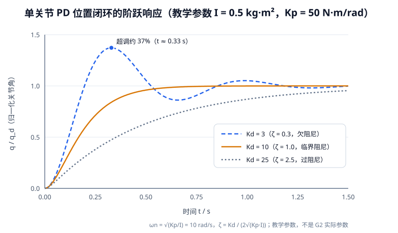

<p align="center"><b>图 5-17</b> 单关节 PD 位置闭环的阶跃响应：Kd 太小会超调振荡，太大则响应迟缓，临界阻尼附近最理想（教学参数）</p>

**PD 作为速度命令**。若下游执行器接收的是关节速度（如 `ArticulationAction(joint_velocities=...)`），则 $\mathbf{u}$ 就是速度命令（rad/s）， $K_p$ 的单位变为 1/s：误差 1 rad 时以 $K_p$ rad/s 的速度去追。此时通常还要加速度限幅 $|u_i|\le v_{max}$。**案例**： $K_p=8.0$、 $K_d=1.2$、 $v_{max}=1.5$ rad/s，当前误差 0.5 rad、速度 0 时， $u=8.0\times0.5=4.0$ rad/s，被限幅到 1.5 rad/s；当误差缩小到 0.1 rad、速度 0.5 rad/s 时， $u=0.8-0.6=0.2$ rad/s，关节明显"刹车"。

### 5.3 本章主线为什么不在 Python 层实现 PID

本章主线代码（`code/code_chapter5`）不在 Python 层额外实现 PID，原因是 G2 的 USD 关节已经配置了 PhysX angular drive，其中包含位置刚度和阻尼。其作用类似底层 PD 位置闭环：

$$
\tau =K_p(q_d-q)-K_d\dot q
$$

本章模型中的主要参数为：

```text
stiffness = 10000
damping   = 1000
```

`stiffness` 对应 $K_p$，`damping` 对应 $K_d$。上层代码发送连续位置目标（`ArticulationAction(joint_positions=...)`），底层 drive 负责产生关节作用力并跟踪目标。如果在 Python 层再叠加一套 PID 力矩控制，会形成双重闭环，增加参数调节难度，也会掩盖本章 FK、IK 和轨迹生成的重点。

当课程进入机器人动力学、重力补偿、力矩控制或柔顺控制时，再自行实现 PID、计算力矩控制或阻抗控制更合适。

对比两种做法：

| | 主线 `code_chapter5` | 早期示例 `JointPDController` |
|---|---|---|
| PD 在哪里算 | PhysX 关节 drive 内部 | Python 物理回调中 |
| 上层下发 | 每步一个位置目标 `joint_positions` | 每步一个速度命令 `joint_velocities` |
| 控制律 | $\tau=K_p(q_d-q)-K_d\dot q$（力矩） | $u=K_p(q^*-q)-K_d\dot q$（速度，再限幅） |
| 参数 | `stiffness = 10000`，`damping = 1000`（USD 中） | `kp=8.0`，`kd=1.2`，`max_velocity=1.5`（示例） |
| 平滑性来源 | 三次时间缩放轨迹 | PD 自身的收敛 + 速度限幅，或 Ruckig 轨迹 |

> 💡 **要点**：两种方式的控制律形状完全相同，区别只是"输出是什么"和"在哪一层计算"。理解了 PD，读懂两份代码就没有障碍。

### 5.4 双臂同步控制

双臂同步控制不能简单地先调用一次左臂控制，再调用一次右臂控制。即使两次调用间隔很短，也可能导致动作时间轴不完全一致——先执行完左臂整条轨迹再执行右臂，就变成了"先左后右"。

本章为左右臂分别生成长度相同的轨迹：

$$
\mathbf{Q}_L= \{\mathbf{q}_{L,0},\ldots,\mathbf{q}_{L,N}\}
$$

$$
\mathbf{Q}_R= \{\mathbf{q}_{R,0},\ldots,\mathbf{q}_{R,N}\}
$$

每个物理步同时取出左右两个轨迹点，并在一个 `ArticulationAction` 中发送 14 个关节位置目标：

$$
\mathbf{q}_{both} = \begin{bmatrix} \mathbf{q}_{L}\\ \mathbf{q}_{R} \end{bmatrix}
$$

这样可以保证两条机械臂共享同一条时间轴。

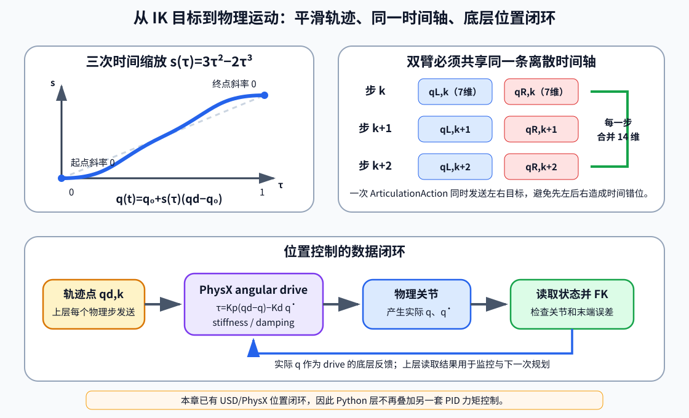

<p align="center"><b>图 5-18</b> IK 结果先经过三次时间缩放；左右臂在每个物理步合并发送，底层 PhysX drive 完成关节位置闭环</p>

**对应代码**（`arm_controller.py` 中 `G2DualArmController`）。关键是两边用**同一个** `duration`（取三者最大值）和同一个 `scale`：

```python
duration = max(float(duration), float(left_minimum), float(right_minimum))  # 两臂取最慢者
steps = max(2, int(np.ceil(duration / dt)))
tau = np.linspace(0.0, 1.0, steps + 1)[1:]
scale = 3.0 * tau**2 - 2.0 * tau**3                                          # 共用 s(τ)

left_trajectory = starts["left"][None, :] + scale[:, None] * (
    left_goal - starts["left"]
)[None, :]
right_trajectory = starts["right"][None, :] + scale[:, None] * (
    right_goal - starts["right"]
)[None, :]
```

双臂控制器把左右 7 个关节目标合并成 14 个关节目标，并在同一个 action 中发送：

```python
def command_positions(self, left_positions, right_positions):
    """在同一个 ArticulationAction 中发送左右臂目标。"""
    from isaacsim.core.utils.types import ArticulationAction

    left_target = self.left.clamp_positions(left_positions)
    right_target = self.right.clamp_positions(right_positions)
    targets = np.concatenate((left_target, right_target))     # q_both，14 维
    self.articulation.apply_action(
        ArticulationAction(
            joint_positions=targets,
            joint_indices=self.joint_indices,                 # 左 7 个 + 右 7 个下标
        )
    )
    return {"left": left_target, "right": right_target}
```

视觉同向关节目标由中心姿态和左臂增量生成：

```python
def mirrored_targets(self, center_positions, left_offsets):
    center = self.left._check_positions(center_positions)
    offsets = self.left._check_positions(left_offsets)
    return {
        "left": self.left.clamp_positions(center + offsets),                 # q_c + Δq_L
        "right": self.right.clamp_positions(
            center + MIRRORED_JOINT_DELTA_SIGNS * offsets                    # q_c + s_q ⊙ Δq_L
        ),
    }
```

双臂的不同任务按以下方式构造目标：

- 对于人为设计的对称关节动作，先使用奇数关节反号关系构造右臂目标，再同步执行（`move_mirrored()`）；
- 对于双臂 FK/IK 演示，先构造左右镜像关节姿态，分别通过左右 FK 得到真实末端目标，再让左右 IK 独立求解；
- 对于直接输入末端位置，两个目标都是 `arm_base_link` 下的绝对坐标。如果希望视觉同向，按 `[x, y, z] → [x, y, -z]` 构造右臂目标；如果确实希望两只手到达两个不对称位置，也可以分别输入任意可达目标。

`solve_ik()` 的双臂版本分别求解、各自用自己的当前关节角做初值（`arm_controller.py`）：

```python
def solve_ik(self, left_position, right_position, left_rotation=None, right_rotation=None):
    """分别求解左右臂 IK；两边都成功后再同步执行。"""
    current = self.get_joint_positions()
    return {
        "left": self.left.solve_ik(left_position, left_rotation, current["left"]),
        "right": self.right.solve_ik(right_position, right_rotation, current["right"]),
    }
```

### 5.5 算法边界

本章算法仍有以下边界：

- IK 不包含机器人自身碰撞和环境碰撞检测；
- 关节轨迹只在关节空间插值，末端路径不一定是直线；
- 位置式 IK 不约束夹爪朝向，最终姿态可能与预想不同；
- 单个末端位姿可能存在多组关节解，结果受初始值影响；
- DLS 可以缓解奇异问题，但不能让不可达目标变得可达；
- 本章主线代码只控制机械臂，不控制夹爪开合，也不执行物体抓取（抓取流程见第六部分早期示例）。

这些内容将在第六章移动与抓取，以及后续视觉抓取章节中继续扩展。

---

## 第六部分 工程化实现：Lula IK、PD 串联与抓取流程

本部分整理自本章补充文档，对应仓库中的 G2 **早期示例代码** `code_pre_alpha/g2_robot`。它与第三至五部分讲的原理一一对应，只是把"手写 DLS-IK"换成了 Isaac Sim 自带的 Lula 求解器，并加入了 Ruckig 轨迹、PD 速度控制和夹爪抓取。阅读时请把它当作"同一套思想的工程版本"。

### 6.1 主线实现与早期示例的对照

| 环节 | 主线 `code/code_chapter5` | 早期示例 `code_pre_alpha/g2_robot` |
|---|---|---|
| FK | 自编 `G2ArmKinematics.forward()`，纯 NumPy | `ArticulationKinematicsSolver.compute_end_effector_pose()` |
| IK | 自编 DLS-IK（阻尼 + 零空间居中 + 步长限制） | `LulaKinematicsSolver` + 三层 fallback |
| 运动学参数来源 | 按 G2 模型参数写在代码里，并与 USD 核对 | URDF + Lula YAML 描述文件 |
| 轨迹 | 三次时间缩放 | Ruckig（约束速度、加速度和 jerk） |
| 关节控制 | PhysX drive 位置闭环 | `JointPDController` 速度命令，或直接下发位置 |
| 夹爪/抓取 | 不涉及 | `PickController` 抓取状态机 |

主线的目的是"把原理看清楚"，早期示例的目的是"把任务跑起来"。学懂主线后，再看 Lula 的接口就会发现：它做的仍然是"FK → 误差 → Jacobian → 修正"的迭代。

### 6.2 早期示例的代码文件与外部资源

早期示例主要对应以下代码：

| 文件 | 作用 |
| --- | --- |
| `code_pre_alpha/g2_robot/core/constants.py` | G2 左右臂 7 个关节名、躯干/头部固定姿态、轮组参数等常量 |
| `code_pre_alpha/g2_robot/core/sim_setup.py` | 设置躯干姿态，初始化左右臂 Lula IK、夹爪和 Ruckig 轨迹器 |
| `code_pre_alpha/g2_robot/controllers/arm.py` | 机械臂直接关节控制、IK 求解、轨迹执行和抓取状态机 |
| `code_pre_alpha/g2_robot/controllers/trajectory.py` | 基于 Ruckig 的关节空间平滑轨迹生成 |
| `code_pre_alpha/g2_robot/controllers/joint_pd.py` | 本章新增的关节空间 PD 速度控制器 |
| `code_pre_alpha/g2_robot/examples/test_pick.py` | 使用右臂 IK、轨迹和夹爪完成一次抓取演示 |

现有 G2 示例依赖 Isaac Sim、Genie Sim 代码仓库和 Genie Sim Assets 资产仓库。Hello Robotics 当前仓库只保留了教学代码，并没有内置完整的 G2 USD、URDF、mesh 和场景资产；如果直接运行示例，最常见的报错就是找不到 `robot/G2_omnipicker/robot_fix.usda` 或 Lula 的机器人描述文件。

运行示例前，需要准备两类外部资源：

| 环境变量 | 指向内容 | 推荐来源 |
| --- | --- | --- |
| `SIM_REPO_ROOT` | Genie Sim 代码目录，至少包含 `source/data_collection/config/robot_cfg/G2/` 和 `source/geniesim/app/robot_cfg/G2_omnipicker/` | `https://github.com/AgibotTech/genie_sim` |
| `SIM_ASSETS` | Genie Sim Assets 资产目录，至少包含 `robot/G2_omnipicker/` 和本章示例用到的 `background/room/room_1/` | `https://huggingface.co/datasets/agibot-world/GenieSimAssets` 或 ModelScope 同名资产集 |

具体运行命令见 8.1 节。

### 6.3 Lula IK 的初始化与固定关节

FK 在早期示例中主要通过 Isaac Sim 的 `ArticulationKinematicsSolver` 间接获得。例如 `test_heart_only_ik.py` 中会调用：

```python
ee_pos, ee_quat = arm_ctrl.ik_solver["art"].compute_end_effector_pose()
```

这个调用背后的含义就是：读取当前 articulation 的关节状态，沿 URDF/Lula 定义的运动链计算末端 link 的世界位姿——和 3.3 节的 `_chain()` 做的是同一件事。对右臂来说，末端 link 使用 `gripper_r_center_link`；对左臂来说，末端 link 使用 `gripper_l_center_link`。

> ⚠️ **注意**：`compute_end_effector_pose()` 返回的是**世界**位姿，而主线 `forward()` 返回的是 **`arm_base_link`** 下的位姿。两套代码混用时务必先统一坐标系（见 1.3 节）。早期抓取示例中的目标点 `[-4.03, -0.032, 0.91]` 显然是世界坐标，不能直接交给主线的 IK。

IK 方面，早期示例没有在教程层手写迭代，而是调用 Isaac Sim 的 Lula 求解器。关键初始化过程在 `SimSetup._init_ik_solvers()`：

```python
right_lula = LulaKinematicsSolver(
    robot_description_path=right_desc,
    urdf_path=urdf_path,
)
right_solver = ArticulationKinematicsSolver(
    self.articulation, right_lula, "gripper_r_center_link"
)
```

这里有两个重要文件：

| 文件 | 含义 |
| --- | --- |
| `G2_omnipicker.urdf` | 机器人完整连杆、关节和几何结构 |
| `G2_omnipicker_fixed_right.yaml` / `G2_omnipicker_fixed_left.yaml` | Lula 的关节空间描述，指定哪些关节参与求解，哪些关节固定 |

G2 不是一条单纯的 7 轴机械臂，它还有躯干和头部。从 URDF 的根部到夹爪，运动链要经过躯干关节；Lula 只求解手臂 7 个关节，其余关节必须被"冻结"在某个确定的值上。现有代码会先把躯干和头部设置到标准姿态，再把这些实际关节值写入临时 Lula YAML：

```python
for rule in lula_desc["cspace_to_urdf_rules"]:
    if rule["rule"] == "fixed" and rule["name"] in FIXED_JOINT_TARGETS:
        idx = next(i for i, d in enumerate(dof_names) if d == rule["name"])
        rule["value"] = float(current_joints[idx])
```

这一步非常关键。如果 Lula 以为躯干是一个姿态，而 Isaac Sim 里的 articulation 实际处在另一个姿态，末端位姿会出现系统性偏差，IK 可能表现为"目标看起来不远，但就是求不出来"。这与主线中"自编 FK 必须与 USD 核对"是同一个道理：**运动学模型必须与真实机器人状态一致**。

### 6.4 三层 fallback IK 与 IK→PD 串联

`ArmController.solve_ik()` 封装了一个比较实用的 fallback 流程：

```python
actions, success = art_solver.compute_inverse_kinematics(
    target_pos, target_orient
)

if not success and target_orient is not None:
    actions, success = art_solver.compute_inverse_kinematics(target_pos)

if not success:
    actions, success = art_solver.compute_inverse_kinematics(
        target_pos, position_tolerance=0.05
    )
```

这段逻辑对应三层尝试：

| 尝试 | 约束 | 适用情况 |
| --- | --- | --- |
| 第一次 | 位置 + 姿态 | 抓取、插入、对齐等对末端朝向敏感的任务 |
| 第二次 | 只约束位置 | 姿态不那么重要，或者目标姿态导致不可达 |
| 第三次 | 放宽位置误差 | 目标接近工作空间边界，需要允许小范围偏差 |

与主线对照：第一层对应 `demo_fk_ik.py` 的完整位姿 IK，第二层对应 `--position-only` / `demo_target_position.py` 的位置式 IK；第三层的 `position_tolerance=0.05`（若按米计即 5 cm）比主线的 2 mm 宽松得多，只适合"差不多到就行"的场合。

> ⚠️ **注意**：fallback 成功不等于"精确到达"。第二、三层成功时，夹爪朝向或位置可能与请求不同，后续抓取前最好用 FK 再检查一次实际末端位姿。

`solve_ik()` 返回的是 7 个手臂关节目标值。后续可以直接下发，也可以交给 Ruckig 或 PD 控制器做平滑执行。真实项目里建议大家尽量先生成轨迹再执行，因为直接把关节位置跳到目标值会造成不自然的运动，甚至在物理仿真里引入很大的瞬时速度。

**PD 控制器的实现**。早期示例新增的 `JointPDController` 位于：

```text
code_pre_alpha/g2_robot/controllers/joint_pd.py
```

核心计算只有一行，正是 5.2 节的速度式 PD：

```python
command = self.kp * (target - current_pos) - self.kd * current_vel
```

然后把速度限制在安全范围内，再通过 `ArticulationAction(joint_velocities=...)` 下发给 Isaac Sim。

**把 IK 和 PD 串起来**。下面的示例展示了一个最小闭环：先用 Lula IK 解目标末端位置，再用 PD 控制器把右臂关节推向 IK 结果。

```python
from g2_robot.controllers.arm import ArmController
from g2_robot.controllers.joint_pd import JointPDController
from g2_robot.core.sim_setup import SimSetup

sim_setup = SimSetup(boot.world, art, config).setup_all()

right_arm = ArmController(
    articulation=art,
    arm="right",
    ik_solver=sim_setup.ik_solvers["right"],
)

target_pos = [-4.03, -0.032, 0.91]
target_orient = [0.0, 1.0, 0.0, 0.0]
target_joints, ok = right_arm.solve_ik(target_pos, target_orient)

if not ok:
    raise RuntimeError("IK failed for target pose")

pd = JointPDController(
    articulation=art,
    joint_indices=right_arm.joint_indices,
    kp=8.0,
    kd=1.2,
    max_velocity=1.5,
)

def physics_callback(step_size):
    if not pd.is_reached(target_joints):
        pd.step(target_joints)

boot.world.add_physics_callback("right_arm_ik_pd", callback_fn=physics_callback)
```

代码解读：

- `target_pos` 是世界坐标中的预抓取点（物体 `[-4.03, -0.032, 0.81]` 上方 0.10 m），`target_orient = [0, 1, 0, 0]` 是夹爪朝下的 `wxyz` 四元数；
- IK 失败就直接抛异常，绝不把未收敛的结果发给机械臂（与主线 `success=False` 时 `raise RuntimeError` 的做法一致）；
- `physics_callback` 注册为物理回调，每个物理步执行一次 PD：没到达就继续 `pd.step()`，到达后停止。

这段代码可以帮助大家理解完整数据流：

```text
┌──────────────────────────┐
│ 目标末端位姿              │
│ position + quaternion    │
└────────────┬─────────────┘
             ↓
┌──────────────────────────┐
│ Lula IK  solve_ik()      │
└────────────┬─────────────┘
             ↓
┌──────────────────────────┐
│ 目标关节角 q*             │
└────────────┬─────────────┘
             ↓
┌──────────────────────────┐ ←──────────────────────┐
│ PD 控制器                 │                        │
│ Kp(q* - q) - Kd·qdot     │                        │
└────────────┬─────────────┘                        │
             ↓                                      │
┌──────────────────────────┐                        │
│ Isaac ArticulationAction │                        │
│ joint_velocities         │                        │
└────────────┬─────────────┘                        │
             ↓                                      │
┌──────────────────────────┐   ┌──────────────────┐ │
│ G2 机械臂运动             │ → │ 下一帧关节状态     │─┘
└──────────────────────────┘   │ q, qdot          │
                               └──────────────────┘
```

<p align="center"><b>图 5-19</b> IK 与 PD 串联的数据流：IK 只算一次目标关节角，PD 在每个物理步读取 q、q̇ 并输出速度命令，形成闭环</p>

需要注意的是，PD 控制适合解释闭环控制思想，也适合做简单的关节目标跟踪。若目标是抓取、搬运或连续轨迹执行，现有 `RuckigTrajectory` 更适合作为默认执行器，因为它会显式约束速度、加速度和 jerk（加加速度），让运动更平滑。纯 PD 跟踪一个远处的阶跃目标时，起步瞬间误差最大、速度命令会直接打到 `max_velocity` 上限，不如"先规划轨迹、再逐点跟踪"柔和。

### 6.5 抓取示例中的完整流程

`examples/test_pick.py` 已经把 G2 右臂的抓取流程串起来了：

1. 启动 Isaac Sim，加载 G2 USD 和房间场景。
2. 调用 `SimSetup.setup_all()`，设置躯干姿态并初始化右臂/左臂 IK。
3. 创建右臂 `ArmController`，传入右臂 IK、Ruckig 和夹爪。
4. 对预抓取点分别测试"位置 + 姿态 IK"和"只约束位置 IK"。
5. `PickController` 依次执行打开夹爪、移动到预抓取点、移动到抓取点、闭合夹爪、抬起物体。

其中预抓取、抓取和抬升目标这样定义：

```python
OBJECT_POS = np.array([-4.03, -0.032, 0.81])
PRE_GRASP_OFFSET = np.array([0.0, 0.0, 0.10])
GRASP_OFFSET = np.array([0.0, 0.0, 0.015])
LIFT_HEIGHT = 0.15
```

**案例：把偏移量换算成目标点**（世界坐标，单位 m）：

- 预抓取点 = `OBJECT_POS + PRE_GRASP_OFFSET` = $(-4.03, -0.032, 0.91)$——正是 6.4 节示例里的 `target_pos`；
- 抓取点 = `OBJECT_POS + GRASP_OFFSET` = $(-4.03, -0.032, 0.825)$，夹爪中心比物体中心高 1.5 cm；
- 抬升后 = 抓取点再向上 `LIFT_HEIGHT`，即 $z\approx0.975$（假设抬升沿竖直方向）。

```text
   打开夹爪
      ↓
   移动到预抓取点（物体上方 10 cm，夹爪朝下）
      ↓
   沿竖直方向下降到抓取点（物体上方 1.5 cm）
      ↓
   闭合夹爪
      ↓
   抬升 15 cm
```

<p align="center"><b>图 5-20</b> 抓取任务的五阶段拆解</p>

这是一种很常见的抓取任务拆解方式：不要直接冲向物体，而是先到物体上方的预抓取点，再沿接近方向下降，闭合夹爪后再抬升。这样可以减少碰撞和 IK 不稳定——从预抓取点到抓取点只差 8.5 cm，两次 IK 的解很接近，关节不会大幅翻转。

---

## 第七部分 代码结构与实现解析

### 7.1 文件组织

本章代码继续采用"运动学、控制器、仿真环境和演示程序分离"的结构：

```text
code/code_chapter5/
├── __init__.py
├── README.md
├── config.py
├── kinematics.py
├── arm_controller.py
├── simulation.py
├── demo_joint_control.py
├── demo_fk_ik.py
└── demo_target_position.py
```

各文件职责如下：

> ⚠️ **注意**：上面的目录树沿用原文，其中 `README.md` 在当前仓库的 `code/code_chapter5/` 中并不存在，以实际文件为准。

| 文件 | 主要职责 |
|---|---|
| `__init__.py` | 导出 `G2ArmKinematics`、`IKResult`、`Pose`，便于 `from code_chapter5 import ...` |
| `config.py` | 模型路径、场景路径、关节名、关节限位、镜像符号和 IK 参数 |
| `kinematics.py` | 纯 NumPy 齐次变换、FK、Jacobian 和 DLS-IK |
| `arm_controller.py` | 单臂/双臂关节查找、限位、轨迹、同步控制和运动学调用 |
| `simulation.py` | 启动 Isaac Sim，加载 `room_1` 和 G2，推进仿真并读取末端位姿 |
| `demo_joint_control.py` | 单臂逐关节控制和双臂视觉同向关节控制 |
| `demo_fk_ik.py` | FK 生成目标、IK 反求关节角、执行并核对模型 |
| `demo_target_position.py` | 直接输入左右末端位置并进行位置式 IK 控制 |

推荐阅读顺序为：

```text
config.py
    ↓
kinematics.py
    ↓
arm_controller.py
    ↓
demo_joint_control.py
    ↓
demo_fk_ik.py
    ↓
demo_target_position.py
    ↓
simulation.py
```

`config.py` 首先集中保存模型路径、场景路径和末端 Prim：

```python
PROJECT_ROOT = Path(__file__).resolve().parents[2]
ROBOT_USD = PROJECT_ROOT / "assets/robot/G2_omnipicker/robot.usda"
ROOM_USD = PROJECT_ROOT / "assets/background/room/room_1/background.usda"

ROBOT_PRIM_PATH = "/genie"
ARM_BASE_PRIM_PATH = f"{ROBOT_PRIM_PATH}/arm_base_link"
END_EFFECTOR_PRIM_PATHS = {
    "left": f"{ROBOT_PRIM_PATH}/gripper_l_center_link",
    "right": f"{ROBOT_PRIM_PATH}/gripper_r_center_link",
}
```

`PROJECT_ROOT` 是 `config.py` 往上两级目录（即项目根目录），所以模型文件需要放在 `<项目根>/assets/robot/G2_omnipicker/robot.usda`。仿真参数也在这里：

```python
@dataclass(frozen=True)
class SimulationConfig:
    """Isaac Sim 的最小运行配置。"""

    physics_hz: int = 120
    rendering_hz: int = 60
    headless: bool = False
    renderer: str = "RaytracedLighting"
    warmup_steps: int = 120
    robot_position: tuple[float, float, float] = (0.0, 0.0, -0.01)
    robot_orientation: tuple[float, float, float, float] = (1.0, 0.0, 0.0, 0.0)

    @property
    def physics_dt(self) -> float:
        return 1.0 / self.physics_hz
```

FK/IK 演示使用的目标关节姿态：

```python
# FK/IK 演示使用的左臂可达目标。单臂演示直接使用该姿态；双臂演示会
# 以 HOME 为中心生成右臂镜像姿态，再分别做 FK 和自编数值 IK。
DEMO_TARGET_JOINT_POSITIONS = np.array(
    [0.45, -0.55, 0.30, -1.35, 0.20, 0.50, -0.25], dtype=np.float64
)
```

### 7.2 模块调用关系

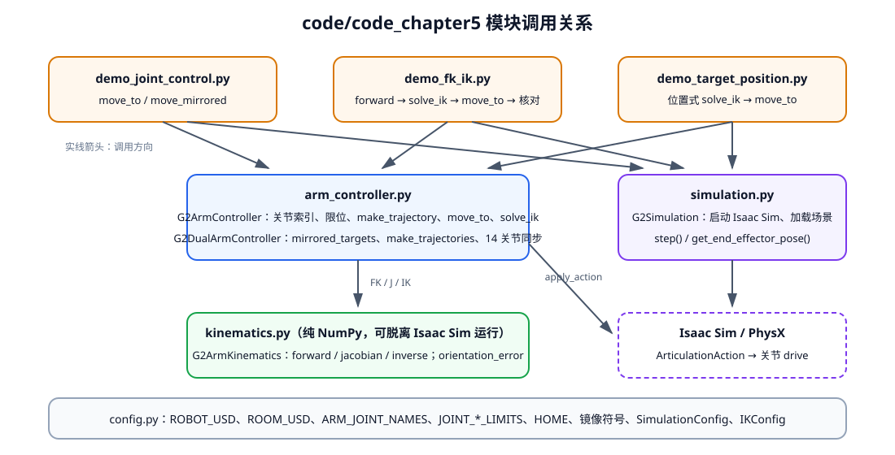

<p align="center"><b>图 5-21</b> 三个演示程序通过 <code>arm_controller.py</code> 调用纯 NumPy 的 <code>kinematics.py</code>，通过 <code>simulation.py</code> 推进 Isaac Sim；所有参数来自 <code>config.py</code></p>

依赖关系的要点：

- `kinematics.py` 只依赖 `config.py` 和 NumPy，**不导入任何 Isaac Sim 模块**，可以单独测试；
- `arm_controller.py` 把 `ArticulationAction` 的导入放在函数内部（`from isaacsim.core.utils.types import ArticulationAction`），这样不启动 Isaac Sim 时也能导入它；
- 每个文件都用 `try: from .config import ... except ImportError: from config import ...` 兼容"作为包导入"和"直接运行脚本"两种方式。

### 7.3 关键流程逐段解读

**（1）仿真启动**（`simulation.py`）。Isaac Sim 要求 `SimulationApp` 在其他 isaacsim 模块之前创建，然后再建 `World`，加载 `room_1` 和 G2：

```python
from isaacsim import SimulationApp

self.app = SimulationApp(
    {
        "headless": config.headless,
        "disable_viewport_updates": config.headless,
        "renderer": config.renderer,
        "limit_cpu_threads": 16,
        "extra_args": shlex.split(os.environ.get("HELLO_ROBOT_KIT_ARGS", "")),
    }
)
# ...（_build_world 中）
self.world = World(
    stage_units_in_meters=1.0,
    physics_dt=self.config.physics_dt,
    rendering_dt=1.0 / self.config.rendering_hz,
)
add_reference_to_stage(str(ROOM_USD), ROOM_PRIM_PATH)
self.world.scene.add_default_ground_plane()
add_reference_to_stage(str(ROBOT_USD), ROBOT_PRIM_PATH)
# ...
self.world.play()
for _ in range(self.config.warmup_steps):        # 预热 120 步，让物理稳定
    self.world.step(render=not self.config.headless)
self.robot = SingleArticulation(prim_path=ROBOT_PRIM_PATH, name="G2_chapter5")
self.world.scene.add(self.robot)
self.robot.initialize()
```

`step()` 就是 `world.step()`，它被作为 `step_callback` 传给 `move_to()`，控制器每发一个目标就调用一次。

**（2）逐关节控制**（`demo_joint_control.py`）。单臂版本先回 HOME，再依次让 J1–J7 各自转动（J4 用 0.35 rad，其余 0.30 rad），每次转过去 1.2 s、转回来 1.0 s，最后做一个组合动作并打印关节跟踪误差：

```python
for joint_id in range(7):
    target = HOME_JOINT_POSITIONS.copy()
    delta = 0.30 if joint_id != 3 else 0.35
    target[joint_id] += delta
    print(
        f"[关节控制] {side} J{joint_id + 1}：+{math.degrees(delta):.1f} deg",
        flush=True,
    )
    arm.move_to(target, 1.2, dt, sim.step)
    arm.move_to(HOME_JOINT_POSITIONS, 1.0, dt, sim.step)

combined = HOME_JOINT_POSITIONS + np.array(
    [0.45, -0.20, 0.30, -0.25, 0.20, 0.15, -0.25]
)
actual = arm.move_to(combined, 3.0, dt, sim.step)
error = np.rad2deg(arm.clamp_positions(combined) - actual)
```

双臂版本把 `move_to` 换成 `move_mirrored`，J1、J3、J5、J7 的右臂增量自动反号：

```python
for joint_id in range(7):
    offsets = np.zeros(7, dtype=np.float64)
    delta = 0.30 if joint_id != 3 else 0.35
    offsets[joint_id] = delta
    right_sign = "-" if joint_id % 2 == 0 else "+"     # joint_id 从 0 开始，偶数下标即 J1/J3/J5/J7
    # ...（打印日志）
    arms.move_mirrored(
        HOME_JOINT_POSITIONS, offsets, 1.2, dt, sim.step
    )
    arms.move_mirrored(
        HOME_JOINT_POSITIONS, np.zeros(7), 1.0, dt, sim.step
    )
```

这里 `move_mirrored()` 用于人工构造的视觉同向动作；一般的左右独立目标应使用 `move_to(left_target, right_target, ...)`。

**（3）FK → IK 闭环验证**（`demo_fk_ik.py`）。单臂流程先用一个已知可达关节姿态做 FK，得到目标末端位姿，然后从 HOME 姿态出发用自编 IK 反求关节角：

```python
target_pose = arm.kinematics.forward(DEMO_TARGET_JOINT_POSITIONS)
target_rotation = None if position_only else target_pose.rotation
result = arm.solve_ik(
    target_pose.position, target_rotation, HOME_JOINT_POSITIONS
)
print_ik_result(side, target_pose, result)
if not result.success:
    raise RuntimeError(f"{side} IK 未收敛")

arm.move_to(result.joint_positions, 3.5, dt, sim.step)
report_final_pose(sim, arm, side, target_pose)
```

这种"已知关节角做 FK 得到目标，再用 IK 求回来"的实验非常适合检查算法，因为目标一定来自机械臂自身工作空间。IK 结果不一定与最初关节角完全相同，因为 7 自由度机械臂可能存在多组解，但它们对应的末端位姿应一致。

**案例**：`DEMO_TARGET_JOINT_POSITIONS` 换算成角度约为 $[25.8, -31.5, 17.2, -77.3, 11.5, 28.6, -14.3]^\circ$，而完整位姿 IK 从 HOME 出发求得的是 $[22.83, -32.03, 21.62, -77.38, 8.62, 28.90, -12.62]^\circ$（见 8.3 节）。J1、J3、J5、J7 都不一样，末端位姿却在 0.2 mm 内一致——这就是冗余自由度带来的"另一组解"。

双臂 FK/IK 不能直接让左右两侧使用同一组演示关节角，否则镜像安装会让奇数关节在画面中反向。代码先生成镜像关节目标，再分别通过左右臂 FK 得到两个真实末端目标：

```python
target_joint_positions = arms.mirrored_targets(
    HOME_JOINT_POSITIONS,
    DEMO_TARGET_JOINT_POSITIONS - HOME_JOINT_POSITIONS,
)
target_poses = {
    side: getattr(arms, side).kinematics.forward(target_joint_positions[side])
    for side in ("left", "right")
}
```

左右 IK 独立求解：

```python
results = arms.solve_ik(
    left_position=target_poses["left"].position,
    right_position=target_poses["right"].position,
    left_rotation=None if position_only else target_poses["left"].rotation,
    right_rotation=None if position_only else target_poses["right"].rotation,
)
```

两边都成功后再同步执行：

```python
failed = [side for side, result in results.items() if not result.success]
if failed:
    raise RuntimeError(f"IK 未收敛：{failed}")

print("\n[双臂 FK/IK] 两侧 IK 均成功，开始同步运动", flush=True)
arms.move_to(
    results["left"].joint_positions,
    results["right"].joint_positions,
    3.5,
    dt,
    sim.step,
)
```

**（4）直接给定末端位置**（`demo_target_position.py`）。默认左臂目标与右臂视觉同向目标为：

```python
DEFAULT_LEFT_TARGET_POSITION = np.array(
    [0.50, 0.35, 0.45], dtype=np.float64
)
DEFAULT_TARGET_POSITIONS = {
    "left": DEFAULT_LEFT_TARGET_POSITION.copy(),
    "right": (
        MIRRORED_END_EFFECTOR_POSITION_SIGNS * DEFAULT_LEFT_TARGET_POSITION
    ),
}
```

得到：

```text
left  = [0.50, 0.35,  0.45]
right = [0.50, 0.35, -0.45]
```

命令行参数 `--x/--y/--z`（单臂）和 `--left-x ... --right-z`（双臂）只覆盖用户指定的分量，其余分量沿用默认值。双臂位置 IK 分别求解，再同步执行：

```python
results = arms.solve_ik(targets["left"], targets["right"])
# ...（打印每侧 success / iterations / residual / 关节角，任一失败则抛异常）
arms.move_to(
    results["left"].joint_positions,
    results["right"].joint_positions,
    duration,
    dt,
    sim.step,
)
```

如果用户输入的右臂位置不是左臂位置的视觉同向镜像，程序会给出提示，但仍然把它作为独立绝对目标执行：

```python
expected_right = MIRRORED_END_EFFECTOR_POSITION_SIGNS * targets["left"]
if not np.allclose(targets["right"], expected_right, atol=1e-9):
    print(
        "[双臂位置控制] 提示：当前是两组独立目标，不是视觉同向的镜像目标；"
        f"左臂目标对应的镜像右臂目标应为 {np.round(expected_right, 4)} m",
        flush=True,
    )
```

这样既保留了教学中的镜像动作，也支持两只机械臂执行不同任务。

**（5）读取末端相对基座位姿**（`simulation.py`）。读取时先获得两个 Prim 的世界变换，再计算相对变换（代码见 3.5 节），这样得到的结果与自编 FK 使用相同的 `arm_base_link` 坐标系，可以直接比较。

---

## 第八部分 代码运行

### 8.1 环境部署

**主线示例（`code/code_chapter5`）**

先进入本地项目根目录（即包含 `code`、`chapter4` 和 `chapter5` 的目录）。下面的 `/path/to/project-root` 是路径占位符，请替换为自己电脑上的实际路径：

```bash
cd /path/to/project-root
```

仿真程序必须使用 Isaac Sim 自带的 Python 环境。下列 `/path/to/isaac-sim/python.sh` 是路径占位符，请替换为自己电脑上 Isaac Sim 的实际安装路径。

> ⚠️ **注意**：`config.py` 按 `<项目根>/assets/robot/G2_omnipicker/robot.usda` 和 `<项目根>/assets/background/room/room_1/background.usda` 查找模型与场景，找不到时 `G2Simulation` 会直接抛出 `FileNotFoundError`。运行前请确认这两个 USD 文件已放到对应位置（资产来源见 6.2 节的 Genie Sim Assets）。

**早期示例（`code_pre_alpha/g2_robot`）**

准备好 6.2 节所述的 `SIM_REPO_ROOT` 与 `SIM_ASSETS` 后，可以按下面的方式运行：

```bash
export SIM_REPO_ROOT=/path/to/genie_sim
export SIM_ASSETS=/path/to/GenieSimAssets
cd code_pre_alpha
python -m g2_robot.examples.test_pick
```

这里的 `/path/to/genie_sim` 和 `/path/to/GenieSimAssets` 需要替换成大家本机实际的资源路径。不要把个人机器上的绝对路径提交到仓库里。

如果只想下载本章需要的最小资产，可以优先拉取 `robot/G2_omnipicker/**` 和 `background/room/room_1/**`。全量 Genie Sim Assets 包含大量物体和场景，体积会更大，建议放在共享数据目录或外置数据盘中。

### 8.2 代码执行

单臂关节控制默认控制右臂：

```bash
/path/to/isaac-sim/python.sh \
code/code_chapter5/demo_joint_control.py
```

只控制左臂：

```bash
/path/to/isaac-sim/python.sh \
code/code_chapter5/demo_joint_control.py \
--arm left
```

双臂视觉同向关节控制：

```bash
/path/to/isaac-sim/python.sh \
code/code_chapter5/demo_joint_control.py \
--arm both
```

双臂完整位姿 FK/IK（先用 FK 生成镜像目标位姿，再左右独立 IK、同步执行并与 USD 核对）：

```bash
/path/to/isaac-sim/python.sh \
code/code_chapter5/demo_fk_ik.py \
--arm both
```

双臂只约束末端位置（位置式 IK）：

```bash
/path/to/isaac-sim/python.sh \
code/code_chapter5/demo_fk_ik.py \
--arm both \
--position-only
```

双臂直接到达默认末端位置（左 `[0.50, 0.35, 0.45]`，右 `[0.50, 0.35, -0.45]`）：

```bash
/path/to/isaac-sim/python.sh \
code/code_chapter5/demo_target_position.py \
--arm both
```

分别指定左右臂视觉同向的末端位置：

```bash
/path/to/isaac-sim/python.sh \
code/code_chapter5/demo_target_position.py \
--arm both \
--left-x 0.50 --left-y 0.35 --left-z 0.45 \
--right-x 0.50 --right-y 0.35 --right-z -0.45
```

单独给右臂一个位置：

```bash
/path/to/isaac-sim/python.sh \
code/code_chapter5/demo_target_position.py \
--arm right \
--x 0.50 --y 0.35 --z -0.45
```

在没有图形界面或只想快速验证算法时，可以在任意命令末尾加入：

```text
--headless
```

有界面运行时，程序完成动作后会继续推进仿真，关闭 Isaac Sim 窗口即可退出。`--headless` 模式下程序会再推进 `physics_hz`（120）步后自动退出。

早期示例的抓取演示命令为 8.1 节中的 `python -m g2_robot.examples.test_pick`；本章的抓取视频由 `code_pre_alpha/g2_robot/examples/record_pick_sequence.py` 生成，该脚本支持通过 `--trial-index` 和 `--seed` 生成多个随机样例。

### 8.3 运行结果

#### 关节控制实验结果

双臂关节控制会先让左右臂同时回到 HOME，然后依次演示 J1 到 J7。日志中的目标方向应为：

```text
J1：左 +17.2°，右 -17.2°
J2：左 +17.2°，右 +17.2°
J3：左 +17.2°，右 -17.2°
J4：左 +20.1°，右 +20.1°
J5：左 +17.2°，右 -17.2°
J6：左 +17.2°，右 +17.2°
J7：左 +17.2°，右 -17.2°
```

这说明 J1、J3、J5、J7 已按照左右镜像关系反号，J2、J4、J6 保持同号。（17.2° 对应 0.30 rad，20.1° 对应 J4 的 0.35 rad。）

一次实际仿真验证得到的组合动作关节误差为：

```text
左臂误差（deg）：
[ 0.004, -0.007,  0.008, -0.007,  0.014,  0.003, -0.007]

右臂误差（deg）：
[-0.005, -0.007, -0.008, -0.006, -0.015,  0.003,  0.007]
```

最大误差约为 `0.015°`，说明三次关节轨迹和 USD 位置 drive 能够准确跟踪目标。

**如何读懂**：误差 = 目标关节角 − 实际关节角，单位是度。0.015° 约为 0.00026 rad；即使按 HOME 下最长约 0.76 m 的力臂（J2 列 $\|\mathbf{J}_{v,2}\|$）估算，对应末端位移也只有约 0.2 mm 量级。左右误差的符号在奇数关节上大致相反，也正是镜像运动的体现。

观察画面时应重点确认两件事：

- 左右臂是否同时开始、同时结束；
- 对应关节在机器人两侧是否表现为视觉同向。

如果时间同步但视觉方向相反，说明目标没有使用镜像符号；如果视觉方向正确但一边明显滞后，则需要检查两边轨迹长度和是否在同一个 action 中发送。

#### FK/IK 和末端位置实验结果

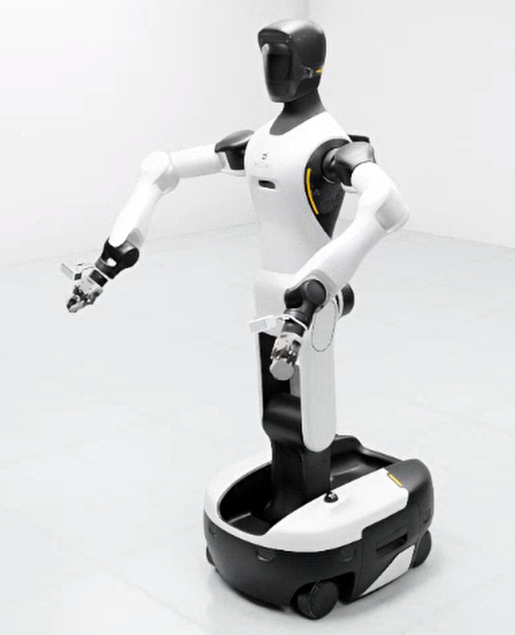

<p align="center"><b>图 5-22</b> 双臂 FK/IK 实验：左右臂分别求解 IK 后同步运动到镜像目标位姿</p>

双臂完整位姿 FK/IK 会先构造镜像关节目标，再通过左右 FK 生成目标位姿。一次实际验证的 IK 结果为：

```text
左臂 IK 关节角（deg）：
[ 22.83, -32.03,  21.62, -77.38,  8.62, 28.90, -12.62]

右臂 IK 关节角（deg）：
[-22.83, -32.03, -21.62, -77.38, -8.62, 28.90,  12.62]
```

可以看到，IK 独立求解以后仍然得到正确的镜像关系：奇数关节反号，偶数关节同号。

完整位姿控制结果为：

```text
左臂末端位置误差：0.180 mm
左臂末端姿态误差：0.020°

右臂末端位置误差：0.179 mm
右臂末端姿态误差：0.020°
```

自编 FK 与 USD 模型核对结果为：

```text
左臂位置差：0.001 mm，姿态差：0.001°
右臂位置差：0.000 mm，姿态差：0.000°
```

这说明自编 FK 的关节顺序、关节轴、连杆变换和工具变换与实际 G2 USD 基本一致。

直接输入双臂末端位置时，默认目标为：

```text
left  = [0.50, 0.35,  0.45] m
right = [0.50, 0.35, -0.45] m
```

一次实际位置式 IK 的结果为：

```text
左臂关节角（deg）：
[ 17.52, -10.36,  15.66, -94.88, -2.37, 12.39, -7.23]

右臂关节角（deg）：
[-17.52, -10.36, -15.66, -94.88,  2.37, 12.39,  7.23]
```

最终末端位置为：

```text
left  = [0.4998, 0.3498,  0.4499] m
right = [0.4998, 0.3498, -0.4499] m
```

左右末端位置误差均约为 `0.322 mm`。

需要注意，位置式 IK 没有约束末端姿态，因此只需要检查位置误差。夹爪最后的朝向可能与完整位姿 IK 不同，这是算法目标不同造成的正常现象，并不表示 IK 出错。

**如何读懂这些输出**：

- **三类误差含义不同**：IK 残差是"数学模型里离目标多远"（容差 2 mm）；末端位置误差是"执行完后用实际关节角做 FK，离目标多远"，它包含 drive 的跟踪误差；"自编 FK 与 USD 核对"是"我的模型和仿真里的真实模型差多少"。三者都小，整条链路才可信。
- **0.18 mm 小于 2 mm 容差**：说明 IK 收敛时的残差本就远小于阈值（DLS 最后几步收敛很快，见 4.7 节）。
- **可离线复现**：`kinematics.py` 不依赖 Isaac Sim，在普通 Python + NumPy 环境下对相同目标求解，可以得到与上面一致的 IK 关节角（完整位姿： $[22.82, -32.03, 21.62, -77.38, 8.62, 28.90, -12.62]^\circ$；位置式默认目标： $[17.52, -10.36, 15.66, -94.89, -2.37, 12.42, -7.23]^\circ$）。末位小数的差异来自仿真中实际起始关节角与理想 HOME 的微小偏差。

#### 早期示例：Isaac Sim 抓取视频

下面的视频是本章重新录制的抓取流程。它先把方块放在右臂前方的目标位置，G2 右臂从预备姿态移动到方块附近，闭合夹爪后，再参考 Genie Sim benchmark 中 `AttachObj` 的思路，将物体绑定到夹爪坐标系并执行抬升。这样可以清楚展示"接近物体、夹爪包住物体、物体随夹爪抬起"的过程。

<video controls muted preload="metadata" width="100%">
  <source src="assets/g2_pick_sequence.mp4" type="video/mp4">
</video>

<p align="center"><b>图 5-23</b> G2 右手抓取并抬升方块（smoke test）。视频由 <code>code_pre_alpha/g2_robot/examples/record_pick_sequence.py</code> 生成</p>

为了观察目标位置变化后的效果，脚本还支持通过 `--trial-index` 和 `--seed` 生成多个随机样例。下面三段视频的末端目标来自右臂初始姿态附近的小范围随机扰动，属于局部可达区域；抓住后的抬升采用关节空间小幅抬升，物体绑定方式仍沿用 `AttachObj` 风格。因此它们适合作为 IK/控制链路的 smoke test，不代表已经完成了严格的接触物理抓取评测。

<video controls muted preload="metadata" width="100%">
  <source src="assets/g2_pick_random_1.mp4" type="video/mp4">
</video>

<p align="center"><b>图 5-24</b> 随机目标 1（smoke test）：末端位置偏右上，观察右臂从预备姿态接近目标</p>

<video controls muted preload="metadata" width="100%">
  <source src="assets/g2_pick_random_2.mp4" type="video/mp4">
</video>

<p align="center"><b>图 5-25</b> 随机目标 2（smoke test）：末端伸得更远，观察同一控制流程在不同可达位置的表现</p>

<video controls muted preload="metadata" width="100%">
  <source src="assets/g2_pick_random_3.mp4" type="video/mp4">
</video>

<p align="center"><b>图 5-26</b> 随机目标 3（smoke test）：末端位置接近基准姿态，用来对比随机扰动前后的动作差异</p>

#### 截图与视频素材规范

这一章非常适合配合 Isaac Sim 截图和短视频讲解。当前仓库已经提供了三张基础截图（图 5-5、图 5-6、图 5-9），它们可以先支撑"机器人加载、机械臂链路、末端执行器观察"三类讲解；后续如果继续跑完整抓取流程，再补充预抓取、闭合和抬升阶段的视频即可。如果需要继续补齐完整演示，建议沿用下面的命名方式（表中前三项与 `g2_pick_sequence.mp4`、`g2_pick_random_*.mp4` 已存在，其余为待补充素材）：

| 素材文件 | 建议内容 | 教学用途 |
| --- | --- | --- |
| `assets/g2_arm_initial_pose.png` | G2 加载完成后的初始姿态，视角覆盖躯干、双臂和夹爪 | 说明 IK 求解前的机器人基准状态 |
| `assets/g2_right_arm_links.png` | 右臂 7 个关节或主要 link 的近景 | 对应关节空间和运动链说明 |
| `assets/g2_gripper_closeup.png` | 末端执行器近景 | 说明末端 link 与夹爪控制对象 |
| `assets/g2_lula_ik_target.png` | 末端目标点、预抓取点和夹爪目标姿态 | 说明 IK 的输入是末端位姿 |
| `assets/g2_pick_pregrasp.png` | 右臂到达预抓取点 | 对应 `PRE_GRASP_OFFSET` |
| `assets/g2_pick_grasp.png` | 夹爪下降到抓取点并闭合 | 对应 `GRASP_OFFSET` 和夹爪控制 |
| `assets/g2_pick_lift.png` | 抓取后抬升物体 | 验证 IK + 轨迹执行形成完整动作 |
| `assets/g2_ik_pd_tracking.mp4` | IK 求解目标关节角后，PD 控制逐步跟踪目标 | 展示"目标位姿 → IK → PD 控制"的闭环过程 |
| `assets/g2_pick_sequence.mp4` | 右臂接近、夹爪闭合、AttachObj 风格绑定并抬升的流程视频 | 作为本章 smoke test 证据 |
| `assets/g2_pick_random_*.mp4` | 多个随机可达目标下的抓取流程视频 | 对比不同目标位置对 IK/关节控制效果的影响 |

截图时建议至少保留三个视角：全局视角、机械臂近景、夹爪近景。视频建议控制在 10 到 30 秒之间，能看清"预抓取、下降、闭合、抬升"四个阶段即可。导出后，大家可以在正文中用下面的方式嵌入：

```html
<video controls muted preload="metadata" width="100%">
  <source src="assets/g2_pick_sequence.mp4" type="video/mp4">
</video>
```

视频下方要注明它是 smoke test 还是最终演示。smoke test 只能说明加载、IK、轨迹和控制链路能跑通，不代表抓取策略已经覆盖所有物体、所有姿态和所有场景。

---

## 本章小结

### 知识回顾

本章完成了从关节角到末端位姿、再从末端目标返回关节角的完整闭环：

```text
关节目标
    ↓
关节限位与三次轨迹
    ↓
Isaac Sim 位置 drive
    ↓
实际关节角
    ↓
自编 FK 与 USD 核对
```

以及：

```text
末端目标
    ↓
位置/姿态误差
    ↓
Jacobian
    ↓
DLS-IK 与零空间关节居中
    ↓
目标关节角
    ↓
单臂或双臂同步执行
```

| 主题 | 核心公式 / 结论 | 关键参数 | 代码位置 |
|---|---|---|---|
| 位姿表示 | $\mathbf{T}=\begin{bmatrix}\mathbf{R}&\mathbf{p}\\\mathbf{0}^T&1\end{bmatrix}$，四元数 `[w,x,y,z]` | 坐标系 `arm_base_link` | `kinematics.py` `Pose` |
| 正运动学 | $\mathbf{T}_{base}^{ee}=\mathbf{T}_1\cdots\mathbf{T}_7\mathbf{T}_{tool}$，每段 = 固定原点 × 绕 $z$ 旋转 | 工具长度 0.23645 m | `_chain()` / `forward()` |
| Jacobian | $\mathbf{J}_{v,i}=\mathbf{z}_i\times(\mathbf{p}_{ee}-\mathbf{p}_i)$， $\mathbf{J}_{\omega,i}=\mathbf{z}_i$ | $6\times7$ | `jacobian()` |
| DLS-IK | $\Delta\mathbf{q}=\mathbf{J}^T(\mathbf{J}\mathbf{J}^T+\lambda^2\mathbf{I})^{-1}\mathbf{e}+k_c\mathbf{N}\mathbf{g}$ | $\lambda=0.04$，步长 0.12 rad， $k_c=0.03$， $w_R=0.35$ | `inverse()` / `IKConfig` |
| 收敛条件 | $\lvert \mathbf{e}_p\rvert \le2$ mm， $\lvert \mathbf{e}_R\rvert \le0.015$ rad，最多 300 次 | — | `inverse()` |
| 轨迹 | $s(\tau)=3\tau^2-2\tau^3$，平均速度 ≤ 60% 上限 | $\dot q_{max}=3.1416$ rad/s | `make_trajectory()` |
| 关节控制 | $\tau=K_p(q_d-q)-K_d\dot q$ | stiffness 10000，damping 1000 | USD drive / `JointPDController` |
| 双臂镜像 | $\Delta\mathbf{q}_R=\mathbf{s}_q\odot\Delta\mathbf{q}_L$， $\mathbf{p}_R=[x,y,-z]$ | $\mathbf{s}_q=[-1,1,-1,1,-1,1,-1]$ | `config.py` / `mirrored_targets()` |
| 工程版 IK | Lula + 三层 fallback；固定躯干/头部关节 | `position_tolerance=0.05` | `code_pre_alpha` `ArmController.solve_ik()` |

本章从运动学和控制两个层面拆解了 G2 机械臂：

- FK 负责从关节角计算末端位姿，本质是沿 URDF 运动链连续相乘。
- IK 负责从末端目标反求关节角。主线代码手写 DLS-IK；早期示例使用 Isaac Sim Lula 求解器，并提供姿态约束、位置约束和放宽误差三层 fallback。
- PD 控制负责把 IK 输出的目标关节角变成每一帧的关节命令（力矩或速度），适合帮助大家理解闭环控制。
- 对完整抓取任务，推荐使用 IK 求解目标关节角，再用轨迹（三次时间缩放 / Ruckig）或 PD 做平滑执行。

到这里，大家已经具备了机械臂"目标位姿 → IK → 关节目标 → 控制执行"的基本链路。下一章可以在此基础上把移动底盘和机械臂结合起来，完成"移动到桌前并抓取物体"的综合控制任务。

### 课后练习

1. **（手算）二连杆 FK/IK**： $l_1=0.30$ m、 $l_2=0.25$ m，取 $q=(45^\circ, 90^\circ)$，求末端位置；再对你算出的位置求两组解析 IK 解，并代入 FK 验证。提示： $q_1+q_2=135^\circ$。
2. **（手算）Jacobian 与奇异**：对第 1 题的姿态写出 $2\times2$ Jacobian，求它的行列式；说明当 $q_2$ 取什么值时二连杆奇异，此时末端在哪个方向上无法瞬时移动。
3. **（思考）DLS 的阻尼**：根据 $\sigma/(\sigma^2+\lambda^2)$，如果把 $\lambda$ 从 0.04 改成 0.2，最大放大系数变成多少？对远离奇异点（ $\sigma=0.5$）的收敛速度有什么影响？
4. **（动手，离线）跟踪 IK 收敛过程**：不启动 Isaac Sim，写一个小脚本导入 `code/code_chapter5/kinematics.py` 中的 `G2ArmKinematics`，以 HOME 为初值求左臂到 `[0.50, 0.35, 0.45]` 的位置式 IK；然后分别把 `IKConfig` 的 `damping` 改为 0.01、0.2，`max_joint_step` 改为 0.05、0.5，比较 `iterations` 和 `position_error`，并解释现象。
5. **（动手，仿真）镜像目标**：用 `demo_target_position.py --arm both` 分别输入一组视觉同向目标（如 `--left-z 0.40 --right-z -0.40`）和一组非镜像目标，观察日志中的提示和左右 IK 关节角的符号关系。
6. **（思考）PD 两种形式**：本章主线依靠 PhysX drive（力矩式 PD），早期示例使用速度式 PD。说明二者中 $K_p$ 的单位分别是什么；如果在主线代码上再加一层 Python PID 力矩控制，可能出现什么问题？

### 参考资料

- Genie Sim 代码仓库：`https://github.com/AgibotTech/genie_sim`
- Genie Sim Assets 资产集：`https://huggingface.co/datasets/agibot-world/GenieSimAssets`（或 ModelScope 同名资产集）
- 本章代码：`code/code_chapter5/`；早期示例：`code_pre_alpha/g2_robot/`
- 补充阅读（经典教材，供深入学习，非本章原文出处）：K. M. Lynch, F. C. Park, *Modern Robotics: Mechanics, Planning, and Control*, Cambridge University Press, 2017（第 4–6、9 章：正运动学、速度运动学与 Jacobian、逆运动学、轨迹时间缩放）；J. J. Craig, *Introduction to Robotics: Mechanics and Control*（DH 参数与操作臂运动学）；S. R. Buss, *Introduction to Inverse Kinematics with Jacobian Transpose, Pseudoinverse and Damped Least Squares Methods*, 2004（DLS-IK 的推导与比较）。


