# 第七章 视觉感知算法

> **本章导读**：第四章让 G2 的四轮独立转向底盘真正"动"了起来，本章给机器人装上"眼睛"。我们围绕 G2 机器人的二维视觉感知展开：从数字图像、相机模型和传统计算机视觉（Computer Vision，CV）的基本概念出发，逐步讲解 OpenCV 图像处理、YOLO 目标检测、HSV 颜色分割和 YOLO 实例分割，并最终在 Isaac Sim 中读取 G2 机载相机画面，完成"采集图像—处理图像—识别物体—生成逐像素语义图"的完整实验。
>
> 本章输出的检测框、掩码和语义图，是第九章"视觉引导机械臂"的感知输入；第二部分讲解的相机内参、外参与像素反投影，则是把二维结果变成三维抓取目标的桥梁。本章最终要跑通三个案例：OpenCV 基础流水线、YOLO 目标检测、HSV / YOLO 语义分割。

本章代码位于 `code/code_chapter7`，机器人模型为 `assets/robot/G2_omnipicker/robot.usda`。视觉示例默认使用 Isaac Sim 自带的仓库场景，也可以通过参数切换到第四章使用的本地 `room_1` 场景。

## 本章概览

### 本章要解决的问题

设想 G2 站在一个仓库里，头部前向相机每秒送来 30 张 640×400 的彩色图片。对计算机来说，这只是一堆 0～255 的数字。我们希望机器人能回答：画面里有没有人、箱子或其他目标？目标在画面左侧、中间还是右侧？它占据了哪些像素？如果要伸手去抓，它在三维空间中离我多远？本章先用规则清楚的传统 OpenCV 方法理解"像素如何变成结构"，再用 YOLO 神经网络回答"是什么、在哪里、占哪些像素"，最后说明从像素走到三维坐标还需要哪些相机几何知识。

本章完成的主要任务如下：

1. 从 G2 头部或夹爪相机读取 RGB 图像；
2. 使用 OpenCV 完成灰度化、滤波、二值化、边缘检测、颜色提取和轮廓分析；
3. 使用 YOLO 检测图像中的物体，并得到类别、置信度和检测框；
4. 对比传统 HSV 分割和学习型分割方法；
5. 将 YOLO 实例掩码整理为后续控制程序可以直接使用的二维语义图。

### 学习目标

- **解释**图像数组 $(H,W,C)$、像素坐标 $(u,v)$ 与 RGB/RGBA/BGR 颜色格式的关系，并能排查"颜色红蓝互换""画面全黑"等问题；
- **推导**针孔相机模型的投影公式，说明内参矩阵 $K$ 与外参 $T$ 各自的含义，并**手算**一个像素加深度反投影到相机系和机器人基座系的例子；
- **解释**灰度化、高斯滤波、Otsu 二值化、Canny 边缘、HSV 分割、形态学和轮廓分析每一步的输入输出，并能用小数字手算验证；
- **解释** YOLO 输出的 `xyxy`、`confidence`、`class_id`，**计算** IoU 并说明 `conf`、`iou`、`imgsz`、`process_every` 分别控制什么；
- **实现**（读懂）从 YOLO 实例掩码到语义图的转换，手算重叠像素的归属、面积与质心；
- **运行**本章三个 Isaac Sim 示例，调节参数并读懂终端输出和结果图；
- **排查**找不到权重、相机无图像、依赖装错环境等常见故障。

### 前置知识

- 第四章：G2 底盘控制器 `G2BaseController` 与四轮独立转向运动学（本章扫描控制直接复用）；
- 第二、三章中坐标系与齐次变换的基础（旋转矩阵、平移向量）；
- 数学：矩阵乘法、相似三角形、简单的加权平均与方差；
- 编程：Python、NumPy 数组索引与布尔掩码、`dataclass` 的基本用法；
- 环境：已安装 Isaac Sim，能用其自带的 `python.sh` 运行脚本。

### 知识地图

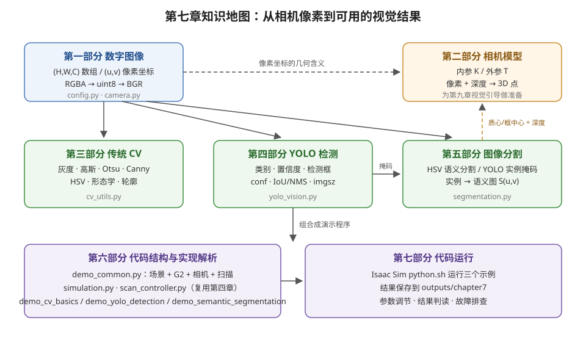

<p align="center"><b>图 7-1</b> 本章知识地图：数字图像是所有算法的输入；相机模型解释像素的几何含义；传统 CV、YOLO 检测、图像分割三条算法线分别对应 cv_utils.py、yolo_vision.py、segmentation.py，最后由演示程序组合运行。</p>

### 对应代码

`code/code_chapter7/`：G2 视觉示例代码。`config.py` / `simulation.py` / `camera.py` 负责场景、机器人与相机；`cv_utils.py`、`yolo_vision.py`、`segmentation.py` 分别实现传统 CV、YOLO 封装和分割语义化；三个 `demo_*.py` 是可直接运行的教学示例；`scan_controller.py` 复用第四章底盘控制器让机器人原地旋转扫描。

---

## 第一部分 从机器人相机到数字图像

### 1.1 机器人为什么需要视觉感知

**直观理解**：相机可以理解为机器人的"眼睛"，但相机本身只负责采集光线并生成图像。就像人眼看到的光信号要经过大脑处理才变成"那里有一个杯子"，机器人真正需要的是从图像中提取与任务有关的信息，例如：

- 画面中有没有人、箱子、杯子或其他目标；
- 目标位于图像左侧、中间还是右侧；
- 目标在图像中占据了多大区域；
- 哪些像素属于目标，哪些像素属于背景；
- 机器人应该继续扫描、靠近目标，还是让机械臂开始抓取。

因此，视觉系统并不是简单地"显示相机画面"，而是要完成从像素到信息的转换：

```text
场景中的物体 → 相机成像 → 数字图像 → 视觉算法 → 检测框或分割掩码 → 任务决策
```

在完整机器人系统中，视觉感知通常位于传感器和控制器之间。相机提供原始数据，视觉算法把原始数据转换成结构化结果，底盘、机械臂或任务规划模块再使用这些结果执行动作。

> 💡 **要点**：本章代码重点解决二维图像中的"看见"和"区分"问题，暂不实现目标距离、三维坐标和抓取位姿。这些内容还需要深度图、相机内参、坐标变换和点云处理。为了让你知道"下一步缺什么"，第二部分会先把相机模型和反投影的原理讲清楚，并给出手算例子。

### 1.2 图像矩阵、像素坐标与颜色格式

**直观理解**：一张彩色照片在计算机里就是一个"三层的表格"：行对应画面从上到下，列对应从左到右，每个格子里放着红、绿、蓝三个亮度数字。

**原理与公式**：计算机中的彩色图像可以表示为一个三维数组：

$$
\mathbf{I}\in\mathbb{R}^{H\times W\times C}
$$

其中：

- $H$ 是图像高度，也就是像素行数；
- $W$ 是图像宽度，也就是像素列数；
- $C$ 是通道数；
- 彩色图像通常有 3 个通道，带透明度的图像通常有 4 个通道。

例如，一张分辨率为 $640\times400$ 的三通道图像，其数组形状通常为：

$$
(400,640,3)
$$

需要注意，图像分辨率习惯写成"宽 × 高"，而 NumPy 数组形状写成"高、宽、通道"。这两个顺序刚好相反，是视觉程序中非常常见的错误来源。本章 `config.py` 中 `CameraConfig.resolution` 的注释也明确写着"resolution 顺序为 (宽, 高)"。

一个像素的位置通常写成 $(u,v)$：

- $u$ 向右增大，对应数组的列；
- $v$ 向下增大，对应数组的行；
- 图像左上角是 $(0,0)$。

所以在 NumPy 里读取像素 $(u,v)$ 要写成 `image[v, u]`——先行后列，而不是 `image[u, v]`。

这套图像坐标系与机器人坐标系不同。机器人坐标系一般使用 $x$、 $y$、 $z$ 描述空间位置，而图像坐标系只描述像素位于画面的哪一行、哪一列。仅凭一个二维像素点，通常不能直接得到物体在世界坐标系中的三维位置（原因见第二部分）。

**RGB、RGBA、BGR 与数据类型**

彩色图像需要约定三个颜色通道的排列顺序。常见格式如下：

| 格式 | 通道顺序 | 常见来源 |
|---|---|---|
| RGB | 红、绿、蓝 | 相机接口、深度学习框架、Isaac Sim 图像 |
| RGBA | 红、绿、蓝、透明度 | 仿真渲染结果、带透明通道图像 |
| BGR | 蓝、绿、红 | OpenCV 默认格式 |

如果把 RGB 图像直接当成 BGR 图像显示，红色和蓝色会互换。算法仍然能够运行，但颜色分割、结果可视化和保存图片都会出现明显错误。因此，本章在相机采集后立即统一颜色格式：

```text
Isaac Sim RGB/RGBA → 去除透明通道 → 转为 uint8 → RGB 转 BGR → OpenCV 处理
```

图像数据类型也很重要。常见表示方式有：

- `uint8`：每个通道取值为 0～255；
- 浮点图像：每个通道可能取值为 0～1，也可能仍然是 0～255。

如果把 0～1 的浮点图像直接转换为 `uint8`，大量像素会变成 0 或 1，画面几乎全黑。正确做法是先判断数值范围，必要时乘以 255，再裁剪到 0～255。

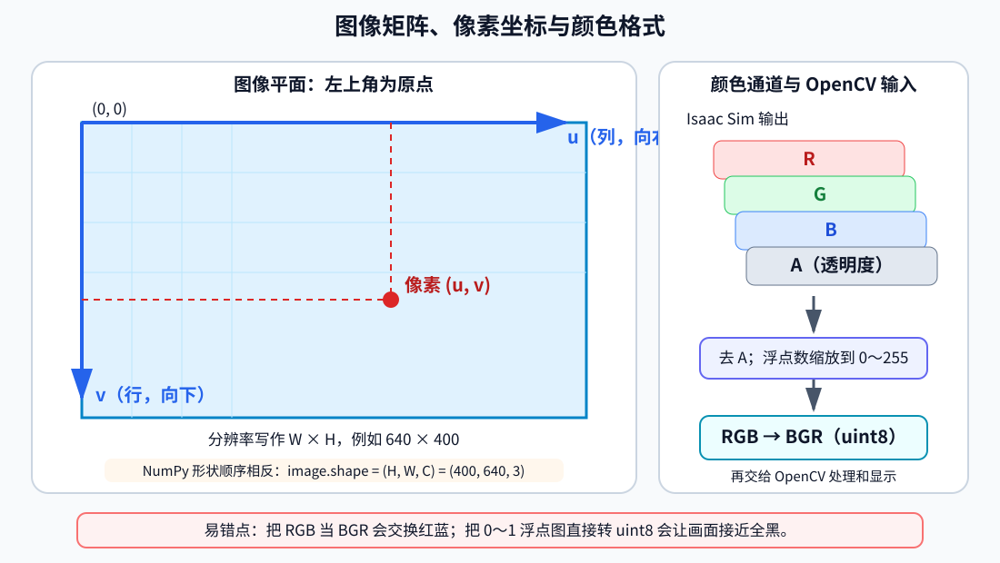

<p align="center"><b>图 7-2</b> 图像坐标、数组形状与颜色格式转换。像素坐标使用 $(u,v)$，NumPy 使用 $(H,W,C)$，Isaac Sim 图像进入 OpenCV 前还需要完成 RGBA/RGB、数据类型与 BGR 转换。</p>

**对应代码**：颜色和数据类型转换由 `camera.py` 完成（摘录自 `code/code_chapter7/camera.py`）：

```python
def rgba_to_rgb(image: np.ndarray) -> np.ndarray:
    """把 Isaac Sim 的 RGB/RGBA 图像统一转换为 uint8 RGB。"""
    array = np.asarray(image)
    if array.ndim != 3 or array.shape[2] < 3:          # 必须是 H×W×3 或 H×W×4
        raise ValueError(f"期望 HxWx3/4 图像，实际形状为 {array.shape}")

    rgb = array[..., :3]                               # 丢掉第 4 个透明通道
    if np.issubdtype(rgb.dtype, np.floating):
        # 最大值 ≤ 1 说明是 0～1 浮点图，需要乘 255；否则已是 0～255
        scale = 255.0 if rgb.size and float(np.nanmax(rgb)) <= 1.0 else 1.0
        rgb = np.nan_to_num(rgb, nan=0.0, posinf=255.0, neginf=0.0)
        rgb = np.clip(rgb * scale, 0.0, 255.0).astype(np.uint8)
    else:
        rgb = np.clip(rgb, 0, 255).astype(np.uint8, copy=False)
    return np.ascontiguousarray(rgb)                   # OpenCV 需要连续内存


def rgb_to_bgr(image_rgb: np.ndarray) -> np.ndarray:
    """RGB 转 OpenCV 常用的 BGR。"""
    import cv2

    return cv2.cvtColor(rgba_to_rgb(image_rgb), cv2.COLOR_RGB2BGR)
```

**代码解读**：

- `array[..., :3]` 对应流程中的"去除透明通道"；
- `scale` 的判断对应"先判断数值范围，必要时乘以 255"；`nan_to_num` 额外处理了渲染中可能出现的 NaN/Inf；
- `np.clip(...).astype(np.uint8)` 对应"裁剪到 0～255 再转 `uint8`"；
- `cv2.COLOR_RGB2BGR` 对应最后一步通道重排。

**案例**：假设 Isaac Sim 返回一个浮点 RGBA 像素 `[0.8, 0.2, 0.1, 1.0]`。

1. 去掉 A 通道得到 `[0.8, 0.2, 0.1]`；
2. 整幅图最大值 ≤ 1，所以 `scale = 255`，得到 `[204, 51, 25.5]`，转 `uint8` 截断为 `[204, 51, 25]`；
3. RGB → BGR 后存为 `[25, 51, 204]`。用 OpenCV 显示时它是偏红的橙色，正确。
4. 若漏掉第 2 步直接 `astype(np.uint8)`，得到 `[0, 0, 0]`——这就是"画面全黑"的原因；若漏掉第 3 步，OpenCV 会把 204 当蓝色显示，红色物体变成蓝色。

> ⚠️ **注意**：`scale` 是根据**整幅图**的最大值判断的。如果一幅 0～255 的浮点图恰好整体很暗（最大值 ≤ 1），会被误乘 255。实际仿真图像几乎不会出现这种情况，但自己处理其他数据源时要知道这条隐含假设。

### 1.3 G2 机载相机与本章数据流

`code/code_chapter7/config.py` 中配置了 G2 的 8 个机载相机，包括 6 个头部相机和 2 个夹爪相机。

| 参数名 | 相机位置 | USD Prim 路径 | 分辨率 |
|---|---|---|---:|
| `head_front` | 头部前向针孔相机 | `/genie/head_link3/head_front_Camera` | 640×400 |
| `head_left` | 头部左向针孔相机 | `/genie/head_link3/head_left_Camera` | 640×400 |
| `head_right` | 头部右向针孔相机 | `/genie/head_link3/head_right_Camera` | 640×400 |
| `head_back_fisheye` | 头部后向鱼眼相机 | `/genie/head_link3/head_back_fisheye` | 640×400 |
| `head_left_fisheye` | 头部左侧鱼眼相机 | `/genie/head_link3/head_left_fisheye` | 640×400 |
| `head_right_fisheye` | 头部右侧鱼眼相机 | `/genie/head_link3/head_right_fisheye` | 640×400 |
| `gripper_left` | 左夹爪相机 | `/genie/gripper_l_base_link/Left_Camera` | 1280×1056 |
| `gripper_right` | 右夹爪相机 | `/genie/gripper_r_base_link/Right_Camera` | 1280×1056 |

头部相机适合观察较大范围的环境，可用于巡检、搜索和导航辅助；夹爪相机距离操作区域更近，适合观察机械臂末端附近的物体，但分辨率更高也意味着单帧处理量更大。粗略算一下： $1280\times1056=1{,}351{,}680$ 像素，约是 $640\times400=256{,}000$ 像素的 5.3 倍。

每个相机由名称、Prim 路径和分辨率组成（摘录自 `code/code_chapter7/config.py`）：

```python
@dataclass(frozen=True)
class CameraConfig:
    """机器人相机配置；resolution 顺序为 (宽, 高)。"""

    name: str
    prim_path: str
    resolution: tuple[int, int]


CAMERAS = {
    # 头部 3 个普通针孔相机
    "head_front": CameraConfig(
        name="head_front",
        prim_path="/genie/head_link3/head_front_Camera",
        resolution=(640, 400),
    ),
    # ... 其余 7 个相机结构相同，见上表
}
```

本章程序的数据流为：

```text
Isaac Sim 场景 → G2 相机 → BGR 图像 → OpenCV 或 YOLO → 可视化结果 → 保存到 outputs/chapter7
```

**不同模块不同节拍**：仿真物理循环和视觉推理的频率不必相同。例如，物理仿真可以以 120 Hz 推进，相机以 30 Hz 渲染，而 YOLO 每隔若干物理帧运行一次。这样可以避免较慢的神经网络推理阻塞整个仿真过程。

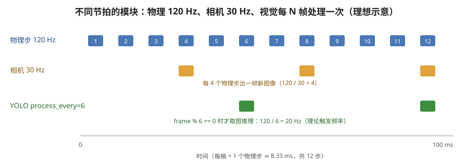

<p align="center"><b>图 7-3</b> 物理步、相机渲染与视觉处理的节拍关系（理想示意）。物理 120 Hz、相机 30 Hz 时，每 4 个物理步出一帧新图；YOLO 示例默认 process_every=6，理论上每 6 个物理步取一次图。</p>

**案例**：`SimulationConfig` 默认 `physics_hz=120`、`rendering_hz=30`。

- 一个物理步时长 $\Delta t=1/120\approx8.33$ ms；
- 相机每 $120/30=4$ 个物理步出一帧新图像；
- OpenCV 示例默认 `--process-every 4`，处理节拍刚好与相机出图节拍一致；
- YOLO 示例默认 `--process-every 6`，理论触发频率 $120/6=20$ Hz，比相机慢，因此每次处理到的未必是"刚出的那帧"，但总能拿到最近的一帧。

> 💡 **要点**：节拍公式和推理频率的取舍在第四部分 4.4 节详细展开。

---

## 第二部分 相机模型：内参、外参与像素反投影

> 本部分是对原文"从二维分割到机器人动作还缺什么"一节的展开。本章代码**没有**读取相机内参或深度图，下面的数值例子使用假设参数，目的是让你理解第九章视觉引导会用到的几何原理。

### 2.1 针孔相机模型与内参

**直观理解**：针孔相机就像一个小黑盒，前面开一个小孔，光线穿过小孔在后壁上形成倒立的像。所有光线都经过同一个点（光心），所以三维点、光心、成像点三者共线。远处的大物体和近处的小物体可能在图像上一样大——这就是"二维像素丢失了深度"的根本原因。

**原理与公式**：在相机光学坐标系 $\{C\}$ 中（视觉领域常用约定： $x$ 向右、 $y$ 向下、 $z$ 沿光轴向前），三维点 $P_C=(X,Y,Z)$ 由相似三角形投影到距离光心 $f$ 的像平面上：

$$
\frac{x}{f}=\frac{X}{Z},\qquad \frac{y}{f}=\frac{Y}{Z}
$$

再把物理长度换算成像素，并把原点从光轴中心移到图像左上角，就得到像素坐标：

$$
u=f_x\frac{X}{Z}+c_x,\qquad v=f_y\frac{Y}{Z}+c_y
$$

写成矩阵形式：

$$
Z\begin{bmatrix}u\\v\\1\end{bmatrix}=
\underbrace{\begin{bmatrix}f_x&0&c_x\\0&f_y&c_y\\0&0&1\end{bmatrix}}_{K}
\begin{bmatrix}X\\Y\\Z\end{bmatrix}
$$

符号含义：

| 符号 | 含义 | 单位 |
|---|---|---|
| $X,Y,Z$ | 点在相机光学系中的坐标， $Z$ 是沿光轴的深度 | m |
| $u,v$ | 像素坐标（列、行） | 像素 |
| $f_x,f_y$ | 以像素为单位的焦距（物理焦距 ÷ 像素尺寸） | 像素 |
| $c_x,c_y$ | 主点，光轴穿过图像的位置，常接近图像中心 | 像素 |
| $K$ | 内参矩阵（intrinsic matrix），只与相机自身有关 | — |

焦距与视场角（Field of View，FOV）的关系：水平视场角为 $\mathrm{HFOV}$ 时

$$
f_x=\frac{W}{2\tan(\mathrm{HFOV}/2)}
$$

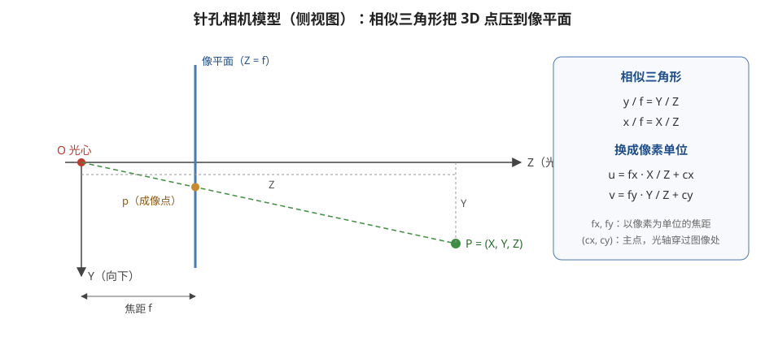

<p align="center"><b>图 7-4</b> 针孔相机模型（侧视图）。三维点 P、光心 O 与成像点 p 共线，由相似三角形得到 $y/f=Y/Z$，再换算到像素单位。</p>

**案例（正投影）**：设 640×400 图像的内参为 $f_x=f_y=320$、 $c_x=320$、 $c_y=200$（假设值）。

- 由 $f_x=W/(2\tan(\mathrm{HFOV}/2))$ 得 $\tan(\mathrm{HFOV}/2)=640/(2\times320)=1$，即水平视场角 $90^\circ$；
- 相机前方点 $P_C=(1.0,\ 0.375,\ 2.0)$ m 投影到： $u=320\times1.0/2.0+320=480$， $v=320\times0.375/2.0+200=260$；
- 把同一点沿视线推远一倍到 $(2.0,\ 0.75,\ 4.0)$，像素仍是 $(480,260)$——深度信息丢失了。

> ⚠️ **注意**：`config.py` 中有 3 个鱼眼相机（`*_fisheye`）。鱼眼镜头存在强烈畸变，不能直接套用上面的针孔公式，需要额外的畸变模型先做去畸变。本章代码没有读取任何相机的真实内参，实际使用时应从 Isaac Sim 相机参数或标定结果获取 $K$，不要使用本节的假设数值。

### 2.2 外参：从相机坐标系到机器人坐标系

**直观理解**：内参回答"相机内部怎么成像"，外参（extrinsic parameters）回答"相机装在机器人哪里、朝向哪里"。机械臂只认识基座坐标系 $\{B\}$ 或世界坐标系 $\{W\}$，所以相机系里的点必须先"搬"过去。

**原理与公式**：外参是一个刚体变换 $T_{BC}=[R_{BC}\mid t_{BC}]$：

$$
P_B=R_{BC}P_C+t_{BC}
$$

- $R_{BC}$： $3\times3$ 旋转矩阵，相机系各轴在基座系中的方向；
- $t_{BC}$：相机光心在基座系中的位置，单位 m。

当相机无俯仰、正对机器人前方时，光学系（ $x$ 右、 $y$ 下、 $z$ 前）与基座系（ $x$ 前、 $y$ 左、 $z$ 上）之间只是轴的重排：

$$
R_{BC}=\begin{bmatrix}0&0&1\\-1&0&0\\0&-1&0\end{bmatrix}
\quad\Longrightarrow\quad
x_B=Z_C,\ \ y_B=-X_C,\ \ z_B=-Y_C
$$

若要得到世界坐标，再沿运动链串联： $T_{WC}=T_{WB}\,T_{B,\mathrm{head}}\,T_{\mathrm{head},C}$。G2 的头部相机挂在 `head_link3` 下，夹爪相机挂在 `gripper_l_base_link` / `gripper_r_base_link` 下（见 1.3 节 Prim 路径），因此头部或手臂一动，外参就随之改变，需要根据当前关节角实时计算。

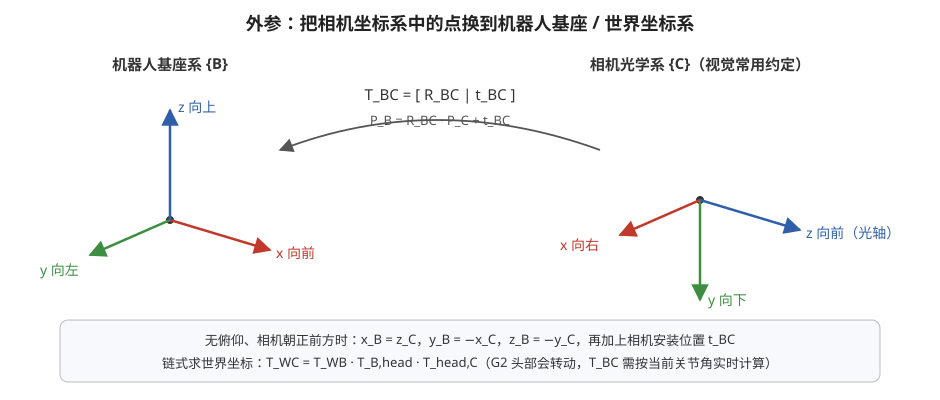

<p align="center"><b>图 7-5</b> 外参把相机光学系中的点变换到机器人基座系。图中给出无俯仰、相机朝正前方时的轴对应关系，以及求世界坐标时的变换链。</p>

> ⚠️ **注意**：Isaac Sim / USD 中相机 Prim 自身的坐标轴约定可能与上面的"光学系"约定不同（例如相机朝 $-z$ 方向看）。做反投影前一定要确认你拿到的位姿是哪种约定，否则会出现左右、上下颠倒。本章代码未涉及这一转换，相关 API 请以 Isaac Sim 官方文档为准。

### 2.3 像素 + 深度 → 三维点：反投影手算

**直观理解**：既然投影丢了深度，那么反过来，只要从深度图里查到该像素的深度 $Z$，就能沿着视线把点"推回"空间中。这就是反投影（back-projection）。

**原理与公式**：由 2.1 节公式反解：

$$
X=\frac{(u-c_x)\,Z}{f_x},\qquad Y=\frac{(v-c_y)\,Z}{f_y},\qquad Z=Z
$$

即 $P_C=Z\,K^{-1}[u,v,1]^\mathsf{T}$。再用 2.2 节外参得到 $P_B$。

**案例**：沿用 2.1 节的假设内参 $f_x=f_y=320$、 $c_x=320$、 $c_y=200$。YOLO 检测到一个目标，其框中心（或分割质心）位于像素 $(480,260)$，深度图在该像素读到 $Z=2.0$ m。再假设相机无俯仰、朝正前方，安装在基座系 $t_{BC}=(0.10,\ 0,\ 1.50)$ m 处。

第一步，反投影到相机光学系：

$$
X_C=\frac{(480-320)\times2.0}{320}=1.000\ \text{m},\quad
Y_C=\frac{(260-200)\times2.0}{320}=0.375\ \text{m},\quad
Z_C=2.000\ \text{m}
$$

第二步，变换到基座系：

$$
x_B=Z_C+0.10=2.100\ \text{m},\quad
y_B=-X_C+0=-1.000\ \text{m},\quad
z_B=-Y_C+1.50=1.125\ \text{m}
$$

结论：目标在机器人前方 2.1 m、右侧 1.0 m（ $y_B$ 为负表示在右侧）、离地约 1.125 m 处。

第三步，校验：把 $P_C$ 代回投影公式， $u=320\times1.0/2.0+320=480$， $v=320\times0.375/2.0+200=260$，与输入一致。

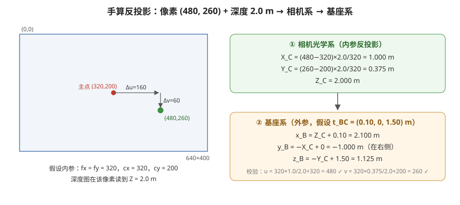

<p align="center"><b>图 7-6</b> 反投影手算：像素 (480, 260) 相对主点偏移 (160, 60)，乘以深度再除以焦距得到相机系坐标，再经外参得到基座系坐标。</p>

**小实验**：下面这段代码**不是仓库代码**，只是用 NumPy 复现上面的手算，你可以在任何 Python 环境中直接运行：

```python
import numpy as np

K = np.array([[320.0, 0.0, 320.0],
              [0.0, 320.0, 200.0],
              [0.0, 0.0, 1.0]])           # 假设内参
u, v, Z = 480, 260, 2.0                   # 像素与深度

P_C = Z * np.linalg.inv(K) @ np.array([u, v, 1.0])
R_BC = np.array([[0, 0, 1], [-1, 0, 0], [0, -1, 0]], dtype=float)
t_BC = np.array([0.10, 0.0, 1.50])
P_B = R_BC @ P_C + t_BC
print(P_C)   # 预期 [1.    0.375 2.   ]
print(P_B)   # 预期 [ 2.1   -1.     1.125]
```

### 2.4 从二维分割到机器人动作还缺什么

完成检测或分割后，机器人只是知道"目标在图像中哪里"。要让机械臂真正抓取目标，通常还需要：

1. 深度图或点云，用于获得目标距离；
2. 相机内参，把像素和深度反投影到相机三维坐标系（2.1、2.3 节）；
3. 相机外参，把相机坐标转换到机器人基座或世界坐标系（2.2 节）；
4. 目标姿态估计，确定抓取方向；
5. 机械臂 IK、轨迹规划和碰撞检测；
6. 闭环校正，应对目标运动和执行误差。

> 💡 **要点**：反投影时用"框中心"还是"掩码质心"差别很大。检测框中心可能落在背景上（例如一把椅子的框中心是空的），查到的深度属于背景；用分割掩码内像素的深度中位数通常更稳健。这也是第五部分要把实例掩码整理成语义图的原因之一。

因此，本章输出是后续视觉控制的感知输入，而不是完整抓取系统。第九章可以把本章的二维视觉结果与机械臂控制结合起来，形成视觉引导任务。

---

## 第三部分 OpenCV 与传统图像处理

### 3.1 传统计算机视觉解决什么问题

**直观理解**：传统计算机视觉通常使用人工设计的规则处理图像，例如：

- 亮度大于某个阈值的像素属于前景；
- 色相位于某个区间的像素属于红色或蓝色物体；
- 灰度变化剧烈的位置可能是物体边缘；
- 连通边缘围成的区域可能对应一个物体轮廓。

这类方法不需要训练数据，计算量通常较小，处理过程也容易解释。对于颜色稳定、背景简单、规则明确的任务，传统方法仍然非常实用。例如，在光照稳定的工业场景中寻找红色标记，未必需要训练神经网络。

但传统方法也有明显局限：同一物体在不同光照、材质、视角和遮挡条件下会产生不同像素值；不同物体又可能具有相似颜色。因此，传统 CV 更擅长提取"颜色、亮度、边缘、形状"等低层特征，不擅长理解复杂物体的语义。

本章把常见操作组织成一条连续流水线：

```text
原图 → 灰度图 → 高斯滤波 → Otsu 二值化 → Canny 边缘 → HSV 颜色掩码 → 轮廓与外接框
```

这条流水线的重点不是让每一步都识别出完整物体，而是理解图像如何从原始像素逐步变成更容易分析的结构。

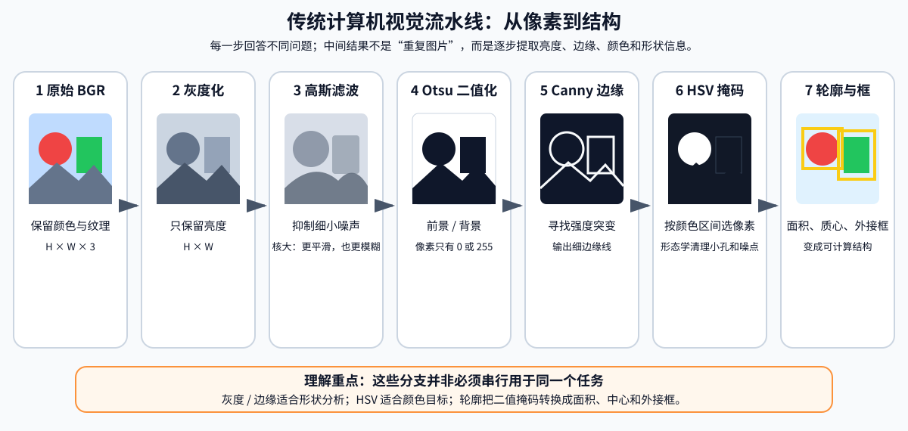

<p align="center"><b>图 7-7</b> 传统计算机视觉流水线。灰度、边缘和颜色掩码提取的是不同信息，轮廓分析再把像素区域整理为面积、质心和外接框等结构化结果。</p>

**对应代码**：整条流水线由 `BasicCVProcessor` 实现。它在创建时检查参数，处理结果用 `CVResult` 打包（摘录自 `code/code_chapter7/cv_utils.py`）：

```python
@dataclass(frozen=True)
class CVResult:
    gray: np.ndarray        # 灰度图
    blurred: np.ndarray     # 高斯滤波结果
    edges: np.ndarray       # Canny 边缘
    binary: np.ndarray      # Otsu 二值图
    color_mask: np.ndarray  # HSV 颜色掩码
    contours: np.ndarray    # 画好轮廓框的彩色图


class BasicCVProcessor:
    """把常见 OpenCV 操作组织成一条便于学习的处理流水线。"""

    def __init__(
        self,
        blur_kernel: int = 5,
        canny_low: int = 80,
        canny_high: int = 160,
        min_contour_area: float = 300.0,
    ) -> None:
        if blur_kernel <= 0 or blur_kernel % 2 == 0:
            raise ValueError("blur_kernel 必须是正奇数")
        if not 0 <= canny_low < canny_high <= 255:
            raise ValueError("Canny 阈值应满足 0 <= low < high <= 255")
        # ...
```

下面逐个讲解每一步，并给出对应的那一两行代码。

### 3.2 灰度化

**直观理解**：彩色图像每个像素有三个颜色分量，灰度图每个像素只保留一个亮度值，就像把彩色照片打印成黑白照片。

**原理与公式**：灰度化可以近似写成：

$$
Y=0.299R+0.587G+0.114B
$$

人眼对绿色更敏感，因此绿色分量的权重通常更大。灰度化后，图像从 $H\times W\times3$ 变为 $H\times W$，后续滤波、阈值处理和边缘检测所需的计算量更小。

**对应代码**（`code/code_chapter7/cv_utils.py`，`BasicCVProcessor.process`）：

```python
image = ensure_bgr_uint8(image_bgr)               # 校验为 H×W×3 的 uint8 BGR
gray = cv2.cvtColor(image, cv2.COLOR_BGR2GRAY)    # 注意输入必须是 BGR
```

**案例**：

- 纯红 $(R,G,B)=(255,0,0)$： $Y=0.299\times255\approx76$；
- 纯绿 $(0,255,0)$： $Y=0.587\times255\approx150$；
- 暗红 $(200,50,50)$： $Y=59.8+29.35+5.7\approx94.9$；
- 暗绿 $(50,130,50)$： $Y=14.95+76.31+5.7\approx97.0$。

后两个颜色人眼一眼能分开，但灰度只差约 2。

> ⚠️ **注意**：灰度图适合分析明暗变化，但它会丢失颜色信息。亮度相近的红色物体和绿色物体在灰度图中可能非常接近（如上例），因此颜色识别不能只依赖灰度图，要用 3.6 节的 HSV。

### 3.3 高斯滤波：先抑制噪声，再寻找结构

**直观理解**：相机图像中可能存在传感器噪声、材质纹理、锯齿和渲染噪点。如果直接进行边缘检测，这些细小变化也可能被识别为边缘。滤波就像"眯起眼睛看"：每个像素参考一下邻居，把突兀的小点抹平。

**原理与公式**：滤波的基本思想是用像素邻域的加权结果替代当前像素。二维卷积可以表示为：

$$
I'(u,v)=\sum_{i=-k}^{k}\sum_{j=-k}^{k}K(i,j)I(u-i,v-j)
$$

其中 $K$ 是卷积核，大小为 $(2k+1)\times(2k+1)$。高斯滤波的核权重服从二维高斯分布

$$
K(i,j)\propto\exp\!\left(-\frac{i^2+j^2}{2\sigma^2}\right)
$$

并归一化使所有权重之和为 1。距离中心更近的像素拥有更大权重，因此能平滑局部噪声，同时比简单平均滤波更自然地保留整体结构。

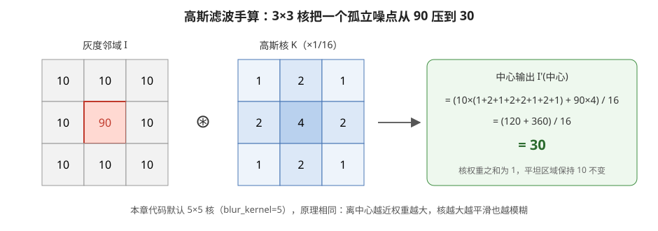

<p align="center"><b>图 7-8</b> 用 3×3 高斯核手算：中心孤立噪点 90 被周围的 10 "稀释"为 30，平坦区域保持不变。</p>

**对应代码**：

```python
# (self.blur_kernel, self.blur_kernel) 默认为 (5, 5)；最后的 0 表示由核尺寸自动推算 σ
blurred = cv2.GaussianBlur(gray, (self.blur_kernel, self.blur_kernel), 0)
```

**案例**：以常用的 3×3 近似高斯核 $\frac{1}{16}\begin{bmatrix}1&2&1\\2&4&2\\1&2&1\end{bmatrix}$ 为例，中心像素为 90、周围 8 个像素都为 10：

$$
I'=\frac{10\times(1+2+1+2+2+1+2+1)+90\times4}{16}=\frac{120+360}{16}=30
$$

噪点从比背景高 80 降到只高 20；而在全为 10 的平坦区域，输出仍是 $10\times16/16=10$。

> ⚠️ **注意**：滤波核越大，平滑效果越强，但物体细节和边缘也会变得模糊。本章默认使用 $5\times5$ 高斯核。卷积核尺寸必须是正奇数，这样才有明确的中心像素——这正是构造函数里 `blur_kernel % 2 == 0` 检查的原因。

### 3.4 二值化与 Otsu 自动阈值

**直观理解**：二值化把灰度图转换成只有 0 和 255 的图像，相当于问每个像素一个"是或否"的问题："你比阈值亮吗？"

**原理与公式**：最基本的阈值规则为：

$$
B(u,v)=\begin{cases}255,& I(u,v)>T \\ 0,& I(u,v)\le T\end{cases}
$$

其中 $T$ 是阈值。二值化可以把图像粗略分成前景和背景，便于计算面积、连通区域和轮廓。

困难在于阈值应该取多少。固定阈值在一种光照下有效，换一个场景后可能完全失效。Otsu 方法根据灰度直方图自动寻找阈值，使两类像素之间的差异尽量大。具体地，对每个候选阈值 $T$，把像素分成两类，计算类间方差：

$$
\sigma_b^2(T)=w_0(T)\,w_1(T)\,\bigl[\mu_0(T)-\mu_1(T)\bigr]^2
$$

- $w_0,w_1$：两类像素占总像素的比例；
- $\mu_0,\mu_1$：两类像素的平均灰度。

Otsu 选择让 $\sigma_b^2$ 最大的 $T$。直觉上，"两类各自够多"（ $w_0w_1$ 大）且"两类均值相差大"（ $(\mu_0-\mu_1)^2$ 大）的切分最好。

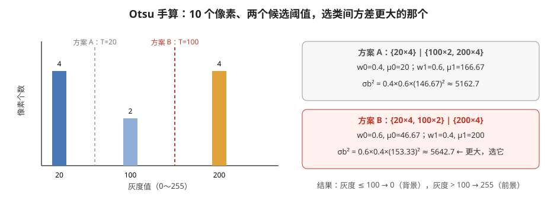

<p align="center"><b>图 7-9</b> Otsu 手算：10 个像素的直方图，比较两个候选阈值的类间方差，T=100 的切分方差更大。</p>

**对应代码**：

```python
_, binary = cv2.threshold(
    blurred, 0, 255, cv2.THRESH_BINARY + cv2.THRESH_OTSU
)   # 传入的阈值 0 会被忽略，OpenCV 用 Otsu 自动求出 T（作为第一个返回值）
```

**案例**：10 个像素，灰度为 4 个 20、2 个 100、4 个 200。

- 方案 A（ $T=20$）： $\{20\times4\}$ 与 $\{100\times2,200\times4\}$。 $w_0=0.4,\ \mu_0=20$； $w_1=0.6,\ \mu_1=(200+800)/6\approx166.67$。 $\sigma_b^2=0.4\times0.6\times146.67^2\approx5162.7$。
- 方案 B（ $T=100$）： $\{20\times4,100\times2\}$ 与 $\{200\times4\}$。 $w_0=0.6,\ \mu_0=(80+200)/6\approx46.67$； $w_1=0.4,\ \mu_1=200$。 $\sigma_b^2=0.6\times0.4\times153.33^2\approx5642.7$。

方案 B 更大，所以 Otsu 会把中间亮度的 100 归入暗类。

> ⚠️ **注意**：Otsu 适合前景和背景亮度分布较明显（直方图"双峰"）的图像，但当画面光照不均匀或前景、背景灰度高度重叠时，效果会下降。另外，二值化结果并不等于语义分割：二值图只说明某个像素属于"0 类"还是"1 类"，但不一定知道这两类分别是什么物体。

### 3.5 Canny 边缘检测

**直观理解**：边缘通常出现在灰度变化明显的位置，例如箱子边界、桌面边缘和物体轮廓。就像在地形图上找"悬崖"——高度突变的地方。

**原理与公式**：图像梯度描述像素值变化速度：

$$
G_x=\frac{\partial I}{\partial x},\qquad
G_y=\frac{\partial I}{\partial y}
$$

梯度幅值可写成：

$$
G=\sqrt{G_x^2+G_y^2}
$$

在离散图像上，偏导用相邻像素差近似，例如 $G_x(u,v)\approx\frac{I(u+1,v)-I(u-1,v)}{2}$（实际 Canny 常用 Sobel 算子）。

Canny 边缘检测通常包含以下步骤：

1. 平滑图像，减少噪声；
2. 计算水平和竖直方向梯度；
3. 使用非极大值抑制，把宽边缘压缩成较细的线；
4. 使用高、低两个阈值筛选边缘；
5. 保留与强边缘相连的弱边缘，删除孤立噪声。

第 4、5 步称为"双阈值 + 滞后连接"（hysteresis），是 Canny 抗噪的关键。

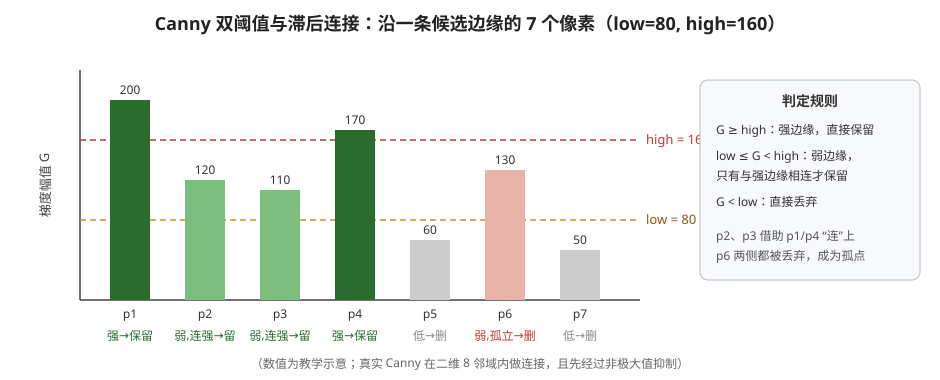

<p align="center"><b>图 7-10</b> Canny 双阈值与滞后连接示意。强边缘直接保留；弱边缘只有与强边缘相连才保留；低于低阈值的直接丢弃。</p>

**对应代码**：

```python
# 输入是 3.3 节的 blurred，对应步骤 1 的"先平滑"
edges = cv2.Canny(blurred, self.canny_low, self.canny_high)   # 默认 80, 160
```

**案例**：

- 梯度手算：一条竖直边界左侧灰度 50、右侧灰度 210，则 $G_x\approx(210-50)/2=80$， $G_y=0$， $G=80$，刚好落在低阈值上，是"弱边缘"；若边界两侧是 20 和 220， $G=100$，仍是弱边缘，需要靠连接到强边缘才能保留。
- 滞后连接：见图 7-10，沿一条线的 7 个像素梯度为 200、120、110、170、60、130、50。p1、p4 为强边缘；p2、p3 是弱边缘但夹在强边缘之间，被保留；p6 是弱边缘但两侧都被丢弃，成为孤点被删除。

> ⚠️ **注意**：本章默认低阈值为 80，高阈值为 160。阈值过低时会产生大量碎边缘；阈值过高时又会漏掉对比度较弱的物体边界。实际调参时，应同时观察边缘数量、边缘连续性和噪声水平。构造函数要求 `0 <= low < high <= 255`。

### 3.6 HSV 颜色分割与形态学处理

**直观理解**：BGR 或 RGB 同时混合了颜色和亮度，"亮红"和"暗红"的三个分量可能完全不同，不便于直接用简单阈值描述"红色""绿色"等概念。HSV 把颜色拆成"是什么颜色""有多鲜艳""有多亮"三件独立的事，于是"找红色"就变成"H 落在某个区间"。

**原理**：HSV 将颜色拆分为：

- $H$：Hue，色相，表示颜色类型；
- $S$：Saturation，饱和度，表示颜色鲜艳程度；
- $V$：Value，明度，表示亮暗程度。

在 OpenCV 中，8 位 HSV 图像的 $H$ 通常取 0～179， $S$ 和 $V$ 取 0～255。注意这里的色相范围不是常见的 0～360（OpenCV 把角度除以 2 以塞进 8 位整数）。

颜色分割的基本过程是：

1. 把 BGR 图像转换为 HSV；
2. 为目标颜色设置下界和上界；
3. 判断每个像素是否落在区间内；
4. 区间内设为 255，区间外设为 0，得到二值掩码。

用公式表示，`cv2.inRange` 做的是逐像素逐通道的区间判断：

$$
M(u,v)=\begin{cases}255,& L_c\le \mathrm{HSV}_c(u,v)\le U_c\ \ \text{对}\ c\in\{H,S,V\}\ \text{均成立}\\0,&\text{否则}\end{cases}
$$

红色在 HSV 色相圆环上跨越起点和终点，因此通常需要用两个区间共同表示，例如接近 0 的一段和接近 179 的一段。

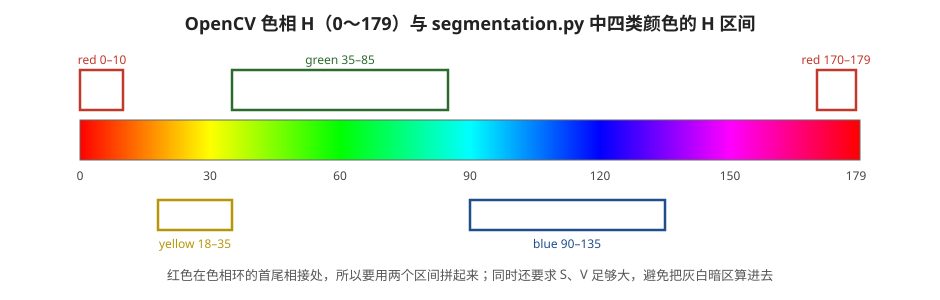

<p align="center"><b>图 7-11</b> OpenCV 色相轴与 segmentation.py 中四类颜色的 H 区间。红色跨越 0/179 边界，需要两个区间拼接。</p>

本章 OpenCV 基础示例并不限定某一种颜色，而是提取饱和度较高的区域，用来直观展示颜色掩码。语义分割示例（第五部分）则分别设置红、绿、蓝、黄四类规则。

**对应代码**（`code/code_chapter7/cv_utils.py`）：

```python
# 示例颜色分割：提取"饱和度较高"的区域，不依赖某一种具体物体颜色。
hsv = cv2.cvtColor(image, cv2.COLOR_BGR2HSV)
color_mask = cv2.inRange(hsv, (0, 80, 40), (179, 255, 255))   # H 任意，S≥80，V≥40
kernel = np.ones((3, 3), dtype=np.uint8)
color_mask = cv2.morphologyEx(color_mask, cv2.MORPH_OPEN, kernel)
color_mask = cv2.morphologyEx(color_mask, cv2.MORPH_CLOSE, kernel)
```

**案例**：

- 灰色墙面 BGR $(128,128,128)$：三个分量相等， $S=0<80$，不进入掩码；
- 纯红 BGR $(0,0,255)$： $H=0,\ S=255,\ V=255$，进入掩码；
- 纯黄 BGR $(0,255,255)$：色相 60°，OpenCV 中 $H=30$，落在 `segmentation.py` 的黄色区间 18～35；
- 很暗的红色 BGR $(0,0,30)$： $V=30<40$，被排除——这条下限避免把阴影里的噪声当成颜色。

**形态学处理：清理掩码中的噪点和小孔**

颜色阈值或二值化产生的掩码常常包含零散白点、断裂区域和内部小孔。形态学操作使用一个小矩阵作为结构元素，对前景区域进行几何处理。

两个基础操作是（结构元素覆盖的邻域记为 $N(u,v)$）：

- 腐蚀：缩小白色前景，可删除小噪点。 $\ \mathrm{erode}(M)(u,v)=\min_{(i,j)\in N(u,v)}M(i,j)$，邻域全白才保留白；
- 膨胀：扩大白色前景，可连接邻近区域并填补小缺口。 $\ \mathrm{dilate}(M)(u,v)=\max_{(i,j)\in N(u,v)}M(i,j)$，邻域有白就变白。

组合后得到：

- 开运算 = 先腐蚀、后膨胀，适合去除小白点；
- 闭运算 = 先膨胀、后腐蚀，适合填补小黑洞和连接断裂区域。

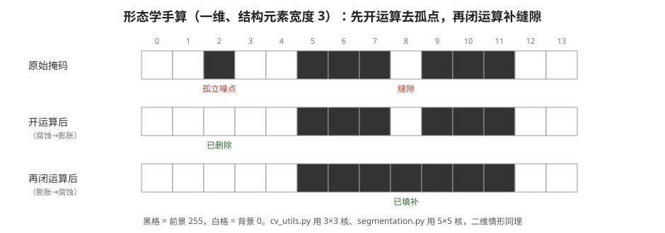

<p align="center"><b>图 7-12</b> 一维形态学手算（结构元素宽度 3）：开运算删除了宽度为 1 的孤立噪点，随后的闭运算填补了宽度为 1 的缝隙。</p>

**案例**：一维掩码 `0 0 1 0 0 1 1 1 0 1 1 1 0 0`（1 表示前景）。

1. 腐蚀：只有左右邻居都为 1 的位置保留，得到 `0 0 0 0 0 0 1 0 0 0 1 0 0 0`；
2. 膨胀（完成开运算）：`0 0 0 0 0 1 1 1 0 1 1 1 0 0`，孤立噪点消失，两段主体恢复原宽；
3. 再膨胀：`0 0 0 0 1 1 1 1 1 1 1 1 1 0`，缝隙被填上；
4. 再腐蚀（完成闭运算）：`0 0 0 0 0 1 1 1 1 1 1 1 0 0`，两段连成一块，外边界恢复。

> ⚠️ **注意**：本章先执行开运算，再执行闭运算。这样既能减少孤立噪声，又能让目标区域更加完整。但结构元素过大时也可能删除小目标，或把相邻的两个目标粘连在一起。`cv_utils.py` 使用 3×3 核，`segmentation.py` 的 HSV 分割默认用 5×5 核，清理力度更强。

### 3.7 轮廓分析与传统 CV 的边界

**直观理解**：轮廓可以理解为二值图或边缘图中连续边界点的集合，相当于用笔沿着白色区域的边描了一圈。得到轮廓后，可以进一步计算：

- 轮廓面积；
- 周长；
- 外接矩形；
- 最小外接圆；
- 形状近似；
- 区域中心。

本章从 Canny 边缘图中寻找外轮廓，并过滤面积小于默认阈值（`min_contour_area=300.0` 像素）的轮廓，再绘制矩形框和面积。面积过滤可以减少细碎边缘带来的误报。

**对应代码**（`code/code_chapter7/cv_utils.py`）：

```python
contour_image = image.copy()
contours, _ = cv2.findContours(
    edges, cv2.RETR_EXTERNAL, cv2.CHAIN_APPROX_SIMPLE   # 只取最外层轮廓，压缩直线段
)
for contour in contours:
    area = cv2.contourArea(contour)
    if area < self.min_contour_area:                     # 默认 300 像素，过滤碎边
        continue
    x, y, width, height = cv2.boundingRect(contour)      # 轴对齐外接矩形
    cv2.rectangle(contour_image, (x, y), (x + width, y + height), (0, 255, 0), 2)
    cv2.putText(
        contour_image,
        f"area={area:.0f}",
        (x, max(18, y - 5)),
        # ... 字体、颜色等参数省略
    )
```

**案例**：一个闭合的矩形边缘，左上角 $(100,80)$、宽 40、高 30 像素。`contourArea` 约为 $40\times30=1200\ge300$，被保留并画框；另一段短小的纹理边缘围成约 $10\times8=80$ 像素的区域，被过滤掉。

> ⚠️ **注意**：轮廓是在 Canny **边缘图**上找的，边缘线只有一两个像素宽。如果一条边缘没有闭合，`contourArea` 算出的面积会很小，即使它很长也可能被过滤。这也是为什么"框太少"时要先检查边缘是否连续。

> 💡 **要点**：传统轮廓框只表示"这里存在一个满足图像规则的区域"，并不能自动判断它是人、箱子还是杯子。要得到稳定的语义类别，需要使用分类器或目标检测模型。

**传统 CV 的适用边界**

传统方法的优势是透明、快速、无需训练。每一步为什么产生当前结果都比较容易解释，参数也可以直接修改。

它更适合：

- 光照和背景比较稳定；
- 目标颜色、形状与背景差异明显；
- 只需要检测标记、边缘或简单几何物体；
- 算力有限，需要快速运行。

它不擅长：

- 复杂自然场景；
- 同类物体外观差异较大；
- 遮挡、阴影和光照变化明显；
- 需要直接识别物体语义类别。

因此，本章先用 OpenCV 理解图像处理基础，再进入能够学习物体特征的 YOLO。

---

## 第四部分 YOLO 目标检测

### 4.1 分类、检测与分割的区别

**直观理解**：视觉任务可以按照输出信息的精细程度分为多个层次，从"这张图是什么"一路细化到"每个物体的每个像素在哪"。

| 任务 | 回答的问题 | 典型输出 |
|---|---|---|
| 图像分类 | 整张图主要是什么 | 一个类别和概率 |
| 目标检测 | 有什么，分别在哪里 | 多个类别、置信度和矩形框 |
| 语义分割 | 每个像素属于哪一类 | 一张类别编号图 |
| 实例分割 | 每个物体实例分别占哪些像素 | 每个实例的类别、框和掩码 |

一张图中同时存在两个人和三个箱子时，图像分类只能给出整张图的主要类别；目标检测可以给出五个检测框；语义分割可以标出所有"人"和"箱子"像素，但不一定区分两个不同的人；实例分割则会为每个独立物体生成单独掩码。

YOLO 检测示例解决"是什么、在哪里"，YOLO 分割示例进一步解决"这个物体具体覆盖了哪些像素"。

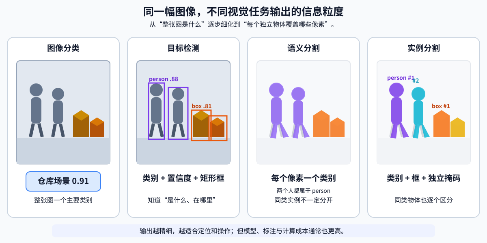

<p align="center"><b>图 7-13</b> 同一场景下四类视觉任务的输出差异。检测提供矩形位置，语义分割给每个像素赋类别，实例分割还会区分同类别的不同物体。</p>

### 4.2 YOLO 为什么适合实时机器人视觉

**直观理解**：YOLO（You Only Look Once）是一类单阶段目标检测方法。它不是先单独生成候选区域，再逐个分类，而是在一次前向推理中直接预测物体类别和位置，因此通常具有较好的速度，适合机器人在线感知。名字本身就说明了思路——"只看一眼"。

从教学角度，可以把模型理解为三个连续模块：

1. 特征提取部分从图像中提取边缘、纹理、形状和高层语义；
2. 多尺度特征融合部分组合不同分辨率的信息，使模型同时关注大目标和小目标；
3. 检测头输出候选框、类别分数和相关置信信息，分割模型还会输出实例掩码。

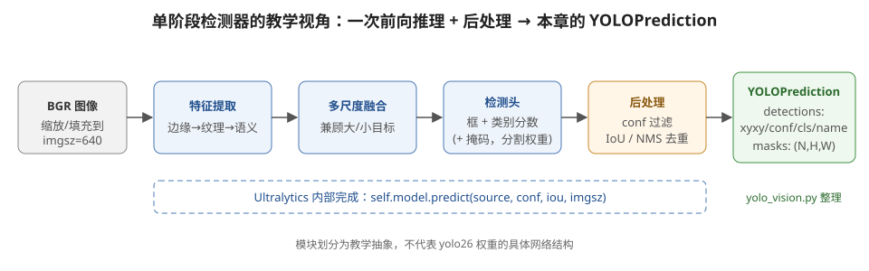

<p align="center"><b>图 7-14</b> 单阶段检测器的教学视角：图像经过特征提取、多尺度融合和检测头，再经过 conf 过滤与 NMS 后处理，由 yolo_vision.py 整理为 YOLOPrediction。模块划分为教学抽象。</p>

神经网络学习的不是某个固定颜色区间，而是从大量训练图像中归纳物体外观。这使它比简单阈值更能适应纹理、视角和一定程度的光照变化，但模型能力取决于训练数据。预训练模型没有见过的专用零件、仿真物体或特殊机器人部件，可能无法正确识别。

本章代码通过 Ultralytics 库调用 YOLO，默认权重为仓库根目录的 `yolo26s.pt`（检测）和 `yolo26s-seg.pt`（分割）。模型只在 `YOLOVision` 初始化时加载一次（摘录自 `code/code_chapter7/yolo_vision.py`）：

```python
class YOLOVision:
    """一次加载模型，多次调用 predict()。支持 detect 和 segment 权重。"""

    def __init__(self, model_path: str | Path) -> None:
        path = Path(model_path).expanduser().resolve()
        if not path.is_file():
            raise FileNotFoundError(
                f"找不到 YOLO 模型：{path}\n"
                "检测示例使用仓库根目录 yolo26s.pt；分割示例使用 yolo26s-seg.pt 权重。"
            )

        from ultralytics import YOLO

        print(f"[YOLOVision] 正在加载模型：{path}", flush=True)
        self.model_path = path
        self.model = YOLO(str(path))
```

> ⚠️ **注意**：不要在每一帧循环中重新创建模型，否则会反复读取权重、占用显存并严重降低速度。

### 4.3 检测结果、置信度与重复框抑制

**检测结果的数据结构**

本章把每个检测结果整理为四类信息：

| 字段 | 含义 |
|---|---|
| `xyxy` | 左上角和右下角像素坐标 $(x_1,y_1,x_2,y_2)$ |
| `confidence` | 当前预测的置信度 |
| `class_id` | 类别编号 |
| `class_name` | 可读类别名称 |

`yolo_vision.py` 没有把 Ultralytics 的原始结果直接传遍整个程序，而是定义了更清晰的数据结构（`code/code_chapter7/yolo_vision.py`）：

```python
@dataclass(frozen=True)
class Detection:
    xyxy: tuple[int, int, int, int]
    confidence: float
    class_id: int
    class_name: str


@dataclass(frozen=True)
class YOLOPrediction:
    image_shape: tuple[int, int]
    detections: tuple[Detection, ...]
    masks: np.ndarray | None = None  # (N, H, W)，取值范围 0~1

    @property
    def has_masks(self) -> bool:
        return self.masks is not None and len(self.masks) == len(self.detections)
```

`masks` 的形状约定为 $(N,H,W)$，其中 $N$ 是实例数量。检测权重没有掩码时，该字段为 `None`；分割权重成功输出掩码时，`has_masks` 为真。

**检测框的几何量**

检测框宽度和高度为：

$$
w=x_2-x_1,\qquad h=y_2-y_1
$$

检测框中心为：

$$
u_c=\frac{x_1+x_2}{2},\qquad
v_c=\frac{y_1+y_2}{2}
$$

框中心可以用于构造最简单的视觉反馈。例如，若 $u_c$ 明显小于图像中心，目标位于画面左侧；若 $u_c$ 明显大于图像中心，目标位于画面右侧。机器人可以据此缓慢旋转，使目标逐渐移动到画面中心。水平误差定义为：

$$
e_u=u_c-\frac{W}{2}
$$

**案例**：在 640×400 的 `head_front` 图像上，检测框 `xyxy=(400, 120, 520, 360)`：

- $w=120$， $h=240$，面积 $28800$ 像素，约占画面 $28800/256000\approx11.3\%$；
- $u_c=460$， $v_c=240$；
- $e_u=460-320=140>0$，目标在画面右侧。若要让目标居中，底盘应向右转（在第四章 $z$ 轴向上的约定下，即 $\omega_z<0$）。

> ⚠️ **注意**：检测框中心只是二维像素位置，不等于物体三维中心，也不能直接作为机械臂抓取点（参见第二部分）。

**从 Ultralytics 结果到 Detection**：单帧推理调用及结果整理如下（`code/code_chapter7/yolo_vision.py`）：

```python
result = self.model.predict(
    source=image,
    conf=confidence,     # 置信度阈值，默认 0.25
    iou=iou,             # NMS 的 IoU 阈值，默认 0.45
    imgsz=image_size,    # 推理输入尺寸，默认 640
    verbose=False,
)[0]

# _read_detections()：张量移到 CPU、转 NumPy
xyxy = boxes.xyxy.detach().cpu().numpy()
scores = boxes.conf.detach().cpu().numpy()
class_ids = boxes.cls.detach().cpu().numpy().astype(int)
for box, score, class_id in zip(xyxy, scores, class_ids):
    x1, y1, x2, y2 = box.tolist()
    clipped = (                                   # 四舍五入并裁剪到图像范围内
        int(np.clip(round(x1), 0, max(0, width - 1))),
        int(np.clip(round(y1), 0, max(0, height - 1))),
        int(np.clip(round(x2), 0, max(0, width - 1))),
        int(np.clip(round(y2), 0, max(0, height - 1))),
    )
    # ... 组装为 Detection(xyxy=clipped, confidence=..., class_id=..., class_name=...)
```

**置信度阈值**

模型通常会产生多个候选预测。置信度阈值 `conf` 用于过滤低置信度结果：

- 阈值降低：保留更多候选，漏检可能减少，但误检可能增加；
- 阈值提高：结果更谨慎，误检可能减少，但弱目标可能被漏掉。

本章默认 `conf=0.25`。这个数值不是所有场景的最优答案。实际应用中应根据目标类别、任务风险和验证数据调整。例如，安全监测任务可能更重视减少漏检，而抓取任务可能更重视减少错误目标。

**IoU 与重复框抑制**

同一个物体附近可能出现多个重叠候选框。交并比 IoU（Intersection over Union）用于衡量两个区域的重叠程度：

$$
\mathrm{IoU}(A,B)=\frac{|A\cap B|}{|A\cup B|}
$$

对两个轴对齐矩形，交集为

$$
|A\cap B|=\max(0,\min(x_2^A,x_2^B)-\max(x_1^A,x_1^B))\cdot\max(0,\min(y_2^A,y_2^B)-\max(y_1^A,y_1^B))
$$

并集 $|A\cup B|=|A|+|B|-|A\cap B|$。IoU 越接近 1，说明两个框越重合；越接近 0，说明重叠越少。

非极大值抑制（Non-Maximum Suppression，NMS）的基本思想是：

1. 保留置信度最高的候选框；
2. 删除与它高度重叠的较低置信度框；
3. 对剩余候选重复以上过程。

本章通过 `iou` 参数控制相关阈值，默认值为 0.45。阈值过低时，靠得很近的两个真实目标可能被误认为重复；阈值过高时，同一个目标周围可能保留多个框。

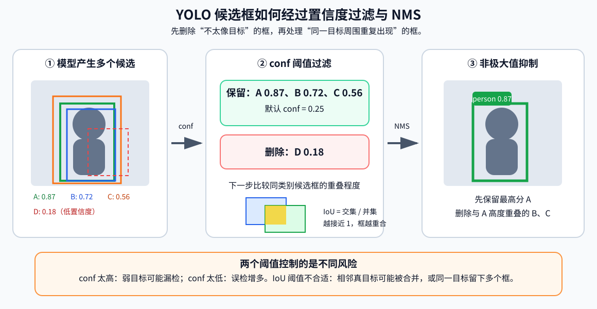

<p align="center"><b>图 7-15</b> YOLO 后处理示意。conf 先过滤低可信候选，NMS 再依据 IoU 删除同一目标周围的重复框；二者控制的风险并不相同。</p>

**案例（手算 IoU 与 NMS）**：三个候选框（单位：像素）：

| 框 | xyxy | 置信度 |
|---|---|---:|
| A | (100, 100, 200, 200) | 0.90 |
| B | (150, 120, 250, 220) | 0.80 |
| C | (110, 105, 210, 205) | 0.70 |

每个框面积都是 $100\times100=10000$。

- $\mathrm{IoU}(A,C)$：交集宽 $200-110=90$、高 $200-105=95$，交集 $8550$；并集 $20000-8550=11450$； $\mathrm{IoU}\approx0.747$。
- $\mathrm{IoU}(A,B)$：交集宽 $200-150=50$、高 $200-120=80$，交集 $4000$；并集 $16000$； $\mathrm{IoU}=0.25$。

NMS（`iou=0.45`）：保留 A；C 与 A 的 IoU 0.747 > 0.45，删除；B 与 A 的 IoU 0.25 ≤ 0.45，保留。最终剩 A、B 两个框。若再设 `conf=0.85`，B 会在 NMS 之前就被置信度过滤掉。

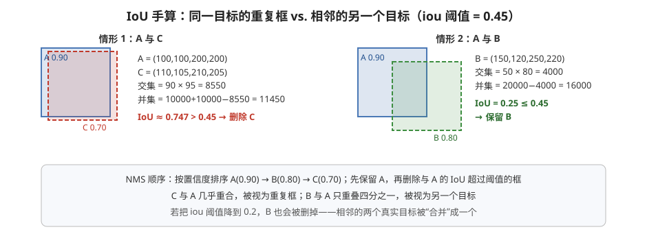

<p align="center"><b>图 7-16</b> IoU 手算：C 与 A 几乎重合被当作重复框删除，B 与 A 只重叠四分之一被视为另一个目标。</p>

> 💡 **要点**：`conf` 管"这个预测可不可信"，`iou` 管"两个预测是不是同一个东西"。前者控制误检/漏检，后者控制重复框/目标合并，二者不能互相替代。

**可视化**：检测结果的可视化由 `draw_detections()` 完成。程序根据类别编号生成稳定颜色，并在原图上绘制检测框、类别名称和置信度（`code/code_chapter7/yolo_vision.py`）：

```python
def class_color(class_id: int) -> tuple[int, int, int]:
    """根据类别编号生成稳定、醒目的 BGR 颜色。"""
    hue = int((class_id * 47 + 29) % 180)          # 同一类别永远得到同一色相
    hsv = np.uint8([[[hue, 210, 255]]])
    bgr = cv2.cvtColor(hsv, cv2.COLOR_HSV2BGR)[0, 0]
    return tuple(int(value) for value in bgr)
```

例如 `class_id=0` 时 $H=29$（偏黄），`class_id=1` 时 $H=76$（偏青绿）。

### 4.4 输入尺寸、推理频率与实时性

YOLO 推理前通常会把图像缩放或填充到指定输入尺寸。本章使用 `imgsz` 控制推理尺寸，默认值为 640。

较大的输入尺寸通常能保留更多细节，对小目标可能更有利，但显存占用和推理时间也会增加。较小尺寸速度更快，但远处小目标可能变得难以识别。

**案例**：设 640×400 图像中一个远处目标宽 20 像素。等比例缩放时（具体的缩放/填充策略由 Ultralytics 内部决定），若 `imgsz=640`，长边 640 不变，目标仍约 20 像素；若 `imgsz=320`，缩放比例 0.5，目标只剩约 10 像素，更难被识别。夹爪相机 1280×1056 在 `imgsz=640` 时缩放比例为 0.5，原图中的细节同样会损失一半分辨率。

机器人视觉还要处理"推理频率"问题。假设物理仿真以 120 Hz 运行，如果每个物理步都执行一次 YOLO，而单次推理需要几十毫秒，仿真会明显变慢。因此，本章使用 `process_every` 控制每隔多少物理帧处理一次图像：

$$
f_{\mathrm{infer}}\approx\frac{f_{\mathrm{physics}}}{N_{\mathrm{process}}}
$$

例如，物理频率为 120 Hz、每 6 帧处理一次时，理论触发频率约为 20 Hz。实际速度还会受到渲染、模型、GPU 和图像分辨率影响。

**对应代码**（三个演示程序的循环结构相同，摘自 `code/code_chapter7/demo_yolo_detection.py`）：

```python
for frame in range(1, args.max_frames + 1):
    if not runtime.simulation.is_running():
        break
    runtime.step()                       # 每个物理帧都推进仿真
    if frame % args.process_every:       # 余数不为 0 → 跳过视觉处理
        continue

    image = runtime.camera.capture_bgr()
    if image is None:
        continue
    prediction = model.predict(image, args.conf, args.iou, args.imgsz)
    # ...
```

**案例**：`--max-frames 900`、`--process-every 6` 时，处理的帧号是 6、12、…、900，共 $900/6=150$ 次推理；仿真时长 $900/120=7.5$ s（按仿真时间算）。改成 `--process-every 10` 后只推理 90 次。

> 💡 **要点**：工程上应把"相机采集、神经网络推理、物理控制"看成不同节拍的模块，而不是强迫所有模块以完全相同频率运行。

### 4.5 如何判断检测效果

只观察一两张结果图容易产生误判。更可靠的检测评估通常关注：

- 真正例（True Positive，TP）：真实目标被正确检测；
- 假正例（False Positive，FP）：不存在的目标被错误检测；
- 假负例（False Negative，FN）：真实目标没有被检测到。

精确率和召回率分别为：

$$
\mathrm{Precision}=\frac{TP}{TP+FP}
$$

$$
\mathrm{Recall}=\frac{TP}{TP+FN}
$$

精确率高表示预测出来的目标大多是真的，召回率高表示真实目标大多没有漏掉。实际系统需要根据任务平衡两者，而不是只追求检测数量。

**案例**：某画面中真实有 5 个箱子。

- `conf=0.25` 时检出 6 个框，其中 4 个正确： $TP=4,FP=2,FN=1$，Precision $=4/6\approx0.67$，Recall $=4/5=0.8$；
- 提高到 `conf=0.50` 后检出 3 个框且全对： $TP=3,FP=0,FN=2$，Precision $=1.0$，Recall $=0.6$。

阈值更高让结果"更干净"，但漏掉了更多箱子。（数字为教学假设。）

本章重点是模型部署与结果使用，不展开数据集标注、训练、验证集和 mAP 计算。若预训练权重不能识别任务目标，后续应采集仿真或真实图像，制作专用数据集并训练或微调模型。

---

## 第五部分 图像分割与逐像素语义

### 5.1 为什么需要分割：从语义到实例

**直观理解**：矩形检测框实现简单，但框内通常同时包含目标和背景。例如，一个人的检测框中可能包含两侧背景，机械臂抓取物体的检测框中也可能包含桌面。分割就是把框里"真正属于目标的那些像素"抠出来。

当任务只需要判断目标大致方向时，检测框通常已经足够；当任务需要精确轮廓、可通行区域、抓取区域或像素级面积时，就需要图像分割。

分割结果通常是一张与原图等高、等宽的二维数组。数组中每个位置不再保存颜色，而是保存类别编号：

$$
S\in\mathbb{Z}^{H\times W}
$$

例如：

- `0` 表示背景；
- `1` 表示人；
- `2` 表示箱子；
- `3` 表示其他类别。

有了语义图，就可以通过"类别编号比较"快速取出某类像素，计算像素面积、质心、边界或与图像中心的相对位置。

**语义分割、实例分割与全景分割**

三类常见分割任务的区别如下：

| 类型 | 是否区分类别 | 是否区分同类实例 | 示例 |
|---|---|---|---|
| 语义分割 | 是 | 否 | 所有人像素都标为"人" |
| 实例分割 | 是 | 是 | 人 1 和人 2 分别拥有掩码 |
| 全景分割 | 是 | 对可数物体区分实例 | 同时描述天空、地面和每个独立物体 |

本章的 YOLO 分割权重首先输出实例分割结果，即每个检测目标都有自己的检测框、类别、置信度和掩码。随后，代码把这些实例掩码合并为一张语义图，便于后续控制模块使用。

> ⚠️ **注意**：这种转换会丢失实例编号。例如，两个 `person` 实例合并后都使用同一个语义类别编号。如果后续任务需要持续区分"左边的人"和"右边的人"，应保留实例掩码，并进一步加入多目标跟踪。

### 5.2 HSV 颜色语义分割

**直观理解**：把第三部分的 HSV 掩码推广到多类：每种颜色一条规则，满足规则的像素写上该类编号。这是"不需要训练"的语义分割。

为了对比传统方法和学习型方法，本章实现了 HSV 颜色语义分割。它为红、绿、蓝、黄四类分别设置颜色区间，对每个像素执行规则判断，再用开运算和闭运算清理掩码。

默认类别约定如下：

| 类别编号 | 类别名称 | 可视化颜色 |
|---:|---|---|
| 0 | background | 黑色 |
| 1 | red | 红色 |
| 2 | green | 绿色 |
| 3 | blue | 蓝色 |
| 4 | yellow | 黄色 |

**原理与公式**：设第 $k$ 类颜色规则的区间集合为 $\mathcal{R}_k$，则

$$
S(u,v)=\begin{cases}k,& \mathrm{HSV}(u,v)\in\bigcup_{r\in\mathcal{R}_k}r\ \text{（且经形态学清理后仍保留）}\\0,&\text{不满足任何规则}\end{cases}
$$

若一个像素同时满足多条规则，按代码中规则的写入顺序，后写入的类别覆盖先写入的。

**对应代码**：HSV 分割使用 `ColorRule` 描述类别和一个或多个颜色范围（`code/code_chapter7/segmentation.py`）：

```python
@dataclass(frozen=True)
class ColorRule:
    class_id: int
    name: str
    # 一个类别可有多个 HSV 区间，例如红色跨越 0/179 边界。
    ranges: tuple[tuple[tuple[int, int, int], tuple[int, int, int]], ...]


DEFAULT_COLOR_RULES = (
    ColorRule(1, "red", (((0, 100, 60), (10, 255, 255)), ((170, 100, 60), (179, 255, 255)))),
    ColorRule(2, "green", (((35, 70, 50), (85, 255, 255)),)),
    ColorRule(3, "blue", (((90, 70, 40), (135, 255, 255)),)),
    ColorRule(4, "yellow", (((18, 90, 70), (35, 255, 255)),)),
)
```

预测时先创建全背景语义图，再逐类写入类别编号：

```python
def predict(self, image_bgr: np.ndarray) -> np.ndarray:
    hsv = cv2.cvtColor(image_bgr, cv2.COLOR_BGR2HSV)
    semantic_map = np.zeros(image_bgr.shape[:2], dtype=np.int32)   # 全 0 = 全背景
    for rule in self.rules:
        mask = np.zeros(image_bgr.shape[:2], dtype=np.uint8)
        for lower, upper in rule.ranges:                            # 多个区间取并集
            mask = cv2.bitwise_or(
                mask,
                cv2.inRange(hsv, np.asarray(lower), np.asarray(upper)),
            )
        mask = cv2.morphologyEx(mask, cv2.MORPH_OPEN, self.kernel)  # 默认 5×5 核
        mask = cv2.morphologyEx(mask, cv2.MORPH_CLOSE, self.kernel)
        semantic_map[mask > 0] = rule.class_id                      # 后写覆盖先写
    return semantic_map
```

可视化颜色由 `class_colors` 给出（BGR）：`{1: (0, 0, 255), 2: (0, 255, 0), 3: (255, 0, 0), 4: (0, 255, 255)}`。

**案例**：

- 像素 HSV $(5,200,150)$：落在红色第一区间 $[(0,100,60),(10,255,255)]$， $S=1$；
- 像素 HSV $(175,200,150)$：落在红色第二区间， $S=1$；
- 像素 HSV $(35,120,120)$：同时满足绿色（H 35～85）和黄色（H 18～35）——两区间在 $H=35$ 处相接。黄色规则写在后面，所以最终 $S=4$；
- 像素 HSV $(60,40,200)$：色相是绿，但 $S=40<70$，太"灰"， $S=0$。

> ⚠️ **注意**：HSV 分割结果的"类别"只是颜色名，不是物体名。一个红色箱子和一个红色灭火器都会被标成 `red`。

### 5.3 YOLO 实例掩码与二值化阈值

分割模型输出的掩码通常不是直接的 0 或 1，而是 0～1 之间的浮点值，可以理解为每个像素属于当前实例的强度或置信程度。

本章使用 `mask_threshold` 把浮点掩码变成布尔区域：

$$
M(u,v)=\begin{cases}1,& P(u,v)\ge T_m \\ 0,& P(u,v)<T_m\end{cases}
$$

默认阈值 $T_m=0.5$。

- 阈值降低时，掩码区域通常变大，边缘较宽，但可能包含更多背景；
- 阈值提高时，掩码更保守，边缘可能收缩，细小区域可能消失。

`conf` 和 `mask_threshold` 解决的是不同问题：

- `conf` 决定是否保留整个检测实例；
- `mask_threshold` 决定已保留实例中的每个像素是否进入掩码。

**对应代码**：网络输出的掩码分辨率可能小于原图，`_read_masks()` 会把它插值到原图的 $(H,W)$（`code/code_chapter7/yolo_vision.py`）：

```python
if result.masks is None or result.masks.data is None:
    return None                                         # 检测权重：没有掩码
masks = result.masks.data.detach().cpu().numpy().astype(np.float32)
if masks.ndim != 3 or masks.shape[0] != detection_count:
    return None                                         # 掩码数量与框数量不一致
if masks.shape[1:] != (height, width):
    masks = np.stack(
        [cv2.resize(mask, (width, height), interpolation=cv2.INTER_LINEAR) for mask in masks]
    )
return masks
```

> ⚠️ **注意**：`cv2.resize` 的尺寸参数是 `(width, height)`，而 `masks.shape[1:]` 是 `(height, width)`——又一次"宽高顺序相反"。

### 5.4 从 YOLO 实例掩码到语义图

**直观理解**：把每个实例的掩码像"贴纸"一样贴到一张空白图上，贴纸上写着类别编号；先贴不太确定的，后贴最确定的，重叠处就被最确定的那张盖住。

YOLO 类别编号通常从 0 开始，但本章希望语义图中的 0 固定表示背景。因此，语义编号采用：

```text
semantic_id = class_id + 1
```

对应关系为：

| 语义图数值 | 含义 |
|---:|---|
| 0 | 背景 |
| `class_id + 1` | YOLO 对应类别 |

当画面中没有任何检测结果时，程序返回一张全 0 语义图。这是正常的"当前无目标"状态，不应该被当作程序错误。

多个实例掩码可能发生重叠。本章先写入低置信度实例，再写入高置信度实例，因此重叠像素最终由高置信度实例覆盖。这种规则实现简单、结果确定，但不代表它在所有任务中都最合理。若任务需要严格保留遮挡关系，应直接使用独立实例掩码，而不是过早合并。

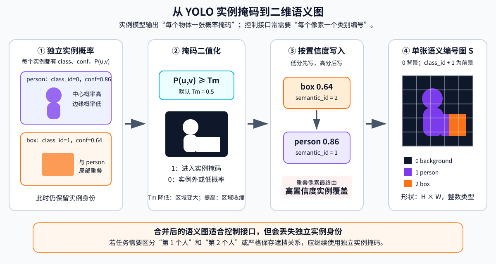

<p align="center"><b>图 7-17</b> 从实例概率掩码生成语义编号图。概率经过 mask_threshold 二值化，再按置信度顺序写入类别编号；合并后便于控制程序使用，但不再保留独立实例身份。</p>

**对应代码**（`code/code_chapter7/segmentation.py`）：

```python
def yolo_to_semantic_map(
    prediction: YOLOPrediction,
    mask_threshold: float = 0.5,
) -> tuple[np.ndarray, dict[int, str]]:
    if not 0.0 <= mask_threshold <= 1.0:
        raise ValueError("mask_threshold 必须位于 [0, 1]")

    semantic_map = np.zeros(prediction.image_shape, dtype=np.int32)   # 0 固定为背景
    class_names = {0: "background"}

    # 分割模型在当前画面没有识别到目标时，boxes 和 masks 都为空。
    # 这是正常结果，应返回全背景语义图，而不是误判为加载了检测模型。
    if not prediction.detections:
        return semantic_map, class_names
    if not prediction.has_masks:
        raise ValueError("当前 YOLO 权重没有输出掩码，请使用 yolo26s-seg.pt 分割模型")
    scores = np.asarray([item.confidence for item in prediction.detections])
    # 低置信度先写，高置信度后写，从而覆盖重叠区域。
    for index in np.argsort(scores):
        detection = prediction.detections[int(index)]
        semantic_id = detection.class_id + 1
        semantic_map[prediction.masks[index] >= mask_threshold] = semantic_id
        class_names[semantic_id] = detection.class_name
    return semantic_map, class_names
```

**代码解读**：

- `np.zeros(prediction.image_shape)` 对应"0 固定为背景"；
- 两个 `if` 区分"没检测到"（正常，返回全背景）和"检测到了但没有掩码"（误用检测权重，报错）；
- `np.argsort(scores)` 返回按置信度**升序**的下标，因此低置信度先写；
- `prediction.masks[index] >= mask_threshold` 就是 5.3 节的二值化公式 $M(u,v)$；
- `semantic_id = detection.class_id + 1` 对应编号平移。

**案例（手算一张 4×4 语义图）**：两个实例，`mask_threshold=0.5`。

- 实例 A：`class_id=0`，`conf=0.82`，概率掩码按行为
  `[0.1 0.6 0.7 0.2] / [0.2 0.9 0.8 0.4] / [0.1 0.7 0.6 0.3] / [0.0 0.2 0.3 0.1]`；
- 实例 B：`class_id=2`，`conf=0.60`，概率掩码为
  `[0.0 0.1 0.2 0.1] / [0.0 0.3 0.6 0.7] / [0.1 0.4 0.8 0.9] / [0.0 0.2 0.7 0.6]`。

步骤：

1. `argsort([0.82, 0.60]) = [1, 0]`，先写 B，再写 A；
2. B 中 $P\ge0.5$ 的像素（行 $v$，列 $u$）： $(v,u)=(1,2),(1,3),(2,2),(2,3),(3,2),(3,3)$，写入 $2+1=3$；
3. A 中 $P\ge0.5$ 的像素： $(0,1),(0,2),(1,1),(1,2),(2,1),(2,2)$，写入 $0+1=1$；其中 $(1,2)$、 $(2,2)$ 原本是 3，被覆盖为 1。

最终语义图：

```text
0 1 1 0
0 1 1 3
0 1 1 3
0 0 3 3
```

`class_names` 为 `{0: "background", 3: B 的类别名, 1: A 的类别名}`。若把阈值降到 0.3，A 的掩码从 6 个像素扩大到 9 个（多出 0.4、0.3、0.3 三个像素）；升到 0.7，A 只剩 0.7、0.9、0.8、0.7 共 4 个像素。

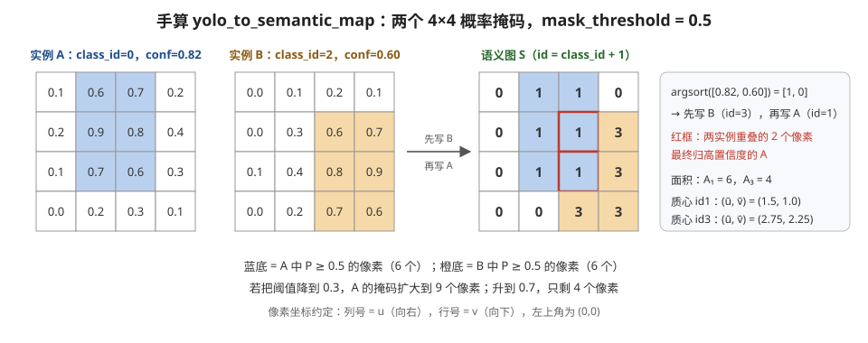

<p align="center"><b>图 7-18</b> 手算 yolo_to_semantic_map：两个 4×4 概率掩码经阈值 0.5 二值化，按置信度升序写入，重叠的 2 个像素归高置信度实例 A。</p>

### 5.5 HSV 与 YOLO 分割对比

HSV 分割与 YOLO 分割虽然最终都能输出二维类别图，但工作机制完全不同：

| 对比项 | HSV 颜色分割 | YOLO 分割 |
|---|---|---|
| 知识来源 | 人工设置颜色范围 | 从训练数据学习特征 |
| 是否需要权重 | 不需要 | 需要分割模型权重 |
| 可解释性 | 高 | 相对较低 |
| 计算量 | 较小 | 较大 |
| 适应复杂场景 | 较弱 | 通常更强 |
| 识别语义类别 | 只能识别预设颜色含义 | 可输出模型训练过的类别 |
| 重叠处理 | 规则写入顺序靠后者覆盖 | 置信度高者覆盖 |
| 背景编号 | 0 | 0（类别编号整体 +1） |

如果任务是"找到红色标志"，HSV 可能更简单可靠；如果任务是"在复杂仓库中识别人和箱子"，学习型模型通常更合适。

### 5.6 语义图的可视化、计算与机器人接口

**可视化**：类别编号图不适合直接给人观察，因此需要为不同类别分配颜色，生成语义色彩图。为了同时看到目标轮廓和原始纹理，还可以把色彩图半透明叠加到原图：

$$
I_{\mathrm{blend}}=(1-\alpha)I_{\mathrm{original}}+\alpha I_{\mathrm{color}}
$$

其中 $\alpha$ 控制语义颜色的透明度。本章默认仅在前景像素处执行叠加，背景保持原图不变。

**对应代码**（`code/code_chapter7/segmentation.py`）：

```python
def overlay_semantic(image_bgr, semantic_map, alpha=0.45, class_colors=None):
    """把语义颜色半透明叠加到原图，背景区域不染色。"""
    # ... 参数检查省略
    colored = colorize_semantic_map(semantic_map, class_colors)
    blended = cv2.addWeighted(image_bgr, 1.0 - alpha, colored, alpha, 0.0)  # 公式 I_blend
    output = image_bgr.copy()
    foreground = semantic_map != 0
    output[foreground] = blended[foreground]       # 只替换前景像素
    return output
```

`colorize_semantic_map()` 把每个非零编号映射为颜色，默认颜色 `class_color(semantic_id - 1)`，与检测框颜色一致；`draw_legend()` 只为当前画面中实际出现的类别绘制图例。

**案例**：默认 $\alpha=0.45$。原图像素 BGR $(100,100,100)$ 属于 HSV 分割的 red 类（颜色 $(0,0,255)$）：

$$
I_{\mathrm{blend}}=0.55\times(100,100,100)+0.45\times(0,0,255)=(55,55,169.75)
$$

转为 `uint8` 约为 $(55,55,170)$，偏红但仍能看出原来的明暗。

**语义图参与计算**：例如，对目标类别 $c$ 构造布尔掩码：

$$
M_c(u,v)=[S(u,v)=c]
$$

目标像素面积为：

$$
A_c=\sum_{u,v}M_c(u,v)
$$

若目标像素坐标集合非空，其二维质心可以写成：

$$
\bar{u}=\frac{1}{A_c}\sum_{u,v}uM_c(u,v),\qquad
\bar{v}=\frac{1}{A_c}\sum_{u,v}vM_c(u,v)
$$

**案例**：对 5.4 节手算得到的语义图：

- 类别 1：像素 $(u,v)\in\{(1,0),(2,0),(1,1),(2,1),(1,2),(2,2)\}$， $A_1=6$， $\bar u=(1+2)\times3/6=1.5$， $\bar v=(0+0+1+1+2+2)/6=1.0$；
- 类别 3：像素 $\{(3,1),(3,2),(2,3),(3,3)\}$， $A_3=4$， $\bar u=(3+3+2+3)/4=2.75$， $\bar v=(1+2+3+3)/4=2.25$。

用 NumPy 实现（示意，不是仓库代码）：

```python
ys, xs = np.nonzero(semantic_map == c)    # 注意 nonzero 先返回行(v)再返回列(u)
if xs.size:
    area = xs.size
    u_bar, v_bar = xs.mean(), ys.mean()
```

> ⚠️ **注意**：二维面积和质心可以用于目标筛选、画面居中和粗略接近控制。但像素面积还会受到距离、视角和遮挡影响，不能直接等同于真实物体面积。由针孔模型，同一物体距离加倍，像素面积约变为原来的 1/4。要得到三维位置，需结合第二部分的反投影。

---

## 第六部分 代码结构与实现解析

### 6.1 文件组织

本章代码采用"配置、仿真、相机、算法和演示程序分离"的结构：

```text
code/code_chapter7/
├── __init__.py
├── README.md
├── requirements.txt
├── config.py
├── simulation.py
├── camera.py
├── scan_controller.py
├── cv_utils.py
├── yolo_vision.py
├── segmentation.py
├── demo_common.py
├── demo_cv_basics.py
├── demo_yolo_detection.py
└── demo_semantic_segmentation.py
```

各文件职责如下：

| 文件 | 主要职责 |
|---|---|
| `config.py` | 项目路径、场景路径、相机 Prim、分辨率和推理参数 |
| `simulation.py` | 启动 Isaac Sim，加载场景与 G2，推进仿真并管理关闭流程 |
| `camera.py` | 创建 G2 相机，读取 RGB/RGBA 图像并转换为 BGR |
| `scan_controller.py` | 复用第四章底盘控制器，让机器人原地旋转扫描 |
| `cv_utils.py` | OpenCV 基础处理、教学拼图、窗口显示和图像保存 |
| `yolo_vision.py` | 加载 YOLO 权重，统一整理检测框和实例掩码 |
| `segmentation.py` | HSV 分割、YOLO 掩码语义化、着色、叠加和图例 |
| `demo_common.py` | 三个示例共用的命令行参数和运行时 |
| `demo_cv_basics.py` | OpenCV 基础流水线演示 |
| `demo_yolo_detection.py` | YOLO 目标检测演示 |
| `demo_semantic_segmentation.py` | YOLO 或 HSV 分割演示 |

建议按以下顺序阅读：

```text
config.py → camera.py → cv_utils.py → yolo_vision.py → segmentation.py → demo_common.py → 三个演示程序 → simulation.py
```

### 6.2 模块调用关系

算法模块本身不负责创建 Isaac Sim。三个 `demo_*.py` 通过统一运行时组合场景、机器人、相机、扫描控制和视觉算法，避免每个示例重复编写仿真初始化代码。

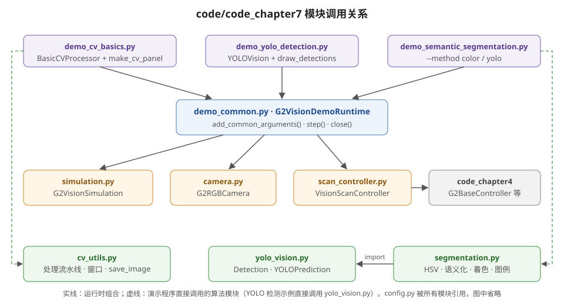

<p align="center"><b>图 7-19</b> code/code_chapter7 模块调用关系。三个演示程序共用 G2VisionDemoRuntime（仿真、相机、扫描控制），再各自调用 cv_utils、yolo_vision 或 segmentation 中的算法；scan_controller 依赖第四章的底盘控制模块。</p>

### 6.3 关键流程逐段解读

下面按程序实际执行顺序，把核心代码串起来。

**第 1 步：统一配置**

`config.py` 使用当前文件位置计算项目根目录，并统一设置模型、场景和输出路径（`code/code_chapter7/config.py`）：

```python
PROJECT_ROOT = Path(__file__).resolve().parents[2]
ROBOT_USD = PROJECT_ROOT / "assets/robot/G2_omnipicker/robot.usda"
ROOM_USD = PROJECT_ROOT / "assets/background/room/room_1/background.usda"
# ...
WAREHOUSE_ASSET = "/Isaac/Environments/Simple_Warehouse/full_warehouse.usd"

DEFAULT_DETECTION_MODEL = PROJECT_ROOT / "yolo26s.pt"
DEFAULT_SEGMENTATION_MODEL = PROJECT_ROOT / "yolo26s-seg.pt"
DEFAULT_OUTPUT_DIR = PROJECT_ROOT / "outputs/chapter7"
```

`parents[2]` 从 `code/code_chapter7/config.py` 向上两级目录，得到仓库根目录，所以权重默认放在仓库根目录。

`SimulationConfig` 统一管理物理频率、渲染频率、场景和机器人初始位姿；`InferenceConfig` 统一 YOLO 推理参数：

```python
@dataclass(frozen=True)
class SimulationConfig:
    physics_hz: int = 120
    rendering_hz: int = 30
    headless: bool = False
    renderer: str = "RaytracedLighting"
    warmup_steps: int = 120
    scene: str = "warehouse"  # warehouse 更适合目标检测；room 与第四章一致
    room_robot_position: tuple[float, float, float] = (0.0, 0.0, -0.01)
    warehouse_robot_position: tuple[float, float, float] = (-8.0, 13.0, -0.01)
    # ...


@dataclass(frozen=True)
class InferenceConfig:
    """YOLO 通用推理参数。"""

    confidence: float = 0.25
    iou: float = 0.45
    image_size: int = 640
    mask_threshold: float = 0.50
```

其中 `warehouse` 更适合观察丰富目标，`room` 与第四章本地场景一致。

**第 2 步：解析命令行并创建运行时**

三个演示都使用 `G2VisionDemoRuntime`。它完成以下工作：

1. 根据命令行参数创建 `SimulationConfig`；
2. 启动 Isaac Sim 并加载场景、G2；
3. 创建指定机载相机；
4. 创建第四章的底盘控制器；
5. 等待相机第一帧；
6. 在每个循环中先更新扫描控制，再推进仿真。

```python
class G2VisionDemoRuntime:
    def __init__(self, args: argparse.Namespace) -> None:
        # ... max_frames、process_every 必须 > 0
        config = replace(
            SimulationConfig(),
            headless=args.headless,
            physics_hz=args.physics_hz,
            rendering_hz=args.rendering_hz,
            scene=args.scene,
        )
        self.config = config
        self.simulation = G2VisionSimulation(config)          # 步骤 1、2
        # ...
        try:
            self.camera = G2RGBCamera(CAMERAS[args.camera], frequency=config.rendering_hz)  # 步骤 3
            self.scan = VisionScanController(self.simulation.robot)                        # 步骤 4
            self.camera.wait_for_bgr(self.simulation)                                      # 步骤 5
        except Exception:
            self.simulation.close()
            raise

    def step(self) -> None:                                   # 步骤 6
        self.scan.update(self.config.physics_dt, self.spin_speed)
        self.simulation.step(render=True)
```

（摘录自 `code/code_chapter7/demo_common.py`。）

共用参数包括：

| 参数 | 默认值 | 含义 |
|---|---:|---|
| `--scene` | `warehouse` | 选择仓库或本地房间场景 |
| `--camera` | `head_front` | 选择机载相机 |
| `--headless` | 关闭 | 无窗口运行 |
| `--max-frames` | 900 | 最大物理帧数 |
| `--process-every` | 基础示例为 4，YOLO 示例为 6 | 每隔多少物理帧处理一帧图像 |
| `--spin-speed` | 0.0 | 原地扫描角速度，单位 rad/s |
| `--physics-hz` | 120 | 物理仿真频率 |
| `--rendering-hz` | 30 | 渲染与相机频率 |

YOLO 检测和分割示例通过 `parser.set_defaults(process_every=6)` 覆盖默认值 4。

**第 3 步：启动仿真、加载场景与 G2**

`G2VisionSimulation`（`code/code_chapter7/simulation.py`）在启动前检查资源，然后创建 `SimulationApp`、`World`，加载场景和机器人，并执行预热：

```python
if not ROBOT_USD.is_file():
    raise FileNotFoundError(f"找不到 G2 USD：{ROBOT_USD}")
# ...
# Isaac Sim 要求先创建 SimulationApp，再导入大部分 isaacsim 模块。
from isaacsim import SimulationApp
# ...
self.world.play()
# ...
for _ in range(self.config.warmup_steps):
    # RTX 相机在无窗口模式下也需要渲染步。
    self.world.step(render=True)
```

> ⚠️ **注意**：视觉任务即使使用无窗口模式，也必须继续执行渲染步，否则 RTX 相机可能无法产生新图像。`warehouse` 场景通过 `get_assets_root_path()` 查找 Isaac Sim Assets，找不到时报 `找不到 Isaac Sim Assets 根路径，无法加载 warehouse`。

**第 4 步：创建相机并等待第一帧**

`G2RGBCamera` 根据配置创建 Isaac Sim 相机（`code/code_chapter7/camera.py`）：

```python
self.sensor = Camera(
    prim_path=config.prim_path,
    name=f"chapter7_{config.name}_camera",
    frequency=frequency,
    resolution=config.resolution,
)
self.sensor.initialize()
self.sensor.add_rgb_to_frame()
```

采集时先读取 RGBA，再统一为 BGR：

```python
def capture_bgr(self) -> np.ndarray | None:
    rgb = self.capture_rgb()
    if rgb is None:
        return None
    return rgb_to_bgr(rgb)

def wait_for_bgr(self, simulation, max_steps: int = 60) -> np.ndarray:
    """推进仿真直到取得第一帧，失败时给出明确错误。"""
    for _ in range(max_steps):
        simulation.step(render=True)
        image = self.capture_bgr()
        if image is not None:
            return image
    raise RuntimeError("相机在等待期间没有返回有效图像，请检查相机 prim 路径")
```

`wait_for_bgr()` 会在初始化后推进若干渲染步（最多 60 步），直到取得第一帧。这样可以避免相机刚创建时返回空数据。

**第 5 步：扫描控制（复用第四章）**

`scan_controller.py` 不重新实现四轮独立转向运动学，而是直接复用第四章的 `G2BaseController`、`SwerveKinematics` 和参数配置。扫描时只给出角速度（`code/code_chapter7/scan_controller.py`）：

```python
# 直接执行 demo_xxx.py 时，确保能够导入兄弟目录 code_chapter4。
CODE_ROOT = PROJECT_ROOT / "code"
if str(CODE_ROOT) not in sys.path:
    sys.path.insert(0, str(CODE_ROOT))

from code_chapter4.base_controller import G2BaseController
from code_chapter4.config import ControlLimits, RobotGeometry
from code_chapter4.kinematics import SwerveKinematics


class VisionScanController:
    # ...
    def update(self, dt: float, angular_speed: float = 0.0) -> None:
        self.base.set_velocity(vx=0.0, vy=0.0, wz=angular_speed)
        self.base.update(dt)
```

这使第七章与第四章形成清晰衔接：第四章负责"怎样让机器人真实转动"，第七章负责"机器人转动时怎样持续观察并处理相机画面"。

**案例**：`--spin-speed 0.25` 时，理想情况下转一整圈需要 $2\pi/0.25\approx25.1$ s 仿真时间；而默认 `--max-frames 900` 只有 7.5 s，大约转 $0.25\times7.5=1.875$ rad ≈ 107°。想扫完一圈需要增大 `--max-frames`（实际转速还受第四章控制器的限幅与响应影响）。

**第 6 步：三个演示程序的主循环**

OpenCV 演示的核心循环是（`code/code_chapter7/demo_cv_basics.py`）：

```python
runtime.step()
if frame % args.process_every:
    continue

image = runtime.camera.capture_bgr()
if image is None:
    continue
result = processor.process(image)
last_panel = make_cv_panel(image, result)
```

`make_cv_panel()` 将原图、灰度图、高斯滤波、Otsu 二值图、Canny 边缘、HSV 掩码和轮廓图组成教学拼图（第 8 格为 "Input for next stage"，即原图），排成 2 行 × 4 列，便于同时比较每一步的作用。

YOLO 检测演示在循环外创建模型，在循环内重复推理（`code/code_chapter7/demo_yolo_detection.py`）：

```python
model = YOLOVision(args.model)
# ... 循环内：
prediction = model.predict(image, args.conf, args.iou, args.imgsz)
last_annotated = draw_detections(image, prediction)
names = [item.class_name for item in prediction.detections]
print(
    f"[YOLO] frame={frame:04d}, count={len(names)}, classes={names[:8]}",
    flush=True,
)
```

分割演示通过 `--method` 在 HSV 和 YOLO 两种方法间切换，并把原图、纯语义色彩图和叠加图横向拼接（`code/code_chapter7/demo_semantic_segmentation.py`）：

```python
color_model = HSVSemanticSegmenter() if args.method == "color" else None
yolo_model = YOLOVision(args.model) if args.method == "yolo" else None
# ... 循环内：
if color_model is not None:
    semantic_map = color_model.predict(image)
    class_names = color_model.class_names
    class_colors = color_model.class_colors
else:
    prediction = yolo_model.predict(image, args.conf, args.iou, args.imgsz)
    semantic_map, class_names = yolo_to_semantic_map(
        prediction, args.mask_threshold
    )
    class_colors = None

color_map = colorize_semantic_map(semantic_map, class_colors)
overlay = overlay_semantic(image, semantic_map, class_colors=class_colors)
overlay = draw_legend(overlay, class_names, semantic_map, class_colors)
last_panel = cv2.hconcat((image, color_map, overlay))
```

**第 7 步：保存结果与清理**

三个示例都在 `finally` 中保存最后一次有效结果并关闭窗口、停止底盘、关闭 Isaac Sim。这样即使用户按键退出或中途发生异常，也尽量完成资源清理：

```python
finally:
    if last_panel is not None:
        save_image(args.output, last_panel)   # 打印 "[OpenCV] 已保存：..."
    window.close()
    runtime.close()                           # 先 scan.stop()，再 simulation.close()
```

`ImageWindow` 在无法创建 GUI 窗口时会自动降级为"只保存图像"，按 `q` 或 `Esc` 时 `show()` 返回 `False`，主循环随之退出。

---

## 第七部分 代码运行

### 7.1 环境部署

本章仿真程序必须使用 Isaac Sim 对应的 Python 环境。下列 `/path/to/isaac-sim/python.sh` 是占位符，请替换为实际安装路径。运行命令时应先进入仓库根目录，使 `code/code_chapter7`、`assets` 和模型权重路径都能正确解析。

运行仿真前还应确认代码所引用的本地资源已经准备完成：

| 资源 | 代码默认路径 | 是否必需 |
|---|---|---|
| G2 机器人模型 | `assets/robot/G2_omnipicker/robot.usda` | 所有三个示例都需要 |
| 本地房间场景 | `assets/background/room/room_1/background.usda` | 仅使用 `--scene room` 时需要 |
| 仓库场景 | Isaac Sim Assets 中的 `Simple_Warehouse/full_warehouse.usd` | 使用默认 `warehouse` 时需要 |

如果机器人 USD 缺失，程序会在启动 Isaac Sim 前直接报错；如果本地房间资源缺失，可改用仓库场景，但前提是本机已经安装 Isaac Sim Assets。

先检查基础依赖：

```bash
/path/to/isaac-sim/python.sh -c \
"import cv2, numpy, ultralytics; \
print('OpenCV:', cv2.__version__); \
print('NumPy:', numpy.__version__); \
print('Ultralytics import: OK')"
```

`requirements.txt` 中列出了本章额外使用的软件包：

```text
ultralytics>=8.4
opencv-python>=4.8
```

若 Isaac Sim Python 中缺少依赖，可在该环境中安装。若 `cv2` 已经能够正常导入，优先只补充缺失的软件包，避免无意覆盖 Isaac Sim 已有的 OpenCV 环境：

```bash
/path/to/isaac-sim/python.sh -m pip install \
-r code/code_chapter7/requirements.txt
```

> ⚠️ **注意**：不要只把依赖安装到系统 Python。系统 Python 能导入 `ultralytics`，不代表 Isaac Sim 的 Python 也能导入。

OpenCV 基础示例不需要 YOLO 权重。YOLO 检测和分割示例分别默认查找仓库根目录中的：

```text
yolo26s.pt

yolo26s-seg.pt
```

当前代码只配置权重路径，不会在程序中自动下载。如果仓库根目录没有这两个文件，需要先准备与代码兼容的检测权重和分割权重，或通过 `--model` 指定其他本地权重路径。

### 7.2 代码执行

以下命令均在仓库根目录执行。

**OpenCV 基础示例**

运行 OpenCV 基础流水线（默认仓库场景、头部前向相机）：

```bash
/path/to/isaac-sim/python.sh \
code/code_chapter7/demo_cv_basics.py
```

切换到本地 `room_1` 场景：

```bash
/path/to/isaac-sim/python.sh \
code/code_chapter7/demo_cv_basics.py \
--scene room
```

切换左夹爪相机，并让底盘缓慢旋转扫描：

```bash
/path/to/isaac-sim/python.sh \
code/code_chapter7/demo_cv_basics.py \
--camera gripper_left \
--spin-speed 0.25
```

调整 Canny 阈值：

```bash
/path/to/isaac-sim/python.sh \
code/code_chapter7/demo_cv_basics.py \
--canny-low 50 \
--canny-high 120
```

无窗口运行 180 个物理帧并保存最后一次有效结果：

```bash
/path/to/isaac-sim/python.sh \
code/code_chapter7/demo_cv_basics.py \
--headless \
--max-frames 180 \
--output outputs/chapter7/opencv_basics.jpg
```

按 `q` 或 `Esc` 可以结束有窗口运行。即使窗口关闭，程序也会尝试保存最后一张有效教学拼图。

**YOLO 目标检测示例**

使用默认检测权重运行目标检测：

```bash
/path/to/isaac-sim/python.sh \
code/code_chapter7/demo_yolo_detection.py
```

显式指定模型和置信度：

```bash
/path/to/isaac-sim/python.sh \
code/code_chapter7/demo_yolo_detection.py \
--model yolo26s.pt \
--conf 0.25 \
--iou 0.45 \
--imgsz 640
```

降低推理频率并让机器人扫描：

```bash
/path/to/isaac-sim/python.sh \
code/code_chapter7/demo_yolo_detection.py \
--process-every 10 \
--spin-speed 0.20
```

**语义分割示例**

默认方法是 YOLO 分割：

```bash
/path/to/isaac-sim/python.sh \
code/code_chapter7/demo_semantic_segmentation.py
```

显式指定分割模型及参数：

```bash
/path/to/isaac-sim/python.sh \
code/code_chapter7/demo_semantic_segmentation.py \
--method yolo \
--model yolo26s-seg.pt \
--conf 0.25 \
--mask-threshold 0.50
```

运行 HSV 颜色分割对照实验：

```bash
/path/to/isaac-sim/python.sh \
code/code_chapter7/demo_semantic_segmentation.py \
--method color
```

### 7.3 运行结果

**OpenCV 基础示例**

程序默认加载仓库场景、G2 和头部前向相机。显示窗口包含原图、灰度图、高斯滤波图、Otsu 二值图、Canny 边缘图、HSV 颜色掩码、轮廓图以及下一阶段输入参考图。

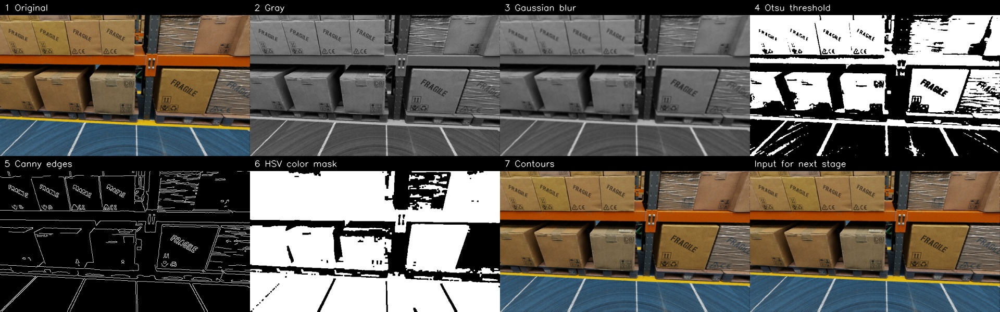

<p align="center"><b>图 7-20</b> OpenCV 基础示例的教学拼图：第一行为原图、灰度、高斯滤波、Otsu 二值化，第二行为 Canny 边缘、HSV 颜色掩码、轮廓框和下一阶段输入。</p>

正常情况下，退出时会看到类似输出：

```text
[OpenCV] 已保存：.../outputs/chapter7/opencv_basics.jpg
```

**如何读懂**：

- 灰度图应保留原图明暗结构，但不再包含颜色。高斯滤波图应比灰度图更平滑，细小纹理和噪声减少。Otsu 图应把部分区域分成黑白两类，但不一定与真实物体类别一致。
- Canny 图中，高对比度边界应形成较连续的细线。如果几乎整张图都是边缘，说明阈值可能过低或场景纹理过多；如果几乎没有边缘，说明阈值可能过高或图像过于平滑。
- HSV 掩码显示高饱和度区域。灰色墙面、白色地面等低饱和区域通常不会被选中，颜色鲜艳的物体更容易成为白色前景。
- 轮廓图只绘制面积足够大的外轮廓。如果框很多且杂乱，可以提高最小轮廓面积、增加滤波或调整边缘阈值；如果目标完全没有框，应检查边缘是否连续，以及面积阈值是否过高。

**YOLO 目标检测示例**

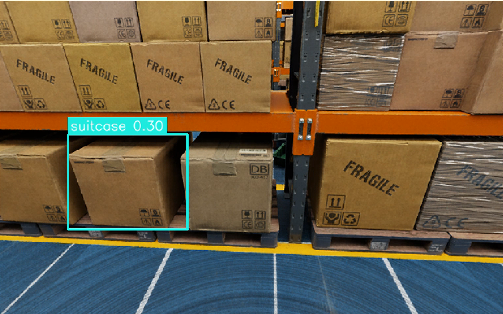

<p align="center"><b>图 7-21</b> YOLO 目标检测示例运行结果：检测框、类别名称与置信度绘制在 G2 相机画面上。</p>

程序会在终端持续输出当前处理帧、目标数量和类别名称，例如：

```text
[YOLO] frame=0060, count=3, classes=['person', 'box', 'box']
```

具体类别由权重和当前画面决定，因此实际结果可能不同。可视化图会绘制矩形框、类别名称和置信度，退出时默认保存到：

```text
outputs/chapter7/yolo_detection.jpg
```

如果画面没有检测到目标，`count=0` 是正常推理结果。程序不会因为空检测而退出。

**如何读懂**：

- `frame=0060` 是物理帧号（4 位补零），它总是 `--process-every` 的整数倍（默认 6）；`count` 是 NMS 之后剩下的框数；`classes` 最多只打印前 8 个类别名（代码中 `names[:8]`）。
- 首先检查类别是否与物体一致，再观察检测框是否覆盖目标主体，最后观察置信度。高置信度不等于绝对正确，尤其是在仿真域和真实训练数据差异较大时。
- 同一目标出现多个框时，可检查 IoU 参数；远处小目标漏检时，可尝试提高输入尺寸、切换视角或让机器人靠近；大量错误类别可能说明预训练数据与当前任务目标不匹配，需要专用数据训练。

**语义分割示例**

YOLO 分割（默认方法）结果：

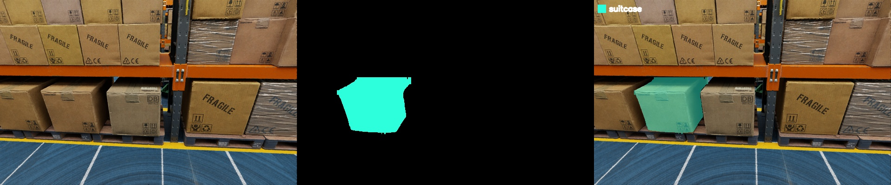

<p align="center"><b>图 7-22</b> YOLO 分割示例运行结果：左为相机原图，中为纯语义色彩图，右为带类别图例的半透明叠加图。</p>

HSV 颜色分割对照实验结果：

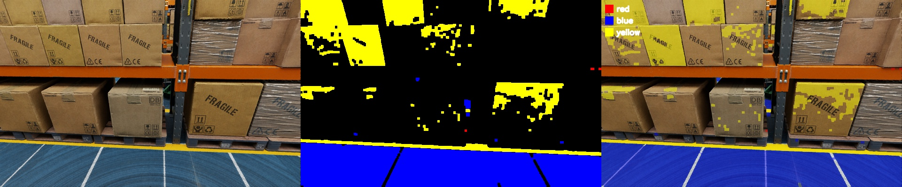

<p align="center"><b>图 7-23</b> HSV 颜色分割（--method color）运行结果：只有满足红、绿、蓝、黄颜色规则的像素被着色。</p>

分割窗口从左到右显示：

1. 相机原图；
2. 纯语义色彩图；
3. 带类别图例的半透明叠加图。

退出时默认保存到：

```text
outputs/chapter7/semantic_segmentation.jpg
```

YOLO 方法的终端输出会显示当前语义图中实际出现的类别。没有识别到任何物体时，语义图全为背景，类别列表为空，这同样是正常结果。

**如何读懂**：

- 终端行格式为 `[Segmentation] frame=XXXX, classes=[...]`，类别列表按字母排序、不含 background；
- 纯语义图应只有离散类别颜色，不应保留原图纹理。叠加图应同时显示目标轮廓和原始场景；
- 掩码边缘过宽时可提高 `mask-threshold`，掩码破碎或过小时可适当降低。若使用 HSV 方法，应重点检查颜色区间和光照；若使用 YOLO 方法，应重点检查权重类型、类别能力和置信度。

**参数调节速查**

| 参数 | 主要影响 | 调大后的典型变化 | 调小后的典型变化 |
|---|---|---|---|
| `--conf` | 实例是否保留 | 更谨慎，可能漏检 | 保留更多目标，也可能误检 |
| `--iou` | 重叠预测处理 | 可能保留更多重叠框 | 抑制更积极，邻近目标可能被合并 |
| `--imgsz` | 网络输入尺寸 | 细节更多、速度更慢 | 速度更快、小目标更难检测 |
| `--mask-threshold` | 掩码像素范围 | 掩码更保守、更小 | 掩码更宽，可能包含背景 |
| `--process-every` | 推理间隔 | 推理更少、仿真更流畅 | 推理更频繁、计算压力更大 |
| `--spin-speed` | 底盘扫描角速度 | 覆盖更快，但可能出现运动模糊 | 扫描更稳定，但覆盖较慢 |
| `--camera` | 观察视角与分辨率 | 取决于相机选择 | 取决于相机选择 |

建议每次只修改一个参数，并保存结果进行对比。若同时修改置信度、输入尺寸和推理间隔，很难判断结果变化究竟由哪个参数引起。

---

## 本章小结

### 知识回顾

本章完成了从 G2 相机到二维视觉结果的完整链路：

```text
G2 相机采集 → RGB/RGBA 转 BGR → OpenCV 基础处理 → YOLO 目标检测 → HSV 或 YOLO 分割 → 语义图着色与保存
```

需要掌握的核心结论包括：

1. 图像是按"高、宽、通道"组织的数字矩阵，像素坐标与机器人三维坐标不能混用；
2. Isaac Sim 常见 RGB/RGBA 图像进入 OpenCV 前要正确转换为 `uint8 BGR`；
3. 针孔模型 $u=f_xX/Z+c_x$ 把三维点压到像平面，丢失深度；有了深度 $Z$、内参 $K$ 和外参 $T_{BC}$，才能把像素反投影为机器人坐标；
4. 灰度、滤波、阈值、边缘、形态学和轮廓是传统 CV 的基本工具；
5. 传统 CV 依赖人工规则，YOLO 依赖训练数据，两者各有适用场景；
6. 目标检测输出类别、置信度和矩形框，实例分割进一步输出逐实例掩码；
7. 本章将 YOLO 类别编号加 1，使语义图中的 0 始终表示背景；重叠像素归高置信度实例；
8. `conf`、`iou`、`imgsz`、`mask-threshold` 和 `process-every` 分别控制不同环节，不能混为一谈；
9. 视觉推理不必与物理仿真同频，合理降低推理频率能提高系统流畅性；
10. 二维检测和分割只能说明目标位于画面何处，不能直接给出世界坐标和抓取位姿。

| 知识点 | 核心公式 / 规则 | 对应代码 |
|---|---|---|
| 颜色格式 | RGBA → uint8 → BGR | `camera.py: rgba_to_rgb / rgb_to_bgr` |
| 针孔投影 | $u=f_xX/Z+c_x,\ v=f_yY/Z+c_y$ | 本章代码未实现（第九章基础） |
| 反投影 | $X=(u-c_x)Z/f_x$， $P_B=R_{BC}P_C+t_{BC}$ | 本章代码未实现 |
| 灰度化 | $Y=0.299R+0.587G+0.114B$ | `cv2.cvtColor(..., COLOR_BGR2GRAY)` |
| 高斯滤波 | 加权卷积，核为正奇数 | `cv2.GaussianBlur`，默认 5×5 |
| Otsu | 最大化 $w_0w_1(\mu_0-\mu_1)^2$ | `cv2.threshold(..., THRESH_OTSU)` |
| Canny | 梯度 + NMS + 双阈值滞后 | `cv2.Canny`，默认 80/160 |
| HSV + 形态学 | 区间判断，开运算后闭运算 | `cv2.inRange`、`cv2.morphologyEx` |
| 轮廓 | 外轮廓 + 面积过滤 | `cv2.findContours`，默认 ≥300 |
| 检测 | `xyxy`、conf、IoU/NMS | `yolo_vision.py: YOLOVision.predict` |
| 语义化 | `semantic_id = class_id + 1`，置信度升序写入 | `segmentation.py: yolo_to_semantic_map` |
| 叠加 | $I_{\mathrm{blend}}=(1-\alpha)I+\alpha I_c$， $\alpha=0.45$ | `segmentation.py: overlay_semantic` |

### 课后练习

1. **（思考）坐标与形状**：一张 `gripper_left` 图像的 NumPy 形状是多少？像素 $(u,v)=(1000,50)$ 在 NumPy 中应该如何索引？如果写成 `image[1000, 50]` 会发生什么？
2. **（手算）反投影**：沿用 2.3 节的假设内参与外参，若目标像素为 $(160,140)$、深度 $Z=4.0$ m，求它在相机光学系与基座系中的坐标，并判断目标在机器人左侧还是右侧。（参考答案： $P_C=(-2.0,-0.75,4.0)$， $P_B=(4.1,2.0,2.25)$，左侧。）
3. **（手算）IoU 与 NMS**：两个框 $(0,0,100,100)$ 与 $(50,0,150,100)$，求 IoU；当 `iou=0.45` 和 `iou=0.30` 时，NMS 分别保留几个框？
4. **（动手）Canny 阈值实验**：保持场景和相机不变，分别运行以下三组 Canny 阈值，对比保存图片，记录边缘数量、连续性和轮廓框变化。

   | 组别 | 低阈值 | 高阈值 | 预期现象 |
   |---|---:|---:|---|
   | A | 30 | 80 | 边缘较多，噪声也可能较多 |
   | B | 80 | 160 | 默认折中结果 |
   | C | 150 | 220 | 只保留较强边缘，可能漏掉弱边界 |

5. **（动手）相机视角、置信度与掩码阈值**：
   - 依次选择 `head_front`、`head_left`、`gripper_left`，保持其他参数不变，比较视野范围、目标在画面中的大小、处理速度、远处目标和近处目标的检测效果；
   - 固定模型和场景，分别设置 `conf=0.10`、`0.25`、`0.50`，记录每种设置下的目标数量、明显误检和明显漏检，理解"阈值更高"并不等于"系统一定更好"；
   - 固定一帧包含明显目标的图像，分别设置 `mask-threshold=0.30`、`0.50`、`0.70`，比较目标边界、细小结构和背景污染程度；
   - 在同一场景中分别运行 `--method color` 和 `--method yolo`，观察 HSV 是否会把不同物体中相同颜色的区域归为一类、YOLO 是否能跨颜色识别同一语义类别、光照变化对两种方法的影响以及两种方法的运行速度差异。
6. **（动手）构造简单视觉扫描策略**：设置较小的 `spin-speed` 让机器人缓慢旋转，观察目标框中心如何随机器人朝向变化。进一步可以在 `demo_yolo_detection.py` 的循环中计算检测框中心与图像中心的水平误差：

   $$
   e_u=u_c-\frac{W}{2}
   $$

   当 $e_u$ 为负时目标在左侧，为正时目标在右侧。可以据此设计"目标居中后停车"的简单视觉反馈，例如 $\omega_z=-k\,e_u$，并修改 `runtime.spin_speed`。实现时应设置角速度上限、死区和目标丢失策略，避免机器人持续抖动或无限旋转。

### 参考资料

- 本章代码：`code/code_chapter7/`（`README.md`、`requirements.txt` 及各模块源码）
- 第四章底盘控制代码：`code/code_chapter4/`（`base_controller.py`、`kinematics.py`、`config.py`）
- OpenCV 官方文档：图像滤波、阈值、Canny、形态学、轮廓等 `cv2` 接口
- Ultralytics YOLO 官方文档：`YOLO(...).predict()` 的 `conf`、`iou`、`imgsz` 参数与 `Results.boxes` / `Results.masks` 结构
- NVIDIA Isaac Sim 官方文档：`isaacsim.sensors.camera.Camera`、`SimulationApp`、Isaac Sim Assets

