# 第八章 雷达点云建图

> **本章导读**：第四章讲了移动底盘如何运动、里程计如何由轮速积分得到，第七章讲了机器人如何用相机"看懂"颜色和语义。本章换一种传感器——激光雷达（Light Detection and Ranging，LiDAR），它不擅长语义，却能稳定地给出环境的几何结构。我们从"激光雷达如何测到一个点"开始，依次讲解点云的字段与坐标系、双雷达外参变换与融合、点云预处理、里程计漂移与回环检测、ICP 配准与位姿图优化，最后落到二维占据栅格和三维体素地图两种地图表示。本章生成的二维 PGM/YAML 地图将在第十章作为 Nav2 静态地图的输入。
>
> 本章最终要跑通的案例是：在 Isaac Sim 的 `Simple_Warehouse/full_warehouse.usd` 仓库场景中，给 G2 机器人的 `base_link` 动态添加两台 Ouster OS1 RTX LiDAR，让机器人沿方形闭环轨迹巡航一圈，完成双雷达读取、2D 占据栅格建图和 3D 体素建图，并在 RViz2 中观察"漂移轨迹—回环—优化轨迹—地图重建"的全过程。

## 本章概览

### 本章要解决的问题

设想 G2 机器人第一次进入一座仓库，后续要在这里自主导航和取货。它首先需要一张地图：哪里是墙和货架，哪里可以通行。两台激光雷达每秒会送来大量三维点，但这些点各自位于雷达自己的坐标系中，机器人在移动，里程计又会一点点漂移——如果只是把每帧点云简单"堆"在一起，得到的会是双层墙、扇形重影和闭合不上的走廊。本章要回答的就是：**怎样把一帧帧点云放到同一个正确的地图坐标系中，并把它们组织成可用于导航的 2D 地图和可用于空间理解的 3D 地图**。

### 学习目标

- **解释**激光雷达飞行时间测距原理，并能把一组（距离、方位角、俯仰角）手算成三维点；
- **解释** XYZI 点云的数据契约（`xyz`、`intensity`、`origin`），说清楚为什么一个点必须与 `frame_id` 一起解释；
- **推导并手算**点从 `lidar_*` 经外参变换到 `base_link`、再经机器人位姿变换到 `map` 的完整坐标链；
- **实现/读懂**点云预处理流程：有限值过滤、量程过滤、固定步长抽样、体素降采样与双雷达融合；
- **解释**里程计漂移的来源，以及扫描描述子 + 2D ICP + SE(2) 位姿图优化如何修正漂移；
- **推导**占据栅格的 Bresenham 射线更新与 log-odds 概率累计，以及 3D 体素哈希地图的均值聚合；
- **运行**双雷达检查、2D 建图、3D 建图三个示例，并用 ROS2 命令按数据链**排查**常见故障。

### 前置知识

- 第一、二章：Isaac Sim 的安装与基本使用（Stage、Prim、仿真步进）；
- 第四章：移动底盘运动学与里程计（位姿 $(x,y,\psi)$、增量积分的概念）；
- 数学：二维/三维旋转矩阵、齐次坐标变换、向量范数、对数与指数、最小二乘的基本思想（了解 SVD 更好）；
- 编程：Python 与 NumPy（布尔掩码索引、广播、`np.floor`、`np.unique`），了解 ROS2 话题、TF 与 RViz2 的基本概念。

### 知识地图

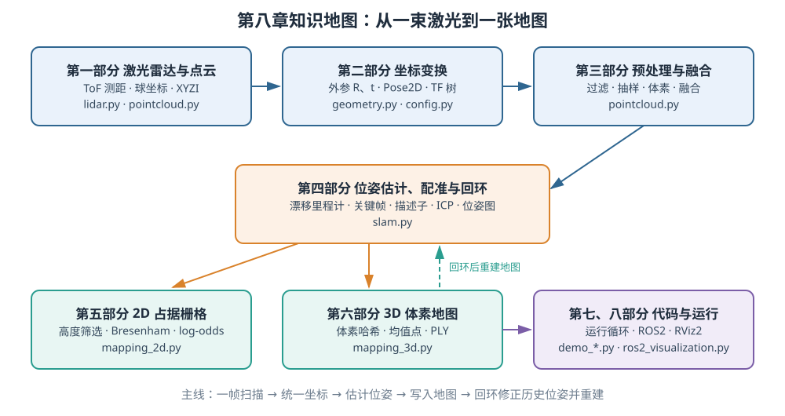

<p align="center"><b>图 8-1</b> 本章知识地图：各部分之间的关系以及与代码模块的对应</p>

### 对应代码

本章代码位于 `code/code_chapter8/`：这是一套用于理解核心概念的教学实现，包含双 RTX LiDAR 点云、漂移里程计、回环检测、2D ICP、SE(2) 位姿图优化、2D 占据栅格与 3D 体素地图，以及 ROS2/RViz2 可视化。代码默认使用 Isaac Sim 的 `Simple_Warehouse/full_warehouse.usd` 场景，按 `config.py` 中的路径加载 G2 模型，并在 `base_link` 下动态添加两台 Ouster OS1 RTX LiDAR。运行前应确认本地 Isaac Sim、G2 USD 文件和 ROS2 Bridge 与配置一致。

> ⚠️ **注意**：本章代码不等同于 FAST-LIO2、Cartographer、SLAM Toolbox 等完整工程系统。尤其是本章**没有实现** LiDAR-IMU 紧耦合、逐点运动畸变补偿和持续的 scan-to-map 前端，这些边界会在后文（4.1 节、6.4 节）明确说明。

---

## 第一部分 激光雷达测距原理与点云数据结构

### 1.1 机器人为什么需要激光雷达

**直观理解**：相机是"被动地看"——它把环境光投影成二维图像，擅长提供颜色、纹理和语义；激光雷达是"主动地摸"——它自己向环境发射光束，再根据回波计算距离，擅长提供稳定的几何结构。

对于移动机器人来说，激光雷达最直接回答的问题是：

- 障碍物离机器人多远；
- 墙面、货架和柱子位于什么方向；
- 前方是否存在可通行空间；
- 机器人移动后，两次扫描之间如何对齐；
- 多帧扫描能否累积成可供导航使用的地图。

与普通 RGB 相机相比，激光雷达通常不依赖环境纹理，对明暗变化也不那么敏感。例如，一面纯白墙在图像中可能几乎没有特征，但雷达仍然能够测出墙面距离。与此同时，激光雷达也有自己的局限：

- 黑色、透明、镜面或强反光材料可能产生弱回波、漏检或异常点；
- 雨、雾、粉尘会引入额外散射；
- 旋转式雷达的一帧点云并不是同一时刻采集完成的，机器人快速运动时会产生运动畸变；
- 雷达只提供几何和反射强度，不能直接告诉机器人"这是纸箱还是行人"；
- 多台雷达若外参或时间不同步，融合后会出现双层墙和重影。

因此，激光雷达不是"装上就能自动建图"的黑盒。完整流程至少包括下面这些环节，本章的各个部分正是沿着这条链展开的：

```text
激光测距                                  ← 第一部分
  ↓
生成单帧点云                              ← 第一部分
  ↓
数据解析与过滤                            ← 第三部分
  ↓
坐标变换与多雷达融合                      ← 第二、三部分
  ↓
估计机器人位姿                            ← 第四部分
  ↓
把多帧点云放入统一地图坐标系              ← 第二、四部分
  ↓
生成 2D 或 3D 地图                        ← 第五、六部分
  ↓
通过回环与后端优化减小长期漂移            ← 第四部分
```

### 1.2 飞行时间测距与球坐标转换

**直观理解**：对着山谷喊一声，听到回声的时间越久，山就越远。激光雷达做的是同一件事，只不过"声音"换成了光，计时精度达到纳秒级。

**原理与公式**：常见激光雷达会发射一束激光，记录光从传感器出发、被物体反射并返回接收器所经历的时间差（Time of Flight，ToF）。若光速为 $c$（约 $3\times10^8$ m/s），往返时间为 $\Delta t$（s），则物体距离 $d$（m）近似为：

$$
d=\frac{c\Delta t}{2}
$$

分母中的 2 来自"去程加回程"。雷达测出的不仅是距离 $d$，还知道该束激光发射时的方位角 $\alpha$（水平面内绕 $z$ 轴的角度）和俯仰角 $\beta$（相对水平面抬起的角度）。在一种常见的球坐标定义下，可以把量测转换为传感器坐标系中的三维点：

$$
x=d\cos\beta\cos\alpha
$$

$$
y=d\cos\beta\sin\alpha
$$

$$
z=d\sin\beta
$$

其中 $d\cos\beta$ 是距离在水平面上的投影长度，再按方位角 $\alpha$ 分解到 $x$、 $y$； $d\sin\beta$ 是竖直分量。于是，每发射并接收到一束有效激光，就得到一个三维点 $(x,y,z)$。大量激光束在水平和竖直方向上扫描后，就形成一帧点云。

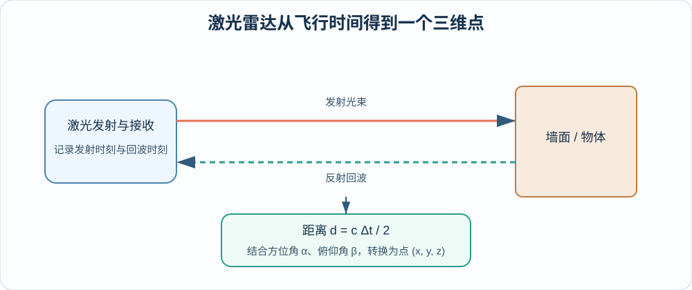

<p align="center"><b>图 8-2</b> 雷达通过往返时间计算距离，再结合方位角和俯仰角生成三维点</p>

**案例（手算）**：

1. 某束激光的往返时间 $\Delta t=26.69\ \mathrm{ns}$，则 $d=\dfrac{2.998\times10^8\times26.69\times10^{-9}}{2}\approx4.000\ \mathrm{m}$。反过来看，时间每误差 1 ns，距离就误差约 15 cm，这就是雷达需要极高计时精度的原因。
2. 若该束激光的 $\alpha=30^\circ$、 $\beta=0^\circ$，则 $x=4\cos30^\circ=3.464$ m， $y=4\sin30^\circ=2.000$ m， $z=0$。（这个点会在 2.4 节一路变换到地图里。）
3. 若同样 $d=4$ m、 $\alpha=30^\circ$，但俯仰角 $\beta=10^\circ$，则水平投影变短为 $4\cos10^\circ=3.939$ m，得到 $x=3.411$ m， $y=1.970$ m， $z=4\sin10^\circ=0.695$ m。

**对应代码**：真实机械雷达、MEMS 雷达和仿真 RTX LiDAR 的底层实现不同，但从建图算法的角度看，它们最终都需要输出"某时刻、某坐标系下的一组空间量测"。本章使用 Isaac Sim 的 RTX LiDAR：RTX 传感器通过光线追踪模拟激光与场景几何、材质之间的交互，并由 `IsaacCreateRTXLidarScanBuffer` annotator 直接提供传感器坐标系下的笛卡尔点云和强度数据。因此上面的 ToF 与球坐标换算在本章代码中由仿真器完成，Python 代码拿到的已经是 $(x,y,z)$。

> 💡 **要点**：ToF 公式和球坐标公式解释了"点从哪里来"；之后所有算法只关心"点在哪个坐标系、什么时刻"。

### 1.3 扫描线、分辨率、频率与量程

理解雷达参数时，不能只看"最大距离"。以下指标会共同影响地图质量和计算量：

| 参数 | 含义 | 对建图的影响 |
|---|---|---|
| 水平视场角 | 雷达在水平方向能看到多大范围 | 视场越完整，匹配和回环通常越稳定 |
| 垂直视场角 | 雷达在竖直方向能覆盖多大范围 | 决定能否看到地面、货架上层和高处结构 |
| 通道数 | 同一水平角附近有多少条不同俯仰角的扫描线 | 通道越多，竖直结构越密，但数据量更大 |
| 水平角分辨率 | 相邻水平采样之间的角度间隔 | 分辨率越高，远处墙面越连续 |
| 扫描频率 | 每秒形成多少帧扫描 | 频率越高，动态响应越好，但计算压力更大 |
| 最小量程 | 能可靠测量的最近距离 | 过近点可能是传感器自身、机器人结构或异常回波 |
| 最大量程 | 能可靠测量的最远距离 | 过远点更稀疏，也更容易受噪声影响 |
| 强度 | 回波能量或反射强弱 | 可用于可视化、材料差异和部分定位特征，但不能直接当作颜色 |

本章 `LidarConfig` 默认选择：

```text
模型：OS1
配置：OS1_REV6_128ch10hz1024res
最小量程：0.25 m
最大量程：50.0 m
点抽样步长：2
单帧体素尺寸：0.10 m
```

**对应代码**（`code/code_chapter8/config.py`）：

```python
@dataclass(frozen=True)
class LidarConfig:
    """Ouster OS1 RTX LiDAR 和单帧点云预处理参数。"""

    model: str = "OS1"                              # RTX LiDAR 配置文件名
    profile: str = "OS1_REV6_128ch10hz1024res"      # 128 线、10 Hz、每圈 1024 列
    min_range: float = 0.25                         # 近距阈值 r_min（m）
    max_range: float = 50.0                         # 远距阈值 r_max（m）
    max_range_margin: float = 0.0                   # 量程余量，有效上限 = max_range - margin
    point_stride: int = 2                           # 固定步长抽样
    scan_voxel_size: float = 0.10                   # 单帧体素边长（m）
```

其中"128ch"表示高线数扫描配置，"10hz"表示配置名称对应 10 Hz 级扫描，"1024res"表示每圈的水平采样规模。实际输出频率还会受到仿真渲染频率、读取间隔和 RTX 传感器配置影响。

**案例（估算数据量）**：按配置名的字面含义粗略估算，一圈约 $128\times1024=131072$ 个采样点，10 Hz 就是每秒约 131 万个点；两台雷达再翻倍。每点按 XYZI 四个 `float32` 存储即 16 字节，单台每秒原始数据约 $131072\times10\times16\approx21$ MB。这就是为什么 3.3 节要先抽样、再体素降采样。（这是按配置名的上限估算，真实有效点数会因无回波、量程过滤而更少。）

> ⚠️ **注意**：本章仿真物理与渲染频率为 60 Hz（`SimulationConfig.physics_hz=60`），而雷达约 10 Hz 才完成一圈。`demo_common.py` 中的注释说明，Isaac Sim 5.0 只在完成一整圈扫描时才输出数据，所以代码在**每个渲染帧**都调用 `capture()` 读取，而不是只在 `frame % N == 0` 时读取，否则 60 Hz 与 10 Hz 相位不对齐时可能永远错过扫描。

### 1.4 点云的数据组织：XYZI 与数据契约

**直观理解**：图像像一张排好座位的考场座位表，每个像素都有固定的上下左右邻居；点云则像操场上随意站着的一群人，只记录每个人的位置，彼此之间没有固定的邻接关系。

**原理与公式**：最基础的一帧点云可以写成

$$
\mathcal{P}=\{\mathbf{p}_i\}_{i=1}^{N},\qquad \mathbf{p}_i=[x_i,\ y_i,\ z_i]^{T}
$$

其中 $N$ 是点数。点云与规则图像不同：图像像素天然排成 $H\times W$ 的网格，而普通点云通常只是 $N\times 3$ 或 $N\times C$ 的数组，点与点之间没有固定的二维邻接关系。

工程中的点云经常还带有附加字段：

| 字段 | 含义 | 本章是否保留 |
|---|---|---|
| `x, y, z` | 点在当前坐标系中的三维坐标，单位通常为米 | 是 |
| `intensity` | 回波强度 | 是 |
| `ring` | 点来自哪条扫描线 | 否 |
| `timestamp` / `time` | 点在一帧内部的采样时刻 | 否 |
| `return_type` | 首回波、最强回波等 | 否 |
| `rgb` | 与相机融合后的颜色 | 否 |

本章统一使用 XYZI 点云：

$$
\mathbf{q}_i=[x_i,\ y_i,\ z_i,\ I_i]^{T}
$$

其中 $I_i$ 表示强度。代码不会对每帧强度做最大最小拉伸，只会把 `NaN` 和无穷值归零。这样可以避免同一物体因为每帧点云范围不同而在 RViz 中不断"闪烁"。

除了点坐标，本章还为每个点保存对应雷达在 `base_link` 中的原点 `origin`。这个字段对 2D 占据栅格非常重要，因为算法需要知道一条激光射线"从哪里出发、在哪里击中障碍"。如果只保留终点而丢失雷达原点，就无法正确标记射线经过的自由空间。

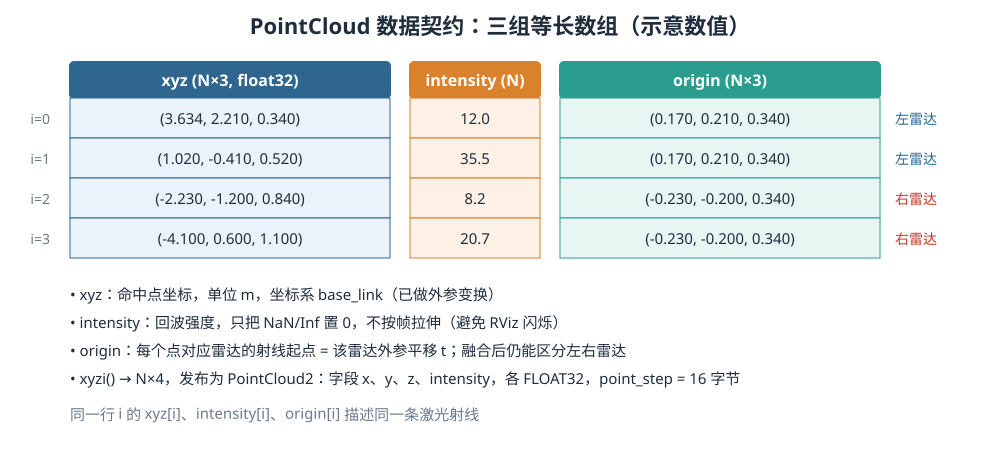

<p align="center"><b>图 8-3</b> PointCloud 的三组等长数组：同一行 i 描述同一条激光射线（数值为示意）</p>

**对应代码**（`code/code_chapter8/pointcloud.py`）：

```python
@dataclass
class PointCloud:
    """统一的 XYZI 点云；xyz 和 origin 都位于 base_link 坐标系。"""

    xyz: np.ndarray          # N×3，命中点
    intensity: np.ndarray    # N，回波强度
    origin: np.ndarray       # N×3，每个点对应雷达的射线起点

    # ...
    def xyzi(self) -> np.ndarray:
        if len(self) == 0:
            return np.empty((0, 4), dtype=np.float32)
        # 把坐标和强度拼成 N×4，用于发布 PointCloud2
        return np.column_stack((self.xyz, self.intensity)).astype(np.float32, copy=False)

def normalize_intensity(intensity: np.ndarray) -> np.ndarray:
    """保留真实 intensity；仅处理 NaN/Inf，不按帧拉伸，避免地图闪烁。"""
    return np.nan_to_num(np.asarray(intensity, dtype=np.float32), nan=0.0, posinf=0.0, neginf=0.0)
```

数据契约为：

| 成员 | 形状 | 坐标系 | 含义 |
|---|---|---|---|
| `xyz` | `N×3` | `base_link` | 点坐标 |
| `intensity` | `N` | 无坐标系 | 每个点的回波强度 |
| `origin` | `N×3` | `base_link` | 每个点对应雷达的射线起点 |

发布到 ROS2 时，`xyzi()` 的 $N\times4$ 数组被直接打包成 `sensor_msgs/PointCloud2`（`code/code_chapter8/ros2_visualization.py`）：

```python
msg.point_step = 16                       # 每点 4 个 float32 = 16 字节
msg.row_step = 16 * msg.width
msg.fields = [
    self.PointField(name="x", offset=0, datatype=self.PointField.FLOAT32, count=1),
    self.PointField(name="y", offset=4, datatype=self.PointField.FLOAT32, count=1),
    self.PointField(name="z", offset=8, datatype=self.PointField.FLOAT32, count=1),
    self.PointField(name="intensity", offset=12, datatype=self.PointField.FLOAT32, count=1),
]
msg.data = points.tobytes()
```

**代码解读**：

- `PointField` 的 `offset` 0/4/8/12 正好对应 $\mathbf{q}_i$ 的四个分量在 16 字节中的位置；
- RViz 能按 `intensity` 着色，正是因为字段名 `intensity` 被显式声明；
- `origin` 不会被发布，它只服务于本进程内的 2D 射线更新。

> ⚠️ **注意**：一个点的数值只有与 `frame_id` 一起解释才有意义。坐标为 $(1,0,0)$ 的点，在 `lidar_left` 下表示"左雷达前方 1 米"，在 `base_link` 下表示"机器人底盘原点前方 1 米"，在 `map` 下则表示"地图原点前方 1 米"。三者不能直接混用。

### 1.5 在仿真中创建两台 RTX LiDAR

**对应代码**（`code/code_chapter8/lidar.py`，`DualRtxLidar.__init__` 节选）：

```python
for mount in mounts:
    sensor = LidarRtx(
        prim_path=mount.prim_path,
        name=mount.name,
        config_file_name=config.model,          # "OS1"
        variant=config.profile,                 # "OS1_REV6_128ch10hz1024res"
        translation=np.asarray(mount.translation, dtype=np.float64),
        orientation=np.asarray(mount.orientation_wxyz, dtype=np.float64),
    )
    # Isaac Sim 5.0 的 OS1 资产是 Xform 包装 + OmniLidar 子节点，
    # 外参只保留在包装节点上，子节点置为单位位姿，否则平移会叠加两次
    if str(sensor.prim_path) != mount.prim_path:
        sensor.set_local_pose(
            translation=np.zeros(3, dtype=np.float64),
            orientation=np.array([1.0, 0.0, 0.0, 0.0]),
        )
    sensor.initialize()
    self._verify_mount(sensor, mount)           # 校验渲染位姿与 TF 外参是否一致
    import omni.replicator.core as rep
    annotator = rep.AnnotatorRegistry.get_annotator(
        SCAN_BUFFER_ANNOTATOR, init_params={"outputIntensity": True, "transformPoints": False}
    )
    annotator.attach([sensor.get_render_product_path()])
    self.handles.append(LidarHandle(mount, sensor, annotator))
```

**代码解读**：

- `SCAN_BUFFER_ANNOTATOR = "IsaacCreateRTXLidarScanBuffer"`，`outputIntensity=True` 让 annotator 同时输出强度；
- `transformPoints=False` 表示点保留在**传感器自身坐标系**，外参变换由我们自己的 `PointCloudProcessor` 完成（第三部分），这样仿真与 ROS TF 使用同一套外参；
- 源码注释特别说明：如果不把子节点位姿置为单位位姿，平移会被应用两次，右雷达的 $180^\circ$ 也会变成 $180^\circ+180^\circ=360^\circ$——这正是"外参写对了、点云却不对"的典型隐蔽 bug；`_verify_mount()` 会在不一致时直接抛出 `RuntimeError("LiDAR mount/TF mismatch: ...")`，成功时打印 `[LiDAR mount OK]`。

> ⚠️ **注意**：必须先启动 `SimulationApp`，再导入和创建 `LidarRtx`（`from isaacsim.sensors.rtx import LidarRtx` 写在 `__init__` 内部就是这个原因）。传感器初始化后还需要推进若干渲染帧，第一包点云才可能有效。`demo_common.py` 因此在正式循环前额外执行 12 个预热步。

> 💡 **要点**：原文早期版本给出的写法是 `sensor.attach_annotator("IsaacCreateRTXLidarScanBuffer", outputIntensity=True, enablePerFrameOutput=True)` 并用 `sensor.get_current_frame()` 读取；当前仓库代码针对 Isaac Sim 5.0 改为通过 Replicator `AnnotatorRegistry` 创建 annotator、用 `annotator.get_data()` 读取（源码注释说明 5.0 的 scan-buffer 节点没有 `enablePerFrameOutput`）。以仓库代码为准。

---

## 第二部分 坐标系与坐标变换

### 2.1 本章的双雷达坐标系

**直观理解**：同一个苹果，"在我左手边 1 米"和"在门口往里 3 米"说的是同一个位置，只是参考点不同。坐标变换就是在不同参考点之间翻译位置。

本章把两台 RTX LiDAR 固定安装在 `/genie/base_link` 下：

| 雷达 | 坐标系 | 原始话题 | 相对 `base_link` 平移 |
|---|---|---|---|
| 左雷达 | `lidar_left` | `/lidar/left/points` | $(0.17,\ 0.21,\ 0.34)$ m |
| 右雷达 | `lidar_right` | `/lidar/right/points` | $(-0.23,\ -0.20,\ 0.34)$ m |

右雷达还绕 `base_link` 的 $z$ 轴旋转 $180^\circ$，使它的逐帧扫描方向与左雷达互补。两台雷达的原始数据首先位于各自坐标系中，不能直接把数组拼接后用于建图。

本章涉及三层坐标系：

```text
map（地图，世界固定）
 └── base_link（机器人底盘，随机器人运动）      ← 动态 TF：机器人位姿 (x, y, ψ)
      ├── lidar_left（左雷达）                  ← 静态 TF：外参 R_bl, t_bl
      └── lidar_right（右雷达，绕 z 转 180°）    ← 静态 TF
```

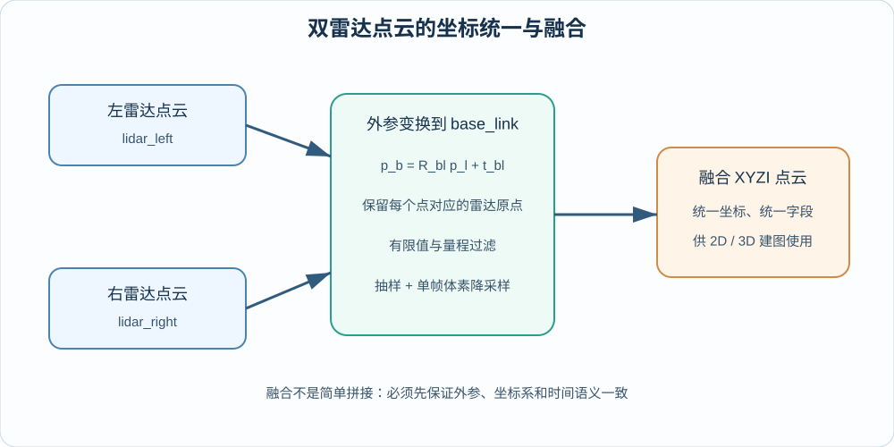

<p align="center"><b>图 8-4</b> 左右雷达必须先经过各自外参变换，再在 base_link 中融合</p>

**对应代码**（`code/code_chapter8/config.py`）：

```python
LIDAR_PARENT_PATH = "/genie/base_link"

@dataclass(frozen=True)
class LidarMount:
    """一个 RTX LiDAR 在 base_link 下的固定外参。"""

    name: str
    prim_path: str
    frame_id: str
    topic: str
    translation: tuple[float, float, float]
    orientation_wxyz: tuple[float, float, float, float] = (1.0, 0.0, 0.0, 0.0)   # 默认无旋转

LEFT_LIDAR = LidarMount(
    name="chapter8_lidar_left",
    prim_path=f"{LIDAR_PARENT_PATH}/chapter8_lidar_left",
    frame_id="lidar_left",
    topic="/lidar/left/points",
    translation=(0.17, 0.21, 0.34),
)
RIGHT_LIDAR = LidarMount(
    name="chapter8_lidar_right",
    prim_path=f"{LIDAR_PARENT_PATH}/chapter8_lidar_right",
    frame_id="lidar_right",
    topic="/lidar/right/points",
    translation=(-0.23, -0.20, 0.34),
    # 绕 base_link 的 Z 轴旋转 180°，让逐帧扫描扇区与左雷达互补。
    orientation_wxyz=(0.0, 0.0, 0.0, 1.0),
)
LIDAR_MOUNTS = (LEFT_LIDAR, RIGHT_LIDAR)
```

> 💡 **要点**：调节雷达位置时只修改 `config.py`，不要同时在多个演示程序中复制外参。若换成真实机器人，最重要的不是让点云"看起来大致对"，而是使用标定结果替换这些数值。

### 2.2 外参变换：从雷达坐标系到 base_link

**原理与公式**：外参描述"传感器如何安装在机器人上"，通常包括旋转和平移。若外参准确且安装刚性固定，它在运行过程中不应随时间变化。假设某个点在雷达坐标系中的坐标为 $\mathbf{p}_{l}$，雷达到 `base_link` 的旋转矩阵和平移向量分别为 $\mathbf{R}_{bl}$（ $3\times3$，无单位）、 $\mathbf{t}_{bl}$（m），则点在底盘坐标系中的坐标为：

$$
\mathbf{p}_{b}=\mathbf{R}_{bl}\mathbf{p}_{l}+\mathbf{t}_{bl}
$$

下标读法：" $bl$"表示"把 $l$（lidar）系中的量表达到 $b$（base）系中"。

本章 `LidarMount` 使用四元数 `orientation_wxyz=(w,x,y,z)` 表示旋转。单位四元数 $\mathbf{q}=(w,x,y,z)$ 对应的旋转矩阵为：

$$
\mathbf{R}(\mathbf{q})=
\begin{bmatrix}
1-2(y^2+z^2) & 2(xy-zw) & 2(xz+yw)\\
2(xy+zw) & 1-2(x^2+z^2) & 2(yz-xw)\\
2(xz-yw) & 2(yz+xw) & 1-2(x^2+y^2)
\end{bmatrix}
$$

只绕 $z$ 轴旋转角度 $\psi$ 时，四元数为 $(\cos\frac{\psi}{2},0,0,\sin\frac{\psi}{2})$。

**对应代码**（`code/code_chapter8/geometry.py`）：

```python
def quaternion_wxyz_to_matrix(quaternion: tuple[float, float, float, float]) -> np.ndarray:
    """单位四元数 wxyz 转 3x3 旋转矩阵。"""
    w, x, y, z = (float(value) for value in quaternion)
    norm = math.sqrt(w * w + x * x + y * y + z * z)
    if norm <= 1e-12:
        raise ValueError("四元数长度不能为 0")
    w, x, y, z = w / norm, x / norm, y / norm, z / norm      # 先归一化，容忍轻微非单位输入
    return np.array(
        [
            [1 - 2 * (y * y + z * z), 2 * (x * y - z * w), 2 * (x * z + y * w)],
            [2 * (x * y + z * w), 1 - 2 * (x * x + z * z), 2 * (y * z - x * w)],
            [2 * (x * z - y * w), 2 * (y * z + x * w), 1 - 2 * (x * x + y * y)],
        ],
        dtype=np.float64,
    )
```

以及 `code/code_chapter8/pointcloud.py` 中真正执行变换的三行：

```python
rotation = quaternion_wxyz_to_matrix(mount.orientation_wxyz)
translation = np.asarray(mount.translation, dtype=np.float64)
points_base = points.astype(np.float64) @ rotation.T + translation    # p_b = R p_l + t（行向量形式）
```

**代码解读**：这里点以数组的"行向量"形式保存（每行一个点），所以实现写成 `points @ rotation.T`。对一行 $\mathbf{p}^T$ 有 $\mathbf{p}^T\mathbf{R}^T=(\mathbf{R}\mathbf{p})^T$，它与数学中常见的列向量形式 $\mathbf{R}\mathbf{p}$ 等价，不能误删转置。

**案例（右雷达，手算）**：右雷达四元数 $(0,0,0,1)$，即 $w=0,z=1$，代入公式：

$$
\mathbf{R}=\begin{bmatrix}1-2 & 0 & 0\\ 0 & 1-2 & 0\\ 0 & 0 & 1\end{bmatrix}=\begin{bmatrix}-1 & 0 & 0\\ 0 & -1 & 0\\ 0 & 0 & 1\end{bmatrix}
$$

这正是绕 $z$ 轴转 $180^\circ$（ $\cos\frac{180^\circ}{2}=0,\ \sin\frac{180^\circ}{2}=1$）。若右雷达测到 $\mathbf{p}_l=(2.0,\ 1.0,\ 0.5)$，则

$$
\mathbf{p}_b=(-2.0,\ -1.0,\ 0.5)+(-0.23,\ -0.20,\ 0.34)=(-2.23,\ -1.20,\ 0.84)
$$

右雷达"正前方 2 米"在底盘系中变成了"机器人后方约 2.2 米"——这就是它与左雷达视野互补的含义。

> ⚠️ **注意**：四元数顺序有 `wxyz`（本章、Isaac Sim）和 `xyzw`（ROS `geometry_msgs`）两种常见约定。若把 $(0,0,0,1)$ 按 `xyzw` 理解，它就成了单位旋转，右雷达点云会整体方向相反。`ros2_visualization.py` 发布静态 TF 时显式写 `w, x, y, z = mount.orientation_wxyz` 再逐个赋值，就是为了避免这个错误。

### 2.3 平面位姿 Pose2D：从 base_link 到 map

**直观理解**：外参回答"雷达装在车上哪儿"，位姿回答"车现在在地图哪儿"。前者固定不变，后者每帧都在变。

**原理与公式**：机器人运动后，还需要使用机器人在地图中的位姿把点转换到 `map`：

$$
\mathbf{p}_{m}=\mathbf{R}_{mb}\mathbf{p}_{b}+\mathbf{t}_{mb}
$$

本章机器人只在平面运动，所以 $\mathbf{R}_{mb}$ 只包含 `yaw` 旋转，位姿写成：

$$
\mathbf{x}=[x,\ y,\psi]^{T}
$$

其中 $x,y$ 单位为 m， $\psi$ 为偏航角（rad）。得到位姿 $(x_k,y_k,\psi_k)$ 后，机器人坐标系中的点 $(x_b,y_b,z_b)$ 变换为地图坐标：

$$
x_m=\cos\psi_k\,x_b-\sin\psi_k\,y_b+x_k
$$

$$
y_m=\sin\psi_k\,x_b+\cos\psi_k\,y_b+y_k
$$

$$
z_m=z_b
$$

本章使用 `Pose2D(x, y, yaw)` 描述机器人轨迹，所以只估计平面平移与偏航角；3D 地图仍然保留激光点的 $z$。如果机器人会明显俯仰、侧倾或上下运动，则需要使用完整的 $SE(3)$ 位姿，把滚转角、俯仰角和三维平移也纳入估计。

位姿之间还有两个基本运算，后面的里程计、关键帧和位姿图都依赖它们：

- **复合** $\mathbf{T}_{wa}\cdot\mathbf{T}_{ab}=\mathbf{T}_{wb}$：已知 $a$ 在世界中的位姿和 $b$ 在 $a$ 中的位姿，求 $b$ 在世界中的位姿；
- **相对位姿** $\mathbf{T}_{ab}=\mathbf{T}_{wa}^{-1}\mathbf{T}_{wb}$：已知两者在世界中的位姿，求 $b$ 相对 $a$ 的位姿。

**对应代码**（`code/code_chapter8/geometry.py`）：

```python
def wrap_angle(angle: float) -> float:
    """把角度归一化到 [-pi, pi)。"""
    return (float(angle) + math.pi) % (2.0 * math.pi) - math.pi

@dataclass(frozen=True)
class Pose2D:
    x: float = 0.0
    y: float = 0.0
    yaw: float = 0.0

    def transform_points(self, points: np.ndarray) -> np.ndarray:
        """将机器人坐标系的 Nx2/Nx3 点转换到地图坐标系。"""
        # ...
        c, s = math.cos(self.yaw), math.sin(self.yaw)
        x = points[:, 0]
        y = points[:, 1]
        result[:, 0] = c * x - s * y + self.x      # x_m = cosψ·x_b − sinψ·y_b + x_k
        result[:, 1] = s * x + c * y + self.y      # y_m = sinψ·x_b + cosψ·y_b + y_k
        return result                              # 若有第三列 z，保持不变

def compose(a: Pose2D, b: Pose2D) -> Pose2D:
    """位姿复合：T_world_result = T_world_a * T_a_b。"""
    c, s = math.cos(a.yaw), math.sin(a.yaw)
    return Pose2D(
        x=a.x + c * b.x - s * b.y,
        y=a.y + s * b.x + c * b.y,
        yaw=wrap_angle(a.yaw + b.yaw),
    )

def between(a: Pose2D, b: Pose2D) -> Pose2D:
    """返回 b 在 a 坐标系中的相对位姿。"""
    return compose(inverse(a), b)
```

**案例（`between` 手算）**： $a=(1,0,90^\circ)$ 表示机器人在 $(1,0)$ 面朝 $+y$； $b=(1,1,90^\circ)$ 在它正前方 1 米。先求 $a^{-1}$：按 `inverse()`， $c=0,s=1$，得 $(-0\cdot1-1\cdot0,\ 1\cdot1-0\cdot0,\ -90^\circ)=(0,1,-90^\circ)$。再 `compose` $(a^{-1},b)$： $c=\cos(-90^\circ)=0,\ s=-1$， $x=0+0\cdot1-(-1)\cdot1=1$， $y=1+(-1)\cdot1+0\cdot1=0$， $\psi=0$。结果 $(1,0,0)$： $b$ 在 $a$ 的正前方 1 米、朝向相同，符合直觉。

### 2.4 完整数值例子：一个激光点的坐标链

下面用一个完整数值例子串起"测距点—外参—机器人位姿"这条链路，后面第五、六部分会接着把它写入栅格和体素。为了便于计算，假设左雷达旋转外参为单位旋转（与 `config.py` 中左雷达的默认四元数一致），地图栅格以世界坐标 $(0,0)$ 为索引原点。

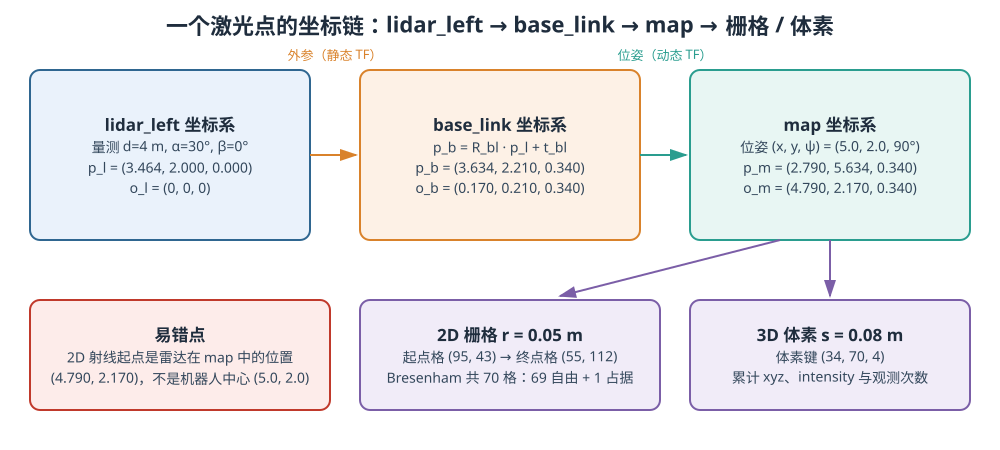

<p align="center"><b>图 8-5</b> 一个激光点从 lidar_left 到 base_link、map，再到 2D 栅格与 3D 体素的完整数值链</p>

**1. 从距离和角度得到雷达坐标系中的点。** 假设左雷达测得距离 $d=4\ \mathrm{m}$、方位角 $\alpha=30^{\circ}$、俯仰角 $\beta=0^{\circ}$，则：

$$
x_l=4\cos 30^{\circ}=3.464\ \mathrm{m},\qquad y_l=4\sin 30^{\circ}=2.000\ \mathrm{m},\qquad z_l=0
$$

$$
\mathbf{p}_{l}=(3.464,\ 2.000,\ 0.000)
$$

**2. 使用雷达外参变换到 `base_link`。** 本章左雷达平移外参为 $\mathbf{t}_{bl}=(0.17,\ 0.21,\ 0.34)\ \mathrm{m}$，在单位旋转下：

$$
\mathbf{p}_{b} = \mathbf{p}_{l}+\mathbf{t}_{bl} = (3.634,\ 2.210,\ 0.340)
$$

雷达坐标系原点 $(0,0,0)$ 经过外参变换后，就是 `base_link` 中的射线原点：

$$
\mathbf{o}_{b}=(0.170,\ 0.210,\ 0.340)
$$

**3. 使用机器人位姿变换到 `map`。** 假设采集这一帧时，机器人位姿为 $(x_k,y_k,\psi_k)=(5.0\ \mathrm{m},\ 2.0\ \mathrm{m},\ 90^{\circ})$。偏航角为 $90^{\circ}$ 时 $\cos\psi=0,\sin\psi=1$，机器人坐标系的 $x$ 轴转向地图坐标系的 $y$ 轴。代入坐标变换：

$$
x_m=0\cdot3.634-1\cdot2.210+5.0=2.790\ \mathrm{m}
$$

$$
y_m=1\cdot3.634+0\cdot2.210+2.0=5.634\ \mathrm{m}
$$

$$
z_m=0.340\ \mathrm{m}
$$

$$
\mathbf{p}_{m}=(2.790,\ 5.634,\ 0.340)
$$

射线原点也要使用相同机器人位姿进行变换： $x=5.0-0.210=4.790$， $y=2.0+0.170=2.170$，

$$
\mathbf{o}_{m}=(4.790,\ 2.170,\ 0.340)
$$

**可运行的验证**：在 `code/code_chapter8/` 目录下用普通 Python + NumPy（无需 Isaac Sim）即可复现：

```python
import math
import numpy as np
from geometry import Pose2D

pose = Pose2D(5.0, 2.0, math.pi / 2)
print(pose.transform_points(np.array([[3.634, 2.210, 0.34],    # p_b
                                      [0.170, 0.210, 0.34]])))  # o_b
# 预期：[[2.79 5.634 0.34] [4.79 2.17 0.34]]
```

> ⚠️ **注意**：真正用于 2D 射线更新的起点不是机器人中心 $(5.0,2.0)$，而是左雷达在地图中的实际位置 $(4.790,2.170)$。双雷达系统中，左右雷达原点不同，不能在融合以后把所有射线都错误地当作从 `base_link` 原点发出，否则靠近机器人处的自由空间会被画错。

### 2.5 TF 树：把坐标关系发布给 ROS2

**直观理解**：TF（Transform）是 ROS 里的"坐标关系公告板"。每个节点只需发布"父→子"的相对变换，RViz 等工具就能自动沿树把任何坐标系中的数据画到 Fixed Frame（本章为 `map`）中。

TF 主链为：

```text
map
└── base_link
    ├── lidar_left
    ├── lidar_right
    └── G2 机器人各关节与连杆坐标系
```

`map -> base_link` 是动态 TF；`base_link -> lidar_left` 和 `base_link -> lidar_right` 是静态 TF。`ros2_visualization.py` 还会遍历 G2 USD 中的关节关系，尽可能发布完整机器人连杆树。

**对应代码**（`code/code_chapter8/ros2_visualization.py`）：

```python
def publish_lidar_static_tf(self, sim_time: float | None = None) -> None:
    # ...
    for mount in LIDAR_MOUNTS:
        msg = self.TransformStamped()
        msg.header.frame_id = self.base_frame          # 父：base_link
        msg.child_frame_id = mount.frame_id            # 子：lidar_left / lidar_right
        msg.transform.translation.x = float(mount.translation[0])
        # ...
        w, x, y, z = mount.orientation_wxyz            # 显式拆 wxyz，再按 ROS 字段赋值
        msg.transform.rotation.w = float(w)
        # ...
    self.static_tf_pub.sendTransform(transforms)

def _base_transform(self, stamp, pose: Pose2D):
    msg = self.TransformStamped()
    msg.header.frame_id = self.map_frame               # 父：map
    msg.child_frame_id = self.base_frame               # 子：base_link
    msg.transform.translation.x = float(pose.x)
    msg.transform.translation.y = float(pose.y)
    msg.transform.rotation.z = math.sin(pose.yaw / 2.0)   # 绕 z 旋转 ψ 的四元数
    msg.transform.rotation.w = math.cos(pose.yaw / 2.0)
    return msg
```

**代码解读**：静态 TF 与 `config.py` 外参、`PointCloudProcessor` 外参来自同一个 `LIDAR_MOUNTS`，保证"仿真里雷达装在哪""融合时用的外参""RViz 显示的 TF"三者一致；动态 TF 由 yaw 生成四元数 $(\cos\frac{\psi}{2},0,0,\sin\frac{\psi}{2})$，与 2.2 节公式对应。若 Isaac Sim 自带的 Python 3.11 环境中没有 `tf2_ros`，代码会退回到 `tf_broadcaster.py` 中的最小实现，直接向 `/tf`、`/tf_static` 发布 `TFMessage`。

---

## 第三部分 点云预处理与双雷达融合

### 3.1 原始点云为什么不能直接建图

传感器返回点云后，初学者常见的做法是直接把所有点累加到一个数组中。这样通常会很快得到一团模糊、重叠甚至不断扩张的数据。原因包括：

1. **坐标系不同**：左右雷达各自在自己的坐标系中测量；
2. **机器人在运动**：不同帧点云对应不同机器人位姿；
3. **存在无效点**：数据中可能有 `NaN`、无穷值或空数组；
4. **近距离自遮挡**：雷达可能看到机器人自身结构；
5. **远距离噪声**：量程边界附近的数据更不稳定；
6. **点数过多**：原始高线数雷达每帧点数很大，直接累积会迅速占满内存；
7. **动态物体**：移动的人或车辆不应该永久写入静态地图；
8. **外参误差**：一台雷达偏移几厘米，就可能让墙面变成两层；
9. **时间误差**：两台雷达或位姿的时间戳不一致，会把运动误差误认为空间结构。

本章预处理解决其中的 1、3、4、5、6 和"双雷达射线原点"问题；2 由第四部分的位姿估计解决；7、8、9 是本章代码的边界，在 4.1 节和 6.4 节讨论。单帧处理顺序是：

```text
兼容解析 RTX 输出字段
  ↓
整理为 XYZ + intensity
  ↓
删除 NaN / Inf
  ↓
最小与最大量程过滤
  ↓
按固定步长抽样
  ↓
单帧体素降采样
  ↓
从 lidar_* 变换到 base_link
  ↓
保留雷达原点并融合左右点云
```

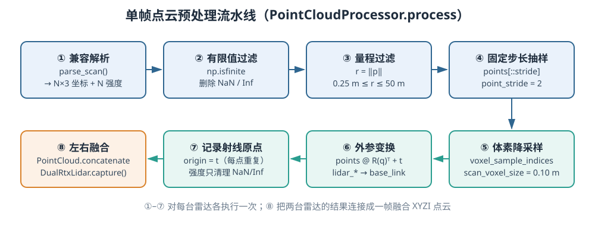

<p align="center"><b>图 8-6</b> PointCloudProcessor.process() 的单帧处理流水线与对应函数</p>

### 3.2 数据解析与有效值过滤

**直观理解**：不同版本的 Isaac Sim 把点云放在不同"抽屉"里，解析代码要挨个抽屉找；找到之后，先把坏掉的点（`NaN`、无穷）扔掉，再把太近（多半是自己）和太远（多半是噪声）的点扔掉。

不同 Isaac Sim 或 annotator 版本中，点云字段名称可能存在差异。本章的 `PointCloudProcessor` 会依次尝试：

```text
点坐标：data / pointCloudData / points / pointcloud
强度：intensity / intensities / intensitiesData
```

解析后的点坐标统一为 `N×3` 的 `float32` 数组，强度统一为长度为 $N$ 的一维数组。如果强度字段不存在，则使用 0 补齐；如果点和强度数量不同，则截取两者共同有效的长度。

**原理与公式**：删除所有包含非有限数的点：

$$
\mathrm{valid}_i= \mathrm{finite}(x_i)\land \mathrm{finite}(y_i)\land \mathrm{finite}(z_i)\land \mathrm{finite}(I_i)
$$

点到传感器原点的距离为：

$$
r_i=\sqrt{x_i^2+y_i^2+z_i^2}
$$

只有满足以下条件的点才会保留：

$$
r_{\min}\le r_i\le r_{\max}
$$

默认最小量程为 $0.25$ m，最大量程为 $50$ m。代码中真正使用的上限是 $\max(r_{\min},\ r_{\max}-\text{max\_range\_margin})$，默认余量为 0。

> 💡 **要点**：量程过滤发生在**外参变换之前**，所以 $r_i$ 是"到该雷达"的距离而不是"到机器人中心"的距离，这才符合"雷达近处看到自身结构"的物理含义。

**对应代码**（`code/code_chapter8/pointcloud.py`）：

```python
class PointCloudProcessor:
    """把不同版本 annotator 的输出整理为干净的 base_link 点云。"""

    POINT_KEYS = ("data", "pointCloudData", "points", "pointcloud")
    INTENSITY_KEYS = ("intensity", "intensities", "intensitiesData")

    def process(self, scan_data, mount: LidarMount) -> PointCloud:
        points, intensity = self.parse_scan(scan_data)          # 兼容解析
        if points.size == 0:
            return PointCloud.empty()

        finite = np.isfinite(points).all(axis=1) & np.isfinite(intensity)   # valid_i
        points, intensity = points[finite], intensity[finite]
        distances = np.linalg.norm(points, axis=1)                          # r_i
        effective_max = max(
            self.config.min_range,
            self.config.max_range - self.config.max_range_margin,
        )
        valid = (distances >= self.config.min_range) & (distances <= effective_max)
        points, intensity = points[valid], intensity[valid]
        # ...（抽样、体素、外参变换见 3.3、3.4 节）

    @classmethod
    def parse_scan(cls, scan_data) -> tuple[np.ndarray, np.ndarray]:
        if isinstance(scan_data, dict):
            points_data = next((scan_data[key] for key in cls.POINT_KEYS if key in scan_data), None)
            intensity_data = next(
                (scan_data[key] for key in cls.INTENSITY_KEYS if key in scan_data),
                None,
            )
        else:
            points_data = scan_data
            intensity_data = None

        points = as_xyz_array(points_data)                      # 统一成 N×3 float32
        intensity = as_scalar_array(intensity_data, len(points))  # 缺失补 0、过短补零
        count = min(len(points), len(intensity))
        return points[:count], intensity[:count]
```

**代码解读**：`as_xyz_array()` 还处理了几种形状：一维扁平数组按每 3 个数一组 reshape（多余的尾部丢弃），高维数组压成二维，列数多于 3 时只取前三列。这样上层算法只需面对一种格式。

**案例（手算）**：一帧中有 4 个点：

| 点 | 坐标 | 有限？ | $r$ (m) | 结果 |
|---|---|---|---|---|
| A | $(0.1,\ 0.1,\ 0)$ | 是 | 0.141 | 删除（ $<0.25$，可能是机器人自身） |
| B | $(3,\ 4,\ 0)$ | 是 | 5.000 | 保留 |
| C | $(30,\ 40,\ 1)$ | 是 | 50.010 | 删除（ $>50$） |
| D | $(\mathrm{NaN},\ 1,\ 1)$ | 否 | — | 删除 |

若地图中出现机器人自身点，可以适当增大 `min_range`；若远处噪声较多，可以减小 `max_range` 或使用 `max_range_margin` 留出量程余量。

### 3.3 固定步长抽样与体素降采样

**直观理解**：固定步长抽样像"每隔一个人点一次名"，快但不看位置；体素降采样像"把操场画成方格，每个格子只留一个代表"，保证空间上分布均匀。

高分辨率雷达的一帧点云可能包含大量相邻点，而建图不一定需要保留每个原始点。本章先使用 `point_stride` 做简单抽样。例如 `point_stride=2` 表示每隔一个点保留一个点。

固定步长抽样速度快，但它只依赖数组顺序，无法保证空间分布均匀。因此代码又进行一次体素降采样。

**原理与公式**：设体素边长为 $s$（m），点 $\mathbf{p}=[x,y,z]^{T}$ 所属的体素索引为：

$$
\mathbf{k}=\left\lfloor\frac{\mathbf{p}}{s}\right\rfloor
$$

（逐分量向下取整，得到三个整数）。体素 $\mathbf{k}$ 的中心为 $\mathbf{c}_\mathbf{k}=(\mathbf{k}+0.5)s$。落入同一体素的多个点只保留一个代表点：本章的 `voxel_sample_indices` 选择最靠近体素中心的原始点

$$
i^{*}(\mathbf{k})=\arg\min_{i\ \mid\ \mathbf{k}_i=\mathbf{k}}\ \|\mathbf{p}_i-\mathbf{c}_\mathbf{k}\|^2
$$

而不是直接取第一个点。这样可以减少点数，同时尽量保持几何分布均匀；而且保留的是**真实测量点**，不是人为平均出来的点。

**对应代码**（`code/code_chapter8/pointcloud.py`）：

```python
stride = max(1, int(self.config.point_stride))
points, intensity = points[::stride], intensity[::stride]          # 固定步长抽样
selected = voxel_sample_indices(points, self.config.scan_voxel_size)
points, intensity = points[selected], intensity[selected]

def voxel_sample_indices(points: np.ndarray, voxel_size: float) -> np.ndarray:
    """每个体素保留最靠近体素中心的点，返回原数组下标。"""
    # ...
    voxel_ids = np.floor(points / float(voxel_size)).astype(np.int64)    # k = floor(p / s)
    centers = (voxel_ids.astype(np.float64) + 0.5) * float(voxel_size)   # c_k
    distances = np.sum((points - centers) ** 2, axis=1)                  # ||p - c_k||²
    # 先按体素索引 (kx, ky, kz) 排序，同一体素内再按距离从小到大
    order = np.lexsort((distances, voxel_ids[:, 2], voxel_ids[:, 1], voxel_ids[:, 0]))
    sorted_ids = voxel_ids[order]
    first = np.ones(len(order), dtype=bool)
    first[1:] = np.any(sorted_ids[1:] != sorted_ids[:-1], axis=1)       # 每个体素的第一个 = 最近点
    return order[first]
```

**代码解读**：`np.lexsort` 以**最后一个**键为主键，所以这里的排序优先级是 $k_x \to k_y \to k_z \to$ 距离。排好后，相同体素的点连在一起，且每段的第一个就是离中心最近的点；`first` 标记每段的开头。整个过程是向量化的，没有 Python 循环。

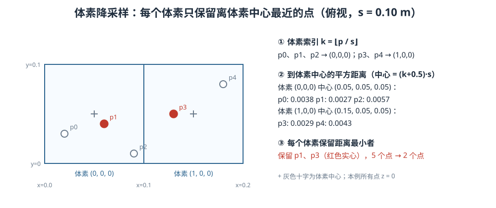

<p align="center"><b>图 8-7</b> 体素降采样手算例子：5 个点落入 2 个体素，各保留离中心最近的一个</p>

**案例（手算， $s=0.10$ m）**：5 个点均在 $z=0$ 平面上： $p_0=(0.02,0.03)$、 $p_1=(0.06,0.04)$、 $p_2=(0.09,0.01)$、 $p_3=(0.13,0.05)$、 $p_4=(0.18,0.08)$。

1. 体素索引： $p_0,p_1,p_2\to(0,0,0)$， $p_3,p_4\to(1,0,0)$；
2. 体素 $(0,0,0)$ 中心为 $(0.05,0.05,0.05)$。注意中心的 $z=0.05$，所以每个点的平方距离都含 $0.05^2=0.0025$： $p_0$： $0.0009+0.0004+0.0025=0.0038$； $p_1$： $0.0001+0.0001+0.0025=0.0027$； $p_2$： $0.0016+0.0016+0.0025=0.0057$；
3. 体素 $(1,0,0)$ 中心 $(0.15,0.05,0.05)$： $p_3$： $0.0004+0+0.0025=0.0029$； $p_4$： $0.0009+0.0009+0.0025=0.0043$；
4. 结果保留 $p_1,p_3$，即 `voxel_sample_indices` 返回 `[1, 3]`（已用仓库代码验证）。

默认单帧体素尺寸为 `0.10 m`：

- 调小体素，例如 `0.05 m`，能保留更多细节，但处理更慢、地图更大；
- 调大体素，例如 `0.15 m`，运行更快，但细杆、边缘和小障碍可能消失；
- 体素尺寸不应只根据"画面好看"决定，还要结合场景尺度、导航安全距离和计算资源。

> ⚠️ **注意**：本章有三个不同的"体素尺寸"，不要混淆：单帧降采样 `LidarConfig.scan_voxel_size=0.10`（命令行 `--scan-voxel`）、回环扫描降采样 `prepare_scan_xy` 中固定的 `0.18`、3D 地图体素 `Map3DConfig.voxel_size=0.08`。

### 3.4 外参变换、射线原点与双雷达融合

**原理与公式**：点经过外参变换后位于 `base_link`：

$$
\mathbf{p}_{b}=\mathbf{R}(\mathbf{q})\mathbf{p}_{l}+\mathbf{t}
$$

雷达原点在自身坐标系中是 $[0,0,0]^T$，变换到 `base_link` 后就是安装平移 $\mathbf{t}$：

$$
\mathbf{o}_{b}=\mathbf{R}(\mathbf{q})\cdot\mathbf{0}+\mathbf{t}=\mathbf{t}
$$

因此，本章为该雷达产生的每个点重复保存同一个 `origin` $=\mathbf{t}$。左右雷达融合后，不同点仍保留各自的射线起点。融合点云的本质是：

$$
\mathcal{P}_{fused}=\mathcal{T}_{left}(\mathcal{P}_{left})\cup \mathcal{T}_{right}(\mathcal{P}_{right})
$$

这里的并集不是要求删除所有重复点，而是先确保两组点处于同一坐标系和同一数据格式，再连接为一帧 XYZI 点云。后续 2D 和 3D 地图还会分别进行角度筛选或地图体素聚合。

**对应代码**（`code/code_chapter8/pointcloud.py` 与 `code/code_chapter8/lidar.py`）：

```python
# pointcloud.py：PointCloudProcessor.process() 的最后一段
rotation = quaternion_wxyz_to_matrix(mount.orientation_wxyz)
translation = np.asarray(mount.translation, dtype=np.float64)
points_base = points.astype(np.float64) @ rotation.T + translation           # p_b
origins = np.repeat(translation.reshape(1, 3), points_base.shape[0], axis=0) # o_b = t，每点一份
return PointCloud(
    xyz=points_base.astype(np.float32),
    intensity=normalize_intensity(intensity),
    origin=origins.astype(np.float32),
)

# pointcloud.py：融合
@staticmethod
def concatenate(clouds: list["PointCloud"]) -> "PointCloud":
    valid = [cloud for cloud in clouds if len(cloud) > 0]
    if not valid:
        return PointCloud.empty()
    return PointCloud(
        xyz=np.concatenate([cloud.xyz for cloud in valid], axis=0),
        intensity=np.concatenate([cloud.intensity for cloud in valid], axis=0),
        origin=np.concatenate([cloud.origin for cloud in valid], axis=0),
    )

# lidar.py：DualRtxLidar.capture()
def capture(self, sim_time: float | None = None) -> tuple[PointCloud, dict[str, PointCloud]]:
    clouds = {}
    self._capture_count += 1
    for handle in self.handles:
        scan = handle.annotator.get_data()                      # 读取本雷达本帧扫描
        # ...（统计首个有效扫描、发布原始点云到 /lidar/left|right/points）
        clouds[handle.mount.name] = self.processor.process(scan, handle.mount)
    return PointCloud.concatenate(list(clouds.values())), clouds
```

因此 `capture()` 的返回值同时包含：

- `fused`：用于建图和 `/lidar/fused` 的融合点云；
- `individual`：按雷达名称保存的单独点云，便于统计和调试。

**案例**：若某帧左雷达处理后剩 1200 个点、右雷达剩 1100 个点，则 `fused` 恰好有 2300 个点，其中前 1200 行的 `origin` 都是 $(0.17,0.21,0.34)$，后 1100 行都是 $(-0.23,-0.20,0.34)$。融合只是"连接"，不做去重——这正是示例一中"融合点数约等于两台处理后点数之和"的检查依据。（数字为示意。）

> 💡 **要点**：原始话题 `/lidar/left/points`、`/lidar/right/points` 发布的是**未经量程过滤和降采样**的传感器坐标系点（只删除了非有限值，见 `lidar.py` 的 `_publish_raw_scan`），而 `/lidar/fused` 是预处理并变换到 `base_link` 之后的点。所以 RViz 中原始点云会比融合点云密得多，这是正常的。

### 3.5 如何判断点云预处理是否正确

在开始建图前，应先单独检查点云。推荐按以下顺序观察：

1. **只看左雷达**：墙面方向、地面高度和坐标轴是否符合预期；
2. **只看右雷达**：是否确实旋转了 $180^\circ$，扫描范围是否互补；
3. **同时看两台原始雷达**：TF 是否能把两个坐标系正确显示在 `map` 下；
4. **看融合点云**：同一墙面是否重合，是否出现固定间距的双层结构；
5. **移动机器人**：融合点云应跟随 `base_link` 运动，而地图点云应稳定留在 `map` 中；
6. **检查强度**：RViz 的强度通道应有变化，但不应因逐帧归一化而剧烈闪烁。

常见现象与原因如下：

| 现象 | 优先检查 |
|---|---|
| 两台雷达点云方向相反或镜像 | 四元数顺序、右雷达 $180^\circ$ 旋转、坐标轴约定 |
| 墙面固定出现两层 | 双雷达外参、模型安装位置、传感器原点 |
| 点云跟机器人一起移动，无法形成静态地图 | 是否从 `base_link` 转换到 `map`，机器人位姿是否更新 |
| 机器人周围有密集圆环 | `min_range` 太小，雷达看到了自身结构 |
| 远处出现大量散点 | `max_range` 过大、材质回波异常、体素太小 |
| RViz 原始点云不可见 | 原始话题、`frame_id`、静态 TF、QoS 和仿真时间 |

---

## 第四部分 位姿估计、点云配准与回环优化

### 4.1 建图不只是累加点云：SLAM 的基本问题

**直观理解**：把一叠透明胶片上的草图拼成一幅完整地图，关键不在于胶片有多少张，而在于每张放在桌上的位置和角度对不对。激光建图里，"胶片"是每帧点云，"放的位置"就是机器人位姿。

如果机器人始终静止，把多帧点云放在同一个坐标系中并不困难。但机器人一旦移动，每帧点云都在新的机器人位姿下采集。为了把第 $k$ 帧点云放入地图，必须知道该时刻机器人在地图中的位姿 $\mathbf{T}_{mb}^{k}$：

$$
\mathbf{p}_{m}^{k}=\mathbf{T}_{mb}^{k}\mathbf{p}_{b}^{k}
$$

因此，建图问题至少包含两个相互依赖的任务：

- **定位**：估计机器人现在在哪里；
- **建图**：根据估计位姿，把当前量测加入地图。

这就是 SLAM 的基本含义：Simultaneous Localization and Mapping，即同时定位与建图。地图能够帮助定位，定位结果又决定点云应该放到地图中的什么位置。

如果位姿完全准确，建图主要是数据结构和融合问题；如果位姿存在误差，多帧点云就会逐渐错位。实际系统中常见的位姿来源包括：

- 轮速里程计；
- IMU 角速度和加速度；
- LiDAR 帧间或 scan-to-map 匹配；
- 相机视觉里程计；
- GNSS、UWB 或外部定位系统；
- 多传感器融合状态估计器。

本章为了突出漂移、回环和地图重建之间的关系，使用仿真轨迹增量构造一个"带系统误差的教学里程计"。它不是直接复制每帧真值位姿，但其增量来源于仿真参考轨迹。真实机器人接入时，应把它替换为第四章的轮速里程计、LiDAR 前端或 LiDAR-IMU 里程计。

### 4.2 一帧扫描如何进入地图：建图算法循环

前面已经说明，激光雷达只负责回答"相对于雷达，哪些方向、多远的位置存在反射点"。它不会直接输出一张地图。所谓"根据激光雷达建图"，本质上是反复执行下面这个闭环：

1. 雷达采集当前扫描；
2. 估计采集这一帧时机器人的位姿；
3. 用该位姿把扫描变换到全局地图坐标系；
4. 按地图的数据结构更新自由空间、障碍物或三维表面；
5. 当发现回环时修正历史位姿，再重新融合历史扫描。

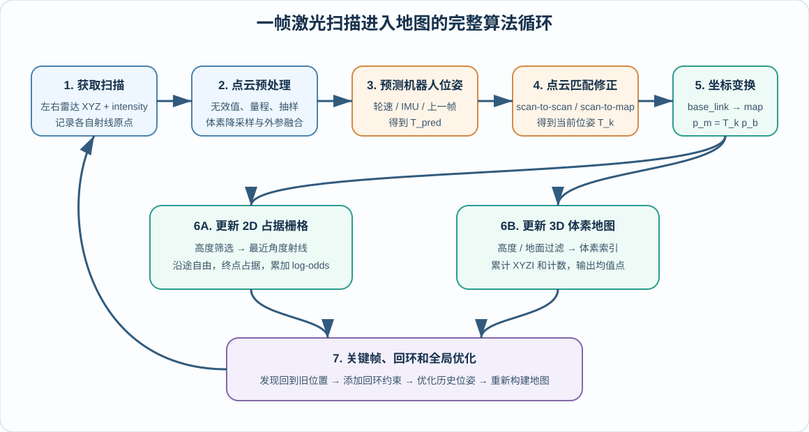

<p align="center"><b>图 8-8</b> 从原始激光扫描到地图更新的完整循环。真正决定多帧点云能否重合的是位姿估计与匹配，而不是简单地保存更多点</p>

下面沿着一帧扫描的处理顺序，把这个过程具体展开。

**第一步：获取扫描，同时保留"命中点"和"射线原点"。** 一帧 LiDAR 数据通常包含一组点：

$$
\mathcal{P}_{l}^{k}=\{\mathbf{p}_{l,1}^{k},\mathbf{p}_{l,2}^{k},\ldots,\mathbf{p}_{l,N}^{k}\}
$$

其中每个点至少包含 $(x,y,z)$，也可能包含反射强度 `intensity`、扫描线编号、相对时间等字段。这里的下标 $l$ 表示点仍在雷达坐标系中，上标 $k$ 表示第 $k$ 帧。建 2D 占据栅格时，不能只保存命中点，还要知道每条激光从哪里发出：从雷达原点到命中点之间，激光能够通过，通常可以认为是自由空间；命中点附近则更可能是障碍物。因此 `PointCloud` 同时保存 `xyz`（激光命中点）、`origin`（对应的雷达射线原点）和 `intensity`（反射强度）。

**第二步：预处理，并统一到 `base_link`。** 即第三部分的流水线。对左雷达中的一个点，外参变换为：

$$
\mathbf{p}_{b,i}=\mathbf{R}_{bl}\mathbf{p}_{l,i}+\mathbf{t}_{bl}
$$

射线原点必须使用同一个外参：

$$
\mathbf{o}_{b,i}=\mathbf{R}_{bl}\mathbf{o}_{l,i}+\mathbf{t}_{bl}
$$

经过这一步以后，一帧扫描描述的是"当前机器人周围的障碍物"，但它仍然跟着机器人运动，还不能直接成为全局地图。

**第三步：先预测机器人位姿。** SLAM 前端一般不会每一帧都从完全未知的位置开始搜索，而是利用轮速、IMU、上一帧匹配结果或匀速模型给出预测位姿：

$$
\mathbf{T}_{pred}^{k} = \mathbf{T}_{k-1}\Delta\mathbf{T}_{odom}^{k}
$$

其中 $\mathbf{T}_{k-1}$ 是上一帧的估计位姿； $\Delta\mathbf{T}_{odom}^{k}$ 是里程计或惯性测量提供的相对运动； $\mathbf{T}_{pred}^{k}$ 是当前帧的初始位姿猜测。预测位姿的作用是把当前扫描先放到地图的大致正确位置。只要初值足够接近，后续点云匹配就不需要在整张地图上盲目搜索。

**第四步：用激光点云匹配修正预测位姿。** 仅靠里程计长期积分一定会漂移，因此正式的 LiDAR SLAM 会比较当前扫描与历史扫描或局部地图，寻找使它们最一致的位姿修正量。常见形式有：

- **scan-to-scan**：当前帧与上一帧或相邻关键帧匹配；
- **scan-to-submap**：当前帧与最近若干关键帧组成的局部子地图匹配；
- **scan-to-map**：当前帧直接与已有地图匹配。

这个过程可以抽象成下面的优化问题：

$$
\underset{\Delta\mathbf{T}}{\min} \sum_i \rho\left( d\left( \mathbf{T}_{pred}^{k}\Delta\mathbf{T}\mathbf{p}_{b,i}, \mathcal{M}_{k-1} \right)^2 \right)
$$

其中 $\mathcal{M}_{k-1}$ 是更新当前帧以前的局部地图； $d$ 表示变换后点到地图中对应平面、线或最近点的距离； $\rho$ 是降低离群点影响的鲁棒代价； $\Delta\mathbf{T}$ 是需要求解的小幅位姿修正。求得最优修正 $\Delta\mathbf{T}^{*}$ 后，当前帧最终位姿为：

$$
\mathbf{T}_{k} = \mathbf{T}_{pred}^{k}\Delta\mathbf{T}^{*}
$$

不同算法的主要差异，就在于"与什么匹配"和"怎样定义距离"：

| 算法思路 | 匹配对象 | 误差直观含义 | 特点 |
|---|---|---|---|
| 点到点 ICP | 当前点与历史最近点 | 两个对应点之间的距离 | 直观，但对初值和点密度较敏感 |
| 点到线 ICP | 2D 激光点与地图线段 | 点到墙面线的垂直距离 | 常用于 2D 激光 SLAM |
| 点到平面 ICP | 3D 激光点与局部平面 | 点到墙面或地面平面的距离 | 3D 点云中约束更稳定 |
| NDT | 当前点与地图概率分布 | 点落入局部高概率区域的程度 | 地图表达平滑，适合较大范围匹配 |
| 相关性匹配 | 多个位姿候选与栅格地图 | 哪个位姿让更多激光端点落在障碍格 | 易理解，常用于 2D 粗匹配 |

> ⚠️ **注意**：这里必须区分"完整 SLAM 算法"和"本章教学代码"的边界：本章代码使用仿真参考轨迹增量构造带漂移的 `DriftedOdometry`，**没有**使用 ICP 连续估计每一帧位姿；代码中的 2D ICP 主要用于回环候选的几何验证。这样设计是为了用较少依赖突出"漂移—回环—位姿图优化—地图重建"主线。真实系统应在这里接入连续的 scan-to-map 前端、轮速与 LiDAR 融合，或 LiDAR-IMU 里程计。

**第五步：把当前帧从 `base_link` 变换到 `map`。** 使用 2.3 节的 `Pose2D.transform_points()`，同样的变换也要作用于射线原点。经过这一步，当前帧中的点才真正获得了固定在世界中的全局位置。

**第六步：按照地图类型融合当前观测。** 更新 2D 占据栅格时，对每条射线执行（详见第五部分）：

1. 按高度范围筛选可作为平面障碍物的点；
2. 将射线原点和命中点投影到二维平面；
3. 将世界坐标换算成起点栅格和终点栅格；
4. 用 Bresenham 算法枚举射线穿过的格子；
5. 中间格增加"自由"证据；
6. 终点格增加"占据"证据；
7. 使用 log-odds 累计多帧观测，而不是被单帧结果直接覆盖。

更新 3D 体素地图时，对每个通过高度与地面过滤的全局点执行（详见第六部分）：

1. 根据体素尺寸计算三维整数索引；
2. 找到该体素对应的哈希表条目；
3. 累计点坐标、反射强度和观测次数；
4. 导出地图时使用体素内的均值代表该局部表面。

因此，2D 地图不仅要记录"哪里有点"，还利用完整射线推断"哪里没有障碍"；本章的 3D 地图则主要保存"哪里观测到了表面"。二者输入可以相同，但逆传感器模型不同。

**第七步：关键帧、回环和地图重建。** 一帧数据写入地图并不代表建图结束。系统还会根据移动距离和转角选择关键帧，并保存关键帧点云、里程计位姿和优化位姿。当机器人重新到达旧区域时：

1. 扫描描述子产生回环候选；
2. ICP 检查两处点云是否真的能够对齐；
3. 接受的回环约束加入位姿图；
4. 后端同时调整多帧历史位姿；
5. 使用优化后的历史位姿清空并重建地图。

把整个算法压缩成一句话就是：

> **激光雷达建图 = 对每帧点云估计准确位姿 + 把点和射线按该位姿融合进地图 + 用回环修正长期累计误差。**

如果只有第一项扫描数据而没有可靠位姿，得到的只是多帧点的堆叠；如果只优化轨迹而不重新融合地图，历史墙面仍会留在错误位置。

**为什么位姿估计是建图算法的核心。** 沿用 2.4 节的例子，假设下一帧再次看到同一个真实墙面点：

- 若机器人位姿估计准确，第二帧点经过变换后仍落在栅格 $(55,112)$ 附近，或落入体素 $(34,70,4)$ 附近，墙面会越来越稳定；
- 若机器人位置多估计了 $0.20\ \mathrm{m}$，在 $0.05\ \mathrm{m}$ 分辨率下就可能相差约 4 个栅格；
- 若航向角估计错误，距离机器人越远的点产生的横向错位越明显，墙面会形成扇形重影。例如航向误差 $1^\circ$（约 0.01745 rad）时，4 m 处的点横向偏移约 $4\times0.01745\approx0.07$ m（1.4 个栅格），20 m 处就达到约 0.35 m（7 个栅格）；
- 若这种误差持续累计，同一堵墙会变成厚墙、双层墙，闭环位置还会出现断裂。

因此，建图算法最重要的工作并不是"把激光点存起来"，而是：**在每次写地图之前，尽可能准确地估计这一帧激光点云的全局位姿。** 点云匹配解决短期位姿修正，回环与位姿图优化解决长期一致性，地图重建则把修正后的位姿真正反映到地图中。

### 4.3 为什么里程计一定会漂移

**原理与公式**：里程计通常通过累计相邻时刻的运动增量得到全局位姿。若第 $k-1$ 帧到第 $k$ 帧的相对运动为 $\Delta\mathbf{T}_{k-1,k}$，则：

$$
\mathbf{T}_{k}=\mathbf{T}_{k-1}\Delta\mathbf{T}_{k-1,k}
$$

每次增量都可能只有很小的误差，但误差会不断累积。例如：

- 车轮半径标定略有偏差，直行距离会按比例放大或缩小；
- 左右轮或横向运动模型不完全一致，轨迹会缓慢侧偏；
- 航向角每米只偏一点点，长距离后也会形成明显旋转误差；
- 点云匹配在长走廊中缺少横向约束，某些方向容易退化；
- IMU 零偏经过积分后会形成不断增长的位置和角度误差。

本章 `DriftedOdometry` 先用 `between()` 求出相邻两个参考位姿的相对增量 $\Delta=(\delta x,\delta y,\delta\psi)$，再按下式加入误差：

$$
\tilde{\Delta}=\big(s_x\,\delta x+n_x,\ \ s_y\,\delta y+n_y,\ \ s_\psi\,\delta\psi+b_\psi\sqrt{\delta x^2+\delta y^2}+n_\psi\big),\qquad n\sim\mathcal{N}(0,\sigma^2)
$$

最后 $\mathbf{T}_k=\mathbf{T}_{k-1}\cdot\tilde{\Delta}$（`compose`）。各参数如下：

| 参数 | 默认值 | 含义 |
|---|---:|---|
| `odom_linear_scale` | 1.012 | 前向增量放大约 1.2% |
| `odom_lateral_scale` | 0.994 | 横向增量缩小约 0.6% |
| `odom_yaw_scale` | 1.008 | 转角增量放大约 0.8% |
| `odom_yaw_bias_per_meter` | 0.002 | 每运动 1 m 增加少量航向偏差 |
| `odom_noise_std` | 0.0005 | 给三个增量分量加入小随机噪声 |

**对应代码**（`code/code_chapter8/slam.py`）：

```python
class DriftedOdometry:
    """从仿真增量构造类似轮速里程计的累计误差。

    true_pose 只用于生成教学数据和误差评估；输出 pose 不会直接复制真值。
    后续接真实机器人时，可把 update() 的输入替换成第四章轮速里程计增量。
    """

    def update(self, reference_pose: Pose2D) -> Pose2D:
        if self._last_reference is None:
            return self.reset(reference_pose)
        delta = between(self._last_reference, reference_pose)       # 真实增量 Δ（机器人系）
        distance = math.hypot(delta.x, delta.y)
        noise = self._rng.normal(0.0, self.config.odom_noise_std, size=3)
        biased = Pose2D(
            x=delta.x * self.config.odom_linear_scale + float(noise[0]),
            y=delta.y * self.config.odom_lateral_scale + float(noise[1]),
            yaw=wrap_angle(
                delta.yaw * self.config.odom_yaw_scale
                + distance * self.config.odom_yaw_bias_per_meter
                + float(noise[2])
            ),
        )
        self.pose = compose(self.pose, biased)                      # T_k = T_{k-1} · Δ̃
        self._last_reference = reference_pose
        return self.pose
```

这里的 `reference_pose` 只用于生成教学数据和评估误差。算法对外使用的是累计后的 `self.pose`。

参考轨迹来自 `code/code_chapter8/simulation.py` 中的 `SquarePatrol`：四个角点为 $(-1.5,-1.2)$、 $(1.5,-1.2)$、 $(1.5,1.2)$、 $(-1.5,1.2)$，每条边用 300 帧直行、75 帧原地转 $90^\circ$，一圈 $4\times375=1500$ 帧。

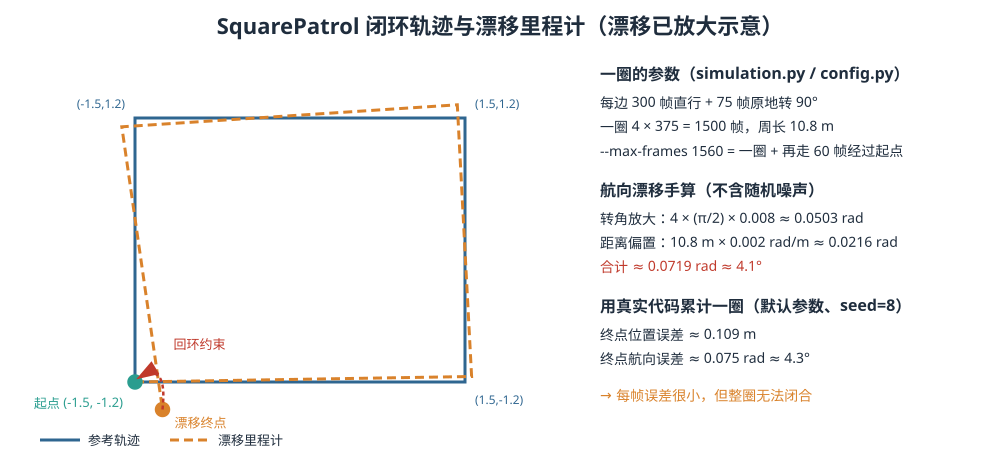

<p align="center"><b>图 8-9</b> SquarePatrol 闭环轨迹与漂移里程计：每帧误差很小，但一圈后无法闭合（漂移已放大示意）</p>

**案例（手算一圈的航向漂移）**：忽略随机噪声，只看两项系统误差：

1. 转角放大：一圈共转 4 次 $90^\circ$，总转角 $2\pi$，多转 $2\pi\times0.008\approx0.0503$ rad；
2. 距离偏置：周长 $3+2.4+3+2.4=10.8$ m，累积 $10.8\times0.002=0.0216$ rad；
3. 合计约 $0.0719$ rad $\approx4.1^\circ$。

用仓库中的 `DriftedOdometry` 和 `SquarePatrol` 离线累计一圈（关闭噪声）得到终点航向误差约 0.0719 rad，与手算一致；打开默认噪声（`random_seed=8`）后终点航向误差约 0.075 rad、位置误差约 0.11 m。（这是在演示程序之外单独调用这两个类得到的数值；实际运行中帧序与随机数抽取顺序稍有不同，数值会略有出入。）

当机器人绕仓库行驶一圈重新回到起点时，漂移里程计的终点通常不会与起点完全重合。若直接使用这条轨迹累积地图，起点附近的墙面和货架就会出现错位。这也是"看起来每一帧都差不多正确，但整张地图无法闭合"的原因。

> 💡 **要点**： $4^\circ$ 的航向误差看起来很小，但按 4.2 节的估算，对 10 m 外的墙就是约 0.7 m 的横向错位——足以让起点附近出现明显的双层墙。

### 4.4 前端、后端与关键帧

工程上常把 SLAM 分为前端和后端：

- **前端**负责处理传感器数据，估计短时间运动，选择关键帧并构造约束；
- **后端**把多个位姿和约束放入统一优化问题，减小长期累计误差；
- **地图模块**使用优化后的位姿保存、更新或重建地图。

如果每一帧都作为优化节点，计算量会迅速增加，而且相邻帧变化很小，信息高度重复。因此常使用关键帧。关键帧不是"每隔固定时间取一帧"，而是机器人运动达到一定程度后才保存。本章在满足任一条件时添加关键帧：

$$
\Delta d\ge 0.22\ \mathrm{m}\qquad\text{或}\qquad |\Delta\psi|\ge 0.18\ \mathrm{rad}
$$

其中 $\Delta d$、 $\Delta\psi$ 是当前里程计位姿相对**上一个关键帧**里程计位姿的平移距离和转角。关键帧中保存：

- 关键帧编号；
- 原始漂移里程计位姿；
- 当前优化位姿；
- 该时刻的融合点云；
- 用于平面匹配的二维扫描点；
- 用于快速回环候选筛选的扫描描述子。

关键帧既减少了计算量，也使"轨迹节点—相邻约束—回环约束"的结构更清晰。

**对应代码**（`code/code_chapter8/slam.py`）：

```python
def should_add_keyframe(self, pose: Pose2D) -> bool:
    if not self.keyframes:
        return True
    distance, yaw = pose_distance(self.keyframes[-1].odom_pose, pose)
    return distance >= self.config.keyframe_distance or yaw >= self.config.keyframe_yaw

def add_keyframe(self, cloud: PointCloud, odom_pose: Pose2D):
    scan_xy = prepare_scan_xy(cloud.xyz)
    optimized_pose = odom_pose
    if self.keyframes:
        previous = self.keyframes[-1]
        odom_increment = between(previous.odom_pose, odom_pose)
        optimized_pose = compose(previous.optimized_pose, odom_increment)   # 新节点接在"已优化"的上一节点后
    keyframe = Keyframe(index=len(self.keyframes), odom_pose=odom_pose,
                        optimized_pose=optimized_pose, cloud=copy_cloud(cloud),
                        scan_xy=scan_xy, descriptor=scan_descriptor(scan_xy))
    if self.keyframes:
        previous = self.keyframes[-1]
        self.constraints.append(PoseConstraint(
            source=previous.index, target=keyframe.index,
            measurement=between(previous.odom_pose, keyframe.odom_pose),   # 里程计边 z_ij
            information=(80.0, 80.0, 140.0), kind="odom"))
    self.keyframes.append(keyframe)

    loop = self._detect_loop(keyframe)
    if loop is not None:
        self.constraints.append(PoseConstraint(
            source=loop.source, target=loop.target, measurement=loop.relative_pose,
            information=(180.0, 180.0, 260.0), kind="loop"))               # 回环边权重更高
        self.loop_results.append(loop)
        self.optimize()
    return keyframe, loop
```

**代码解读**：新关键帧的初始优化位姿 = 上一关键帧的**优化**位姿 ∘ 里程计增量。这样一旦发生过回环修正，后续新节点会"接着修正后的轨迹"往下走，而不是回到漂移轨迹上。

**案例**：沿直线边每帧前进 $3/300=0.01$ m（参考值），而 `--map-every 4` 下最快每 4 帧才处理一次扫描，即每次约 0.04 m，所以直行时约每处理 6 次（0.24 m ≥ 0.22 m）新增一个关键帧；原地转弯每帧转 $\frac{\pi/2}{75}\approx0.0209$ rad，4 帧约 0.084 rad，约每 3 次（0.25 rad ≥ 0.18 rad）新增一个关键帧。（实际间隔还受雷达约 10 Hz 出帧节奏影响，这里只是量级估算。）

### 4.5 回环候选：扫描描述子

**直观理解**：回到一个熟悉的路口，人会先凭"轮廓印象"觉得"好像来过"，再仔细比对细节确认。本章也是两级判断：

1. 扫描描述子快速筛选候选（"轮廓印象"）；
2. 2D ICP 做几何验证（"仔细比对"）。

回环检测用于回答：当前扫描是否来自以前到过的位置。如果答案是"是"，就可以建立一条跨越较长时间的约束，告诉优化器"这两个相距很多帧的节点在空间中其实很接近"。

**原理与公式**：首先，从融合点云中选择高度在约 $0.15$ m 到 $1.8$ m 之间的点，尽量保留墙、柱和货架等竖直结构，减少地面和高处点对平面回环的干扰；再以 0.18 m 体素降采样，最多保留 420 个二维点。然后将二维平面分为 $M=60$ 个角度区间（每个 $6^\circ$），点 $(x,y)$ 落入的区间为

$$
j=\left\lfloor\frac{\operatorname{atan2}(y,x)+\pi}{2\pi}\cdot M\right\rfloor \bmod M
$$

每个区间保存最近点距离，并归一化到最大 20 m： $d_j=\min_i\min(r_i,20)/20$，没有点的区间记为 1。这样得到一个长度为 60 的扫描描述子。若两个描述子分别为 $\mathbf{d}_a$ 和 $\mathbf{d}_b$，本章使用平均绝对差作为距离：

$$
D(\mathbf{d}_a,\mathbf{d}_b)= \frac{1}{M}\sum_{j=1}^{M}|d_{a,j}-d_{b,j}|
$$

**对应代码**（`code/code_chapter8/slam.py`）：

```python
def prepare_scan_xy(points_xyz: np.ndarray, max_points: int = 420) -> np.ndarray:
    # ...
    # 只使用近似竖直结构做平面回环，减少地面/天花板对 ICP 的干扰。
    mask = (points[:, 2] >= 0.15) & (points[:, 2] <= 1.8)
    points = points[mask]
    # ...
    selected = voxel_sample_indices(points, 0.18)
    xy = points[selected, :2]
    if len(xy) > max_points:
        xy = xy[np.linspace(0, len(xy) - 1, max_points, dtype=np.int64)]   # 均匀抽到 420 点
    return xy

def scan_descriptor(points_xy: np.ndarray, bins: int = 60, max_range: float = 20.0) -> np.ndarray:
    """方位角最小距离直方图；空 bin 记为 1，数值越小表示附近有障碍。"""
    descriptor = np.ones((bins,), dtype=np.float64)
    # ...
    ranges = np.linalg.norm(points_xy, axis=1)
    angles = np.arctan2(points_xy[:, 1], points_xy[:, 0])
    indices = np.floor((angles + math.pi) / (2.0 * math.pi) * bins).astype(np.int64) % bins
    for index, distance in zip(indices, ranges):
        descriptor[index] = min(descriptor[index], min(float(distance), max_range) / max_range)
    return descriptor

def descriptor_distance(a: np.ndarray, b: np.ndarray) -> float:
    # ...
    return float(np.mean(np.abs(a - b)))         # D = mean |d_a - d_b|
```

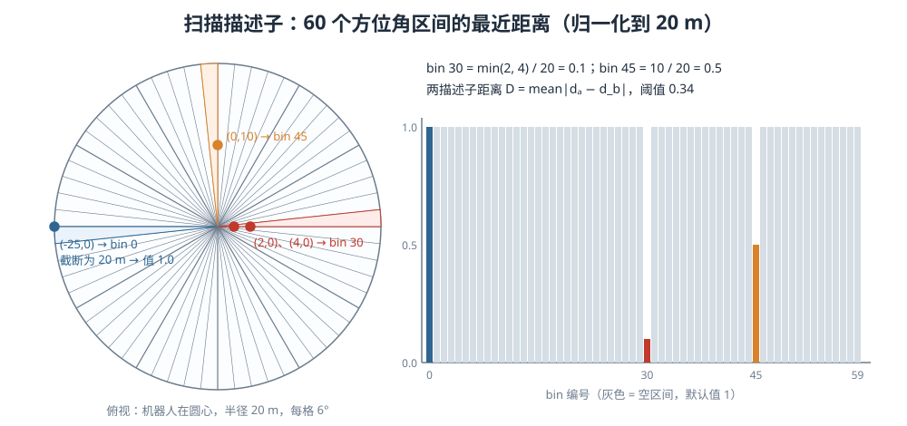

<p align="center"><b>图 8-10</b> 扫描描述子：60 个方位角区间分别记录最近障碍距离（归一化到 20 m）</p>

**案例（手算）**：某关键帧只有 4 个二维点 $(2,0)$、 $(4,0)$、 $(0,10)$、 $(-25,0)$：

- $(2,0)$、 $(4,0)$： $\operatorname{atan2}=0$， $j=\lfloor0.5\times60\rfloor=30$，取最近 $\min(2,4)/20=0.1$；
- $(0,10)$：角度 $\pi/2$， $j=\lfloor0.75\times60\rfloor=45$，值 $10/20=0.5$；
- $(-25,0)$：角度 $\pi$， $j=60 \bmod 60=0$，距离截断为 20，值 $1.0$——与空区间相同；
- 其余 57 个区间为 1。

若另一关键帧只在 bin 30 不同（值 0.4），则 $D=|0.1-0.4|/60=0.005$，远小于阈值 0.34。

> ⚠️ **注意**：描述子相似只能说明"扫描轮廓看起来接近"，不能证明两个位置一定相同。对称仓库、重复货架和长走廊都可能产生相似描述。而且本描述子以机器人朝向为参考，原地转 $90^\circ$ 后整个直方图会循环平移 15 格，它**不具备旋转不变性**，本章轨迹回到起点时朝向相同，所以可以使用。

因此，候选还必须满足：

- 与当前关键帧至少间隔 `loop_min_keyframe_gap`（默认 24 个关键帧）；
- 当前优化位姿距离不超过 `loop_search_radius`（默认 2.0 m）；
- 描述子距离小于 `loop_descriptor_threshold`（默认 0.34）。

通过初筛后，按描述子距离（其次是位姿距离）排序，取最多 3 个候选再用 ICP 检查点云几何是否真正对齐：

```python
# code/code_chapter8/slam.py：PoseGraphSLAM._detect_loop() 节选
for candidate in self.keyframes[: current.index - gap + 1]:
    distance, _ = pose_distance(candidate.optimized_pose, current.optimized_pose)
    if distance > self.config.loop_search_radius:
        continue
    score = descriptor_distance(candidate.descriptor, current.descriptor)
    if score <= self.config.loop_descriptor_threshold:
        candidates.append((score, distance, candidate))
# ...
for score, _, candidate in sorted(candidates, key=lambda item: (item[0], item[1]))[:3]:
    initial = between(candidate.optimized_pose, current.optimized_pose)   # ICP 初值来自当前位姿估计
    relative, rmse, inlier_ratio = icp_2d(
        source=current.scan_xy,
        target=candidate.scan_xy,
        initial_source_to_target=initial,
        max_correspondence=self.config.loop_icp_max_correspondence,     # 0.45 m
    )
    if (
        rmse <= self.config.loop_icp_max_rmse                           # 0.22 m
        and inlier_ratio >= self.config.loop_icp_min_inlier_ratio       # 0.30
    ):
        return LoopResult(source=candidate.index, target=current.index,
                          relative_pose=relative, rmse=rmse,
                          inlier_ratio=inlier_ratio, descriptor_score=score)
```

### 4.6 ICP：迭代最近点配准

**直观理解**：把两张画在透明纸上的墙面轮廓叠在一起，先让每个点去找对面最近的点"牵手"，再整体平移、旋转一下让所有牵手的距离最短；然后重新找最近点、再挪……反复几次，两张图就对齐了。

**原理与公式**：ICP 是 Iterative Closest Point，即迭代最近点。它试图寻找刚体变换，使源点云变换后与目标点云尽量重合。在二维情况下，待估计变换属于 $SE(2)$，包括平移 $(t_x,t_y)$ 和旋转 $\theta$。设源点为 $\mathbf{p}_i$，其最近目标点为 $\mathbf{q}_i$，点到点 ICP 的目标可以写成：

$$
\min_{\mathbf{R},\mathbf{t}} \sum_i\|\mathbf{R}\mathbf{p}_i+\mathbf{t}-\mathbf{q}_i\|^2
$$

当对应关系固定时，这个最小二乘问题有闭式解（SVD 方法）：

1. 求两组点的质心 $\bar{\mathbf{p}}=\frac{1}{n}\sum\mathbf{p}_i$， $\bar{\mathbf{q}}=\frac{1}{n}\sum\mathbf{q}_i$；
2. 构造 $2\times2$ 协方差矩阵 $\mathbf{H}=\sum_i(\mathbf{p}_i-\bar{\mathbf{p}})(\mathbf{q}_i-\bar{\mathbf{q}})^T$；
3. 做奇异值分解 $\mathbf{H}=\mathbf{U}\mathbf{\Sigma}\mathbf{V}^T$，则 $\mathbf{R}=\mathbf{V}\mathbf{U}^T$；若 $\det\mathbf{R}<0$（得到的是反射而非旋转），把 $\mathbf{V}$ 的最后一列取反后重算；
4. 平移 $\mathbf{t}=\bar{\mathbf{q}}-\mathbf{R}\bar{\mathbf{p}}$，转角 $\theta=\operatorname{atan2}(R_{10},R_{00})$。

但对应关系（谁是谁的最近点）依赖于变换本身，所以需要迭代。本章 ICP 的基本步骤是：

1. 使用当前位姿关系作为初始变换；
2. 把源扫描变换到目标扫描附近；
3. 为每个源点寻找最近目标点；
4. 删除距离超过 `max_correspondence` 的匹配；
5. 使用 SVD 求当前匹配下的最佳二维刚体变换；
6. 把增量变换复合到当前估计；
7. 当平移和旋转增量足够小时停止。

最终返回两个重要质量指标：

- `rmse`：内点匹配距离的均方根误差， $\mathrm{rmse}=\sqrt{\frac{1}{n_{in}}\sum_{i\in in}\|\mathbf{R}\mathbf{p}_i+\mathbf{t}-\mathbf{q}_i\|^2}$；
- `inlier_ratio`：有效匹配点占源点数的比例， $n_{in}/n_{src}$。

本章只有在 `rmse` 足够小且 `inlier_ratio` 足够大时才接受回环。这样可以降低错误回环概率，但仍不能完全代替生产系统中的鲁棒核、语义验证、多帧一致性和人工安全检查。

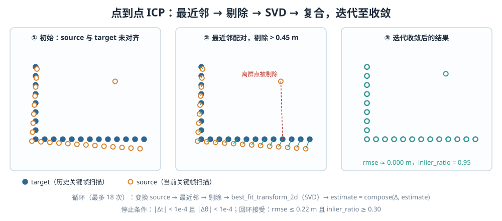

<p align="center"><b>图 8-11</b> 点到点 ICP：最近邻配对、剔除离群点、SVD 求解并复合，迭代至收敛（图中结果由仓库 icp_2d 实际计算得到）</p>

**对应代码**（`code/code_chapter8/slam.py`）：

```python
def icp_2d(source, target, initial_source_to_target=Pose2D(),
           max_correspondence=0.5, max_iterations=18):
    """点到点 ICP，返回 source 坐标系到 target 坐标系的变换。"""
    # ...
    if len(source) < 12 or len(target) < 12:                  # 点太少，直接判失败
        return initial_source_to_target, float("inf"), 0.0
    estimate = initial_source_to_target                       # 步骤 1：初值
    rmse, inlier_ratio = float("inf"), 0.0
    for _ in range(max_iterations):
        transformed = estimate.transform_points(source)       # 步骤 2
        nearest_indices, distances = nearest_neighbors(transformed, target)   # 步骤 3（暴力最近邻）
        inliers = distances <= max_correspondence             # 步骤 4
        inlier_count = int(np.count_nonzero(inliers))
        inlier_ratio = inlier_count / float(len(source))
        if inlier_count < 10:
            return estimate, float("inf"), inlier_ratio
        matched_source = transformed[inliers]
        matched_target = target[nearest_indices[inliers]]
        delta = best_fit_transform_2d(matched_source, matched_target)   # 步骤 5：SVD
        estimate = compose(delta, estimate)                   # 步骤 6：左乘增量
        rmse = float(np.sqrt(np.mean(distances[inliers] ** 2)))
        if math.hypot(delta.x, delta.y) < 1e-4 and abs(delta.yaw) < 1e-4:   # 步骤 7
            break
    return estimate, rmse, inlier_ratio

def best_fit_transform_2d(source: np.ndarray, target: np.ndarray) -> Pose2D:
    source_center = source.mean(axis=0)                       # p̄
    target_center = target.mean(axis=0)                       # q̄
    covariance = (source - source_center).T @ (target - target_center)   # H
    u, _, vt = np.linalg.svd(covariance)
    rotation = vt.T @ u.T                                     # R = V Uᵀ
    if np.linalg.det(rotation) < 0:                           # 排除反射
        vt[-1, :] *= -1
        rotation = vt.T @ u.T
    translation = target_center - rotation @ source_center    # t = q̄ − R p̄
    return Pose2D(x=float(translation[0]), y=float(translation[1]),
                  yaw=math.atan2(float(rotation[1, 0]), float(rotation[0, 0])))
```

**代码解读**：

- 增量 `delta` 是在"已变换到 target 附近"的点上求出的，所以用 `compose(delta, estimate)` **左乘**到当前估计上；
- 注意 `rmse` 用的是本轮**更新前**的匹配距离，所以收敛后返回的 rmse 反映的是最后一次配对的残差；
- `nearest_neighbors()` 以 128 点为一块做暴力搜索，源、目标点数都被 `prepare_scan_xy` 限制在 420 以内，所以计算量可接受；工程系统会改用 KD 树。

**案例 1（SVD 一步求解）**：source 为正方形四个顶点 $(1,0),(0,1),(-1,0),(0,-1)$，target 为它们绕原点旋转 $10^\circ$ 再平移 $(0.5,0.2)$ 的结果。对应关系已知时，`best_fit_transform_2d` 一步给出 $(t_x,t_y,\theta)=(0.5,\ 0.2,\ 0.1745\ \mathrm{rad})$， $0.1745$ rad 正是 $10^\circ$。

**案例 2（迭代与初值敏感性，可运行实验）**：把一面 L 形墙（横边 $x\in[0,3]$、竖边 $y\in[0.25,2]$，每 0.25 m 一个点，共 21 点）作为 target，把它按真实变换的逆变换得到 source，再加 1 个离群点，初值取单位变换、`max_correspondence=0.45`：

```python
import math
import numpy as np
from geometry import Pose2D, inverse
from slam import icp_2d

target = np.array([[x, 0.0] for x in np.arange(0, 3.01, 0.25)] +
                  [[0.0, y] for y in np.arange(0.25, 2.01, 0.25)])
for tx, ty, deg in [(0.10, 0.06, 4), (0.12, 0.08, 5)]:
    true = Pose2D(tx, ty, math.radians(deg))
    source = np.vstack([inverse(true).transform_points(target), [[2.2, 1.6]]])   # 加 1 个离群点
    est, rmse, inlier = icp_2d(source, target, Pose2D(), max_correspondence=0.45)
    print(deg, round(est.x, 3), round(est.y, 3), round(math.degrees(est.yaw), 2), round(rmse, 3), round(inlier, 3))
```

在 `code/code_chapter8/` 目录下运行，用仓库代码实测：

| 真实变换 $(t_x,t_y,\theta)$ | ICP 结果 | rmse | inlier_ratio | 是否满足回环阈值 |
|---|---|---|---|---|
| $(0.10,\ 0.06,\ 4^\circ)$ | $(0.100,\ 0.060,\ 4.00^\circ)$ | ≈ 0 | 0.955（21/22，离群点被剔除） | 是 |
| $(0.12,\ 0.08,\ 5^\circ)$ | $(-0.037,\ 0.116,\ 2.49^\circ)$ | 0.112 | 0.955 | rmse ≤ 0.22，**会被误判为通过** |

第二行说明：初值只差得稍多一点，ICP 就陷入了局部最优（最近邻配对一开始就配错了一部分），而 rmse 和内点率却看起来"还不错"。这正是"ICP 对初值和点密度较敏感"的直接体现，也是生产系统需要鲁棒核、多帧一致性等额外检查的原因。

> 💡 **要点**：本章回环 ICP 的初值是 `between(candidate.optimized_pose, current.optimized_pose)`，即"按当前（已漂移的）位姿估计，两帧的相对位置"。漂移越大，初值越差，ICP 越可能失败或陷入局部最优——这也是 `loop_search_radius` 不宜设得过大的原因之一。

### 4.7 位姿图优化与地图重建

**直观理解**：把每个关键帧想成一颗钉子，相邻关键帧之间的里程计约束是弹簧，回环约束是一根更硬的弹簧。漂移让钉子位置不对、弹簧被拉伸；优化就是让整串钉子一起移动，使所有弹簧的总弹性势能最小。

位姿图把每个关键帧位姿看作节点，把相对位姿量测看作边：

- 相邻关键帧之间是里程计边；
- 回到旧位置后建立的是回环边。

**原理与公式**：设第 $i$ 个节点和第 $j$ 个节点的位姿分别记为 $\mathbf{x}_{i}$、 $\mathbf{x}_{j}$。从节点 $i$ 到节点 $j$ 的边量测，以及根据当前节点估计得到的相对位姿分别记为 $\mathbf{z}_{ij}$、 $\hat{\mathbf{z}}_{ij}=\mathbf{x}_i^{-1}\mathbf{x}_j$（即 `between(x_i, x_j)`）。两者的差构成这条边的残差（角度分量要做 wrap）：

$$
\mathbf{e}_{ij}=\hat{\mathbf{z}}_{ij}-\mathbf{z}_{ij}
$$

后端优化希望所有边的加权残差尽量小：

$$
\min_{\mathbf{x}} \sum_{(i,j)}\mathbf{e}_{ij}^{T}\mathbf{\Omega}_{ij}\mathbf{e}_{ij}
$$

其中 $\mathbf{\Omega}_{ij}$ 是信息矩阵，权重越大表示越相信该约束。本章里程计边 $\mathbf{\Omega}=\mathrm{diag}(80,80,140)$，回环边 $\mathbf{\Omega}=\mathrm{diag}(180,180,260)$，即回环边权重更高，并使用高斯—牛顿法迭代求解：每轮在当前估计处线性化 $\mathbf{e}_{ij}(\mathbf{x}+\Delta\mathbf{x})\approx\mathbf{e}_{ij}+\mathbf{J}_i\Delta\mathbf{x}_i+\mathbf{J}_j\Delta\mathbf{x}_j$，累加

$$
\mathbf{H}=\sum\mathbf{J}^T\mathbf{\Omega}\mathbf{J},\qquad \mathbf{b}=\sum\mathbf{J}^T\mathbf{\Omega}\mathbf{e}
$$

再解线性方程 $\mathbf{H}\Delta\mathbf{x}=-\mathbf{b}$ 并更新 $\mathbf{x}\leftarrow\mathbf{x}+\Delta\mathbf{x}$。

如果整张图同时平移或旋转，所有相对约束仍然成立，因此位姿图存在规范自由度（gauge freedom）。代码固定第 0 个节点，不允许它参与优化，从而确定整个地图的参考坐标系。

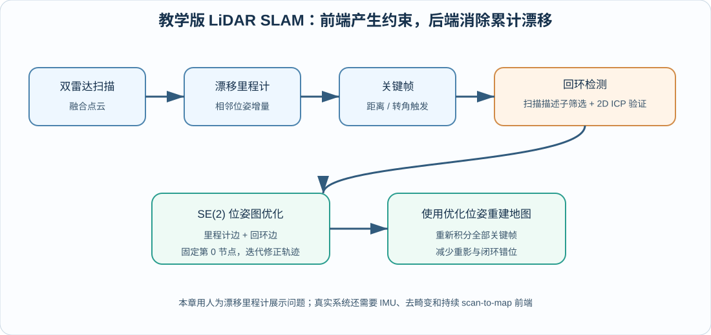

<p align="center"><b>图 8-12</b> 里程计提供局部连续性，回环提供全局约束，后端优化后需要重新构建地图</p>

**对应代码**（`code/code_chapter8/slam.py`）：

```python
def optimize(self) -> None:
    """高斯-牛顿优化；固定第 0 个节点消除规范自由度。"""
    node_count = len(self.keyframes)
    # ...
    poses = [frame.optimized_pose for frame in self.keyframes]
    dimension = 3 * (node_count - 1)                        # 第 0 个节点不在变量里
    for _ in range(max(1, self.config.optimize_iterations)):   # 默认最多 8 轮
        hessian = np.zeros((dimension, dimension), dtype=np.float64)
        gradient = np.zeros((dimension,), dtype=np.float64)
        for edge in self.constraints:
            residual = constraint_residual(poses[edge.source], poses[edge.target], edge.measurement)
            jac_source, jac_target = numerical_jacobians(
                poses[edge.source], poses[edge.target], edge.measurement)   # 数值差分雅可比
            information = np.diag(np.asarray(edge.information, dtype=np.float64))
            # 回环用 Huber 权重抑制偶发错误匹配。
            norm = float(np.sqrt(residual @ information @ residual))
            robust = min(1.0, 2.5 / max(norm, 1e-12)) if edge.kind == "loop" else 1.0
            information *= robust
            # ...
            self._accumulate(hessian, gradient, edge.source, edge.target,
                             jac_source, jac_target, information, residual)   # H += JᵀΩJ, b += JᵀΩe
        hessian += np.eye(dimension) * 1e-6                  # 轻微阻尼，防止奇异
        try:
            increment = np.linalg.solve(hessian, -gradient)  # H Δx = −b
        except np.linalg.LinAlgError:
            increment = np.linalg.lstsq(hessian, -gradient, rcond=None)[0]
        for index in range(1, node_count):
            offset = 3 * (index - 1)
            vector = poses[index].as_vector() + increment[offset : offset + 3]
            poses[index] = pose_from_vector(vector)
        if np.max(np.abs(increment), initial=0.0) < 1e-5:
            break
    for frame, pose in zip(self.keyframes, poses):
        frame.optimized_pose = pose

def constraint_residual(source: Pose2D, target: Pose2D, measurement: Pose2D) -> np.ndarray:
    predicted = between(source, target)                       # ẑ_ij
    return np.array((predicted.x - measurement.x,
                     predicted.y - measurement.y,
                     wrap_angle(predicted.yaw - measurement.yaw)), dtype=np.float64)   # e_ij
```

**代码解读**：

- `numerical_jacobians` 用 $\epsilon=10^{-6}$ 的前向差分近似 $\mathbf{J}_i,\mathbf{J}_j$，省去了手推 SE(2) 雅可比，代价是每条边多算 6 次残差；
- 回环边带 Huber 风格的鲁棒权重：当加权残差范数 $\sqrt{\mathbf{e}^T\mathbf{\Omega}\mathbf{e}}>2.5$ 时，权重按 $2.5/\text{norm}$ 缩小，一条错误回环就不至于把整张图拉歪；
- `_accumulate` 中遇到节点 0 直接跳过，这就是"固定第 0 个节点"的实现。

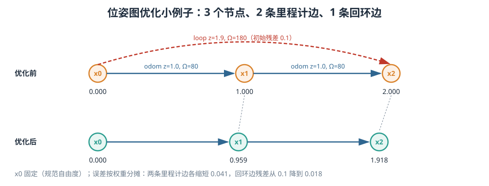

<p align="center"><b>图 8-13</b> 三节点位姿图的手算例子：回环误差按权重分摊到各条边</p>

**案例（手算，可用仓库代码验证）**：机器人沿 $x$ 轴走，三个关键帧初值 $x_0=0,\ x_1=1.0,\ x_2=2.0$（ $y$、 $\psi$ 均为 0），两条里程计边都测得前进 $z=1.0$（权重 80），回环边测得 $x_2$ 相对 $x_0$ 只前进了 $1.9$（权重 180）。初始时回环残差 $2.0-1.9=0.1$。由于只有 $x$ 方向有误差，问题退化为一维加权最小二乘（固定 $x_0=0$）：

$$
\min_{x_1,x_2}\ 80(x_1-1)^2+80(x_2-x_1-1)^2+180(x_2-1.9)^2
$$

对 $x_1$、 $x_2$ 求偏导并令其为 0：

$$
\begin{cases}
2x_1-x_2=0\\
-80x_1+260x_2=422
\end{cases}
\Rightarrow\ x_2=\frac{422}{220}=1.91818,\quad x_1=0.95909
$$

（第二式来自 $80(x_2-x_1-1)+180(x_2-1.9)=0$。）结果：两条里程计边各"缩短"了约 0.041，回环残差从 0.1 降为 0.018——回环权重大，所以误差主要被里程计边吸收。把这三个节点和三条边直接交给 `PoseGraphSLAM.optimize()`，得到 $x_1=0.959091,\ x_2=1.918182$，与手算完全一致（回环加权残差范数 $\sqrt{180\times0.1^2}\approx0.42<2.5$，鲁棒权重为 1，不影响结果）。

**地图重建。** 后端修改了历史关键帧位姿后，已经写入地图的旧点不会自动移动。因此，本章检测到回环并完成优化后，会：

1. 清空当前 2D 或 3D 地图；
2. 遍历全部关键帧；
3. 使用每个关键帧的优化位姿重新转换点云；
4. 把点云重新积分到地图。

这一步称为地图重建。若只优化轨迹而不重建地图，RViz 中可能看到轨迹已经闭合，但墙面仍保留优化前的重影。

```python
# code/code_chapter8/slam.py：MappingBackend
def add_scan(self, cloud: PointCloud, odom_pose: Pose2D) -> tuple[bool, LoopResult | None]:
    if len(cloud) == 0 or not self.slam.should_add_keyframe(odom_pose):
        return False, None                         # 非关键帧：不写地图
    keyframe, loop = self.slam.add_keyframe(cloud, odom_pose)
    if loop is None:
        self._integrate(keyframe)                  # 无回环：增量写入这一帧
    else:
        self.rebuild_maps()                        # 有回环：清空后按优化位姿全部重写
    return True, loop

def rebuild_maps(self) -> None:
    if self.map3d is not None:
        self.map3d.clear()
    if self.map2d is not None:
        self.map2d.clear()
    for keyframe in self.slam.keyframes:
        self._integrate(keyframe)                  # 使用 keyframe.optimized_pose
```

**代码解读**：返回的 `added` 表示当前扫描是否成为关键帧，`loop` 表示本次是否检测并接受回环。演示程序据此输出关键帧数量、回环数量和地图规模。注意**只有关键帧**才会写入地图，这既省算力，也保证了重建时能复现完全相同的地图。

> 💡 **要点**：回环之后，当前时刻机器人位姿也需要修正。`demo_common.py` 中的 `corrected_current_pose()` 以最新关键帧为锚点，把"优化位姿 ∘（锚点里程计位姿 → 当前里程计位姿的增量）"作为发布给 TF 的 `map -> base_link`，使 RViz 中的机器人随回环修正平滑跳到正确位置。

---

## 第五部分 二维占据栅格地图

### 5.1 同一批点云为什么能生成两种地图

二维地图关注"平面上哪里可以走"，三维地图关注"空间表面在哪里"。两者可以使用同一批融合点云，但信息选择和地图表达不同：

- 2D 建图会选择一定高度范围内的障碍点，再把三维射线投影到平面；
- 3D 建图会保留点的高度，并将空间划分为三维体素；
- 2D 地图显式更新自由空间与占据端点；
- 本章 3D 地图只保存被点命中的表面体素，不表达完整自由空间。

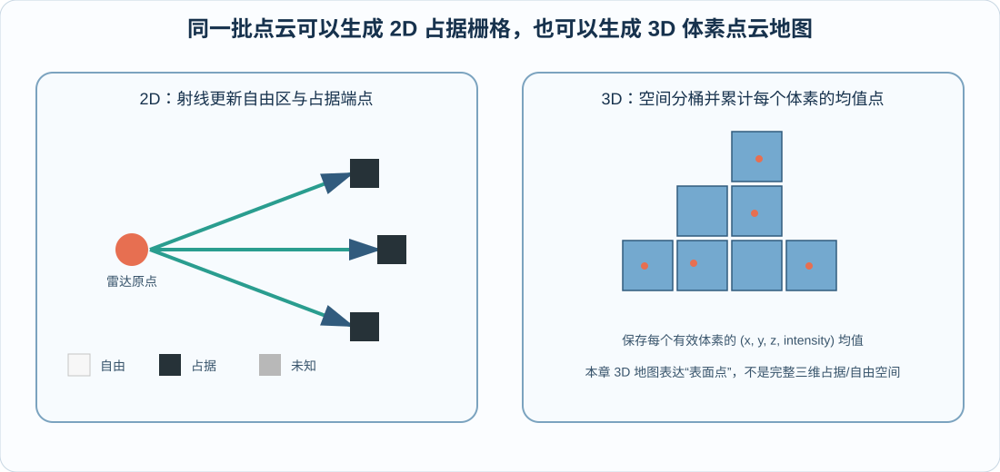

<p align="center"><b>图 8-14</b> 2D 地图使用射线更新自由区和占据端点，3D 地图使用体素聚合空间表面点</p>

### 5.2 占据栅格的基本表示

**直观理解**：把仓库地面铺满 5 cm 见方的小瓷砖，每块瓷砖上写一个数字，表示"这块地被东西占着的可能性有多大"。

**原理与公式**：二维占据栅格把地面划分为边长为 $r$（m/cell）的小方格。若世界坐标为 $(x,y)$，对应的栅格索引为：

$$
i=\left\lfloor\frac{x}{r}\right\rfloor,\qquad j=\left\lfloor\frac{y}{r}\right\rfloor
$$

本章默认分辨率为 `0.05 m`，即每个栅格边长 5 cm。分辨率越小，地图越精细，但网格数量会按面积快速增加。例如同样是 $20\ \mathrm{m}\times20\ \mathrm{m}$ 的区域：

- `0.10 m` 分辨率约为 $200\times200$ 个栅格；
- `0.05 m` 分辨率约为 $400\times400$ 个栅格；
- `0.02 m` 分辨率约为 $1000\times1000$ 个栅格。

每个栅格通常有三种语义：

| 状态 | ROS `OccupancyGrid` 常用值 | PGM 显示 |
|---|---:|---|
| 未知 | -1 | 灰色 |
| 自由 | 0 | 白色 |
| 占据 | 100 | 黑色 |

"未知"不等于"自由"。未知区域只是传感器尚未可靠观测，导航时通常不能随意穿过。

**对应代码**（`code/code_chapter8/config.py` 与 `code/code_chapter8/mapping_2d.py`）：

```python
@dataclass(frozen=True)
class Map2DConfig:
    resolution: float = 0.05             # r，m/cell
    min_hit_z: float = 0.10              # 参与 2D 的最低命中高度
    max_hit_z: float = 3.0               # 参与 2D 的最高命中高度
    angular_resolution_deg: float = 1.0  # 角度射线压缩的区间宽度
    free_probability: float = 0.35       # 自由观测的单次概率
    occupied_probability: float = 0.70   # 占据观测的单次概率
    occupied_threshold: float = 0.65     # 输出为占据的阈值
    free_threshold: float = 0.25         # 输出为自由的阈值
    max_log_odds: float = 5.0            # log-odds 限幅

class OccupancyGrid2D:
    """动态边界的 log-odds 占据栅格。"""

    def __init__(self, config: Map2DConfig = Map2DConfig()) -> None:
        self.config = config
        self._log_odds: dict[tuple[int, int], float] = {}     # 稀疏字典：只存被更新过的格
        self._free_delta = logit(config.free_probability)
        self._occupied_delta = logit(config.occupied_probability)
        # ...

    def world_to_cell(self, xy: np.ndarray) -> tuple[int, int]:
        return tuple(np.floor(np.asarray(xy) / self.config.resolution).astype(np.int64))   # (i, j)
```

**代码解读**：栅格不是预先分配的二维数组，而是以 $(i,j)$ 为键的字典，"动态边界"由此而来——机器人走到哪儿，地图就长到哪儿；不在字典里的格天然就是"未知"。

**案例**：2.4 节的射线起点 $(4.790,2.170)$ 对应 $(\lfloor95.8\rfloor,\lfloor43.4\rfloor)=(95,43)$；命中终点 $(2.790,5.634)$ 对应 $(\lfloor55.8\rfloor,\lfloor112.68\rfloor)=(55,112)$。负坐标同样适用： $x=-0.01$ 时 $\lfloor-0.2\rfloor=-1$，而不是 0——`np.floor` 与 `int()` 截断在负数上的区别必须注意。

### 5.3 从 3D 点云选择 2D 障碍量测

**直观理解**：要画一张"能不能走"的平面图，地面本身不算障碍，天花板也不算；只有机器人可能撞上的那一层高度里的东西才算。

本章首先将点云和雷达原点从 `base_link` 变换到 `map`，然后只保留高度在以下范围内的点：

$$
0.10\ \mathrm{m}\le z\le 3.0\ \mathrm{m}
$$

这样可以排除过低的地面点，同时保留墙、柱和货架等障碍结构。高度阈值需要根据传感器安装、场景地面高度和机器人可碰撞范围调整。

三维雷达在同一个水平方位角上可能有很多不同俯仰角的点。如果把它们全部投影到 2D，并对每个点都做射线追踪，会产生大量重复计算；更严重的是，较远点的自由射线可能穿过较近障碍，形成"穿墙"伪影。

因此，本章按"雷达原点 + 水平方位角区间"分组，每个角度区间只保留最近点。默认角分辨率为 $1^\circ$。这等价于把三维点云压缩为两台雷达各自的一组平面射线。

**原理与公式**：对同一雷达原点 $\mathbf{o}$ 的点 $\mathbf{p}$，令 $\Delta=\mathbf{p}_{xy}-\mathbf{o}_{xy}$，则

$$
\theta=\operatorname{atan2}(\Delta_y,\Delta_x),\qquad b=\left\lfloor\frac{\theta+\pi}{\Delta\theta}\right\rfloor,\qquad \rho=\|\Delta\|
$$

每个 $(\mathbf{o},b)$ 组合只保留 $\rho$ 最小的点。 $\Delta\theta=1^\circ$ 时一个雷达最多 360 条射线，两台雷达最多 720 条。

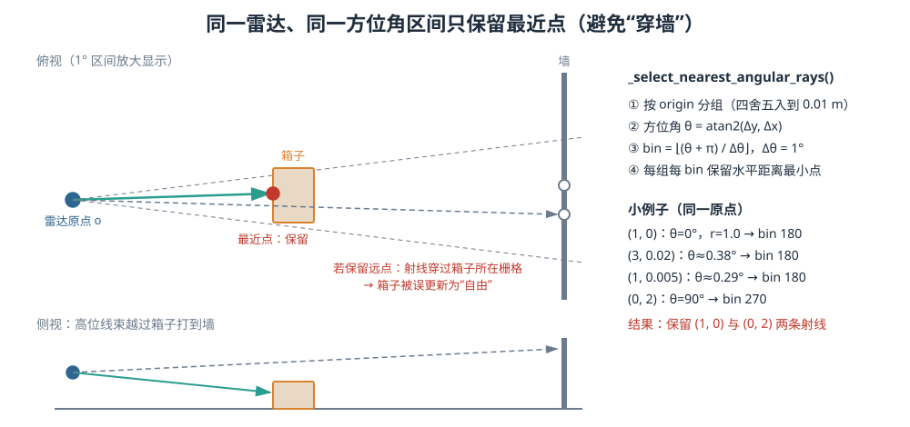

<p align="center"><b>图 8-15</b> 同一雷达、同一方位角区间只保留最近点：高位线束越过近处箱子打到墙上，若保留远点会把箱子"清空"</p>

**对应代码**（`code/code_chapter8/mapping_2d.py`）：

```python
def integrate(self, cloud: PointCloud, pose: Pose2D) -> int:
    if len(cloud) == 0:
        return 0
    world_points = pose.transform_points(cloud.xyz)          # 命中点 → map
    world_origins = pose.transform_points(cloud.origin)      # 射线原点 → map（同一位姿）
    height = (world_points[:, 2] >= self.config.min_hit_z) & (
        world_points[:, 2] <= self.config.max_hit_z
    )
    world_points, world_origins = world_points[height], world_origins[height]
    # ...
    selected = self._select_nearest_angular_rays(world_points, world_origins)
    # ...（见 5.4 节）

def _select_nearest_angular_rays(self, points: np.ndarray, origins: np.ndarray) -> np.ndarray:
    """每个雷达、每个方位角只保留最近障碍，减少射线数量和穿墙伪影。"""
    origin_keys = np.round(origins[:, :2] / 0.01).astype(np.int64)     # 按 1 cm 量化区分雷达
    selected: list[int] = []
    bin_width = math.radians(max(0.1, self.config.angular_resolution_deg))
    for origin_key in np.unique(origin_keys, axis=0):                   # 每个雷达一组
        group = np.flatnonzero(np.all(origin_keys == origin_key, axis=1))
        delta = points[group, :2] - origins[group, :2]
        ranges = np.linalg.norm(delta, axis=1)                          # ρ
        angles = np.arctan2(delta[:, 1], delta[:, 0])                   # θ
        bins = np.floor((angles + math.pi) / bin_width).astype(np.int64)   # b
        order = np.lexsort((ranges, bins))                              # 先按 bin，再按距离
        sorted_bins = bins[order]
        first = np.ones(len(order), dtype=bool)
        first[1:] = sorted_bins[1:] != sorted_bins[:-1]
        selected.extend(group[order[first]].tolist())                   # 每个 bin 的最近点
    return np.asarray(selected, dtype=np.int64)
```

**代码解读**：这里用 `origin` 来区分"这是哪台雷达的射线"，这就是第三部分坚持为每个点保存 `origin` 的直接回报；思路与 3.3 节的 `voxel_sample_indices` 完全相同（`lexsort` + 取每段第一个），只是把"体素"换成了"角度区间"。

**案例（手算，已用仓库代码验证）**：同一雷达原点 $(0,0)$ 下 4 个点： $(1,0)$、 $(3,0.02)$、 $(0,2)$、 $(1,0.005)$（高度均在 0.10–3.0 m 内）。

| 点 | $\theta$ | bin | $\rho$ (m) |
|---|---|---|---|
| $(1,0)$ | $0^\circ$ | 180 | 1.000 |
| $(3,0.02)$ | $0.38^\circ$ | 180 | 3.000 |
| $(0,2)$ | $90^\circ$ | 270 | 2.000 |
| $(1,0.005)$ | $0.29^\circ$ | 180 | 1.000（略大于 1） |

bin 180 有三个点，保留最近的 $(1,0)$；bin 270 保留 $(0,2)$。函数返回下标 `[0, 2]`。

### 5.4 逆传感器模型与 Bresenham 射线

**直观理解**：一束激光能从雷达一路飞到墙上，说明路上没有东西挡着（自由）；它在墙上停下来，说明那儿有东西（占据）。这种"从量测反推地图"的规则叫逆传感器模型（Inverse Sensor Model）。

一束有效激光从雷达原点出发，沿途没有提前碰到物体，最后在障碍表面返回。因此可以使用如下逆传感器模型：

- 射线经过的栅格更可能是自由空间；
- 射线终点所在栅格更可能被占据。

本章使用 Bresenham 算法找出起点栅格到终点栅格之间经过的所有离散网格。对 `ray[:-1]` 更新自由证据，对最后一个栅格更新占据证据。

**原理**：Bresenham 是一种只用整数加减法画直线的经典算法。设 $dx=|x_1-x_0|$、 $dy=|y_1-y_0|$，步进方向 $s_x,s_y\in\{-1,+1\}$，维护误差项 $e=dx-dy$。每一步令 $e_2=2e$：

- 若 $e_2>-dy$： $e\leftarrow e-dy$， $x\leftarrow x+s_x$；
- 若 $e_2<dx$： $e\leftarrow e+dx$， $y\leftarrow y+s_y$；

直到到达终点。两个条件可能同时满足（走对角）。

**对应代码**（`code/code_chapter8/mapping_2d.py`）：

```python
# integrate() 中对每条被选中的射线：
for index in selected:
    start = self.world_to_cell(world_origins[index, :2])   # 射线起点格
    end = self.world_to_cell(world_points[index, :2])      # 命中终点格
    ray = list(self.bresenham(start, end))
    if not ray:
        continue
    for cell in ray[:-1]:
        changed += self._update(cell, self._free_delta)    # 中间格：自由证据
    changed += self._update(ray[-1], self._occupied_delta) # 终点格：占据证据
    self.rays_integrated += 1

@staticmethod
def bresenham(start: tuple[int, int], end: tuple[int, int]):
    x0, y0 = start
    x1, y1 = end
    dx, dy = abs(x1 - x0), abs(y1 - y0)
    sx = 1 if x0 < x1 else -1
    sy = 1 if y0 < y1 else -1
    error = dx - dy
    while True:
        yield x0, y0
        if x0 == x1 and y0 == y1:
            break
        doubled = 2 * error
        if doubled > -dy:
            error -= dy
            x0 += sx
        if doubled < dx:
            error += dx
            y0 += sy
```

**案例 1（手算 Bresenham）**：从 $(0,0)$ 到 $(5,2)$： $dx=5,dy=2,e=3$。

| 步 | 输出格 | $e_2=2e$ | $e_2>-2$？ | $e_2<5$？ | 新 $e$ |
|---|---|---|---|---|---|
| 1 | (0,0) | 6 | 是， $x\to1$， $e=1$ | 否 | 1 |
| 2 | (1,0) | 2 | 是， $x\to2$， $e=-1$ | 是， $y\to1$， $e=4$ | 4 |
| 3 | (2,1) | 8 | 是， $x\to3$， $e=2$ | 否 | 2 |
| 4 | (3,1) | 4 | 是， $x\to4$， $e=0$ | 是， $y\to2$， $e=5$ | 5 |
| 5 | (4,2) | 10 | 是， $x\to5$， $e=3$ | 否 | 3 |
| 6 | (5,2) | — | 到达终点 | | |

得到 6 个格：前 5 个 `(0,0),(1,0),(2,1),(3,1),(4,2)` 更新为自由，最后的 `(5,2)` 更新为占据（与仓库代码输出一致）。

**案例 2（接 2.4 节）**：从 $(95,43)$ 到 $(55,112)$， $dx=40,dy=69$，Bresenham 共输出 $\max(dx,dy)+1=70$ 个格（ $dy>dx$ 时每步 $y$ 必走一格），即 69 个自由格 + 1 个占据格 $(55,112)$；前几格为 $(95,43),(94,44),(94,45),(93,46)$。

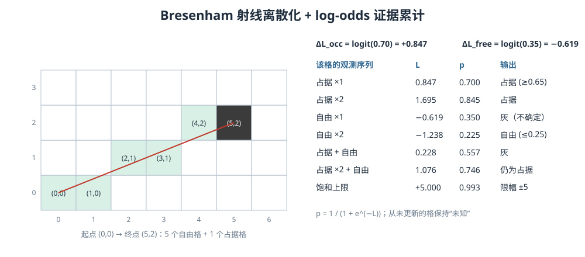

<p align="center"><b>图 8-16</b> Bresenham 把射线离散成格子序列；每个格子用 log-odds 累计多次观测的证据</p>

### 5.5 log-odds 概率更新

**直观理解**：每个格子像一个"投票箱"。看到障碍投一张赞成票（+0.847），射线穿过投一张反对票（−0.619）。偶尔一张错票改变不了长期多数票的结论。

单次量测并不绝对可靠。若看到一次点就永久标记为占据，偶发噪声会留在地图中；若一条自由射线就立刻清空栅格，动态遮挡和漏检又会导致地图闪烁。因此需要概率式累计。

**原理与公式**：设某栅格被占据的概率为 $p$，其 log-odds 表示为：

$$
l=\log\frac{p}{1-p}
$$

反向转换为概率：

$$
p=\frac{1}{1+e^{-l}}
$$

相比直接累加概率，log-odds 的优点是可以把多次观测转化为加法更新。在"各次观测相互独立、先验 $p_0=0.5$（即 $l_0=0$）"的假设下，贝叶斯更新化简为

$$
l_t=l_{t-1}+\log\frac{p(\text{占据}\mid z_t)}{1-p(\text{占据}\mid z_t)}
$$

本章默认：

- 自由观测概率 `free_probability=0.35`，对应负的 log-odds 增量；
- 占据观测概率 `occupied_probability=0.70`，对应正的 log-odds 增量；
- 每次更新后将 log-odds 限制在 $[-5,5]$，避免数值无限增长。

单次 log-odds 增量为：

$$
\Delta L_{free} = \log\frac{0.35}{0.65} \approx-0.619
$$

$$
\Delta L_{occ} = \log\frac{0.70}{0.30} \approx0.847
$$

经过多次观测后：

- 概率大于等于 `0.65` 的栅格输出为占据；
- 概率小于等于 `0.25` 的栅格输出为自由；
- 中间区域保留连续概率或灰度；
- 从未被更新的栅格保持未知。

这种"证据累积"让稳定墙面逐渐变黑，让偶发噪声更难长期保留。

**对应代码**（`code/code_chapter8/mapping_2d.py`）：

```python
def logit(probability: float) -> float:
    probability = float(np.clip(probability, 1e-6, 1.0 - 1e-6))   # 防止 log(0)
    return math.log(probability / (1.0 - probability))

def _update(self, cell: tuple[int, int], delta: float) -> int:
    old = self._log_odds.get(cell, 0.0)                            # 未知格先验 l0 = 0（p = 0.5）
    new = float(np.clip(old + delta, -self.config.max_log_odds, self.config.max_log_odds))
    self._log_odds[cell] = new
    return int(new != old)                                          # 返回是否真的改变（饱和后为 0）
```

**案例（手算，与仓库代码一致）**：

| 某格的观测序列 | $l$ | $p$ | 输出 |
|---|---:|---:|---|
| 占据 ×1 | 0.847 | 0.700 | 占据（≥ 0.65） |
| 占据 ×2 | 1.695 | 0.845 | 占据 |
| 自由 ×1 | −0.619 | 0.350 | 中间灰度（不确定） |
| 自由 ×2 | −1.238 | 0.225 | 自由（≤ 0.25） |
| 占据 ×1 + 自由 ×1 | 0.228 | 0.557 | 中间灰度 |
| 占据 ×2 + 自由 ×1 | 1.076 | 0.746 | 仍为占据 |
| 连续占据约 6 次后 | 5.000（限幅） | 0.993 | 占据 |

读法：

- 一面墙被看到一次就已经是"占据"，但一块自由区要被穿过**两次**才会被判为"自由"——这是参数选择上偏保守的体现（宁可多留灰色，不轻易宣布"可通行"）；
- 被看到两次的墙，被一次误穿射线"打一下"后仍是占据，体现了抗噪声能力；
- 限幅 ±5 的意义：如果一个格子被连续观测 1000 次占据，没有限幅时 $l\approx847$，之后要上千次自由观测才能翻转，地图就无法反映环境变化；限幅后 $5/0.619\approx8.1$，即 9 次自由观测就能让饱和占据的格子降到 0 以下（概率低于 0.5），再多两次左右即可输出为自由。

> 💡 **要点**：如果后续多帧再次看到同一堵墙，终点附近会不断累加正证据；射线稳定穿过的区域会不断累加负证据。偶然噪声通常只有少量观测，不容易推翻长期累积的结果。

### 5.6 导出 PGM、YAML 与 ROS2 OccupancyGrid

本章 2D 建图会保存三个文件：

- `.pgm`：地图灰度图；
- `.yaml`：分辨率、原点、阈值等地图元数据；
- `.png`：便于普通图片工具查看的预览，如果本地有 Pillow 或 OpenCV。

YAML 中最关键的字段包括：

| 字段 | 含义 |
|---|---|
| `image` | 对应 PGM 文件名 |
| `resolution` | 每个像素代表多少米 |
| `origin` | 图像左下角在地图坐标系中的 $(x,y,yaw)$ |
| `negate` | 是否反转黑白含义 |
| `occupied_thresh` | 判为占据的概率阈值 |
| `free_thresh` | 判为自由的概率阈值 |

地图图像的数组通常从左上角开始，而 ROS 地图原点按左下角解释。本章在生成 PGM 时会翻转行索引，在生成 `OccupancyGrid` 时则保持 ROS 所需的从地图左下方开始的一维排列。这个细节若处理错误，地图会在 RViz 中上下颠倒。

**对应代码**（`code/code_chapter8/mapping_2d.py`）：

```python
def to_arrays(self, padding_cells: int = 4):
    # ...
    keys = np.asarray(list(self._log_odds), dtype=np.int64)
    min_x, min_y = keys.min(axis=0) - padding_cells           # 动态边界 + 四周留 4 格
    max_x, max_y = keys.max(axis=0) + padding_cells
    width, height = int(max_x - min_x + 1), int(max_y - min_y + 1)
    image = np.full((height, width), 205, dtype=np.uint8)     # PGM：205 = 灰（未知）
    ros_grid = np.full((height, width), -1, dtype=np.int16)   # ROS：-1 = 未知
    for (x, y), odds in self._log_odds.items():
        col, row_bottom = x - min_x, y - min_y
        row_image = height - 1 - row_bottom                   # 图像行号从上往下，需翻转
        probability = 1.0 / (1.0 + math.exp(-odds))
        if probability >= self.config.occupied_threshold:
            image[row_image, col] = 0                         # 黑
            ros_grid[row_bottom, col] = 100
        elif probability <= self.config.free_threshold:
            image[row_image, col] = 254                       # 白
            ros_grid[row_bottom, col] = 0
        else:
            image[row_image, col] = np.uint8(np.clip(round(254 * (1 - probability)), 1, 253))
            ros_grid[row_bottom, col] = round(100 * probability)
    origin = (float(min_x * self.config.resolution), float(min_y * self.config.resolution))
    return image, ros_grid.astype(np.int8).reshape(-1), width, height, origin

def save(self, output_prefix):
    # ...
    with pgm_path.open("wb") as stream:
        stream.write(f"P5\n# Chapter 8 occupancy grid\n{width} {height}\n255\n".encode("ascii"))
        stream.write(image.tobytes())
    with yaml_path.open("w", encoding="utf-8") as stream:
        stream.write(f"image: {pgm_path.name}\nmode: trinary\n")
        stream.write(f"resolution: {self.config.resolution:.6f}\n")
        stream.write(f"origin: [{origin[0]:.6f}, {origin[1]:.6f}, 0.000000]\n")
        stream.write("negate: 0\n")
        stream.write(f"occupied_thresh: {self.config.occupied_threshold:.6f}\n")
        stream.write(f"free_thresh: {self.config.free_threshold:.6f}\n")
    self._save_png(png_path, image)                           # 先试 Pillow，再试 OpenCV，都没有就跳过
```

**代码解读**：

- `to_arrays()` 动态统计已经更新过的栅格边界，并在四周增加少量 padding。它同时生成用于 PGM/PNG 的灰度图、用于 ROS2 `OccupancyGrid` 的一维 `int8` 数据、地图宽度和高度，以及地图左下角原点；
- PGM 灰度约定：0 黑（占据）、254 白（自由）、205 灰（未知），中间概率映射到 1–253；
- 同一个 `(x, y)` 格在图像中写到 `row_image`，在 ROS 数组中写到 `row_bottom`，两者正好上下翻转；
- `origin` 是左下角格（含 padding）的世界坐标，对应 YAML 的 `origin` 和 `OccupancyGrid.info.origin`。

**案例（可运行的小实验）**：机器人位于原点，一条从 $(0,0)$ 射向 $(0.2,0,0.5)$ 的激光（原点、位姿均为零），积分一次后调用 `to_arrays(padding_cells=0)`：

- Bresenham 给出格 $(0,0)\sim(4,0)$，前 4 格 $l=-0.619$、 $p=0.35$，处于两阈值之间，PGM 值 $\mathrm{round}(254\times0.65)=165$，ROS 值 $\mathrm{round}(35.0)=35$；
- 第 5 格 $(4,0)$ 为占据：PGM 值 0，ROS 值 100；
- 结果 `width=5, height=1, origin=(0.0, 0.0)`，ROS 数据 `[35, 35, 35, 35, 100]`（已用仓库代码验证）。

可见只穿过一次的格子还是"灰"的，需要更多帧的证据才能变白。

> ⚠️ **注意**：后续第十章可将 PGM 和 YAML 作为 Nav2 静态地图输入，但在真正导航前还应检查地图比例、原点、障碍完整性和机器人膨胀半径。

---

## 第六部分 三维体素地图与 2D/3D 地图选择

### 6.1 3D 体素点云地图的表示

**直观理解**：把空间切成 8 cm 的小立方块，每个块像一个"记账本"，记下落进来的点坐标之和、强度之和和点数；最后每个块只交出一个"平均点"。

三维地图不能使用二维栅格索引 $(i,j)$，而是把空间划分为立方体体素。设体素边长为 $s$，点所属体素为：

$$
\mathbf{k}= \left\lfloor \frac{[x,y,z]^{T}}{s} \right\rfloor
$$

本章 `VoxelMap3D` 使用 Python 字典作为体素哈希表，只为实际被观测到的体素分配存储。每个体素累计：

- 所有点的 $x$ 坐标和；
- 所有点的 $y$ 坐标和；
- 所有点的 $z$ 坐标和；
- 所有点的强度和；
- 点的观测次数。

输出地图时，用累计和除以计数，得到该体素中的平均 XYZI 点：

$$
\bar{\mathbf{q}}_{k}= \frac{1}{n_k}\sum_{i\in k}[x_i,y_i,z_i,I_i]^{T}
$$

相比保存全部原始点，体素均值地图有三个优点：

1. 相邻帧对同一墙面的重复量测被合并；
2. 地图点数与"被占据的体素数"更相关，而不是与运行时间线性增长；
3. 多次观测可以平均部分随机噪声和强度波动。

> 💡 **要点**：注意与 3.3 节单帧降采样的区别：单帧降采样保留"离中心最近的真实点"（不改变点的位置），地图体素输出的是"体素内所有点的均值"（是一个计算出来的点）。前者为了保持原始几何，后者为了平均多帧噪声。

默认地图体素边长为 `0.08 m`，并进行以下高度处理：

- 只保留 $0.08$ m 到 $6.0$ m 的点；
- 删除接近 `ground_z=0.0` 且在 `ground_margin=0.06 m` 内的地面点；
- 最多保存 `800000` 个体素；
- 可通过 `min_observations` 过滤只出现少量次数的点（默认 1，即不过滤）。

最终保存标准 ASCII PLY 文件，字段为：

```text
x y z intensity
```

PLY 可以使用 CloudCompare、MeshLab、Open3D 或 PCL 工具查看。

### 6.2 体素哈希的增量积分与导出

**对应代码**（`code/code_chapter8/mapping_3d.py`）：

```python
class VoxelMap3D:
    """使用体素哈希表保存均值点。
    三个思想：先滤波、增量插入、只维护有信息的空间单元。
    """

    def __init__(self, config: Map3DConfig = Map3DConfig()) -> None:
        self.config = config
        self._sum_by_voxel: dict[tuple[int, int, int], np.ndarray] = {}   # 键 → (Σx, Σy, Σz, ΣI)
        self._count_by_voxel: dict[tuple[int, int, int], int] = {}        # 键 → n
        # ...

    def integrate(self, cloud: PointCloud, pose: Pose2D) -> int:
        # ...
        world_xyz = pose.transform_points(cloud.xyz)                       # 用关键帧优化位姿变到 map
        intensity = cloud.intensity.astype(np.float64, copy=False)
        valid = np.isfinite(world_xyz).all(axis=1) & np.isfinite(intensity)
        valid &= (world_xyz[:, 2] >= self.config.min_z) & (world_xyz[:, 2] <= self.config.max_z)
        if self.config.ground_margin > 0.0:
            valid &= np.abs(world_xyz[:, 2] - self.config.ground_z) > self.config.ground_margin
        world_xyz, intensity = world_xyz[valid], intensity[valid]
        # ...
        voxel_ids = np.floor(world_xyz / self.config.voxel_size).astype(np.int64)   # k
        unique_ids, inverse = np.unique(voxel_ids, axis=0, return_inverse=True)     # 单帧内先聚合
        counts = np.bincount(inverse)
        sums = np.column_stack(
            [np.bincount(inverse, weights=world_xyz[:, axis]) for axis in range(3)]
            + [np.bincount(inverse, weights=intensity)]
        )

        changed = 0
        for voxel, value_sum, count in zip(unique_ids, sums, counts):
            key = tuple(int(v) for v in voxel)
            if key not in self._sum_by_voxel and len(self._sum_by_voxel) >= self.config.max_voxels:
                continue                                                    # 达到上限：不再新增体素
            if key in self._sum_by_voxel:
                self._sum_by_voxel[key] += value_sum
                self._count_by_voxel[key] += int(count)
            else:
                self._sum_by_voxel[key] = value_sum.astype(np.float64)
                self._count_by_voxel[key] = int(count)
            changed += 1
        # ...

    def points(self, min_observations: int | None = None) -> np.ndarray:
        threshold = self.config.min_observations if min_observations is None else int(min_observations)
        rows = []
        for key, value_sum in self._sum_by_voxel.items():
            count = self._count_by_voxel[key]
            if count >= threshold:
                rows.append(value_sum / float(count))                       # q̄_k
        # ...
        return np.asarray(rows, dtype=np.float32)

    def save_ply(self, path, min_observations=None) -> int:
        points = self.points(min_observations)
        # ...
        with path.open("w", encoding="ascii") as stream:
            stream.write("ply\nformat ascii 1.0\n")
            stream.write(f"element vertex {len(points)}\n")
            stream.write("property float x\nproperty float y\nproperty float z\n")
            stream.write("property float intensity\nend_header\n")
            for x, y, z, intensity in points:
                stream.write(f"{x:.5f} {y:.5f} {z:.5f} {intensity:.5f}\n")
        return int(len(points))
```

**代码解读**：

- 代码使用 `np.unique(..., return_inverse=True)` 在单帧内部先聚合相同体素：`inverse[i]` 告诉我们第 $i$ 个点属于第几个"唯一体素"，再用 `np.bincount(inverse, weights=...)` 一次性求出每个体素的坐标和与强度和。这比逐点更新 Python 字典更高效——Python 循环次数从"点数"降到了"本帧涉及的体素数"；
- 高度过滤实际上是两个条件的交集： $0.08\le z\le6.0$ 且 $|z-0|>0.06$。默认参数下第二个条件已被第一个蕴含，但若把 `ground_z` 改成仓库实际地面高度（例如地面不在 $z=0$ 时），它就会起作用；
- 地图输出时遍历体素字典，只输出观测次数不小于阈值的体素均值点。PLY 文件头明确包含：

```text
property float x
property float y
property float z
property float intensity
```

  因此 RViz 和离线工具都可以按强度显示地图。

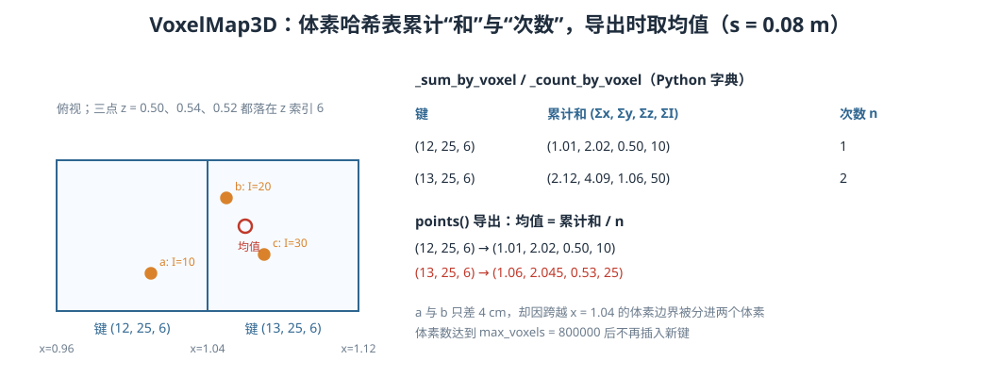

<p align="center"><b>图 8-17</b> VoxelMap3D 的体素哈希累计与均值导出（手算例子，已用仓库代码验证）</p>

**案例 1（接 2.4 节）**：全局命中点 $\mathbf{p}_m=(2.790,5.634,0.340)$，体素尺寸 $s=0.08$ m：

$$
(v_x,v_y,v_z) = \left( \left\lfloor\frac{2.790}{0.08}\right\rfloor, \left\lfloor\frac{5.634}{0.08}\right\rfloor, \left\lfloor\frac{0.340}{0.08}\right\rfloor \right) =(\lfloor34.875\rfloor,\lfloor70.425\rfloor,\lfloor4.25\rfloor)=(34,70,4)
$$

它的高度 0.34 m 在 $[0.08,6.0]$ 内且离地面超过 0.06 m，通过过滤。程序在哈希表中找到键 `(34, 70, 4)`，累计该点的 $x$、 $y$、 $z$、`intensity` 和观测次数。后续点只要落入同一体素，就与已有统计量合并，导出 PLY 时取均值。因此同一小块墙面不会因为重复扫描而无限保存大量几乎相同的点。

**案例 2（体素均值）**：三个点 $a=(1.01,2.02,0.50)$、 $b=(1.05,2.06,0.54)$、 $c=(1.07,2.03,0.52)$，强度 10、20、30：

- $a$： $\lfloor1.01/0.08\rfloor=\lfloor12.625\rfloor=12$，键 $(12,25,6)$；
- $b$： $\lfloor13.125\rfloor=13$，键 $(13,25,6)$； $c$： $\lfloor13.375\rfloor=13$，键 $(13,25,6)$；
- 导出： $(12,25,6)\to(1.01,2.02,0.50,10)$； $(13,25,6)\to\big(\frac{1.05+1.07}{2},\frac{2.06+2.03}{2},\frac{0.54+0.52}{2},\frac{20+30}{2}\big)=(1.06,2.045,0.53,25)$。

$a$ 与 $b$ 只相距约 6 cm，却因跨越了 $x=1.04$ 的体素边界被分到两个体素——体素化的"边界效应"不可避免，这也是体素尺寸不宜过大的原因之一。

**案例 3（内存估算）**：每个体素在两个字典里各占一个条目，若每个条目按约 200 字节（Python 元组键 + NumPy 小数组 + 字典开销的粗略量级，非精确值）估算，`max_voxels=800000` 时约 160 MB。这也是原文建议大场景改用 C++ 空间索引的原因。

### 6.3 2D 建图和 3D 建图如何选择

| 对比项 | 2D 占据栅格 | 3D 体素点云地图 |
|---|---|---|
| 主要问题 | 地面上哪里能走 | 空间表面在哪里 |
| 位姿维度 | 通常为 $(x,y,yaw)$ | 完整系统通常为 6DoF，本章仍为平面 3DoF |
| 高度信息 | 经过筛选后投影掉 | 保留 |
| 自由空间 | 通过射线显式更新 | 本章不显式保存 |
| 典型输出 | PGM + YAML、`OccupancyGrid` | PLY、`PointCloud2` |
| 典型用途 | Nav2、路径规划、平面避障 | 场景重建、三维测量、空间理解 |
| 数据量 | 较小 | 较大 |
| 对地面坡度 | 假设较强 | 能表达高度，但定位也要支持 6DoF 才完整 |

对于室内平整地面移动机器人，2D 地图通常足以支持导航；如果任务涉及斜坡、多层货架、机械臂抓取、三维避障或环境数字化，则需要 3D 地图。

> ⚠️ **注意**：本章 3D 示例需要准确理解一个边界：地图中的点是三维的，但机器人轨迹仍由 `Pose2D(x,y,yaw)` 描述。这适用于机器人在平整仓库地面运动的教学场景，不适用于无人机、楼梯、坡道或明显俯仰滚转运动。完整 3D SLAM 应估计 $SE(3)$ 位姿，并处理 $x,y,z,roll,pitch,yaw$ 六个自由度。

### 6.4 从教学代码走向真实系统还缺什么

本章已经覆盖点云建图的主要思想，但真实部署还必须考虑：

1. **时间同步**：LiDAR、IMU、轮速和控制时钟必须使用一致时间基准；
2. **逐点时间字段**：旋转式雷达一帧内每个点的采样时刻不同；
3. **运动畸变补偿**：使用 IMU 或连续位姿把每个点补偿到统一参考时刻；
4. **持续前端匹配**：每帧或每个子扫描都应通过 scan-to-scan、scan-to-map 或滤波器约束位姿，而不是主要依赖轮速；
5. **IMU 紧耦合**：高速运动、快速旋转和几何退化时，需要 IMU 提供短时运动约束；
6. **外参标定**：双雷达、LiDAR-IMU、LiDAR-base 的外参应离线或在线标定；
7. **动态点过滤**：行人、叉车和移动门不应永久写入静态地图；
8. **退化检测**：长走廊、空旷平面等场景中应监测哪些运动方向不可观；
9. **大地图管理**：生产系统需要局部地图、子地图、空间索引和地图裁剪；
10. **鲁棒回环**：应增加几何一致性、鲁棒核、多帧确认或语义辅助，避免错误闭环破坏整图。

**案例（为什么需要运动畸变补偿）**：10 Hz 旋转雷达扫一圈需要 0.1 s。若机器人以 1 m/s 前进，一帧开头和结尾采到的点之间机器人已经走了 0.1 m——在 5 cm 栅格上就是 2 格的错位；若机器人以 1 rad/s 原地旋转，0.1 s 转过约 $5.7^\circ$，10 m 外的点横向错位约 1 m。本章轨迹速度很低且使用仿真，影响不明显，但真实机器人必须处理。

FAST-LIO2 等系统的价值不仅在于"把点云累加起来"，而在于使用 IMU 预积分或前向传播、点云去畸变、迭代状态估计和增量空间索引，在实时条件下持续获得高精度位姿。本章代码适合先理解这些系统为什么需要前端、后端和地图数据结构，再进入完整 C++ 工程。

---

## 第七部分 代码结构与实现解析

### 7.1 文件组织

本章代码采用"配置、几何、传感器、点云、地图、SLAM、仿真、ROS2 和演示程序分离"的结构：

```text
code/code_chapter8/
├── __init__.py
├── README.md
├── config.py
├── geometry.py
├── pointcloud.py
├── lidar.py
├── mapping_3d.py
├── mapping_2d.py
├── slam.py
├── simulation.py
├── ros2_visualization.py
├── demo_common.py
├── demo_add_dual_lidar.py
├── demo_3d_mapping.py
├── demo_2d_mapping.py
├── run_demo.sh
├── run_rviz.sh
└── rviz/
    └── chapter8_mapping.rviz
```

各文件职责如下：

| 文件 | 主要职责 |
|---|---|
| `config.py` | G2 与仓库场景路径、双雷达外参、点云过滤、2D/3D 地图和 SLAM 参数 |
| `geometry.py` | `Pose2D`、角度归一化、位姿复合、相对位姿和坐标变换 |
| `pointcloud.py` | RTX 输出兼容解析、XYZI 数据结构、过滤、体素采样、外参变换和融合 |
| `lidar.py` | 在 `base_link` 下创建两台 RTX LiDAR，挂接 annotator 和原始 ROS2 writer |
| `mapping_3d.py` | 增量三维体素哈希地图与 PLY 保存 |
| `mapping_2d.py` | 高度筛选、角度射线压缩、Bresenham、log-odds 与 PGM/YAML 保存 |
| `slam.py` | 教学漂移里程计、关键帧、扫描描述子、2D ICP、回环和 SE(2) 位姿图 |
| `simulation.py` | 启动 Isaac Sim、加载仓库和 G2、生成闭环方形巡航轨迹 |
| `ros2_visualization.py` | 发布点云、地图、轨迹、`/clock` 配套数据和完整 TF 树 |
| `demo_common.py` | 2D/3D 示例共享的参数解析、运行循环、发布和保存逻辑 |
| `demo_add_dual_lidar.py` | 只添加双雷达并检查点云 |
| `demo_3d_mapping.py` | 启用三维体素地图 |
| `demo_2d_mapping.py` | 启用二维占据栅格 |
| `run_demo.sh` | 使用 Isaac Sim 自带 Python 与 ROS2 Bridge 启动示例 |
| `run_rviz.sh` | 使用仿真时间打开配套 RViz2 配置 |

此外，仓库中还有 `tf_broadcaster.py`：当 Isaac Sim 自带 Python 环境中缺少 `tf2_ros` 时，`ros2_visualization.py` 用它直接向 `/tf` 和 `/tf_static` 发布 `TFMessage`。（原文目录树中列出的 `README.md` 在当前 `code/code_chapter8/` 目录中未找到。）

推荐阅读顺序：

```text
config.py
  ↓
geometry.py
  ↓
pointcloud.py + lidar.py
  ↓
mapping_2d.py + mapping_3d.py
  ↓
slam.py
  ↓
simulation.py + demo_common.py
  ↓
三个 demo 文件与 ros2_visualization.py
```

> 💡 **要点**：`geometry.py`、`pointcloud.py`、`mapping_2d.py`、`mapping_3d.py`、`slam.py` 只依赖 NumPy，不依赖 Isaac Sim 和 ROS2，可以在普通 Python 环境中单独导入、做本章所有手算案例的验证；`lidar.py`、`simulation.py`、`ros2_visualization.py` 和 demo 文件则必须在 Isaac Sim 环境中运行。

### 7.2 模块调用关系

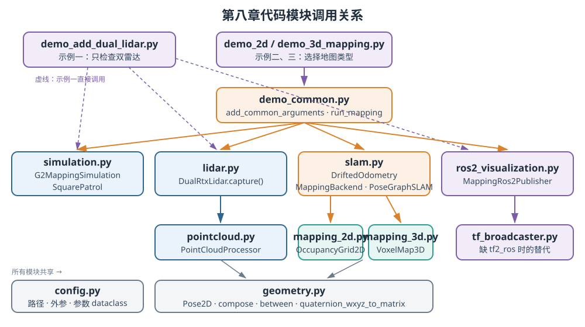

<p align="center"><b>图 8-18</b> 第八章代码模块调用关系：demo 入口 → 运行循环 → 仿真/雷达/SLAM/ROS2 → 点云与地图 → 几何与配置</p>

### 7.3 关键流程逐段解读

下面按 `demo_2d_mapping.py` / `demo_3d_mapping.py` 的执行顺序，把前六部分讲过的核心代码串起来。

**（1）入口：选择地图类型。** `demo_2d_mapping.py` 和 `demo_3d_mapping.py` 本身很短，只负责选择地图类型，完整流程都在 `demo_common.py` 中：

```python
# code/code_chapter8/demo_2d_mapping.py
def main() -> None:
    parser = argparse.ArgumentParser(description=__doc__)
    add_common_arguments(parser, "g2_dual_lidar_2d_map")          # 默认输出前缀
    run_mapping(parser.parse_args(), build_3d=False, build_2d=True)
```

`demo_3d_mapping.py` 与之相同，只是改为 `build_3d=True, build_2d=False`，默认输出前缀为 `g2_dual_lidar_3d_map`。

**（2）参数与配置。** `config.py` 首先根据当前文件位置计算仓库根目录，并集中保存机器人、场景和输出路径：

```python
PROJECT_ROOT = Path(__file__).resolve().parents[2]
ROBOT_USD = PROJECT_ROOT / "assets/robot/G2_omnipicker/robot_fix.usda"
ROBOT_PRIM_PATH = "/genie"
WAREHOUSE_ASSET = "/Isaac/Environments/Simple_Warehouse/full_warehouse.usd"
LIDAR_PARENT_PATH = "/genie/base_link"
OUTPUT_DIR = PROJECT_ROOT / "outputs/chapter8"
```

这意味着示例不依赖当前终端恰好位于某个子目录，但运行前必须确认：

- `ROBOT_USD` 指向实际存在的 G2 USD；
- Isaac Sim 资源服务器或本地安装中存在 `WAREHOUSE_ASSET`；
- 模型加载后的机器人 Prim 确实是 `/genie`；
- 模型中存在 `/genie/base_link`。

命令行开关通过 `dataclasses.replace` 改写配置，而不是修改全局常量：

```python
# code/code_chapter8/demo_common.py：run_mapping() 开头
sim_config = replace(SimulationConfig(), headless=args.headless)
lidar_config = replace(LidarConfig(), profile=args.lidar_profile, scan_voxel_size=args.scan_voxel)
slam_config = SlamConfig()
if args.perfect_odometry:                                 # 关闭人为漂移：比例 1、偏置 0、噪声 0
    slam_config = replace(slam_config, odom_linear_scale=1.0, odom_lateral_scale=1.0,
                          odom_yaw_scale=1.0, odom_yaw_bias_per_meter=0.0, odom_noise_std=0.0)
if args.disable_loop:                                     # 把回环最小间隔设得极大，等价于关闭回环
    slam_config = replace(slam_config, loop_min_keyframe_gap=10**9)
```

默认仿真参数为：

| 参数 | 默认值 | 含义 |
|---|---:|---|
| `--max-frames` | 1560 | 运行一圈并再次经过起点所需的总帧数 |
| `--map-every` | 4 | 每 4 帧处理一次双雷达点云 |
| `--publish-every` | 30 | 每 30 帧更新一次 RViz 地图 |
| `--scan-voxel` | 0.10 | 单帧体素降采样尺寸 |
| `--perfect-odometry` | 关闭 | 默认保留人为漂移 |
| `--disable-loop` | 关闭 | 默认启用回环与位姿图优化 |
| `--no-ros` | 关闭 | 默认尝试发布 ROS2 数据 |

此外还有 `--headless`、`--show-lidar` / `--hide-lidar`（互斥，未指定时非 headless 模式默认显示）、`--lidar-profile`（默认 `OS1_REV6_128ch10hz1024res`）和 `--output`（输出前缀）。`SquarePatrol` 一圈是 1500 帧，所以默认 1560 帧 = 一圈 + 再走 60 帧，让机器人重新经过起点附近、触发回环。

**（3）初始化仿真、雷达和 ROS2。** 整体流程为：

```text
创建 Isaac Sim 与仓库场景
  ↓
加载 G2，设置初始位姿
  ↓
创建双 RTX LiDAR
  ↓
创建 ROS2 发布器和 TF 树
  ↓
预热 RTX LiDAR
  ↓
按方形闭环轨迹推进仿真
  ↓
生成带漂移里程计
  ↓
定期读取、融合点云
  ↓
添加关键帧、回环优化、更新地图
  ↓
发布 RViz 数据
  ↓
退出时保存地图和轨迹
```

对应代码：

```python
# code/code_chapter8/demo_common.py：run_mapping()（节选）
simulation = G2MappingSimulation(sim_config, enable_ros2=not args.no_ros)   # 启动 SimulationApp，加载仓库与 G2
backend = MappingBackend(slam_config=slam_config, map3d_config=Map3DConfig(),
                         map2d_config=Map2DConfig(), build_3d=build_3d, build_2d=build_2d)
odometry = DriftedOdometry(slam_config)
patrol = SquarePatrol()
# ...
first_pose = patrol.pose(0)
simulation.set_pose(first_pose)
lidar = DualRtxLidar(lidar_config, show_visual=show_lidar, publish_raw_ros=not args.no_ros)
ros = None if args.no_ros else MappingRos2Publisher()
if ros is not None:
    # ...
    ros.register_robot_tf_tree(simulation.stage, ROBOT_PRIM_PATH)   # 从 USD 关节注册连杆 TF
    ros.publish_lidar_static_tf(simulation.sim_time)                # base_link -> lidar_*
odometry.reset(first_pose)

# RTX LiDAR 创建后需要若干渲染帧才能产生第一包有效点云。
for _ in range(12):
    simulation.step(first_pose)
```

注意 `G2MappingSimulation` 不做物理驱动：`set_pose()` 直接给 `/genie` 的 Xform 设置平移和绕 $z$ 旋转（"瞬移"到参考位姿），所以参考轨迹就是真值，误差全部来自 `DriftedOdometry`。

**（4）主循环。**

```python
for frame in range(args.max_frames):
    if not simulation.is_running():
        break
    true_pose = patrol.pose(frame)                 # 参考位姿（仅用于驱动仿真和生成里程计）
    simulation.step(true_pose)                     # 设置位姿并渲染一帧，同时发布 /clock
    odom_pose = odometry.update(true_pose)         # 带漂移的里程计

    # Isaac Sim 5.0 只在完成整圈扫描时输出，所以每个渲染帧都读取
    fused, _ = lidar.capture(simulation.sim_time)  # 第三部分：解析、过滤、抽样、体素、外参、融合
    if len(fused) == 0 or frame - last_mapping_frame < max(1, args.map_every):
        if ros is not None:
            ros.publish_dynamic_tree(corrected_current_pose(backend, odom_pose), simulation.sim_time)
        continue

    last_mapping_frame = frame
    added, loop = backend.add_scan(fused, odom_pose)   # 第四~六部分：关键帧、回环、优化、地图
    if ros is not None:
        ros.publish_fused_cloud(fused.xyzi(), simulation.sim_time)
        ros.publish_dynamic_tree(corrected_current_pose(backend, odom_pose), simulation.sim_time)

    if loop is not None:
        print(f"[回环] keyframe {loop.source} -> {loop.target}, "
              f"rmse={loop.rmse:.3f} m, inlier={loop.inlier_ratio:.2f}, "
              f"descriptor={loop.descriptor_score:.3f}")
    if added and len(backend.slam.keyframes) % 10 == 0:
        map_size = len(backend.map3d.points()) if backend.map3d is not None else len(backend.map2d._log_odds)
        print(f"[建图] frame={frame:04d}, keyframes={len(backend.slam.keyframes)}, "
              f"loops={len(backend.slam.loop_results)}, map_size={map_size}, scan_points={len(fused)}")

    if ros is not None and frame - last_publish_frame >= max(1, args.publish_every):
        publish_maps(ros, backend, simulation.sim_time)
        last_publish_frame = frame
```

**代码解读**：

- `--map-every` 的语义是"距离上一次处理至少间隔 N 帧，且本帧有有效扫描"，而不是严格的 `frame % N`；
- `[建图]` 日志每新增 10 个关键帧打印一次；3D 模式下 `map_size` 是体素地图输出点数，2D 模式下是已更新的栅格数（`_log_odds` 字典大小）；
- 将点云处理频率和 RViz 发布频率分开是重要的工程设计。地图不需要每个仿真帧都重新完整发布，否则会浪费大量序列化、DDS 传输和 RViz 渲染时间。

**（5）退出与保存。**

```python
# finally 分支：只要有关键帧就保存
def save_results(output: Path, backend: MappingBackend, build_3d: bool, build_2d: bool) -> None:
    # ...
    if build_3d and backend.map3d is not None:
        point_count = backend.map3d.save_ply(output.with_suffix(".ply"))
        print(f"[保存] 3D 地图：{output.with_suffix('.ply')}，{point_count} 点")
    if build_2d and backend.map2d is not None:
        pgm, yaml, png = backend.map2d.save(output)
        print(f"[保存] 2D 地图：{pgm} / {yaml}" + (f" / {png}" if png.exists() else ""))
    trajectory = output.with_name(output.stem + "_trajectory.csv")
    backend.slam.save_trajectory(trajectory)
    print(f"[保存] 漂移/优化轨迹：{trajectory}")
    print(f"[完成] keyframes={len(backend.slam.keyframes)}, "
          f"loop_closures={len(backend.slam.loop_results)}")
```

若整个运行没有采到任何有效关键帧，代码会抛出 `No valid LiDAR keyframes were captured; refusing empty-map success.`，并在 `finally` 中打印 `[ERROR] No valid map; existing output files were preserved.`——宁可失败也不覆盖旧地图。

### 7.4 ROS2 话题、QoS 与 TF 数据契约

本章 RViz 固定坐标系为 `map`。发布的数据如下：

| 话题 | 消息类型 | `frame_id` | 含义 |
|---|---|---|---|
| `/clock` | `rosgraph_msgs/Clock` | 无 | Isaac Sim 仿真时间 |
| `/lidar/left/points` | `sensor_msgs/PointCloud2` | `lidar_left` | 左雷达原始点云 |
| `/lidar/right/points` | `sensor_msgs/PointCloud2` | `lidar_right` | 右雷达原始点云 |
| `/lidar/fused` | `sensor_msgs/PointCloud2` | `base_link` | 外参变换后的双雷达融合 XYZI 点云 |
| `/map_cloud` | `sensor_msgs/PointCloud2` | `map` | 三维体素地图 |
| `/map` | `nav_msgs/OccupancyGrid` | `map` | 二维占据栅格 |
| `/trajectory/odom` | `nav_msgs/Path` | `map` | 优化前漂移轨迹 |
| `/trajectory/optimized` | `nav_msgs/Path` | `map` | 回环优化后的轨迹 |

地图、轨迹等较低频数据使用可靠且 `TRANSIENT_LOCAL` 的 QoS，使后来启动的 RViz 也能收到最近一次地图。原始 RTX 点云在 RViz 配置中使用 `Best Effort`，更适合高频传感器流。

```python
# code/code_chapter8/ros2_visualization.py
latched = QoSProfile(depth=1)
latched.reliability = ReliabilityPolicy.RELIABLE
latched.durability = DurabilityPolicy.TRANSIENT_LOCAL          # "锁存"：新订阅者能拿到最后一条
self.cloud_pub = self.node.create_publisher(PointCloud2, "/map_cloud", latched)
self.fused_pub = self.node.create_publisher(PointCloud2, "/lidar/fused", 1)
self.grid_pub = self.node.create_publisher(OccupancyGrid, "/map", latched)
self.raw_path_pub = self.node.create_publisher(Path, "/trajectory/odom", latched)
self.optimized_path_pub = self.node.create_publisher(Path, "/trajectory/optimized", latched)

# code/code_chapter8/lidar.py：原始点云使用传感器数据 QoS（Best Effort）
self._raw_publishers[handle.mount.name] = self._ros_node.create_publisher(
    PointCloud2, handle.mount.topic, qos_profile_sensor_data
)
```

> 💡 **要点**：原文描述原始 RTX 点云"由 Isaac Sim writer 发布"；当前仓库代码针对 Isaac Sim 5.0 改为在 `lidar.py` 中用 `rclpy` 直接发布同一份已采集的扫描（源码注释："Isaac 5.0 compatibility: publish the same captured scan using rclpy"），QoS 为 `qos_profile_sensor_data`。从 RViz 的角度看，话题名、`frame_id` 和 `Best Effort` 设置都不变。

---

## 第八部分 代码运行

### 8.1 环境部署

> 💡 **路径约定**：下文命令中 `/path/to/isaac-sim` 表示 Isaac Sim 的安装目录，是占位符，请替换为自己机器上的实际路径。

本章完整示例依赖：

- Linux 环境；
- 可用的 NVIDIA Isaac Sim；
- Isaac Sim 自带 Python；
- G2 USD 模型及其依赖资源；
- 可选的 ROS2 Humble 和 RViz2；
- Isaac Sim ROS2 Bridge 与系统 ROS2 使用兼容的 DDS 配置。

所有命令都应从仓库根目录执行。首先确认脚本具有执行权限：

```bash
chmod +x code/code_chapter8/run_demo.sh
chmod +x code/code_chapter8/run_rviz.sh
```

`run_demo.sh` 默认假设 Isaac Sim 安装在：

```text
/path/to/isaac-sim
```

如果实际路径不同，通过环境变量指定：

```bash
export ISAAC_SIM_ROOT=/path/to/isaac-sim
```

脚本会执行以下关键环境隔离：

- 清除可能指向系统 ROS Python 3.10 的 `PYTHONPATH`；
- 使用 Isaac Sim ROS2 Bridge 自带的 `rclpy` 和动态库；
- 避免当前 Conda 环境干扰 Isaac Sim Python；
- 把 ROS 日志放到 `outputs/chapter8/ros_logs`；
- 最终调用 `$ISAAC_SIM_ROOT/python.sh`。

这样做是因为系统 ROS Humble 常使用 Python 3.10，而某些 Isaac Sim 版本使用 Python 3.11。直接混合两套 `rclpy` 可能出现 `_rclpy_pybind11`、Python ABI 或动态库符号错误。对应脚本片段（`code/code_chapter8/run_demo.sh`）：

```bash
ISAAC_SIM_ROOT="${ISAAC_SIM_ROOT:-/path/to/isaac-sim}"
ROS_DISTRO="${ROS_DISTRO:-humble}"
BRIDGE_ROOT="$ISAAC_SIM_ROOT/exts/isaacsim.ros2.bridge/$ROS_DISTRO"
# ...
export RMW_IMPLEMENTATION="${RMW_IMPLEMENTATION:-rmw_fastrtps_cpp}"
unset PYTHONPATH
export LD_LIBRARY_PATH="$BRIDGE_LIB${LD_LIBRARY_PATH:+:$LD_LIBRARY_PATH}"
export ROS_LOG_DIR="${ROS_LOG_DIR:-$REPO_ROOT/outputs/chapter8/ros_logs}"
# ...
unset CONDA_PREFIX CONDA_DEFAULT_ENV CONDA_PROMPT_MODIFIER PYTHONHOME
cd "$REPO_ROOT"
exec "$ISAAC_SIM_ROOT/python.sh" "$@"
```

脚本不带参数时默认运行 `demo_3d_mapping.py`；传入的相对路径会先按仓库根目录、再按脚本目录解析。默认 DDS 实现为 `rmw_fastrtps_cpp`。

运行前还应检查 `code/code_chapter8/config.py` 中的：

```text
ROBOT_USD
ROBOT_PRIM_PATH
LIDAR_PARENT_PATH
WAREHOUSE_ASSET
```

如果 G2 文件名、Prim 路径或本地仓库结构不同，应先修改统一配置，而不是在报错后逐个修改演示程序。

### 8.2 代码执行

**示例一：只添加和检查双雷达。** 第一次运行建议先不要建图，只检查雷达和点云。下面的命令启动仿真、添加双雷达并周期性打印点数：

```bash
code/code_chapter8/run_demo.sh \
    code/code_chapter8/demo_add_dual_lidar.py
```

非 headless 模式默认显示雷达扫描，也可以显式指定：

```bash
code/code_chapter8/run_demo.sh \
    code/code_chapter8/demo_add_dual_lidar.py \
    --show-lidar
```

如果只想运行较短时间：

```bash
code/code_chapter8/run_demo.sh \
    code/code_chapter8/demo_add_dual_lidar.py \
    --max-frames 300
```

（`demo_add_dual_lidar.py` 自身的 `--max-frames` 默认值为 600。）

**示例二：3D XYZI 体素建图。** 运行三维建图（带窗口、带 ROS2 发布）：

```bash
code/code_chapter8/run_demo.sh \
    code/code_chapter8/demo_3d_mapping.py
```

无窗口运行：

```bash
code/code_chapter8/run_demo.sh \
    code/code_chapter8/demo_3d_mapping.py \
    --headless
```

如果不需要 ROS2，只生成离线地图文件：

```bash
code/code_chapter8/run_demo.sh \
    code/code_chapter8/demo_3d_mapping.py \
    --headless --no-ros
```

**示例三：2D 占据栅格建图。** 运行二维建图：

```bash
code/code_chapter8/run_demo.sh \
    code/code_chapter8/demo_2d_mapping.py
```

调整单帧体素和总帧数：

```bash
code/code_chapter8/run_demo.sh \
    code/code_chapter8/demo_2d_mapping.py \
    --scan-voxel 0.14 \
    --max-frames 1560
```

**使用 RViz2 查看实时结果。** 终端 1 运行 2D 或 3D 示例。终端 2 从仓库根目录启动配套 RViz2（脚本会清理 Isaac/Conda 环境变量，使用系统 ROS Humble，并启用仿真时间）：

```bash
code/code_chapter8/run_rviz.sh
```

也可以手动启动：

```bash
source /opt/ros/humble/setup.bash
rviz2 \
    -d code/code_chapter8/rviz/chapter8_mapping.rviz \
    --ros-args -p use_sim_time:=true
```

配套 RViz 配置已包含：

| 显示项 | 话题 | 观察重点 |
|---|---|---|
| Left RTX LiDAR Scan | `/lidar/left/points` | 左雷达原始扫描和坐标方向 |
| Right RTX LiDAR Scan | `/lidar/right/points` | 右雷达原始扫描和 $180^\circ$ 安装方向 |
| Fused Dual LiDAR | `/lidar/fused` | 两台雷达是否在 `base_link` 中正确重合 |
| 3D XYZI Map | `/map_cloud` | 地图表面、强度、重影和闭环前后变化 |
| 2D Occupancy Map | `/map` | 自由、占据、未知区域是否合理 |
| Drifted Odometry | `/trajectory/odom` | 累计误差是否导致终点偏离起点 |
| Optimized Trajectory | `/trajectory/optimized` | 回环后轨迹是否更接近闭合 |
| TF | `/tf`、`/tf_static` | `map -> base_link -> lidar_*` 与机器人连杆树 |

Isaac Sim 与 RViz 必须使用一致的 `ROS_DOMAIN_ID`。RViz 还必须启用仿真时间，否则消息时间戳与 TF 查询时间可能不一致。

**ROS2 数据排查命令。** 如果 RViz 没有数据，按数据链逐层检查。列出当前所有话题：

```bash
ros2 topic list
```

确认仿真时钟：

```bash
ros2 topic echo /clock --once
```

确认原始和融合点云频率：

```bash
ros2 topic hz /lidar/left/points
ros2 topic hz /lidar/right/points
ros2 topic hz /lidar/fused
```

确认地图：

```bash
ros2 topic echo /map --once
ros2 topic echo /map_cloud --once
```

确认 TF：

```bash
ros2 run tf2_ros tf2_echo map base_link
ros2 run tf2_ros tf2_echo base_link lidar_left
ros2 run tf2_ros tf2_echo base_link lidar_right
```

生成完整 TF 树：

```bash
ros2 run tf2_tools view_frames
```

排查时遵循"先源头、后处理、再地图"的顺序：

```text
/clock 是否存在
  ↓
左右原始点云是否存在
  ↓
静态 TF 是否存在
  ↓
融合点云是否存在
  ↓
map -> base_link 是否连续
  ↓
地图与轨迹是否发布
  ↓
RViz Fixed Frame 和 QoS 是否匹配
```

不要一开始就反复修改 RViz。若 `/lidar/fused` 本身没有数据，问题位于传感器、解析或融合；若话题有数据但 RViz 不显示，才重点检查 TF、时间和 QoS。

**三组对照实验：看懂漂移和回环。** 为了真正理解 SLAM，不应只运行一次默认示例。建议使用不同输出前缀完成三组实验。

实验 A：带漂移里程计，启用回环。这是默认教学模式：

```bash
code/code_chapter8/run_demo.sh \
    code/code_chapter8/demo_3d_mapping.py \
    --headless \
    --output outputs/chapter8/3d_with_loop
```

实验 B：带漂移里程计，关闭回环：

```bash
code/code_chapter8/run_demo.sh \
    code/code_chapter8/demo_3d_mapping.py \
    --headless --disable-loop \
    --output outputs/chapter8/3d_without_loop
```

实验 C：理想里程计，关闭人为漂移：

```bash
code/code_chapter8/run_demo.sh \
    code/code_chapter8/demo_3d_mapping.py \
    --headless --perfect-odometry \
    --output outputs/chapter8/3d_perfect_odom
```

### 8.3 运行结果

**示例一的输出。** 控制台会周期性输出左右雷达点数、融合点数和最大强度，形式类似：

```text
双雷达已添加：/genie/base_link/chapter8_lidar_left 和 chapter8_lidar_right
[点云] frame=0000, chapter8_lidar_left=..., chapter8_lidar_right=..., fused=..., intensity_max=...
```

此时重点不是追求点数越多越好，而是确认：

- 两台雷达都有非零有效点；
- 融合点数约等于两台处理后点数之和；
- `intensity_max` 不是异常的 `NaN` 或无穷值；
- 左右雷达在场景中的安装位置和方向正确；
- RViz 中原始点云与静态 TF 对齐。

**如何读懂**：`[点云]` 行由 `demo_add_dual_lidar.py` 在 `frame % 60 == 0` 且本帧有有效扫描时打印，各雷达数字是**预处理后**的点数（`individual` 字典），`fused` 是它们的和，`intensity_max` 保留一位小数。代码中还会打印 `[LiDAR mount OK] ...`（外参校验通过）、`[LiDAR] ...: first valid scan, ...`（首包有效扫描）以及结束时的 `[LiDAR complete] valid_frames=..., scans=...`。

**示例二的输出。**

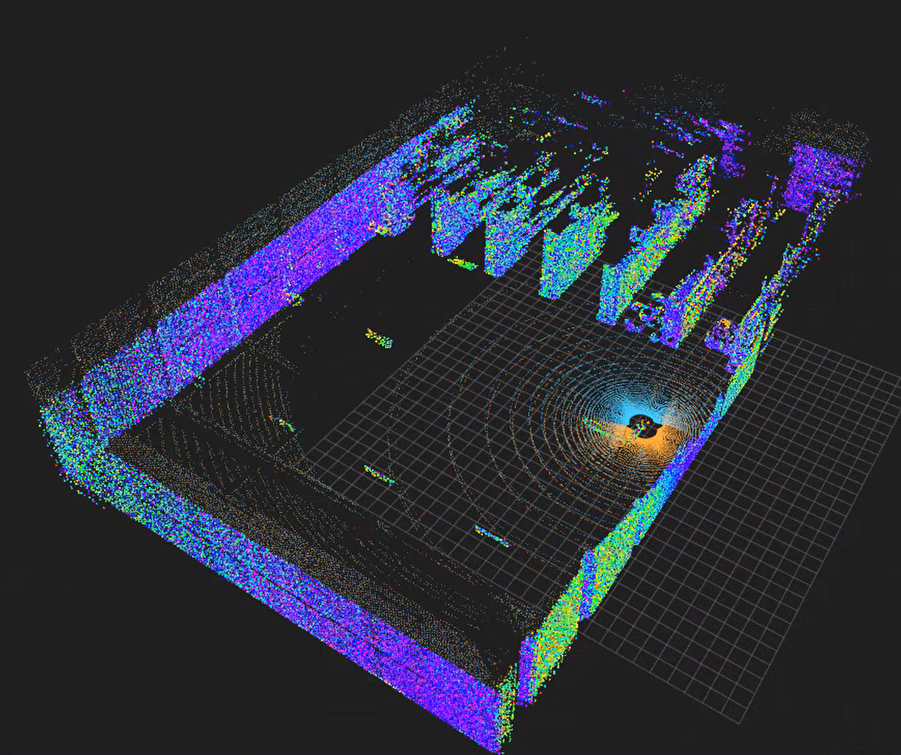

<p align="center"><b>图 8-19</b> 3D XYZI 体素建图运行结果</p>

默认输出前缀为：

```text
outputs/chapter8/g2_dual_lidar_3d_map
```

运行结束后主要文件为：

```text
outputs/chapter8/g2_dual_lidar_3d_map.ply
outputs/chapter8/g2_dual_lidar_3d_map_trajectory.csv
```

PLY 中包含优化位姿下重建的 XYZI 体素地图；CSV 同时保存每个关键帧的漂移位姿和优化位姿：

```text
index,
odom_x, odom_y, odom_yaw,
optimized_x, optimized_y, optimized_yaw
```

控制台会定期输出：

```text
[建图] frame=..., keyframes=..., loops=..., map_size=..., scan_points=...
```

其中：

- `keyframes` 应随机器人运动逐渐增加；
- `loops` 在机器人再次接近旧区域并通过 ICP 验证后增加；
- `map_size` 对 3D 示例表示当前体素地图输出点数；
- `scan_points` 表示当前融合扫描点数。

**如何读懂**：检测到回环时还会出现一行 `[回环] keyframe A -> B, rmse=... m, inlier=..., descriptor=...`：A 是旧关键帧、B 是当前关键帧，B − A 至少为 24；`rmse` 应不超过 0.22，`inlier` 不低于 0.30，`descriptor` 不超过 0.34——超出任何一项都不会被接受。回环后 `map_size` 可能突然变小，因为地图被按优化位姿重建、原来的重影体素合并了。CSV 中的 `odom_*` 与 `optimized_*` 在第一次回环前完全相同，之后才开始分离。

**示例三的输出。**

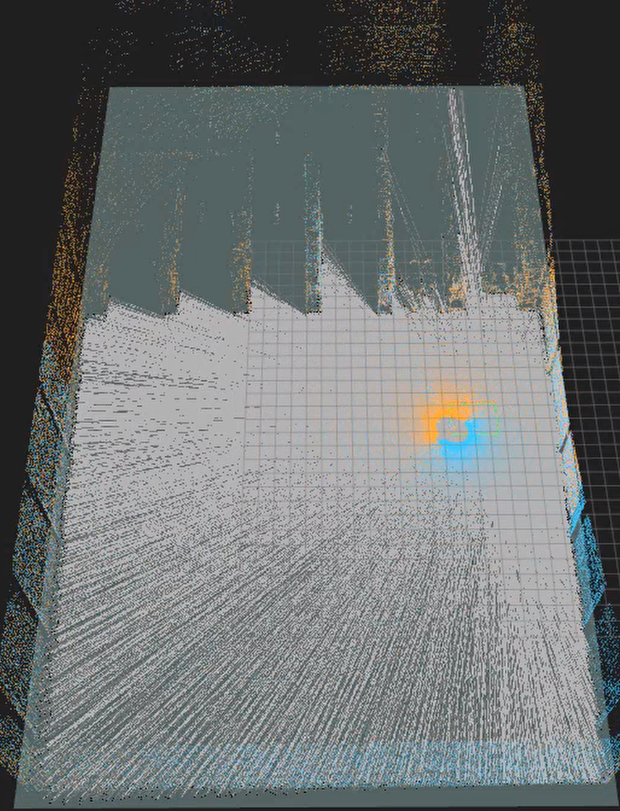

<p align="center"><b>图 8-20</b> 2D 占据栅格建图运行结果</p>

默认输出前缀为：

```text
outputs/chapter8/g2_dual_lidar_2d_map
```

运行结束后可能生成：

```text
outputs/chapter8/g2_dual_lidar_2d_map.pgm
outputs/chapter8/g2_dual_lidar_2d_map.yaml
outputs/chapter8/g2_dual_lidar_2d_map.png
outputs/chapter8/g2_dual_lidar_2d_map_trajectory.csv
```

其中 PNG 只有在环境中可以导入 Pillow 或 OpenCV 时才会生成；PGM 和 YAML 是主要地图结果。后续第十章可将它们作为 Nav2 静态地图输入，但在真正导航前还应检查地图比例、原点、障碍完整性和机器人膨胀半径。

**如何读懂**：打开 YAML 应能看到 `image: g2_dual_lidar_2d_map.pgm`、`mode: trinary`、`resolution: 0.050000`、`negate: 0`、`occupied_thresh: 0.650000`、`free_thresh: 0.250000`，`origin` 是地图左下角（含 4 格 padding）的世界坐标。PGM 中黑色是墙和货架、白色是机器人雷达扫过的可通行区域、灰色是未观测或证据不足的区域。2D 模式下 `[建图]` 行的 `map_size` 是已更新过的栅格数。

**三组对照实验的预期现象。**

- 实验 A：预期看到原始轨迹逐渐偏移，检测到回环后优化轨迹更接近闭合，地图被重新构建；
- 实验 B：预期起点附近出现错位，漂移轨迹无法闭合。它说明局部增量即使每次误差很小，也不能保证长期全局一致；
- 实验 C：该实验用于观察"若位姿足够准确，地图数据结构本身能达到什么效果"。如果理想里程计下仍然出现稳定双层墙，应优先检查外参和点云处理，而不是回环参数。

可对三个 CSV 计算终点与起点误差：

$$
e_p=\sqrt{(x_N-x_0)^2+(y_N-y_0)^2}
$$

$$
e_{\psi}=|\mathrm{wrap}(\psi_N-\psi_0)|
$$

还可以比较 PLY 中墙面厚度、重影数量、体素点数和运行时间。这样比只凭"看起来不错"更有说服力。

> 💡 **要点**：计算 $e_p$ 时， $(x_0,y_0)$ 取 CSV 第一行， $(x_N,y_N)$ 取最后一行。由于默认 1560 帧比一圈多 60 帧，最后一个关键帧并不精确落在起点：按参考轨迹，第 1560 帧已沿第一条边前进了 $60/300\times3=0.6$ m。比较三组实验时应使用同样的帧数，并关注"三者之间的差异"而不是绝对值；也可以把 `odom_*` 与 `optimized_*` 分别计算，对比回环前后的变化。

---

## 本章小结

### 知识回顾

本章从一束激光的飞行时间出发，建立了从传感器量测到 2D/3D 地图的完整认识：

```text
RTX LiDAR 产生 XYZ + intensity
  ↓
删除无效点并进行量程过滤
  ↓
抽样和单帧体素降采样
  ↓
利用外参统一到 base_link
  ↓
融合左右雷达并保留各自射线原点
  ↓
里程计提供初始轨迹，关键帧保存扫描
  ↓
扫描描述子寻找候选，2D ICP 验证回环
  ↓
SE(2) 位姿图优化历史轨迹
  ↓
使用优化位姿重建地图
  ├── 2D：高度筛选 + 射线 + log-odds 占据栅格
  └── 3D：高度过滤 + 体素哈希 + XYZI 均值点
```

| 主题 | 核心公式 / 规则 | 关键参数（默认值） | 代码位置 |
|---|---|---|---|
| ToF 测距 | $d=c\Delta t/2$，球坐标转 $(x,y,z)$ | — | 由 RTX annotator 完成 |
| 外参变换 | $\mathbf{p}_b=\mathbf{R}(\mathbf{q})\mathbf{p}_l+\mathbf{t}$， $\mathbf{o}_b=\mathbf{t}$ | 左 $(0.17,0.21,0.34)$；右 $(-0.23,-0.20,0.34)$ + 绕 z 180° | `config.py`、`pointcloud.py` |
| 位姿变换 | $x_m=\cos\psi x_b-\sin\psi y_b+x$ … | `Pose2D(x, y, yaw)` | `geometry.py` |
| 预处理 | 有限值、 $r_{\min}\le r\le r_{\max}$、步长、体素最近中心 | 0.25 / 50 m，stride 2，0.10 m | `pointcloud.py` |
| 漂移里程计 | 增量乘比例 + 每米航向偏置 + 噪声 | 1.012 / 0.994 / 1.008 / 0.002 / 0.0005 | `slam.py` |
| 关键帧 | $\Delta d\ge0.22$ m 或 $\lvert\Delta\psi\rvert\ge0.18$ rad | — | `slam.py` |
| 回环候选 | 60 区间描述子， $D=\text{mean}\lvert d_a-d_b\rvert$ | 间隔 24，半径 2.0 m，阈值 0.34 | `slam.py` |
| ICP | 最近邻 + SVD，迭代至收敛 | 对应距离 0.45 m，rmse ≤ 0.22，内点率 ≥ 0.30 | `slam.py` |
| 位姿图 | $\min\sum\mathbf{e}^T\mathbf{\Omega}\mathbf{e}$，高斯—牛顿，固定节点 0 | 里程计 (80,80,140)，回环 (180,180,260)，8 轮 | `slam.py` |
| 2D 栅格 | Bresenham + log-odds，最近角度射线 | 0.05 m，0.10–3.0 m，1°，0.35/0.70，阈值 0.65/0.25，±5 | `mapping_2d.py` |
| 3D 体素 | $\mathbf{k}=\lfloor\mathbf{p}/s\rfloor$，体素均值 | 0.08 m，0.08–6.0 m，地面 ±0.06 m，800000 体素 | `mapping_3d.py` |

需要牢牢记住四点：

1. 点云坐标必须与 `frame_id`、外参和时间一起解释；
2. 建图质量首先取决于位姿质量，单纯累加点云不能解决漂移；
3. 2D 地图表达平面自由与占据，3D 点云地图表达空间表面，两者用途不同；
4. 回环优化修改历史位姿后，地图必须使用优化位姿重新构建。

完成本章后，读者应能够看懂激光雷达点云的数据契约，解释 2D 占据栅格和 3D 体素地图的生成过程，运行 G2 双雷达建图示例，并区分教学级建图流程与真实 LiDAR-IMU SLAM 系统之间的边界。

### 课后练习

1. **（手算）坐标链。** 右雷达测得 $d=5$ m、 $\alpha=90^\circ$、 $\beta=0^\circ$，机器人位姿为 $(1.0,\ -2.0,\ 180^\circ)$。依次求 $\mathbf{p}_l$、 $\mathbf{p}_b$（注意右雷达的 $180^\circ$ 外参）、 $\mathbf{p}_m$、射线原点 $\mathbf{o}_m$，以及 $\mathbf{p}_m$ 所在的 2D 栅格索引（ $r=0.05$ m）和 3D 体素索引（ $s=0.08$ m）。再用 `Pose2D.transform_points` 和 `quaternion_wxyz_to_matrix` 验证。
2. **（思考）log-odds 参数。** 若把 `free_probability` 从 0.35 改为 0.45，一个自由格需要被穿过几次才能输出为"自由"？这会让地图在动态障碍（如走过的行人）面前表现得更"顽固"还是更"灵活"？与原值相比各有什么代价？
3. **（动手）ICP 初值实验。** 运行 4.6 节的 ICP 小实验，把真实变换的平移从 0.05 m 逐步增大到 0.30 m、转角从 $2^\circ$ 增大到 $15^\circ$，记录每组的 rmse 和是否收敛到真值，找到"会被 `loop_icp_max_rmse=0.22` 错误接受"的区间。思考：为什么 rmse 小不等于对齐正确？
4. **（动手）漂移与回环对照。** 完成 8.2 节的实验 A、B、C，用三个 CSV 分别计算 $e_p$、 $e_\psi$（`odom_*` 与 `optimized_*` 各算一次），整理成表格，并在 CloudCompare 中对比三份 PLY 起点附近的墙面厚度。
5. **（动手）外参误差实验。** 在 `config.py` 中把右雷达 `translation` 的 $y$ 分量故意从 $-0.20$ 改为 $-0.18$，以 `--perfect-odometry` 运行 2D 建图，观察墙面是否出现双层或变厚；再用 4.2 节的估算解释为什么 2 cm 外参误差在 5 cm 栅格上可能不明显，但在更细分辨率下会显现。
6. **（拓展）更多实验方向。** 单雷达与双雷达对比（暂时只保留左雷达，比较遮挡区域、回环描述子和地图完整度）；体素尺寸 0.05/0.10/0.20 m 对比；二维分辨率 0.02/0.05/0.10 m 对比；改变 `ground_margin` 观察低矮障碍取舍；在仓库中加入移动物体观察未做动态过滤时的拖影；用第四章底盘正运动学输出替换教学漂移里程计；将 PGM/YAML 加载到 Nav2 地图服务器检查原点、比例和障碍膨胀；为点云增加逐点时间和 IMU，接入 FAST-LIO2 或其他正式系统，对比轨迹与地图质量。

### 参考资料

原文未单独列出参考资料章节。本章正文中提及的系统与工具如下，供延伸阅读：

- FAST-LIO2、Cartographer、SLAM Toolbox（完整 LiDAR SLAM 工程系统，正文中作为与教学代码的对比对象）；
- Nav2（第十章，将使用本章生成的 PGM/YAML 地图）；
- CloudCompare、MeshLab、Open3D、PCL（查看 PLY 点云地图的工具）；
- NVIDIA Isaac Sim RTX LiDAR 与 `IsaacCreateRTXLidarScanBuffer` annotator（本章仿真传感器）；
- 本章代码：`code/code_chapter8/`。
