# 第九章 感知控制综合实践：视觉感知控制

> **本章导读**：第五章解决了“给定末端目标，机械臂怎样到达”的问题，第七章让机器人能够在图像中识别物体，第八章介绍了点云与空间理解。本章是一个**综合实践章**，把这些能力连接成一条完整闭环，回答一个更具体的问题：**相机看见桌面上的苹果、肥皂和罐子之后，机器人怎样知道夹哪里、从哪个方向接近，并把它们逐个放进接收区？**
>
> 本章最终要跑通的案例是：在 Isaac Sim 中，固定底盘的 G2 Omnipicker 用右臂完成桌面小物体的逐件抓取与放置。感知侧使用 YOLO 检测、SAM2 实例分割和 RGB-D 点云；抓取候选可以由传统几何方法或 GraspGenX 生成；执行侧沿用第五章的完整位姿逆运动学与关节控制。本章建立的“感知 → 坐标变换 → 目标位姿 → 运动控制 → 验收”闭环，也是后续机械臂规划（第十一章 MoveIt2）和移动操作综合实践（第十二章）的基础。

## 本章概览

### 本章要解决的问题

设想桌面上摆着一块肥皂、一个苹果和一个罐子，机器人头顶的 RGB-D 相机拍下一帧图像。看见一个物体，不等于知道它在三维空间中的位置；知道位置，不等于知道夹爪应该朝向哪里；得到抓取姿态，也不等于机械臂能够无碰撞地执行；就算执行了，也不等于物体真的被拿起并放进了接收区。

本章的重点不是把几个模型依次启动，而是弄清这些环节之间的数据关系，让每一步都有可以解释、检查和复现的输入与输出：像素怎样变成米，米制点云怎样变成夹爪位姿，夹爪位姿怎样变成七个关节角，关节角怎样变成物理上真实发生的抓取，以及系统怎样判断“这一件成功了，可以去抓下一件”。

### 学习目标

学完本章你能：

- **解释**检测、分割、点云、姿态估计、抓取生成、IK、路径检查与执行验证各自回答什么问题、输入输出是什么，以及为什么任何一步都不能替代下一步。
- **推导**像素 $(u,v)$ 与光轴深度 $z$ 到相机系、世界系、机械臂基座系的完整坐标链，并能手算一个像素的三维位置。
- **实现/阅读**桌面 RANSAC 拟合、PCA 2.5D 姿态估计和几何抓取候选生成的核心代码，并能手算一个物体在不同偏航下的开口需求和分数。
- **解释**完整位姿阻尼最小二乘 IK、分阶段笛卡尔路径、近似碰撞检查和抬升/放置验证在闭环中的作用。
- **运行**本章的感知实验、单物体与多物体抓放实验，并读懂 `perception.json`、`planning.json`、`summary.json`。
- **排查**“检测正常但点云偏移”“候选很多却全部规划失败”“夹住后掉落”等典型问题，定位到具体环节。

### 前置知识

- 第一章：Isaac Sim 的安装与独立启动；第二、三章：Isaac Sim 场景、相机与 articulation 的基本使用。
- 第五章：G2 机械臂正运动学、雅可比、阻尼最小二乘 IK 与平滑关节轨迹。
- 第七章：目标检测（YOLO）与图像分割的基本概念；第八章：点云、体素降采样与平面拟合。
- 数学：齐次变换矩阵、旋转矩阵、协方差与特征分解、伪逆。
- 编程：Python、NumPy 数组操作，会使用 Conda 与命令行。

### 知识地图

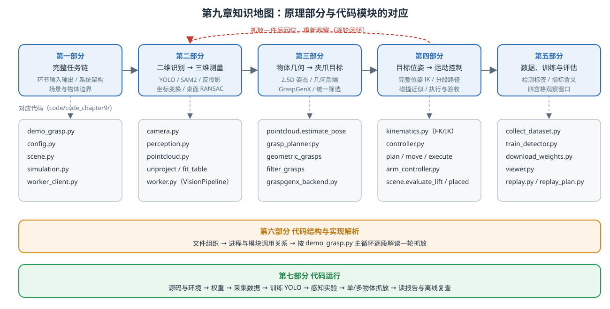

<p align="center"><b>图 9-1</b> 本章知识地图：五个原理部分沿数据流依次衔接，每部分下方为对应的代码文件；抓放一件后回位重新观察，形成逐轮闭环</p>

### 对应代码

本章代码位于 `code/code_chapter9/`，不依赖其他章节的运行时导入：第五章的运动学与控制实现已整理进本章（`kinematics.py`、`arm_controller.py`），G2 资产也位于本章目录。主入口为 `demo_grasp.py`（通过 `run.sh` 用 Isaac 自带 Python 启动），视觉与 GraspGenX 推理分别运行在 `.envs/vision` 与 `.envs/graspgenx` 两个独立 Conda 环境的常驻 worker 进程中。

---

## 第一部分 从“看见物体”到“完成抓放”：完整任务链与系统架构

### 1.1 先明确五个边界

一个综合实践项目最容易出现的问题，是把“能跑通”误解为“已经解决了某类问题”。开始之前，先明确本章做了什么、没做什么：

1. **本章是模块化视觉引导抓取，不是 VLA 端到端动作策略。** YOLO、SAM2 和 GraspGenX 是学习模型，点云处理、几何估计、逆运动学和执行检查主要是显式算法。不能把整个系统都称为传统方法。
2. **当前“动态”体现为场景变化后的重新观察，而不是移动目标拦截。** 机械臂抓一个、放下、回位，再重新感知；推理和规划等待期间，主循环不推进物理时间。本章没有实现传送带抓取、速度预测或连续视觉伺服。
3. **物体姿态采用桌面支撑假设下的 2.5D 几何估计。** 这不是从单张图像恢复任意物体完整 CAD 六维姿态；夹爪目标本身仍是需要同时约束位置和朝向的六维位姿。
4. **在线抓取目标来自视觉，但整个实验不是完全不用仿真真值。** 真值用于训练标注、场景重置、机器人标定，以及抬升与放置结果验证；其中执行验证还决定状态机是否继续。它不用于直接提供待抓物体的目标坐标，不通过瞬移或强制附着制造成功。
5. **候选筛选和路径检查不构成真实机器人安全认证。** 单视角点云存在遮挡，碰撞模型有所简化，执行过程也没有持续更新所有障碍物。真实部署还需要标定、传感器反馈和独立安全措施。

> 💡 **要点**：第 4 条是理解本章的关键。代码中凡是读取仿真物体真实位姿的函数（`scene.snapshot_truth`、`scene.evaluate_lift`、`scene.placed`、`scene.randomize`），注释里都明确写着“仅评估/仅重置，不向 planner 提供真值”。阅读代码时可以把它们当作“裁判”，而不是“选手”。

### 1.2 检测、分割、姿态和抓取，分别回答什么问题

**直观理解**：设相机看到桌面上有一块肥皂。检测器首先给出“这是一块肥皂”和一个矩形框。这个框包含肥皂，也包含周围桌面。如果直接把框中所有深度反投影成点云，桌面点可能比物体点更多，计算出来的中心和方向就会被背景拉偏。

因此，需要分割模型进一步回答“哪些像素属于这一块肥皂”。掩码与同帧深度结合，才能得到较干净的物体点云。随后，几何估计回答物体大致位于哪里、长轴朝向哪里、有多高；抓取生成器则提出夹爪的位置、朝向和开口需求。

最后，运动控制还必须回答：当前关节状态能否到达这个位姿？接近、抬升和搬运的中间路径是否会碰到桌子、其他物体或另一只手臂？夹爪闭合后物体有没有真的被拿起来？

| 环节 | 输入 | 输出 | 不能替代的下一步 |
|---|---|---|---|
| YOLO 检测 | RGB 图像 | 类别、置信度、边界框 | 不能直接提供精确物体轮廓和米制距离 |
| SAM2 分割 | RGB 图像、检测框 | 实例掩码、掩码质量评分 | 不负责测量深度，也不独立决定物体类别 |
| RGB-D 反投影 | 掩码、深度、相机参数 | 物体和场景的三维点 | 不能自动消除遮挡或恢复不可见背面 |
| 几何姿态估计 | 物体点云、桌面平面 | 中心、主方向、尺寸、高度 | 物体坐标系不等于夹爪抓取坐标系 |
| 抓取候选生成 | 点云、夹爪描述 | 多组抓取位姿、开口需求与分数 | 高分候选不等于机器人可达 |
| IK 与路径检查 | 候选、机器人状态、场景 | 分阶段关节路径 | 规划可行不等于接触抓取必然成功 |
| 执行与验证 | 关节路径、仿真反馈 | 抓取、放置结果及停止原因 | 一次成功不代表所有布局都可靠 |

图 9-2 展示了本章真正需要连通的数据流。注意，几何方法与 GraspGenX 是抓取生成阶段的两条可选分支，并不是两套互不相关的抓取系统。

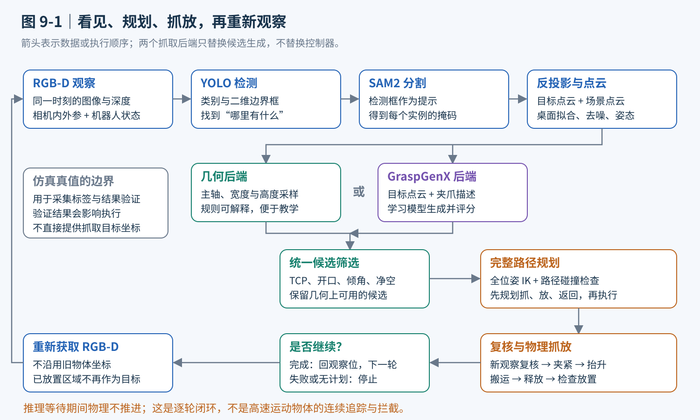

<p align="center"><b>图 9-2</b> 从视觉观察到逐物体抓放的完整流程：两个抓取后端可以互换候选生成，但共用同一套筛选、规划与控制</p>

把整条链压缩成一句话，就是本章的“闭环”：

```text
 RGB-D 一帧 ──► 像素级目标(框+掩码) ──► 米制点云(世界系) ──► 物体几何(中心/主轴/高度)
      ▲                                                              │
      │                                                              ▼
 重新观察 ◄── 验收(抬升/放置) ◄── 关节执行+反馈 ◄── 关节路径(IK) ◄── 夹爪目标位姿 T_WG
```

<p align="center"><b>图 9-3</b> 感知—坐标变换—目标位姿—运动控制—验收的闭环（ASCII 简图）</p>

### 1.3 系统架构：进程、解释器与数据接口

**直观理解**：本章同时用到 Isaac Sim、PyTorch 视觉模型和 GraspGenX 三套依赖，它们对 Python、CUDA 库和 Qt 的要求互相冲突。代码的做法是“各住各的房子，用文件和短消息通信”：

- **主进程**用 Isaac 自带的 `python.sh` 运行 `demo_grasp.py`，负责仿真、相机采集、机器人控制和状态机；
- **视觉 worker**用 `.envs/vision/bin/python` 运行 `worker.py --role vision`，负责检测、分割、点云、几何后端和统一筛选；
- **GraspGenX worker**用 `.envs/graspgenx/bin/python` 运行 `worker.py --role graspgenx`，只在 `--backend graspgenx` 时由视觉 worker 启动；
- **四宫格 viewer**（可选）只读结果文件，不参与控制。

进程之间每次请求只传一行 JSON（输入/输出文件路径），大数组放在 NPZ 文件里。

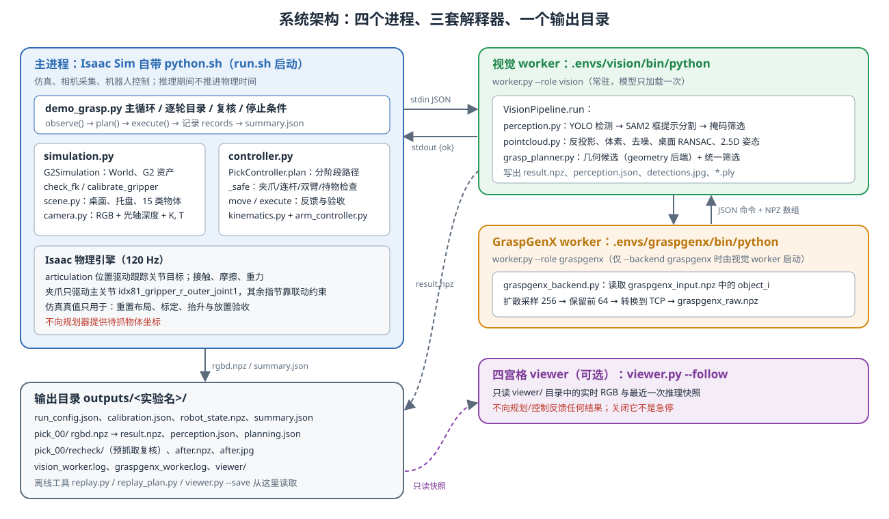

<p align="center"><b>图 9-4</b> 系统架构：四个进程、三套解释器，通过 stdin/stdout 上的 JSON 命令与 NPZ 文件交换数据，所有结果落在同一个输出目录</p>

对应代码（`code/code_chapter9/worker_client.py`，有删减）：

```python
class WorkerClient:
    def __init__(self, python=None, role='vision', options=None, log_dir=None):
        # ...
        env = isolated_environment(python)   # 清理 PYTHONPATH/LD_LIBRARY_PATH/Qt 等，防止 Isaac 环境污染子进程
        self.proc = subprocess.Popen([str(python),'-u',str(ROOT/'worker.py'),'--role',role,'--options',json.dumps(options or {})],
                                      stdin=subprocess.PIPE,stdout=subprocess.PIPE,stderr=self.log,text=True,env=env,cwd=ROOT)

    def request(self, source, destination, timeout=240):
        msg = dict(input=str(Path(source).resolve()),output=str(Path(destination).resolve()))
        self.proc.stdin.write(json.dumps(msg)+'\n'); self.proc.stdin.flush()   # 一行 JSON 命令
        deadline = time.monotonic()+timeout
        while time.monotonic()<deadline:
            # ... 子进程退出则报错
            line = self.proc.stdout.readline()
            # ...
            reply = json.loads(line)
            if not reply.get('ok'):
                raise RuntimeError(f"推理失败：{reply.get('error')}；查看 {self.log_path}")
            return Path(reply['output'])
        self.close()
        raise TimeoutError(f'推理超时 {timeout}s，查看 {self.log_path}')
```

**代码解读**：

- `request` 是**同步阻塞**的：主进程写入命令后一直等到 worker 回复。主循环调用 `observe()` 时传入 `timeout=420`，这段时间里仿真不推进物理步——这就是“推理期间物理时间暂停”的实现来源。
- worker 端（`worker.py` 的 `main`）把所有库日志用 `contextlib.redirect_stdout(sys.stderr)` 重定向到 stderr，stdout 只留给协议 JSON，否则第三方库的一句 `print` 就会破坏通信。
- 模型在第一次请求时加载，之后跨轮次复用，不需要每抓一个物体重新加载权重。

> ⚠️ **注意**：多个进程用于**依赖隔离**，不代表已经实现连续异步运动控制：主循环等待推理返回时仍暂停推进物理时间。

### 1.4 一轮抓放的数据流

图 9-5 把一轮抓放中“每一步交给下一步的数据”具体到数组形状与阈值。后文各部分就是沿着这张图的编号①～⑩展开的，阅读时可以随时回来对照。

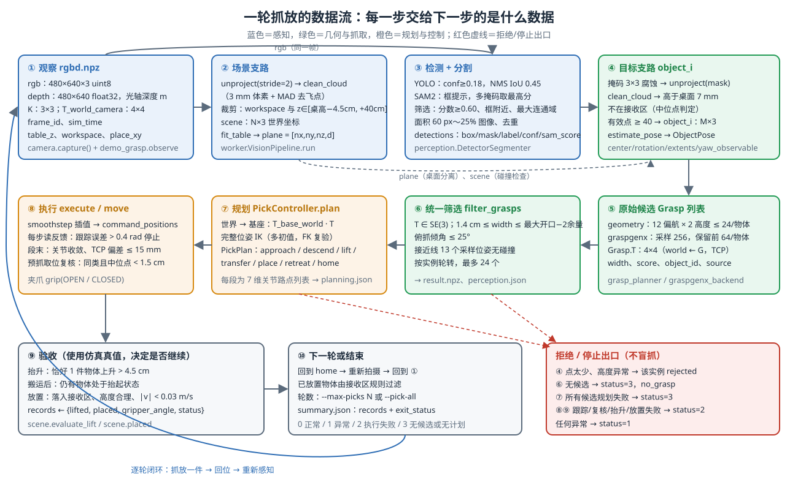

<p align="center"><b>图 9-5</b> 一轮抓放的数据流：从 rgbd.npz 到 summary.json，每个环节的输入输出、关键阈值，以及所有“拒绝/停止”出口</p>

> 💡 **要点**：图中红色框列出的出口说明了本章的设计哲学——**宁可停止，不要盲抓**。点太少就拒绝该实例，没有候选就停止，规划不通就停止，抬升验证失败就退回并停止。每个出口都会在报告中留下原因，这比“偶尔成功”更有教学价值。

### 1.5 为什么先做固定底盘的桌面场景

第四章已经介绍底盘运动，但本章不同时加入导航。因为底盘一旦移动，相机与机器人相对目标的关系、工作空间和障碍物分布都会改变。对于第一次打通视觉与机械臂控制的学习者，先把这些变化固定住，更容易判断错误来自检测、坐标变换还是 IK。代码在 `simulation.py` 中用一个 `FixedJoint` 把 `base_link` 固定在世界中。

本章保留两个重要的已知条件：**工作台大致位置**和**放置区域位置**。它们是任务先验，不是每件物体的真值。桌面平面仍要根据深度拟合，待抓物体的位置仍要从视觉获得。相机外参可以在仿真中直接读取；真实部署时，这一项必须换成经过验证的相机标定结果。

代码使用一台固定 RGB-D 相机，配置分辨率为 640×480，物理步频为 120 Hz、相机配置频率为 30 Hz。这些是仿真配置，不代表整条感知链路能够达到每秒 30 次推理。

```python
# code/code_chapter9/config.py
@dataclass(frozen=True)
class SimulationConfig:
    headless: bool = False
    physics_hz: int = 120
    rendering_hz: int = 30
    resolution: tuple = (640, 480)
```

### 1.6 本章可以摆放哪些物体

案例内置 15 类小物体。它们由程序生成网格、材质和刚体属性，尺寸专门限制在 G2 小夹爪和桌面工作空间适用的范围内。它们是教学代理模型，不是同名真实物品的精确扫描件。

| 组别 | 命令中的类别名称 | 适合观察的现象 |
|---|---|---|
| 水果和蔬菜 | `apple`、`orange`、`lemon`、`tomato`、`potato` | 近圆形物体朝向不明显；细长物体有较清楚的主轴 |
| 盒状物体 | `soap`、`sponge`、`tea_box`、`wood_block`、`eraser` | 长短轴、不同夹取宽度和较低物体的桌面净空 |
| 瓶罐与其他形状 | `can`、`bottle`、`cup`、`spool`、`battery` | 圆柱对称性、局部接触宽度、开口和非凸形状的困难 |

每类物体的包围盒尺寸、文本提示词和颜色都写在 `config.py` 的 `OBJECTS` 中，例如（单位 m）：

```python
# code/code_chapter9/config.py（节选）
OBJECTS = (
    ObjectSpec("apple", "a small red apple", "apple", (.050, .048, .050), (.78, .05, .025)),
    # ...
    ObjectSpec("soap", "a bar of soap", "box", (.070, .038, .027), (.82, .58, .71)),
    # ...
    ObjectSpec("can", "a small soda can", "can", (.040, .040, .073), (.70, .10, .04)),
    # ...
    ObjectSpec("battery", "a cylindrical battery", "can", (.024, .024, .050), (.12, .12, .13)),
)
```

后文的手算案例会反复使用肥皂的尺寸 70×38×27 mm。

同一批最多放置六件，当前入口不允许同名物体重复。这是场景和数据关联设计的限制，不是 YOLO 天生只能识别六件物体。代码还会检查初始布局与桌边、放置区和其他物体的间距，避免一开始就把待抓物体放进“已完成区域”（`scene.sample_layout` 用物体 XY 外接圆半径、10 mm 托盘间隙和 12 mm 邻物间隙做检查，放不下时明确报错而不是强行塞入）。

“海绵”“水果”等名称也不意味着启用了软体仿真：当前这些对象都是刚体。材质采用适合教学接触抓取的摩擦设置（`scene.py` 中静摩擦 1.3、动摩擦 1.1、恢复系数 0）。不能据此宣称已经解决透明瓶、柔性包装、密集堆叠或真实水果受挤压变形的问题。

---


## 第二部分 把二维识别变成三维测量：检测、分割与 RGB-D 点云

本部分对应图 9-5 中的①～④：从一帧 RGB-D 得到“每个物体一团干净的米制点云”，外加一张用于碰撞检查的场景点云和一个桌面平面。

### 2.1 YOLO 负责找目标，为什么本章还要训练自己的检测器

**直观理解**：YOLO（You Only Look Once）可以理解为一个同时预测类别与边界框的检测网络。图像先经过多层特征提取，不同尺度的特征再进行融合，使网络既能识别整体外形，也能保留小物体的位置线索。检测头产生类别和框的预测，后处理根据置信度及重叠程度筛选结果。

**原理与公式**：对于两个框 $B_1$ 和 $B_2$，交并比（Intersection over Union, IoU）定义为：

$$
\mathrm{IoU}(B_1,B_2)=\frac{|B_1\cap B_2|}{|B_1\cup B_2|}
$$

其中 $|\cdot|$ 表示面积（单位：像素²）。如果多个框都覆盖同一个物体，非极大值抑制（Non-Maximum Suppression, NMS）会按评分和重叠关系去除重复结果：先保留分数最高的框，再删去与它 IoU 超过阈值的其他框，重复直到没有剩余框。本章在调用检测器时设置 IoU 阈值为 0.45，默认置信度阈值为 0.18。这只是当前仿真模型使用的参数，不是所有机器人场景的通用最优值。

**案例：IoU 手算**。设 $B_1=(100,100,200,200)$（格式 $x_1,y_1,x_2,y_2$，各 100×100 像素）：

| $B_2$ | 交集面积 | 并集面积 | IoU | NMS（阈值 0.45） |
|---|---|---|---|---|
| $(150,150,250,250)$ | $50\times50=2500$ | $10000+10000-2500=17500$ | 0.143 | 两框都保留（可能是两个相邻物体） |
| $(110,110,210,210)$ | $90\times90=8100$ | $20000-8100=11900$ | 0.681 | 分数较低者被抑制（同一物体的重复框） |

**对应代码**（`code/code_chapter9/perception.py`）：

```python
# ndarray 输入 Ultralytics 为 BGR，SAM2 为 RGB，不能传反。
result = self.detector.predict(np.ascontiguousarray(rgb[...,::-1]), conf=self.confidence,
                               iou=.45, imgsz=640, device=self.device, verbose=False)[0]
```

`rgb[...,::-1]` 把通道顺序从 RGB 翻转为 BGR；`conf` 默认取构造函数参数 `confidence=.18`（主程序 `--confidence` 默认也是 0.18）；`iou=.45` 就是上面的 NMS 阈值。

**为什么不直接使用通用检测权重？** 因为训练于真实照片的模型未必认识程序生成的简化网格。一根红色圆柱既可能被判断为罐子，也可能被判断为杯子；粉色长方体也不必然被识别为肥皂。对本章固定的 15 类教学对象，训练一个小型专用检测器通常更容易检查和复现。

当前训练入口使用 YOLOv8n 预训练权重初始化，学习本章类别与外形之间的对应关系。损失可以概括为框定位、类别分类和边框分布回归几个部分的加权组合；具体检测网络与损失由固定版本的 Ultralytics 实现，本章没有重写检测器训练算法。

代码还保留 YOLO-World 分支，通过类别文本提示和 CLIP（Contrastive Language-Image Pre-training）支持开放词汇检测。它适合对比“文本描述是否足以识别这个物体”，但并不保证在本章简化模型上优于专用检测器。文本提示就是 `OBJECTS` 中的 `prompt` 字段（如 `"a bar of soap"`）：

```python
# code/code_chapter9/perception.py（节选）
if detector == 'world':
    # ... 将 CLIP 缓存目录固定到本章 weights/clip
    self.detector = YOLOWorld(str(weights))
    self.detector.set_classes([s.prompt for s in OBJECTS])
    self.names = [s.name for s in OBJECTS]
else:
    self.detector = YOLO(str(weights))
    self.names = [self.detector.names[i] for i in range(len(self.detector.names))]
```

主程序的自动模式优先寻找本章训练权重，找不到才使用 YOLO-World：

```python
# code/code_chapter9/demo_grasp.py
if detector=='auto':
    if weights is None and (ROOT/'weights/chapter9_yolo.pt').is_file(): weights=ROOT/'weights/chapter9_yolo.pt'
    detector='yolo' if weights is not None else 'world'
if detector=='yolo' and weights is None: raise ValueError('--detector yolo 需要 --weights 检测器路径')
```

> ⚠️ **注意**：缺少专用权重时仍能启动，**不代表运行的还是同一个检测模型**。因此第七部分的所有实验命令都显式写出 `--detector yolo --weights weights/chapter9_yolo.pt`。

### 2.2 SAM2 怎样利用检测框找到实例轮廓

**直观理解**：SAM2（Segment Anything Model 2）是可提示的分割模型。对于本章的单帧用法，可以将其理解为三个配合工作的部分：图像编码器提取视觉特征，提示编码器表达“关注这个框中的对象”，掩码解码器结合两者输出候选掩码和质量评分。

本章先对整张 RGB 图像进行一次图像编码，再逐个将 YOLO 检测框送入 SAM2。在存在分割歧义时，模型可以返回多个候选掩码，程序选择内部质量评分最高的一个。这个分数是模型对分割质量的估计，不是机器人抓取成功概率。

仅选择最高分掩码还不够。本章随后依次执行：

1. 拒绝质量评分低于 0.60 的掩码。
2. 将掩码限制在检测框附近，防止明显扩散到邻近物体和背景。
3. 保留最大的连通区域，减少零散小块。
4. 拒绝过小或覆盖整幅图过大比例的掩码。
5. 根据掩码重叠关系去除重复实例。

```text
 YOLO 框 ──► SAM2(box, multimask) ──► 取最高分掩码
                                          │
            score < 0.60 ? ──是──► 丢弃     │
                                          ▼
            与「框外扩 3~4 px」求交 ──► 8 连通域取最大块
                                          │
            面积 < 60 px 或 > 25% 图像 ? ──是──► 丢弃
                                          │
            与已保留掩码 IoU > 0.65 ? ──是──► 丢弃(重复实例)
                                          ▼
                          detections: box / mask / label / confidence / sam_score
```

<p align="center"><b>图 9-6</b> SAM2 掩码的五步筛选（阈值取自 perception.py）</p>

**对应代码**（`code/code_chapter9/perception.py`，`DetectorSegmenter.__call__`）：

```python
with torch.inference_mode():
    self.sam.set_image(rgb)                       # 整幅图只编码一次（RGB）
    for b in result.boxes:
        box = b.xyxy[0].cpu().numpy()
        masks, scores, _ = self.sam.predict(box=box, multimask_output=True)
        mask = np.asarray(masks[int(np.argmax(scores))],bool)   # 取最高分候选
        if float(np.max(scores)) < .60:                         # 步骤 1
            continue
        h,w = mask.shape
        x1,y1,x2,y2 = np.rint(box).astype(int)
        roi = np.zeros_like(mask)
        roi[max(0,y1-3):min(h,y2+4),max(0,x1-3):min(w,x2+4)] = True
        mask &= roi                                             # 步骤 2：限制在框附近
        n, labels, stats, _ = cv2.connectedComponentsWithStats(mask.astype(np.uint8),8)
        if n < 2:
            continue
        mask = labels == (1+np.argmax(stats[1:,cv2.CC_STAT_AREA]))   # 步骤 3：最大连通域
        if mask.sum() < 60 or mask.sum() > h*w*.25:                  # 步骤 4
            continue
        if any(np.sum(mask & d['mask'])/max(1,np.sum(mask | d['mask']))>.65 for d in detections):
            continue                                                 # 步骤 5：去重
        cls = int(b.cls.item())
        detections.append(dict(box=box,mask=mask,label=self.names[cls],confidence=float(b.conf.item()),
                               sam_score=float(np.max(scores))))
```

**案例**：640×480 图像共 307200 像素，25% 上限为 76800 像素。一个 40 mm 罐子在约 0.8 m 外、焦距约 590.8 像素时，顶面直径约 $0.040\times590.8/0.8\approx 29.5$ 像素，投影面积在数百到一千像素量级，远在 60～76800 的区间内；而一张把整片桌面都涂上的错误掩码会被 25% 上限拒绝。

在反投影物体点云之前，还会对掩码做一次小范围腐蚀（`worker.py` 中 3×3 核的 `cv2.erode`）。其目的不是让物体“变小”，而是尽量避开深度边界处容易混入的桌面或背景像素。但薄小物体也可能因此损失有效点，最终需要由点数阈值决定是否继续，而不能无条件相信处理后的掩码。

这里有两个容易忽略的实现细节。

**第一，RGB 与 BGR 不能混用。** 当前 Ultralytics 的数组输入按 BGR 处理，而 SAM2 接收 RGB。代码在检测入口转换通道顺序，传给 SAM2 时仍保留 RGB。图像形状正确但通道顺序错误，程序不一定报错，却可能明显影响颜色相关识别。

**第二，本章使用的是 SAM2 图像预测接口，不是视频跟踪接口。** 并没有在连续帧之间维持 SAM2 记忆状态，也没有通过它给物体建立永久跟踪 ID。后面的目标复核是重新检测、重新分割，再做简单的数据关联。

此外，当前输出中的检测框和终端“检测数量”，实际对应通过上述分割筛选后保留的实例，不是所有未经筛选的 YOLO 原始框。理解这一点，才能解释“模型曾经输出框，但最后结果中没有这个实例”的情况。

> 💡 **要点**：`confidence`（YOLO 类别置信度）与 `sam_score`（SAM2 掩码质量）是两个独立的分数，都会写入 `perception.json`。排查“类别错”看前者，排查“轮廓糊”看后者。

### 2.3 从像素到米：深度反投影与坐标变换

**直观理解**：RGB 告诉我们颜色和外观，深度图告诉我们对应像素沿相机光轴方向的距离。两者必须来自对齐的同一观察，否则掩码选中的物体像素可能对应到另一时刻的背景深度。本章的 `camera.capture()` 在同一次渲染帧中一次性读取 RGB、深度、内参和相机位姿，并记录 `frame_id` 与 `sim_time`。

**原理与公式**：设像素位置为 $(u,v)$，光轴深度为 $z$，相机内参为：

$$
K=\begin{bmatrix}
f_x&0&c_x\\
0&f_y&c_y\\
0&0&1
\end{bmatrix}
$$

则相机光学坐标系中的三维点为：

$$
\mathbf p_C=zK^{-1}\begin{bmatrix}u\\v\\1\end{bmatrix}
=\begin{bmatrix}(u-c_x)z/f_x\\(v-c_y)z/f_y\\z\end{bmatrix}
$$

其中焦距 $f_x,f_y$ 与主点 $c_x,c_y$ 用像素表示，深度使用米，输出自然也是米。像素偏移不能直接当作末端位移，必须经过这个几何关系。

本章读取的是到图像平面的光轴深度，而不是从相机光心沿射线测量的欧氏距离。如果输入的是射线距离 $r$，应使用归一化射线方向计算 $\mathbf p_C=r\mathbf d/\|\mathbf d\|$（其中 $\mathbf d=K^{-1}[u,v,1]^\top$），不能继续把 $r$ 当成光轴深度套用前式。混用两种深度定义会让离主点较远的三维位置产生系统性偏差。

下面统一三个坐标系：世界坐标系 $W$、相机光学坐标系 $C$、机械臂运动学基座坐标系 $B$。记 ${}^{W}T_C$ 表示把相机坐标转换到世界坐标的齐次变换，则：

$$
\begin{bmatrix}\mathbf p_W\\1\end{bmatrix}
={}^{W}T_C\begin{bmatrix}\mathbf p_C\\1\end{bmatrix},\qquad
{}^{B}T_G=({}^{W}T_B)^{-1}{}^{W}T_G
$$

这里 $G$ 是夹爪 TCP（Tool Center Point，工具中心点）坐标系，第二个式子表示将世界坐标中的抓取目标转换到 IK 使用的机械臂基座坐标。

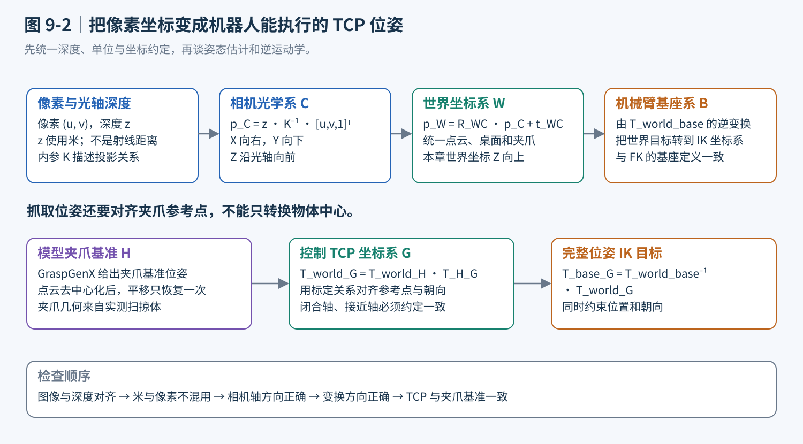

<p align="center"><b>图 9-7</b> 相机测量与机械臂控制之间的坐标链：像素经 $K^{-1}$ 到相机系，经 ${}^WT_C$ 到世界系，再经 $({}^WT_B)^{-1}$ 到 IK 使用的基座系</p>

相机光学坐标采用 X 向右、Y 向下、Z 向前；世界坐标采用 Z 向上。相机朝下观察桌面时，两个坐标系显然不能直接互换。代码显式使用光学坐标约定设置和读取相机姿态，并保存内参与外参，不靠交换几个数组分量“凑出”坐标。

**对应代码**：相机姿态的构造（`code/code_chapter9/camera.py`）：

```python
def look_at_optical(eye, target):
    z = np.asarray(target)-eye
    z = z / np.linalg.norm(z)          # 光轴 Z：从相机指向目标
    x = np.cross(z,[0,0,1.])           # X：与世界 Z 轴和光轴都垂直（图像向右）
    if np.linalg.norm(x) < 1e-6:
        x = np.array([1.,0,0])
    x /= np.linalg.norm(x)
    return np.column_stack([x,np.cross(z,x),z])  # x右、y下、z前
```

相机初始化时设定焦距 24、水平孔径 26、读取 `distance_to_image_plane`（光轴深度），并用 `camera_axes='ros'` 统一按光学坐标约定设置和读取位姿：

```python
# code/code_chapter9/camera.py（节选）
self.sensor.set_world_pose(eye, matrix_to_quaternion(look_at_optical(eye,target)), camera_axes='ros')
self.sensor.set_focal_length(24.)
self.sensor.set_horizontal_aperture(26.)
# ...
self.sensor.add_distance_to_image_plane_to_frame()
# capture() 中：
pos, quat = self.sensor.get_world_pose(camera_axes='ros')
T = np.eye(4); T[:3,:3] = quaternion_to_matrix(quat); T[:3,3] = pos
return dict(rgb=rgb, depth=depth, K=np.asarray(self.sensor.get_intrinsics_matrix()), T_world_camera=T, ...)
```

反投影本身只有几行（`code/code_chapter9/pointcloud.py`）：

```python
def unproject(depth, K, T_world_camera, mask=None, stride=1):
    """depth 为光轴深度 Z（米），不是 distance_to_camera 的欧氏距离。"""
    # ... 检查 depth 维度、K 合法、T 属于 SE(3)
    v, u = np.mgrid[0:depth.shape[0]:stride, 0:depth.shape[1]:stride]   # 像素网格（可隔点）
    z = depth[v, u]
    valid = np.isfinite(z) & (z > .05) & (z < 4.)                        # 只保留 5 cm~4 m 的有效深度
    if mask is not None:
        valid &= np.asarray(mask, bool)[v, u]                            # 目标支路：只取掩码内像素
    pixels = np.column_stack([u[valid], v[valid], np.ones(valid.sum())]) # [u, v, 1]
    rays = pixels @ np.linalg.inv(K).T                                   # K^{-1}[u,v,1]^T
    return transform_points(T_world_camera, rays * z[valid, None])       # 乘 z 得 p_C，再变换到世界系
```

**代码解读**：

- `rays * z` 对应公式 $\mathbf p_C = zK^{-1}[u,v,1]^\top$；因为 `rays` 第三个分量恒为 1，乘 $z$ 后第三个分量正好就是光轴深度。
- `transform_points(T, p)` 计算 $R\,\mathbf p + \mathbf t$，即 ${}^WT_C$ 作用在点上；返回的点云已经在**世界系**。
- `validate_transform` 会检查最后一行为 $[0,0,0,1]$、旋转部分正交且行列式为 1，防止把错误矩阵悄悄传下去。

**案例：一个像素走完整条坐标链**。由 `camera.py` 的参数，Isaac 相机内参 $f_x = \text{焦距}\times W/\text{水平孔径} = 24\times640/26\approx590.8$ 像素；竖直孔径按分辨率比例设置，所以 $f_y=f_x$；取主点 $c_x=320, c_y=240$。为便于手算，再**假设**相机光轴竖直向下、机械臂基座只有平移（真实外参请从 `rgbd.npz` 的 `T_world_camera` 和 `robot_state.npz` 的 `T_world_base` 读取）。

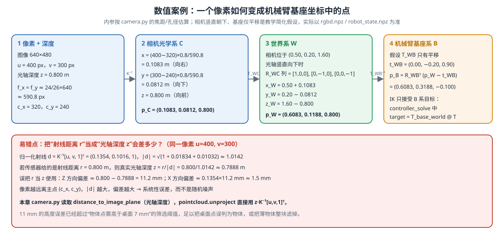

<p align="center"><b>图 9-8</b> 数值案例：像素 (400, 300)、光轴深度 0.8 m 依次变换到相机系、世界系、基座系；下半部分演示把射线距离误当光轴深度造成的 11 mm 系统误差</p>

逐步验证：

1. 相机系： $x_C=(400-320)\times0.8/590.8=0.1083$ m， $y_C=(300-240)\times0.8/590.8=0.0812$ m， $z_C=0.800$ m。
2. 光轴竖直向下时 ${}^WR_C$ 的三列为 $[1,0,0]^\top,[0,-1,0]^\top,[0,0,-1]^\top$（检验：第一列叉乘第二列等于第三列，是右手系）。相机位于 $(0.50,0.20,1.60)$，得 $\mathbf p_W=(0.6083,\,0.1188,\,0.800)$。
3. 若 ${}^WT_B$ 只有平移 $(0,-0.20,0.90)$，则 $\mathbf p_B=\mathbf p_W-\mathbf t_{WB}=(0.6083,\,0.3188,\,-0.100)$。

> ⚠️ **注意**：在真实设备上，深度比例、RGB-D 对齐、镜头畸变处理、时间同步以及相机到基座外参都需要单独验证。仿真中能够直接读取外参，只是省去了实验标定步骤，并不意味着真实机器人不需要标定。

### 2.4 点云为什么要分成“场景”和“目标”两条支路

**直观理解**：如果只保留目标点云，规划器看不见邻居和桌面；如果把整张图的点云都用于估计目标，物体几何又会被背景污染。因此，代码同时维护两类点云。

**场景点云**由整幅深度反投影得到，经过工作台区域裁剪，用于桌面拟合和碰撞检查。当前场景支路以隔点方式采样深度，再做约 3 mm 的体素降采样。在一个小立方体内用平均点代表多个点，既降低计算量，也避免某些表面因像素过密而占据过高权重。

**目标点云**由实例掩码筛选深度像素得到，经过降采样、离群点过滤和桌面分离，用于姿态估计与抓取生成。离群点处理根据邻域距离衡量点是否孤立，并使用中位数及中位绝对偏差（Median Absolute Deviation, MAD）减少少量飞点的影响。

**对应代码**（`code/code_chapter9/pointcloud.py`）：

```python
def voxel_downsample(points, size=.003):
    # ... 去掉非有限点
    _, inverse = np.unique(np.floor(p / size).astype(np.int64), axis=0, return_inverse=True)  # 每个点所属体素编号
    count = np.bincount(inverse)
    return np.column_stack([np.bincount(inverse, weights=p[:, i]) / count for i in range(3)])  # 体素内取平均

def clean_cloud(points, voxel=.003):
    p = voxel_downsample(points, voxel)
    if len(p) < 12:
        return p
    distance, _ = cKDTree(p).query(p, k=min(12, len(p)))
    mean = distance[:, 1:].mean(axis=1)               # 每个点到 11 个近邻的平均距离
    # MAD 避免少数飞点把均值/方差拉大。
    median = np.median(mean)
    return p[mean <= median + max(3 * 1.4826 * np.median(abs(mean - median)), voxel * 1.5)]
```

**代码解读**：离群判据为

$$
\bar d_i \le \mathrm{med}(\bar d) + \max\!\big(3\times1.4826\times\mathrm{MAD}(\bar d),\ 1.5\,s\big)
$$

其中 $\bar d_i$ 是第 $i$ 个点到近邻的平均距离， $s=3$ mm 是体素尺寸； $1.4826\times\mathrm{MAD}$ 是正态分布下标准差的稳健估计； $1.5s=4.5$ mm 的下限防止点云很规则时 MAD 接近 0、把正常点也删掉。

**案例：体素归属**。图 9-8 中的点 $(0.6083,0.1188,0.800)$ 除以 0.003 后向下取整为体素 $(202,39,266)$；同一 3 mm 小立方体内的所有点会被平均成一个点。

两条支路在 `worker.py` 中这样组装：

```python
# code/code_chapter9/worker.py（VisionPipeline.run 节选）
full = clean_cloud(unproject(frame['depth'],K,T,stride=2))            # 场景：隔点采样 + 体素 + 去噪
bounds = frame['workspace']
keep = (full[:,:2]>=bounds[0]).all(1)&(full[:,:2]<=bounds[1]).all(1)  # 裁剪到工作台 XY 范围
scene = full[keep & (full[:,2] > float(frame['table_z'])-.045) & (full[:,2]<float(frame['table_z'])+.40)]
plane = fit_table(scene,float(frame['table_z']))
# ...
for i,d in enumerate(detections):
    mask = cv2.erode(d['mask'].astype(np.uint8),np.ones((3,3),np.uint8)).astype(bool)
    points = clean_cloud(unproject(frame['depth'],K,T,mask))         # 目标：掩码内像素
    valid = (points@plane[:3]+plane[3]>.007)&(points[:,:2]>=bounds[0]).all(1)&(points[:,:2]<=bounds[1]).all(1)
    points = points[valid]                                            # 只保留高于桌面 7 mm 的点
    # ... 位于接收区则拒绝
    if len(points)<cfg.min_points: raise ValueError('有效物体点太少')   # min_points = 40
    pose = estimate_pose(points,plane)
```

**桌面拟合使用 RANSAC**（Random Sample Consensus，随机抽样一致）。每次从候选点中抽取三个不共线点，得到平面假设：

$$
\mathbf n^\top\mathbf p+d=0,\qquad \|\mathbf n\|=1
$$

统计距离平面足够近的内点，保留支持最多的假设，再用 SVD（奇异值分解）对内点进行精细拟合。已知桌高只用于限制搜索区域；如果有效点不足或平面不可靠，程序直接拒绝，而不是回退为“假装拟合成功”。本章要求桌面近水平，并统一法向朝上。

```python
# code/code_chapter9/pointcloud.py
def fit_table(points, expected_z, seed=9):
    """RANSAC + SVD，法向朝上；已知桌高仅作 ROI 先验，最终高度来自深度。"""
    p = np.asarray(points)
    p = p[abs(p[:,2] - expected_z) < .035]              # 只在先验桌高 ±3.5 cm 内搜索
    if len(p) < 80:
        raise ValueError("桌面有效深度不足，拒绝猜测桌高")
    rng = np.random.default_rng(seed)
    sample = p[rng.choice(len(p), min(5000, len(p)), replace=False)]
    best = np.zeros(len(sample), bool)
    for _ in range(120):                                 # 120 次假设
        a, b, c = sample[rng.choice(len(sample), 3, replace=False)]
        n = np.cross(b-a, c-a)                           # 三点确定的法向
        if np.linalg.norm(n) < 1e-8:
            continue                                     # 三点共线
        n /= np.linalg.norm(n)
        if abs(n[2]) < .98:
            continue                                     # 倾斜超过约 11.5° 的假设直接跳过
        keep = abs((sample-a) @ n) < .004                # 内点：距平面 < 4 mm
        if keep.sum() > best.sum():
            best = keep
    if best.sum() < 80 or best.mean() < .35:
        raise ValueError("未找到可靠桌面平面")
    q = sample[best]
    _, _, v = np.linalg.svd(q-q.mean(0), full_matrices=False)
    n = v[-1] * (1 if v[-1,2] > 0 else -1)              # 最小奇异值方向为法向，统一朝上
    if n[2] < .98:
        raise ValueError("本入门示例要求近水平桌面")
    return np.r_[n, -n @ q.mean(0)]                      # [nx, ny, nz, d]
```

**代码解读**： $|n_z|\ge0.98$ 对应法向与竖直方向夹角不超过 $\arccos 0.98\approx11.5°$；SVD 精拟合时，内点去中心后最小奇异值对应的右奇异向量就是“点云最不延展的方向”，即平面法向； $d=-\mathbf n^\top\bar{\mathbf q}$ 保证平面经过内点质心。

对于单位法向， $\mathbf n^\top\mathbf p+d$ 就是点到桌面的有符号距离。物体支路只保留明显高于桌面的点，避免把桌面当成物体底部。当前筛选阈值为 7 mm，实例至少需要 40 个有效点。这也解释了为什么非常薄、很小或严重遮挡的物体可能没有候选：系统选择拒绝不可靠测量，而不是补一个猜测位置。

**案例：有符号距离**。接着图 9-8 的例子，设拟合得到 $\mathbf n=(0,0,1)$、 $d=-0.773$（桌面在 $z=0.773$ m）。图 9-8 中的点 $z_W=0.800$：距离 $0.800-0.773=0.027$ m，正好是一块 27 mm 高肥皂的顶面，保留；肥皂侧面靠下一点 $z=0.779$：距离 $0.006$ m $<0.007$，被当作“贴近桌面的点”滤掉。若三点抽样得到稍有倾斜的法向，例如 $\mathbf n=(0,-0.0100,0.99995)$，则 $|n_z|\ge0.98$ 仍然通过方向检查，最终由内点数量和 SVD 精拟合决定。这也正是图 9-8 下半部分的意义——11 mm 的深度系统误差足以让桌面点越过 7 mm 阈值被误当成物体。

> ⚠️ **注意**：**单视角点云仍然只是可见表面。** 体素化、去噪和 RANSAC 都不会凭空恢复杯子的背面、盒子的底面或被另一件物体挡住的区域。后续所有几何判断都必须保留这一不确定性。

---

## 第三部分 从物体几何到夹爪目标：两种抓取生成方法

本部分对应图 9-5 中的④～⑥：从物体点云得到“夹爪应该放在哪里、朝向哪里、张多大”的候选位姿 ${}^WT_G$，并统一筛掉明显不可行的候选。

### 3.1 2.5D 姿态估计：能知道什么，不能知道什么

**直观理解**：对桌面上的长方形肥皂，我们主要关心它的中心、长轴方向、横向尺寸和高度。对于直立且支撑在近水平桌面上的物体，可以先在世界 XY 平面估计主方向，再结合桌面高度构造一个近似三维包围盒。这就是本章使用的 2.5D 姿态估计。它的直观含义是：**先让尺子顺着物体摆放，再量它有多长、多宽、多高。**

**原理与公式**：设平面投影后的点为 $\mathbf x_i=(x_i,y_i)^\top$，其协方差为：

$$
C=\frac{1}{N-1}\sum_{i=1}^{N}(\mathbf x_i-\bar{\mathbf x})(\mathbf x_i-\bar{\mathbf x})^\top
$$

对 $C$ 做特征分解 $C=V\,\mathrm{diag}(\lambda_1,\lambda_2)\,V^\top$（ $\lambda_1\ge\lambda_2$），较大特征值对应的特征向量给出分布延伸最明显的方向，也就是 PCA（Principal Component Analysis，主成分分析）主轴。将点云旋转到这一方向后，代码用 1% 和 99% 分位数估计边界，降低极少数异常点对尺寸的影响；顶部取较高分位数（97%），底部由拟合桌面提供，从而得到高度和近似中心。

它得到的是 PCA 对齐的近似包围盒，不是搜索所有方向得到的严格最小体积包围盒。

**对应代码**（`code/code_chapter9/pointcloud.py`）：

```python
def estimate_pose(points, plane):
    """2.5D OBB：仅估计桌上直立物体的中心/主轴；不是 CAD 6D 配准。"""
    p = np.asarray(points, float)
    if len(p) < 12:
        raise ValueError("物体点云不足")
    xy = p[:,:2]
    vals, vecs = np.linalg.eigh(np.cov(xy.T))      # 2×2 协方差的特征分解（升序）
    major = vecs[:, -1]                            # 最大特征值方向 = 主轴
    if major[0] < 0:
        major = -major                             # 固定符号，消除 ± 二义
    R = np.eye(3)
    R[:2,0], R[:2,1] = major, [-major[1], major[0]] # 物体系：X 主轴，Y 次轴，Z 竖直
    local = p @ R                                   # 点转到物体系
    lo, hi = np.percentile(local, [1,99], axis=0)   # 1%/99% 分位数作为边界
    center = R @ ((lo+hi)/2)
    bottom = table_height(plane, center[:2])        # 底面：桌面在该 XY 处的高度
    top = float(np.percentile(p[:,2], 97))          # 顶面：97% 分位数
    height = top-bottom
    if not .012 < height < .16:
        raise ValueError(f"物体高度异常：{height:.3f}m")
    center[2] = bottom + height/2
    extents = hi-lo
    extents[2] = height
    return ObjectPose(center, R, extents, bool(vals[-1] / max(vals[0], 1e-10) > 1.35), height)
```

**为什么需要“偏航是否可观测”的标志？** 如果物体投影接近圆形，两个特征值相近，主轴会很容易被少量噪声改变。球体和竖直圆柱通常没有唯一的几何偏航；正方形物块也可能存在多个等价方向。代码只有在两个特征值之比大于 1.35 时，才标记偏航较明显（`yaw_observable`）。

**案例 1：特征值之比**。把可见顶面近似为均匀分布：长 $L$、宽 $W$ 的矩形沿两轴的方差分别为 $L^2/12$ 与 $W^2/12$；直径 $D$ 的圆盘沿任意方向的方差为 $D^2/16$。

| 物体（`config.py` 尺寸） | $\lambda_1$ / m² | $\lambda_2$ / m² | $\lambda_1/\lambda_2$ | `yaw_observable` |
|---|---|---|---|---|
| soap 70×38 mm | $0.070^2/12=4.08\times10^{-4}$ | $0.038^2/12=1.20\times10^{-4}$ | 3.39 | 是 |
| eraser 60×26 mm | $3.00\times10^{-4}$ | $5.63\times10^{-5}$ | 5.33 | 是 |
| wood_block 42×42 mm | $1.47\times10^{-4}$ | $1.47\times10^{-4}$ | ≈1 | 否 |
| can 直径 40 mm | $0.040^2/16=1.0\times10^{-4}$ | $1.0\times10^{-4}$ | ≈1 | 否 |

**案例 2：从协方差反求主轴**。让肥皂偏航 30°，则 $C=R(30°)\,\mathrm{diag}(4.083,1.203)\,R(30°)^\top\times10^{-4}$：

$$
C_{xx}=4.083\cdot0.75+1.203\cdot0.25=3.363,\quad
C_{yy}=4.083\cdot0.25+1.203\cdot0.75=1.923,\quad
C_{xy}=(4.083-1.203)\cdot0.433=1.247
$$

（单位 $10^{-4}$ m²）。由 $\tan2\theta=2C_{xy}/(C_{xx}-C_{yy})=2.494/1.440=1.732$ 得 $2\theta=60°$， $\theta=30°$，与设定一致——这就是 `eigh` 在做的事情。

即使长轴清晰，也可能仍有 180° 对称歧义（代码用 `major[0] < 0` 时取反来固定符号）。因此，返回一个旋转矩阵并不表示已经识别出物体语义上的“正面”。对双指夹取来说，一些对称方向可能等价；对插接、拧盖等任务来说，这种姿态估计就远远不够。

这里必须区分两件事：

- **物体姿态**描述物体几何如何摆放，本章采用支撑先验和可见点云近似。
- **抓取位姿**描述夹爪应该放在哪里、朝向哪里。即使物体只估计了 2.5D 几何，夹爪仍要有明确的三维位置和三维朝向。

> ⚠️ **注意**：高度必须落在 12 mm～160 mm 之间，否则 `estimate_pose` 直接抛错，该实例在 `perception.json` 中记为 `rejected`。这是对“点云把桌面误当物体”或“只看到一小片顶面”的保护。

### 3.2 几何后端：围绕主轴采样，而不是按类别写死动作

**直观理解**：当前几何后端不为苹果、肥皂、罐子分别写固定抓取坐标，而是使用同一套点云几何规则——“绕着物体转一圈，看看从哪个方向夹最窄、最稳”。

首先确定抓取坐标系：X 轴为夹爪闭合方向，Z 轴从掌部指向指尖，原点对应第五章控制的夹爪中心 TCP（`gripper_r_center_link`）。对于俯抓，Z 轴指向桌面，因此接近桌面的方向约为桌面法向的反方向。

**原理与公式**：以物体主轴为起点，每隔 30° 采样一个偏航方向，一圈共 12 个。对每个方向，将物体点云投影到夹爪闭合轴，估计夹取所需的开口：

$$
a_i=(\mathbf p_i-\mathbf c)^\top\mathbf x_G,\qquad
w=Q_{0.99}(a)-Q_{0.01}(a)+\delta
$$

其中 $\mathbf c$ 是估计中心， $\mathbf x_G$ 是候选闭合方向， $Q$ 表示分位数， $\delta$ 是开口余量，本章取 6 mm。这样，沿长轴闭合和沿短轴闭合会得到不同的宽度需求。

每个偏航方向再尝试两个接触高度，分别位于估计物体高度的 55% 和 72% 附近，并根据夹指相对 TCP 的实际范围修正桌面净空。因此，在高度条件允许时，每个物体最多得到 24 个几何候选。过低物体可能在生成阶段就被跳过，之后还要继续通过安全筛选。

**对应代码**（`code/code_chapter9/grasp_planner.py`）：

```python
def geometric_grasps(points, plane, object_id=0, geom=None):
    """主轴/短轴、多偏航与多接触高度采样；宽度从点云投影得到，不按类别写死。"""
    geom = geom or GripperGeometry()
    pose = estimate_pose(points, plane)
    main_yaw = np.arctan2(pose.rotation[1,0], pose.rotation[0,0])
    yaws = main_yaw + np.arange(0, 2*np.pi, np.pi/6)       # 12 个偏航，间隔 30°
    bottom = pose.center[2] - pose.height/2
    result = []
    for yaw in yaws:
        x = np.array([np.cos(yaw), np.sin(yaw), 0.])       # 闭合方向 x_G
        z = -plane[:3]                                     # 接近方向 z_G = 桌面法向的反方向
        x -= (x @ z)*z                                     # 让 x 与 z 正交
        x /= np.linalg.norm(x)
        R = np.column_stack([x, np.cross(z,x), z])          # 右手系 [x, y, z]
        projection = (points - pose.center) @ x             # a_i
        lo, hi = np.percentile(projection, [1,99])
        width = hi-lo + .006                                # w = Q99 - Q01 + 6 mm
        for fraction in (.55, .72):
            T = np.eye(4)
            T[:3,:3] = R
            T[:3,3] = pose.center + x*((lo+hi)/2)           # 闭合方向上取投影区间中点
            T[2,3] = max(bottom + pose.height*fraction, bottom+geom.finger_z_max+.010)  # 桌面净空
            if T[2,3] > bottom+pose.height+.010:
                continue                                    # 过低物体：TCP 会高出物体顶面
            # 小宽度/深一点的夹持优先，分数只是几何启发式而非成功概率。
            score = 1 - width/geom.max_width*.4 - abs(fraction-.55)*.2
            result.append(Grasp(T, float(width), score, object_id))
    return result, pose
```

**代码解读**：

- `bottom + geom.finger_z_max + .010`：`finger_z_max` 是夹指在 TCP 系 +Z（指尖方向）上最远处的坐标。TCP 放在高度 $h_\text{TCP}$ 时，指尖最低点约在 $h_\text{TCP}-\text{finger\_z\_max}$，所以要求 $h_\text{TCP}\ge$ 桌面 $+$ `finger_z_max` $+10$ mm，保证指尖离桌至少 1 cm。
- 分数公式 $s=1-0.4\,w/w_\max-0.2\,|f-0.55|$ 偏好较小的开口和 55% 这一档高度。

**案例：为肥皂手算候选**（使用 `GripperGeometry` 默认值 `max_width=0.085`、`finger_z_max=0.016`、`margin=0.004`；运行时这些值会被 `calibrate_gripper` 的实测结果替换）。设顶面点均匀，分位数区间约等于物体在该方向的投影宽度，矩形在方向 $\theta$（相对主轴）上的投影宽度为 $70|\cos\theta|+38|\sin\theta|$ mm。

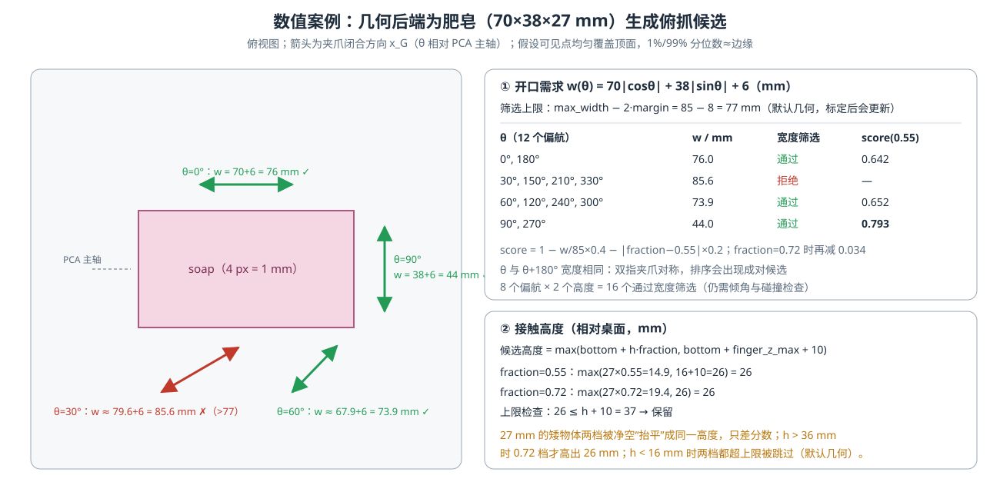

<p align="center"><b>图 9-9</b> 数值案例：肥皂在 12 个偏航下的开口需求、宽度筛选结果与分数，以及矮物体两档接触高度被夹指净空“抬平”的现象</p>

逐项验证：

- $\theta=90°$（沿短轴闭合）： $w=38+6=44$ mm， $s=1-0.044/0.085\times0.4=1-0.207=0.793$；
- $\theta=0°$（沿长轴闭合）： $w=70+6=76$ mm， $s=1-0.358=0.642$；
- $\theta=60°$： $w=70\times0.5+38\times0.866+6=35+32.9+6=73.9$ mm， $s=0.652$；
- $\theta=30°$： $w=70\times0.866+38\times0.5+6=60.6+19+6=85.6$ mm，超过统一筛选上限 $85-2\times4=77$ mm，会在 `filter_grasps` 中被拒绝；
- 接触高度： $0.55\times27=14.9$ mm 与 $0.72\times27=19.4$ mm 都低于净空下限 $16+10=26$ mm，两档都被抬到 26 mm；上限 $27+10=37$ mm，保留。因此肥皂的 24 个几何候选中，同一偏航的两档位置相同，只差 $0.2\times0.17=0.034$ 的分数。

可见排名第一的是“沿短轴闭合”，这与人的直觉一致；但这只是排序，不保证可达。

> ⚠️ **注意**：候选分数偏好较小的开口和较深的夹持位置。但这个分数只是人工设计的排序启发式，**不是概率，也没有显式求解摩擦锥、对向接触或力闭合条件**。即使位姿几何上合理，碰撞形状、接触位置和摩擦仍可能导致物理抓取失败。

### 3.3 GraspGenX：让学习模型提出更多样的抓取候选

**直观理解**：GraspGenX 是跨夹爪形态的抓取生成模型。与仅对一种固定夹爪学习抓取的方式不同，它把物体点云和夹爪描述作为条件，生成抓取位姿，并使用评分模型对候选进行评估。

**原理与公式**：可以用下面的条件关系理解它：

$$
\{(T_i,s_i)\}_{i=1}^{M}
=F_\theta(P,\mathcal G,\xi)
$$

其中 $P$ 为物体点云， $\mathcal G$ 为夹爪几何或运动相关描述， $\xi$ 表示采样噪声， $T_i$ 是抓取位姿， $s_i$ 是候选评分， $\theta$ 为网络参数。它的输出是一组可能的抓法，不是一串直接驱动 G2 关节的角度。

扩散生成的直观理解是：从带有随机性的位姿表示开始，在物体形状和夹爪条件的引导下逐步去噪，得到更符合训练中抓取分布的候选。评分器再根据输入条件判断候选质量。**这个过程不是大语言模型的文字推理，也不是在运行时对当前物体重新训练。**

```text
 object_i 点云 P ──► 减均值 ──┐
                              ├─► 扩散生成器(gen) ──► 256 个位姿 ──► 评分器(dis) ──► 前 64 个 (T_H, s)
 G2 扫掠盒描述 𝒢 ─────────────┘                                                          │
                                                                                          ▼
         Grasp(T_G, width, score, id, 'graspgenx') ◄── 估计接触宽度 ◄── 右乘 ᴴT_G ◄── 加回均值
```

<p align="center"><b>图 9-10</b> GraspGenX 适配器的数据流：模型输出的是夹爪基准系 H 的位姿，需要加回均值并转换到 TCP 系 G</p>

本章适配器调用上游扩散规划入口，请求采样 256 个抓取并保留前 64 个返回候选。之后还要估计接触区域的开口需求、转换 TCP 坐标并执行本章筛选，所以报告中的原始候选数量不一定等于 64；多个物体时也不是整场固定 64 个（每个物体各自生成）。

这里还有一个重要限制：虽然上游可以生成六维候选，本章执行侧只接受与俯抓方向夹角不超过 25° 的姿态。侧抓、倒抓等候选会被拒绝。不能看到模型支持六维抓取，就认为本章已经验证任意方向的机械臂动作。

### 3.4 为什么夹爪标定和 TCP 转换不能省略

同一个物体，对小夹爪和宽夹爪的可抓区域并不一样。只给 GraspGenX 一团点云而不告诉它夹爪的特点，或者直接冒用其他品牌的夹爪描述，都可能导致模型生成 G2 无法实现的候选。

本章在 Isaac 中测量 G2 夹指的几何与不同开合状态（`simulation.calibrate_gripper` 在全开、半开、闭合三个角度读取夹指网格），保存最大开口、指厚、指深、相对 TCP 的范围，以及打开和半开时的简化扫掠区域。这里的“扫掠”可以理解为夹爪运动时指间能够作用到的空间。本章用盒状参数近似表达这些区域，并不是把完整高精度夹爪网格交给模型。

适配器显式检查发布权重使用的夹爪编码方式，只接受与当前简化扫掠体描述兼容的配置。如果换成还要求夹爪点云或 TSDF（Truncated Signed Distance Field，截断符号距离场）的模型，不能用缺失信息的占位对象蒙混通过：

```python
# code/code_chapter9/graspgenx_backend.py（__init__ 节选）
cfg = load_model_cfg(weights/'release/gen',weights/'release/dis')
for part in (cfg.diffusion,cfg.discriminator):
    if part.gripper_backbone not in SWEEP_VOLUME_ONLY_BACKBONES:
        raise ValueError('此检查点还需要夹爪点云/TSDF，不能用扫掠体占位符代替')
keys = ('extents_open','offset_open','extents_mid','offset_mid','gripper_type','fingertip_depth')
info = make_sweep_volume_gripper_info(**{k:self.cal[k] for k in keys},name='g2_measured')
self.sampler = GraspGenXSampler(cfg,gripper_info=info)
```

另一个常见错误是坐标原点不一致。上游返回的是模型使用的夹爪基准坐标，而第五章控制的是 G2 的夹爪中心 TCP。记模型基准为 $H$，控制 TCP 为 $G$，则应执行：

$$
{}^{W}T_G={}^{W}T_H\,{}^{H}T_G
$$

如果遗漏这个固定偏移，机器人可能方向正确，却把掌部或夹爪基座移动到了物体中心。代码先对输入点云减均值以满足上游接口，输出后再加回平移，最后右乘基准到 TCP 的固定变换。不能重复减均值、忘记加回，或把局部偏移直接当世界方向相加。当前适配器假定模型基准轴与控制 TCP 轴已对齐，因此这一步的固定变换只写入标定平移。更换夹爪或坐标定义后，若两者还有旋转差异，就必须补全旋转部分，不能照搬这项假设。

**对应代码**（`code/code_chapter9/graspgenx_backend.py`）：

```python
def generate(self, points, object_id=0):
    from graspgenx.samplers import run_planner_on_object
    # 严格按官方 demo：点云减均值，生成后平移加回；不能重复居中。
    center = points.mean(axis=0)
    transforms,scores,_,_ = run_planner_on_object((points-center).astype(np.float32),self.sampler,
                                                  planner='diffusion',num_grasps=256,topk_num_grasps=64)
    result = []
    B_G = np.eye(4); B_G[:3,3] = self.cal['base_to_tcp']   # ᴴT_G：只有平移（轴已对齐的假设）
    for T, score in zip(transforms,scores):
        T = T.astype(float).copy(); T[:3,3] += center       # 加回均值
        T = T @ B_G  # 官方输出 gripper base 位姿 -> 第5章 center_link TCP
        local = (points-T[:3,3]) @ T[:3,:3]                 # 物体点转到 TCP 系
        # 仅对夹指实际接触高度附近估计开口需求，而不是整物体投影。
        contact = local[abs(local[:,2])<.035]
        if len(contact)<12: continue                        # 接触区点太少：丢弃（所以不一定恰好 64 个）
        lo,hi = np.percentile(contact[:,0],[1,99])
        result.append(Grasp(T,float(hi-lo+.006),float(score),object_id,'graspgenx'))
    return result
```

**案例：右乘与左乘的区别**。`base_to_tcp` 的真实值由标定写入 `assets/g2_gripper.json`，这里**假设**为 $(0,0,0.15)$ m 便于手算。设模型输出基准位姿 ${}^WT_H$ 位于 $(0.60,0.00,0.55)$，旋转为俯抓 $R=\mathrm{diag}(1,-1,-1)$（ $z_H$ 指向世界 $-Z$）。

- 正确（右乘）： $\mathbf p_G=\mathbf p_H+R\,(0,0,0.15)^\top=(0.60,0.00,0.55-0.15)=(0.60,0.00,0.40)$——TCP 比夹爪基座低 15 cm，落在物体上；
- 错误（把局部偏移当世界方向相加）： $(0.60,0.00,0.70)$——TCP 在物体上方 30 cm 处“空抓”；
- 错误（忘记加回均值）：TCP 会落在世界原点附近，通常直接 IK 不可达。

开口宽度同样需要辨明来源：**当前适配器从候选局部接触高度附近（TCP 系 $|z|<35$ mm）的点云估计所需宽度，并不是直接把上游输出解释成 G2 电机角度。** 执行器仍按标定好的打开、闭合目标驱动夹爪，由物理接触约束闭合结果；没有将每个候选宽度转换成精密的力控或宽度伺服命令。

### 3.5 两种后端为什么必须经过同一层筛选

两条后端最终统一输出抓取位姿、宽度、分数、对象编号和来源（`Grasp` 数据类）。几何方法的分数与学习模型的分数含义不同，不应该跨后端直接比较数值高低；本章是在一次运行中选择一种后端，然后在该后端候选内部排序。

```python
# code/code_chapter9/grasp_planner.py
@dataclass
class Grasp:
    T: np.ndarray                 # world <- G，G=center_link
    width: float
    score: float
    object_id: int = 0
    source: str = "geometry"
```

| 比较项 | 几何后端 | GraspGenX 后端 |
|---|---|---|
| 主要依据 | 主轴、投影宽度、接触高度和人工规则 | 点云与夹爪条件下的学习式生成、评分 |
| 额外抓取权重 | 不需要 | 需要生成器和评分器权重 |
| 可解释性 | 易追踪到几何量和阈值 | 可检查输入输出，但内部决策不如几何规则直观 |
| 主要限制 | 单视角几何近似，缺少显式接触力学验证 | 输入质量、训练分布、夹爪适配和候选可达性 |
| 本章后续处理 | 同一套候选筛选、IK、路径和控制 | 同一套候选筛选、IK、路径和控制 |
| 是否保证成功 | 否 | 否 |

统一筛选首先检查变换矩阵是否有效、开口是否在夹爪可用范围内、抓取方向是否符合俯抓限制。然后从抓取点向上方预抓取点沿接近方向采样，检查夹指和掌部的简化包围盒是否碰到可见场景点，并检查夹指关键角点与桌面的距离。

**对应代码**（`code/code_chapter9/grasp_planner.py`）：

```python
def filter_grasps(candidates, scene, plane, geom=None, cfg=None):
    geom, cfg = geom or GripperGeometry(), cfg or PlannerConfig()
    accepted = []
    for g in candidates:
        try:
            validate_transform(g.T)                    # ① T 必须属于 SE(3)
        except ValueError:
            continue
        if not np.isfinite([g.width, g.score]).all() or not cfg.min_width <= g.width <= geom.max_width - 2*geom.margin:
            continue                                   # ② 14 mm ≤ width ≤ 最大开口 − 2×余量
        if -g.T[:3,2] @ plane[:3] < np.cos(np.deg2rad(cfg.max_tilt_deg)):
            continue  # ③ 本章不执行未经验证的侧抓、倒抓（倾角 ≤ 25°）
        if any(gripper_collision(_offset(g.T, -d*g.T[:3,2]), scene, plane, geom)
               for d in np.linspace(0, cfg.pregrasp, 13)):
            continue                                   # ④ 从抓取点到预抓取点 13 个位置都不碰
        accepted.append(g)
    # ⑤ 按实例轮转，防止一个不可达目标占满候选预算。
    groups = {}
    for g in sorted(accepted, key=lambda g: g.score, reverse=True):
        groups.setdefault(g.object_id, []).append(g)
    balanced = []
    while groups and len(balanced) < cfg.max_candidates:
        for key in list(groups):
            balanced.append(groups[key].pop(0))
            if not groups[key]: del groups[key]
            if len(balanced) == cfg.max_candidates: break
    return balanced
```

`gripper_collision` 把场景点变换到候选 TCP 系 $\mathbf q=R^\top(\mathbf p-\mathbf t)$，然后判断是否落在两个“指盒”（ $|q_x|$ 在 $[w/2-m,\,w/2+t_f+m]$、 $|q_y|\le d_f/2+m$、 $q_z$ 在指的 Z 范围内）或“掌盒”内，再检查 8 个指尖角点到桌面的有符号距离是否小于余量 $m$：

```python
# code/code_chapter9/grasp_planner.py（gripper_collision 节选）
q = (np.asarray(scene) - T[:3,3]) @ T[:3,:3]        # 场景点 → TCP 系
# ... finger / palm 两类盒子判定
if np.any(finger | palm):
    return True
# 检查指尖四角到桌面的有符号距离，防止稀疏深度漏掉桌碰撞。
corners = np.array([[x,y,z] for x in (-geom.max_width/2-geom.finger_thickness, geom.max_width/2+geom.finger_thickness)
                    for y in (-geom.finger_depth/2, geom.finger_depth/2)
                    for z in (geom.finger_z_min, geom.finger_z_max)])
world = corners @ T[:3,:3].T + T[:3,3]
return bool(np.any(world @ plane[:3] + plane[3] < m))
```

**案例 1：倾角筛选**。 $-\mathbf z_G\cdot\mathbf n$ 就是夹爪接近方向与竖直向下方向夹角 $\alpha$ 的余弦。阈值 $\cos25°=0.906$：

| 候选倾角 $\alpha$ | $\cos\alpha$ | 结果 |
|---|---|---|
| 0°（正俯抓） | 1.000 | 通过 |
| 20° | 0.940 | 通过 |
| 30° | 0.866 | 拒绝 |
| 90°（侧抓） | 0.000 | 拒绝 |

**案例 2：接近线采样**。`np.linspace(0, 0.12, 13)` 给出 $d=0,0.01,\dots,0.12$ m，即每 1 cm 检查一次夹爪盒（以最大开口检查）。

**案例 3：轮转预算**。设三件物体通过前四项检查的候选数分别为 24、20、3，`max_candidates=24`。按“每轮各取一个最高分”的轮转：前 3 轮取 9 个后第三件物体耗尽；剩余 15 个在前两件之间交替，前者多取 1 个。最终为 $11+10+3=24$。若只按分数全局排序，一件不可达的物体可能独占全部 24 个名额。

该阶段默认以最大开口进行保守夹爪检查，不等于已经模拟了完整闭合过程。它也没有检查整条机械臂路径，因此通过后只是“值得尝试规划”的候选。代码按实例轮转取候选，最多保留 24 个，防止一个不可达物体占满全部尝试预算。

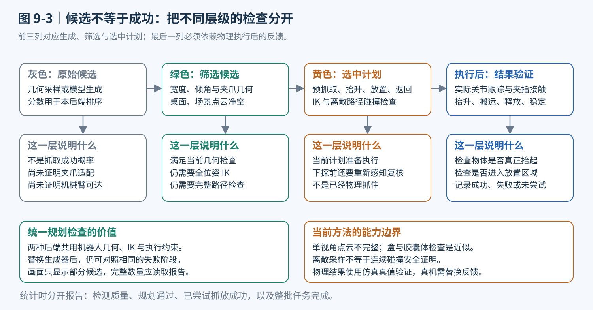

<p align="center"><b>图 9-11</b> 抓取候选需要经过几何、运动学与物理三层检查：本部分完成第一层，第四部分完成后两层</p>

---

## 第四部分 让候选真正变成动作：完整位姿 IK、路径与执行闭环

本部分对应图 9-5 中的⑦～⑩：把一个“值得尝试”的抓取位姿 ${}^WT_G$ 变成一串经过检查的关节路点，执行它，并用物理结果决定下一步。

### 4.1 到达一个点还不够，必须同时到达正确朝向

**直观理解**：假设夹爪中心到达了肥皂上方，但夹指方向沿着肥皂长边，所需开口超过夹爪能力，这仍然不是合格抓取（图 9-9 中 $\theta=30°$ 的候选就是这样被拒绝的）。更危险的是，位置正确但掌部朝下，可能让夹爪背面先碰到物体。因此，本章对抓取目标求解完整位姿 IK，不在失败时偷偷退化为只控制位置。

**原理与公式**：设关节角为 $\mathbf q\in\mathbb R^7$，正运动学得到位置 $\mathbf p(\mathbf q)$ 和旋转 $R(\mathbf q)$。目标位置与朝向为 $\mathbf p^*,R^*$，任务误差写为：

$$
\mathbf e=\begin{bmatrix}
\mathbf p^*-\mathbf p(\mathbf q)\\
\alpha\,\mathrm{Log}\!\left(R^*R(\mathbf q)^\top\right)^\vee
\end{bmatrix}
$$

旋转误差是轴角意义下的三维向量（单位 rad），不是直接相减欧拉角； $\alpha$ 用于平衡位置（m）和姿态（rad）误差，本章 `IKConfig.orientation_weight = 0.35`。相应地，雅可比的旋转部分也采用相同权重，避免只缩放误差却没有同步缩放模型。

第五章的阻尼最小二乘（Damped Least Squares, DLS）更新可概括为：

$$
J^{\sharp}=J^\top(JJ^\top+\lambda^2I)^{-1},\qquad
\Delta\mathbf q=J^{\sharp}\mathbf e+\eta(I-J^{\sharp}J)\mathbf g(\mathbf q)
$$

其中阻尼 $\lambda$（`damping = 0.025`）缓解奇异附近的数值问题； $\mathbf g$ 是让关节远离限位、靠近中间位置的小幅偏置， $\eta$ 为其增益（`joint_center_gain = 0.005`）。由于采用阻尼伪逆，后一个投影项是近似的零空间修正，并不保证严格不影响主任务，最终仍要以实际 FK 误差验收。

**对应代码**（`code/code_chapter9/kinematics.py`，`G2ArmKinematics.inverse` 循环体节选）：

```python
rotation_delta = orientation_error(target_r, pose.rotation)        # Log(R* R^T)^∨
orientation_norm = float(np.linalg.norm(rotation_delta))
error = np.concatenate((position_delta, cfg.orientation_weight * rotation_delta))
jacobian = np.vstack((full_jacobian[:3], cfg.orientation_weight * full_jacobian[3:]))  # 同步加权

if position_norm <= cfg.position_tolerance and (
    target_r is None or orientation_norm <= cfg.orientation_tolerance
):
    return IKResult(q.copy(), True, iteration - 1, position_norm, orientation_norm)

# J# = J^T (J J^T + lambda^2 I)^-1，比直接求普通逆矩阵更稳健。
task_size = jacobian.shape[0]
damped = jacobian @ jacobian.T + (cfg.damping ** 2) * np.eye(task_size)
pseudo_inverse = jacobian.T @ np.linalg.solve(damped, np.eye(task_size))
delta_q = pseudo_inverse @ error

# 冗余自由度用于远离关节上下限。
normalized_center_error = (center - q) / (half_range * half_range)
nullspace = np.eye(7) - pseudo_inverse @ jacobian
delta_q += cfg.joint_center_gain * (nullspace @ normalized_center_error)

largest_step = float(np.max(np.abs(delta_q)))
if largest_step > cfg.max_joint_step:
    delta_q *= cfg.max_joint_step / largest_step                  # 单步最大 0.12 rad
q = np.clip(q + delta_q, self.lower_limits, self.upper_limits)     # 关节限位
```

`orientation_error` 实现了 SO(3) 对数映射，并专门处理了 0° 与 180° 两个数值奇点：

```python
# code/code_chapter9/kinematics.py
def orientation_error(target: np.ndarray, current: np.ndarray) -> np.ndarray:
    """SO(3) 对数误差。相差 180 度时也不把姿态误差误判为零。"""
    R = target @ current.T
    angle = np.arccos(np.clip((np.trace(R)-1)/2, -1, 1))
    vee = np.array([R[2,1]-R[1,2], R[0,2]-R[2,0], R[1,0]-R[0,1]])
    if angle < 1e-7:
        return vee/2
    if np.pi-angle < 1e-5:
        # ... 180° 时 vee≈0，改用 (R+R^T)/2 的最大特征向量求旋转轴
        return angle * axis
    return angle/(2*np.sin(angle))*vee
```

**案例 1：旋转误差与权重**。目标朝向相对当前朝向绕 Z 轴多转 10°，则 $R^*R^\top=R_z(10°)$， $\mathrm{tr}=1+2\cos10°=2.9696$，角度 $=\arccos(0.9848)=0.1745$ rad； $\text{vee}=(0,0,2\sin10°)=(0,0,0.3473)$，乘 $0.1745/(2\sin10°)=0.5025$ 得误差向量 $(0,0,0.1745)$。加权后进入 $\mathbf e$ 的是 $0.35\times0.1745=0.0611$，与 6 cm 位置误差同一量级。收敛判据则用**未加权**的范数：位置 $\le3$ mm，朝向 $\le0.025$ rad（约 1.43°）。

**案例 2：阻尼的作用**。DLS 在每个奇异值方向上的增益为 $\sigma/(\sigma^2+\lambda^2)$，而普通伪逆为 $1/\sigma$。取 $\lambda=0.025$：

| 奇异值 $\sigma$ | 普通伪逆 $1/\sigma$ | DLS $\sigma/(\sigma^2+\lambda^2)$ | 说明 |
|---|---|---|---|
| 0.5 | 2.0 | 1.995 | 远离奇异：几乎不受影响 |
| 0.05 | 20 | 16.0 | 接近奇异：开始抑制 |
| 0.01 | 100 | 13.8 | 非常接近奇异：增益被压住，避免关节暴冲 |

即使如此，单步还会被限幅到 0.12 rad，再裁剪到关节限位。

G2 右臂有七个关节，可能存在多个解。控制器从当前关节状态、回位状态等多个初值求解，优先选与当前状态接近的结果；同时限制单步角度变化并检查关节限位。求解器报告成功后，还会重新计算 FK，检查位置误差小于 4 mm、朝向误差小于 0.03 rad：

```python
# code/code_chapter9/controller.py
def _solve(self, T, seed):
    target = self.sim.T_base_world @ T                       # 世界系目标 → 基座系：ᴮT_G = (ᵂT_B)⁻¹ ᵂT_G
    seeds = [seed,HOME_RIGHT,(seed+HOME_RIGHT)/2,(JOINT_LOWER_LIMITS+JOINT_UPPER_LIMITS)/2]
    answers=[]
    for s in seeds:
        answer=self.arm.kinematics.inverse(target[:3,3],target[:3,:3],s)
        # 不只相信求解器标记，重新计算最终 FK 位置/真实角度误差。
        actual=self.arm.kinematics.forward(answer.joint_positions)
        if (answer.success and np.linalg.norm(actual.position-target[:3,3])<.004 and
                np.linalg.norm(orientation_error(target[:3,:3],actual.rotation))<.03):
            answers.append(answer.joint_positions)
            if np.max(abs(answer.joint_positions-seed))<.5: break  # 已找到离当前状态近的解
    if not answers: raise PlanningError('完整位姿 IK 不可达，未降级成只控制位置')
    return min(answers,key=lambda q: np.linalg.norm(q-seed))
```

仿真启动时也会对照机器人实际 TCP 检查运动学模型是否一致（`simulation.check_fk`：位置偏差超过 12 mm 或角度超过 0.06 rad 就拒绝移动，并打印 `[标定] FK vs USD: ... mm, ... deg`）。

> 💡 **要点**：这里完成了闭环中最关键的一次坐标变换：感知得到的 ${}^WT_G$ 左乘 `T_base_world` 变成 ${}^BT_G$，IK 只在 $B$ 系里工作。图 9-8 的数值案例展示的正是同一条链上点的变换。

### 4.2 为什么抓取前就要规划好放置和返回

**直观理解**：只规划“到物体上方”很容易造成半途无路可走：物体已经拿起，却无法保持安全姿态移到接收区。本章因此在执行前规划整条阶段链，而不是边走边临时拼接未经检查的动作。

流程包含：侧上方观察位、预抓取位、下探、抬升、搬运、释放、撤离和回位。侧上方观察位用于减少夹爪遮挡目标；到达后进行视觉复核，再移动到目标正上方并下探。预抓取距离默认 12 cm，抬升距离默认 16 cm，这些是当前桌面案例参数（`PlannerConfig.pregrasp`、`PlannerConfig.lift`）。

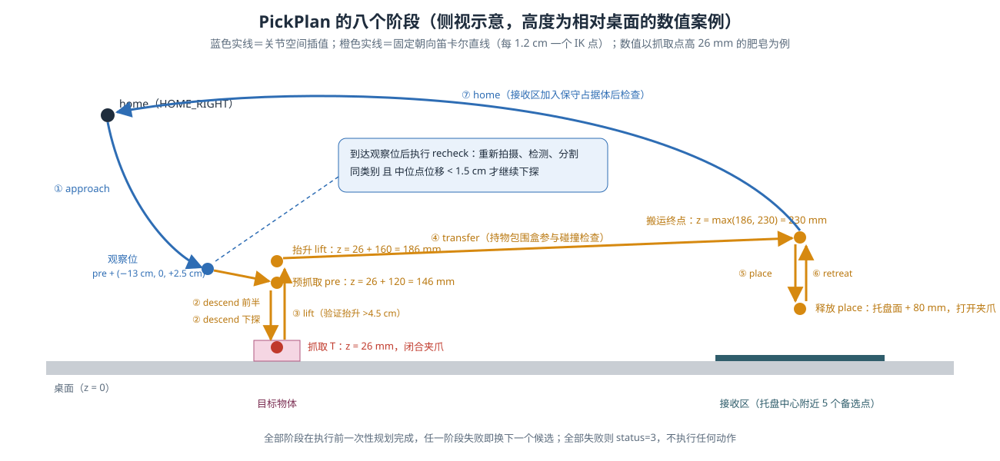

<p align="center"><b>图 9-12</b> PickPlan 的阶段链与数值案例：以抓取点高 26 mm 的肥皂为例，各关键位姿相对桌面的高度</p>

从当前状态到观察位、释放后回位，采用关节空间插值；下探、抬升、搬运等阶段采用固定朝向的笛卡尔直线段，对线上采样点逐个求 IK，并继续检查相邻关节段。如果相邻解突然跳到另一个 IK 分支，程序会拒绝该路径。

**对应代码**（`code/code_chapter9/controller.py`，`PickController.plan` 节选）：

```python
T=grasp.T; pre=_offset(T,-self.cfg.pregrasp*T[:3,2])      # 预抓取：沿 -z_G 后退 12 cm
lift=_offset(T,[0,0,self.cfg.lift])                         # 抬升：世界 +Z 16 cm
target=lift.copy()
# 托盘上已有物体时用观测点云选空位置，而不是反复放到同一个中心。
tray_xy=self.sim.scene.place[:2]
occupied=scene[(abs(scene[:,0]-tray_xy[0])<.12)&(abs(scene[:,1]-tray_xy[1])<.11)&
               (scene[:,2]>self.sim.scene.table_top+.02)]
destinations=[tray_xy+offset for offset in ([0.,0.],[-.06,-.05],[-.06,.05],[.06,-.05],[.06,.05])]
target[:2,3]=(max(destinations,key=lambda p: np.min(np.linalg.norm(occupied[:,:2]-p,axis=1)))
              if len(occupied) else tray_xy)
target[2,3]=max(lift[2,3],self.sim.scene.table_top+.23)    # 搬运高度至少桌面以上 23 cm
place=target.copy()
# 释放时保留8cm净空，避免物体底部擦桌；放入低托盘而不是硬插到已知中心。
place[2,3]=self.sim.scene.place[2]+.08
seed=self.arm.get_joint_positions()
failures=[]
for offset in ([-.13,0.,.025],[0.,-.15,.025],[0.,.15,.025]):   # 三个侧上方观察方向
    observation=_offset(pre,offset)
    try:
        qp=self._solve(observation,seed)
        approach=self._joint_path(seed,qp,scene,plane)            # 关节插值
        to_pre=self._line(observation,pre,qp,scene,plane)         # 笛卡尔直线
        descend=to_pre+self._line(pre,T,to_pre[-1],scene,plane)
        break
    except PlanningError as exc: failures.append(str(exc))
else: raise PlanningError('observation/descend: '+'; '.join(failures))
# ... 构造持物包围盒 held，规划 lift / transfer / place / retreat / home（见 4.3）
return PickPlan(grasp,approach,descend,rising,transfer,placing,retreat,home)
```

笛卡尔直线段的实现：

```python
# code/code_chapter9/controller.py
def _line(self, start_T, target_T, seed, scene, plane, held=None):
    # 接近/抬升/放置姿态固定，只做笛卡尔直线平移。
    result=[]
    for pos in np.linspace(start_T[:3,3],target_T[:3,3],max(2,int(np.linalg.norm(start_T[:3,3]-target_T[:3,3])/.012)+1))[1:]:
        T=target_T.copy(); T[:3,3]=pos
        q=self._solve(T,seed)
        if np.max(abs(q-seed))>.5: raise PlanningError('笛卡尔 IK 分支跳变')
        result.extend(self._joint_path(seed,q,scene,plane,held)); seed=q
    return result

def _joint_path(self, start, target, scene, plane, held=None):
    samples=np.linspace(start,target,max(2,int(np.max(abs(target-start))/.045)+1))[1:]
    if any(not self._safe(q,scene,plane,held) for q in samples):
        raise PlanningError('关节插值路径碰撞/桌面/另一臂检查不通过')
    return list(samples)
```

**案例：阶段高度**（相对桌面，对应图 9-12）。肥皂抓取点高 26 mm（图 9-9），夹爪俯抓 $\mathbf z_G=(0,0,-1)$：

| 阶段 | 计算 | 高度 |
|---|---|---|
| 预抓取 pre | $26+120$ | 146 mm |
| 观察位（第一种偏移） | $146+25$，并在 X 方向偏 $-13$ cm | 171 mm |
| 抓取 T | — | 26 mm |
| 抬升 lift | $26+160$ | 186 mm |
| 搬运终点 | $\max(186,\ 230)$ | 230 mm |
| 释放 place | 托盘面（桌面 $+8$ mm） $+80$ | 88 mm |

pre→T 的 12 cm 直线按每 1.2 cm 一个点，约 10 个 IK 点；每两个相邻 IK 解之间再以 0.045 rad 为步长插值并逐个做 `_safe` 检查；任何相邻 IK 解之间某关节变化超过 0.5 rad 都视为“分支跳变”而拒绝。

**这不是 MoveIt2 的全局运动规划，也没有实现 RRT（Rapidly-exploring Random Tree）或任意障碍环境搜索。** 代码尝试有限个观察方向和分段路径，找不到安全方案就停止。与后续机械臂规划章节相比，本章更关注把视觉目标正确交给运动学和控制。

放置也不是高精度装配：代码在接收区几个备选点中，选择与当前可见占据点较远的位置，再保留一定高度释放，让物体落在低托盘中。它不是带接触力反馈的精密落座，也不应该用于易碎品真实投放。

**案例：选放置点**。托盘中心记为原点，5 个备选点为 $(0,0)$、 $(\pm0.06,\pm0.05)$。若托盘上已有一件物体，其可见点集中在 $(-0.05,-0.04)$ 附近：到 $(0,0)$ 的最近距离约 0.064 m，到 $(-0.06,-0.05)$ 约 0.014 m，到 $(0.06,0.05)$ 约 $\sqrt{0.11^2+0.09^2}=0.142$ m。`max` 选出距离最大的 $(0.06,0.05)$，即对角位置。

### 4.3 碰撞检查必须包含夹爪、手臂和被拿起的物体

候选生成阶段只检查夹爪仍然不够。一个夹爪位姿可能完全不碰桌面，但通往它的肘部会扫过邻近物体。当前控制器增加了几层近似检查：

- **夹爪与场景：** 用指部、掌部保守盒检查场景点，并检查桌面净空。
- **手臂与场景：** 在连杆线段上采样，以距离阈值近似胶囊体检查。
- **左右臂之间：** 检查右臂采样点与固定左臂的距离，跳过共同安装区域的特定近邻部分。
- **持物搬运：** 从目标可见点与桌面支撑先验构造 TCP 局部包围盒，检查搬运中该盒与背景点、桌面的关系。
- **释放后返回：** 给接收区加入保守占据范围，避免按理想落点假设直接穿过可能已经落下的物体。

**对应代码**（`code/code_chapter9/controller.py`，`_safe`）：

```python
def _safe(self, q, scene, plane, held=None):
    T = self._world_fk(q)
    if gripper_collision(T,scene,plane,self.geom): return False           # 夹爪与场景
    links = self._links(q)                                                # 关节原点连成的折线
    tree = cKDTree(scene) if len(scene) else None
    for a,b in zip(links[:-1],links[1:]):
        samples = _sphere_segment(a,b)                                    # 每 2.5 cm 一个采样球心
        if tree and np.any(tree.query(samples)[0]<.032): return False     # 半径 3.2 cm 的近似胶囊
        on_table = ((samples[:,:2]>self.sim.scene.bounds[0]).all(1)&(samples[:,:2]<self.sim.scene.bounds[1]).all(1))
        if np.any((samples@plane[:3]+plane[3]<.04)&on_table): return False # 桌面上方 4 cm 净空
    left = self._links(self.sim.left.get_joint_positions(),self.sim.left)
    left_points = np.concatenate([_sphere_segment(a,b) for a,b in zip(left[:-1],left[1:])])
    # 第一段在肩部天然靠近另一臂，跳过共同安装区域。
    right_points = np.concatenate([_sphere_segment(a,b) for a,b in zip(links[1:-1],links[2:])])
    if len(right_points) and np.any(cKDTree(left_points).query(right_points)[0]<.065): return False  # 双臂 6.5 cm
    if held is not None:
        world = transform_points(T,held)
        if np.any(world@plane[:3]+plane[3] < .004): return False          # 持物盒角点不能低于桌面 4 mm
        local_scene=transform_points(np.linalg.inv(T),scene)
        if np.any(((local_scene>=held.min(0)-.004)&(local_scene<=held.max(0)+.004)).all(1)): return False
    return True
```

**为什么抬升后要从静态场景中移除目标点？** 因为原来的点云把目标记录在桌面位置。如果继续把它当静态障碍，规划器会把夹爪拿着的物体和旧位置重复计算。代码从背景中移除目标附近的观测点，并在搬运时将其表示为随 TCP 运动的持物包围盒：

```python
# code/code_chapter9/controller.py（plan 节选）
target_tree=cKDTree(object_points)
background=scene[target_tree.query(scene)[0]>.008]           # 距目标点 8 mm 以内的场景点视为目标本身，剔除
# 支撑面先验补齐不可见底面；否则只看到顶面的点云会低估搬运包围盒。
bottom=object_points.copy(); bottom[:,2]=table_height(plane,bottom[:,:2])
local=transform_points(np.linalg.inv(T),np.vstack([object_points,bottom]))
lo,hi=local.min(0),local.max(0)
held=np.array([[x,y,z] for x in (lo[0],hi[0]) for y in (lo[1],hi[1]) for z in (lo[2],hi[2])])  # TCP 系 8 角点
# 初始起升阶段目标尚接触桌面，不用角点-桌面净空约束；后续搬运启用。
rising=self._line(T,lift,descend[-1],background,plane)
transfer=self._line(lift,target,rising[-1],background,plane,held)
placing=self._line(target,place,transfer[-1],background,plane,held)
retreat=self._line(place,target,placing[-1],background,plane)
# 将接收区的可能落物范围作为保守占据体，不用理想落点代替真实落物。
place_cloud=np.array([[x,y,z] for x in np.arange(self.sim.scene.place[0]-.11,self.sim.scene.place[0]+.111,.015)
                      for y in np.arange(self.sim.scene.place[1]-.10,self.sim.scene.place[1]+.101,.015)
                      for z in np.arange(self.sim.scene.table_top,self.sim.scene.table_top+.16,.015)])
home=self._joint_path(retreat[-1],HOME_RIGHT,np.vstack([background,place_cloud]),plane)
```

（原代码中每段都包在 `try/except` 里，把失败原因加上 `lift:`、`transfer:`、`place:`、`retreat:`、`home:` 前缀，这正是 `planning.json` 中拒绝原因的来源。）

**案例：持物包围盒**。TCP 在桌面上方 26 mm， $\mathbf z_G$ 指向下方，所以肥皂顶面（桌面上方 27 mm）在 TCP 系 $z\approx-1$ mm，补齐的底面（桌面）在 $z\approx+26$ mm。若只用可见顶面点，包围盒在 $z$ 方向几乎是一张薄片；补齐底面后高 27 mm，搬运经过托盘边缘或其他物体上方时才能被正确检查。

这仍只是近似：没有完整网格级连续碰撞检测，没有覆盖所有机械臂自碰撞组合，也无法识别相机看不到的障碍。离散采样检查存在分辨率限制。正文中的“通过检查”应理解为**通过当前观测和近似模型的检查**，不能替换成“已经证明绝对安全”。

### 4.4 关节插值、实际反馈与接触抓取

**直观理解**：规划得到的是一串关节路点，执行时不能瞬间跳到最后一个目标。第五章的轨迹接口使用平滑插值：

$$
s(\tau)=3\tau^2-2\tau^3,\qquad
\mathbf q(\tau)=\mathbf q_0+s(\tau)(\mathbf q_1-\mathbf q_0),\quad \tau\in[0,1]
$$

它让单段开始与结束时的插值速度为零（ $s'(\tau)=6\tau-6\tau^2$，在 $\tau=0,1$ 处为 0），避免位置指令突变；但分段使用它并不等于全程速度最优或 jerk（加加速度）连续。底层 articulation 驱动跟踪位置目标，物理引擎计算惯性、碰撞与接触。

**对应代码**（`code/code_chapter9/arm_controller.py`）：

```python
def make_trajectory(self, target_positions, duration, dt, start_positions=None):
    """生成三次时间缩放轨迹 q=q0+(3t²-2t³)(q1-q0)。"""
    # ...
    # 自动保证平均速度不超过 URDF 速度上限的 60%，给物理 drive 留出余量。
    minimum_duration = float(np.max(np.abs(target - start) / (0.6 * self.velocity_limits)))
    duration = max(float(duration), minimum_duration)
    steps = max(2, int(np.ceil(duration / dt)))
    tau = np.linspace(0.0, 1.0, steps + 1)[1:]
    scale = 3.0 * tau**2 - 2.0 * tau**3
    return start[None, :] + scale[:, None] * (target - start)[None, :]
```

**案例：smoothstep 手算**。某关节从 0 转到 0.6 rad：

| $\tau$ | $s(\tau)$ | $q$ / rad |
|---|---|---|
| 0.25 | $0.1875-0.03125=0.15625$ | 0.094 |
| 0.50 | $0.75-0.25=0.5$ | 0.300 |
| 0.75 | $1.6875-0.84375=0.84375$ | 0.506 |

峰值速度出现在 $\tau=0.5$， $s'(0.5)=1.5$，即平均速度的 1.5 倍。G2 关节速度上限 3.1416 rad/s，最短时长 $0.6/(0.6\times3.1416)=0.318$ s；若调用方给的时长更短，会被自动拉长。

控制器每步读取关节反馈，跟踪误差过大或出现非有限值就停止推进；每段结束后等待收敛，并对照实际 TCP 与计划 FK。这样可以发现“数学上求到解，但仿真驱动没有到位”的问题：

```python
# code/code_chapter9/controller.py
def move(self, path, seconds):
    if not path: return
    dt=self.sim.cfg.physics_dt
    duration=max(seconds/len(path),2*dt)
    for target in path:
        trajectory=self.arm.make_trajectory(target,duration,dt)
        for q in trajectory:
            self.arm.command_positions(q); self.sim.step()
            actual=self.arm.get_joint_positions()
            if not np.isfinite(actual).all() or np.max(abs(actual-q))>.4:
                raise ExecutionError('关节跟踪误差过大，停止推进')          # 每步：0.4 rad
    for tick in range(180):
        self.arm.command_positions(path[-1]); self.sim.step()
        if tick >= 24 and np.max(abs(self.arm.get_joint_positions()-path[-1])) < .012: break
    if np.max(abs(self.arm.get_joint_positions()-path[-1]))>.09:
        raise ExecutionError('运动结束后关节未收敛')                       # 段末：0.09 rad
    actual=self.sim.link_transform('/genie/gripper_r_center_link')
    target_T=self._world_fk(path[-1])
    if np.linalg.norm(actual[:3,3]-target_T[:3,3])>.015:
        raise ExecutionError(f'实际末端偏差过大 {np.linalg.norm(actual[:3,3]-target_T[:3,3])*1000:.1f}mm，拒绝继续抓取')
```

夹爪只驱动主关节（`idx81_gripper_r_outer_joint1`，打开 0.785、闭合 0.0），其他指节依靠模型中的联动约束运动。真正的抓取依赖夹指闭合产生接触，再随手臂抬升；执行时不会把物体坐标直接改到夹爪上，也不会创建一个强制固定关系伪装夹紧。

验证阶段记录抓取前的仿真物体位置，抬升后要求恰好有一件物体上升超过阈值，当前默认阈值为 4.5 cm。如果不满足，控制器尝试沿已规划的抬升路径退回并打开夹爪，随后停止，而不是带着未知状态横移。搬运途中也会检查是否仍有被抬起的物体，但不是每一步连续接触监测。

```python
# code/code_chapter9/controller.py（execute 节选）
before=self.sim.scene.snapshot_truth()  # 仅用于结果评估，不参与动作生成
self.move(plan.descend,.8)
self.sim.grip(GRIPPER_CLOSED)
self.move(plan.lift,1.)
for _ in range(45): self.sim.step()
lifted=self.sim.scene.evaluate_lift(before)
if len(lifted)!=1:
    # 安全退回原抓取位置释放，而不是带着未知状态横移。
    self.move(list(reversed(plan.lift)) + [plan.descend[-1]],1.)
    self.sim.grip(GRIPPER_OPEN)
    raise ExecutionError(f'物理抬升验证失败：抬起{len(lifted)}个物体')
self.move(plan.transfer,1.8)
if not self.sim.scene.evaluate_lift(before):
    raise ExecutionError('搬运中物体掉落')
self.move(plan.place,.7)
self.sim.grip(GRIPPER_OPEN)
self.move(plan.retreat,.8)
self.move(plan.home,1.5)
```

```text
 approach ──► [recheck] ──失败──► 停止(status=2)
                 │通过
                 ▼
 descend ──► 闭合 ──► lift ──► 等 45 步 ──► 恰好 1 件上升 > 4.5 cm ? ──否──► 沿 lift 退回、张开、停止
                                               │是
                                               ▼
                transfer ──► 仍有物体抬起 ? ──否──► 停止("搬运中物体掉落")
                                │是
                                ▼
             place ──► 张开 ──► retreat ──► home ──► placed() 判定 success / place_failed
```

<p align="center"><b>图 9-13</b> execute 的执行状态机：每个检查点失败都会停止，并把原因写进 summary.json</p>

**案例：抬升与放置判定**（`scene.evaluate_lift`、`scene.placed`）：

- 夹住肥皂抬升 16 cm，肥皂中心随之上升约 0.16 m $>0.045$，判定抬起 1 件，通过；
- 夹爪闭合时肥皂打滑，只被带起倾斜 1 cm： $0.01<0.045$，抬起 0 件，退回并停止；
- 夹指同时带起了紧挨着的橡皮：抬起 2 件，同样判失败——“恰好 1 件”防止误把两件一起搬走；
- 放置后肥皂中心相对托盘中心偏移 $(0.03,-0.02)$ m、高于托盘面 1.4 cm、速度 0.005 m/s：满足 $|\Delta x|<0.105$、 $|\Delta y|<0.095$、 $0<\Delta z<0.12$、 $\|\mathbf v\|<0.03$，判 `placed=True`。

放置结果依据目标是否进入接收区、高度是否合理以及线速度是否足够小判断。**这些检查使用仿真真值，而且会影响执行是否继续。** 因此真实部署时，不仅要替换相机来源，还要用视觉、夹爪位置、电流、力或触觉等反馈替换这一验证机制。

### 4.5 连续抓取为什么不是“一次识别后按旧坐标抓到底”

抓走一件物体后，剩余物体的可见区域可能变大，邻居也可能因接触发生移动，接收区则增加了新障碍。所以每轮抓放结束后，机械臂回到利于观察的位置，重新获取 RGB-D，重新检测、分割、生成候选并规划。

已放置物体不是靠永久记住对象 ID 来排除。代码根据已知接收区范围，过滤中位位置落在该区域的目标点云。它是一条任务区域规则，而不是凭真值查询“这个对象是否已经抓过”。这也解释了为什么初始布局必须避开放置区：

```python
# code/code_chapter9/worker.py
# 托盘 ROI 不再作为待抓取区；区域是任务先验，不是物体真值。
if 'place_xy' in frame and len(points) and np.all(abs(np.median(points[:,:2],axis=0)-frame['place_xy']) < TRAY_EXCLUSION_HALF_SIZE):
    raise ValueError('位于已放置区域')
```

其中 `TRAY_EXCLUSION_HALF_SIZE = (0.12, 0.11)` m（`config.py`）。

在每轮真正下探前，还会进行一次新观察。程序用**相同类别与点云中位位置距离小于 1.5 cm**来判断原目标是否仍在附近。复核不通过就停止，不会自动追逐新位置。复核通过时也不重建整条路径，更没有严格检查目标朝向变化或所有新障碍变化。因此，它能拦截一部分明显目标变化，但不是完整的动态避障规划器。

```python
# code/code_chapter9/demo_grasp.py
def recheck(g):
    fresh=observe(folder/'recheck')                      # 重新拍摄 + 完整推理
    label=str(data['labels'][g.object_id])
    old_center=np.median(data[f'object_{g.object_id}'],axis=0)
    for i,newlabel in enumerate(fresh['labels']):
        key=f'object_{i}'
        if str(newlabel)==label and key in fresh:
            if np.linalg.norm(np.median(fresh[key],axis=0)-old_center)<.015: return True
    return False
```

**案例**：机械臂移向观察位时肘部轻碰了罐子，使其平移 8 mm： $0.008<0.015$，复核通过，但路径仍按旧位置执行——对 40 mm 罐子与 85 mm 级的最大开口而言，单侧约 2 cm 的余量通常还能容纳 8 mm 偏移，但余量已被消耗，接触点也会偏离预期。若被推开 2 cm：复核失败，`status=2`，停止。

当前对象 ID 只在一帧结果内部有意义，下一轮检测顺序可以变化；同类别近邻匹配也不等于稳定实例跟踪。这是本章限制同批次名称不重复的另一个原因。

---

## 第五部分 从算法理解到可复现教学：数据、训练与评估

### 5.1 训练数据为什么只监督检测器

**直观理解**：本章采集的是 RGB 图像与 YOLO 检测框标签。Isaac 语义标注给出哪些像素属于某个类别，再从这些像素求出边界框，将类别编号和归一化框中心、宽高写入标签。仿真真值在这里扮演“自动标注员”，只在离线采集时使用，不参与在线抓取。

**原理与公式**：设图像宽高为 $W,H$，框为 $(x_1,y_1,x_2,y_2)$，则标签中的几何量为：

$$
x_c=\frac{x_1+x_2}{2W},\quad y_c=\frac{y_1+y_2}{2H},\quad
w=\frac{x_2-x_1}{W},\quad h=\frac{y_2-y_1}{H}
$$

**对应代码**（`code/code_chapter9/collect_dataset.py`，节选）：

```python
for idx in range(args.samples):
    split='val' if idx%5==0 else 'train'                    # 每 5 张划 1 张到验证集
    # ...
    sim.scene.randomize(rng,spread=.040)                    # 物体平面位置与偏航随机化
    target=sim.arm_to_world([.57,.57,-.20])+rng.uniform(-.025,.025,3)
    eye=target+np.array([.25,-.05,.78])+rng.uniform(-.035,.035,3)   # 相机观察位置扰动
    sim.camera.sensor.set_world_pose(eye,matrix_to_quaternion(look_at_optical(eye,target)),camera_axes='ros')
    # ...
    for identity,item in labels.items():
        name=item.get('class','') if isinstance(item,dict) else str(item)
        if name not in names: continue
        yy,xx=np.where(pixels==int(identity))
        if len(xx)<40: continue                             # 可见像素太少的实例不标注
        x1,x2,y1,y2=int(xx.min()),int(xx.max())+1,int(yy.min()),int(yy.max())+1
        lines.append(f'{names.index(name)} {(x1+x2)/(2*w):.7f} {(y1+y2)/(2*h):.7f} {(x2-x1)/w:.7f} {(y2-y1)/h:.7f}')
```

**案例：一行标签**。肥皂在 `OBJECTS` 中排第 6 位（编号 5）。若其语义像素覆盖 $x\in[300,359]$、 $y\in[200,259]$，则 $x_1=300,x_2=360,y_1=200,y_2=260$，在 640×480 图像中：

$$
x_c=\frac{660}{1280}=0.5156250,\quad y_c=\frac{460}{960}=0.4791667,\quad w=\frac{60}{640}=0.0937500,\quad h=\frac{60}{480}=0.1250000
$$

标签文件中对应一行 `5 0.5156250 0.4791667 0.0937500 0.1250000`。

这里监督的是“哪里有什么”，没有给每个物体提供最优抓取位姿，也没有采集机械臂示教轨迹。因此，这套数据不能直接训练 GraspGenX 或一个 VLA 策略。

采集时会改变物体平面位置、偏航和相机观察位置。类别映射始终使用统一的 15 类顺序（`names=[s.name for s in OBJECTS]`），所以分三组采集仍可汇总到一个数据目录；不能每组都重新从零编号，否则同一个类别编号会指向不同物体。

SAM2 使用预训练分割模型；GraspGenX 使用发布的生成器和评分器。只有 YOLO 从通用初始化权重继续训练：

```python
# code/code_chapter9/train_detector.py（节选）
model=YOLO(str(ROOT/'weights/yolov8n.pt'))
model.train(data=str(config),epochs=args.epochs,batch=args.batch,imgsz=640,device=args.device,workers=2,
            project=str(ROOT/'outputs/detector_training'),name='chapter9',exist_ok=False,
            seed=9,deterministic=True,patience=15,amp=False,plots=True)
best=Path(model.trainer.best)
# ...
shutil.copy2(best,destination)            # 复制为 weights/chapter9_yolo.pt
```

### 5.2 怎样理解验证集、检测指标和历史成功记录

当前采集器每五张图划一张到验证集，其余进入训练集。三组各采集 200 张，共得到 600 张，其中训练 480 张、验证 120 张（每组 `idx` 为 0, 5, …, 195 的 40 张进入验证集， $40\times3=120$）。训练时使用验证集选择最佳权重，并将最佳模型复制为本章默认检测器。

这是一种同场景分布下的留出验证：训练和验证共享程序模型、材质、背景和相似扰动范围。它并没有隔离全新物体资产、全新相机、真实照片或长期时序。要研究真实泛化，需要另建测试数据，而不是只增加同类截图数量。

检测 mAP50（mean Average Precision at IoU 0.50）表示在 IoU 阈值为 0.50 时对类别检测精度进行汇总；mAP50-95 还综合更严格的多个 IoU 阈值（0.50 到 0.95，步长 0.05）。指标高说明类别与框较准确，但不能直接说明深度正确、夹爪能夹住或搬运不会掉落。

本地历史模型使用过 570 张图、40 轮训练；这与本节建议重新采集的 600 张不同。不能把旧模型的指标复制成新训练结果。`VALIDATION.md` 还收集了多类物体的物理成功记录，但它们来自不同开发阶段和场景，并不是最终版本下的大规模成功率统计。

评价完整系统时，至少分开记录：检测和分割质量、候选生成与规划通过情况、实际抬升结果、最终放置结果。多物体任务还应记录整批是否完成。某轮没有候选而提前停止时，剩余物体是“未尝试”，不应全部计入“已经尝试但物理抓取失败”。

```text
  本批物体 N 件
      │
      ├─ 检测+分割保留 ───────────── perception.json: objects（含 rejected 原因）
      ├─ 有候选（raw → accepted） ── [候选统计] 生成 X → 保留 Y
      ├─ 规划通过 ─────────────────── planning.json: planned / rejected
      ├─ 物理抬升成功 ─────────────── summary.json: records[].lifted
      └─ 放置成功 ─────────────────── summary.json: records[].status == "success"
  未进入某一层的物体要单列为"未尝试"，不要混入"失败"的分母
```

<p align="center"><b>图 9-14</b> 系统评估的分层漏斗：每一层对应一个报告字段，逐层记录才能定位瓶颈</p>

**案例：两个分母**。三物体实验中，第 1、2 轮放置成功，第 3 轮抬升验证失败而停止：已尝试动作的放置成功比例为 $2/3$；整批是否全部完成为“否”。若第 3 轮是“没有安全候选”而停止，则已尝试动作的放置成功比例为 $2/2$，剩下 1 件记为未尝试，整批仍为“否”。两个指标必须分开报告。

### 5.3 四宫格窗口是观察工具，不是新的控制回路

独立窗口依次显示当前 RGB、最近一次检测、最近一次分割，以及同帧点云和抓取投影。原始候选显示为灰色，经过统一筛选的候选显示为绿色，已经选中进入执行计划的抓取显示为黄色。

```text
 ┌──────────────────────────────┬──────────────────────────────┐
 │ LIVE RGB                     │ YOLO: latest inference       │
 │ (随仿真步进更新, ≤ 约 0.12 s 一次) │ (一次完整推理后更新)            │
 ├──────────────────────────────┼──────────────────────────────┤
 │ SAM2: box-prompted masks     │ <backend>: cloud + grasps    │
 │                              │ 灰=原始  绿=筛选通过  黄=选中计划 │
 ├──────────────────────────────┴──────────────────────────────┤
 │ round / completed / 当前阶段 / snapshot sim 时间 / raw / filtered │
 └─────────────────────────────────────────────────────────────┘
```

<p align="center"><b>图 9-15</b> 四宫格窗口布局（实际截图见第七部分图 9-19）</p>

绿色不代表完成 IK，也不代表物理成功；黄色表示当前计划选中的抓取，仍要经过真实接触和结果验证。右下角是三维信息在相机图像上的二维投影，不是可交互旋转的完整三维点云窗口。为避免遮挡，窗口只展示部分候选，不能拿画面上的线条数量代替报告中的完整数量。

RGB 发布按墙钟时间节流，当前最多约每 0.12 秒发布一次，但需要仿真有新的步进。推理与规划暂停物理推进时，RGB 也不会继续看到真实的新运动。检测、分割和抓取面板在一次完整推理完成后更新，不是三个模型各自逐帧流式输出。

窗口只读结果，不参与规划。关闭它不会停止当前抓取任务，也不是急停。使用“无 Isaac 主窗口但保留感知窗口”的模式时，仍然需要可用桌面；真正无桌面机器应导出图片或使用离线报告。代码在启动时就检查这一点：

```python
# code/code_chapter9/viewer.py（PerceptionViewer.__init__ 节选）
if not os.environ.get('DISPLAY'):
    raise RuntimeError('--show-perception 需要桌面 DISPLAY；无桌面可离线导出 viewer.py --save')
```

---

## 第六部分 代码结构与实现解析

### 6.1 文件组织

本章代码没有依赖其他章节的运行时导入。第五章的运动学与控制实现已整理进本章，G2 资产也位于本章目录。

```text
code/code_chapter9/
├── run.sh                    # 清理环境变量后用 Isaac 的 python.sh 启动 demo_grasp.py
├── setup_env.sh              # 创建/复用 .envs/vision 或 .envs/graspgenx 两个 Conda prefix 环境
├── requirements.txt          # 视觉环境固定依赖（Ultralytics 8.3.203、NumPy 1.26.4 等）
├── requirements-graspgenx.txt# GraspGenX 最小推理依赖
├── config.py                 # 关节限位、HOME 姿态、IK/规划/夹爪参数、15 类物体定义
├── demo_grasp.py             # 主入口：CLI、逐轮观察—规划—执行、复核、summary.json
├── simulation.py             # G2Simulation：Isaac World、G2 资产、FK 一致性检查、夹爪标定
├── scene.py                  # 桌面、托盘、程序生成的 15 类刚体、随机布局、抬升/放置判定
├── camera.py                 # RGB-D 相机：光学坐标约定、同步采集 rgb/depth/K/T
├── perception.py             # DetectorSegmenter：YOLO(或 YOLO-World) + SAM2 + 掩码筛选
├── pointcloud.py             # 反投影、体素、去噪、桌面 RANSAC、2.5D 姿态估计、写 PLY
├── grasp_planner.py          # Grasp 数据结构、几何后端、夹爪碰撞盒、统一筛选
├── graspgenx_backend.py      # GraspGenX 官方推理适配：扫掠盒条件、TCP 转换、接触宽度
├── worker.py                 # 常驻推理进程：VisionPipeline / GraspGenX 角色、JSON 协议
├── worker_client.py          # 启动隔离子进程、发送请求、超时与日志
├── kinematics.py             # G2 七自由度 FK、雅可比、DLS 完整位姿 IK、SO(3) 误差
├── arm_controller.py         # 关节索引、限位裁剪、smoothstep 轨迹、位置命令
├── controller.py             # PickController：分阶段规划、近似碰撞检查、执行与验证
├── viewer.py                 # 四宫格窗口（--follow 实时 / --save 离线导出）
├── collect_dataset.py        # 用语义真值生成 YOLO 检测标签
├── train_detector.py         # 训练本章 YOLO 并更新 weights/manifest.json
├── download_weights.py       # 下载权重并登记 SHA256；--verify 离线校验
├── replay.py                 # 不启动 Isaac，用保存的 RGB-D 重跑感知与抓取生成
├── replay_plan.py            # 不启动 Isaac，用保存的状态与点云重跑 IK 与路径规划
├── probe_sim.py              # 不加载网络，仅验证仿真/相机/夹爪标定
├── audit_assets.py           # 检查 G2 USD 依赖是否全部在本章目录内
├── assets/                   # G2 机器人资产；g2_gripper.json 夹爪标定结果
├── data/                     # 采集的检测数据（可从 HuggingFace 下载）
├── weights/                  # 模型权重与 manifest.json（可从 HuggingFace 下载）
└── third_party/              # SAM2、CLIP、GraspGenX 固定版本源码
```

建议从主入口开始，沿“观察—候选—规划—执行”的方向阅读，而不是逐个文件死记：

| 学习问题 | 主要文件与入口 | 应关注的数据 |
|---|---|---|
| 一轮抓放怎样组织 | `demo_grasp.py` | CLI、逐轮目录、复核、停止条件 |
| 场景和物体怎样生成 | `scene.py`、`config.py` | 类别、近水平桌面、任务区域、刚体假设 |
| 仿真怎样启动与标定 | `simulation.py` | 实际 TCP、夹爪几何、主关节驱动 |
| 图像怎样变成三维数据 | `camera.py`、`pointcloud.py` | RGB、光轴深度、内外参、坐标系 |
| 检测与分割怎样连接 | `perception.py` | 类别、框、实例掩码与筛选 |
| 感知流水线怎样汇总 | `worker.py` | 场景点云、目标点云、候选与报告 |
| 两种抓取后端怎样替换 | `grasp_planner.py`、`graspgenx_backend.py` | 统一抓取数据结构、TCP 和宽度 |
| 位姿怎样变成关节动作 | `kinematics.py`、`controller.py`、`arm_controller.py` | 完整位姿 IK、路径、反馈与状态机 |
| 不同环境怎样通信 | `worker_client.py` | 常驻进程、JSON 命令、NPZ 数组 |
| 窗口显示什么 | `viewer.py` | 实时 RGB、最近推理快照、阶段信息 |
| 数据和模型怎样准备 | `collect_dataset.py`、`train_detector.py`、`download_weights.py` | 标签、训练配置、权重来源与哈希 |
| 怎样进行离线实验复查 | `replay.py`、`replay_plan.py`、`viewer.py` | 重放感知、抓取候选和规划结果 |

两个 Conda 环境分别负责视觉和 GraspGenX，Isaac 使用其自带 Python。这样做不是因为所有模块不能共存，而是避免 Isaac 的依赖、视觉库和上游模型约束互相干扰。路径形式的 Conda 环境与按名称创建的环境本质相同，本章只是把解释器放在章节目录的 `.envs` 下，便于脚本定位。

主仿真通过常驻 worker 执行推理，数组保存在 NPZ，命令与状态使用 JSON。模型加载后可以跨轮次复用，不需要每抓一个物体重新加载全部权重。子进程会清理不适用的 Python、动态库和 Qt 路径，避免父进程环境污染。**多个进程用于依赖隔离，不代表已经实现连续异步运动控制：主循环等待推理返回时仍暂停推进物理时间。**

### 6.2 模块调用关系

```text
 run.sh ──exec──► demo_grasp.py  (Isaac python.sh)
                    │
                    ├─► simulation.G2Simulation ──► arm_controller.G2ArmController ──► kinematics.G2ArmKinematics
                    │        ├─► scene.TableScene            (布局 / evaluate_lift / placed)
                    │        └─► camera.RGBDCamera           (capture → rgbd.npz)
                    │
                    ├─► controller.PickController ──► kinematics.orientation_error
                    │        └─► grasp_planner.gripper_collision / pointcloud.transform_points
                    │
                    ├─► viewer.PerceptionViewer  ──子进程──► viewer.py --follow（只读）
                    │
                    └─► worker_client.WorkerClient ──子进程──► worker.py --role vision  (.envs/vision)
                                                                 ├─► perception.DetectorSegmenter (YOLO + SAM2)
                                                                 ├─► pointcloud.* / grasp_planner.geometric_grasps
                                                                 ├─► grasp_planner.filter_grasps
                                                                 └─► WorkerClient ──子进程──► worker.py --role graspgenx
                                                                                               └─► graspgenx_backend.GraspGenXBackend
 离线：replay.py ──► worker.VisionPipeline        replay_plan.py ──► controller.PickController（SimpleNamespace 假 sim）
```

<p align="center"><b>图 9-16</b> 模块调用关系：主进程只负责仿真与控制，所有学习模型都在隔离子进程中运行</p>

值得注意的是 `replay_plan.py` 的写法：它用 `SimpleNamespace` 构造了一个只有 `T_world_base`、`arm.kinematics`、`get_joint_positions` 和 `scene` 边界的“假仿真对象”，就能直接调用 `PickController.plan`。这说明规划器只依赖“机器人状态 + 视觉点云 + 候选”，**不依赖任何物体真值**——这是 1.1 节第 4 条边界的代码级证据。

### 6.3 关键流程逐段解读

下面按 `demo_grasp.py` 的执行顺序，把一轮抓放串起来。

**第 1 段：参数检查与检测器选择。** 同批物体名不能重复；`--max-picks` 与 `--pick-all` 互斥；`--detector auto` 优先使用 `weights/chapter9_yolo.pt`（见 2.1 节）。运行参数写入 `run_config.json`。

**第 2 段：启动仿真、标定并随机布局。**

```python
# code/code_chapter9/demo_grasp.py（main 节选）
sim=G2Simulation(SimulationConfig(headless=args.headless),names)     # 内部完成 check_fk
cal=sim.calibrate_gripper(ROOT/'assets/g2_gripper.json')              # 实测夹爪几何 → calibration.json
(out/'calibration.json').write_text(json.dumps(cal,indent=2))
if args.calibrate_only: return 0
sim.scene.randomize(np.random.default_rng(args.seed))                 # 由 --seed 决定布局
for _ in range(90): sim.step()
# ...
controller=PickController(sim,GripperGeometry(**cal['geometry']))     # 用实测几何替换默认值
worker=WorkerClient(args.vision_python,options=options,log_dir=out)
```

**第 3 段：观察。** `observe()` 拍一帧、存 `rgbd.npz`（附带桌高先验、工作台边界和接收区中心），同步请求视觉 worker，读回 `result.npz`：

```python
def observe(folder):
    folder.mkdir(parents=True,exist_ok=True)
    frame=sim.camera.capture()
    np.savez_compressed(folder/'rgbd.npz',**frame,table_z=sim.scene.table_top,workspace=sim.scene.bounds,place_xy=sim.scene.place[:2])
    # ...
    worker.request(folder/'rgbd.npz',folder/'result.npz',timeout=420)   # 阻塞：此时物理时间暂停
    # ...
    with np.load(folder/'result.npz',allow_pickle=False) as f: return dict(f)
```

**第 4 段：打印感知统计，决定是否继续。**

```python
grasps=load_grasps(data)
print(f'[第{pick+1}轮] 检测{len(data["labels"])}个，候选{len(grasps)}个',flush=True)
report=json.loads((folder/'perception.json').read_text())
for item in report['objects']:
    if 'rejected' in item:
        print(f"[感知过滤] {item['label']}: {item['rejected']}",flush=True)
print(f"[候选统计] 生成 {report['raw_candidates']} → 保留 {report['accepted_candidates']}",flush=True)
if args.perception_only:
    records.append(dict(mode='perception-only',detections=len(data['labels']),candidates=len(grasps))); break
if not grasps:
    status=3; records.append(dict(status='no_grasp')); print('没有安全抓取候选；查看 detections.jpg/perception.json，不执行盲抓。',flush=True); break
```

这几行打印就是运行时终端里最需要关注的信息。例如图 9-19 左图底部的 `raw=192 filtered=24`，对应的就是 `[候选统计] 生成 192 → 保留 24`：GraspGenX 为三件物体共生成 192 个候选（与每件 64 个的上限之和一致），统一筛选后保留上限 24 个。

**第 5 段：按候选顺序尝试规划。** 候选已按实例轮转排好，逐个调用 `controller.plan`，第一个成功的即为本轮计划；所有拒绝原因写入 `planning.json`：

```python
for g in grasps:
    try:
        plan=controller.plan(g,data['scene'],data['plane'],data[f'object_{g.object_id}']); break
    except PlanningError as exc:
        rejected.append(dict(object_id=g.object_id,reason=str(exc)))
(folder/'planning.json').write_text(json.dumps(dict(rejected=rejected,planned=plan is not None),indent=2,ensure_ascii=False))
if plan is None:
    records.append(dict(status='no_reachable_collision_free_plan',rejected=rejected)); status=3; break
```

**第 6 段：执行与记录。** `controller.execute(plan, recheck=recheck, ...)` 按图 9-13 的状态机执行；返回的 `lifted`、`placed`、`gripper_angle` 加上 `status`、`detected_label`、`backend` 写入 `records`；成功后再拍一帧存 `after.npz` / `after.jpg`。`ExecutionError` 记为 `execution_stopped`（`status=2`），其他异常记为 `error`（`status=1`）。

**第 7 段：收尾。** 无论成功失败，`finally` 块都会写 `summary.json`、打印 `[报告] <输出目录>`、关闭 viewer 与 worker，最后 `sim.close(status)`。注意 `simulation.close` 的注释：`python.sh` 会把非零 Kit 退出码统一转成 1，精确状态以 `summary.json` 为准。

> 💡 **要点**：如果只记住一件事——**读 `summary.json` 的 `exit_status` 和 `records`，而不是 shell 的 `$?`。**

---

## 第七部分 代码运行

前面各部分解释算法，本部分集中放置可执行命令。**所有命令都在 `code_chapter9` 的根目录执行，不需要进入其中的 `code` 目录，也不要再次给输出路径添加 `code/code_chapter9` 前缀。** 本仓库的对应位置如下；如果你把章节单独放到了其他位置，只需要修改首次进入目录的命令。

**进入章节目录。** 后续命令都在这个目录执行，权重、数据和输出路径均相对于它。请将路径改成你实际保存章节的位置。

```bash
cd /path/to/project-root/code/code_chapter9
```

下面没有要求先批量设置环境变量，也不要求先激活某个 Conda 环境。安装使用 Conda 创建环境，运行时直接选择对应解释器。命令前出现的环境变量只对该次命令及其子进程生效。

#### 友情提醒！

**在6.1和6.2下载完第三方源码并创建好独立的环境文件夹后，weights模型权重文件，后续需要采集的数据文件以及微调后的模型文件都可以在huggingface的datawhale, hello-robotics-chapter9中进行下载。下载完成放入对应的文件夹之后，可以直接跳转到6.5节进行测试**

下载链接：https://huggingface.co/Datawhale/hello-robotics-chapter9/tree/main

> 💡 **要点**：上面提醒中的“6.1和6.2”对应本文 7.1 节的“准备运行基础”与“创建隔离环境，下载权重”；“6.5节”对应 7.2 节的“由感知到执行”。

整体操作顺序如下：

```text
 7.1 下载固定版本源码 ──► 创建 vision / graspgenx 环境 ──► 下载权重
                                                         │
          (或直接从 HuggingFace 下载 weights/ 与 data/) ───┤
                                                         ▼
 7.2 采集三组数据 ──► 训练 YOLO ──► 列物体 / 仅感知 ──► 单物体抓放 ──► 多物体抓放 ──► (GUI)
                                                                              │
 7.3 读 summary.json ◄── 导出四宫格 ◄── 离线重放感知 / 规划 ◄───────────────────┘
```

<p align="center"><b>图 9-17</b> 代码运行的整体顺序：部署 → 采集与训练 → 感知与抓放实验 → 报告与离线复查</p>

### 7.1 环境部署

> 💡 **路径约定**：下文命令中 `/path/to/project-root` 表示本仓库在你电脑上的根目录，`/path/to/isaac-sim` 表示 Isaac Sim 的安装目录，均为占位符，请替换为自己机器上的实际路径。

#### 准备运行基础，下载固定版本的第三方源码

本章按已有工程的验证组合说明：Linux、独立安装的 Isaac Sim 5.1、Python 3.11、PyTorch 2.7.1 + CUDA 12.8 轮子、Torchvision 0.22.1；已有物理测试使用 RTX 5090。这里的版本是**本章复现基线，不是要求安装“最新版本”**。其他显卡或 Isaac 版本需要自行核验驱动、传感器接口和资产兼容性，不能把本机记录视为全部平台认证。

Isaac Sim、NVIDIA 驱动和 Conda 是外部基础软件，不包含在章节文件夹中。下面假定 Isaac 位于 `/path/to/isaac-sim`，Conda 位于 `$HOME/miniconda3`，并且已能独立启动 Isaac。若尚未安装，请先完成第一章的基础安装，再执行本章步骤；**不要通过向 Isaac 自带 Python 随意安装 PyTorch 来补齐视觉环境。**

第三方源码可以直接从官方仓库下载，但要区分**源码版本**和**模型权重版本**。本章适配的是下列固定提交，而不是日后不断变化的主分支。若教程包已带有这些目录，跳过对应的下载和检出命令，避免覆盖已有修改；若是缺少源码的新目录，执行：

**创建第三方源码目录。** 用于集中保存 SAM2、CLIP 和 GraspGenX 的源码；已有目录时不会清空其内容。

```bash
mkdir -p third_party
```

**下载 SAM2 源码。** 将分割模型的官方源码保存到 `third_party/sam2`。下载完成后，再执行下一条版本切换命令。

```bash
git clone https://github.com/facebookresearch/sam2.git third_party/sam2
```

**固定 SAM2 版本。** 将刚下载的 SAM2 切换到本章使用的提交，避免直接使用后续变化的主分支。

```bash
git -C third_party/sam2 checkout --detach 2b90b9f5ceec907a1c18123530e92e794ad901a4
```

**下载 CLIP 源码。** 将 YOLO-World 文本编码所需的源码保存到 `third_party/CLIP`，供视觉环境安装脚本使用。

```bash
git clone https://github.com/openai/CLIP.git third_party/CLIP
```

**固定 CLIP 版本。** 将 CLIP 切换到本章记录的提交；需要先完成上一条下载命令。

```bash
git -C third_party/CLIP checkout --detach d05afc436d78f1c48dc0dbf8e5980a9d471f35f6
```

**下载 GraspGenX 源码。** 将学习型抓取生成器的源码保存到 `third_party/GraspGenX`。仅使用几何后端时，可以跳过此项及下一条命令。

```bash
git clone https://github.com/NVlabs/GraspGenX.git third_party/GraspGenX
```

**固定 GraspGenX 版本。** 将抓取模型源码切换到本章适配的提交。这一步固定的是源码，模型权重将在后面单独下载。

```bash
git -C third_party/GraspGenX checkout --detach b9429097728cb1c430dd78b92edf17ba318aad03
```

仅学习几何后端时，不需要下载 GraspGenX 源码或安装其环境；SAM2 仍然需要。当前视觉安装脚本还会安装 CLIP，用于可选的 YOLO-World，因此按原脚本安装时也应准备 CLIP 目录。

#### 创建隔离环境，下载权重

安装脚本只在本章创建两个 Conda prefix 环境。`.envs/vision` 不是另外一种环境管理器，而是 Conda 环境的磁盘位置；它和 `conda create -n 名称` 的主要区别在于通过路径定位。

**安装视觉环境。** 在 `.envs/vision` 中创建或复用 Conda 环境，安装 YOLO、SAM2、CLIP 和点云处理依赖；两个抓取后端都需要这一环境。

```bash
CONDA_EXE="$HOME/miniconda3/bin/conda" bash setup_env.sh vision
```

**安装 GraspGenX 推理环境。** 在 `.envs/graspgenx` 中创建或复用独立环境，安装学习型抓取推理依赖。仅运行几何后端时可以跳过。

```bash
CONDA_EXE="$HOME/miniconda3/bin/conda" bash setup_env.sh graspgenx
```

如果 Conda 不在这个位置，仅修改该次命令的 `CONDA_EXE`。脚本会复用已经存在的对应环境，因此已有环境且工作正常时可以直接跳过。两套环境的职责是：

| 解释器 | 执行内容 | 不应承担的任务 |
|---|---|---|
| Isaac 的 `python.sh` | 仿真、相机采集、机器人控制、数据采集 | 不用于安装本章的完整视觉依赖 |
| `.envs/vision/bin/python` | YOLO、SAM2、点云、几何后端、检测器训练、离线分析 | 不直接创建 Isaac 仿真 |
| `.envs/graspgenx/bin/python` | 官方 GraspGenX 模型推理 | 本章不提供它的从零训练流程 |

`requirements.txt` 固定了 Ultralytics 8.3.203、NumPy 1.26.4、SciPy 1.14.1、OpenCV 4.11.0.86 等依赖；GraspGenX 的依赖单列在 `requirements-graspgenx.txt`。SAM2 的可选 CUDA 后处理扩展不编译（`setup_env.sh` 中以 `SAM2_BUILD_CUDA=0` 安装），掩码后处理由本章 OpenCV 代码完成。

**GraspGenX 这里是最小推理环境，不是完整上游训练环境。** 上游包元数据声明的 Torch/Torchvision 上限与本章的 cu128 组合不同，安装脚本以 `--no-deps` 配合显式推理依赖处理。本章记录中验证了所用发布模型的推理，但 `pip check` 仍可能报告这些版本差异和缺失的训练、渲染可选包。不要把它写成“所有上游依赖检查通过”，也不要为了消除警告直接在其他环境中升级或降级依赖。

环境安装完成后下载所需权重。已经带有完整权重的目录可以跳过此步骤，无需重复下载。

**下载视觉与抓取权重。** 下载基础视觉模型、CLIP 和 GraspGenX 的发布权重到 `weights/`。只使用几何后端时去掉 `--graspgenx`；本章专用的 `chapter9_yolo.pt` 需另行提供或训练生成。

```bash
PYTHONPATH= PYTHONNOUSERSITE=1 .envs/vision/bin/python download_weights.py --graspgenx
```

| 本地文件 | 来源与用途 | 约占用 |
|---|---|---|
| `weights/yolov8n.pt` | 通用检测初始化权重，用于本章 YOLO 训练 | 7 MB |
| `weights/yolov8s-worldv2.pt` | 可选的开放词汇检测器 | 26 MB |
| `weights/clip/ViT-B-32.pt` | YOLO-World 的文本编码 | 354 MB |
| `weights/sam2.1_hiera_small.pt` | SAM2.1 Hiera small 分割模型 | 184 MB |
| `weights/graspgenx/release/gen/epoch_736.pth` | 抓取生成器 | 1.21 GB |
| `weights/graspgenx/release/dis/epoch_1056.pth` | 抓取评分器 | 484 MB |
| `weights/graspgenx/release/gen/config.yaml`、`release/dis/config.yaml` | 与上述模型对应的网络配置 | 很小 |
| `weights/chapter9_yolo.pt` | 教程包提供或下一节训练生成的 15 类检测器 | 6 MB |

GraspGenX 使用固定模型快照 `7c834043c11a11417e31d6d5ea9355801e40a2c1`，下载来源及哈希由 `weights/manifest.json` 记录。源码与权重的固定版本共同构成本章的复现基线。

这里有两个容易混淆的地方：

- **下载脚本不会从官方服务器下载本章专用的 `chapter9_yolo.pt`。** 它不是官方通用模型，必须由教程包提供或通过下一节训练生成。如果清单保留了这个文件的记录而文件尚不存在，先完成训练，再重新校验；训练脚本会更新该条记录。
- **哈希校验是文件一致性检查，不是抓取能力测试，也不是独立的来源认证。** 下载脚本会登记本地文件的哈希。判断收到的文件是否被修改，还需要对照可信的原始发布清单；重新生成清单不能证明旧文件本来就正确。

本机已有记录中，两套环境合计约 15 GB，权重约 2.2 GB，另有源码、机器人资产、安装缓存和训练输出。新安装应留出明显多于这些数字的可用空间，不要只按权重大小准备磁盘。

### 7.2 代码执行

#### 采集训练数据

安装完成并下载所需权重后，直接采集用于检测器训练的数据。下面从三组物体采集新的教学数据，**共 600 张图，训练 480 张、验证 120 张**。统一写入 `data/tutorial_detection`，采集器会使用相同的 15 类映射。三条命令逐条执行，不要并行启动三个 Isaac 进程争用资源。

**采集第一组：水果和蔬菜。** 摆放苹果、橙子、柠檬、番茄和土豆，采集 200 张带检测框标签的图像，写入 `data/tutorial_detection`。使用 seed 921，并且不显示 Isaac 主窗口。

```bash
PYTHONPATH= PYTHONNOUSERSITE=1 OPENBLAS_NUM_THREADS=1 \
  /path/to/isaac-sim/python.sh collect_dataset.py --headless \
  --objects apple,orange,lemon,tomato,potato \
  --samples 200 --seed 921 --output data/tutorial_detection
```

**采集第二组：盒状物体。** 上一组采集结束后，摆放肥皂、海绵、木块、茶盒和橡皮，使用 seed 922 再采集 200 张图，追加到同一数据目录。

```bash
PYTHONPATH= PYTHONNOUSERSITE=1 OPENBLAS_NUM_THREADS=1 \
  /path/to/isaac-sim/python.sh collect_dataset.py --headless \
  --objects soap,sponge,wood_block,tea_box,eraser \
  --samples 200 --seed 922 --output data/tutorial_detection
```

**采集第三组：瓶罐与其他形状。** 第二组结束后，摆放罐子、瓶子、杯子、线轴和电池，使用 seed 923 再采集 200 张图。三组共同覆盖本章 15 类对象。

```bash
PYTHONPATH= PYTHONNOUSERSITE=1 OPENBLAS_NUM_THREADS=1 \
  /path/to/isaac-sim/python.sh collect_dataset.py --headless \
  --objects can,bottle,cup,spool,battery \
  --samples 200 --seed 923 --output data/tutorial_detection
```

采集器会拒绝覆盖相同物体组合、相同 seed 对应的已有图片。重复实验可以整体改用新的数据目录，或使用新的 seed 追加采集；如果要严格复现上面的 600 张统计，应使用空目录。中途失败时也不要以为重新运行就会自动续采。

数据目录保留图片、标签和 `dataset.json`。用于 Ultralytics 的 `dataset.yaml` 由训练脚本生成，其中的数据根目录会转成当前机器的绝对路径。因此章节搬家后，应重新生成对应训练配置，而不是盲目沿用旧机器上的绝对路径。

#### 训练 YOLO

**这一步只训练 YOLO，不训练 SAM2 或 GraspGenX。** 若仅体验已有模型，可跳过采集和训练；若要学习完整流程，则使用上一节新采集的数据。

训练会把最佳结果复制到默认文件 `weights/chapter9_yolo.pt`。为避免丢失教程包原来的检测器，首次重训前可做一次备份；下面命令不会覆盖已经存在的备份。

**保留原有检测器备份。** 仅在原模型存在且备份尚不存在时复制一份，不覆盖已有备份。这是可选的重训前保护步骤，不会启动训练。

```bash
if [ -f weights/chapter9_yolo.pt ] && [ ! -f weights/chapter9_yolo.before_tutorial.pt ]; then
  cp weights/chapter9_yolo.pt weights/chapter9_yolo.before_tutorial.pt
fi
```

**训练本章 YOLO 检测器。** 使用前面采集的数据，在 GPU 0 上以 batch 16 训练最多 40 轮；`--overwrite` 允许用最佳模型替换 `weights/chapter9_yolo.pt`。SAM2 和 GraspGenX 不参与这次训练。

```bash
PYTHONPATH= PYTHONNOUSERSITE=1 .envs/vision/bin/python train_detector.py \
  --data data/tutorial_detection --epochs 40 --batch 16 --device 0 --overwrite
```

参数中的 `--overwrite` 表示明确允许替换默认检测器，不表示删除已有训练数据。脚本使用 640 像素输入、固定种子和 15 轮耐心值；`--epochs 40` 是最大训练轮数，可能提前停止。显存不足时先把 `--batch 16` 降到 8 或 4，不要同时改动检测器、分割器与抓取后端来掩盖问题。

训练目录位于 `outputs/detector_training/` 下，名称以 `chapter9` 开头；如果已有同名实验，Ultralytics 会创建带编号的新目录。具体最佳模型来源写入 `weights/detector_training.json`。应检查实际训练目录内的 `results.csv`、指标图和验证可视化，而不只看脚本最后打印“已保存”。

#### 由感知到执行：单物体、多物体与独立窗口

以下命令显式指定本章检测器，避免缺少权重时自动切换为 YOLO-World，使不同实验的检测器保持一致。每个实验使用独立输出目录；重跑时建议换目录名，否则可能混入旧轮次文件。

先查看可用物体，并只运行感知：

**查看可选物体。** 在终端列出本章支持的 15 类物体名称、描述和尺寸，方便填写后续的 `--objects`；这条命令不执行感知或抓放任务。

```bash
bash run.sh --list-objects
```

**几何后端的感知实验：只生成抓取候选。** 场景放入苹果、肥皂和罐子，使用本章 YOLO 检测、SAM2 分割和 RGB-D 点云，再用传统几何方法生成并筛选抓取候选。`--perception-only` 表示不执行抓放，`--headless` 表示不显示 Isaac 主窗口；结果保存到 `outputs/tutorial_perception_geometry`。

```bash
bash run.sh --headless --perception-only \
  --detector yolo --weights weights/chapter9_yolo.pt \
  --backend geometry --objects apple,soap,can --seed 9 \
  --output outputs/tutorial_perception_geometry
```

**GraspGenX 后端的感知实验：只生成网络候选。** 场景只放一个罐子，前面的检测、分割和点云流程不变，改由 GraspGenX 生成候选并进行统一筛选。同样不执行抓放，也不开启感知显示窗口；结果保存到 `outputs/tutorial_perception_graspgenx`。需要已安装 GraspGenX 环境并下载对应权重。

```bash
bash run.sh --headless --perception-only \
  --detector yolo --weights weights/chapter9_yolo.pt \
  --backend graspgenx --objects can --seed 9 \
  --output outputs/tutorial_perception_graspgenx
```

此时应检查目标是否被正确分离、目标点云是否落在桌上、抓取候选是否符合夹爪尺度。**`--perception-only` 不执行抓取，也不证明完整路径已经通过 IK。** GraspGenX 环境、权重或适配接口有问题时应显式报错，不能把几何结果当作网络结果展示。

感知正常后，用同样的单物体场景分别测试两个后端，暂时不引入多物体干扰：

**几何后端的单物体抓放实验。** 对一个罐子运行完整视觉、几何抓取、IK、路径规划和物理抓放流程，最多执行一轮。通过规划后机械臂会实际运动，结果保存到 `outputs/tutorial_single_geometry`。

```bash
bash run.sh --headless \
  --detector yolo --weights weights/chapter9_yolo.pt \
  --backend geometry --objects can --max-picks 1 --seed 9 \
  --output outputs/tutorial_single_geometry
```

**GraspGenX 后端的单物体抓放实验。** 对同样的罐子场景改用网络生成抓取候选，其余规划和执行流程保持一致，最多执行一轮。结果保存到 `outputs/tutorial_single_graspgenx`，可与几何后端对照。

```bash
bash run.sh --headless \
  --detector yolo --weights weights/chapter9_yolo.pt \
  --backend graspgenx --objects can --max-picks 1 --seed 9 \
  --output outputs/tutorial_single_graspgenx
```

比较时不要只看候选分数，因为两种后端的分数含义不同。更有意义的是：可用候选数、规划淘汰原因、所选 TCP 朝向、是否真实抬升、是否最终进入放置区。

接着测试连续抓放。`--pick-all` 按本批物体数量安排最多相应轮次，每轮重新感知；它**不是无条件保证清空**，遇到无可用候选或执行失败仍会停止。它与 `--max-picks` 互斥，不要同时填写。

**几何后端的多物体连续抓放实验。** 对苹果、肥皂和罐子逐件抓取、放下、回到观察位并重新感知，再处理下一件。`--pick-all` 设置本批的抓取轮次上限，失败仍会停止；结果保存到 `outputs/tutorial_multi_geometry`。

```bash
bash run.sh --headless \
  --detector yolo --weights weights/chapter9_yolo.pt \
  --backend geometry --objects apple,soap,can --pick-all --seed 9 \
  --output outputs/tutorial_multi_geometry
```

**GraspGenX 后端的多物体连续抓放实验。** 对罐子、电池和茶盒执行逐轮感知与抓放，抓取候选由 GraspGenX 提供。结果保存到 `outputs/tutorial_multi_graspgenx`；这与上一条的物体组合不同，不应直接当作严格同场景性能对比。

```bash
bash run.sh --headless \
  --detector yolo --weights weights/chapter9_yolo.pt \
  --backend graspgenx --objects can,battery,tea_box --pick-all --seed 9 \
  --output outputs/tutorial_multi_graspgenx
```

后一条是多目标实验命令，并非保证三件都成功的承诺。历史上各类别有成功记录，也不能推出新组合、新检测器和新随机布局必然成功。完成三物体实验后，可以从 15 类列表中更换目标，每批不超过 6 个且名称不重复。不要直接把“批量加载更多模型”当成抓取性能提升。

有桌面时，去掉 `--headless` 并打开独立感知窗口。下面同时显示 Isaac 主窗口与四宫格；如果只想保留四宫格，可以加回 `--headless`，但仍需要可用图形桌面。

**打开仿真与独立感知窗口。** 实际执行 GraspGenX 多物体抓放，同时显示 Isaac 主窗口及检测、分割、点云和抓取结果四宫格。任务结束后保留窗口供观察，输出保存到 `outputs/tutorial_gui`；需要可用的图形桌面。

```bash
bash run.sh \
  --detector yolo --weights weights/chapter9_yolo.pt \
  --backend graspgenx --objects can,battery,tea_box --pick-all --seed 9 \
  --show-perception --keep-open --output outputs/tutorial_gui
```

`--keep-open` 会在任务结束后保留仿真供观察；`summary.json` 在退出清理时写入，因此应正常关闭程序后再检查最终汇总。不要在没有桌面时随意设置一个猜测的 `DISPLAY`，也不要把关闭四宫格当成急停。

如果 Isaac 安装在其他位置，只对需要它的命令指定路径即可；采集命令则直接改成实际的 `python.sh` 路径。例如：

**使用自定义 Isaac 安装路径。** 仅当 Isaac 不在默认位置时使用：将 `/your/isaac-sim` 替换为实际目录，执行一次几何后端罐子抓放实验。该变量仅对本次启动生效。

```bash
ISAAC_SIM=/your/isaac-sim bash run.sh --headless \
  --detector yolo --weights weights/chapter9_yolo.pt \
  --backend geometry --objects can --max-picks 1 \
  --output outputs/tutorial_custom_isaac
```

#### 读取报告与离线复查

训练和实验完成后，读取实际执行报告：

**读取单物体 GraspGenX 实验报告。** 格式化显示已经完成的 `tutorial_single_graspgenx` 实验汇总，查看实际执行状态与抓放结果；不会重新启动仿真。

```bash
PYTHONPATH= PYTHONNOUSERSITE=1 .envs/vision/bin/python -m json.tool \
  outputs/tutorial_single_graspgenx/summary.json
```

**读取多物体几何实验报告。** 显示已经完成的 `tutorial_multi_geometry` 实验汇总，查看各轮结果及停止原因；需要先完成对应的多物体实验。

```bash
PYTHONPATH= PYTHONNOUSERSITE=1 .envs/vision/bin/python -m json.tool \
  outputs/tutorial_multi_geometry/summary.json
```

无图形桌面时，可以把已有运行导出为四宫格图片；不重新启动 Isaac，也不重新执行动作：

**导出实验四宫格图片。** 从单物体 GraspGenX 实验的 `pick_00` 读取保存结果，生成 `dashboard.png`。不启动仿真或图形窗口，适合无桌面机器查看实验输出。

```bash
PYTHONPATH= PYTHONNOUSERSITE=1 .envs/vision/bin/python viewer.py \
  --run outputs/tutorial_single_graspgenx --pick pick_00 \
  --save outputs/tutorial_single_graspgenx/dashboard.png
```

若怀疑感知或候选生成有问题，使用保存的 RGB-D 重新推理；若怀疑 IK 或碰撞检查有问题，则使用保存的机器人状态和点云重新规划：

**离线重放感知与抓取生成。** 读取单物体实验保存的 RGB-D，使用当前 YOLO、SAM2 和 GraspGenX 重新推理，将新结果写入 `outputs/tutorial_replay_graspgenx`。不执行机械臂运动，可用于分析同一观察下的候选生成结果。

```bash
PYTHONPATH= PYTHONNOUSERSITE=1 .envs/vision/bin/python replay.py \
  outputs/tutorial_single_graspgenx/pick_00/rgbd.npz \
  --detector yolo --weights weights/chapter9_yolo.pt --backend graspgenx \
  --output outputs/tutorial_replay_graspgenx
```

**离线重放路径规划。** 使用原实验 `pick_00` 保存的机器人状态、点云和候选重新计算 IK 与路径，终端显示规划结果或拒绝原因。不会重新执行感知，也不推进物理仿真。

```bash
PYTHONPATH= PYTHONNOUSERSITE=1 OPENBLAS_NUM_THREADS=1 \
  .envs/vision/bin/python replay_plan.py \
  outputs/tutorial_single_graspgenx --pick pick_00
```

离线感知重放使用当前权重，若权重改变，输出不必与历史运行相同；学习型抓取采样也可能产生差异。离线路径重放不推进物理仿真，所以它适合定位规划问题，不证明接触、抬升和放置必然成功。

### 7.3 运行结果

实验结果如下图所示：


<div style="display: flex; justify-content: center; gap: 16px;">
  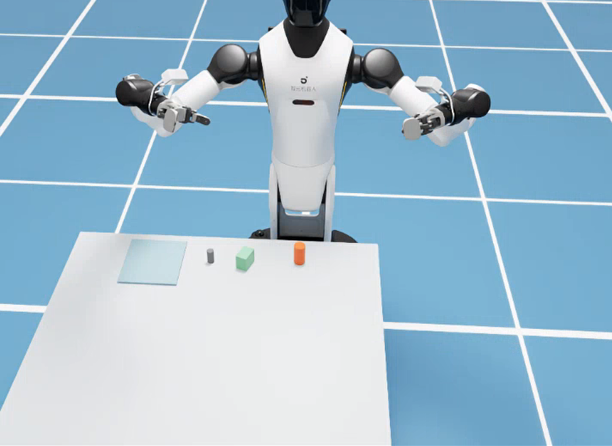
  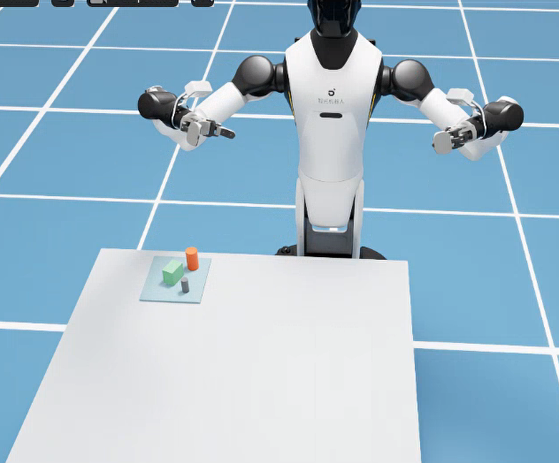
</div>

<p align="center"><b>图 9-18</b> 多物体抓放的 Isaac 主窗口：左为初始布局（电池、茶盒、罐子位于桌面，左侧浅色方块为接收区），右为抓放完成后三件物体都位于接收区</p>

<div style="display: flex; justify-content: center; gap: 16px;">
  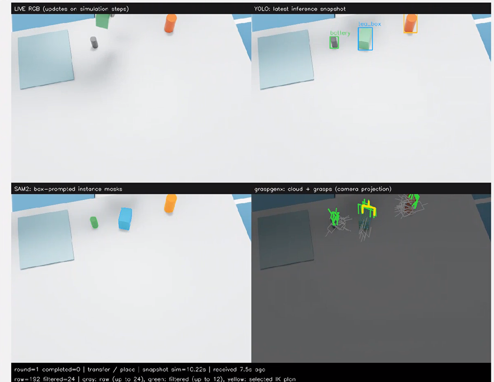
  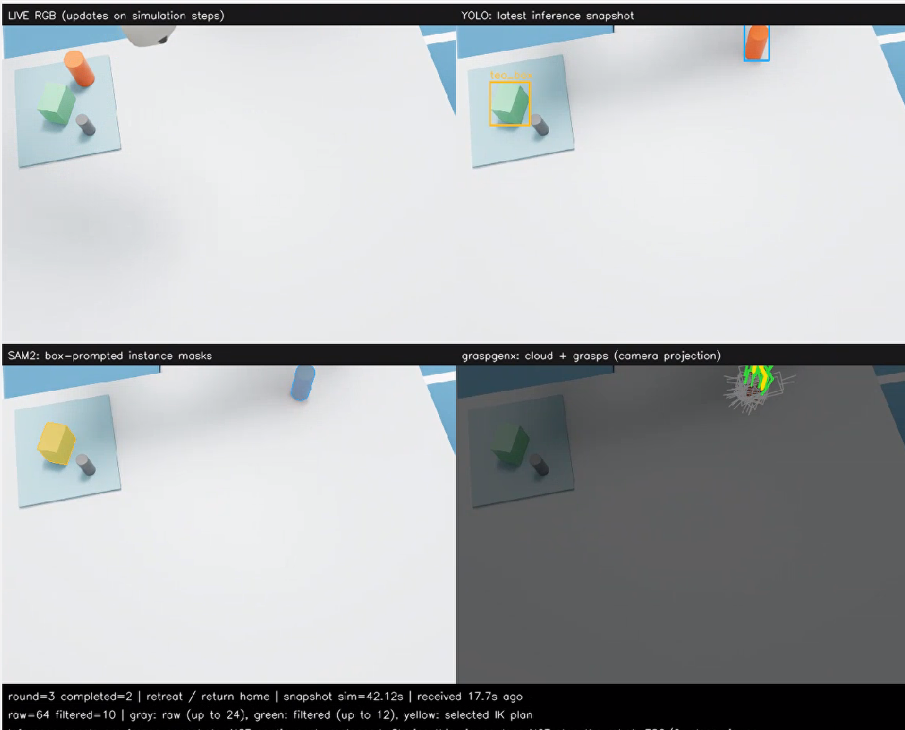
</div>

<p align="center"><b>图 9-19</b> GraspGenX 后端的四宫格感知窗口：左为第 1 轮（raw=192 filtered=24，搬运/放置阶段），右为第 3 轮（已完成 2 件，raw=64 filtered=10，撤离/回位阶段）</p>

**如何读懂这些截图**：

- 图 9-19 左图右上角 YOLO 面板识别出 `battery`、`tea_box` 和罐子三个框；左下角 SAM2 面板给每个实例涂上不同颜色的掩码；右下角灰色线是原始候选（最多画 24 个），绿色是统一筛选通过的候选（最多画 12 个），黄色是通过 IK/路径规划后选中的抓取——它画在茶盒上，说明第 1 轮选中的是茶盒。
- 底部状态栏 `raw=192 filtered=24` 就是终端 `[候选统计] 生成 192 → 保留 24`：三件物体各 64 个 GraspGenX 候选，统一筛选后被截断到 `max_candidates=24`。
- 图 9-19 右图是第 3 轮：茶盒和电池已在接收区内。YOLO 与 SAM2 仍然检测到了托盘上的茶盒，但右下角的点云与抓取只出现在罐子上——托盘内的实例被 4.5 节的接收区规则（中位点落在接收区内即拒绝）过滤，不再成为抓取目标。这说明“检测到”不等于“会去抓”。此时只剩罐子一个目标，`raw=64` 正是单个物体的 GraspGenX 上限。
- `snapshot sim=…` 与 `received … ago` 说明右侧三个面板是“最近一次推理快照”，而不是实时画面（见 5.3 节）。

主程序将每次完整运行保存为一个目录，每轮为 `pick_00`、`pick_01` 等。理解这些文件比只截一张成功图片更重要。

| 文件 | 用途 | 不能由它单独证明什么 |
|---|---|---|
| `run_config.json` | 后端、种子、对象、参数 | 参数正确不代表执行成功 |
| `calibration.json`、`robot_state.npz` | 实测夹爪几何与机器人状态 | 不证明感知无误 |
| `pick_XX/rgbd.npz` | 当轮原始图像、深度、内外参 | 不等于完整场景真值重建 |
| `pick_XX/perception.json`、`result.npz` | 实例、姿态、点云、抓取候选 | 有候选不等于有可行路径 |
| `pick_XX/planning.json` | 是否选到计划、各候选拒绝原因 | 计划通过不等于物理抓放成功 |
| `pick_XX/after.npz` | 执行后观察，成功走到保存步骤时生成 | 一张图不等于长期稳定性 |
| `summary.json` | 各轮执行记录与退出状态 | 要结合运行模式解释 |

`exit_status` 的约定是：0 为正常结束，1 为异常，2 为执行失败，3 为无可用候选或无可行计划。**正常结束还可能来自仅感知、仅标定或达到指定次数，必须结合 `records` 和运行参数判断是否真的完成抓放。** 外层 Isaac 启动脚本可能改变 shell 看到的非零退出码，最终以汇总、执行记录和日志共同判断，不能只依赖终端的 `$?`。

**读懂 `summary.json` 的 `records`**（字段来自 `demo_grasp.py`）：

| `records[i]` 中的内容 | 含义 | 对应 `exit_status` |
|---|---|---|
| `mode: "perception-only"`、`detections`、`candidates` | 仅感知模式，未执行动作 | 0 |
| `status: "success"`、`lifted`、`placed: true`、`gripper_angle`、`detected_label`、`backend` | 该轮抓放成功 | 继续下一轮 |
| `status: "place_failed"` | 抬升成功但放置判定失败 | 2 |
| `status: "execution_stopped"`、`reason` | 复核、跟踪、抬升或搬运检查失败 | 2 |
| `status: "no_grasp"` | 没有通过统一筛选的候选 | 3 |
| `status: "no_reachable_collision_free_plan"`、`rejected` | 所有候选规划失败 | 3 |
| `status: "error"`、`reason` | 程序异常 | 1 |

`lifted` 字段是被抬起物体的仿真名称，`detected_label` 是视觉检测给出的类别；两者不一致时，说明“抓到的不是以为要抓的那件”，是排查检测错误的重要线索。

形成课程测试结论时，建议逐条记录：代码与权重版本、对象组合、seed、后端、尝试数、抬升成功数、放置成功数、未尝试数以及失败阶段。在多个种子上对两个后端运行相同布局，比挑选各自最好的一张图更有比较意义。可以分别报告“已尝试动作的放置成功比例”与“整批任务全部完成的比例”，不要混用两个分母。

---

## 本章小结

### 知识回顾

本章最重要的不是把 YOLO、SAM2、GraspGenX 三个名字串在一起，而是建立一条可以逐层解释和验证的数据链：**图像里的对象如何变成以米为单位的点云，点云如何约束夹爪位姿，位姿如何变成可达路径，路径又如何通过真实接触与结果检查形成下一轮观察。** 先用几何后端理解这些关系，再用 GraspGenX 替换候选生成器，就能看清学习模型提供了什么，也能看清传统几何、运动学与控制仍然承担哪些不可省略的工作。

| 闭环环节 | 核心方法 | 关键参数（本章取值） | 代码位置 |
|---|---|---|---|
| 检测 | YOLO（专用 15 类）/ YOLO-World | conf 0.18，NMS IoU 0.45，输入 640 | `perception.py` |
| 分割 | SAM2 框提示 + 五步筛选 | 分数 ≥0.60，面积 60 px～25%，去重 IoU 0.65 | `perception.py` |
| 坐标变换 | $\mathbf p_C=zK^{-1}[u,v,1]^\top$， ${}^WT_C$， $({}^WT_B)^{-1}$ | 光轴深度，5 cm～4 m | `pointcloud.unproject`、`camera.py` |
| 点云与桌面 | 体素 + MAD 去噪；RANSAC + SVD | 体素 3 mm，内点 4 mm， $\lvert n_z\rvert\ge0.98$，高于桌面 7 mm，≥40 点 | `pointcloud.py`、`worker.py` |
| 物体几何 | PCA 2.5D 包围盒 | 分位数 1%/99%，顶 97%，偏航可观测比 1.35 | `pointcloud.estimate_pose` |
| 抓取生成 | 几何：12 偏航×2 高度；GraspGenX：256→64 | 开口余量 6 mm，接触高度 55%/72% | `grasp_planner.py`、`graspgenx_backend.py` |
| 统一筛选 | SE(3)、宽度、倾角、接近线碰撞、实例轮转 | 宽度 ≥14 mm，倾角 ≤25°，13 个接近采样，≤24 个 | `grasp_planner.filter_grasps` |
| 目标位姿 → 关节 | 完整位姿 DLS IK，多初值，FK 复验 | λ=0.025，α=0.35，复验 4 mm / 0.03 rad | `kinematics.py`、`controller._solve` |
| 路径 | 关节插值 + 固定朝向笛卡尔直线 | 预抓取 12 cm，抬升 16 cm，IK 点间距 1.2 cm，跳变 0.5 rad | `controller.plan` |
| 碰撞近似 | 夹爪盒、连杆胶囊、双臂距离、持物盒 | 3.2 cm / 4 cm / 6.5 cm / 4 mm | `controller._safe` |
| 执行 | smoothstep + 每步反馈 + 段末收敛 | 跟踪 0.4 rad，收敛 0.09 rad，TCP 15 mm | `arm_controller.py`、`controller.move` |
| 验收 | 抬升、搬运、放置（仿真真值） | 恰好 1 件上升 >4.5 cm，放置速度 <0.03 m/s | `scene.py`、`controller.execute` |
| 下一轮 | 重新观察；接收区过滤；预抓取复核 | 复核阈值 1.5 cm | `demo_grasp.py`、`worker.py` |

### 课后练习

1. **（思考题）** 1.1 节说“在线抓取目标来自视觉，但整个实验不是完全不用仿真真值”。请列出代码中所有读取仿真物体真值的函数，并说明如果把它们迁移到真实机器人，分别要用什么传感信号替代。
2. **（手算题）** 沿用图 9-8 的相机参数，计算像素 $(320,240)$ 与 $(600,450)$ 在光轴深度 0.8 m 时的相机系坐标；再计算若把 0.8 m 当作射线距离误用，两点的 Z 方向误差各是多少，并解释为什么主点处误差为 0。
3. **（手算题）** 对橡皮（60×26×26 mm）重复图 9-9 的计算：列出 12 个偏航方向的开口需求，判断哪些通过 77 mm 上限，给出最高分候选的分数和接触高度。高度 26 mm 的物体是否会因 `T[2,3] > bottom+height+0.010` 而被跳过？
4. **（动手题）** 运行几何后端的感知实验 `outputs/tutorial_perception_geometry`，打开 `pick_00/perception.json`，记录每个物体的 `points`、`extents`、`yaw_observable` 与 `raw_candidates`/`accepted_candidates`，并与 `config.py` 中的真实尺寸比较，说明 PCA 包围盒的误差来源。
5. **（动手题）** 用 `replay_plan.py` 重放一次单物体实验的规划结果。然后在自己的副本中把 `PlannerConfig.pregrasp` 从 0.12 改为 0.06，再次重放，比较 `planning.json` 或终端输出的拒绝原因变化，并解释预抓取距离与接近线碰撞检查（`filter_grasps` 中 13 个采样点）之间的关系。
6. **（思考题）** 预抓取复核只检查“同类别、中位点位移 < 1.5 cm”，通过后不重新规划。请设计一个反例说明它可能漏掉的风险（例如目标原地旋转、邻居被推近），并提出一种在现有代码框架内的改进方案。

### 参考资料

- SAM2 官方仓库：https://github.com/facebookresearch/sam2 （本章固定提交 `2b90b9f5ceec907a1c18123530e92e794ad901a4`）
- CLIP 官方仓库：https://github.com/openai/CLIP （本章固定提交 `d05afc436d78f1c48dc0dbf8e5980a9d471f35f6`）
- GraspGenX 官方仓库：https://github.com/NVlabs/GraspGenX （本章固定提交 `b9429097728cb1c430dd78b92edf17ba318aad03`；模型快照 `adithyamurali/GraspGenXModel` @ `7c834043c11a11417e31d6d5ea9355801e40a2c1`）
- Ultralytics（YOLOv8 / YOLO-World），本章固定版本 8.3.203；权重来源见 `code/code_chapter9/download_weights.py`
- 本章权重与数据下载：https://huggingface.co/Datawhale/hello-robotics-chapter9/tree/main
- 本教程第五章（G2 机械臂运动学与控制）、第七章（视觉识别）、第八章（点云与空间理解）
