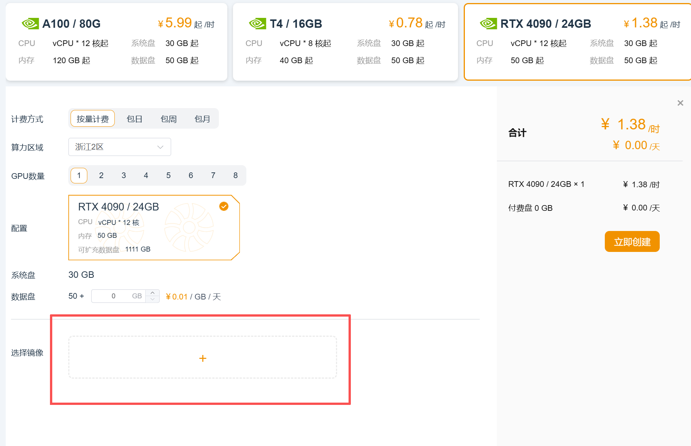
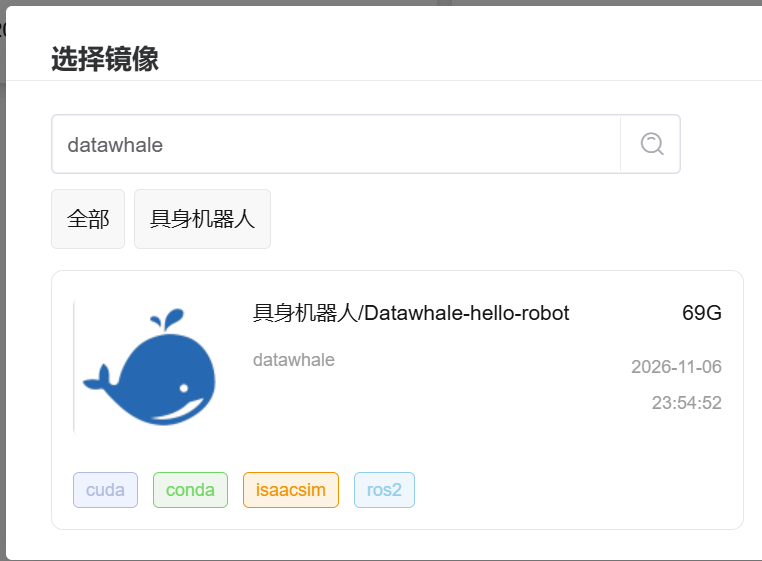
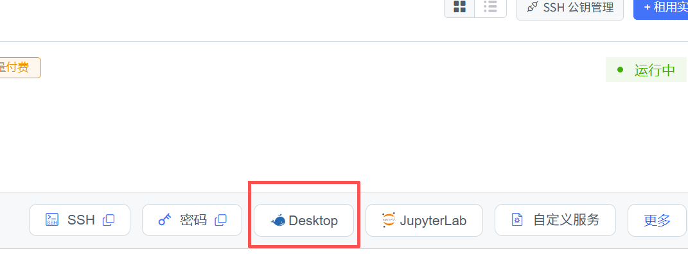
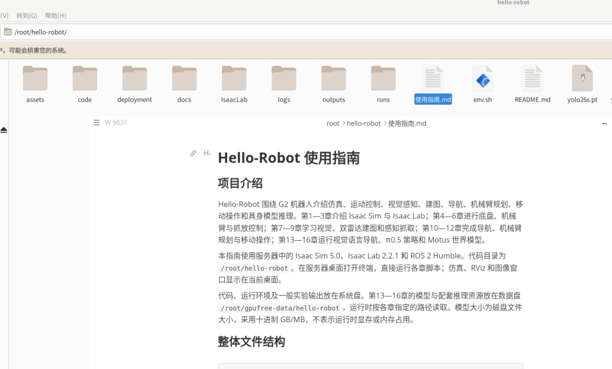

# Hello-Robot 算力自由平台使用指南

## 项目介绍

Hello-Robot 围绕 G2 机器人介绍仿真、运动控制、视觉感知、建图、导航、机械臂规划、移动操作和具身模型推理。第1—3章介绍 Isaac Sim 与 Isaac Lab；第4—6章进行底盘、机械臂与抓放控制；第7—9章学习视觉、双雷达建图和感知抓取；第10—12章完成导航、机械臂规划与移动操作；第13—16章运行视觉语言导航、π0.5 策略和 Motus 世界模型。

本指南使用服务器中的 Isaac Sim 5.0、Isaac Lab 2.2.1 和 ROS 2 Humble。代码目录为 `/root/hello-robot`。在服务器桌面打开终端，直接运行各章脚本；仿真、RViz 和图像窗口显示在当前桌面。

代码、运行环境及一般实验输出放在系统盘。第13—16章的模型与配套推理资源放在数据盘 `/root/gpufree-data/hello-robot`，运行时按各章指定的路径读取。

项目github：https://github.com/datawhalechina/hello-robot

项目在线文档：https://datawhalechina.github.io/hello-robot/

## 创建一个实例

1. 登录算力自由控制台，创建一台带 NVIDIA GPU 的实例。机型选择很宽松（L40 / 4090 都可以），其他的默认即可（系统盘30g，数据盘50g），由于所有的模型都已下载到镜像中，所以不需要额外的储存空间。



2. 选择镜像，搜索datawhale，选择具身机器人/Datawhale-hello-robot镜像并选择立即创建。



3. 通过桌面显示的方法，如下图，进行登录。（由于镜像中包含很多的大模型权重，拉取时间可能有点长，需要耐心等待，如果4090一直显示在排队，4090用的人很多，可以关机使用L40）



4. 打开页面后，进入/root/hello-robot，里面也有一个使用指南，按里面的命令执行即可（注意由于云平台的相关问题，云平台的命令和教程中的不同，请严格执行云平台中的使用指南命令）



## 整体文件结构

```text
/root/
├── isaacsim/                         Isaac Sim 5.0，含 python.sh、isaac-sim.sh
├── hello-robot/                      项目代码与运行环境（系统盘）
│   ├── 使用指南.md
│   ├── env.sh                       仿真终端环境
│   ├── docs/chapter1 … chapter16/    各章教程与图片
│   ├── assets/
│   │   ├── robot/                   G2 机器人资产
│   │   ├── background/              房间与场景资产
│   │   └── isaac/5.0/               Isaac 官方资产
│   ├── code/
│   │   ├── code_chapter4/           底盘速度与航点控制
│   │   ├── code_chapter5/           关节控制、FK、IK
│   │   ├── code_chapter6/           抓放动作
│   │   ├── code_chapter7/           OpenCV、检测、分割
│   │   ├── code_chapter8/           双雷达与二维/三维建图
│   │   ├── code_chapter9/           感知与抓取，含 .envs、weights、outputs
│   │   ├── code_chapter10_1/        教学导航算法
│   │   ├── code_chapter10_2/        Nav2 导航
│   │   ├── code_chapter11_1/        教学机械臂规划
│   │   ├── code_chapter11_2/        MoveIt 2 规划
│   │   ├── code_chapter12/          移动操作综合任务
│   │   ├── code_chapter13/          Qwen3-VL 语义导航
│   │   ├── code_chapter14/          π0.5，含 openpi/.venv
│   │   ├── code_chapter15/          SFT/ACP，含 third_party/openpi/.venv
│   │   └── code_chapter16/          Motus，含 Motus 源码
│   ├── IsaacLab/                    Isaac Lab 源码与示例
│   ├── .envs/                       sim、lab 环境
│   ├── .runtime/                    qwen3-vl、motus-inference、vision310 等环境
│   ├── deployment/                  各环境配置脚本
│   ├── outputs/                     视觉、地图等结果
│   ├── logs/                        运行与训练日志
│   └── .cache/、.tmp/               运行缓存与临时文件
└── gpufree-data/                     数据盘
    └── hello-robot/
        ├── chapter13/               Qwen3-VL-4B、YOLO-World、CLIP
        ├── chapter14/checkpoints/   第14章成品策略
        ├── chapter15/checkpoints/   第15章 ACP/SFT 成品策略
        ├── chapter16/
        │   ├── weights/             Motus、Wan VAE、Qwen 配置与处理器
        │   ├── checkpoints/         第16章 G2 LoRA
        │   └── data/cache/t5/       三种任务的文本特征
        └── shared/openpi/           第14、15章共用分词器

/opt/ros/humble/                     ROS 2 Humble
```

## 通用运行方法

每个新的仿真终端先执行：

```bash
cd /root/hello-robot
source env.sh
```

然后执行对应章节的 `/root/isaacsim/python.sh 脚本路径 参数`。第4—11章的仿真示例均以项目根目录为当前目录。第12章及模型服务终端使用各节给出的完整准备命令。

同一章需要多个终端时，按“终端1、终端2……”的顺序启动；模型服务加载完成后再启动使用该模型的仿真。一次运行一个章节，结束后在对应终端按 `Ctrl+C`，再运行下一章。

参数表中的默认值表示不填写参数时的行为。布尔开关只写参数名，例如 `--keep-open`；带数值或路径的参数写成 `--max-frames 1560`。各 Python 命令可加 `--help` 查看帮助。多行命令末尾的 `\` 表示下一行仍属于同一条命令，也可以合并为一行执行。

## 第1章：Isaac Sim 与 Isaac Lab

打开 Isaac Sim 编辑器：

```bash
cd /root/hello-robot
source env.sh
/root/isaacsim/isaac-sim.sh --allow-root $HELLO_ROBOT_KIT_ARGS
```

`--allow-root` 用于当前 root 用户启动；`HELLO_ROBOT_KIT_ARGS` 由 `env.sh` 提供资产与渲染配置。

运行 Ant 强化学习示例，打开16个并行环境并训练2轮：

```bash
cd /root/hello-robot
source env.sh
PYTHONEXE=/root/hello-robot/.envs/lab/bin/python /root/isaacsim/python.sh IsaacLab/scripts/reinforcement_learning/rsl_rl/train.py \
  --task Isaac-Ant-v0 --num_envs 16 --max_iterations 2 \
  --kit_args "$HELLO_ROBOT_KIT_ARGS"
```

训练日志和检查点保存在 `logs/rsl_rl/ant/` 下的运行时间目录。增加 `--max_iterations` 可延长训练。

| 参数 | 默认值 | 用法 |
|---|---|---|
| `--task` | 需指定 | 任务名称，本例 `Isaac-Ant-v0` |
| `--num_envs` | 任务配置 | 并行仿真环境数量 |
| `--max_iterations` | 算法配置 | 最大训练迭代次数 |
| `--seed` | 算法配置 | 随机种子 |
| `--agent` | `rsl_rl_cfg_entry_point` | 算法配置入口 |
| `--video` | 不启用 | 录制训练视频 |
| `--video_length` | 200 | 每段视频的步数 |
| `--video_interval` | 2000 | 录制间隔步数 |
| `--distributed` | 不启用 | 多 GPU/多节点训练 |
| `--export_io_descriptors` | 不启用 | 导出环境输入输出描述 |
| `--headless` | 不启用 | 关闭仿真窗口 |
| `--device` | `cuda:0` | 指定计算设备，例如 `cuda:0` |
| `--enable_cameras` | 不启用 | 启用相机渲染，录制视频时自动启用 |
| `--kit_args` | 空 | 传给 Isaac Sim 的配置参数字符串 |
| `--experiment_name` | 算法配置 | 日志中的实验目录名 |
| `--run_name` | 算法配置 | 本次运行目录的名称后缀 |
| `--resume` | 不启用 | 从检查点继续训练 |
| `--load_run` | 算法配置 | 恢复训练使用的运行目录名或匹配表达式 |
| `--checkpoint` | 算法配置 | 恢复训练使用的检查点文件名或匹配表达式 |
| `--logger` | 算法配置 | `tensorboard`、`wandb` 或 `neptune` |
| `--log_project_name` | 算法配置 | wandb/neptune 的项目名称 |
| `--livestream` | -1，读取环境配置 | 0关闭；1原生串流；2浏览器/WebRTC 串流 |
| `--xr` | 不启用 | 启用 XR 模式 |
| `--verbose` / `--info` | 不启用 | 启用详细或 INFO 级别日志 |
| `--experience` | 自动选择 | 指定应用 `.kit` 配置路径 |
| `--rendering_mode` | balanced | `performance`、`balanced` 或 `quality` |
| `--anim_recording_enabled` | 不启用 | 录制 USD 动画 |
| `--anim_recording_start_time` | 0 | 动画录制开始时间，s |
| `--anim_recording_stop_time` | 10 | 动画录制结束时间，s |

查看命令帮助：

```bash
PYTHONEXE=/root/hello-robot/.envs/lab/bin/python /root/isaacsim/python.sh IsaacLab/scripts/reinforcement_learning/rsl_rl/train.py --help
```

## 第2章：场景与机器人基础

在编辑器中完成场景、刚体、碰撞、关节等操作：

```bash
cd /root/hello-robot
source env.sh
/root/isaacsim/isaac-sim.sh --allow-root $HELLO_ROBOT_KIT_ARGS
```

进入编辑器后，通过 `File → Open` 打开练习资产，再按 `docs/chapter2/` 的步骤操作。可使用的官方资产包括：

```text
/root/hello-robot/assets/isaac/5.0/Isaac/Samples/Rigging/MockRobot/mock_robot_no_joints.usd
/root/hello-robot/assets/isaac/5.0/Isaac/Samples/Rigging/Manipulator/import_manipulator/ur10e/ur/ur.usd
```

本章使用图形界面完成操作。启动参数与第1章编辑器相同；资产文件路径通过 `File → Open` 选择。

## 第3章：机械臂配置与官方示例

打开编辑器进行机械臂与 Lula 配置：

```bash
cd /root/hello-robot
source env.sh
/root/isaacsim/isaac-sim.sh --allow-root $HELLO_ROBOT_KIT_ARGS
```

机械臂资产位于：

```text
/root/hello-robot/assets/isaac/5.0/Isaac/Samples/Rigging/Manipulator/configure_manipulator/ur10e/ur/ur_gripper.usd
/root/hello-robot/assets/isaac/5.0/Isaac/Samples/Rigging/Manipulator/configure_manipulator/ur10e/ur/ur_gripper_lula.usd
```

UR10e 夹爪控制：

```bash
/root/isaacsim/python.sh /root/isaacsim/standalone_examples/api/isaacsim.robot.manipulators/ur10e/gripper_control.py $HELLO_ROBOT_KIT_ARGS
```

UR10e 逆运动学目标跟随：

```bash
/root/isaacsim/python.sh /root/isaacsim/standalone_examples/api/isaacsim.robot.manipulators/ur10e/follow_target_example.py $HELLO_ROBOT_KIT_ARGS
```

UR10e RMPflow 目标跟随：

```bash
/root/isaacsim/python.sh /root/isaacsim/standalone_examples/api/isaacsim.robot.manipulators/ur10e/follow_target_example_rmpflow.py $HELLO_ROBOT_KIT_ARGS
```

UR10e 抓取与放置：

```bash
/root/isaacsim/python.sh /root/isaacsim/standalone_examples/api/isaacsim.robot.manipulators/ur10e/pick_up_example.py $HELLO_ROBOT_KIT_ARGS
```

这四个官方脚本没有自定义命令行可选参数，末尾的 `$HELLO_ROBOT_KIT_ARGS` 将资产配置传给 Isaac Sim。跟随示例中可在仿真窗口移动目标物体，观察机械臂跟随。

## 第4章：底盘控制

底盘速度控制：按预设速度驱动底盘：

```bash
/root/isaacsim/python.sh code/code_chapter4/demo_velocity_control.py
```

底盘航点控制：依次到达目标位置：

```bash
/root/isaacsim/python.sh code/code_chapter4/demo_waypoint_control.py
```

速度控制参数：

| 参数 | 默认值 | 用法 |
|---|---|---|
| `--headless` | 不启用 | 关闭 Isaac Sim 图形窗口；桌面运行时省略 |
| `--physics-hz` | 120 | 物理仿真频率，Hz |

航点控制参数：

| 参数 | 默认值 | 用法 |
|---|---|---|
| `--headless` | 不启用 | 关闭 Isaac Sim 图形窗口；桌面运行时省略 |
| `--physics-hz` | 120 | 物理仿真频率，Hz |
| `--timeout` | 20.0 | 每个航点的最大控制时间 |

## 第5章：机械臂控制与运动学

`--arm both` 表示双臂；只运行右臂可改成 `--arm right`。

双臂关节控制：

```bash
/root/isaacsim/python.sh code/code_chapter5/demo_joint_control.py --arm both
```

双臂正逆运动学：

```bash
/root/isaacsim/python.sh code/code_chapter5/demo_fk_ik.py --arm both
```

双臂末端目标位置控制：

```bash
/root/isaacsim/python.sh code/code_chapter5/demo_target_position.py --arm both
```

关节控制参数：

| 参数 | 默认值 | 用法 |
|---|---|---|
| `--arm` | right | 选择机械臂：`left`、`right`、`both` |
| `--headless` | 不启用 | 关闭 Isaac Sim 图形窗口；桌面运行时省略 |

正逆运动学参数：

| 参数 | 默认值 | 用法 |
|---|---|---|
| `--arm` | right | 选择机械臂：`left`、`right`、`both` |
| `--position-only` | 不启用 | IK 仅约束末端位置 |
| `--headless` | 不启用 | 关闭 Isaac Sim 图形窗口；桌面运行时省略 |

末端目标参数；坐标单位为米，坐标系使用本章机器人运动学定义：

| 参数 | 默认值 | 用法 |
|---|---|---|
| `--arm` | right | 选择机械臂：`left`、`right`、`both` |
| `--x` | 内置目标 | 单臂目标 X 坐标，m |
| `--y` | 内置目标 | 单臂目标 Y 坐标，m |
| `--z` | 内置目标 | 单臂目标 Z 坐标，m |
| `--duration` | 3.5 | 运动持续时间，s |
| `--headless` | 不启用 | 关闭 Isaac Sim 图形窗口；桌面运行时省略 |

双臂目标还支持 `--left-x`、`--left-y`、`--left-z`、`--right-x`、`--right-y`、`--right-z`，分别指定左右臂坐标；省略时使用内置目标。单臂时使用 `--x`、`--y`、`--z`。

## 第6章：抓取与放置

使用相对关节动作完成抓取与放置：

```bash
/root/isaacsim/python.sh code/code_chapter6/demo_pick_place.py --mode relative_joint --keep-open
```

使用末端增量动作完成抓取与放置：

```bash
/root/isaacsim/python.sh code/code_chapter6/demo_pick_place.py --mode delta_ee --keep-open
```

`relative_joint` 使用相对关节动作，`delta_ee` 使用末端增量动作。机器人完成抓取与放置后保留窗口。

| 参数 | 默认值 | 用法 |
|---|---|---|
| `--mode` | relative_joint | 动作空间：`relative_joint` 或 `delta_ee` |
| `--headless` | 不启用 | 关闭 Isaac Sim 图形窗口；桌面运行时省略 |
| `--keep-open` | 不启用 | 完成后保留窗口，便于观察 |
| `--record` | 未指定 | 保存 JSONL 轨迹的文件路径，填写一个新文件名 |

保存本次轨迹时，在命令末尾添加：

```bash
/root/isaacsim/python.sh code/code_chapter6/demo_pick_place.py --mode delta_ee \
  --record /root/hello-robot/outputs/chapter6/pick_place_01.jsonl
```

## 第7章：视觉基础、检测与分割

OpenCV 基础图像处理：

```bash
/root/isaacsim/python.sh code/code_chapter7/demo_cv_basics.py --scene room --max-frames 900
```

YOLO 目标检测：

```bash
/root/isaacsim/python.sh code/code_chapter7/demo_yolo_detection.py --scene warehouse --max-frames 900
```

语义分割：

```bash
/root/isaacsim/python.sh code/code_chapter7/demo_semantic_segmentation.py --scene warehouse --max-frames 900
```

运行时打开仿真与图像窗口，结束时保存结果到 `outputs/chapter7/`。三条命令共享以下参数：

| 参数 | 默认值 | 用法 |
|---|---|---|
| `--headless` | 不启用 | 关闭 Isaac Sim 图形窗口；桌面运行时省略 |
| `--scene` | warehouse | warehouse 目标更丰富；room 与第四章场景一致 |
| `--camera` | head_front | 相机名称，见下方列表 |
| `--max-frames` | 900 | 最大运行帧数 |
| `--process-every` | 4 | 每隔多少个物理帧处理一次图像 |
| `--spin-speed` | 0.0 | 扫描角速度，rad/s；0 表示静止 |
| `--physics-hz` | 120 | 物理仿真频率，Hz |
| `--rendering-hz` | 30 | 渲染频率，Hz |

相机可选：`head_front`、`head_left`、`head_right`、`head_back_fisheye`、`head_left_fisheye`、`head_right_fisheye`、`gripper_left`、`gripper_right`。

OpenCV 示例附加参数：

| 参数 | 默认值 | 用法 |
|---|---|---|
| `--output` | outputs/chapter7/opencv_basics.jpg | 保存拼接结果图的路径 |
| `--canny-low` | 80 | Canny 边缘检测低阈值 |
| `--canny-high` | 160 | Canny 边缘检测高阈值 |

YOLO 检测附加参数：

| 参数 | 默认值 | 用法 |
|---|---|---|
| `--model` | /root/hello-robot/yolo26s.pt | 检测权重路径 |
| `--conf` | 0.25 | 检测置信度阈值 |
| `--iou` | 0.45 | 非极大值抑制 IoU 阈值 |
| `--imgsz` | 640 | 输入图像尺寸，像素 |
| `--output` | outputs/chapter7/yolo_detection.jpg | 检测结果图片路径 |

语义分割附加参数：

| 参数 | 默认值 | 用法 |
|---|---|---|
| `--method` | yolo | 默认 yolo（yolo26s-seg.pt）；color 仅用于学习传统 HSV 分割 |
| `--model` | /root/hello-robot/yolo26s-seg.pt | 分割权重路径 |
| `--conf` | 0.25 | 置信度阈值 |
| `--iou` | 0.45 | 非极大值抑制 IoU 阈值 |
| `--imgsz` | 640 | 输入图像尺寸，像素 |
| `--mask-threshold` | 0.5 | 掩膜二值化阈值 |
| `--output` | outputs/chapter7/semantic_segmentation.jpg | 原图、语义图和叠加图的保存路径 |

## 第8章：双雷达与二维/三维建图

双雷达显示：

```bash
/root/isaacsim/python.sh code/code_chapter8/demo_add_dual_lidar.py --max-frames 160
```

双雷达二维建图：

```bash
/root/isaacsim/python.sh code/code_chapter8/demo_2d_mapping.py --max-frames 1560
```

双雷达三维建图：

```bash
/root/isaacsim/python.sh code/code_chapter8/demo_3d_mapping.py --max-frames 1560
```

示例运行期间，在另一个终端打开 RViz，查看扫描点、轨迹和地图：

```bash
cd /root/hello-robot
export ROS_LOG_DIR=/root/hello-robot/outputs/chapter8/ros_logs
bash code/code_chapter8/run_rviz.sh
```

双雷达显示参数：

| 参数 | 默认值 | 用法 |
|---|---|---|
| `--headless` | 不启用 | 关闭 Isaac Sim 图形窗口；桌面运行时省略 |
| `--max-frames` | 600 | 最大运行帧数 |
| `--show-lidar` | 桌面模式开启 | 强制显示扫描点；与 `--hide-lidar` 二选一 |
| `--hide-lidar` | 桌面模式不启用 | 隐藏扫描点；与 `--show-lidar` 二选一 |
| `--no-ros` | 不启用 | 关闭 ROS 发布，结果仍保存到文件 |

二维、三维建图共享参数：

| 参数 | 默认值 | 用法 |
|---|---|---|
| `--headless` | 不启用 | 关闭 Isaac Sim 图形窗口；桌面运行时省略 |
| `--max-frames` | 1560 | 最大运行帧数 |
| `--map-every` | 4 | 每 N 帧处理一次双雷达点云 |
| `--publish-every` | 30 | 每 N 帧更新一次 RViz 地图 |
| `--show-lidar` | 桌面模式开启 | 强制显示扫描点；与 `--hide-lidar` 二选一 |
| `--hide-lidar` | 桌面模式不启用 | 隐藏扫描点；与 `--show-lidar` 二选一 |
| `--no-ros` | 不启用 | 关闭 ROS 发布，结果仍保存到文件 |
| `--perfect-odometry` | 不启用 | 关闭人为里程计漂移，用作对照 |
| `--disable-loop` | 不启用 | 关闭回环检测和位姿图优化 |
| `--lidar-profile` | OS1_REV6_128ch10hz1024res | RTX LiDAR 扫描配置名 |
| `--scan-voxel` | 0.1 | 单帧点云降采样体素边长，m |
| `--output` | 见下文 | 地图输出路径前缀 |

二维结果默认前缀为 `outputs/chapter8/g2_dual_lidar_2d_map`，三维结果默认前缀为 `outputs/chapter8/g2_dual_lidar_3d_map`。二维输出包含栅格地图与 ROS 地图配置，三维输出包含点云及地图预览。`run_rviz.sh` 直接运行即可。

## 第9章：感知与闭环抓取

使用几何抓取后端，显示感知窗口：

```bash
/root/isaacsim/python.sh code/code_chapter9/demo_grasp.py \
  --objects soap --max-picks 1 --backend geometry \
  --show-perception --keep-open \
  --output code/code_chapter9/outputs/my_geometry
```

使用 GraspGenX，显示实时 RGB、检测、分割和抓取结果：

```bash
/root/isaacsim/python.sh code/code_chapter9/demo_grasp.py \
  --objects soap --max-picks 1 --backend graspgenx \
  --show-perception --keep-open \
  --output code/code_chapter9/outputs/my_graspgenx
```

`--show-perception` 打开独立图像窗口；`--keep-open` 在任务完成后继续显示。输出目录保存感知图像、抓取预测和执行记录。多个物体使用英文逗号分隔，例如 `--objects apple,soap,can --pick-all`。

| 参数 | 默认值 | 用法 |
|---|---|---|
| `--headless` | 不启用 | 关闭 Isaac Sim 图形窗口；桌面运行时省略 |
| `--objects` | apple,orange,lemon,soap,can,wood_block | 最多6个；--list-objects 查看15种 |
| `--list-objects` | 不启用 | 列出支持的物体名称后结束 |
| `--backend` | geometry | 抓取后端：`geometry` 几何估计，`graspgenx` 模型估计 |
| `--detector` | auto | 检测器：`auto` 自动选择、`world` YOLO-World、`yolo` 普通 YOLO |
| `--weights` | 按检测器自动选择 | 手动指定检测权重文件 |
| `--confidence` | 0.18 | 检测置信度阈值 |
| `--device` | cuda:0 | 推理设备，如 `cuda:0` |
| `--vision-python` | code/code_chapter9/.envs/vision/bin/python | 视觉与显示环境的解释器 |
| `--grasp-python` | code/code_chapter9/.envs/graspgenx/bin/python | 抓取模型解释器 |
| `--max-picks` | 3 | 最多抓取次数；与 `--pick-all` 二选一 |
| `--pick-all` | 不启用 | 按本批物体数逐个抓放，每次重新感知；失败仍停止 |
| `--show-perception` | 不启用 | 独立窗口显示实时RGB和最近检测/分割/抓取快照，需要桌面 |
| `--perception-only` | 不启用 | 只检测、分割、估计抓取，不执行动作 |
| `--calibrate-only` | 不启用 | 生成相机与机器人标定信息后结束 |
| `--output` | code/code_chapter9/outputs/时间戳 | 本次运行结果目录 |
| `--seed` | 9 | 随机种子 |
| `--keep-open` | 不启用 | 完成后保留窗口，便于观察 |

查看全部支持物体：

```bash
/root/isaacsim/python.sh code/code_chapter9/demo_grasp.py --list-objects
```

## 第10章：移动机器人导航

### 10.1 教学导航算法

终端1运行仿真，机器人前往默认目标：

```bash
cd /root/hello-robot
source env.sh
/root/isaacsim/python.sh code/code_chapter10_1/demo_navigation.py
```

终端2显示地图、障碍物和路径：

```bash
cd /root/hello-robot
bash code/code_chapter10_1/run_rviz.sh
```

仿真参数：

| 参数 | 默认值 | 用法 |
|---|---|---|
| `--headless` | 不启用 | 关闭 Isaac Sim 图形窗口；桌面运行时省略 |
| `--no-rviz` | 不启用 | 关闭本示例 ROS/RViz 接口 |
| `--no-dynamic-obstacle` | 不启用 | 关闭场景中的移动障碍物 |
| `--goal` | 场景预设目标 | 输入 `X Y YAW`，位置单位 m、朝向单位 rad |
| `--timeout` | 90.0 | 最大仿真时间，秒 |

### 10.2 Nav2 导航

终端1启动仿真：

```bash
cd /root/hello-robot
source env.sh
/root/isaacsim/python.sh code/code_chapter10_2/nav2_bridge.py
```

终端2启动 Nav2 和 RViz：

```bash
cd /root/hello-robot
bash code/code_chapter10_2/run_nav2.sh
```

终端3发送导航目标，也可以在 RViz 中使用 `Nav2 Goal`：

```bash
cd /root/hello-robot
bash code/code_chapter10_2/send_goal.sh --x 3.6 --y 3.2 --yaw 1.57
```

仿真参数：

| 参数 | 默认值 | 用法 |
|---|---|---|
| `--headless` | 不启用 | 关闭 Isaac Sim 图形窗口；桌面运行时省略 |
| `--no-dynamic-obstacle` | 不启用 | 关闭场景中的移动障碍物 |

Nav2 启动脚本可追加 ROS launch 参数：

| 参数 | 默认值 | 用法 |
|---|---|---|
| `map:=路径` | 本章 `maps/chapter10_2_map.yaml` | 地图 YAML |
| `params_file:=路径` | 本章 `config/nav2_params.yaml` | Nav2 参数文件 |
| `use_rviz:=true/false` | true | 是否启动 RViz |

发送目标参数：

| 参数 | 默认值 | 用法 |
|---|---|---|
| `--x` | 3.6 | 地图坐标系 X，m |
| `--y` | 3.2 | 地图坐标系 Y，m |
| `--yaw` | 1.57 | 目标朝向，rad |
| `--startup-timeout` | 30 | 等待导航服务的时间，s |

编辑本章源码或配置后，可运行 `bash code/code_chapter10_2/build_nav2.sh` 构建。

## 第11章：机械臂运动规划

### 11.1 教学规划与抓取

终端1启动机械臂抓取：

```bash
cd /root/hello-robot
source env.sh
/root/isaacsim/python.sh code/code_chapter11_1/demo_pick_red.py
```

终端2查看路径和障碍地图：

```bash
cd /root/hello-robot
bash code/code_chapter11_1/run_rviz.sh
```

仿真参数：

| 参数 | 默认值 | 用法 |
|---|---|---|
| `--headless` | 不启用 | 关闭 Isaac Sim 图形窗口；桌面运行时省略 |
| `--no-rviz` | 不启用 | 关闭本示例 ROS/RViz 接口 |
| `--seed` | 11 | 随机种子 |

### 11.2 MoveIt 2 规划与抓取

终端1运行仿真：

```bash
cd /root/hello-robot
source env.sh
/root/isaacsim/python.sh code/code_chapter11_2/isaac_moveit_bridge.py
```

终端2运行 MoveIt 和 RViz：

```bash
cd /root/hello-robot
bash code/code_chapter11_2/run_moveit.sh
```

终端3发送抓取任务：

```bash
cd /root/hello-robot
bash code/code_chapter11_2/run_pick.sh
```

`isaac_moveit_bridge.py` 支持 `--headless`，默认显示窗口。`run_moveit.sh` 可追加 `use_rviz:=false` 关闭 RViz，默认开启。`run_pick.sh` 直接运行即可，执行预设红色物体抓取流程。修改源码或配置后，运行 `bash code/code_chapter11_2/build_moveit.sh` 构建。

## 第12章：移动操作综合任务

终端1启动仿真：

```bash
cd /root/hello-robot/code/code_chapter12
bash run.sh sim
```

终端2启动导航、规划、感知和 RViz：

```bash
cd /root/hello-robot/code/code_chapter12
bash run.sh system
```

终端3检查运行接口，再执行移动操作任务：

```bash
cd /root/hello-robot/code/code_chapter12
bash run.sh check
bash run.sh mission
```

`system` 启动所需节点，`mission` 开始任务；终端出现 `[TASK] DONE` 表示任务完成。重新执行整套任务时，关闭当前任务、system 和 sim，再按以上顺序启动。

| 命令/参数 | 默认值 | 用法 |
|---|---|---|
| `sim --headless` | 不启用 | 关闭仿真窗口 |
| `sim --steps N` | 0 | 最大仿真步数；0 持续运行 |
| `sim --diagnostics` | 不启用 | 保存物理轨迹和相机快照到 `log/integration` |
| `system slam:=true/false` | false | true 启用 SLAM；false 使用参考地图定位 |
| `system map:=路径` | 本章 `maps/room.yaml` | 指定定位地图 |
| `system rviz:=true/false` | true | 是否打开 RViz |
| `check --timeout 秒数` | 30 | 等待传感器和 action 就绪的最长时间 |
| `mission` | 无附加参数 | 执行一次完整任务 |

例如，边运行边建图，将终端2命令改为：

```bash
bash run.sh system slam:=true
```

其他操作在本章目录执行：

| 命令 | 用法 |
|---|---|
| `bash run.sh teleop` | 进入键盘控制，按终端显示的按键操作 |
| `bash run.sh estop` | 停止机器人运动 |
| `bash run.sh reset` | 解除急停 |
| `bash run.sh save-map` | 将 SLAM 地图保存为 `maps/slam_room.*` |
| `bash run.sh build` | 修改源码或配置后重新构建 |
| `bash run.sh test` | 运行本章测试 |

本章任务配置在 `config/task.yaml`，导航配置在 `config/nav2_params.yaml`，感知权重为 `models/apple_yolo.pt`，构建与运行日志在本章 `log/`。

## 第13—16章资源与运行目录

第13—16章的模型、检查点和预计算文本特征从 `/root/gpufree-data/hello-robot/` 读取，该目录可按只读方式挂载。打包后的实例已包含这些文件时，直接执行各章的运行命令。

运行时目录如下：

| 内容 | 位置 |
|---|---|
| 模型、checkpoint、输入样本和第16章 T5 文本特征 | `/root/gpufree-data/hello-robot/`，只读 |
| Hugging Face、PyTorch、Triton、CUDA 等运行时缓存 | `/root/hello-robot/.cache/`，可写 |
| 临时文件 | `/root/hello-robot/.tmp/`，可写 |
| 图像、视频和评估结果 | 各章命令中的 `outputs/` 或 `reports/`，位于系统盘 |

各章的 `source env.sh`、`source ../../deployment/openpi_env.sh` 或 `source ../../deployment/motus_env.sh` 会设置系统盘缓存路径。`OPENPI_DATA_HOME` 指向数据盘上已有的分词器；`CHAPTER16_WEIGHTS`、`CHAPTER16_DATA` 分别指向数据盘的权重和输入数据。结果保存路径使用系统盘目录。

## 第13章：Qwen3-VL 语义导航

本章使用 YOLO-World 识别候选目标，Qwen3-VL-4B-Instruct 根据图像和指令选择目标，再由 Nav2 执行导航。

### 数据盘路径配置

代码仍在 `/root/hello-robot/code/code_chapter13`。使用数据盘模型时，将以下文件中的路径设置为数据盘目录。

1. 在 `config.py` 中设置默认模型路径：

```python
YOLO_WORLD_MODEL = Path("/root/gpufree-data/hello-robot/chapter13/yolov8l-world.pt")
QWEN3_VL_MODEL = Path("/root/gpufree-data/hello-robot/chapter13/Qwen3-VL-4B-Instruct")
```

2. 在 `demo_vlm_navigation.py` 的 `_chapter_path()` 中，将 `chapter = CHAPTER_DIR.resolve()` 设置为：

```python
chapter = Path("/root/gpufree-data/hello-robot/chapter13").resolve()
```

3. 在 `local_vlm.py` 的模型加载部分，将 `model_dir.relative_to(CHAPTER_DIR.resolve())` 设置为：

```python
model_dir.relative_to(Path("/root/gpufree-data/hello-robot/chapter13").resolve())
```

这两处目录校验与模型所在的目录一致。

4. 在 `perception.py` 的 `cached_clip()` 中，将计算 CLIP 文件路径的 `path = ...` 一行设置为：

```python
path = Path("/root/gpufree-data/hello-robot/chapter13/clip") / url.rsplit("/", 1)[-1]
```

### 运行语义导航

终端1启动仿真、视觉感知和 Qwen3-VL 决策：

```bash
cd /root/hello-robot
source env.sh
/root/isaacsim/python.sh code/code_chapter13/demo_vlm_navigation.py \
  --instruction "请导航到蓝色物体" \
  --vlm-model /root/gpufree-data/hello-robot/chapter13/Qwen3-VL-4B-Instruct \
  --yolo-model /root/gpufree-data/hello-robot/chapter13/yolov8l-world.pt \
  --vlm-python /root/hello-robot/.runtime/qwen3-vl/bin/python
```

终端2启动导航和 RViz：

```bash
cd /root/hello-robot
bash code/code_chapter13/run_nav2.sh
```

机器人观察目标、解析指令并前往目标位置。输出保存在 `code/code_chapter13/outputs/`，包括 `target_observation_board.jpg`、`detections.json` 和 `vlm_decision.json`。

主程序参数（模型默认路径按上面的配置填写）：

| 参数 | 默认值 | 用法 |
|---|---|---|
| `--instruction` | 启动后在终端输入 | 导航指令，例如“请导航到蓝色物体” |
| `--headless` | 不启用 | 关闭 Isaac Sim 图形窗口；桌面运行时省略 |
| `--yolo-model` | 数据盘 chapter13/yolov8l-world.pt | YOLO-World 权重文件路径 |
| `--vlm-model` | 数据盘 chapter13/Qwen3-VL-4B-Instruct/ | Qwen 模型目录 |
| `--vlm-python` | 环境变量 VLM_PYTHON | 独立 Qwen 解释器；本指南显式传入 .runtime/qwen3-vl/bin/python |
| `--skip-vlm` | 不启用 | 仅调试感知/Nav2：按颜色关键词选择 |
| `--perception-only` | 不启用 | 识别和决策后不发送 Nav2 目标 |
| `--output-dir` | code/code_chapter13/outputs | 观察图、检测摘要和决策文件的保存目录 |

`run_nav2.sh` 可追加 `map:=地图路径`、`params_file:=参数文件路径`、`use_rviz:=true/false`；默认分别使用本章 `maps/chapter13_map.yaml`、`config/nav2_params.yaml` 和 `true`。

## 第14章：π0.5 成品策略推理

本章加载已训练的彩色物块抓放策略，由模型服务生成动作，Isaac Sim 执行双臂和夹爪动作。

### 数据盘路径配置

在 `/root/hello-robot/code/code_chapter14/config.py` 中，将 `CHECKPOINT_ROOT = CHAPTER_ROOT / "checkpoints"` 设置为：

```python
CHECKPOINT_ROOT = Path("/root/gpufree-data/hello-robot/chapter14/checkpoints")
```

模型服务终端通过 `OPENPI_DATA_HOME` 读取数据盘上的分词器。环境变量放在 `source ../../deployment/openpi_env.sh` 之后设置，完整命令如下。

### 运行抓放

终端1启动模型服务：

```bash
cd /root/hello-robot/code/code_chapter14
source ../../deployment/openpi_env.sh
export OPENPI_DATA_HOME=/root/gpufree-data/hello-robot/shared/openpi
openpi/.venv/bin/python serve_model.py --model finetuned \
  --checkpoint /root/gpufree-data/hello-robot/chapter14/checkpoints/pi05_g2_color_blocks/color_blocks_lora_v1/9999 \
  --port 8000
```

模型服务加载完成并监听8000端口后，终端2启动仿真：

```bash
cd /root/hello-robot
source env.sh
/root/isaacsim/python.sh code/code_chapter14/run_inference.py \
  --host 127.0.0.1 --port 8000
```

默认依次处理三种颜色。只抓红色物块，在仿真命令末尾添加 `--target-color red`。

模型服务参数：

| 参数 | 默认值 | 用法 |
|---|---|---|
| `--model` | manipulation | 可选 `instruction`、`manipulation`、`finetuned`；本章成品策略使用 `finetuned` |
| `--checkpoint` | 由模型类型选择 | 本章成品使用数据盘中的 `9999` 目录 |
| `--port` | 8000 | 模型服务端口，仿真端与服务端保持一致 |
| `--lora` / `--no-lora` | 自动判断 | `--lora` 指定 LoRA，`--no-lora` 指定非 LoRA；通常按检查点自动判断 |

仿真参数：

| 参数 | 默认值 | 用法 |
|---|---|---|
| `--host` | 127.0.0.1 | 模型服务地址；同机运行使用 `127.0.0.1` |
| `--port` | 8000 | 模型服务端口，仿真端与服务端保持一致 |
| `--headless` | 不启用 | 关闭 Isaac Sim 图形窗口；桌面运行时省略 |
| `--control-waist` | 不启用 | 允许manipulation模型控制腰部5关节 |
| `--single-prompt` | 不启用 | 不拆分任务，一次提示三个物块 |
| `--target-color` | 依次执行三种颜色 | 只运行一种颜色：`red`、`green`、`blue` |
| `--dry-run` | 不启用 | 只进行策略推理并输出动作，不驱动机械臂执行策略动作 |
| `--debug-actions` | 不启用 | 打印模型夹爪原始动作 |
| `--execute-chunk` | 0 | 每次执行多少个模型动作；0表示执行完整动作块（默认，与G2 baseline一致） |
| `--max-replans` | 180 | 最多重新预测动作的次数 |

## 第15章：SFT/ACP 策略评估

本章使用已训练的 ACP 策略进行单颜色抓放和三颜色连续抓放评估，也可加载 SFT 策略作对比。

### 数据盘路径与运行

`serve_policy.py` 通过 `--checkpoint` 接收数据盘的绝对路径；分词器通过 `OPENPI_DATA_HOME` 指向共享目录。代码保留在系统盘。

终端1启动 ACP 策略服务：

```bash
cd /root/hello-robot/code/code_chapter15
source ../../deployment/openpi_env.sh
export OPENPI_DATA_HOME=/root/gpufree-data/hello-robot/shared/openpi
third_party/openpi/.venv/bin/python serve_policy.py \
  --checkpoint /root/gpufree-data/hello-robot/chapter15/checkpoints/g2_pi05_acp_001/acp_round_001/29999 \
  --host 127.0.0.1 --port 8000
```

加载完成后，终端2启动评估。下面命令每种颜色分别评估1次，并执行1次三颜色连续任务：

```bash
cd /root/hello-robot
source env.sh
/root/isaacsim/python.sh code/code_chapter15/evaluate.py \
  --host 127.0.0.1 --port 8000 \
  --episodes-per-color 1 --sequential-episodes 1 \
  --output /root/hello-robot/code/code_chapter15/reports/evaluation_acp.json
```

结果 JSON 包含每种颜色成功率、连续任务成功率和每次任务记录。评估 SFT 时，将服务端 `--checkpoint` 改为 `/root/gpufree-data/hello-robot/chapter15/checkpoints/g2_pi05_sft_000/sft_round_000/7999`，仿真端输出文件可改为 `evaluation_sft.json`。

服务端参数：

| 参数 | 默认值 | 用法 |
|---|---|---|
| `--checkpoint` | 必填 | 训练好的检查点目录，使用本章给出的数据盘绝对路径 |
| `--host` | 127.0.0.1 | 模型服务地址；同机运行使用 `127.0.0.1` |
| `--port` | 8000 | 模型服务端口，仿真端与服务端保持一致 |

评估参数：

| 参数 | 默认值 | 用法 |
|---|---|---|
| `--episodes-per-color` | 20 | 每种颜色的单目标评估次数 |
| `--sequential-episodes` | 20 | 连续完成三种颜色任务的评估次数 |
| `--max-frames` | 300 | 单个颜色任务最多执行的动作步数 |
| `--position-noise` | 0.01 | 初始位置扰动幅度，m |
| `--host` | 127.0.0.1 | 模型服务地址；同机运行使用 `127.0.0.1` |
| `--port` | 8000 | 模型服务端口，仿真端与服务端保持一致 |
| `--connect-timeout` | 60.0 | 等待策略服务连接的最长时间，s |
| `--inference-timeout` | 300.0 | 等待一次策略推理的最长时间，s |
| `--progress-every` | 50 | 每隔多少动作步打印进度；0 关闭 |
| `--headless` | 不启用 | 关闭 Isaac Sim 图形窗口；桌面运行时省略 |
| `--seed` | 11000 | 评估随机种子 |
| `--output` | code/code_chapter15/reports/evaluation.json | 评估报告 JSON 路径 |

## 第16章：Motus 世界模型与动作推理

本章使用 Motus Stage-2 基座与训练好的 G2 Stage-3 LoRA，联合预测未来视频和机器人动作。闭环评估将动作发送到 Isaac Sim；未来视频示例将预测结果保存为视频、图片和动作数组。

### 数据盘路径配置

`code/code_chapter16/settings.py` 从环境变量读取资源根目录：

| 环境变量/参数 | 本指南设置 | 读取内容 |
|---|---|---|
| `CHAPTER16_WEIGHTS` | `/root/gpufree-data/hello-robot/chapter16/weights` | Motus、Wan、Qwen 配套资源 |
| `CHAPTER16_DATA` | `/root/gpufree-data/hello-robot/chapter16/data` | `cache/t5/` 文本特征及示例输入 |
| `--checkpoint` | 数据盘 `checkpoint_step_6000` 的绝对路径 | G2 LoRA 与配置 |

每个模型终端在加载 `motus_env.sh` 后设置这两个环境变量。代码路径保持 `/root/hello-robot/code/code_chapter16`，完整运行方式如下。

### 运行闭环抓取

终端1启动模型服务：

```bash
cd /root/hello-robot/code/code_chapter16
source ../../deployment/motus_env.sh
export CHAPTER16_WEIGHTS=/root/gpufree-data/hello-robot/chapter16/weights
export CHAPTER16_DATA=/root/gpufree-data/hello-robot/chapter16/data
python serve_policy.py \
  --checkpoint /root/gpufree-data/hello-robot/chapter16/checkpoints/stage3_g2_lora/g2_pickplace_lora_r16_v2/checkpoint_step_6000 \
  --device cuda:0 --inference-steps 10 --seed 42 \
  --host 127.0.0.1 --port 8616
```

出现 `Motus Stage-3 policy ready` 后，终端2运行红色物块抓放：

```bash
cd /root/hello-robot
source env.sh
/root/isaacsim/python.sh code/code_chapter16/evaluate.py \
  --host 127.0.0.1 --port 8616 \
  --colors red --episodes-per-color 1 \
  --execution-mode official --position-noise 0.01 --max-replans 20 --seed 42 \
  --output code/code_chapter16/outputs/eval_red.json
```

将 `--colors red` 改为 `--colors red green blue` 可评估三种颜色。`official` 每次执行完整16步动作块；`receding` 默认执行4步后重新预测。

服务端参数：

| 参数 | 默认值 | 用法 |
|---|---|---|
| `--checkpoint` | 必填 | 训练好的检查点目录，使用本章给出的数据盘绝对路径 |
| `--host` | 127.0.0.1 | 模型服务地址；同机运行使用 `127.0.0.1` |
| `--port` | 8616 | 模型服务端口，仿真端与服务端保持一致 |
| `--inference-steps` | 10 | 模型去噪推理步数 |
| `--device` | cuda:0 | 推理设备，如 `cuda:0` |
| `--seed` | 16016 | 随机种子 |
| `--reseed-each-request` | 不启用 | 每次请求重新使用同一随机种子，便于重复对比 |

仿真评估参数：

| 参数 | 默认值 | 用法 |
|---|---|---|
| `--host` | 127.0.0.1 | 模型服务地址；同机运行使用 `127.0.0.1` |
| `--port` | 8616 | 模型服务端口，仿真端与服务端保持一致 |
| `--colors` | red green blue | 要评估的颜色列表，例如 `--colors red blue` |
| `--episodes-per-color` | 10 | 每种颜色的单目标评估次数 |
| `--execution-mode` | official | 动作执行模式：`official` 或 `receding` |
| `--execute-steps` | official：16；receding：4 | 每次预测后执行的动作数；official 固定16 |
| `--max-replans` | 20 | 单次任务最多重新预测动作的次数 |
| `--position-noise` | 0.01 | 物块初始位置随机扰动幅度，m |
| `--max-arm-step` | 0.4 | receding 模式中单步机械臂关节变化上限，rad |
| `--max-gripper-step` | 0.8 | receding 模式中单步夹爪指令变化上限 |
| `--action-seconds` | 0.1 | 每个动作执行时长，s |
| `--seed` | 16160 | 随机种子 |
| `--enable-grasp-guard` | 不启用 | receding 模式的可选右夹爪抓取状态机 |
| `--inference-timeout` | 900.0 | 等待一次策略推理的最长时间，s |
| `--pause-during-inference` | 不启用 | 等待推理时暂停仿真步进，默认继续刷新仿真 |
| `--headless` | 不启用 | 关闭 Isaac Sim 图形窗口；桌面运行时省略 |
| `--output` | code/code_chapter16/outputs/stage3_evaluation.json | 评估 JSON 文件路径 |

### 生成未来视频

使用数据盘中的红色任务输入样本 `data/test_condition_red.npz`。该样本包含从仿真采集的一帧三路相机图像、16维机器人状态和红色任务指令，可直接用于下面的视频推理命令。

结束闭环抓取和模型服务后，在模型终端执行视频推理：

```bash
cd /root/hello-robot/code/code_chapter16
source ../../deployment/motus_env.sh
export CHAPTER16_WEIGHTS=/root/gpufree-data/hello-robot/chapter16/weights
export CHAPTER16_DATA=/root/gpufree-data/hello-robot/chapter16/data
python infer_future.py \
  --checkpoint /root/gpufree-data/hello-robot/chapter16/checkpoints/stage3_g2_lora/g2_pickplace_lora_r16_v2/checkpoint_step_6000 \
  --episode /root/gpufree-data/hello-robot/chapter16/data/test_condition_red.npz \
  --frame 0 --steps 10 --seed 42 --output outputs/future_red
```

输出在 `code/code_chapter16/outputs/future_red/`，包含 `condition.png`、`future.mp4`、`future.gif`、`future_grid.png` 和 `predicted_actions.npy`，在服务器桌面直接打开查看。

未来视频参数：

| 参数 | 默认值 | 用法 |
|---|---|---|
| `--checkpoint` | 必填 | 训练好的检查点目录，使用本章给出的数据盘绝对路径 |
| `--episode` | 未指定 | 输入 episode 的 `.npz` 文件路径 |
| `--image` | 未指定 | 输入条件图像路径，与 `--episode` 选择一种输入方式 |
| `--state` | 16维全零向量 | `--image` 模式下使用的16维状态 `.npy` 文件 |
| `--frame` | 0 | 从 episode 中选取的帧编号 |
| `--instruction` | episode 中的任务指令 | 覆盖任务指令；使用 `--image` 时需指定，并与已有的任务文本特征一致 |
| `--steps` | 10 | 去噪推理步数 |
| `--device` | cuda:0 | 推理设备，如 `cuda:0` |
| `--seed` | 16016 | 随机种子 |
| `--output` | outputs/future_red | 视频、图片与动作数组输出目录 |
